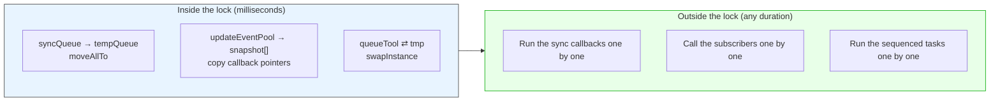

# LF_SwapUnderLock.md

> Chinese version: [LF_SwapUnderLock.md](LF_SwapUnderLock.md)

> Anywhere the LF core needs to "iterate while holding a lock" it never really iterates inside the lock.
>
> It always first **swaps the whole queue into a temporary empty container** inside the lock (`moveAllTo` / `swapInstance` / a `snapshot` copy), releases the lock, and then leisurely processes whatever is in the temporary container. This pattern recurs in `Check_Synchronize`, `Do_LFRegEvent` and `Sequence_Thread.Do_Run_Th`, and is the most consistent design decision in LF: **the lock only takes ownership, it never does the work**.



| What you assume | What actually happens |
|---------|-----------|
| Iterate while holding the lock, callbacks run inside the lock | The lock only swaps containers; all callbacks run outside |
| `moveAllTo` / `swapInstance` are copies | Both are O(1) pointer swaps; no nodes moved, no data copied |
| `snapshot` deep-copies the callback objects | Only the `OnUpdate` function pointers are copied into an array, not the objects |
| The lock granularity is "process the whole batch" | The lock granularity is "swap a pointer", usually tens of clock cycles |

**Why do this**: because callbacks very likely touch the same container again. `OnUpdate` may call `Subscribe_Update` / `Remove_Update` (mutating `updateEventPool`), sequenced tasks may call `post_notify` (mutating `queueTool`), and a sync callback may trigger a new `Synchronize` (mutating `syncQueue`). Iterating under the lock means the callback deadlocks the moment it touches its own container. **Swapping containers decouples iteration from mutation** — the lock takes ownership of the old container while callbacks modify the new one, and the two never interfere.

**Cost**: at the peak moment two containers live in memory. `tempQueue` is an empty list, `snapshot` is an array of pointers, `tmp` is an empty order struct — all small, but they exist. What you get in return is freedom for callbacks to manipulate the container without deadlocking.

**One consequence**: `Remove_Update(self)` inside a `Do_LFRegEvent` callback is safe, `post_notify2` inside a `Do_Run_Th` task is safe, and issuing another `Synchronize` inside a `Check_Synchronize` callback is safe. These "looks like it should deadlock" operations are all carried by the "swap the container inside the lock" trick. Conversely, anything newly enqueued while iterating outside the lock must wait for the next cycle — **that batch is not lost, but it is not processed in the current round either**, so high-frequency callbacks exhibit "batch processing, always one beat behind".

---

## What the pattern looks like

Sketching the skeleton in C++ pseudo-code is more direct than prose:

```cpp
// ─────────────────────────────────────────────────────────
// Anti-pattern: iterate under the lock (will deadlock)
// ─────────────────────────────────────────────────────────
void bad_process() {
    std::lock_guard lk(mtx);
    for (auto& item : queue) {         // ← iteration inside the lock
        item.callback();                // ← callback inside the lock
        // if the callback calls subscribe() / unsubscribe(),
        // it will try to take the same mtx → self-deadlock
    }
}

// ─────────────────────────────────────────────────────────
// Correct pattern: swap the container inside the lock, work outside
// ─────────────────────────────────────────────────────────
void good_process() {
    std::deque<Item> local;             // ← local temporary container

    // (1) do exactly one thing inside the lock: swap the whole queue into local
    {
        std::lock_guard lk(mtx);
        local.swap(queue);              // ← O(1), no nodes moved
    }

    // (2) process local leisurely outside the lock
    for (auto& item : local) {
        item.callback();                // ← the callback may take locks freely
    }

    // local is emptied on destruction; queue stays empty awaiting the next batch
}
```

Python version (a Python `list` has no `swap`, but `local = queue; queue = []` gives equivalent semantics):

```python
import threading

class SwapUnderLock:
    def __init__(self):
        self._mtx = threading.Lock()
        self._queue = []

    def enqueue(self, item):
        with self._mtx:
            self._queue.append(item)

    def process_all(self):
        # (1) swap the container inside the lock: O(1), just rebinds the reference
        with self._mtx:
            local, self._queue = self._queue, []

        # (2) process leisurely outside the lock
        for item in local:
            item.callback()             # the callback may enqueue again without deadlocking

    def subscribe(self, cb):
        with self._mtx:
            self._queue.append(Subscriber(cb))
```

---

## Three flavours of the swap

LF has three concrete shapes of "swap the container inside the lock", each with its own purpose:

### Shape 1: swap the whole queue away (`moveAllTo` / `swap`)

Use case: **pending tasks / events / notifications**. Producers enqueue continuously; the consumer takes the whole batch periodically.

```cpp
// A typical implementation on the C++ side
void drain_queue() {
    std::deque<Task> local;
    {
        std::lock_guard lk(mtx);
        local.swap(queue);
    }
    for (auto& t : local) t.run();
}
```

```python
# A typical implementation on the Python side
def drain_queue(self):
    with self._mtx:
        local, self._queue = self._queue, []
    for t in local:
        t.run()
```

**Characteristic**: the old container is emptied inside the lock and newly arriving tasks go into the new container, so the two batches never clash. This is where "batch processing" comes from.

### Shape 2: copy callback pointers into a snapshot (`snapshot`)

Use case: **subscriber pools / observer lists**. Subscribers are few and callbacks short, but a callback may add or remove subscribers.

```cpp
void notify_all_observers() {
    std::vector<Observer*> snapshot;
    {
        std::lock_guard lk(mtx);
        snapshot.assign(observers.begin(), observers.end());  // ← copy pointers only
    }
    // call outside the lock
    for (auto* o : snapshot) {
        o->on_update();
        // even if on_update unsubscribes some observer it does not matter —
        // the snapshot is already copied, so this round's list is unaffected
    }
}
```

```python
def notify_all_observers(self):
    with self._mtx:
        snapshot = list(self._observers)     # copy references only
    for o in snapshot:
        o.on_update()
```

**Characteristic**: `snapshot` is a **shallow copy** — pointers only, never objects. So even if a callback `unsubscribe`s an observer, that only removes it from the main container while the entry in `snapshot` remains; this round still calls it and the next round will not. Many event systems adopt this semantic.

### Shape 3: swap the whole container for an empty object (`swapInstance`)

Use case: **queue swapping in a sequenced thread** (see `LF_Sequenced_FIFO.md`). Producers enqueue via `post_*` and the consumer thread swaps the entire queue away.

```cpp
// Consumer loop of a sequenced thread on the C++ side
void run_sequence_thread() {
    std::deque<Job> tmp;
    while (active) {
        {
            std::lock_guard lk(mtx);
            tmp.swap(jobs);               // swap away all pending jobs
        }
        for (auto& j : tmp) j.execute();
        tmp.clear();
        std::this_thread::sleep_for(std::chrono::milliseconds(10));
    }
}
```

```python
# Consumer loop of a sequenced thread on the Python side
def run_sequence_thread(self):
    while self._active:
        with self._mtx:
            tmp, self._jobs = self._jobs, []
        for j in tmp:
            j.execute()
        time.sleep(0.01)
```

**Characteristic**: `tmp` is a **long-lived empty container**; each round swaps in the current batch, processes it, clears it, and swaps again next round. This is the classic implementation of the "one batch per round" model.

---

## Side effects of the pattern

### Side effect 1: newly enqueued tasks are "one beat behind"

This is the most direct manifestation. Suppose 100 tasks sit in the queue when the round begins; after the swap, the producer stuffs in another 50. The round only processes the 100 swapped away, and the 50 wait for the next round.

**Symptom**: high-frequency callbacks show "batch processing, each batch steady, but the latency from enqueue to processing is always two rounds". That is not a bug; it is a necessary result of the pattern.

**Mitigation**: if you need "process on enqueue", do not use whole-batch swapping; instead take one item under the lock and process it outside:

```cpp
// Take one at a time, process, then take the next
void drain_one_by_one() {
    while (true) {
        Task t;
        {
            std::lock_guard lk(mtx);
            if (queue.empty()) break;
            t = std::move(queue.front());
            queue.pop_front();
        }
        t.run();
    }
}
```

Latency is lower but every item costs a lock/unlock, so throughput is slightly lower. Choose according to your scenario.

### Side effect 2: two containers at the peak moment

After the swap, `local` and `queue` coexist — `queue` is empty but the underlying container object itself still exists. For `std::deque` those are two independent objects; for a linked list they are just two head pointers. The memory overhead is small, but be aware it exists.

### Side effect 3: iteration order may differ from "the true current order"

If you use `moveAllTo` to swap the whole queue away, `local` holds the order "at the instant of the swap". Tasks the producer enqueues outside the lock afterwards are not in that `local` — their order is "the order inside the new container" and unrelated to the old batch.

For a sequenced thread this is fine (each batch is FIFO independently), but if the application layer expects "global FIFO", watch out for this boundary.

---

## When not to use this pattern

**Not every locked scenario suits container swapping**. Ordinary locks suffice for:

- **Single operations**: `lock(); do_one_thing(); unlock()` — no iteration, so no "mutate while iterating" problem
- **Read-only access**: reading a counter or a boolean — a read lock or an atomic variable will do
- **Tiny containers with very short callbacks**: the swap overhead (allocating a temporary container, O(1) pointer swap) may exceed just running under the lock

**The test**: ask yourself — **"will the callback touch this container again?"** If yes, you must swap; if no, an ordinary lock is enough.

---

## Pitfall quick reference

| Symptom | Root cause | Fix |
|------|------|------|
| Deadlock as soon as a callback calls `unsubscribe` | Iterating under the lock | Swap the container inside the lock, iterate outside |
| New tasks processed "one beat behind" | Inherent to whole-batch swapping | Accept it, or switch to "take one at a time" |
| Peak memory doubles | Two containers coexist | Normal; the containers themselves are tiny |
| Tasks added during iteration are lost | You assumed the code rescans outside the lock | It does not; new tasks wait for the next round |
| `snapshot` calls an already `unsubscribe`d observer | The snapshot is a shallow copy | This is the intended semantic, not a bug |
| Throughput drops after switching to "take one at a time" | A lock/unlock per item | Weigh latency against throughput |

---

## Final word

This "swap the container inside the lock" pattern in the LF core looks like deadlock avoidance on the surface, but in substance it separates **"who owns this batch of data"** from the lock — the lock only **grabs ownership** (an O(1) swap), and the work itself happens outside, so nobody blocks anybody.

With that understood, every lock-related place in LF looks the same: **swap the pointer inside the lock, take your time outside**.


