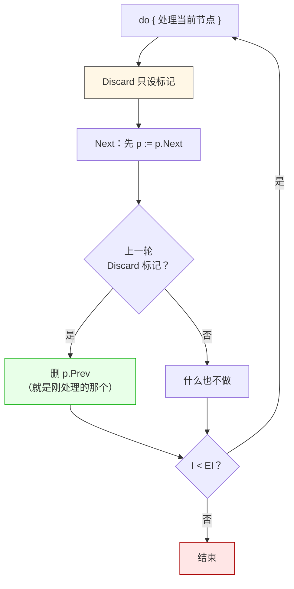

# LF_TBigList_Iterator.md

> LF 内核里所有的池——发送队列、数据池、顺序线程队列、哈希桶——底层都是同一种链表容器，而它的迭代器有个反直觉的设计：`Next` 是**先移动指针再判断是否结束**，不是先判断再移动。这意味着 `while (it.Next())` 会跳过首节点，而 `do { process(it.Data); } while (it.Next());` 才是对的写法。这个设计不是 bug，是为了让 `Discard`（迭代中删除）能安全实现——`Discard` 只设一个标记，真正删除发生**下一次 `Next`** 的内部，此时迭代器已经移到下一个节点，删的是"前一个"，迭代状态不受影响。这也是为什么 LF 内核里所有遍历都长成 `repeat ... until not Next` 的形态——不是风格偏好，是唯一正确的写法。



| 你以为的 | 实际发生的 |
|---------|-----------|
| `while (Next())` 能遍历全部 | **漏首节点**，`p` 一开始就在 `First`，`Next` 一调用就移到 `Second` |
| `Discard` 立即删除节点 | 只设 `Is_Discard = True`，删除发生在**下一次 `Next`** 里 |
| 回收池是"节点复用池" | 是**延迟删除队列**，`Push_To_Recycle_Pool` 只标记不删，`Free_Recycle_Pool` 才真删 |
| `Remove_Data` 立即删 | 先 `Push_To_Recycle_Pool` 标记所有匹配，再 `Free_Recycle_Pool` 统一释放 |
| `Add` 从回收池取节点 | **不取**，直接 `new(p)`，回收池里的节点只在 `Free_Recycle_Pool` 时才被 `Dispose` |

**代价**：`Push_To_Recycle_Pool` 之后节点**还在链表里**，只是标了 `Recycle = True`。这意味着"我标记了但还没 `Free_Recycle_Pool`"的窗口期内，这个节点仍然能被 `Find` / 遍历命中。这也是为什么 LF 内核里凡是"批量删除"都长成 `先遍历标记 → 再 Free_Recycle_Pool`——两次遍历之间不能有外部访问。

**一个后果**：线程安全版的迭代也**必须外部加锁**，只是加了锁之后 `Discard` 才能正常工作——不加锁就直接崩。

---

## 用一个具体实现把语义说清楚

上面那张图讲的是"行为"，但"为什么 `Next` 要先移动再判断"这件事，只看文字容易绕。下面用 C++ 写一个最小化的链表迭代器，把 LF 的真实语义复现出来。

### 节点结构

```cpp
struct Node {
    int  data;
    Node* prev;
    Node* next;
    bool  is_discard = false;   // Discard 只设这个标记
};

struct BigList {
    Node* first = nullptr;
    Node* last  = nullptr;
    Node* recycle_head = nullptr;   // 延迟删除队列的头
};
```

### 迭代器：`Next` 先移动再判断

```cpp
class Iter {
public:
    Node* current;          // 指向"当前处理到的节点"
    Node* first;            // 边界：从 first 开始
    Node* last;             // 边界：到 last 结束

    Iter(BigList& list) : current(nullptr), first(list.first), last(list.last) {}

    // ─────────────────────────────────────────────────
    // 关键语义：Next 先移动，再判断
    // ─────────────────────────────────────────────────
    bool Next() {
        // ① 先处理"上一轮 Discard 的标记"
        //    如果当前节点标了 discard，现在才真正删它
        if (current && current->is_discard) {
            Node* dead = current;
            // 从链表上摘掉 dead
            if (dead->prev) dead->prev->next = dead->next;
            else            first = dead->next;       // dead 是首节点
            if (dead->next) dead->next->prev = dead->prev;
            else            last  = dead->prev;       // dead 是末节点

            Node* next = dead->next;
            delete dead;
            current = next;
            return current != nullptr && current != last->next;
        }

        // ② 正常的移动逻辑
        if (current == nullptr) {
            current = first;                          // 首次调用：跳到首节点
        } else {
            current = current->next;                  // 后续调用：前进一个
        }

        return current != nullptr;
    }

    int Data() const { return current ? current->data : 0; }

    // Discard 只设标记，真正删除延后到下一次 Next
    void Discard() {
        if (current) current->is_discard = true;
    }
};
```

### 正确 vs 错误遍历

```cpp
// ────────────────────────────────────────────────────────
// ❌ 错误：do-while 之前的 while(Next) 会漏首节点
// ────────────────────────────────────────────────────────
void bad_traverse(BigList& list) {
    Iter it(list);
    while (it.Next()) {                // ← 第一次调用就跳到了 Second
        process(it.Data());            //    首节点永远不会被处理
    }
}

// ────────────────────────────────────────────────────────
// ✅ 正确：do-while 先处理再前进
// ────────────────────────────────────────────────────────
void good_traverse(BigList& list) {
    Iter it(list);
    do {
        process(it.Data());            // ← 先处理当前节点
    } while (it.Next());               // ← 再前进
}

// ────────────────────────────────────────────────────────
// ✅ 正确：迭代中删除（安全）
// ────────────────────────────────────────────────────────
void traverse_with_discard(BigList& list) {
    Iter it(list);
    do {
        if (should_remove(it.Data())) {
            it.Discard();              // ← 只标标记，节点还活着
        } else {
            process(it.Data());
        }
    } while (it.Next());               // ← 下一轮 Next 才真正删
}
```

### Python 版本的等价语义

Python 没有指针，但用 `__next__` 协议的生成器把同样的语义复现出来，能让 Python 读者理解"为什么先移动再判断"这个设计。

```python
class Node:
    __slots__ = ("data", "prev", "next", "is_discard")
    def __init__(self, data):
        self.data = data
        self.prev = None
        self.next = None
        self.is_discard = False


class BigListIterator:
    """
    语义：Next 先移动指针，再判断是否结束。

    与 LF 的真实实现对应：
      - Discard 只设标记，真正删除延后到下一次 Next
      - 首次 Next 跳到 first（不是跳到 first.next）
      - while(Next) 会漏首节点，必须 do-while 形态
    """
    def __init__(self, big_list):
        self._list = big_list
        self._current = None     # 当前处理节点
        self._first = big_list.first
        self._last  = big_list.last
        self._started = False

    def next(self) -> bool:
        # ① 处理上一轮的 Discard 标记
        if self._current and self._current.is_discard:
            dead = self._current
            if dead.prev:
                dead.prev.next = dead.next
            else:
                self._first = dead.next
            if dead.next:
                dead.next.prev = dead.prev
            else:
                self._last = dead.prev

            self._current = dead.next
            return self._current is not None

        # ② 正常移动
        if not self._started:
            self._current = self._first
            self._started = True
        else:
            self._current = self._current.next
        return self._current is not None

    def data(self):
        return self._current.data if self._current else None

    def discard(self):
        # 只设标记，不立即删除
        if self._current:
            self._current.is_discard = True


# ─────────────────────────────────────────────
# ❌ 错误：while 会漏首节点
# ─────────────────────────────────────────────
def bad_traverse(big_list):
    it = BigListIterator(big_list)
    while it.next():
        process(it.data())          # 首节点永远不处理


# ─────────────────────────────────────────────
# ✅ 正确：先处理再前进
# ─────────────────────────────────────────────
def good_traverse(big_list):
    it = BigListIterator(big_list)
    # Python 没有 do-while，用首次手动调用 + while 模拟
    if it.next():                    # 首次跳到 first
        while True:
            process(it.data())
            if not it.next():
                break


# ─────────────────────────────────────────────
# ✅ 正确：迭代中删除
# ─────────────────────────────────────────────
def traverse_with_discard(big_list):
    it = BigListIterator(big_list)
    if it.next():
        while True:
            if should_remove(it.data()):
                it.discard()         # 只标标记
            else:
                process(it.data())
            if not it.next():
                break
```

---

## 延迟删除为什么必须这样设计

如果把 `Discard` 改成"立即删除"，会在迭代过程中出现两个问题：

**问题 1：下一轮的 `Next` 找不到下一个节点**

```
遍历到 C，C 标了 Discard
如果立即删 C：
   A → B → [C 被删] → D
   迭代器还指向 C（已释放）
   下一轮 Next 的 `current = current->next` 访问已释放内存 → 崩溃
```

**问题 2：`Remove_Data` 的批量删除会破坏遍历**

`Remove_Data` 的实现是"遍历标记 → `Free_Recycle_Pool` 统一释放"。如果标记即删，遍历过程中链表结构一直在变，`current->next` 可能指向已释放节点。

**延迟删除把两个问题都解决了**：

- `Discard` 只设标记，链表结构不变，遍历安全
- 真正删除在下一次 `Next` 内部，此时迭代器已经移到下一节点（通过 `current = current->next`），"删前一个"不影响"当前位置"
- 批量删除分两步：先全部标记，再统一释放，中间不让外部访问

---

## 两个池的关系

LF 里有**两个**跟删除相关的概念，名字很像但作用不同：

| 概念 | 作用 | 时机 |
|------|------|------|
| `Discard` 标记 | 标记"这个节点该删了" | 迭代过程中随时 |
| 回收池（`Recycle_Pool`） | 延迟删除队列，`Push_To_Recycle_Pool` 只标记，`Free_Recycle_Pool` 才真删 | 批量删除场景 |

**关键点**：`Add` **不从回收池取节点**。每次 `Add` 直接 `new(p)`，回收池里的节点只在 `Free_Recycle_Pool` 时才被 `Dispose`。这就意味着：

- 回收池不是"节点复用池"，是"待销毁队列"
- 长时间不 `Free_Recycle_Pool`，节点数会一直涨
- `Push_To_Recycle_Pool` 之后节点还在链表里，还能被 `Find` / 遍历命中

---

## 线程安全与外部锁

`Discard` 内部的删除操作**不加锁**（`Remove_P(p->prev, false)`，`Lock=false`）。这意味着：

- 单线程遍历 + Discard：安全，无需加锁
- 多线程同时遍历同一个链表：**必须外部加锁**，否则 `Discard` 里的指针操作会跟另一个线程的 `Add` / `Remove` 竞态

LF 内核里凡是跨线程访问的链表，都有一把外部锁保护。`Discard` 只是把"延迟删除"这个语义塞进了"已经持有外部锁"的场景里——它不负责保护链表，只负责在锁内标记。

### C++ 侧的正确用法

```cpp
class ThreadSafeList {
    BigList list_;
    std::mutex mtx_;
public:
    void traverse_and_discard() {
        std::lock_guard lk(mtx_);              // ← 外部锁
        Iter it(list_);
        do {
            if (should_remove(it.Data())) {
                it.Discard();                  // 只设标记
            } else {
                process(it.Data());
            }
        } while (it.Next());                   // 下一轮 Next 才真正删
    }

    void batch_remove(const std::function<bool(int)>& pred) {
        std::lock_guard lk(mtx_);
        // ① 先遍历标记
        Iter it(list_);
        do {
            if (pred(it.Data())) it.Discard();
        } while (it.Next());
        // ② 再统一释放（如果用的是回收池模式）
        // free_recycle_pool_locked();
    }
};
```

### Python 侧的正确用法

```python
import threading

class ThreadSafeList:
    def __init__(self):
        self._list = BigList()
        self._mtx = threading.Lock()

    def traverse_and_discard(self):
        with self._mtx:                        # ← 外部锁
            it = BigListIterator(self._list)
            if it.next():
                while True:
                    if should_remove(it.data()):
                        it.discard()
                    else:
                        process(it.data())
                    if not it.next():
                        break

    def batch_remove(self, pred):
        with self._mtx:
            it = BigListIterator(self._list)
            if it.next():
                while True:
                    if pred(it.data()):
                        it.discard()
                    if not it.next():
                        break
            # 再统一释放
            # self._list.free_recycle_pool()
```

---

## 陷阱速查

| 症状 | 根因 | 修复 |
|------|------|------|
| 遍历时首节点被漏掉 | `while (Next())` 先移动再判断 | 用 `do { process; } while (Next())` |
| `Discard` 后节点还在 | 延迟删除，等下一次 `Next` | 正常；停止迭代后调 `Free_Recycle_Pool` |
| 迭代中新增的节点被跳过 | `Next` 用的是当前指针，新增节点在链表尾部 | 下次遍历能看到；本轮不保证 |
| 批量删除后能 `Find` 到已删节点 | 标记了但没 `Free_Recycle_Pool` | 标记完立刻 `Free_Recycle_Pool` |
| 多线程遍历时偶发崩溃 | `Discard` 不加锁 | 外部加锁保护整个遍历 |
| 内存不下降 | 回收池里的节点没释放 | 定期 `Free_Recycle_Pool` |
| `Add` 没复用回收池的节点 | 设计如此，`Add` 直接 `new` | 不是 bug；想复用自己实现 |

---

## 最后一句

`TBigList` 的迭代器设计，表面上看是"`Next` 语义反直觉"，实质上是**把"遍历"和"删除"这两件互相冲突的事拆开**——遍历只负责前进，删除只负责标记，真正的删除延后到下一轮前进时。这样遍历过程中链表结构永远不变，`Discard` 才能在任何时刻被安全调用。

理解了这一点，`do { ... } while (Next())` 这个"看着别扭"的写法就变成唯一正确的写法了——它不是风格，是这个设计的必然结果。
