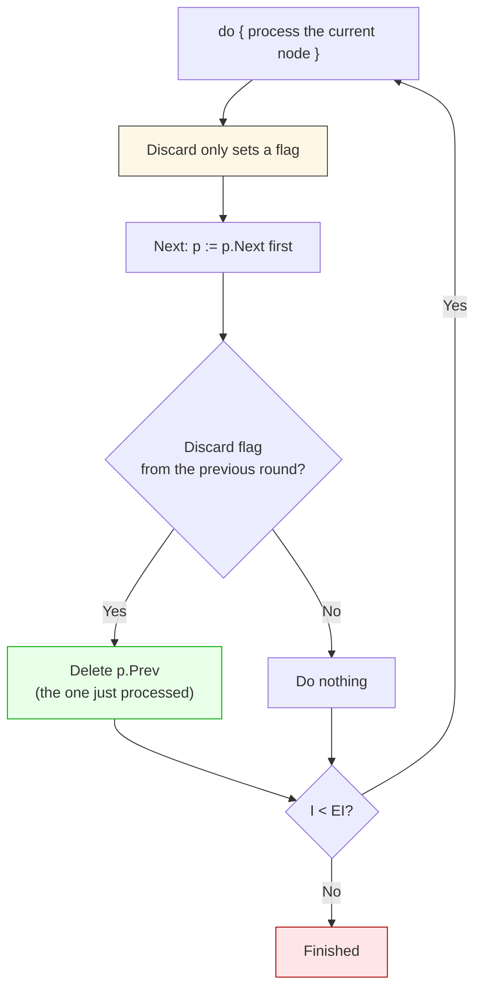

# LF_TBigList_Iterator.md

> Chinese version: [LF_TBigList_Iterator.md](LF_TBigList_Iterator.md)

> Every pool in the LF core — the send queue, the data pool, sequenced thread queues, hash buckets — sits on the same linked-list container, and its iterator has a counter-intuitive design: `Next` **moves the pointer first and then decides whether we are done**, not the other way round. That means `while (it.Next())` skips the first node, and `do { process(it.Data); } while (it.Next());` is the only correct form. This is not a bug; it exists so that `Discard` (delete-during-iteration) can be implemented safely — `Discard` only sets a flag, the real deletion happens inside the **next `Next`**, at which point the iterator has already moved on and what gets deleted is "the previous one", leaving the iteration state untouched. That is also why every traversal in the LF core takes the form `repeat ... until not Next` — not a stylistic preference but the only correct way to write it.



| What you assume | What actually happens |
|---------|-----------|
| `while (Next())` traverses everything | **The first node is skipped**; `p` starts at `First`, and one `Next` call moves it to `Second` |
| `Discard` deletes the node immediately | It only sets `Is_Discard = True`; deletion happens inside the **next `Next`** |
| The recycle pool is a "node reuse pool" | It is a **deferred-deletion queue**; `Push_To_Recycle_Pool` only marks, `Free_Recycle_Pool` really deletes |
| `Remove_Data` deletes immediately | It first `Push_To_Recycle_Pool`-marks all matches, then `Free_Recycle_Pool` releases them in one sweep |
| `Add` takes nodes from the recycle pool | **It does not**; it just `new(p)`. Pooled nodes are only `Dispose`d at `Free_Recycle_Pool` time |

**Cost**: after `Push_To_Recycle_Pool` the node **is still in the list**, merely flagged `Recycle = True`. That means during the window "marked but `Free_Recycle_Pool` not yet called" the node can still be hit by `Find` or traversal. That is why every "batch deletion" in the LF core reads as `traverse and mark → then Free_Recycle_Pool` — no external access may interleave the two passes.

**One consequence**: the thread-safe variant of iteration **still requires an external lock**; only with the lock does `Discard` work at all — without it you simply crash.

---

## Making the semantics explicit with a concrete implementation

The diagram above describes behaviour, but "why `Next` moves before checking" is easy to get lost in when reading prose. Below is a minimal C++ linked-list iterator reproducing LF's real semantics.

### Node structure

```cpp
struct Node {
    int  data;
    Node* prev;
    Node* next;
    bool  is_discard = false;   // Discard only sets this flag
};

struct BigList {
    Node* first = nullptr;
    Node* last  = nullptr;
    Node* recycle_head = nullptr;   // head of the deferred-deletion queue
};
```

### Iterator: `Next` moves first, then checks

```cpp
class Iter {
public:
    Node* current;          // points at "the node currently being processed"
    Node* first;            // boundary: start at first
    Node* last;             // boundary: end at last

    Iter(BigList& list) : current(nullptr), first(list.first), last(list.last) {}

    // ─────────────────────────────────────────────────
    // Key semantics: Next moves first, then checks
    // ─────────────────────────────────────────────────
    bool Next() {
        // (1) handle the Discard flag left by the previous round first
        //     if the current node is flagged discard, delete it only now
        if (current && current->is_discard) {
            Node* dead = current;
            // unlink dead from the list
            if (dead->prev) dead->prev->next = dead->next;
            else            first = dead->next;       // dead was the first node
            if (dead->next) dead->next->prev = dead->prev;
            else            last  = dead->prev;       // dead was the last node

            Node* next = dead->next;
            delete dead;
            current = next;
            return current != nullptr && current != last->next;
        }

        // (2) normal advancement
        if (current == nullptr) {
            current = first;                          // first call: jump to the first node
        } else {
            current = current->next;                  // later calls: advance by one
        }

        return current != nullptr;
    }

    int Data() const { return current ? current->data : 0; }

    // Discard only sets a flag; the real deletion is deferred to the next Next
    void Discard() {
        if (current) current->is_discard = true;
    }
};
```

### Correct vs incorrect traversal

```cpp
// ────────────────────────────────────────────────────────
// ❌ Wrong: while(Next) before do-while skips the first node
// ────────────────────────────────────────────────────────
void bad_traverse(BigList& list) {
    Iter it(list);
    while (it.Next()) {                // ← the very first call jumps to Second
        process(it.Data());            //    the first node is never processed
    }
}

// ────────────────────────────────────────────────────────
// ✅ Correct: do-while processes first, then advances
// ────────────────────────────────────────────────────────
void good_traverse(BigList& list) {
    Iter it(list);
    do {
        process(it.Data());            // ← process the current node first
    } while (it.Next());               // ← then advance
}

// ────────────────────────────────────────────────────────
// ✅ Correct: deletion during iteration (safe)
// ────────────────────────────────────────────────────────
void traverse_with_discard(BigList& list) {
    Iter it(list);
    do {
        if (should_remove(it.Data())) {
            it.Discard();              // ← flag only; the node is still alive
        } else {
            process(it.Data());
        }
    } while (it.Next());               // ← the next Next really deletes it
}
```

### Equivalent Python semantics

Python has no pointers, but the same semantics can be reproduced with a `__next__`-style generator, which lets Python readers understand "why move before checking".

```python
class Node:
    __slots__ = ("data", "prev", "next", "is_discard")
    def __init__(self, data):
        self.data = data
        self.prev = None
        self.next = None
        self.is_discard = False


class BigListIterator:
    """
    Semantics: Next moves the pointer first, then decides whether we are done.

    Mirrors LF's real implementation:
      - Discard only sets a flag; the real deletion is deferred to the next Next
      - The first Next jumps to first (not to first.next)
      - while(Next) skips the first node; the do-while form is mandatory
    """
    def __init__(self, big_list):
        self._list = big_list
        self._current = None     # current node
        self._first = big_list.first
        self._last  = big_list.last
        self._started = False

    def next(self) -> bool:
        # (1) handle the Discard flag from the previous round
        if self._current and self._current.is_discard:
            dead = self._current
            if dead.prev:
                dead.prev.next = dead.next
            else:
                self._first = dead.next
            if dead.next:
                dead.next.prev = dead.prev
            else:
                self._last = dead.prev

            self._current = dead.next
            return self._current is not None

        # (2) normal advancement
        if not self._started:
            self._current = self._first
            self._started = True
        else:
            self._current = self._current.next
        return self._current is not None

    def data(self):
        return self._current.data if self._current else None

    def discard(self):
        # flag only, no immediate deletion
        if self._current:
            self._current.is_discard = True


# ─────────────────────────────────────────────
# ❌ Wrong: while skips the first node
# ─────────────────────────────────────────────
def bad_traverse(big_list):
    it = BigListIterator(big_list)
    while it.next():
        process(it.data())          # the first node is never processed


# ─────────────────────────────────────────────
# ✅ Correct: process first, then advance
# ─────────────────────────────────────────────
def good_traverse(big_list):
    it = BigListIterator(big_list)
    # Python has no do-while; emulate with a first manual call plus while
    if it.next():                    # first jump to first
        while True:
            process(it.data())
            if not it.next():
                break


# ─────────────────────────────────────────────
# ✅ Correct: deletion during iteration
# ─────────────────────────────────────────────
def traverse_with_discard(big_list):
    it = BigListIterator(big_list)
    if it.next():
        while True:
            if should_remove(it.data()):
                it.discard()         # flag only
            else:
                process(it.data())
            if not it.next():
                break
```

---

## Why deferred deletion is mandatory

If `Discard` deleted immediately, two problems would arise during iteration:

**Problem 1: the next `Next` cannot find the successor**

```
Iterating reaches C, C is flagged Discard
If C were deleted immediately:
   A → B → [C deleted] → D
   The iterator still points at C (already freed)
   The next Next runs `current = current->next` over freed memory → crash
```

**Problem 2: batch deletion in `Remove_Data` would break the traversal**

`Remove_Data` is implemented as "traverse and mark → `Free_Recycle_Pool` releases in one sweep". If marking meant deleting, the list structure would change continuously during traversal and `current->next` could point at a freed node.

**Deferred deletion solves both**:

- `Discard` only sets a flag, the list structure is unchanged, traversal is safe
- The real deletion happens inside the next `Next`, by which point the iterator has already advanced (`current = current->next`), so "deleting the previous one" does not affect "the current position"
- Batch deletion is two steps: mark everything, then release in one sweep, with no external access in between

---

## The relationship between the two pools

LF has **two** deletion-related concepts with similar names but different roles:

| Concept | Role | Timing |
|------|------|------|
| The `Discard` flag | Marks "this node should go" | Anytime during iteration |
| The recycle pool (`Recycle_Pool`) | A deferred-deletion queue; `Push_To_Recycle_Pool` only marks, `Free_Recycle_Pool` really deletes | Batch deletion scenarios |

**Key point**: `Add` **never takes nodes from the recycle pool**. Each `Add` just `new(p)`; pooled nodes are only `Dispose`d at `Free_Recycle_Pool` time. This means:

- The recycle pool is not a "node reuse pool" but a "queue awaiting destruction"
- Without a `Free_Recycle_Pool` for a long time the node count keeps growing
- After `Push_To_Recycle_Pool` the node is still in the list and can still be hit by `Find` / traversal

---

## Thread safety and the external lock

The deletion inside `Discard` **takes no lock** (`Remove_P(p->prev, false)`, `Lock=false`). That means:

- Single-threaded traversal + Discard: safe, no locking needed
- Several threads traversing the same list: **an external lock is mandatory**, otherwise the pointer operations inside `Discard` race against another thread's `Add` / `Remove`

Every cross-thread list in the LF core is protected by an external lock. `Discard` merely folds the "deferred deletion" semantic into a scenario that already holds the external lock — it does not protect the list, it only marks under the lock.

### Correct usage on the C++ side

```cpp
class ThreadSafeList {
    BigList list_;
    std::mutex mtx_;
public:
    void traverse_and_discard() {
        std::lock_guard lk(mtx_);              // ← external lock
        Iter it(list_);
        do {
            if (should_remove(it.Data())) {
                it.Discard();                  // flag only
            } else {
                process(it.Data());
            }
        } while (it.Next());                   // the next Next really deletes it
    }

    void batch_remove(const std::function<bool(int)>& pred) {
        std::lock_guard lk(mtx_);
        // (1) traverse and mark first
        Iter it(list_);
        do {
            if (pred(it.Data())) it.Discard();
        } while (it.Next());
        // (2) then release in one sweep (if the recycle-pool model is used)
        // free_recycle_pool_locked();
    }
};
```

### Correct usage on the Python side

```python
import threading

class ThreadSafeList:
    def __init__(self):
        self._list = BigList()
        self._mtx = threading.Lock()

    def traverse_and_discard(self):
        with self._mtx:                        # ← external lock
            it = BigListIterator(self._list)
            if it.next():
                while True:
                    if should_remove(it.data()):
                        it.discard()
                    else:
                        process(it.data())
                    if not it.next():
                        break

    def batch_remove(self, pred):
        with self._mtx:
            it = BigListIterator(self._list)
            if it.next():
                while True:
                    if pred(it.data()):
                        it.discard()
                    if not it.next():
                        break
            # then release in one sweep
            # self._list.free_recycle_pool()
```

---

## Pitfall quick reference

| Symptom | Root cause | Fix |
|------|------|------|
| The first node is skipped during traversal | `while (Next())` moves before checking | Use `do { process; } while (Next())` |
| The node is still there after `Discard` | Deferred deletion awaits the next `Next` | Normal; call `Free_Recycle_Pool` after you stop iterating |
| Nodes added during iteration are skipped | `Next` uses the current pointer; new nodes sit at the tail | Visible next traversal; not guaranteed this round |
| `Find` still locates a deleted node after batch removal | Marked but `Free_Recycle_Pool` never ran | Call `Free_Recycle_Pool` right after marking |
| Occasional crashes during multi-threaded traversal | `Discard` takes no lock | Protect the whole traversal with an external lock |
| Memory never drops | Pooled nodes were never released | Call `Free_Recycle_Pool` periodically |
| `Add` does not reuse pooled nodes | By design, `Add` just calls `new` | Not a bug; implement reuse yourself if needed |

---

## Final word

The `TBigList` iterator design looks like "counter-intuitive `Next` semantics" but in substance **separates the two conflicting activities, iterating and deleting** — iteration only advances, deletion only marks, and the actual removal waits until the next advance. That keeps the list structure invariant throughout the traversal, which is what makes `Discard` safe at any moment.

Once this is clear, `do { ... } while (Next())` — the "awkward-looking" form — becomes the only correct one: not a style choice but a necessary consequence of the design.


