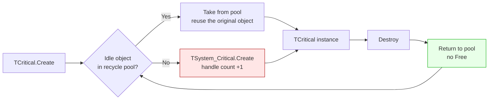

# LF_TCritical_Reuse.md

> Chinese version: [LF_TCritical_Reuse.md](LF_TCritical_Reuse.md)

> A counter-intuitive fact: create a hundred thousand `TCritical` instances inside LF and the operating-system handle count hardly moves.
>
> Because `TCritical` is **not** a thin wrapper around `TCriticalSection` — underneath it there is a recycle pool. On `Create` it first checks whether the pool holds an idle critical-section object, reuses it if so, and only really does `new` when the pool is empty; on `Destroy` it does not release immediately either, but **returns the underlying object to the pool**. So "create/destroy ten thousand times" looks to the system like "create/reuse the same critical-section object ten thousand times". That is why Z-series servers keep a constant handle count in Task Manager over long periods: the cost of locks is amortized onto the pool rather than pushed onto the operating system.

| What you assume | What actually happens |
|---------|-----------|
| `Create` = new a critical section | The pool is checked first; a hit is reused, only a miss really calls new |
| `Destroy` = release the critical section | The underlying object goes back to the pool; only the `TSystem_Critical` instance itself stays resident in the pool |
| Frequent create/destroy → handle count rises | Handle count stays flat; only the pool's high-water mark determines the real number of handles |
| `LNum` is a reference count | `LNum` is the **recursion count of the current instance**; before `Destroy` it runs `while LNum > 0 do Release` to force release |

**Cost**: `Get_System_Critical_Num` counts "instances ever created", not "handles currently held"; to learn actual occupancy look at `Get_System_Critical_Recycle_Pool_Num` (idle entries in the pool) and the difference between the two.

**One consequence**: `TCritical` is `sealed` — inheritance is not allowed. To add your own semantics you can only compose, never inherit.

