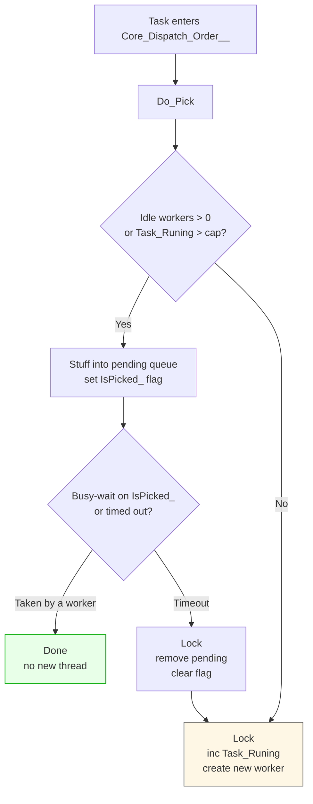

# LF_ThreadPool_Pick.md

> Chinese version: [LF_ThreadPool_Pick.md](LF_ThreadPool_Pick.md)

> When a task arrives, the thread pool **does not rush to create a thread**.
>
> The first thing `Do_Pick` in `TCore_Dispatch_Order_Thread` does is read `Core_Thread_Wait_Sum__.V` — if any idle worker is waiting for work, it stuffs the task into `Core_Thread_Dispatch_Queue_Pool__` (the pending queue) and then **busy-waits** for `IsPicked_` to be set or for a timeout. Only after confirming "there is no idle worker" or "the busy-wait timed out" does it `inc(Core_Thread_Task_Runing__)` and create a new worker. The point of this logic: **let idle workers absorb new tasks first, and only expand when they truly cannot keep up** — brute-force expansion instantly slams the thread count to the ceiling, after which a large batch of threads goes idle, kills itself one second later, and the churn is severe.

| What you assume | What actually happens |
|---------|-----------|
| A thread is created as soon as a task arrives | When an idle worker exists the task goes into the pending queue first, no thread is created |
| A thread is only created when no worker is idle | True, but "no idle" is a snapshot judgement and may coincide with a burst of simultaneous tasks |
| Once created, threads stay forever | A thread idle longer than `Core_Thread_Life_Time_Tick__` (default 1000 ms) exits automatically |
| `Core_Thread_Task_Runing__` is "currently active task count" | It is "currently active worker count", not task count |
| `Core_Thread_Wait_Sum__` is "queued task count" | It is "number of idle workers waiting to take work" — exactly the opposite semantics |

**Cost**: that "busy-wait on `IsPicked_` or timeout" is a non-blocking soft lock — `Do_Pick` waits and the worker thread waits, both polling at the 1 ms level. The cost is short bursts of spinning CPU; the gain is **coordination without any extra condition variable**. The timeout uses `Core_Thread_Life_Time_Tick__` (the same constant as the worker idle-exit), so "waiting for a worker to take it" and "a worker waiting for tasks" share one time scale and behave symmetrically.

**One consequence**: in `ParallelFor`, if tasks are split too finely (say each `ParallelFor` only splits into 2 threads), it easily triggers the "no idle worker → create new thread" path — the thread is created, the task finishes, the thread goes idle, a new task arrives shortly after, and the cycle repeats. That is why LF's `Parallel_Granularity__` defaults to 8 instead of the CPU core count — **create fewer threads and let existing ones do more work** is more stable than "matching the core count exactly".

