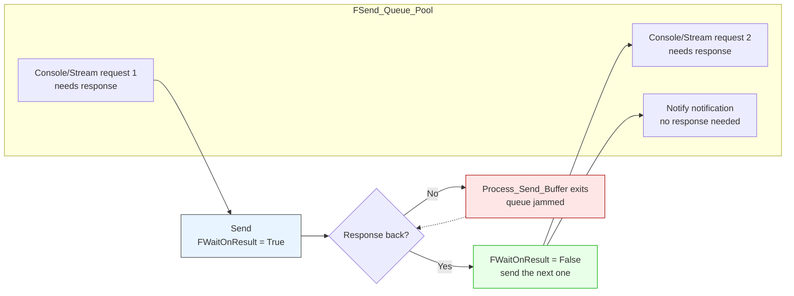

# LF_WaitOnResult.md

> Chinese version: [LF_WaitOnResult.md](LF_WaitOnResult.md)

> On one IO, **only one request-response may be in flight at any moment**.
>
> Every `TPeerIO` carries an `FWaitOnResult: TAtomVar<Boolean>`. `SendConsoleCmd` / `SendStreamCmd` set it to True before sending and clear it to False when the response comes back. The first line of every `Process_Send_Buffer` round checks it — if True it simply `exit`s and not a single remaining request in the queue is sent. So the queue does not "send in order"; it **jams completely after the first request goes out**, resuming only when the response returns. This is LF's request-response serialization: no complex task tracking, just one boolean flag.

| What you assume | What actually happens |
|---------|-----------|
| The queue sends requests one by one in order | **After the first one goes out the whole queue jams**, releasing the next only when the response returns |
| Notify and Call queue up together | Notify is **not subject to `FWaitOnResult`**; while a Call is stuck Notify cannot go out either (queue order), but it moves immediately once the Call response comes back |
| Multiple Calls can run concurrently | **No** — only one may be in flight per IO |
| This flag is reentrancy protection | No, it is **mandatory request-response serialization**; the two have different semantics |

**Cost**: on one connection, **throughput is capped by the slowest single round trip**. Want concurrency? Open more physical connections — that is one of the motivations behind the dual tunnel (Recv + Send) and P2PVM virtual multi-connection design. Or use `CompleteBuffer_NoWait_Stream`, which bypasses this flag.

**One consequence**: if `LF_Call` times out, `FWaitOnResult` does not reset itself. The only visible symptom of a timeout is the caller receiving a handle with size=0, while `FWaitOnResult` is still True — subsequent requests still cannot go out. That is why "after a timeout you must reconnect or reset" is a well-known requirement in LF: the source does not reset it for you. It is also why `Check_Param_And_Send_Queue` periodically sends `SendNULL` — `SendNULL` is a response-less notification used specifically to **probe whether the connection is still alive**; if the peer does not respond, the link is truly dead and can be safely disconnected.

