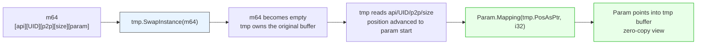

# LF_ZeroCopy_Decode.md

> Chinese version: [LF_ZeroCopy_Decode.md](LF_ZeroCopy_Decode.md)

> When `TMemory_Param_Tool.DecryptFromMem` splits a payload it **performs not a single memcpy**.
>
> It does not copy the business parameters out; instead it makes `Param` directly `Mapping` to some offset inside the source `TMem64` buffer. The trick is neat — `tmp.SwapInstance(m64)` **takes over the whole internal buffer** of the caller-supplied `m64` into `tmp`, then `tmp` reads forward through `apiName` / `FromUID` / `FromP2PName` / `Param.Size` while advancing its position to the start of the business parameters, and finally `Param.Mapping(tmp.PosAsPtr, i32)` — at which point `Param` becomes a view over that buffer, with the source buffer owned by `tmp`. The business parameters are never touched along the whole chain.

| What you assume | What actually happens |
|---------|-----------|
| Decoding copies the business parameters out | It goes through `Mapping` zero-copy; `Param` is only a view over the source buffer |
| `m64` is still usable after decoding | **It has been emptied by `SwapInstance`** and its content is gone |
| `Param` is an independent copy | Its lifetime is bound to `TMemory_Param_Tool` (that is, `tmp`) |
| `DecryptFromMem` does not modify the source | **It does**; outside `ProtectedMode` the source `m64` is swapped away |
| Same behaviour when `ProtectedMode = True` | **No** — that branch goes through `ReadPtr(Param.Memory, ...)` and performs a **real copy** |

**Why the `ProtectedMode` branch exists**: `m64.ProtectedMode = True` means the source buffer is a read-only mapping (something passed in via `SetPointerWithProtectedMode`) and must not be swapped — swapping means taking ownership, and a read-only thing should not be taken over. So that branch honestly reads and copies. `ProtectedMode = False` is the common case and goes zero-copy.

**Cost**: `Param`'s lifetime is bound to `TMemory_Param_Tool`. `TMemory_Param_Tool.Destroy` first calls `DisposeObject(Param)` (because `Param` is a view with `ProtectedMode = True` and does not free the buffer), then `DisposeObject(tmp)` (which really frees the buffer). The order must not be reversed.

**One consequence**: in `Execute_Call`, after `input_ := TLF_Data.New_Param_From(Memory_Param, False)`, if the business callback passes `input_` to another layer and that layer uses `DecryptFromMem` or otherwise consumes it — as long as this layer does not copy, the view stays valid; but once `input_` is freed, `Param` dangles. So reading `Input` inside the callback is safe, but **stuffing `Input` into an async queue for deferred consumption** will hit this problem.

