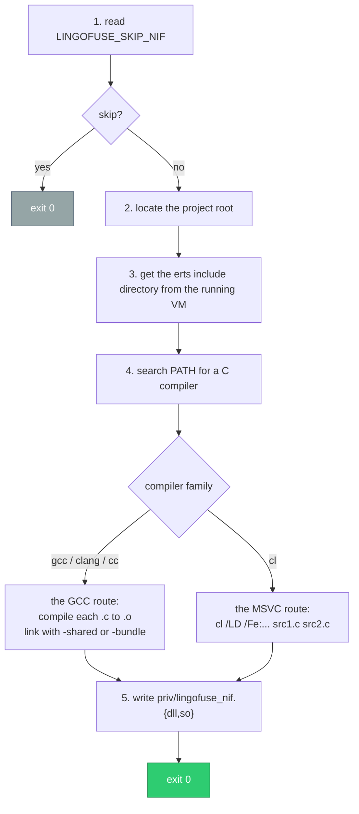

# LingoFuse Erlang binding

> Chinese version: [README.md](README.md)

The Erlang NIF binding for the [LingoFuse](https://github.com/PassByYou888/LingoFuse) distributed RPC framework.

Any function written in Pascal, Python, C++, C#, JavaScript, Rust or another language LingoFuse supports can be called directly from Erlang. Conversely, any Erlang function registered through this binding can be called by every other LingoFuse binding.

## Core features

- **Complete C ABI coverage.** All **59** exported LingoFuse functions are available, wrapped in RAII-style resource types.
- **Three addressing schemes.** App name, UID (a 32-byte session identifier) and P2PName (group-name load balancing), each offering synchronous call, asynchronous call, notification and sequenced notification.
- **Process-level P2P registration.** Independent of any App's global API namespace; registered through `register_p2p_call[_sync]` / `register_p2p_notify` and callable by any UID or P2PName.
- **Seamless asynchronous calls.** `lingofuse:async_call(App, Api, Payload, fun(Result) -> ... end)` — the call and the business callback in one line, with no pid, Ref, monitor or cleanup to manage.
- **Side-data identity.** Callbacks registered with `#{with_identity => true}` automatically extract the sender's UID and P2PName from the Input handle and deliver them as extra elements of the message.
- **16 pairs of typed options.** Typed versions such as `set_opt_quiet/1` / `get_opt_quiet/0` — the argument types are safe and option keys cannot be misspelled.
- **Unified JSON I/O.** Only one module (`lingofuse_json`) is permitted to encode and decode JSON, enforcing the cross-language wire contract: compact UTF-8, literal non-ASCII characters, NUL-terminated payloads.
- **A portable NIF build.** `c_src/build.escript` builds the NIF on Windows, Linux, macOS and BSD, automatically using whichever C compiler is available on the host (gcc, clang, cc or MSVC `cl`).
- **Zero runtime dependencies.** Built on the `json` module bundled with OTP 27+; no third-party Hex package is needed at runtime.

---

## Contents

1. [Requirements](#1-requirements)
2. [Setting up the environment](#2-setting-up-the-environment)
3. [Building](#3-building)
4. [Testing](#4-testing)
5. [Test project report](#5-test-project-report)
6. [Important information about the Erlang interface](#6-important-information-about-the-erlang-interface)
7. [Quick start](#7-quick-start)
8. [Merging LingoFuse into an existing project](#8-merging-lingofuse-into-an-existing-project)
9. [Compiling the NIF (c_src)](#9-compiling-the-nif-c_src)
10. [The cross-language wire format](#10-the-cross-language-wire-format)
11. [API quick reference](#11-api-quick-reference)
12. [Known limitations](#12-known-limitations)
13. [License](#13-license)

---

## 1. Requirements

| Component | Minimum version | Notes |
|------|----------|------|
| Erlang/OTP | 27 | verified on OTP 29 |
| rebar3 | 3.20 | shipped with the repository at the project root: `rebar3` and `rebar3.cmd` |
| C compiler | any one of gcc, clang, cc, cl | only needed to compile the NIF; see §9 |
| LingoFuse runtime | 3.10 or later | `LingoFuse64.dll` / `liblingofuse.so` / `liblingofuse.dylib` |
| PowerShell | 5.1 or later | only for the convenience scripts `build.ps1` / `check.ps1` / `test.ps1` / `clean.ps1` |

This binding covers the following platform / toolchain combinations:

| Platform | The C compiler `build.escript` uses |
|------|--------------------------------|
| Windows (x64) | `gcc` (MinGW-w64) → `clang` → `cc` → `cl` (MSVC) |
| Linux (x86_64 / aarch64) | `gcc` → `clang` → `cc` |
| macOS (x64 / arm64) | `clang` (Xcode command-line tools) → `gcc` → `cc` |
| FreeBSD / OpenBSD | `clang` → `cc` → `gcc` |

---

## 2. Setting up the environment

### 2.1 Installing Erlang/OTP

Install OTP 27 or later:

- **Windows**: the [Erlang/OTP installer](https://www.erlang.org/downloads) or
  `winget install Erlang.ErlangOTP`
- **Linux**: the distribution package, or the
  [Erlang Solutions repository](https://www.erlang-solutions.com/downloads/)
- **macOS**: `brew install erlang`

Verify:

```bash
erl -noshell -eval 'io:format("~s~n", [erlang:system_info(otp_release)]), halt().'
```

### 2.2 Getting rebar3

`rebar3` is a single escript. The repository root already provides it, together with the Windows
`rebar3.cmd` launcher:

```
erlang/
├── rebar3        (the escript itself)
└── rebar3.cmd    (the Windows launcher)
```

If these two files are missing after cloning, download them manually:

```bash
# Linux / macOS
curl -L -o rebar3 https://s3.amazonaws.com/rebar3/rebar3
chmod +x rebar3
```

```powershell
# Windows (PowerShell)
Invoke-WebRequest -Uri "https://s3.amazonaws.com/rebar3/rebar3" -OutFile "rebar3"
```

### 2.3 Placing the LingoFuse native runtime

The LingoFuse shared library must be on the operating system's loader search path **before** BEAM starts.

| Platform | Runtime library | Search-path variable |
|------|----------|--------------|
| Windows 64-bit | `LingoFuse64.dll` | `PATH` |
| Windows 32-bit | `LingoFuse32.dll` | `PATH` |
| Linux / BSD | `liblingofuse.so` | `LD_LIBRARY_PATH` |
| macOS | `liblingofuse.dylib` | `DYLD_LIBRARY_PATH` |

Its own dependencies must be on the same search path:

- `z_ipc_64.dll` (Windows) or `libz_ipc.so` / `libz_ipc.dylib` (Linux / macOS)
- the mimalloc allocator, if you use it

Windows example:

```powershell
$env:PATH += ";D:\CoreLibrary\LingoFuse\Binary"
```

Linux example:

```bash
export LD_LIBRARY_PATH="$LD_LIBRARY_PATH:/opt/lingofuse/lib"
```

### 2.4 Verifying the environment

```powershell
cd D:\CoreLibrary\LingoFuse\erlang
.\build.ps1
```

On success it prints `[ OK ] rebar3 compile` and produces
`priv/lingofuse_nif.dll` (or `.so`).

If the host has no C compiler and you only need the Erlang side, use `-SkipNif`:

```powershell
.\build.ps1 -SkipNif
```

You can also run the environment diagnostics script at any time for a full dependency snapshot:

```powershell
.\check_env.ps1
```

---

## 3. Building

### 3.1 Convenience scripts (recommended)

The project root provides four PowerShell scripts.

| Script | Purpose |
|------|------|
| `build.ps1` | compile the NIF and the Erlang code |
| `check.ps1` | static analysis: syntax, style, xref, dead code, escript, dialyzer |
| `test.ps1` | run the EUnit test suites |
| `clean.ps1` | clean build artifacts (three cumulative levels) |
| `check_env.ps1` | print an environment diagnostics report |

```powershell
# full build (NIF + Erlang)
.\build.ps1

# Erlang only (no C compiler needed)
.\build.ps1 -SkipNif

# clean first, then a full build
.\build.ps1 -Clean
```

### 3.2 Using rebar3 directly

```powershell
# Windows
.\rebar3.cmd compile

# Linux / macOS
./rebar3 compile
```

Skipping the NIF compilation:

```powershell
# PowerShell
$env:LINGOFUSE_SKIP_NIF = "1"
.\rebar3.cmd compile
```

```bash
# bash
LINGOFUSE_SKIP_NIF=1 ./rebar3 compile
```

### 3.3 Static analysis

`check.ps1` runs six checks. Five are enabled by default:

| Check | Tool | Coverage |
|--------|------|----------|
| `compile` | `erl_lint` | syntax, unused variables, deprecated calls, variable shadowing |
| `style` | a built-in scanner | trailing whitespace, tab characters, line length |
| `xref` | `xref` | undefined functions, unused local functions, deprecated calls |
| `hank` | `rebar3_hank` | dead code (unused functions, macros, records, callbacks) |
| `escript` | `cross/check_escript.escript` | the syntax of `cross/*.escript` |
| `dialyzer` | `dialyzer` | type analysis (enabled with `-Dialyzer`) |
| `fmt --check` | `rebar3_erlfmt` | format check (enabled with `-Format`) |

```powershell
# the default fast suite
.\check.ps1

# including dialyzer (slow on the first run: the PLT must be built)
.\check.ps1 -Dialyzer

# every check, including fmt --check
.\check.ps1 -All

# auto-format, then run the default suite
.\check.ps1 -Fix

# skip the escript scan
.\check.ps1 -SkipEscript
```

### 3.4 Cleaning

```powershell
# remove the object files and run rebar3 clean
.\clean.ps1

# also remove _build/ and priv/lingofuse_nif.*
.\clean.ps1 -Deep

# also remove rebar.lock and the dialyzer PLT
.\clean.ps1 -All

# preview without deleting
.\clean.ps1 -All -DryRun
```

---

## 4. Testing

### 4.1 Running the full EUnit suite

```powershell
.\test.ps1
```

It invokes `rebar3 eunit`, running all six suites:

| Module | Coverage |
|------|----------|
| `lingofuse_abi_tests` | data handle lifetime, buffer I/O, position/size, app lifetime, API registration, callback bridge, runtime options |
| `lingofuse_json_tests` | JSON encoding/decoding, wire format, NUL framing, tolerant reading |
| `lingofuse_network_tests` | framework lifetime, local and loopback dispatch, UID / P2PName addressing, P2P registration, diagnostics, client binding |
| `lingofuse_sync_tests` | the synchronous Call bridge, reply/2, timeout behaviour, concurrent calls |
| `lingofuse_async_tests` | the async call family: basic round trip, sequenced round trip, the Raw form, concurrent workers |
| `lingofuse_identity_tests` | the `with_identity` side-data message format, P2P register/unregister |
| `lingofuse_options_tests` | the 16 typed option pairs, generic set/get, masks and placeholders, boolean wire format |

### 4.2 Running a single suite

```powershell
.\test.ps1 -Suite lingofuse_async_tests
```

### 4.3 CI mode

By default, if the LingoFuse native library is missing each suite prints `[SKIP]`
and the run exits with `0`. In CI you usually want a missing native library to be a hard failure:

```powershell
.\test.ps1 -RequireNative
```

It sets `LINGOFUSE_REQUIRE_NATIVE=1`. When the native library is missing the suite throws
`native_library_unavailable` and the run ends with a non-zero exit code.

### 4.4 Calling rebar3 directly

```powershell
# Windows
.\rebar3.cmd eunit

# a single suite
.\rebar3.cmd eunit --module=lingofuse_async_tests

# Linux / macOS
./rebar3 eunit
```

---

## 5. Test project report

### 5.1 Coverage

| Category | Suite | Status |
|------|----------|:----:|
| Data handles: create, free, double free, buffer I/O, position, size, snapshot | `lingofuse_abi_tests` | ✅ |
| App handles: create, free, double free, default description | `lingofuse_abi_tests` | ✅ |
| API registration: single registration, duplicate rejection, unregister, re-registration | `lingofuse_abi_tests` | ✅ |
| Callback bridge: local dispatch (Call and Notify), unregistered API | `lingofuse_abi_tests` | ✅ |
| Runtime options: known keys, unknown keys, wrong arguments, status round trip | `lingofuse_abi_tests` | ✅ |
| JSON serialisation: compact output, literal UTF-8, scalar round trip | `lingofuse_json_tests` | ✅ |
| Wire format: reference byte sequences, NUL framing, CJK payloads | `lingofuse_json_tests` | ✅ |
| Handle JSON I/O: round trip, empty payload, invalid payload, multiple payloads, missing-NUL tolerance, lenient reading | `lingofuse_json_tests` | ✅ |
| `cstr/1`: binary, charlist, atom, wrong argument | `lingofuse_json_tests` | ✅ |
| Framework lifetime: prepare-done, thread active, service tag, client tag, duplicate rejection, reset-restart, exit idempotence, shutdown idempotence | `lingofuse_network_tests` | ✅ |
| Local dispatch: `{lf_call, ...}` and `{lf_notify, ...}` messages, wrong arguments | `lingofuse_network_tests` | ✅ |
| Remote dispatch (loopback): Call, Notify, Sequenced Notify, FIFO order | `lingofuse_network_tests` | ✅ |
| **UID addressing**: whoami probe, uid_call, uid_notify, check_uid[_api] | `lingofuse_network_tests` | ✅ |
| **P2PName addressing**: p2pname_call, p2pname_notify, check_p2pname[_api] | `lingofuse_network_tests` | ✅ |
| **Process-level P2P registration**: register_p2p_call[_sync], register_p2p_notify, unregister_p2p | `lingofuse_network_tests` | ✅ |
| Diagnostics: `check_app`, `check_api`, status counting, runtime options | `lingofuse_network_tests` | ✅ |
| Client binding: no idle client, successful binding | `lingofuse_network_tests` | ✅ |
| Sync bridge: basic round trip, delayed reply, unknown ref, timeout, `set_sync_timeout`, wrong arguments, multi-way concurrent calls | `lingofuse_sync_tests` | ✅ |
| Async bridge (legacy behaviour): `{lf_call, Api, Payload}` message delivery | `lingofuse_sync_tests` | ✅ |
| **Async calls**: `async_call`, `async_call_seq`, `async_call_raw`, concurrent workers | `lingofuse_async_tests` | ✅ |
| **Side data**: the 3-tuple / 4-tuple message difference of `with_identity`, P2P register/unregister | `lingofuse_identity_tests` | ✅ |
| **Typed options**: the 16 typed setter/getter pairs, generic set/get, masks, boolean wire format | `lingofuse_options_tests` | ✅ |

### 5.2 Static analysis

The current source passes every static check:

| Check | Status |
|--------|:----:|
| `compile` (strict `erl_opts` warnings) | ✅ |
| `style` (trailing whitespace, tabs, line length) | ✅ |
| `xref` (undefined functions, unused local functions, deprecated calls) | ✅ |
| `hank` (dead code) | ✅ |
| `escript` (all four `cross/*.escript`) | ✅ |
| `dialyzer` (type analysis) | ✅ |

Dialyzer enables only the three warning classes `error_handling`, `unmatched_returns` and `unknown`.
`underspecs` is deliberately disabled: the public API of `lingofuse_json.erl` uses `term()`
as the input type of `dumps/1`, `write_json/2` and the like, matching OTP's built-in `json` module.
Dialyzer would report five such specs as "supertype of the success typing"
with no actionable information.

### 5.3 The NIF build

`c_src/build.escript` produces `priv/lingofuse_nif.dll` (Windows) or
`priv/lingofuse_nif.so` (Linux / macOS / BSD). The NIF builds with
MinGW-w64 `gcc` on Windows and loads successfully.

---

## 6. Important information about the Erlang interface

### 6.1 The three addressing schemes

LingoFuse supports three orthogonal addressing schemes, each with synchronous call, asynchronous call, one-way notification and sequenced notification. All forms share the same connection and the same serialisation contract.

| Addressing scheme | Argument type | Routing semantics | Local first |
|---------|---------|---------|:-------:|
| **App name** | `binary()` | exact match on the App name | ✅ |
| **UID** | `<<_:256>>` | targeted at one session | ✅ |
| **P2PName** | `binary()` | load-balancing within the group | ❌ |

**App-name addressing**:

```erlang
lingofuse:call(<<"MyApp">>, Req, 3000).
lingofuse:notify(<<"MyApp">>, Req).
lingofuse:sequenced_notify(<<"MyApp">>, Req).
```

**UID addressing**:

```erlang
UID = <<...32 bytes...>>,
lingofuse:uid_call(UID, Req, 3000).
lingofuse:uid_notify(UID, Req).
lingofuse:uid_sequenced_notify(UID, Req).
```

**P2PName addressing**:

```erlang
lingofuse:p2pname_call(<<"workers">>, Req, 3000).
lingofuse:p2pname_notify(<<"workers">>, Req).
lingofuse:p2pname_sequenced_notify(<<"workers">>, Req).
```

### 6.2 The two Call callback modes

**Asynchronous mode** (`register_call/4`):

```erlang
ok = lingofuse:register_call(App, <<"myapi">>, <<"desc">>, self()).
```

The registering process receives `{lf_call, ApiName, Payload}`. The native caller returns immediately; the LingoFuse output handle is empty.

**Synchronous mode** (`register_call_sync/4`):

```erlang
ok = lingofuse:register_call_sync(App, <<"myapi">>, <<"desc">>, self()).
```

The registering process receives `{lf_call, Ref, ApiName, Payload}`. The native caller blocks until the Erlang side calls `reply(Ref, ResultBin)`. That binary is written into the LingoFuse output handle, and the caller sees a normal synchronous response.

```erlang
receive
    {lf_call, Ref, <<"myapi">>, Payload} ->
        Result = handle(Payload),
        _ = lingofuse:reply(Ref, Result)
end.
```

### 6.3 Side data (`with_identity`)

The `/5` variants of the registration functions let you ask the framework to attach the **sender identity** to the callback message. The identity is a map:

```erlang
#{uid => <<_:256>>, p2p_name => binary()}
```

**App-level callback** (`register_call/5` or `register_call_sync/5`):

```erlang
ok = lingofuse:register_call(App, <<"whoami">>, <<"desc">>, self(),
                             #{with_identity => true}).

%% messages received:
%% {lf_call, <<"whoami">>, Payload, Identity}          (async)
%% {lf_call, Ref, <<"whoami">>, Payload, Identity}     (sync)
```

**Notify callback** (`register_notify/5`):

```erlang
ok = lingofuse:register_notify(App, <<"log">>, <<"desc">>, self(),
                               #{with_identity => true}).

%% messages received:
%% {lf_notify, <<"log">>, Payload, Identity}
```

**Process-level P2P callback** (the `register_p2p_*` family): the message tag becomes `lf_p2p_call` / `lf_p2p_notify`; the rest of the format is the same.

**Side Data semantics**:

- **Only valid on the callback's Input handle.** The identity comes from the `FromUID` / `FromP2PName` fields the sender writes into the request payload automatically.
- **It cannot be read from a self-created handle or an Output handle.** The framework returns an all-zero UID / an empty string.
- **The UID is always 32 bytes** and may be arbitrary binary, so it cannot go straight into JSON.

### 6.4 Asynchronous calls

The binding offers two layers of async API.

**The high-level form (recommended) — the "seamless" style**:

```erlang
ok = lingofuse:async_call(App, Api, Payload, fun(Result) ->
    case Result of
        {ok, Bin}  -> handle_reply(Bin);
        {error, R} -> log_error(R)
    end
end).
```

- **Returns `ok` immediately**, without waiting for the result.
- In the background it spawns a worker process: build the DataHandle → serialise the Payload → call the NIF → wait for the result → run the callback → free the handle.
- The user **never has to deal with pid / Ref / monitor / cleanup**.
- The default timeout is 30 seconds; on timeout the callback receives `{error, timeout}`. Pass `infinity` to disable the timeout.
- Any exception thrown inside the callback is caught and swallowed, matching the C side.

It covers 6 addressing schemes × 2 sequencing forms:

| Function | Notes |
|------|------|
| `async_call/4,5` | App-name addressing, no ordering guarantee |
| `async_call_seq/4,5` | App-name addressing, FIFO by (App, Api) |
| `async_uid_call/4,5` | UID addressing |
| `async_uid_call_seq/4,5` | UID addressing, FIFO |
| `async_p2pname_call/4,5` | P2PName addressing |
| `async_p2pname_call_seq/4,5` | P2PName addressing, FIFO |

**The low-level form (Raw) — you manage the pid and the messages yourself**:

```erlang
{ok, Ref} = lingofuse:async_call_raw(App, Req, self()),
%% later you receive {lf_async_result, Ref, {ok, Bin} | {error, Reason}}
```

It covers 6 raw entry points: `async_call_raw/3`, `async_call_seq_raw/3`, `async_uid_call_raw/3`, `async_uid_call_seq_raw/3`, `async_p2pname_call_raw/3`, `async_p2pname_call_seq_raw/3`.

**Note**: in the Raw form the caller is responsible for `free_data(Req)`, and **must wait until `lf_async_result` arrives before freeing it**, otherwise the C side may still hold an internal reference.

### 6.5 Typed options

Besides the generic `set_option/2` / `get_option/1`, the binding offers **16 typed pairs**.

**Boolean options**:

```erlang
lingofuse:set_opt_quiet(true).
lingofuse:set_opt_show_thread_id(false).
lingofuse:set_opt_console_output(true).
lingofuse:set_opt_overlap_connection(true).
lingofuse:set_opt_wait_connection_ready_ok(false).

Q = lingofuse:get_opt_quiet().        %% => true | false
```

**Integer options**:

```erlang
lingofuse:set_opt_wait_connection_timeout(30000).
lingofuse:set_opt_ipc_serv_thread_count(4).
lingofuse:set_opt_ipc_serv_max_queue_length(1024).
lingofuse:set_opt_ipc_serv_max_msg_size(1048576).
lingofuse:set_opt_fixed_sequenced_time(20000).
lingofuse:set_opt_data_handle_idle_timeout(600000).
lingofuse:set_opt_data_handle_pool_scan_interval(5000).
lingofuse:set_opt_no_reponse_cmd_null_flush_threshold(5000).

T = lingofuse:get_opt_wait_connection_timeout().   %% => 30000
```

**String options**:

```erlang
lingofuse:set_opt_password(<<"my_secret">>).
lingofuse:set_opt_p2p_name(<<"workers">>).

P = lingofuse:get_opt_p2p_name().     %% => <<"workers">>
```

**Boolean wire format**: the C side recognises only `"True"`, `"true"` and `"TRUE"` as true; everything else counts as false. The Erlang getter is more lenient (it also accepts `"1"`, `"Yes"`, `"on"`), but that only matters for **hand-written** option values.

**`get_opt_password/0` returns a mask**: the native library always returns the fixed mask `"********"` and never exposes the real password.

**`get_opt_debug/0` returns a placeholder**: debug is a write-only option.

### 6.6 The synchronous callback contract

- A synchronous callback **must** be handled by **a process other than the one that made the call**. If the same process both makes the call and handles the callback it deadlocks: the caller blocks inside the NIF and cannot receive the callback message.
- **The recommended pattern**: register the synchronous callback on a dedicated server process.
- A reply that arrives after the sync timeout returns `{error, unknown_ref}`; the caller should ignore it or only log it.
- The sync timeout is a **process-level** setting, 30 seconds by default, configured with `set_sync_timeout/1`. Values below 100 ms are clamped to 100 ms.
- The upper bound on reply latency is the polling interval (5 ms). The NIF API does not provide `enif_cond_timedwait`, so the sync bridge polls with a short sleep loop.

### 6.7 Callback threads

- Call, Notify, async-result and network-event callbacks all run on LingoFuse's own native worker threads, **not** on BEAM scheduler threads.
- **Never call a blocking LingoFuse function inside a callback.** Calling `call/2`, `local_call/2`, `prepare_done/0` or `shutdown/0` from inside a callback deadlocks the entire LingoFuse mesh.
- Long-running work should be handed off to a separate Erlang process. The callback should return as quickly as possible.

### 6.8 Network events

```erlang
ok = lingofuse:set_network_event(ConnectPid, DisconnectPid).
```

- **Connect** fires when a client first receives a service API broadcast, **not** on the TCP handshake.
- **Disconnect** fires once each time the physical link drops.
- Both callbacks run on background worker threads; message format: `{lf_connect, Addr}` / `{lf_disconnect, Addr}`.
- Pass `undefined` to disable the corresponding callback.

### 6.9 Handle lifetime

- `create_data/1` creates an auto-reclaimed handle. The library frees it after 10 minutes of idleness (scanning every 5 seconds).
- `create_data_permanent/1` creates a handle that is never auto-reclaimed. It must be freed explicitly.
- Both kinds are freed during `shutdown/0`.
- `free_data/1` is idempotent.

### 6.10 App lifetime

- `create_app/2` creates an app in the global pool.
- `free_app/1` unbinds the app from every client and stops its sequencing thread. The underlying object stays in the global pool until `shutdown/0` runs.
- The handle is invalid after `free_app/1`.

### 6.11 Only one startup per process

`prepare_done/0` returns `1` only on the first call. Calling it again in the same process (without `shutdown/0` in between) returns `0`. That is documented behaviour, not a failure.

### 6.12 Address uniqueness

By default each physical address can carry **one** client. Calling `prepare_client/2` again for the same address returns `-1`. Setting `Overlap_Connection=True` before preparing the client allows several clients on the same address.

---

## 7. Quick start

### 7.1 A server exposing an echo API

```erlang
-module(echo_service).
-export([run/0]).

run() ->
    {ok, App} = lingofuse:create_app(<<"EchoService">>, <<"echo demo">>),
    ok = lingofuse:register_call_sync(App, <<"echo">>, <<"echo">>, self()),

    ok = lingofuse:set_option(<<"Wait_Connection_ReadyOk">>, <<"False">>),
    ok = lingofuse:reset_prepare(),
    {ok, _} = lingofuse:prepare_service(<<"ipc:echo">>, <<"ipc:echo">>),
    {ok, _} = lingofuse:prepare_client(<<"ipc:echo">>, App),
    {ok, 1} = lingofuse:prepare_done(),

    loop().

loop() ->
    receive
        {lf_call, Ref, <<"echo">>, Payload} ->
            _ = lingofuse:reply(Ref, Payload),
            loop();
        stop ->
            lingofuse:shutdown()
    end.
```

### 7.2 A client calling the echo API

```erlang
call_echo() ->
    ok = lingofuse:set_option(<<"Wait_Connection_ReadyOk">>, <<"False">>),
    ok = lingofuse:reset_prepare(),
    {ok, _} = lingofuse:prepare_client(<<"ipc:echo">>, undefined),
    {ok, 1} = lingofuse:prepare_done(),

    %% wait for the app to become visible on the mesh.
    ok = wait_for_app(<<"EchoService">>, 5000),

    {ok, P} = lingofuse:create_data(<<"echo">>),
    ok = lingofuse_json:write_json(P, <<"hello">>),
    {ok, R} = lingofuse:call(<<"EchoService">>, P, 3000),
    Reply = lingofuse_json:read_json(R),
    lingofuse:free_data(P),
    lingofuse:free_data(R),
    Reply.

wait_for_app(_Name, 0) ->
    error(app_not_found);
wait_for_app(Name, Remaining) ->
    case lingofuse:check_app(Name) of
        {ok, true} -> ok;
        _ ->
            timer:sleep(100),
            wait_for_app(Name, Remaining - 100)
    end.
```

### 7.3 Asynchronous calls (recommended for most scenarios)

```erlang
-module(async_demo).
-export([run/1]).

run(AppName) ->
    %% one call, one callback, no pid / Ref / cleanup.
    ok = lingofuse:async_call(
           AppName, <<"echo">>, #{<<"msg">> => <<"hello">>},
           fun(Result) ->
               case Result of
                   {ok, Bin} ->
                       Parsed = lingofuse_json:loads(Bin),
                       io:format("Reply: ~p~n", [Parsed]);
                   {error, Reason} ->
                       io:format("Failed: ~p~n", [Reason])
               end
           end),
    ok.
```

`async_call/4` returns `ok` immediately; the actual work runs in a separate worker.

### 7.4 UID-targeted addressing

Use the whoami pattern to discover your own UID, then use the UID to call any API it has registered with precision.

**Server**:

```erlang
handle_whoami(Ref, _Payload, Identity) ->
    UID  = maps:get(uid, Identity),
    Name = maps:get(p2p_name, Identity),
    Reply = lingofuse_json:dumps(#{
        <<"uid_hex">>  => binary:encode_hex(UID),
        <<"p2p_name">> => Name
    }),
    _ = lingofuse:reply(Ref, Reply).
```

**Client**:

```erlang
{ok, Req} = lingofuse:create_data(<<"whoami">>),
ok = lingofuse_json:write_json(Req, #{}),
{ok, Res} = lingofuse:call(<<"SomeApp">>, Req, 5000),
lingofuse:free_data(Req),
Reply    = lingofuse_json:read_json(Res),
UIDHex   = maps:get(<<"uid_hex">>, Reply),
MyUID    = binary:decode_hex(UIDHex),
lingofuse:free_data(Res),

%% call yourself by UID afterwards
{ok, P2} = lingofuse:create_data(<<"ping">>),
ok = lingofuse_json:write_json(P2, #{}),
{ok, R2} = lingofuse:uid_call(MyUID, P2, 3000),
lingofuse:free_data(P2),
lingofuse:free_data(R2).
```

### 7.5 P2PName group addressing

```erlang
%% declare membership in the "workers" group
ok = lingofuse:set_opt_p2p_name(<<"workers">>),
%% ... after prepare_done ...

%% other clients can call by group (the server load-balances)
{ok, Req} = lingofuse:create_data(<<"process">>),
ok = lingofuse_json:write_json(Req, #{<<"job">> => 42}),
{ok, Res} = lingofuse:p2pname_call(<<"workers">>, Req, 5000),
...
```

### 7.6 The Cross demo

The three scripts under `cross/` interoperate byte for byte with the Cross demos of C++ / C# / Python / JavaScript, so they work with any other language's Cross demo:

```bash
# terminal 1: the coordinator (beacon)
escript cross/cross_service.escript

# terminal 2: the worker node (registers "add" and "inv_seri")
escript cross/cross_node.escript

# terminal 3: the load-test client
escript cross/cross_call.escript
```

On Windows use the `.cmd` wrapper scripts:

```powershell
cross\run_service.cmd
cross\run_node.cmd
cross\run_call.cmd
```

---

## 8. Merging LingoFuse into an existing project

### 8.1 Option A — copy the source tree

Copy the following into your project:

```
your_project/
├── src/
│   ├── lingofuse.erl
│   ├── lingofuse_app.erl
│   ├── lingofuse_json.erl
│   ├── lingofuse_nif.erl
│   └── lingofuse_sup.erl
├── c_src/
│   ├── build.escript
│   ├── lf_bindings.h
│   ├── lf_loader.c
│   ├── lf_loader.h
│   ├── lingofuse_nif.c
│   └── Makefile
└── priv/             (created automatically at build time)
```

Then add this to your `rebar.config`:

```erlang
{pre_hooks, [
    {".*", compile, "escript c_src/build.escript"}
]}.
```

### 8.2 Option B — as a rebar3 dependency

If the Erlang binding has been published as a Hex or Git package, add it to `deps`:

```erlang
{deps, [
    {lingofuse, {git, "https://github.com/PassByYou888/LingoFuse.git",
                 {branch, "main"}}}
]}.
```

The `pre_hook` in the dependency's own `rebar.config` compiles its NIF into its own `priv/`, so your project needs no extra work.

### 8.3 Option C — embed only the NIF and call the ABI directly

If you already have a full OTP release and want complete control, compile the NIF yourself and load it with `erlang:load_nif/2`:

1. compile `c_src/*.c` into `priv/lingofuse_nif.{dll,so}`.
2. add `lingofuse_nif.beam` to the code path.
3. call `lingofuse:ensure_loaded()` when the application starts.

That is exactly what `lingofuse_app.erl` does in the default binding.

### 8.4 Required build artifacts

| Artifact | Location | Producer |
|------|------|--------|
| `lingofuse_nif.{dll,so}` | `priv/` | `c_src/build.escript` |
| `lingofuse*.beam` | `_build/default/lib/lingofuse/ebin/` | `rebar3 compile` |
| `LingoFuse64.dll` / `liblingofuse.so` / `liblingofuse.dylib` | the OS loader search path | the LingoFuse core distribution |

### 8.5 The pre-launch checklist

Before starting BEAM in production, confirm:

- [ ] the LingoFuse runtime library is on `PATH` / `LD_LIBRARY_PATH` / `DYLD_LIBRARY_PATH`.
- [ ] its dependencies (`z_ipc_*.dll`, `libz_ipc.so`, the allocator) are on the same search path.
- [ ] `priv/lingofuse_nif.{dll,so}` exists.
- [ ] `LINGOFUSE_SKIP_NIF` is **not** set (unless you deliberately ship a prebuilt NIF).
- [ ] the application calls `lingofuse:ensure_loaded/0` at startup and fails fast when it returns `{error, lf_not_loaded}`.

---

## 9. Compiling the NIF (c_src)

The NIF is a C11 shared library that exposes LingoFuse's 59 C ABI exports to BEAM. It is built by `c_src/build.escript`, which `rebar3 compile` invokes automatically through the `pre_hooks` in `rebar.config`.

### 9.1 What build.escript does



The script hard-codes no paths. The project root and the erts include directory are both derived from `escript:script_name()` and the running VM, so it behaves identically on every platform.

### 9.2 Compiler detection order

`build.escript` looks for compilers in the following order and uses the first one found on `PATH`:

| Order | Name | Notes |
|:----:|------|------|
| 1 | `gcc` | MinGW-w64 on Windows, native on Linux/macOS/BSD |
| 2 | `clang` | LLVM, all platforms |
| 3 | `cc` | the POSIX generic alias |
| 4 | `cl` | MSVC, Windows only, as the last resort |

`gcc` and `clang` come first because the NIFs they produce load on every OTP build with no extra configuration. MSVC is the fallback; the DLLs it produces behave equivalently at runtime.

### 9.3 The platform matrix

| Platform | Compiler | Link flags | Artifact |
|------|--------|----------|------|
| Windows (MinGW) | `gcc` | `-shared` | `priv/lingofuse_nif.dll` |
| Windows (LLVM) | `clang` | `-shared` | `priv/lingofuse_nif.dll` |
| Windows (MSVC) | `cl` | `/LD /Fe:<target>` | `priv/lingofuse_nif.dll` |
| Linux (x86_64 / aarch64) | `gcc` or `clang` | `-shared` | `priv/lingofuse_nif.so` |
| macOS (x64 / arm64) | `clang` | `-bundle -undefined dynamic_lookup` | `priv/lingofuse_nif.so` |
| FreeBSD / OpenBSD | `clang` or `cc` | `-shared` | `priv/lingofuse_nif.so` |

**macOS note.** A NIF on macOS is a *bundle*, not a shared library; the `erl_*` / `enif_*` symbols are resolved by BEAM at load time. You must use `-bundle -undefined dynamic_lookup`; plain `-shared` fails to load.

**Windows / MSVC note.** `cl.exe` must be invoked from the "x64 Native Tools Command Prompt for VS". The script also looks for `erts-<ver>/lib/erl_nif.lib` and links against it when present; when it is absent it relies on runtime symbol resolution — the same behaviour as the gcc/clang route.

### 9.4 Environment variables

| Variable | Effect |
|------|------|
| `LINGOFUSE_SKIP_NIF` | when set to any non-empty value, `build.escript` exits successfully without compiling anything. Useful for CI jobs that verify only the Erlang side, or for hosts without a C compiler. |

There is no environment variable to force a particular compiler. The search order is fixed.

### 9.5 Compiling manually (bypassing rebar3)

**With build.escript:**

```bash
# from the project root
escript c_src/build.escript
```

**With the Makefile** (GNU Make required; MSYS2 on Windows):

```bash
cd c_src
make            # produces ../priv/lingofuse_nif.{dll,so}
make clean      # removes object files and artifacts
make rebuild    # clean + all
```

The Makefile supports these overrides:

| Variable | Default | Meaning |
|------|--------|------|
| `ERL_ROOT` | the result of `erl -eval code:root_dir()` | the OTP installation root |
| `ERTS_VER` | the result of `erl -eval erlang:system_info(version)` | the erts version string |
| `CC` | `cc` | the C compiler to use |
| `CFLAGS` | `-O2 -Wall -Wextra -fPIC -std=c11` | compile flags |

The Makefile does **not** support MSVC's `nmake`. On Windows use MSYS2's `mingw32-make`, or switch to `build.escript`.

### 9.6 Verifying the build

After a successful build the NIF is at:

```
priv/
└── lingofuse_nif.dll      (Windows)
└── lingofuse_nif.so       (Linux, macOS, BSD)
```

You can load it manually in the Erlang shell to verify:

```erlang
1> code:add_patha("_build/default/lib/lingofuse/ebin").
2> lingofuse:ensure_loaded().
ok
3> lingofuse:check_main_thread().
{ok, false}
```

The NIF prints diagnostics to stderr when it loads. A successful load looks like this:

```
[lingofuse_nif] NIF loaded from .../priv/lingofuse_nif
[lingofuse_nif] LingoFuse library loaded (platform=Windows 64-bit, file=LingoFuse64.dll)
```

If the LingoFuse runtime cannot be found, the second line becomes a multi-line diagnostic naming the expected file and platform.

### 9.7 Extending the NIF

The NIF function table is at the bottom of `c_src/lingofuse_nif.c`:

```c
static ErlNifFunc nif_funcs[] = {
    {"create_data", 1, nif_create_data, 0},
    ...
};
```

To add an export:

1. add a `static ERL_NIF_TERM nif_xxx(ErlNifEnv*, int, const ERL_NIF_TERM[])`.
2. add the corresponding row to `nif_funcs`.
3. add a stub of the same arity to `src/lingofuse_nif.erl`.
4. export a wrapper from `src/lingofuse.erl` if it belongs in the public API.

All 62 existing NIF entries follow this pattern and can serve as templates.

---

## 10. The cross-language wire format

The JSON payload on a LingoFuse data handle is:

```
[UTF-8 JSON text][NUL byte]
```

The logical payload `{"a":1}` corresponds to the byte sequence `7B 22 61 22 3A 31 7D 00`, exactly as in every other binding:

| Binding | The bytes of `{"a":1}` |
|------|------------------|
| Pascal | `7B 22 61 22 3A 31 7D 00` |
| C++ | same |
| C# | same |
| Python | same |
| Rust | same |
| JavaScript | same |
| **Erlang** | **same** |

Non-ASCII characters are transmitted as literal UTF-8. No binding emits `\uXXXX` escapes for characters that can be written directly.

All JSON goes through `lingofuse_json`:

```erlang
%% encoding: compact, literal UTF-8, no \uXXXX escapes.
Bin = lingofuse_json:dumps(#{<<"name">> => <<"张三"/utf8>>}).
%% => <<"{\"name\":\"张三\"}">>

%% write to a handle, with the required NUL terminator.
ok = lingofuse_json:write_json(Hnd, Term).

%% read it back. An empty payload returns `undefined`.
Term = lingofuse_json:read_json(Hnd).

%% lenient reading: returns the raw bytes for a non-JSON payload.
Term | Bin | undefined = lingofuse_json:read_json_or_bytes(Hnd).
```

---

## 11. API quick reference

### 11.1 Data handles (10)

```erlang
create_data/1
create_data_permanent/1
free_data/1
write_buffer/2, read_buffer/2
get_buffer/1
get_pos/1, set_pos/2
get_size/1, set_size/2
```

### 11.2 App handles (5)

```erlang
create_app/1, create_app/2
free_app/1
generate_app_name/0
get_app_name/1
bind_app/1
```

### 11.3 API registration, App level (7)

```erlang
register_call/4            %% asynchronous mode
register_call/5            %% + Options (#{with_identity => true})
register_call_sync/4       %% synchronous mode
register_call_sync/5       %% + Options
register_notify/4
register_notify/5
unregister/2
```

### 11.4 API registration, process-level P2P (7)

```erlang
register_p2p_call/3, register_p2p_call/4
register_p2p_call_sync/3, register_p2p_call_sync/4
register_p2p_notify/3, register_p2p_notify/4
unregister_p2p/1
```

### 11.5 The synchronous callback bridge (3)

```erlang
reply/2
set_sync_timeout/1
get_sync_timeout/0
```

### 11.6 Local execution (2)

```erlang
local_call/2, local_notify/2
```

### 11.7 Network preparation (6)

```erlang
reset_prepare/0
prepare_service/2
prepare_client/1, prepare_client/2
prepare_done/0
exit_main_thread/0
```

### 11.8 Remote calls, App name (4)

```erlang
call/2, call/3
notify/2
sequenced_notify/2
```

### 11.9 Remote calls, UID (4)

```erlang
uid_call/2, uid_call/3
uid_notify/2
uid_sequenced_notify/2
```

### 11.10 Remote calls, P2PName (4)

```erlang
p2pname_call/2, p2pname_call/3
p2pname_notify/2
p2pname_sequenced_notify/2
```

### 11.11 Async calls, high-level form (12)

```erlang
async_call/4, async_call/5
async_call_seq/4, async_call_seq/5
async_uid_call/4, async_uid_call/5
async_uid_call_seq/4, async_uid_call_seq/5
async_p2pname_call/4, async_p2pname_call/5
async_p2pname_call_seq/4, async_p2pname_call_seq/5
```

### 11.12 Async calls, Raw form (6)

```erlang
async_call_raw/3
async_call_seq_raw/3
async_uid_call_raw/3
async_uid_call_seq_raw/3
async_p2pname_call_raw/3
async_p2pname_call_seq_raw/3
```

### 11.13 Generic options (2)

```erlang
set_option/2
get_option/1
```

### 11.14 Typed options (16 pairs)

```erlang
set_opt_password/1, get_opt_password/0
set_opt_debug/1, get_opt_debug/0
set_opt_quiet/1, get_opt_quiet/0
set_opt_show_thread_id/1, get_opt_show_thread_id/0
set_opt_console_output/1, get_opt_console_output/0
set_opt_overlap_connection/1, get_opt_overlap_connection/0
set_opt_wait_connection_ready_ok/1, get_opt_wait_connection_ready_ok/0
set_opt_wait_connection_timeout/1, get_opt_wait_connection_timeout/0
set_opt_ipc_serv_thread_count/1, get_opt_ipc_serv_thread_count/0
set_opt_ipc_serv_max_queue_length/1, get_opt_ipc_serv_max_queue_length/0
set_opt_ipc_serv_max_msg_size/1, get_opt_ipc_serv_max_msg_size/0
set_opt_fixed_sequenced_time/1, get_opt_fixed_sequenced_time/0
set_opt_p2p_name/1, get_opt_p2p_name/0
set_opt_data_handle_idle_timeout/1, get_opt_data_handle_idle_timeout/0
set_opt_data_handle_pool_scan_interval/1, get_opt_data_handle_pool_scan_interval/0
set_opt_no_reponse_cmd_null_flush_threshold/1, get_opt_no_reponse_cmd_null_flush_threshold/0
```

### 11.15 Diagnostics and status (4)

```erlang
post_status/1
get_status/0
get_status_count/0
check_main_thread/0
```

### 11.16 Queries (7)

```erlang
check_app/1
check_api/2
check_uid/1
check_uid_api/2
check_p2pname/1
check_p2pname_api/2
```

### 11.17 Shutdown and network events (2)

```erlang
shutdown/0
set_network_event/2
```

---

## 12. Known limitations

- **Only one client per address by default.** Setting `Overlap_Connection=True` before `prepare_client/2` allows several clients on the same physical address.
- **Never call a blocking LingoFuse function inside a callback.** Calling `call/2`, `local_call/2`, `prepare_done/0` or `shutdown/0` from a Call or Notify callback deadlocks the whole mesh.
- **A synchronous callback must be handled by a separate process.** A process that both makes the call and handles the callback deadlocks.
- **A NIF crash takes down the BEAM node.** Any bug in the C bridge destroys the whole runtime. Test new functionality in an isolated environment before going live.
- **Synchronous Call latency is bounded by the polling interval.** The sync bridge uses a 5 ms polling loop (the NIF API does not provide `enif_cond_timedwait`). Reply latency is therefore at most 5 ms.
- **`set_sync_timeout/1` is process-level.** All pending synchronous calls share one timeout value.
- **Async calls have no cancellation on the C side.** The timeout in the `async_*` family only stops the waiting on the Erlang side; the C-side request is still in flight and its later result is silently discarded.
- **`check_uid` / `check_p2pname` have a ~3 second broadcast delay.** A freshly registered UID or group name may return `false` for a short while; retry accordingly.
- **Side Data is only valid on the callback's Input handle.** Calling `getP2PUid` / `getP2PName` on a self-created handle or an Output handle returns all-zero / empty values.
- **`get_opt_password/0` returns a fixed mask.** The native library never exposes the real password.
- **`get_opt_debug/0` returns a placeholder.** debug is a write-only option.
- **MSVC builds need the Native Tools command prompt.** `cl.exe` is not on the `PATH` of a normal shell. Use the "x64 Native Tools Command Prompt for VS", or configure the environment with `vcvarsall.bat`.
- **`build.escript` does not force a specific compiler.** If you need a particular compiler, remove the others from `PATH`, or invoke it manually with the arguments from §9.3.
- **A UID cannot go straight into JSON.** A 32-byte UID is arbitrary binary and usually not valid UTF-8. Encode it with `binary:encode_hex/1` into a 64-character hex string for transport.

---

## 13. License

MIT. See `LICENSE`.
