# LingoFuse Fortran 绑定

> 用 Fortran 直接调用其它语言写的函数，也让其它语言直接调用 Fortran 函数。
> 不需要写 IDL，不需要生成桩代码，不需要手写 HTTP 服务。

---

## 目录

1. [写在前面](#一写在前面)
2. [环境要求](#二环境要求)
3. [编译器与工具链要求](#三编译器与工具链要求)
4. [c_ext 目录内的代码职责](#四c_ext-目录内的代码职责)
5. [构建方法](#五构建方法)
6. [接口原理](#六接口原理)
7. [如何使用 Fortran 接口](#七如何使用-fortran-接口)
8. [API 速查](#八api-速查)
9. [三种寻址方式](#九三种寻址方式)
10. [异步编程的两种风格](#十异步编程的两种风格)
11. [测试项目说明](#十一测试项目说明)
12. [测试与应用场景对照](#十二测试与应用场景对照)
13. [故障排查](#十三故障排查)

---

## 一、写在前面

### 1.1 目标

让 Fortran 成为 LingoFuse 的**一等公民**：

- Fortran 函数可以被 Pascal / Python / C++ / C# / Rust / Go / JavaScript / Dart / Java / Swift / Zig / Erlang / Ruby 调用。
- Fortran 代码可以调用上述任意语言写的函数。
- 底层字节格式与其它所有绑定**完全一致**。

### 1.2 当前覆盖度（v1.1）

Fortran 绑定已覆盖 LingoFuse C ABI 的**全部 59 个导出符号**，并额外提供：

| 能力 | 说明 |
|------|------|
| **三种寻址** | App 名 / UID / P2PName |
| **P2P 身份读取** | `lf_data_get_p2p_uid` / `lf_data_get_p2p_name` |
| **UID 二进制 I/O** | `lf_data_write_uid` / `lf_data_read_uid` / `lf_uid_to_hex` / `lf_uid_from_hex` |
| **P2P 进程级注册** | `lf_register_p2p_call` / `lf_register_p2p_notify` / `lf_unregister_p2p` |
| **异步调用（两种风格）** | 回调式 `lf_async_call`；任务句柄式 `lf_async_submit` / `lf_task_*` |
| **16 组 Options 快捷方式** | `lf_set_opt_*` / `lf_get_opt_*` |

跨语言 Demo 演示 5 种寻址 / 调用方式：**App 名 → whoami 身份发现 → UID 定向 → P2PName 组播 → 异步回调**。

### 1.3 为什么需要一个 C++ 中间层

Fortran 的 `iso_c_binding` 能直接调用 C 函数，但 LingoFuse 的动态库在 ABI 上有一段由 C++ RAII 封装承载的便利性——特别是**回调、异常隔离、统一 I/O 策略**。直接让 Fortran 与 LingoFuse 裸 C ABI 对接会把这些便利重新实现一遍，代价大且容易出细节问题。

因此采用四层结构：

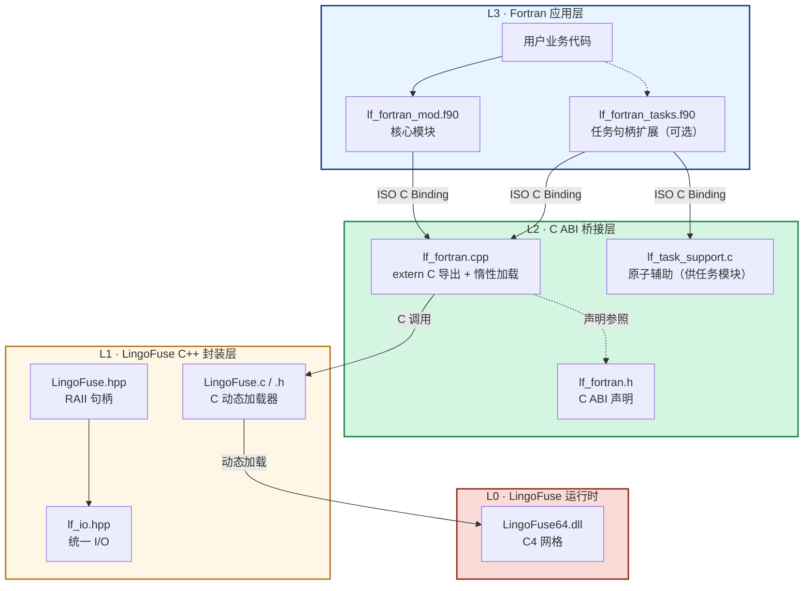

**分工明确**：

| 层 | 语言 | 职责 |
|----|------|------|
| L3 | Fortran | 业务逻辑、算法、数值计算 |
| L2 | C++ / C | 跨语言 ABI 桥接、错误码翻译、字符串编解码、回调 trampoline、原子辅助 |
| L1 | C / C++ | RAII 资源管理、统一 JSON/字符串/字节 I/O、动态库加载 |
| L0 | Pascal | C4 服务网格、IPC/TCP 传输、负载均衡、服务发现 |

---

## 二、环境要求

### 2.1 操作系统

| 平台 | 最低版本 | 已验证 |
|------|----------|:------:|
| Windows 10 | 1809+ | ✅ Windows 10 / 11 x64 |
| Windows 11 | 任意 | ✅ |
| Windows Server | 2019+ | ⏳ |
| Linux | 现代 glibc | ⏳ 理论可行，未实测 |
| macOS | 12+ | ⏳ 理论可行，未实测 |

当前绑定**只在 Windows x64 上经过完整验证**。Linux / macOS 的代码路径已经预留（`bind(C)` 与 `extern "C"` 都是跨平台标准），但未在真实机器上运行过。

### 2.2 软件依赖总览

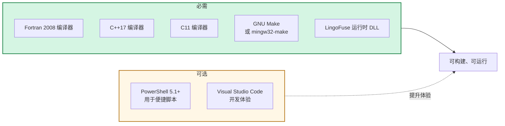

### 2.3 LingoFuse 运行时（必需）

核心动态库由 LingoFuse 主仓库的 `Binary/` 目录提供。Windows x64 需要以下文件：

| 文件 | 作用 |
|------|------|
| `LingoFuse64.dll` | C4 服务网格、RPC 引擎 |
| `z_ipc_64.dll` | 同机 IPC 传输 |
| `mimalloc64.dll` | 高性能内存分配器 |
| `mimalloc-redirect.dll` | 分配器重定向（可选，但建议一起放） |

**放置方式**：把 4 个文件放在 exe 同目录，或把它们的目录加入系统 `PATH`。`LingoFuse.c` 中的 `LF_LoadLibrary` 会按此顺序自动搜索，不需要任何显式配置。

### 2.4 编译产物清单

构建完成后，`c_ext\` 目录下应出现：

| 文件 | 类型 | 说明 |
|------|------|------|
| `LingoFuse.o` | 中间 | C 动态加载器 + C 类型化 helper |
| `lf_fortran.o` | 中间 | C++ 桥接层 |
| `lf_task_support.o` | 中间 | C 原子辅助 |
| `lf_fortran_mod.o` / `.mod` | 中间 | Fortran 核心模块 |
| `lf_fortran_tasks.o` / `.mod` | 中间 | Fortran 任务句柄模块 |
| `test_lf_fortran_c.exe` | 可执行 | C ABI 测试（257 项断言） |
| `test_lf_fortran_f.exe` | 可执行 | Fortran 绑定测试（114 项断言） |
| `test_lf_json_f.exe` | 可执行 | Fortran JSON 测试（73 项断言） |
| `test_lf_tasks_f.exe` | 可执行 | Fortran 任务句柄测试（30 项断言） |

`cross_demo\` 目录下应出现：

| 文件 | 类型 | 说明 |
|------|------|------|
| `cross_service.exe` | 可执行 | Fortran 信标（协调器） |
| `cross_node.exe` | 可执行 | Fortran 计算节点 |
| `cross_call.exe` | 可执行 | Fortran 调用端（5 段演示） |
| `cross_call_cpp.exe` | 可执行 | C++ 调用端（跨语言验证） |

---

## 三、编译器与工具链要求

### 3.1 三个编译器，各司其职

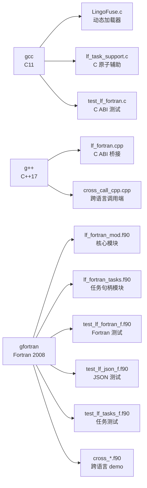

### 3.2 各源文件的编译器要求

| 源文件 | 语言标准 | 必需的编译器特性 |
|--------|----------|------------------|
| `LingoFuse.c` | **C11** | 动态加载（`LoadLibraryA` / `dlopen`）、`int64_t` / `uint64_t`、函数指针 |
| `lf_task_support.c` | **C11** | `__atomic_*` 内建（GCC/Clang）或 `Interlocked*`（MSVC） |
| `lf_fortran.cpp` | **C++17** | `extern "C"` 导出、`std::once_flag`、`try / catch (...)`、`reinterpret_cast` |
| `lf_fortran_mod.f90` | **Fortran 2008** | `iso_c_binding`、`bind(C)`、`c_funloc`、`allocatable character` |
| `lf_fortran_tasks.f90` | **Fortran 2008** | 同上；不依赖任何 F2018 协程特性 |
| `test_lf_fortran.c` | **C11** | 变参宏、`inttypes.h` |

**最低编译器版本**：

| 编译器 | 最低版本 | 推荐 |
|--------|:--------:|:----:|
| GCC / MinGW-w64 | 9.0 | 13.0+ |
| Clang | 10.0 | 17.0+ |
| MSVC | 2019 (19.20) | 2022 |
| gfortran | 9.0 | 13.0+ |

**版本一致性要求**：

> ⚠️ **C++ 编译器和 Fortran 编译器必须来自同一套工具链**。

原因：链接 Fortran 目标文件时，会用 C++ 链接器并附带 `-lgfortran`，如果 `g++` 版本与 `gfortran` 版本不一致，会报 `undefined reference to __gfortran_*` 之类的符号缺失。

同一套 MinGW-Builds / MSYS2 / WinLibs 发行版里的三个编译器天然版本一致。

### 3.3 Fortran 编译器必须支持的语言特性

| 特性 | 标准 | 用途 |
|------|:----:|------|
| `iso_c_binding` 模块 | F2003 | 全部 C 互操作 |
| `bind(C)` 过程属性 | F2003 | 回调注册 |
| `c_funloc` / `c_funptr` / `c_ptr` / `c_associated` | F2003 | 回调传递、指针判空 |
| `allocatable` + `character(len=:)` | F2003 | 动态字符串返回 |
| `int(x, kind)` 转换函数 | F2003 | 类型安全 |
| `size(arr)` / `len(str)` 内建 | F2003 | 缓冲区大小计算 |
| `transfer()` 内建 | F90 | 字节序列 ↔ 数值重解释 |

**不建议**使用 `block ... end block`（F2008 新增）：部分 IDE 的 Fortran 插件对其支持不佳，本绑定刻意避开。

**不使用**：`atomic_cas` / `atomic_define` / `atomic_ref`（F2018 协程内建）。原子操作全部下沉到 C 层。

### 3.4 已验证的工具链

| 组件 | 版本 | 来源 |
|------|------|------|
| gfortran | 16.1.0 | MinGW-Builds x86_64-win32-seh-rev1 |
| g++ | 16.1.0 | 同上 |
| gcc | 16.1.0 | 同上 |
| GNU Make | mingw32-make | 随 MinGW-Builds 提供 |

---

## 四、c_ext 目录内的代码职责

`c_ext/` 是绑定层的核心目录。每个源文件都有明确的单一职责。

### 4.1 文件清单与职责

| 文件 | 语言 | 职责 | 是否导出符号 |
|------|:----:|------|:------------:|
| `LingoFuse.h` | C | 声明 LingoFuse 运行时 C ABI（59 个导出符号）。不定义实现。 | 是（声明） |
| `LingoFuse.c` | C | 实现动态库加载（`LF_LoadLibrary` / `LF_FreeLibrary`）和 C 类型化 helper（`LF_WriteInt32` / `LF_ReadString` / `LF_Set_Opt_Quiet` 等）。 | 是（实现） |
| `LingoFuse.hpp` | C++ | LingoFuse 官方的 C++17 RAII 封装（`DataHandle` / `App` / `LibraryLoader`）。**Fortran 绑定不依赖它**，只为跨语言开发者提供。 | 否 |
| `lf_io.hpp` | C++ | 统一 JSON / 字符串 I/O 层。**Fortran 绑定不依赖它**。 | 否 |
| `json.hpp` | C++ | 单文件 nlohmann/json。**Fortran 绑定不依赖它**。 | 否 |
| `lf_fortran.h` | C | **本绑定对外暴露的 C ABI 契约**（约 55 个符号 + 类型 + 常量）。所有 `bind(C)` 声明都参照此文件。 | 是（契约） |
| `lf_fortran.cpp` | C++ | **实现 `lf_fortran.h` 的所有符号**。负责 UID 数组 ↔ `TP2P_UID` 结构体转换、异步回调 trampoline、异常吸收、惰性加载。 | 是（实现） |
| `lf_task_support.h` | C | 声明 3 个原子原语（`lf_task_atomic_cas_int` / `_store_int` / `_load_int`）。 | 是（声明） |
| `lf_task_support.c` | C | 实现上述原子原语。GCC/Clang 用 `__atomic_*`；MSVC 用 `Interlocked*`。 | 是（实现） |
| `lf_fortran_mod.f90` | Fortran | **核心 Fortran 模块**。封装所有同步 API、UID / P2P 身份、Options、异步回调式调用。 | 是（Fortran module） |
| `lf_fortran_tasks.f90` | Fortran | **可选扩展模块**。封装任务句柄式异步调用（`lf_async_submit` / `lf_task_*`）。 | 是（Fortran module） |
| `test_lf_fortran.c` | C | C 侧 ABI 测试。257 项断言。 | 否 |
| `test_lf_fortran_f.f90` | Fortran | Fortran 核心模块测试。114 项断言。 | 否 |
| `test_lf_json_f.f90` | Fortran | JSON / 字节 / 字符串 I/O 测试。73 项断言。 | 否 |
| `test_lf_tasks_f.f90` | Fortran | 任务句柄异步测试。30 项断言。 | 否 |
| `Makefile` | Make | 构建规则。四个测试 exe 的完整依赖关系。 | 否 |

### 4.2 依赖方向

```mermaid
flowchart TB
    subgraph L3["Fortran 应用"]
        M["lf_fortran_mod.f90"]
        T["lf_fortran_tasks.f90"]
        TM["test_lf_*.f90"]
    end

    subgraph L2["C ABI 桥接"]
        H["lf_fortran.h"]
        C["lf_fortran.cpp"]
        AH["lf_task_support.h"]
        AC["lf_task_support.c"]
    end

    subgraph L1["LingoFuse C 加载器"]
        LH["LingoFuse.h"]
        LC["LingoFuse.c"]
    end

    subgraph L0["运行时"]
        DLL["LingoFuse64.dll"]
    end

    M -->|USE| H
    T -->|USE| M
    T -->|bind(C)| AH
    TM -->|USE| M
    TM -->|USE| T

    C -->|include| H
    C -->|include| LH
    AC -->|include| AH

    LC -->|LoadLibrary| DLL
    C -->|LF_LoadLibrary| LC

    style L3 fill:#E8F4FF,stroke:#1E3A8A,stroke-width:2px
    style L2 fill:#D5F5E3,stroke:#1E8449,stroke-width:2px
    style L1 fill:#FFF7E6,stroke:#B7791F,stroke-width:2px
    style L0 fill:#FADBD8,stroke:#922B21,stroke-width:2px
```

### 4.3 每个文件的详细职责

#### 4.3.1 `LingoFuse.c` / `LingoFuse.h`

**作用**：把 LingoFuse 动态库（`LingoFuse64.dll`）的所有导出符号封装为**可静态链接的函数指针表**。

**核心函数**：

```c
int  LF_LoadLibrary(void);        // 加载 DLL 并解析所有 59 个符号
void LF_FreeLibrary(void);        // 卸载 DLL 并清零函数指针

// 类型化 helper（在 LingoFuse.c 内实现，非 DLL 导出）
int LF_WriteInt32(TDataHnd h, int32_t v);
int LF_ReadInt32(TDataHnd h, int32_t* out);
int LF_WriteString(TDataHnd h, const char* s);
int64_t LF_ReadString(TDataHnd h, char* buf, size_t n);
// ... 共 20+ 个 helper

// Options 快捷 helper（在 LingoFuse.c 内实现）
void        LF_Set_Opt_Quiet(int value);
int         LF_Get_Opt_Quiet(void);
void        LF_Set_Opt_Overlap_Connection(int value);
// ... 共 32 个 helper
```

**这是唯一直接调用 `LoadLibraryA` / `GetProcAddress` 的文件**。其他所有文件通过函数指针间接调用 DLL。

#### 4.3.2 `lf_fortran.h` / `lf_fortran.cpp`

**作用**：把 `LingoFuse.c` 的 C 接口重新包装成**Fortran 友好的 ABI**。

**关键设计决策**：

| 决策 | 理由 |
|------|------|
| UID 用 `const int8_t*`（数组）而非 `TP2P_UID` 结构体 | Fortran 只有 `c_int8_t`，数组语义最贴近字节序列 |
| P2P 身份 getter 立即拷贝到用户缓冲 | 隐藏 `LF_Get_P2P_UID` 的 ~5 秒 transient pointer |
| 异步回调用 `(void* user_data, void* result)` | 与 C++ 侧的 `submit_async_call` 模式一致 |
| 分发失败时**同步**回调一次 | 用户只需一套失败路径（`if (!result_handle)`） |
| 每个 `extern "C"` 入口 `try/catch` 全包裹 | 异常绝不穿透到 Fortran 栈 |
| 惰性加载用 `std::call_once` | 线程安全；首次调用任意 `lf_*` 时自动加载 |

**关键的 UID 转换函数**：

```cpp
inline void uid_array_to_struct(const int8_t* src, TP2P_UID& dst) {
    std::memcpy(dst.bytes, src, 32);
}

inline void uid_struct_to_array(const TP2P_UID& src, int8_t* dst) {
    std::memcpy(dst, src.bytes, 32);
}
```

#### 4.3.3 `lf_task_support.h` / `lf_task_support.c`

**作用**：为 `lf_fortran_tasks.f90` 提供**跨线程安全的原子操作**。

**为什么需要它**：Fortran 2008 标准不允许在非协程变量上调用 `atomic_cas` / `atomic_define` / `atomic_ref`（这三个是 F2018 协程内建）。任务句柄模块需要在**主线程**和**TCompute 工作线程**之间共享少量状态（槽状态字段），因此把原子性下沉到 C 层。

**三个原语**：

```c
int  lf_task_atomic_cas_int(int* ptr, int expected, int new_val);  // 返回旧值
void lf_task_atomic_store_int(int* ptr, int val);                  // release 语义
int  lf_task_atomic_load_int(const int* ptr);                      // acquire 语义
```

**双路径实现**：
- **MSVC**：`InterlockedCompareExchange` / `InterlockedExchange`
- **GCC / Clang**：`__atomic_compare_exchange_n` / `__atomic_store_n` / `__atomic_load_n`（带明确的 acquire/release 内存序）

#### 4.3.4 `lf_fortran_mod.f90`

**作用**：Fortran 应用**实际 `use` 的核心模块**。

**封装内容**：

| 分类 | 数量 | 说明 |
|------|:----:|------|
| 生命周期 | 4 | load / free / shutdown / exit_main_thread |
| App 句柄 | 7 | create / destroy / register_call / register_notify / unregister / bind / get_name |
| Data 句柄 | 3 | create / create_permanent / destroy |
| 标量 I/O | 20 | 10 写 + 10 读 |
| 字节 / 字符串 / JSON | 9 | write / read 全家族 |
| Cursor / Size | 4 | get/set position, get/set size |
| **UID I/O** | 2 | write_uid / read_uid |
| **UID ↔ Hex** | 2 | to_hex / from_hex |
| **P2P 身份** | 2 | get_p2p_uid / get_p2p_name |
| 网络准备 | 4 | reset / service / client / done |
| **App 名调用** | 4 | call / local_call / notify / sequenced_notify |
| **UID 调用** | 5 | call_uid / notify_uid / seq_notify_uid / check_uid / check_uid_api |
| **P2PName 调用** | 5 | 同结构 |
| **异步回调式** | 6 | call / sequenced_call × {app / uid / p2pname} |
| **P2P 进程级注册** | 3 | register_p2p_call / register_p2p_notify / unregister_p2p |
| Options 通用 | 2 | set / get |
| **Options 快捷** | 32 | 16 组 set + get |
| 查询 | 3 | check_main_thread / check_app / check_api |
| 状态 | 3 | get_status_count / get_status / post_status |
| 网络事件 | 1 | set_network_event |

#### 4.3.5 `lf_fortran_tasks.f90`

**作用**：**可选扩展模块**，提供"无回调"的异步调用风格。

**核心理念**：

```fortran
! 提交，立即返回
type(lf_task) :: t
t = lf_async_submit('demo', req)

! ... 主线程做别的事 ...

! 非阻塞检查
if (lf_task_is_ready(t)) then
    if (lf_task_is_ok(t)) then
        v = lf_task_read_int32(t)
    end if
    call lf_task_free(t)
end if
```

**内部机制**：

1. **固定槽表**：`MAX_TASKS = 64`。每个槽有状态字段（0=空闲、1=等待、2=完成）+ 结果缓冲区（默认 64 KB）。
2. **单一共享回调**：`task_callback` 通过 `user_data` 接收槽索引，把结果拷贝到槽内。
3. **槽状态用 C 原子函数读写**：`lf_task_atomic_*`。
4. **`lf_task_free` 拒绝 pending 槽**：避免回调写入已释放的槽。

#### 4.3.6 `Makefile`

**作用**：构建四个测试 exe。

**关键规则**：

```makefile
# 三编译器必须同一套工具链
CC  = gcc
CXX = g++
FC  = gfortran

# 使用 = 而非 ?=，覆盖 make 内建默认值（CC = cc、FC = f77）
```

**依赖关系**：

```
LingoFuse.o ← LingoFuse.c
lf_task_support.o ← lf_task_support.c
lf_fortran.o ← lf_fortran.cpp
lf_fortran_mod.o ← lf_fortran_mod.f90
lf_fortran_tasks.o ← lf_fortran_tasks.f90 + lf_fortran_mod.o

test_lf_fortran_c.exe ← test_lf_fortran.c + LingoFuse.o + lf_fortran.o
test_lf_fortran_f.exe ← test_lf_fortran_f.f90 + lf_fortran_mod.o + LingoFuse.o + lf_fortran.o
test_lf_json_f.exe ← test_lf_json_f.f90 + lf_fortran_mod.o + LingoFuse.o + lf_fortran.o
test_lf_tasks_f.exe ← test_lf_tasks_f.f90 + lf_fortran_tasks.o + lf_fortran_mod.o + lf_task_support.o + LingoFuse.o + lf_fortran.o
```

---

## 五、构建方法

### 5.1 目录结构

```
fortran/
├── README.md               本文件
├── check_env.ps1           环境诊断脚本
├── build.ps1               构建脚本
├── clean.ps1               清理脚本
├── test.ps1                测试脚本
├── run_cross_demo.ps1      跨语言 demo 一键启动
├── verify_all.ps1          c_ext 全套验证（清 → 构建 → 全测试）
│
├── c_ext/                  C-ABI 桥接层 + 单元测试
│   ├── Makefile
│   ├── LingoFuse.h / .c    LingoFuse C 动态加载器
│   ├── LingoFuse.hpp       LingoFuse C++ RAII 封装（参考用）
│   ├── lf_io.hpp           统一 I/O 层（参考用）
│   ├── json.hpp            nlohmann/json（参考用）
│   ├── lf_fortran.h        C ABI 契约
│   ├── lf_fortran.cpp      C ABI 实现
│   ├── lf_task_support.h   C 原子辅助声明
│   ├── lf_task_support.c   C 原子辅助实现
│   ├── lf_fortran_mod.f90  Fortran 核心模块
│   ├── lf_fortran_tasks.f90 Fortran 任务句柄模块
│   ├── test_lf_fortran.c   C ABI 测试
│   ├── test_lf_fortran_f.f90  Fortran 绑定测试
│   ├── test_lf_json_f.f90  Fortran JSON 测试
│   └── test_lf_tasks_f.f90 Fortran 任务测试
│
└── cross_demo/             跨语言 Demo
    ├── Makefile
    ├── cross_service.f90   Fortran 信标
    ├── cross_node.f90      Fortran 计算节点
    ├── cross_call.f90      Fortran 调用端
    └── cross_call_cpp.cpp  C++ 调用端
```

### 5.2 从零构建（5 步）

```powershell
cd D:\CoreLibrary\LingoFuse\fortran

# 步骤 1：诊断环境（可选但推荐）
.\check_env.ps1

# 步骤 2：全清
.\clean.ps1

# 步骤 3：全构建（c_ext + cross_demo）
.\build.ps1

# 步骤 4：跑 c_ext 的全部测试
.\test.ps1 -SkipBuild
.\c_ext\test_lf_tasks_f.exe

# 步骤 5：跨语言 demo（需手动按顺序启动 3 个进程）
.\run_cross_demo.ps1
```

### 5.3 一键验证

`verify_all.ps1` 会自动完成"清 → 构建 c_ext → 跑 4 个测试 → 汇总"：

```powershell
.\verify_all.ps1
```

**预期输出**：

```
  Test                           Status   Detail
  ------------------------------ -------- ------------------------
  C ABI test                     PASS
  Fortran binding test           PASS
  Fortran JSON test              PASS
  Task-handle async test         PASS

[OK] All c_ext tests passed.
```

### 5.4 常用命令

| 命令 | 说明 |
|------|------|
| `.\build.ps1 -Target c_ext` | 仅构建 C 桥接层与测试 |
| `.\build.ps1 -Target cross_demo` | 仅构建跨语言 demo |
| `.\build.ps1 -MakeArgs '-j4'` | 4 线程并行构建 |
| `.\test.ps1 -C -SkipBuild` | 只跑 C 测试 |
| `.\test.ps1 -F -SkipBuild` | 只跑 Fortran 绑定测试 |
| `.\test.ps1 -J -SkipBuild` | 只跑 Fortran JSON 测试 |
| `.\c_ext\test_lf_tasks_f.exe` | 手动跑任务句柄测试 |
| `.\run_cross_demo.ps1 -WaitSeconds 8` | 跨语言 demo，加长等待 |

### 5.5 PowerShell 执行策略

首次运行如遇 `无法加载文件 ... 未对文件进行数字签名` 错误：

```powershell
# 只影响当前窗口
Set-ExecutionPolicy -Scope Process -ExecutionPolicy Bypass

# 或调用时临时绕过
powershell -ExecutionPolicy Bypass -File .\build.ps1
```

### 5.6 环境诊断

`check_env.ps1` 用于检查三个编译器是否齐全、版本是否匹配：

```powershell
.\check_env.ps1
```

它会依次检查：

| 检查项 | 说明 |
|--------|------|
| 操作系统 | Windows x64 |
| PowerShell 版本 | ≥ 5.1 |
| Fortran 编译器 | gfortran 或 x86_64-w64-mingw32-gfortran |
| C++ 编译器 | g++ 或 x86_64-w64-mingw32-g++ |
| C 编译器 | gcc 或 x86_64-w64-mingw32-gcc |
| GNU Make | mingw32-make 或 make |
| 版本一致性 | C++ 与 Fortran 编译器主版本号相同 |

---

## 六、接口原理

### 6.1 为什么 Fortran 无法直接调用 LingoFuse

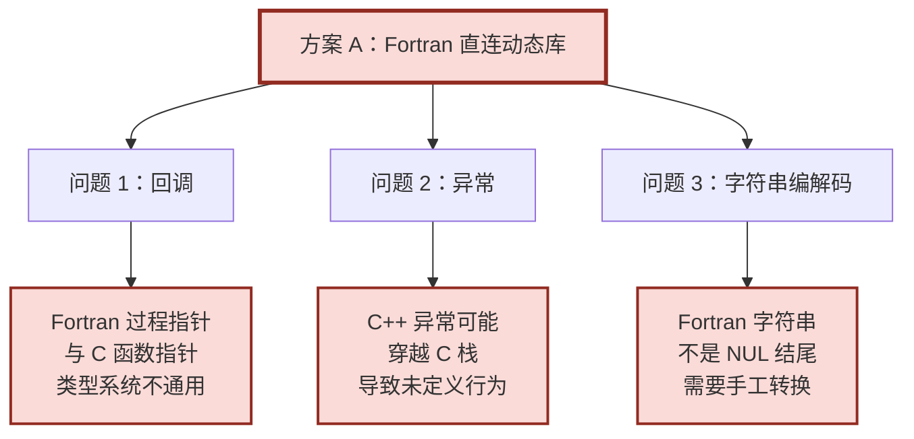

C++ 中间层把这三个问题全部吸收：

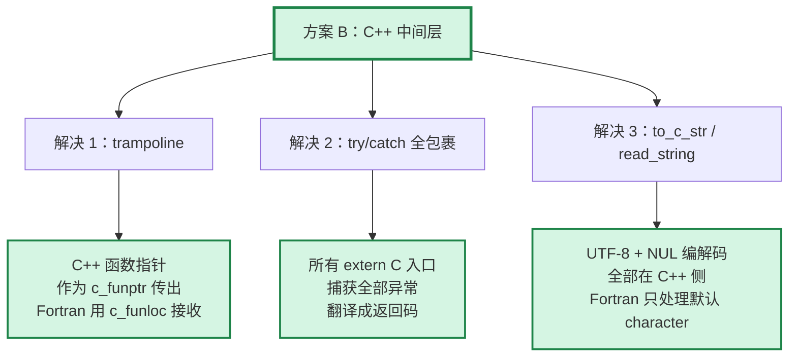

### 6.2 回调机制：跨越三层语言边界

用户注册一个 Fortran 回调，当远端发起调用时，LingoFuse 会把它送到 Fortran。中间要穿过 C4 → C++ → Fortran 三层。

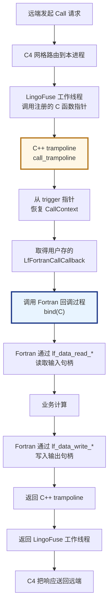

**CallContext 的生命周期**：C++ 桥接层为每个注册的 API 分配一个小结构体，用 `new` 分配到堆上**故意不回收**，把指针作为 `trigger` 传给 LingoFuse。这样做是因为 LingoFuse 可能在任意时刻调用回调——包括注销过程中。回收会引入 use-after-free 窗口，代价是每个 API 泄漏几十字节，对任何现实程序都可忽略。

### 6.3 字符串编解码：NUL 帧契约

所有跨语言字符串都是 **UTF-8 字节 + 单个 NUL**。Fortran 默认的 `character(len=*)` 不是 NUL 结尾，需要转换。

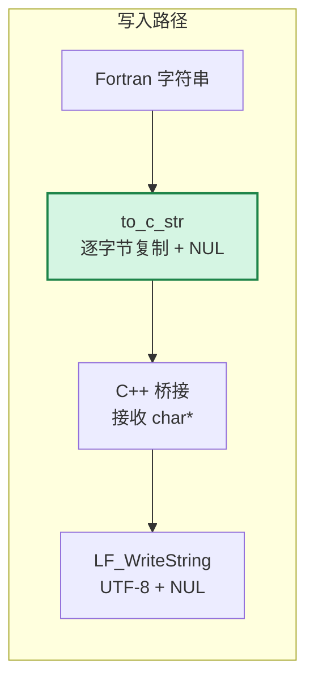

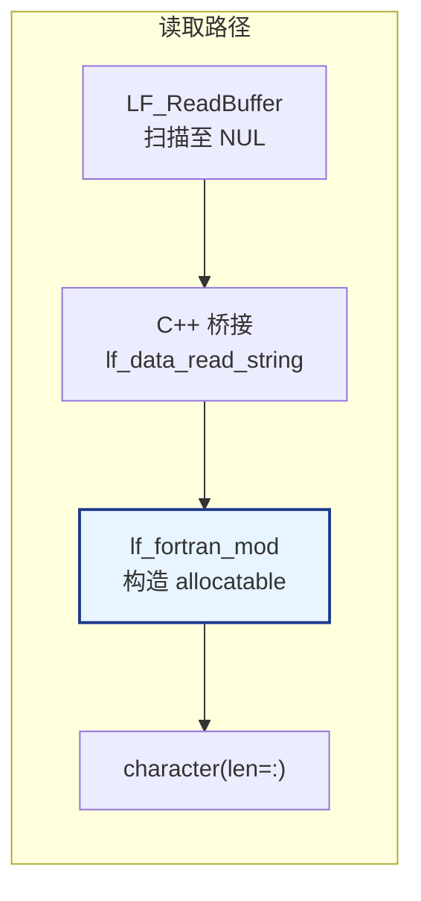

**容错读取**：如果缓冲区里**没有 NUL**（例如来自 HTTP 桥接的裸 JSON），读取方会消费整个缓冲区并返回，游标停在 `size + 1`。这与 Pascal / C++ / C# / Python / JavaScript 的行为**逐字节一致**。

### 6.4 数据句柄的两种生命周期

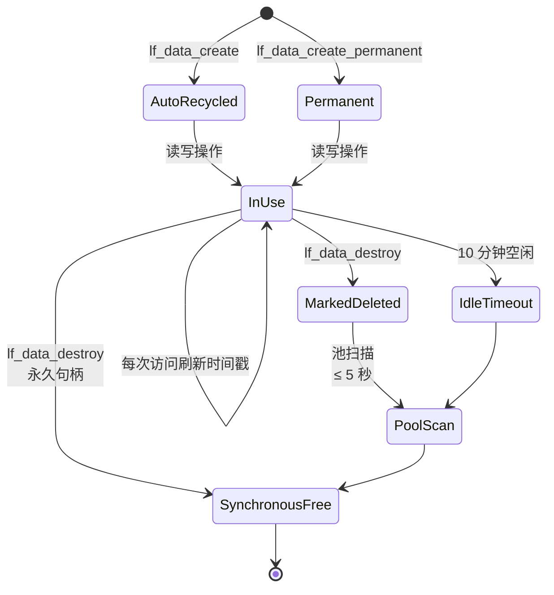

**使用建议**：

- **默认用 `lf_data_create`**（自动回收）。池会兜底忘记释放的句柄。
- **仅在需要跨进程生命周期时用 `lf_data_create_permanent`**（缓存模板、全局注册表）。
- **不要依赖自动回收**：高强度调用下句柄累积速度可能超过回收速度。始终显式 `lf_data_destroy`。

### 6.5 动态库加载契约

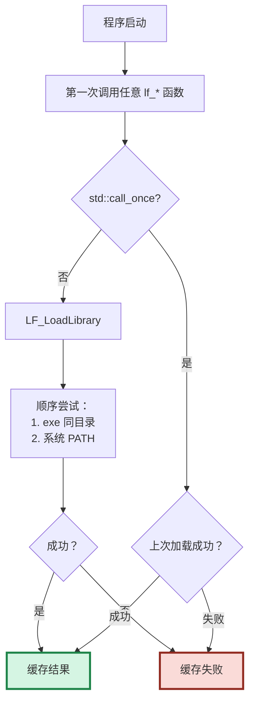

**关键点**：无论你调用的是 `lf_data_create` 还是 `lf_check_app`，C++ 桥接层都会先做一次 `ensure_loaded`，确保动态库已经加载。**用户不需要显式调用 `lf_load_library`**——虽然它也提供了，用于在程序启动时快速失败。

---

## 七、如何使用 Fortran 接口

### 7.1 最小服务端

```fortran
module my_service_callbacks
  use iso_c_binding
  use lf_fortran_mod
  implicit none
  private
  public :: add_callback
contains
  subroutine add_callback(input, output) bind(C)
    type(c_ptr), value :: input, output
    integer(c_int32_t) :: a, b, s
    if (lf_data_read_int32(input, a) /= 1) return
    if (lf_data_read_int32(input, b) /= 1) return
    s = a + b
    if (lf_data_write_int32(output, s) /= 1) return
  end subroutine
end module

program server
  use iso_c_binding
  use lf_fortran_mod
  use my_service_callbacks
  implicit none
  type(c_ptr) :: app
  integer(c_int) :: rc
  character(len=8) :: line

  app = lf_app_create('Calculator', 'Fortran calculator')
  rc = lf_app_register_call(app, 'add', 'Add two ints', &
                            c_funloc(add_callback))

  call lf_set_opt_wait_ready_ok(.false.)   ! 无序启动
  call lf_reset_prepare()
  rc = lf_prepare_service('ipc:calc', 'ipc:calc')
  rc = lf_prepare_client('ipc:calc', app)
  rc = lf_prepare_done()

  write(*, '(A)') 'Ready. Press Enter...'
  read(*, '(A)') line

  call lf_exit_main_thread()
  call lf_app_destroy(app)
  call lf_shutdown()
end program
```

### 7.2 最小调用端

```fortran
program client
  use iso_c_binding
  use lf_fortran_mod
  implicit none
  type(c_ptr) :: req, resp
  integer(c_int32_t) :: result
  integer(c_int64_t) :: sz
  integer :: i

  call lf_set_opt_wait_ready_ok(.false.)
  call lf_reset_prepare()
  call lf_prepare_client('ipc:calc', c_null_ptr)
  if (lf_prepare_done() /= 1) stop

  ! 等待目标上线（广播延迟约 3 秒）
  do i = 1, 50
    if (lf_check_app('Calculator')) exit
    call sleep_ms(100)
  end do

  req = lf_data_create('add')
  if (lf_data_write_int32(req, 5_c_int32_t) /= 1) stop
  if (lf_data_write_int32(req, 5_c_int32_t) /= 1) stop

  resp = lf_call('Calculator', req, 3000_c_int64_t)
  if (c_associated(resp)) then
    sz = lf_data_get_size(resp)
    if (sz >= 4) then
      if (lf_data_read_int32(resp, result) == 1) then
        write(*, '(A,I0)') '5 + 5 = ', result
      end if
    end if
    call lf_data_destroy(resp)
  end if
  call lf_data_destroy(req)

  call lf_exit_main_thread()
  call lf_shutdown()
end program
```

### 7.3 函数 vs 子程序：最重要的一条规则

这是 Fortran 绑定最容易踩的坑：**一部分 API 是函数（返回整数状态码 / 逻辑值 / 句柄），一部分是子程序（无返回值）**。

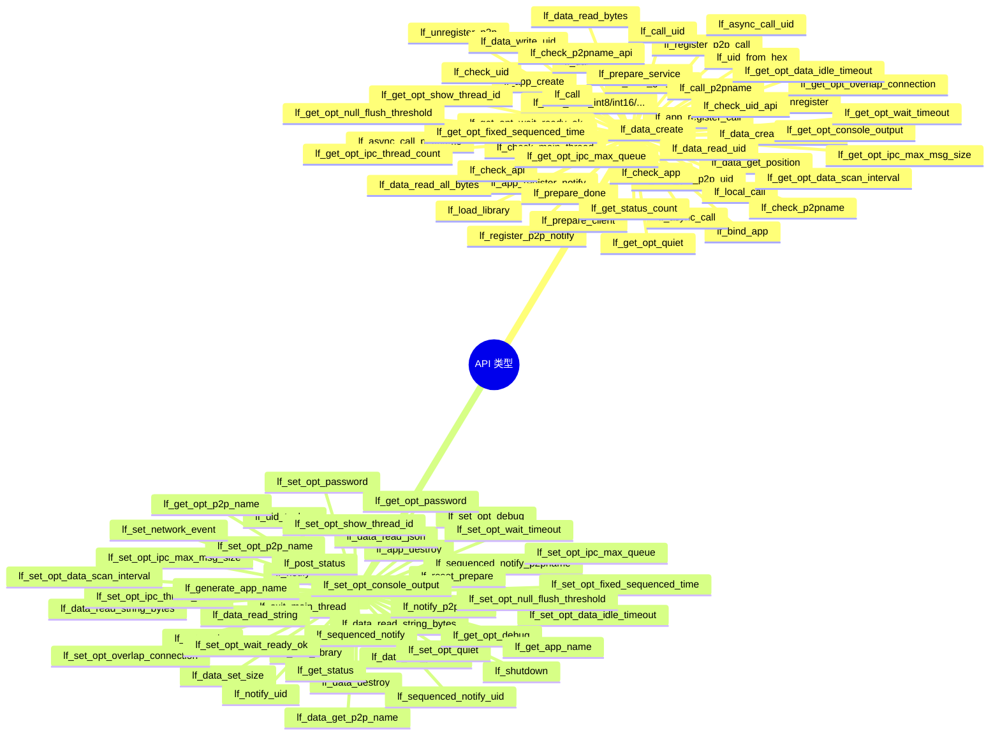

**判断规则**：

| 是否需要返回值？ | 类型 | 调用方式 |
|:---------------:|------|----------|
| 是（状态码 / 句柄 / 大小 / 逻辑值） | Function | `rc = f(...)` 或 `if (f(...))` / `if (f(...) /= 1)` |
| 否 | Subroutine | `call s(...)` |

在 `lf_fortran_mod.f90` 里，所有函数都声明为 `function`，所有子程序都声明为 `subroutine`。编错了编译器会报 `'xxx' has a type, not consistent with CALL`。

### 7.4 应用模式：服务注册与调用

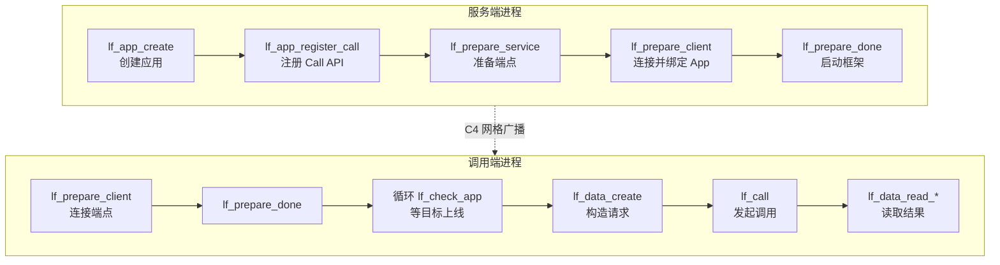

**核心规则**：

1. **先注册 API，再 `prepare_client`**。如果顺序颠倒，注册信息不会包含在广播里，其他进程看不到你注册的 API。
2. **调用端一定要等目标上线**。用 `lf_check_app` / `lf_check_api` 轮询，超时 5–10 秒。
3. **广播传播有约 3 秒延迟**。刚启动的节点不会立刻出现在整个 mesh 上。
4. **自包含单进程测试**（service + client + 本地 app）必须**同时** `prepare_service` 和 `prepare_client`，否则 `prepare_done` 会超时返回 0。

### 7.5 清理顺序

**严格遵守**（对应 Pascal 的 LF-CLEAN-001 契约）：

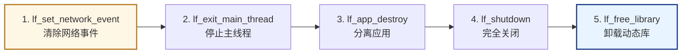

**为什么顺序重要**：

- `lf_exit_main_thread` 会清空**所有数据句柄**，包括永久句柄。在此之后使用句柄会崩溃。
- `lf_app_destroy` 必须在 `lf_shutdown` **之前**。反过来会访问已销毁的池。
- `lf_free_library` 必须在最后。它是桥接层自己的动作，不是 LingoFuse 的运行时刻。

每一步都是幂等的，所以用 `try / finally` 或者反复调用都不会出错。

---

## 八、API 速查

### 8.1 生命周期

| 函数 | 类型 | 说明 |
|------|:----:|------|
| `lf_load_library()` | Function → int | 显式加载动态库（可选，桥接层会惰性加载） |
| `lf_free_library()` | Subroutine | 卸载动态库 |
| `lf_shutdown()` | Subroutine | 完全关闭 LingoFuse 框架 |
| `lf_exit_main_thread()` | Subroutine | 请求主线程退出；会清空所有数据句柄 |

### 8.2 应用句柄

| 函数 | 类型 | 说明 |
|------|:----:|------|
| `lf_app_create(name, desc)` | Function → c_ptr | 创建应用 |
| `lf_app_destroy(app)` | Subroutine | 分离应用 |
| `lf_app_register_call(app, api, desc, c_funloc(cb))` | Function → int | 注册 Call API |
| `lf_app_register_notify(app, api, desc, c_funloc(cb))` | Function → int | 注册 Notify API |
| `lf_app_unregister(app, api)` | Function → int | 反注册 API |
| `lf_bind_app(app)` | Function → int | 绑定 app 到未绑定的客户端 |
| `lf_get_app_name(app, out[, status])` | Subroutine | 查询应用名 |
| `lf_generate_app_name(out[, status])` | Subroutine | 生成唯一应用名 |

### 8.3 P2P 进程级注册

| 函数 | 类型 | 说明 |
|------|:----:|------|
| `lf_register_p2p_call(api, desc, c_funloc(cb))` | Function → int | 注册进程级 Call API |
| `lf_register_p2p_notify(api, desc, c_funloc(cb))` | Function → int | 注册进程级 Notify API |
| `lf_unregister_p2p(api)` | Function → int | 反注册进程级 API |

> 进程级 P2P API **只能**通过 UID 或 P2PName 寻址访问，**不能**通过 App 名访问。

### 8.4 数据句柄

| 函数 | 类型 | 说明 |
|------|:----:|------|
| `lf_data_create(api)` | Function → c_ptr | 自动回收句柄 |
| `lf_data_create_permanent(api)` | Function → c_ptr | 永久句柄 |
| `lf_data_destroy(h)` | Subroutine | 销毁句柄 |

### 8.5 标量 I/O（全部小端序）

| 类别 | 写入（Function → int） | 读取（Function → int） |
|------|-----------------------|-----------------------|
| 8 位有符号 | `lf_data_write_int8` | `lf_data_read_int8` |
| 16 位有符号 | `lf_data_write_int16` | `lf_data_read_int16` |
| 32 位有符号 | `lf_data_write_int32` | `lf_data_read_int32` |
| 64 位有符号 | `lf_data_write_int64` | `lf_data_read_int64` |
| 8 位无符号 | `lf_data_write_uint8` | `lf_data_read_uint8` |
| 16 位无符号 | `lf_data_write_uint16` | `lf_data_read_uint16` |
| 32 位无符号 | `lf_data_write_uint32` | `lf_data_read_uint32` |
| 64 位无符号 | `lf_data_write_uint64` | `lf_data_read_uint64` |
| 单精度浮点 | `lf_data_write_float32` | `lf_data_read_float32` |
| 双精度浮点 | `lf_data_write_float64` | `lf_data_read_float64` |

> ⚠️ **Fortran 没有无符号类型**。`lf_data_write_uint8` 等接受 `c_int8_t` 参数，值需要落在有符号范围内。无符号边界值（255、65535、0xDEADBEEF）通过 `char()` 构造字节序列或由 C 测试覆盖。

### 8.6 字符串 / 字节 / JSON

| 函数 | 类型 | 说明 |
|------|:----:|------|
| `lf_data_write_string(h, s)` | Function → int | 写 UTF-8 + NUL |
| `lf_data_read_string(h, out[, status])` | Subroutine | 读到 NUL；out 是 allocatable |
| `lf_data_write_string_bytes(h, data, n)` | Function → int | 写原始字节 + NUL |
| `lf_data_read_string_bytes(h, buf, n[, status])` | Subroutine | 读到 NUL |
| `lf_data_write_bytes(h, data, n)` | Function → int | 写原始字节（**不加 NUL**） |
| `lf_data_read_bytes(h, buf, n)` | Function → int64 | 读最多 n 字节 |
| `lf_data_read_all_bytes(h, buf, n)` | Function → int64 | 读到缓冲区末尾 |
| `lf_data_write_json(h, s)` | Function → int | 写 JSON + NUL |
| `lf_data_read_json(h, out[, status])` | Subroutine | 读 JSON |

### 8.7 游标与大小

| 函数 | 类型 | 说明 |
|------|:----:|------|
| `lf_data_get_position(h)` | Function → int64 | 当前游标 |
| `lf_data_set_position(h, pos)` | Subroutine | 设置游标 |
| `lf_data_get_size(h)` | Function → int64 | 缓冲区大小 |
| `lf_data_set_size(h, sz)` | Subroutine | 调整大小 |

### 8.8 UID 二进制 I/O 与 Hex

| 函数 | 类型 | 说明 |
|------|:----:|------|
| `lf_data_write_uid(h, uid)` | Function → int | 写 32 字节 UID（无终止符） |
| `lf_data_read_uid(h, uid)` | Function → int | 读 32 字节 UID |
| `lf_uid_to_hex(uid, out)` | Subroutine | UID → 64 字符 hex |
| `lf_uid_from_hex(hex, uid)` | Function → int | hex → UID |

`LF_UID_BYTE_COUNT = 32` 是导出的常量。

**典型用法**：

```fortran
integer(c_int8_t) :: my_uid(LF_UID_BYTE_COUNT)
character(len=:), allocatable :: hex

! ... 从 whoami 探测 my_uid ...

call lf_uid_to_hex(my_uid, hex)
print *, 'My UID = ', hex    ! 64 字符 hex
```

### 8.9 P2P 身份读取

| 函数 | 类型 | 说明 |
|------|:----:|------|
| `lf_data_get_p2p_uid(h, uid)` | Function → int | 从输入句柄读发送方 UID |
| `lf_data_get_p2p_name(h, out[, status])` | Subroutine | 从输入句柄读发送方 P2PName |

> ⚠️ **重要**：这两个函数**只在回调的 `input` 参数上有效**。对自建句柄或 `output` 句柄调用会返回全零 / 空串。

### 8.10 网络准备

| 函数 | 类型 | 说明 |
|------|:----:|------|
| `lf_reset_prepare()` | Subroutine | 清空准备队列 |
| `lf_prepare_service(listen, physics)` | Function → int | 准备服务端点 |
| `lf_prepare_client(addr, app)` | Function → int | 准备客户端 |
| `lf_prepare_done()` | Function → int | 启动框架（每进程只成功一次） |

### 8.11 App 名寻址调用

| 函数 | 类型 | 说明 |
|------|:----:|------|
| `lf_call(app, param, ms)` | Function → c_ptr | 同步远程调用 |
| `lf_local_call(app, param)` | Function → c_ptr | 进程内调用 |
| `lf_notify(app, param)` | Subroutine | 单向通知 |
| `lf_sequenced_notify(app, param)` | Subroutine | 顺序通知 |

### 8.12 UID 寻址调用

| 函数 | 类型 | 说明 |
|------|:----:|------|
| `lf_call_uid(uid, param, ms)` | Function → c_ptr | 定向到具体客户端 |
| `lf_notify_uid(uid, param)` | Subroutine | 单向通知 |
| `lf_sequenced_notify_uid(uid, param)` | Subroutine | 顺序通知 |
| `lf_check_uid(uid)` | Function → logical | 目标是否在线 |
| `lf_check_uid_api(uid, api)` | Function → logical | 目标是否暴露此 API |

### 8.13 P2PName 寻址调用

| 函数 | 类型 | 说明 |
|------|:----:|------|
| `lf_call_p2pname(p2p, param, ms)` | Function → c_ptr | 组内负载均衡调用 |
| `lf_notify_p2pname(p2p, param)` | Subroutine | 单向通知 |
| `lf_sequenced_notify_p2pname(p2p, param)` | Subroutine | 顺序通知 |
| `lf_check_p2pname(p2p)` | Function → logical | 组是否存在 |
| `lf_check_p2pname_api(p2p, api)` | Function → logical | 组内是否暴露此 API |

### 8.14 异步调用（回调式）

| 函数 | 类型 | 说明 |
|------|:----:|------|
| `lf_async_call(app, param, cb, ud)` | Function → int | App 名异步调用 |
| `lf_async_sequenced_call(app, param, cb, ud)` | Function → int | 顺序变体 |
| `lf_async_call_uid(uid, param, cb, ud)` | Function → int | UID 异步调用 |
| `lf_async_sequenced_call_uid(uid, param, cb, ud)` | Function → int | 顺序变体 |
| `lf_async_call_p2pname(p2p, param, cb, ud)` | Function → int | P2PName 异步调用 |
| `lf_async_sequenced_call_p2pname(p2p, param, cb, ud)` | Function → int | 顺序变体 |

其中 `cb` 是 `type(c_funptr)`（用 `c_funloc(proc)` 生成），`ud` 是 `type(c_ptr)`（用户上下文）。

**详见 §十「异步编程的两种风格」。**

### 8.15 异步调用（任务句柄式，需 `use lf_fortran_tasks`）

| 函数 | 类型 | 说明 |
|------|:----:|------|
| `lf_async_submit(app, param)` | Function → `type(lf_task)` | 提交任务 |
| `lf_async_submit_uid(uid, param)` | Function → `type(lf_task)` | UID 提交 |
| `lf_async_submit_p2pname(p2p, param)` | Function → `type(lf_task)` | P2PName 提交 |
| `lf_task_is_valid(t)` | Function → logical | 句柄是否有效 |
| `lf_task_is_ready(t)` | Function → logical | 是否已完成 |
| `lf_task_is_ok(t)` | Function → logical | 是否成功 |
| `lf_task_read_int32(t)` | Function → int32 | 读 int32 |
| `lf_task_read_int64(t)` | Function → int64 | 读 int64 |
| `lf_task_read_float32(t)` | Function → real32 | 读 float32 |
| `lf_task_read_float64(t)` | Function → real64 | 读 float64 |
| `lf_task_read_string(t, s)` | Subroutine | 读字符串 |
| `lf_task_read_size(t)` | Function → int64 | 结果字节数 |
| `lf_task_free(t)` | Subroutine | 释放槽 |
| `lf_task_set_max_payload(n)` | Subroutine | 配置缓冲上限 |

### 8.16 Options

**通用访问**：

| 函数 | 类型 | 说明 |
|------|:----:|------|
| `lf_set_option(name, value)` | Subroutine | 设置任意选项 |
| `lf_get_option(name, out[, status])` | Subroutine | 读取任意选项 |

**16 组类型化快捷方式**（setter 接收 Fortran 原生类型，getter 返回 Fortran 原生类型）：

| 类别 | Setter | Getter |
|------|--------|--------|
| 认证 | `lf_set_opt_password(s)` | `lf_get_opt_password(out)` （始终返回 `"********"` 掩码） |
| 调试 | `lf_set_opt_debug(s)` | `lf_get_opt_debug(out)` （只写选项） |
| 静默 | `lf_set_opt_quiet(l)` | `lf_get_opt_quiet()` → logical |
| 线程 ID | `lf_set_opt_show_thread_id(l)` | `lf_get_opt_show_thread_id()` |
| 控制台 | `lf_set_opt_console_output(l)` | `lf_get_opt_console_output()` |
| Overlap | `lf_set_opt_overlap_connection(l)` | `lf_get_opt_overlap_connection()` |
| WaitReady | `lf_set_opt_wait_ready_ok(l)` | `lf_get_opt_wait_ready_ok()` |
| WaitTimeout | `lf_set_opt_wait_timeout(i64)` | `lf_get_opt_wait_timeout()` |
| IPC 线程 | `lf_set_opt_ipc_thread_count(i)` | `lf_get_opt_ipc_thread_count()` |
| IPC 队列 | `lf_set_opt_ipc_max_queue(i)` | `lf_get_opt_ipc_max_queue()` |
| IPC 消息 | `lf_set_opt_ipc_max_msg_size(i)` | `lf_get_opt_ipc_max_msg_size()` |
| Sequenced | `lf_set_opt_fixed_sequenced_time(i64)` | `lf_get_opt_fixed_sequenced_time()` |
| P2P 名 | `lf_set_opt_p2p_name(s)` | `lf_get_opt_p2p_name(out)` |
| Data 空闲 | `lf_set_opt_data_idle_timeout(i64)` | `lf_get_opt_data_idle_timeout()` |
| Data 扫描 | `lf_set_opt_data_scan_interval(i64)` | `lf_get_opt_data_scan_interval()` |
| Null 刷新 | `lf_set_opt_null_flush_threshold(i)` | `lf_get_opt_null_flush_threshold()` |

### 8.17 查询 / 诊断 / 网络事件

| 函数 | 类型 | 说明 |
|------|:----:|------|
| `lf_check_main_thread()` | Function → logical | 主线程是否运行 |
| `lf_check_app(name)` | Function → logical | App 是否可见 |
| `lf_check_api(app, api)` | Function → logical | API 是否可见 |
| `lf_get_status_count()` | Function → int | 待处理日志数 |
| `lf_get_status(out[, status])` | Subroutine | 读取一条日志 |
| `lf_post_status(msg)` | Subroutine | 注入一条日志 |
| `lf_set_network_event(connect, disconnect)` | Subroutine | 安装全局连接/断开回调 |

---

## 九、三种寻址方式

LingoFuse 提供**三套独立的寻址方式**。每一套对应不同的业务场景，且**可以混用**。

### 9.1 三种寻址对照

| 寻址 | 索引键 | 路由粒度 | 本地优先 | 命中 App 注册 | 命中 P2P 注册 |
|------|--------|---------|:--------:|:-------------:|:-------------:|
| **App 名** | UTF-8 字符串 | 应用级 | ✅ | ✅ | ❌ |
| **UID** | 32 字节二进制 | 会话级 | ✅ | ✅ | ✅ |
| **P2PName** | UTF-8 字符串 | 组级 | ❌ | ✅ | ✅ |

**记忆口诀**：
- **App 名 = 找"哪个应用"**
- **UID = 找"哪个具体客户端"**
- **P2PName = 找"哪一组同质 worker"**

### 9.2 Fortran 侧调用点一览

```fortran
! ---- App 名寻址 ----
resp = lf_call('demo', req, 3000_c_int64_t)
call lf_notify('demo', req)
call lf_sequenced_notify('demo', req)

! ---- UID 寻址 ----
integer(c_int8_t) :: uid(LF_UID_BYTE_COUNT)
resp = lf_call_uid(uid, req, 3000_c_int64_t)
call lf_notify_uid(uid, req)
call lf_sequenced_notify_uid(uid, req)

! ---- P2PName 寻址 ----
resp = lf_call_p2pname('worker_group', req, 5000_c_int64_t)
call lf_notify_p2pname('worker_group', req)
call lf_sequenced_notify_p2pname('worker_group', req)
```

### 9.3 UID 的来源：whoami 模式

**问题**：客户端如何知道自己的 UID？

**答案**：通过调用任意一个已注册的 `whoami` API，让服务器把**你的身份**告诉你。

```fortran
! 服务端（任何 LingoFuse 应用都可以注册这个 API）
subroutine whoami_callback(input, output) bind(C)
    type(c_ptr), value :: input, output
    integer(c_int8_t) :: uid(LF_UID_BYTE_COUNT)
    character(len=:), allocatable :: name

    ! 从输入句柄的"侧数据"里读取发送方身份
    if (lf_data_get_p2p_uid(input, uid) /= 1) return
    call lf_data_get_p2p_name(input, name)

    ! 把身份回写给调用方
    if (lf_data_write_uid(output, uid) /= 1) return
    if (lf_data_write_string(output, name) /= 1) return
end subroutine

! 注册为 P2P 进程级（任意 UID / P2PName 都能调用它）
rc = lf_register_p2p_call('whoami', 'return caller identity', &
                          c_funloc(whoami_callback))
```

```fortran
! 客户端（探测自己的身份）
integer(c_int8_t) :: my_uid(LF_UID_BYTE_COUNT)
character(len=:), allocatable :: my_name

req  = lf_data_create('whoami')
resp = lf_call('demo', req, 3000_c_int64_t)
call lf_data_read_uid(resp, my_uid)
call lf_data_read_string(resp, my_name)

! 现在 my_uid 可以用于后续的 UID 定向调用
resp = lf_call_uid(my_uid, some_other_req, 3000_c_int64_t)
```

**关键点**：
- `lf_data_get_p2p_uid` / `lf_data_get_p2p_name` **只在回调的 `input` 参数上有效**。
- 对自建句柄或 `output` 句柄调用会返回全零 / 空串。
- **UID 是会话级的**：TunnelLink 成功时生成，重连后变化。缓存 UID 的调用方必须在重连后重新探测。

### 9.4 P2PName 组播：1 对多的分布式

**场景**：你启动了 3 个同质的 Fortran 计算节点，都设置了：

```fortran
call lf_set_opt_p2p_name('compute_group')
```

任何一个客户端都可以调用：

```fortran
resp = lf_call_p2pname('compute_group', req, 5000_c_int64_t)
```

服务端会：
1. 找到 `compute_group` 组内的所有 UID（3 个）。
2. 按 `Cycle_Anchor`（轮询）或 `FixedSequenced`（粘性）策略选一个。
3. 把请求转发给它。

**关键事实**：
- **P2PName 路由不做本地优先**：即使调用方本身也在组内，请求仍然走网络。
- **负载均衡**：默认轮询，可用 `lf_set_opt_fixed_sequenced_time()` 调整粘性时间。
- **异步 P2PName 调用的悬挂风险**：如果服务端找不到组名，**回调永不触发**。调用方必须自行实现超时。

---

## 十、异步编程的两种风格

Fortran 绑定提供**两套异步调用 API**。它们各有适用场景，可以混用。

### 10.1 回调式（`lf_async_call` 家族）

**最接近 Erlang 的形态**：把回调过程当成值传给异步入口。

```fortran
module my_handlers
  use iso_c_binding
  use lf_fortran_mod
  implicit none
  private
  public :: on_result
  public :: async_done, async_result
  public :: reset_async

  logical            :: async_done   = .false.
  integer(c_int32_t) :: async_result = 0

contains
  subroutine on_result(user_data, result) bind(C)
    type(c_ptr), value :: user_data, result
    integer(c_int32_t) :: v

    if (.not. c_associated(result)) then
      async_done = .true.
      return
    end if
    if (lf_data_read_int32(result, v) == 1) async_result = v
    async_done = .true.
  end subroutine
end module

! 调用点
use my_handlers

call reset_async()
req = lf_data_create('add')
if (lf_data_write_int32(req, 3_c_int32_t) /= 1) stop
if (lf_data_write_int32(req, 4_c_int32_t) /= 1) stop

! 一行发起，业务回调在 TCompute 线程执行
rc = lf_async_call('demo', req, c_funloc(on_result), c_null_ptr)

! 主线程轮询等待
do while (.not. async_done)
    call sleep_ms(10)
end do

print *, 'result = ', async_result   ! 7
```

**用 `user_data` 传递上下文**（最接近 Erlang 闭包）：

```fortran
type :: job_t
    integer :: id
    integer :: a, b
end type

subroutine on_job_done(user_data, result) bind(C)
    type(c_ptr), value :: user_data, result
    type(job_t), pointer :: job

    call c_f_pointer(user_data, job)
    ! 这里可以访问 job%id / job%a / job%b
end subroutine

! 调用点
type(job_t), target :: job
job%id = 42
job%a  = 3
job%b  = 4
rc = lf_async_call('demo', req, c_funloc(on_job_done), c_loc(job))
```

### 10.2 任务句柄式（`lf_async_submit` 家族）

**无回调**。适合任务池、批处理、轮询模型。

```fortran
use lf_fortran_tasks

type(c_ptr)   :: req
type(lf_task) :: t
integer(c_int32_t) :: sum

req = lf_data_create('add')
if (lf_data_write_int32(req, 5_c_int32_t) /= 1) stop
if (lf_data_write_int32(req, 7_c_int32_t) /= 1) stop

! 提交，立即返回
t = lf_async_submit('demo', req)
call lf_data_destroy(req)

if (.not. lf_task_is_valid(t)) then
    print *, 'no free task slot'
    stop 1
end if

! ... 做别的事 ...

! 非阻塞检查
if (lf_task_is_ready(t)) then
    if (lf_task_is_ok(t)) then
        sum = lf_task_read_int32(t)
        print *, '5 + 7 =', sum
    end if
    call lf_task_free(t)
end if
```

### 10.3 两种风格对比

| 维度 | `lf_async_call`（回调） | `lf_async_submit`（任务句柄） |
|------|------------------------|------------------------------|
| 调用点形态 | `rc = lf_async_call(app, req, c_funloc(cb), ud)` | `t = lf_async_submit(app, req)` |
| 回调 | 必须用户提供 `bind(C)` 过程 | 用户**不写回调** |
| 上下文传递 | `user_data` 指针 | `lf_task` 句柄 |
| 结果获取 | 在回调内读取 `result` | 在主线程读取 `t` |
| 线程模型 | 回调在 TCompute 线程执行 | 主线程用 `lf_task_is_ready` 轮询 |
| 内存 | 回调内立即处理，无需缓冲 | 结果拷贝到槽内（默认 64 KB 上限） |
| 错误处理 | `if (.not. c_associated(result))` | `if (.not. lf_task_is_ok(t))` |
| 槽数量 | 无限（每次调用独立分配） | 固定 64 个 |
| 适用场景 | 触发即处理、无状态 | 任务池、批处理、轮询模型 |

### 10.4 异步回调的 4 条铁律

1. **回调返回后，`result` 句柄立即失效**（框架所有）。禁止跨回调保留。
2. **需要数据就立即拷贝**（用 `lf_data_read_*`）。
3. **回调运行在 TCompute 工作线程**，不是主线程。禁止在回调里调 `lf_call` / `lf_notify` / `lf_local_call`，会死锁。
4. **分发失败时，回调被同步调用一次**，`result` 为 `c_null_ptr`。用户只需处理一种失败路径。

### 10.5 任务句柄的 4 条铁律

1. **槽数量固定为 64**。池满时 `lf_async_submit` 返回 `slot = 0` 的无效句柄。
2. **`lf_task_free` 拒绝 pending 槽**：任务仍在等待时释放是 no-op。
3. **释放任务不取消远程调用**：远程端会照常执行。
4. **`user_data` 被模块内部占用**：如果你需要携带自己的上下文，请用回调式。

---

## 十一、测试项目说明

### 11.1 四个测试套件的分工

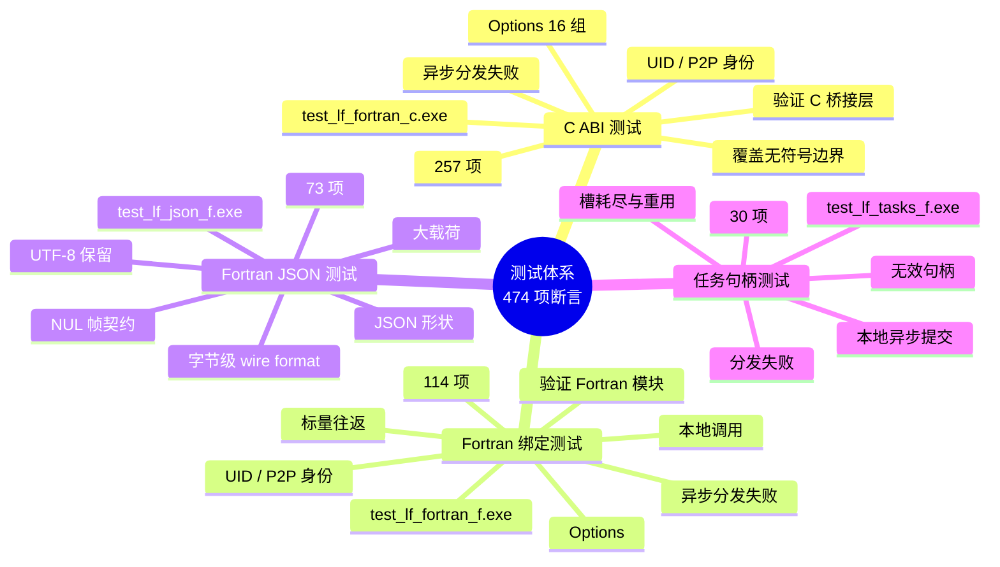

### 11.2 C ABI 测试（257 项）

**目标**：验证 `lf_fortran.h` + `lf_fortran.cpp` 对 C 侧的完备性与正确性。

| 类别 | 覆盖内容 |
|------|----------|
| 数据句柄标量 | 全部整数类型往返，含无符号边界 255 / 65535 / 0xDEADBEEF |
| 字符串 | 明文、UTF-8 多字节、NUL 终结、空串 |
| JSON | 简单对象、中文、空串 |
| **UID 二进制 I/O** | 32 字节定长往返、越界保护、NULL 拒绝 |
| **UID ↔ Hex** | 大小写、非法字符拒绝、输出未污染 |
| **P2P 身份** | 自建句柄返回全零 / 空串 |
| 本地调用 | Call 注册、Notify 注册、add(5,7)=12 |
| **App 反注册** | 二次反注册被拒绝 |
| **P2P 注册** | 注册、重复拒绝、反注册、重注册 |
| App 名 | 缓冲区太小返回 -2 |
| **Options 通用** | 已知 / 未知键、缓冲区太小 |
| **Options 快捷** | 16 组全往返，password 掩码，debug 占位符 |
| **查询函数** | 离线全返回 false |
| **异步分发失败** | 返回 0，回调同步触发一次，result 为 NULL |

**为什么用 C 而不只用 Fortran**：C 有真正的 `uint8_t` / `uint16_t` / `uint32_t` 类型，可以做完整的无符号边界测试。Fortran 没有无符号类型，这部分必须由 C 承担。

### 11.3 Fortran 绑定测试（114 项）

**目标**：验证 `lf_fortran_mod.f90` 对 C ABI 的正确封装。

| 类别 | 覆盖内容 |
|------|----------|
| 标量往返 | 有符号 / 无符号函数入口的管道畅通性 |
| 字符串 | 明文往返、size 包含 NUL |
| JSON | `{"a":1}` 往返 |
| **UID 二进制** | 顺序写入读回、逐字节比较 |
| **UID ↔ Hex** | 大小写、非法字符、空 hex |
| **P2P 身份** | 自建句柄契约、NULL 句柄拒绝 |
| 本地调用 | `c_funloc` 地址传递、`lf_local_call` 往返 |
| 重复注册 | 同名二次被拒绝 |
| **App 反注册** | 反注册成功、二次被拒 |
| **P2P 注册** | 注册 / 反注册 / 重注册 |
| App 名 | `allocatable` 返回值 |
| **Options 通用** | set / get / 未知键 |
| **Options 快捷** | 16 组全往返，`logical` ↔ `True`/`False` |
| **离线查询** | 全部返回 `.false.` |
| **异步分发失败** | 回调同步触发，result 为 NULL |

### 11.4 Fortran JSON 测试（73 项）

**目标**：把 C++ `test_lingofuse_json.cpp` 的思路完整移植到 Fortran 侧。

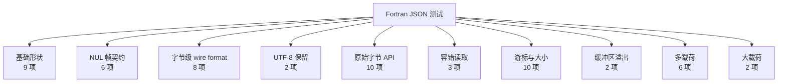

**关键类别：字节级 wire format** —— `{"a":1}` 必须产生**精确的 8 个字节**：

```
7B 22 61 22 3A 31 7D 00
│  │  │  │  │  │  │  └── NUL 帧
│  └──┴──┴──┴──┴──┘
└─ {"a":1}
```

这是与 Pascal / Python / C++ / C# / Rust / Go / JavaScript 互通的**基础契约**。

**关键类别：UTF-8 保留** —— 用 `char(228) // char(184) // char(173)` 构造"中"字的 UTF-8 字节序列，验证整个链路不做任何转码。emoji 用 `char(240) // char(159) // char(140) // char(141)`。

### 11.5 任务句柄测试（30 项）

**目标**：验证 `lf_fortran_tasks.f90` 的槽表管理、原子访问、异步提交。

| 类别 | 覆盖内容 |
|------|----------|
| 无效句柄 | `slot = 0` 时所有操作安全返回 |
| 本地异步提交 | service + client + app + `lf_async_submit` 完整往返 |
| 分发失败 | 无 client 时回调同步触发，任务 ready 但 `ok = .false.` |
| 槽耗尽 | 提交 256 次，验证部分成功、部分失败 |
| 槽重用 | free 后可再次 acquire |

### 11.6 跨语言 Demo（4 个进程）

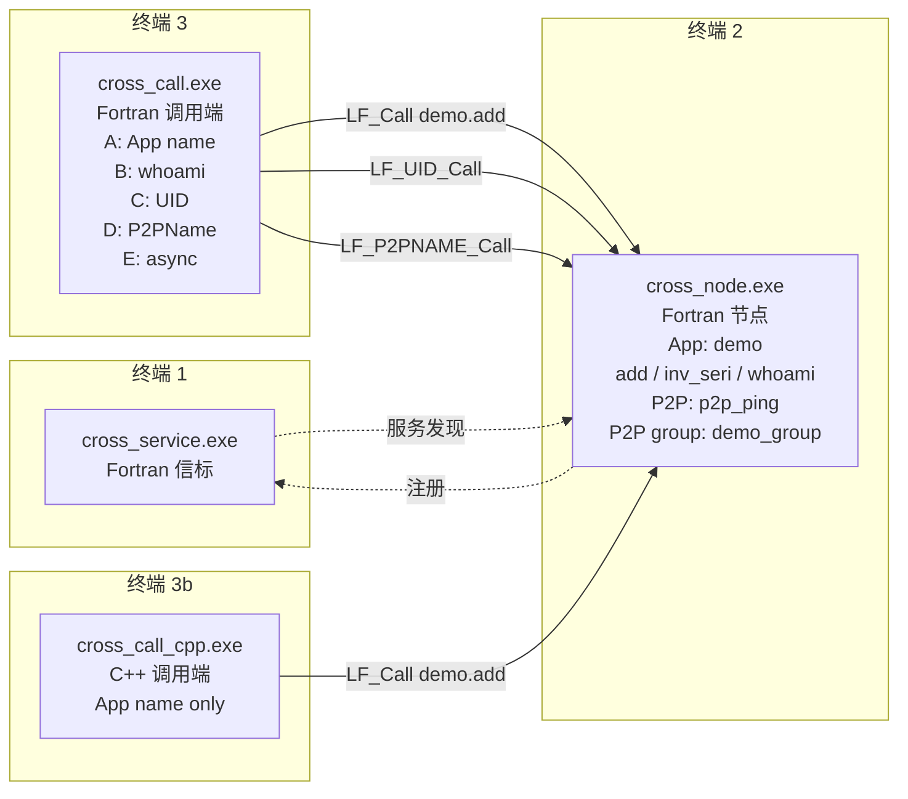

**一键启动**：

```powershell
.\run_cross_demo.ps1
```

它自动：
1. 在新窗口启动 `cross_service.exe`（信标）
2. 在新窗口启动 `cross_node.exe`（Fortran 节点）
3. 等待 5 秒（等 mesh 广播传播）
4. 在主窗口运行 `cross_call.exe`（Fortran 调用端，5 段演示）
5. 在主窗口运行 `cross_call_cpp.exe`（C++ 调用端，跨语言验证）

**预期输出**：

- `cross_call.exe` → `success : 32, failed : 0`
- `cross_call_cpp.exe` → `success : 25, failed : 0`

---

## 十二、测试与应用场景对照

### 12.1 场景分类

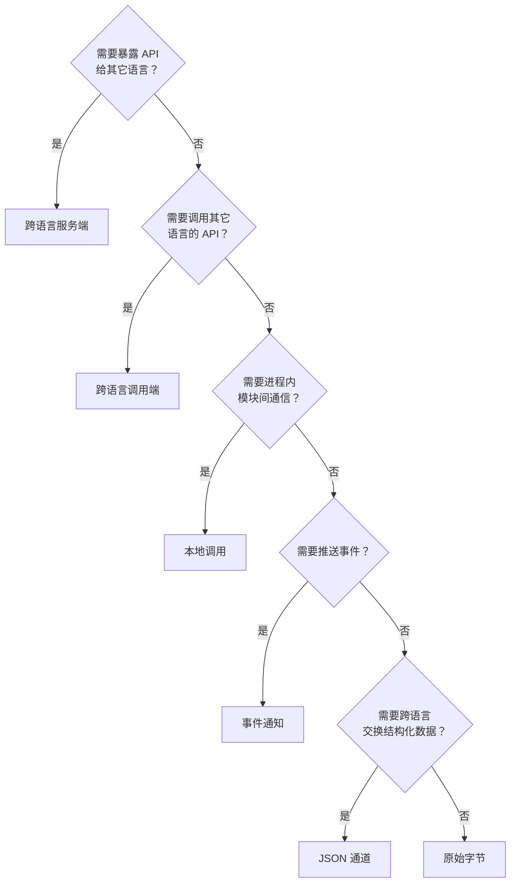

### 12.2 测试与场景映射

| 应用场景 | 对应测试套件 | 关键测试项 | 真实业务示例 |
|----------|--------------|-----------|-------------|
| **跨语言服务端**：Fortran 函数被 Python / C++ 调用 | `test_lf_fortran_f.exe` + `cross_node.exe` | `lf_app_register_call`、`add_callback` | 数值计算服务、仿真内核 |
| **跨语言调用端**：Fortran 调用 C++ / Python 写的 API | `cross_call.exe` + `cross_call_cpp.exe` | `lf_call`、`lf_data_read_int32` | 调用已有的 C++ 数据处理库 |
| **进程内模块间通信**：绕过网络的快速路径 | `test_lf_fortran_f.exe` | `lf_local_call`、`register_call` | 单进程内的模块解耦 |
| **事件通知**：单向推送、状态广播 | `test_lf_fortran_f.exe` | `lf_app_register_notify`、`lf_notify` | 日志采集、进度上报 |
| **JSON 数据交换**：与 HTTP / Web / LLM 对接 | `test_lf_json_f.exe` | `lf_data_write_json`、`lf_data_read_json` | REST API 网关、LLM 工具调用 |
| **二进制协议**：自定义字节格式 | `test_lf_json_f.exe` | `lf_data_write_bytes`、`lf_data_read_all_bytes` | 视频帧、传感器流、Protobuf |
| **大载荷传输**：MB 级消息 | `test_lf_json_f.exe` | `test_large_json` | 大矩阵、图像、日志文件 |
| **跨语言字节互通**：与 Pascal / C++ 对齐 | `cross_call_cpp.exe` | `add` 和 `inv_seri` 的字节序列 | 多语言混合部署 |
| **UID 定向调用**：向特定客户端推送 | `cross_call.exe` Section C | `lf_call_uid`、`lf_check_uid` | 会话管理、通知特定用户 |
| **P2PName 组播**：1 对多负载均衡 | `cross_call.exe` Section D | `lf_call_p2pname` | 无状态 worker 集群 |
| **异步调用**：提交后不阻塞 | `cross_call.exe` Section E + `test_lf_tasks_f.exe` | `lf_async_call`、`lf_async_submit` | 长任务提交、事件驱动 |
| **服务发现与身份识别**：whoami 模式 | `cross_call.exe` Section B | `lf_data_get_p2p_uid`、`lf_data_get_p2p_name` | 客户端自发现、多租户 |
| **弹性集群启动**：节点无序启动 | `cross_node.exe` | `Wait_Ready=False` | K8s / Docker 集群 |

### 12.3 典型场景详解

#### 场景 A：数值计算服务

**业务**：Fortran 写的求解器被 Python 的 ML 管线调用。

| 步骤 | 代码 |
|------|------|
| 1 | `app = lf_app_create('Solver', 'Linear solver')` |
| 2 | `rc = lf_app_register_call(app, 'solve', ..., c_funloc(solve_callback))` |
| 3 | `rc = lf_prepare_client('ipc:solver', app)` |
| 4 | Python 端 `c.solve(matrix_data)` |

#### 场景 B：LLM 工具调用

**业务**：Fortran 的算法暴露为 LLM 的工具，通过 MCP 协议调用。

**数据流**：LLM → MCP Server → Python bridge → LingoFuse → Fortran 节点。JSON 载荷经 Fortran 的 `lf_data_read_json` / `lf_data_write_json` 处理。

#### 场景 C：实时数据流

**业务**：传感器数据以二进制格式高频推送到 Fortran 处理。

| 步骤 | 对应测试 |
|------|----------|
| 二进制帧以 `lf_data_write_bytes` 写入 | `test_fault_tolerant` |
| 帧内含嵌入 NUL | `test_raw_bytes` |
| 接收方一次读全帧 | `read_all_bytes` 测试项 |

#### 场景 D：多语言混合网格

**业务**：C++ 前端 + Fortran 计算核心 + Python 训练后端，通过同一 mesh 通信。

**关键验证**：`cross_call_cpp.exe` 调用 `cross_node.exe`（Fortran），且 `cross_call.exe`（Fortran）用 5 种方式调用同一个节点。

#### 场景 E：Worker 集群（P2PName 组播）

**业务**：启动 N 个同质 worker，客户端把任务提交到组。

```fortran
! Worker：加入组
call lf_set_opt_p2p_name('compute_group')

! 客户端：提交任务到组，服务端自动负载均衡
resp = lf_call_p2pname('compute_group', req, 5000_c_int64_t)
```

#### 场景 F：会话定向（UID）

**业务**：服务端需要给**特定的**客户端推送消息。

```fortran
! 从某次回调中获取调用方的 UID
subroutine on_register(input, output) bind(C)
    type(c_ptr), value :: input, output
    integer(c_int8_t) :: uid(LF_UID_BYTE_COUNT)
    if (lf_data_get_p2p_uid(input, uid) /= 1) return
    ! 保存 uid 到会话表
end subroutine

! 稍后定向推送
call lf_notify_uid(saved_uid, req)
```

---

## 十三、故障排查

### 13.1 决策树

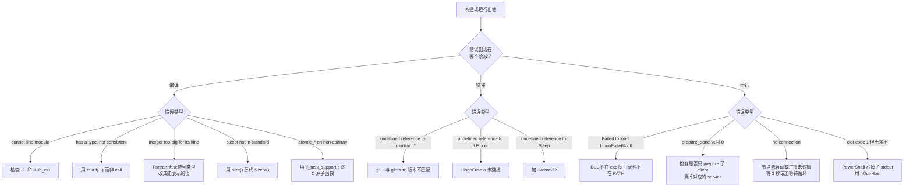

### 13.2 常见错误速查

| 错误信息 | 根因 | 修复 |
|----------|------|------|
| `Cannot open module file 'lf_fortran_mod.mod'` | 模块未编译或路径不对 | `make clean && make` 重来；确认 `-J.` 和 `-I../c_ext` 生效 |
| `has a type, not consistent with CALL` | 把函数当子程序调用 | 用 `rc = f(...)` 或 `if (f(...) /= 1)` |
| `Integer too big for its kind` | 数值超出有符号 kind 范围 | Fortran 无无符号类型；换成能表示的值 |
| `Function 'sizeof' has no IMPLICIT type` | 用了 GNU 扩展 | 改 `size(buf)` |
| `'atomic_cas' at (1) shall be a coarray` | 用了 F2018 协程内建 | 改用 `lf_task_support.c` 的 C 原子函数 |
| `undefined reference to __gfortran_*` | g++ 与 gfortran 版本不匹配 | 用同一套工具链 |
| `undefined reference to Sleep` | 未链接 kernel32 | `Makefile` 里加 `-lkernel32` |
| `f77: command not found` | `Makefile` 用了 `FC ?=`，未覆盖 make 内建默认 | 改用 `FC = gfortran` |
| `Failed to load LingoFuse64.dll` | 运行时库找不到 | 放到 exe 同目录或加 PATH |
| `prepare_done returned 0` | 连接超时（只 prepare 了 client 没有 service） | 补上 `lf_prepare_service` |
| `"demo" no connection` | 目标节点不在 mesh 上 | 检查节点是否运行；等 3 秒或加等待循环 |
| `exit code 1 但屏幕空白` | PowerShell 吞掉了原生输出 | 脚本里用 `\| Out-Host` |
| `LF_PrepareClient returned -1` | 地址重复 | 换地址或设 `Overlap_Connection=True` |
| 中文显示成乱码 | 控制台代码页不是 UTF-8 | `chcp 65001` 切到 UTF-8 |

### 13.3 调试技巧

**开启详细日志**：

```fortran
call lf_set_opt_console_output(.true.)
call lf_set_opt_quiet(.false.)
call lf_set_opt_show_thread_id(.true.)
```

**查看 LingoFuse 内部日志**：

```fortran
character(len=:), allocatable :: msg
do while (lf_get_status_count() > 0)
  call lf_get_status(msg)
  if (len(msg) > 0) write(*, '(A,A)') '[LF] ', msg
end do
```

**检查 mesh 状态**：

```fortran
if (lf_check_main_thread()) write(*, *) 'Framework running'
if (lf_check_app('demo'))    write(*, *) 'demo visible'
if (lf_check_api('demo', 'add')) write(*, *) 'demo.add visible'

! 如果你有目标 UID：
if (lf_check_uid(target_uid)) write(*, *) 'target online'
if (lf_check_uid_api(target_uid, 'add')) write(*, *) 'target exposes add'

! 如果你有目标 P2PName：
if (lf_check_p2pname('compute_group')) write(*, *) 'group exists'
```

---

## 附录 A：核心代码提示

### A.1 添加回调的标准范式

```fortran
module my_callbacks
  use iso_c_binding
  use lf_fortran_mod
  implicit none
  private
  public :: my_callback
contains
  subroutine my_callback(input, output) bind(C)
    type(c_ptr), value :: input, output
    ! ... 读 input，写 output
  end subroutine
end module

! 在 program 中：
use my_callbacks
! ...
if (lf_app_register_call(app, 'myapi', 'desc', &
                         c_funloc(my_callback)) /= 1) stop
```

### A.2 四个必须记住的点

1. **回调必须用 `bind(C)` 且放在 module 里**。program 内部的过程无法用 `c_funloc` 取地址。
2. **写入函数是 Function**，必须 `rc = f(...)` 或 `if (f(...) /= 1)`。
3. **读取字符串是 Subroutine**，用 `call lf_data_read_string(h, out)`。
4. **查询函数返回 `logical`**，直接用 `if (lf_check_app('demo'))`，不要再写 `/= 0`。

### A.3 自包含单进程测试的标准结构

```fortran
call lf_reset_prepare()

! 1. 创建 app 并注册 API
app = lf_app_create('MyTestApp', 'test')
rc = lf_app_register_call(app, 'echo', 'echo', c_funloc(echo_cb))

! 2. 同时准备 service 和 client（缺一不可！）
rc = lf_prepare_service('ipc:my_test', 'ipc:my_test')
rc = lf_prepare_client ('ipc:my_test', app)

! 3. 启动框架
rc = lf_prepare_done()

! 4. 等待 app 可见（广播延迟约 3 秒）
do i = 1, 50
  if (lf_check_app('MyTestApp')) exit
  call sleep_ms(100)
end do

! 5. 测试调用
! ...

! 6. 清理
call lf_exit_main_thread()
call lf_app_destroy(app)
call lf_shutdown()
```

---

## 附录 B：与其它绑定的对照

| 功能 | Fortran | C++ | Python | C# |
|------|:-------:|:---:|:------:|:--:|
| 创建句柄 | `lf_data_create` | `DataHandle h("api")` | `DataHandle("api")` | `new DataHandle("api")` |
| 写 int32 | `lf_data_write_int32` | `h.write<int32_t>(42)` | `h.write_int32(42)` | `h.WriteInt32(42)` |
| 写 JSON | `lf_data_write_json` | `h.writeJson(obj)` | `h.write_json(obj)` | `LfIo.WriteJson(h, obj)` |
| 读 JSON | `lf_data_read_json` | `h.readJson()` | `h.read_json()` | `LfIo.ReadJson<T>(h)` |
| 注册回调 | `lf_app_register_call` + `c_funloc` | `app.registerCall` | `@app.expose` | `app.RegisterCall` |
| 远程调用 | `lf_call` | `lingofuse::call` | `call()` | `Framework.Call` |
| **UID 定向调用** | `lf_call_uid` | `callAsyncByUid` | — | — |
| **P2PName 组播** | `lf_call_p2pname` | `callAsyncByP2PName` | — | — |
| **P2P 身份读取** | `lf_data_get_p2p_uid` / `lf_data_get_p2p_name` | `DataHandle::getP2PUid` | — | — |
| **异步回调式** | `lf_async_call` + `c_funloc` | `callAsync` | — | — |
| **异步任务句柄式** | `lf_async_submit` + `lf_task_*` | — | — | — |
| 网络事件 | `lf_set_network_event` | `setNetworkEvent` | `set_network_event` | `NetworkEvents.Set` |
| Options | `lf_set_opt_*` / `lf_get_opt_*` | `lingofuse::setOption` | — | — |

**线格式完全一致**：同一逻辑载荷 `{"a":1}` 在任意两种语言间往返，字节序列都是 `7B 22 61 22 3A 31 7D 00`。

---

*LingoFuse Fortran 绑定版本 1.1*
*最后更新：2026-10-16*
*覆盖：59 个 C ABI 导出符号 + 任务句柄扩展 + 5 种寻址方式*