# The LingoFuse Fortran binding

> Call functions written in other languages directly from Fortran — and let other languages call
> Fortran functions directly.
> No IDL, no stub generation, no hand-written HTTP service.

> Chinese version: [README.md](README.md)

---

## Contents

1. [Before you start](#1-before-you-start)
2. [Environment requirements](#2-environment-requirements)
3. [Compiler and toolchain requirements](#3-compiler-and-toolchain-requirements)
4. [Code responsibilities in the c_ext directory](#4-code-responsibilities-in-the-c_ext-directory)
5. [How to build](#5-how-to-build)
6. [How the interface works](#6-how-the-interface-works)
7. [How to use the Fortran interface](#7-how-to-use-the-fortran-interface)
8. [API quick reference](#8-api-quick-reference)
9. [The three addressing modes](#9-the-three-addressing-modes)
10. [The two styles of async programming](#10-the-two-styles-of-async-programming)
11. [Test projects](#11-test-projects)
12. [Test-to-scenario mapping](#12-test-to-scenario-mapping)
13. [Troubleshooting](#13-troubleshooting)

---

## 1. Before you start

### 1.1 Goal

Make Fortran a **first-class citizen** of LingoFuse:

- Fortran functions can be called by Pascal / Python / C++ / C# / Rust / Go / JavaScript / Dart /
  Java / Swift / Zig / Erlang / Ruby.
- Fortran code can call functions written in any of those languages.
- The underlying byte format is **exactly the same** as every other binding.

### 1.2 Current coverage (v1.1)

The Fortran binding covers **all 59 exported symbols** of the LingoFuse C ABI, and additionally
provides:

| Capability | Notes |
|------|------|
| **three addressing modes** | App name / UID / P2PName |
| **P2P identity reads** | `lf_data_get_p2p_uid` / `lf_data_get_p2p_name` |
| **UID binary I/O** | `lf_data_write_uid` / `lf_data_read_uid` / `lf_uid_to_hex` / `lf_uid_from_hex` |
| **process-level P2P registration** | `lf_register_p2p_call` / `lf_register_p2p_notify` / `lf_unregister_p2p` |
| **async calls (two styles)** | callback style `lf_async_call`; task-handle style `lf_async_submit` / `lf_task_*` |
| **16 typed Options shortcuts** | `lf_set_opt_*` / `lf_get_opt_*` |

The cross-language demo shows 5 addressing / calling patterns: **App name → whoami identity
discovery → UID targeting → P2PName multicast → async callback**.

### 1.3 Why a C++ intermediate layer is needed

Fortran's `iso_c_binding` can call C functions directly, but LingoFuse's dynamic library carries,
at the ABI level, a body of conveniences provided by a C++ RAII wrapper — especially **callbacks,
exception isolation and a uniform I/O policy**. Wiring Fortran straight to LingoFuse's bare C ABI
would mean reimplementing all those conveniences, which is expensive and prone to detail bugs.

So the structure uses four layers:

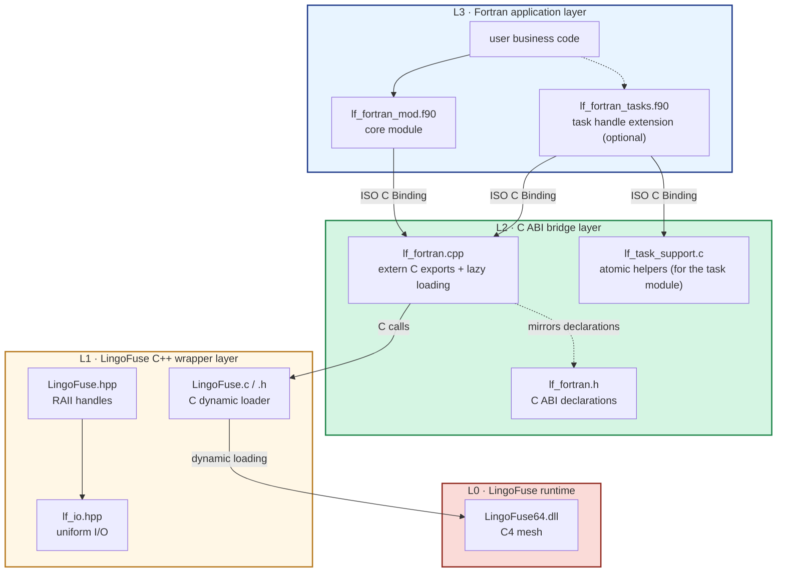

**A clear division of labour**:

| Layer | Language | Responsibility |
|----|------|------|
| L3 | Fortran | business logic, algorithms, numerics |
| L2 | C++ / C | cross-language ABI bridging, error-code translation, string codecs, callback trampolines, atomic helpers |
| L1 | C / C++ | RAII resource management, uniform JSON/string/byte I/O, dynamic library loading |
| L0 | Pascal | the C4 service mesh, IPC/TCP transport, load balancing, service discovery |

---

## 2. Environment requirements

### 2.1 Operating system

| Platform | Minimum version | Verified |
|------|----------|:------:|
| Windows 10 | 1809+ | ✅ Windows 10 / 11 x64 |
| Windows 11 | any | ✅ |
| Windows Server | 2019+ | ⏳ |
| Linux | a modern glibc | ⏳ theoretically feasible, not measured |
| macOS | 12+ | ⏳ theoretically feasible, not measured |

The current binding is **fully verified on Windows x64 only**. The code paths for Linux / macOS are
already reserved (`bind(C)` and `extern "C"` are both cross-platform standards), but they have never
been run on real machines.

### 2.2 Software dependency overview

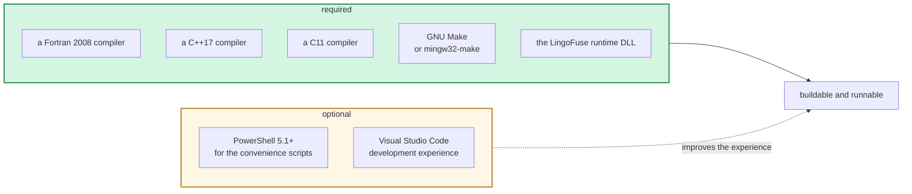

### 2.3 The LingoFuse runtime (required)

The core dynamic libraries come from the `Binary/` directory of the LingoFuse main repository.
Windows x64 needs the following files:

| File | Purpose |
|------|------|
| `LingoFuse64.dll` | the C4 service mesh and RPC engine |
| `z_ipc_64.dll` | same-machine IPC transport |
| `mimalloc64.dll` | the high-performance memory allocator |
| `mimalloc-redirect.dll` | allocator redirection (optional, but recommended alongside) |

**How to place them**: put all 4 files next to the exe, or add their directory to the system
`PATH`. `LF_LoadLibrary` in `LingoFuse.c` searches in that order automatically, with no explicit
configuration needed.

### 2.4 The list of build artifacts

After a successful build, the `c_ext\` directory should contain:

| File | Type | Notes |
|------|------|------|
| `LingoFuse.o` | intermediate | the C dynamic loader + C typed helpers |
| `lf_fortran.o` | intermediate | the C++ bridge layer |
| `lf_task_support.o` | intermediate | C atomic helpers |
| `lf_fortran_mod.o` / `.mod` | intermediate | the Fortran core module |
| `lf_fortran_tasks.o` / `.mod` | intermediate | the Fortran task handle module |
| `test_lf_fortran_c.exe` | executable | C ABI test (257 assertions) |
| `test_lf_fortran_f.exe` | executable | Fortran binding test (114 assertions) |
| `test_lf_json_f.exe` | executable | Fortran JSON test (73 assertions) |
| `test_lf_tasks_f.exe` | executable | Fortran task handle test (30 assertions) |

The `cross_demo\` directory should contain:

| File | Type | Notes |
|------|------|------|
| `cross_service.exe` | executable | the Fortran beacon (coordinator) |
| `cross_node.exe` | executable | the Fortran compute node |
| `cross_call.exe` | executable | the Fortran caller (5 demo sections) |
| `cross_call_cpp.exe` | executable | the C++ caller (cross-language verification) |

---

## 3. Compiler and toolchain requirements

### 3.1 Three compilers, each with its own job

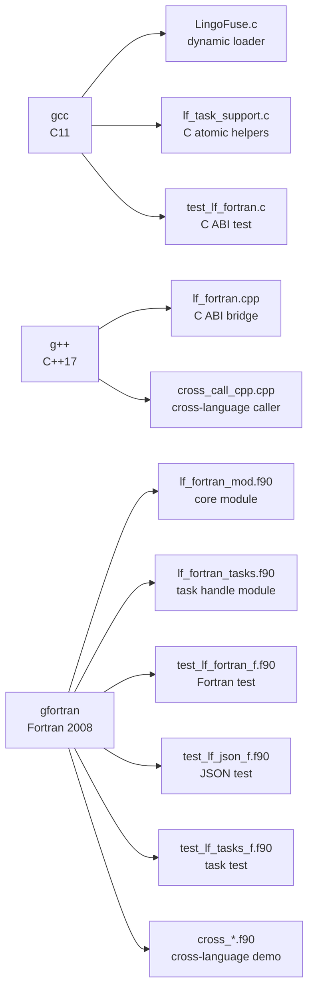

### 3.2 Compiler requirements per source file

| Source file | Language standard | Required compiler features |
|--------|----------|------------------|
| `LingoFuse.c` | **C11** | dynamic loading (`LoadLibraryA` / `dlopen`), `int64_t` / `uint64_t`, function pointers |
| `lf_task_support.c` | **C11** | the `__atomic_*` builtins (GCC/Clang) or `Interlocked*` (MSVC) |
| `lf_fortran.cpp` | **C++17** | `extern "C"` exports, `std::once_flag`, `try / catch (...)`, `reinterpret_cast` |
| `lf_fortran_mod.f90` | **Fortran 2008** | `iso_c_binding`, `bind(C)`, `c_funloc`, `allocatable character` |
| `lf_fortran_tasks.f90` | **Fortran 2008** | the same as above; no dependency on any F2018 coarray feature |
| `test_lf_fortran.c` | **C11** | variadic macros, `inttypes.h` |

**Minimum compiler versions**:

| Compiler | Minimum version | Recommended |
|--------|:--------:|:----:|
| GCC / MinGW-w64 | 9.0 | 13.0+ |
| Clang | 10.0 | 17.0+ |
| MSVC | 2019 (19.20) | 2022 |
| gfortran | 9.0 | 13.0+ |

**Version consistency requirement**:

> ⚠️ **The C++ compiler and the Fortran compiler must come from the same toolchain.**

The reason: linking Fortran object files uses the C++ linker with `-lgfortran` attached. If the
`g++` version and the `gfortran` version differ, you get missing symbols such as
`undefined reference to __gfortran_*`.

The three compilers inside one MinGW-Builds / MSYS2 / WinLibs distribution are consistent by
construction.

### 3.3 Language features the Fortran compiler must support

| Feature | Standard | Purpose |
|------|:----:|------|
| the `iso_c_binding` module | F2003 | all C interop |
| the `bind(C)` procedure attribute | F2003 | callback registration |
| `c_funloc` / `c_funptr` / `c_ptr` / `c_associated` | F2003 | passing callbacks, null-pointer checks |
| `allocatable` + `character(len=:)` | F2003 | returning dynamic strings |
| the `int(x, kind)` conversion function | F2003 | type safety |
| the `size(arr)` / `len(str)` builtins | F2003 | buffer size computation |
| the `transfer()` builtin | F90 | reinterpreting byte sequences ↔ numerics |

Using `block ... end block` (an F2008 addition) is **not recommended**: the Fortran plugins of some
IDEs support it poorly, and this binding deliberately avoids it.

**Not used**: `atomic_cas` / `atomic_define` / `atomic_ref` (F2018 coarray builtins). All atomic
operations are pushed down to the C layer.

### 3.4 The verified toolchain

| Component | Version | Source |
|------|------|------|
| gfortran | 16.1.0 | MinGW-Builds x86_64-win32-seh-rev1 |
| g++ | 16.1.0 | the same |
| gcc | 16.1.0 | the same |
| GNU Make | mingw32-make | shipped with MinGW-Builds |

---

## 4. Code responsibilities in the c_ext directory

`c_ext/` is the core directory of the binding layer. Every source file has a single, well-defined
responsibility.

### 4.1 File list and responsibilities

| File | Language | Responsibility | Exports symbols |
|------|:----:|------|:------------:|
| `LingoFuse.h` | C | declares the LingoFuse runtime C ABI (59 exported symbols). Defines no implementation. | yes (declarations) |
| `LingoFuse.c` | C | implements dynamic library loading (`LF_LoadLibrary` / `LF_FreeLibrary`) and the C typed helpers (`LF_WriteInt32` / `LF_ReadString` / `LF_Set_Opt_Quiet` and others). | yes (implementation) |
| `LingoFuse.hpp` | C++ | LingoFuse's official C++17 RAII wrapper (`DataHandle` / `App` / `LibraryLoader`). **The Fortran binding does not depend on it**; it is provided for cross-language developers. | no |
| `lf_io.hpp` | C++ | the uniform JSON / string I/O layer. **The Fortran binding does not depend on it**. | no |
| `json.hpp` | C++ | single-file nlohmann/json. **The Fortran binding does not depend on it**. | no |
| `lf_fortran.h` | C | **the C ABI contract this binding exposes** (about 55 symbols + types + constants). All `bind(C)` declarations mirror this file. | yes (the contract) |
| `lf_fortran.cpp` | C++ | **implements every symbol in `lf_fortran.h`**. Handles UID array ↔ `TP2P_UID` struct conversion, the async callback trampoline, exception absorption, lazy loading. | yes (implementation) |
| `lf_task_support.h` | C | declares 3 atomic primitives (`lf_task_atomic_cas_int` / `_store_int` / `_load_int`). | yes (declarations) |
| `lf_task_support.c` | C | implements those atomic primitives. GCC/Clang use `__atomic_*`; MSVC uses `Interlocked*`. | yes (implementation) |
| `lf_fortran_mod.f90` | Fortran | **the core Fortran module**. Wraps all synchronous APIs, UID / P2P identity, Options, and callback-style async calls. | yes (Fortran module) |
| `lf_fortran_tasks.f90` | Fortran | **the optional extension module**. Wraps task-handle style async calls (`lf_async_submit` / `lf_task_*`). | yes (Fortran module) |
| `test_lf_fortran.c` | C | the C-side ABI test. 257 assertions. | no |
| `test_lf_fortran_f.f90` | Fortran | the Fortran core module test. 114 assertions. | no |
| `test_lf_json_f.f90` | Fortran | JSON / byte / string I/O tests. 73 assertions. | no |
| `test_lf_tasks_f.f90` | Fortran | the task handle async test. 30 assertions. | no |
| `Makefile` | Make | build rules. The complete dependency graph for the four test exes. | no |

### 4.2 Dependency directions

```mermaid
flowchart TB
    subgraph L3["Fortran application"]
        M["lf_fortran_mod.f90"]
        T["lf_fortran_tasks.f90"]
        TM["test_lf_*.f90"]
    end

    subgraph L2["C ABI bridge"]
        H["lf_fortran.h"]
        C["lf_fortran.cpp"]
        AH["lf_task_support.h"]
        AC["lf_task_support.c"]
    end

    subgraph L1["LingoFuse C loader"]
        LH["LingoFuse.h"]
        LC["LingoFuse.c"]
    end

    subgraph L0["runtime"]
        DLL["LingoFuse64.dll"]
    end

    M -->|USE| H
    T -->|USE| M
    T -->|bind(C)| AH
    TM -->|USE| M
    TM -->|USE| T

    C -->|include| H
    C -->|include| LH
    AC -->|include| AH

    LC -->|LoadLibrary| DLL
    C -->|LF_LoadLibrary| LC

    style L3 fill:#E8F4FF,stroke:#1E3A8A,stroke-width:2px
    style L2 fill:#D5F5E3,stroke:#1E8449,stroke-width:2px
    style L1 fill:#FFF7E6,stroke:#B7791F,stroke-width:2px
    style L0 fill:#FADBD8,stroke:#922B21,stroke-width:2px
```

### 4.3 Detailed responsibilities per file

#### 4.3.1 `LingoFuse.c` / `LingoFuse.h`

**Purpose**: wrap every exported symbol of the LingoFuse dynamic library (`LingoFuse64.dll`) into a
**statically linkable function pointer table**.

**Core functions**:

```c
int  LF_LoadLibrary(void);        // load the DLL and resolve all 59 symbols
void LF_FreeLibrary(void);        // unload the DLL and clear the function pointers

// typed helpers (implemented inside LingoFuse.c, not exported by the DLL)
int LF_WriteInt32(TDataHnd h, int32_t v);
int LF_ReadInt32(TDataHnd h, int32_t* out);
int LF_WriteString(TDataHnd h, const char* s);
int64_t LF_ReadString(TDataHnd h, char* buf, size_t n);
// ... 20+ helpers in total

// Options shortcut helpers (implemented inside LingoFuse.c)
void        LF_Set_Opt_Quiet(int value);
int         LF_Get_Opt_Quiet(void);
void        LF_Set_Opt_Overlap_Connection(int value);
// ... 32 helpers in total
```

**This is the only file that calls `LoadLibraryA` / `GetProcAddress` directly**. Every other file
reaches the DLL indirectly through function pointers.

#### 4.3.2 `lf_fortran.h` / `lf_fortran.cpp`

**Purpose**: rewrap the C interface of `LingoFuse.c` into a **Fortran-friendly ABI**.

**Key design decisions**:

| Decision | Rationale |
|------|------|
| UID as `const int8_t*` (an array) rather than a `TP2P_UID` struct | Fortran only has `c_int8_t`; array semantics map most directly onto a byte sequence |
| the P2P identity getters copy into the user buffer immediately | hides the ~5-second transient pointer of `LF_Get_P2P_UID` |
| async callbacks use `(void* user_data, void* result)` | matches the `submit_async_call` pattern on the C++ side |
| on dispatch failure the callback fires **synchronously** once | users need only one failure path (`if (!result_handle)`) |
| every `extern "C"` entry point is fully wrapped in `try/catch` | exceptions never cross into the Fortran stack |
| lazy loading uses `std::call_once` | thread-safe; loads automatically on the first `lf_*` call |

**The key UID conversion functions**:

```cpp
inline void uid_array_to_struct(const int8_t* src, TP2P_UID& dst) {
    std::memcpy(dst.bytes, src, 32);
}

inline void uid_struct_to_array(const TP2P_UID& src, int8_t* dst) {
    std::memcpy(dst, src.bytes, 32);
}
```

#### 4.3.3 `lf_task_support.h` / `lf_task_support.c`

**Purpose**: provide `lf_fortran_tasks.f90` with **cross-thread-safe atomic operations**.

**Why it is needed**: the Fortran 2008 standard does not allow `atomic_cas` / `atomic_define` /
`atomic_ref` on non-coarray variables (those three are F2018 coarray builtins). The task handle
module needs to share a little state (the slot status field) between the **main thread** and the
**TCompute worker thread**, so atomicity is pushed down to the C layer.

**The three primitives**:

```c
int  lf_task_atomic_cas_int(int* ptr, int expected, int new_val);  // returns the old value
void lf_task_atomic_store_int(int* ptr, int val);                  // release semantics
int  lf_task_atomic_load_int(const int* ptr);                      // acquire semantics
```

**Dual-path implementation**:
- **MSVC**: `InterlockedCompareExchange` / `InterlockedExchange`
- **GCC / Clang**: `__atomic_compare_exchange_n` / `__atomic_store_n` / `__atomic_load_n` (with explicit acquire/release memory ordering)

#### 4.3.4 `lf_fortran_mod.f90`

**Purpose**: the core module that Fortran applications **actually `use`**.

**What it wraps**:

| Category | Count | Notes |
|------|:----:|------|
| lifecycle | 4 | load / free / shutdown / exit_main_thread |
| App handles | 7 | create / destroy / register_call / register_notify / unregister / bind / get_name |
| Data handles | 3 | create / create_permanent / destroy |
| scalar I/O | 20 | 10 writes + 10 reads |
| bytes / strings / JSON | 9 | the full write / read family |
| Cursor / Size | 4 | get/set position, get/set size |
| **UID I/O** | 2 | write_uid / read_uid |
| **UID ↔ Hex** | 2 | to_hex / from_hex |
| **P2P identity** | 2 | get_p2p_uid / get_p2p_name |
| network preparation | 4 | reset / service / client / done |
| **App name calls** | 4 | call / local_call / notify / sequenced_notify |
| **UID calls** | 5 | call_uid / notify_uid / seq_notify_uid / check_uid / check_uid_api |
| **P2PName calls** | 5 | same structure |
| **async callback style** | 6 | call / sequenced_call × {app / uid / p2pname} |
| **process-level P2P registration** | 3 | register_p2p_call / register_p2p_notify / unregister_p2p |
| generic Options | 2 | set / get |
| **Options shortcuts** | 32 | 16 set + get pairs |
| queries | 3 | check_main_thread / check_app / check_api |
| status | 3 | get_status_count / get_status / post_status |
| network events | 1 | set_network_event |

#### 4.3.5 `lf_fortran_tasks.f90`

**Purpose**: an **optional extension module** offering a "callback-free" async call style.

**The core idea**:

```fortran
! submit, then return immediately
type(lf_task) :: t
t = lf_async_submit('demo', req)

! ... the main thread does other work ...

! non-blocking check
if (lf_task_is_ready(t)) then
    if (lf_task_is_ok(t)) then
        v = lf_task_read_int32(t)
    end if
    call lf_task_free(t)
end if
```

**Internal mechanics**:

1. **A fixed slot table**: `MAX_TASKS = 64`. Each slot has a status field (0 = free, 1 = waiting,
   2 = done) plus a result buffer (64 KB by default).
2. **One shared callback**: `task_callback` receives the slot index through `user_data` and copies
   the result into the slot.
3. **Slot status is read and written with the C atomic functions**: `lf_task_atomic_*`.
4. **`lf_task_free` refuses pending slots**: that prevents a callback from writing into a slot
   that has already been released.

#### 4.3.6 `Makefile`

**Purpose**: build the four test exes.

**Key rules**:

```makefile
# all three compilers must come from the same toolchain
CC  = gcc
CXX = g++
FC  = gfortran

# use = rather than ?= to override make's built-in defaults (CC = cc、FC = f77)
```

**Dependency graph**:

```
LingoFuse.o ← LingoFuse.c
lf_task_support.o ← lf_task_support.c
lf_fortran.o ← lf_fortran.cpp
lf_fortran_mod.o ← lf_fortran_mod.f90
lf_fortran_tasks.o ← lf_fortran_tasks.f90 + lf_fortran_mod.o

test_lf_fortran_c.exe ← test_lf_fortran.c + LingoFuse.o + lf_fortran.o
test_lf_fortran_f.exe ← test_lf_fortran_f.f90 + lf_fortran_mod.o + LingoFuse.o + lf_fortran.o
test_lf_json_f.exe ← test_lf_json_f.f90 + lf_fortran_mod.o + LingoFuse.o + lf_fortran.o
test_lf_tasks_f.exe ← test_lf_tasks_f.f90 + lf_fortran_tasks.o + lf_fortran_mod.o + lf_task_support.o + LingoFuse.o + lf_fortran.o
```

---

## 5. How to build

### 5.1 Directory structure

```
fortran/
├── README.md               this file
├── check_env.ps1           environment diagnostics script
├── build.ps1               build script
├── clean.ps1               clean script
├── test.ps1                test script
├── run_cross_demo.ps1      one-command launcher for the cross-language demo
├── verify_all.ps1          the full c_ext verification (clean → build → all tests)
│
├── c_ext/                  the C-ABI bridge layer + unit tests
│   ├── Makefile
│   ├── LingoFuse.h / .c    the LingoFuse C dynamic loader
│   ├── LingoFuse.hpp       LingoFuse's C++ RAII wrapper (for reference)
│   ├── lf_io.hpp           the uniform I/O layer (for reference)
│   ├── json.hpp            nlohmann/json (for reference)
│   ├── lf_fortran.h        the C ABI contract
│   ├── lf_fortran.cpp      the C ABI implementation
│   ├── lf_task_support.h   C atomic helper declarations
│   ├── lf_task_support.c   C atomic helper implementation
│   ├── lf_fortran_mod.f90  the Fortran core module
│   ├── lf_fortran_tasks.f90 the Fortran task handle module
│   ├── test_lf_fortran.c   the C ABI test
│   ├── test_lf_fortran_f.f90  the Fortran binding test
│   ├── test_lf_json_f.f90  the Fortran JSON test
│   └── test_lf_tasks_f.f90 the Fortran task test
│
└── cross_demo/             the cross-language demo
    ├── Makefile
    ├── cross_service.f90   the Fortran beacon
    ├── cross_node.f90      the Fortran compute node
    ├── cross_call.f90      the Fortran caller
    └── cross_call_cpp.cpp  the C++ caller
```

### 5.2 Building from scratch (5 steps)

```powershell
cd D:\CoreLibrary\LingoFuse\fortran

# step 1: diagnose the environment (optional but recommended)
.\check_env.ps1

# step 2: full clean
.\clean.ps1

# step 3: full build (c_ext + cross_demo)
.\build.ps1

# step 4: run every c_ext test
.\test.ps1 -SkipBuild
.\c_ext\test_lf_tasks_f.exe

# step 5: the cross-language demo (3 processes must be started manually, in order)
.\run_cross_demo.ps1
```

### 5.3 One-command verification

`verify_all.ps1` automatically does "clean → build c_ext → run the 4 tests → summarize":

```powershell
.\verify_all.ps1
```

**Expected output**:

```
  Test                           Status   Detail
  ------------------------------ -------- ------------------------
  C ABI test                     PASS
  Fortran binding test           PASS
  Fortran JSON test              PASS
  Task-handle async test         PASS

[OK] All c_ext tests passed.
```

### 5.4 Common commands

| Command | Notes |
|------|------|
| `.\build.ps1 -Target c_ext` | build only the C bridge layer and the tests |
| `.\build.ps1 -Target cross_demo` | build only the cross-language demo |
| `.\build.ps1 -MakeArgs '-j4'` | build in parallel with 4 threads |
| `.\test.ps1 -C -SkipBuild` | run only the C tests |
| `.\test.ps1 -F -SkipBuild` | run only the Fortran binding test |
| `.\test.ps1 -J -SkipBuild` | run only the Fortran JSON test |
| `.\c_ext\test_lf_tasks_f.exe` | run the task handle test manually |
| `.\run_cross_demo.ps1 -WaitSeconds 8` | the cross-language demo, with a longer wait |

### 5.5 PowerShell execution policy

If the first run fails with `file ... is not digitally signed`:

```powershell
# affects the current window only
Set-ExecutionPolicy -Scope Process -ExecutionPolicy Bypass

# or bypass it just for this invocation
powershell -ExecutionPolicy Bypass -File .\build.ps1
```

### 5.6 Environment diagnostics

`check_env.ps1` checks that the three compilers are present and that their versions match:

```powershell
.\check_env.ps1
```

It checks, in order:

| Check | Notes |
|--------|------|
| the operating system | Windows x64 |
| the PowerShell version | ≥ 5.1 |
| the Fortran compiler | gfortran or x86_64-w64-mingw32-gfortran |
| the C++ compiler | g++ or x86_64-w64-mingw32-g++ |
| the C compiler | gcc or x86_64-w64-mingw32-gcc |
| GNU Make | mingw32-make or make |
| version consistency | the C++ and Fortran compilers have the same major version |

---

## 6. How the interface works

### 6.1 Why Fortran cannot call LingoFuse directly

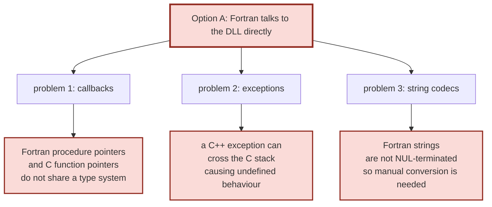

The C++ intermediate layer absorbs all three problems:

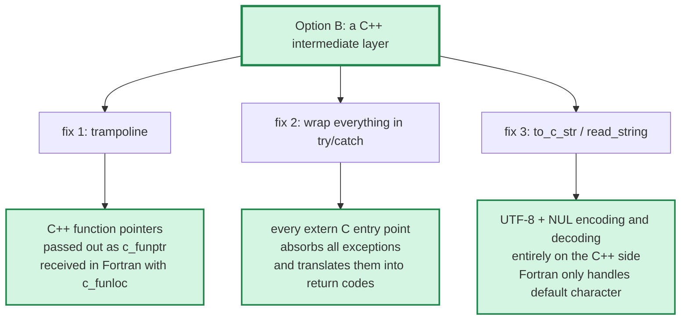

### 6.2 The callback mechanism: crossing three language boundaries

When a user registers a Fortran callback and a remote side issues a call, LingoFuse delivers it to
Fortran. On the way it crosses three layers: C4 → C++ → Fortran.

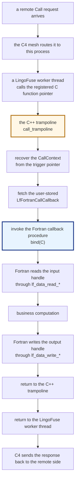

**The CallContext lifecycle**: the C++ bridge layer allocates a small struct per registered API,
deliberately **never frees** it after `new`, and passes the pointer to LingoFuse as `trigger`. That
is because LingoFuse may call back at any moment — including during deregistration. Reclaiming it
would open a use-after-free window; the price is a few dozen leaked bytes per API, negligible for
any real program.

### 6.3 String codecs: the NUL frame contract

Every cross-language string is **UTF-8 bytes + a single NUL**. Fortran's default
`character(len=*)` is not NUL-terminated and needs conversion.

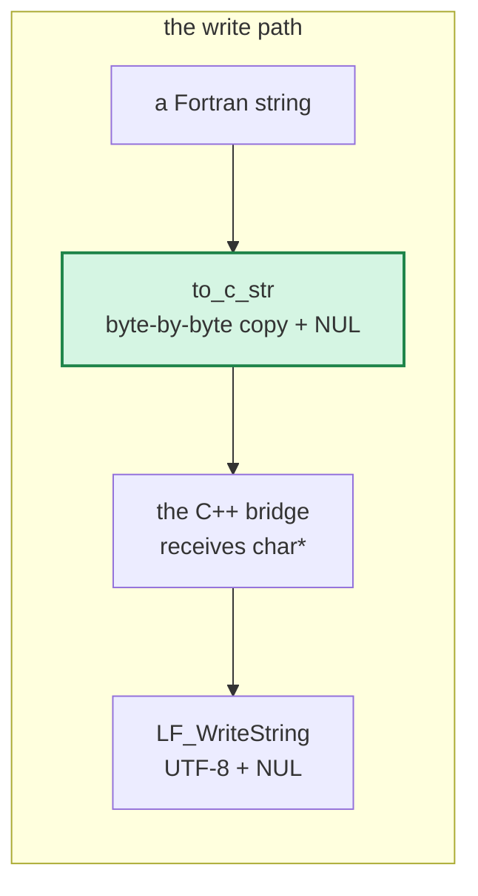

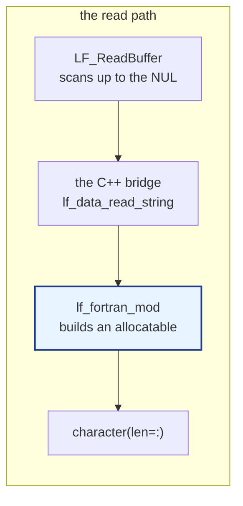

**Fault-tolerant reading**: if the buffer contains **no NUL** (for example bare JSON coming from an
HTTP bridge), the reader consumes the whole buffer and returns, with the cursor left at
`size + 1`. This is **byte-for-byte identical** to the behaviour of Pascal / C++ / C# / Python /
JavaScript.

### 6.4 The two lifecycles of data handles

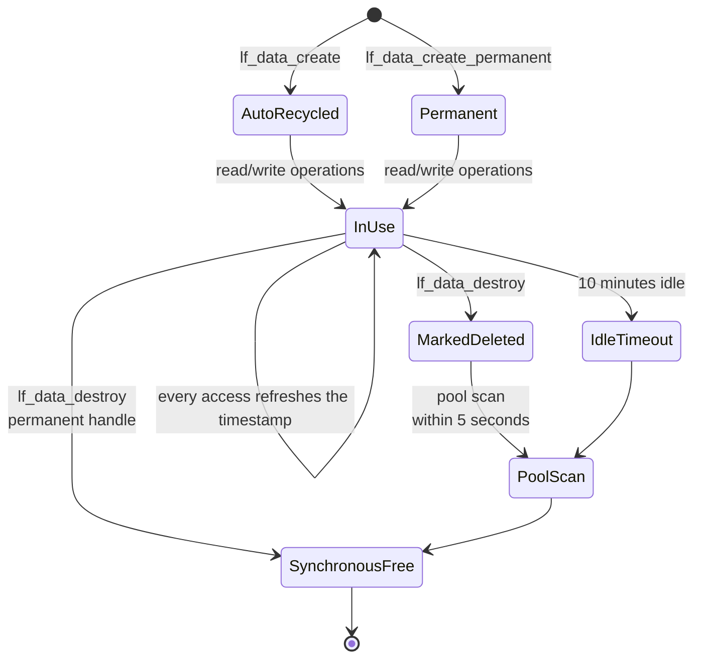

**Usage advice**:

- **use `lf_data_create` by default** (automatic reclamation). The pool catches handles you forget
  to release.
- **use `lf_data_create_permanent` only when the handle must outlive a process** (cached templates,
  global registries).
- **do not rely on automatic reclamation**: under heavy load the handle accumulation rate can
  exceed the reclamation rate. Always call `lf_data_destroy` explicitly.

### 6.5 The dynamic-library loading contract

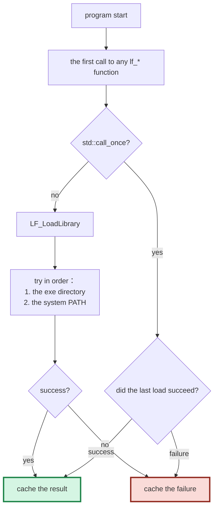

**The key point**: whether you call `lf_data_create` or `lf_check_app`, the C++ bridge layer first
runs `ensure_loaded` to make sure the dynamic library is loaded. **Users do not need to call
`lf_load_library` explicitly** — it exists anyway, for failing fast at program start.

---

## 7. How to use the Fortran interface

### 7.1 A minimal server

```fortran
module my_service_callbacks
  use iso_c_binding
  use lf_fortran_mod
  implicit none
  private
  public :: add_callback
contains
  subroutine add_callback(input, output) bind(C)
    type(c_ptr), value :: input, output
    integer(c_int32_t) :: a, b, s
    if (lf_data_read_int32(input, a) /= 1) return
    if (lf_data_read_int32(input, b) /= 1) return
    s = a + b
    if (lf_data_write_int32(output, s) /= 1) return
  end subroutine
end module

program server
  use iso_c_binding
  use lf_fortran_mod
  use my_service_callbacks
  implicit none
  type(c_ptr) :: app
  integer(c_int) :: rc
  character(len=8) :: line

  app = lf_app_create('Calculator', 'Fortran calculator')
  rc = lf_app_register_call(app, 'add', 'Add two ints', &
                            c_funloc(add_callback))

  call lf_set_opt_wait_ready_ok(.false.)   ! unordered startup
  call lf_reset_prepare()
  rc = lf_prepare_service('ipc:calc', 'ipc:calc')
  rc = lf_prepare_client('ipc:calc', app)
  rc = lf_prepare_done()

  write(*, '(A)') 'Ready. Press Enter...'
  read(*, '(A)') line

  call lf_exit_main_thread()
  call lf_app_destroy(app)
  call lf_shutdown()
end program
```

### 7.2 A minimal caller

```fortran
program client
  use iso_c_binding
  use lf_fortran_mod
  implicit none
  type(c_ptr) :: req, resp
  integer(c_int32_t) :: result
  integer(c_int64_t) :: sz
  integer :: i

  call lf_set_opt_wait_ready_ok(.false.)
  call lf_reset_prepare()
  call lf_prepare_client('ipc:calc', c_null_ptr)
  if (lf_prepare_done() /= 1) stop

  ! wait for the target to come online (broadcast latency ~3 seconds)
  do i = 1, 50
    if (lf_check_app('Calculator')) exit
    call sleep_ms(100)
  end do

  req = lf_data_create('add')
  if (lf_data_write_int32(req, 5_c_int32_t) /= 1) stop
  if (lf_data_write_int32(req, 5_c_int32_t) /= 1) stop

  resp = lf_call('Calculator', req, 3000_c_int64_t)
  if (c_associated(resp)) then
    sz = lf_data_get_size(resp)
    if (sz >= 4) then
      if (lf_data_read_int32(resp, result) == 1) then
        write(*, '(A,I0)') '5 + 5 = ', result
      end if
    end if
    call lf_data_destroy(resp)
  end if
  call lf_data_destroy(req)

  call lf_exit_main_thread()
  call lf_shutdown()
end program
```

### 7.3 Function vs subroutine: the single most important rule

This is the pitfall of the Fortran binding: **some APIs are functions (returning an integer status
code / a logical value / a handle) and some are subroutines (returning nothing)**.

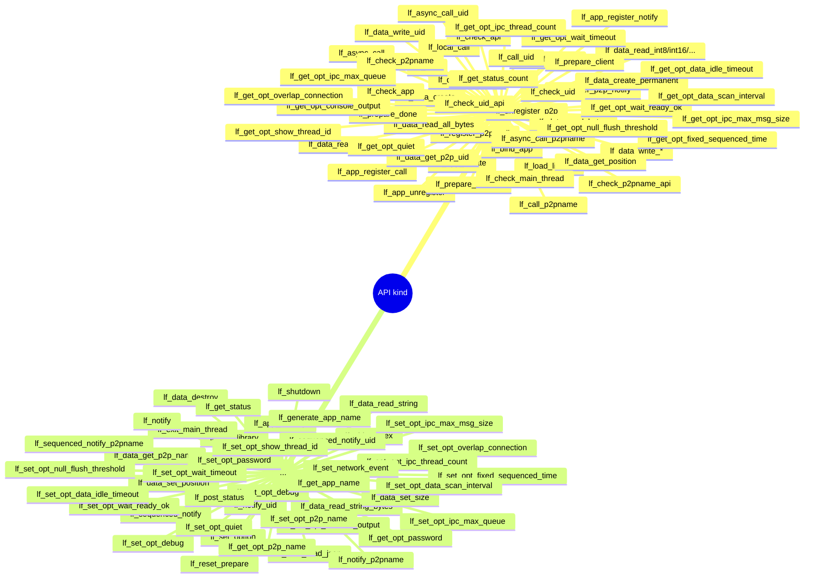

**The decision rule**:

| Does it return a value? | Kind | How to call |
|:---------------:|------|----------|
| yes (status code / handle / size / logical) | Function | `rc = f(...)` or `if (f(...))` / `if (f(...) /= 1)` |
| no | Subroutine | `call s(...)` |

In `lf_fortran_mod.f90` every function is declared as `function` and every subroutine as
`subroutine`. Get it wrong and the compiler reports
`'xxx' has a type, not consistent with CALL`.

### 7.4 Application pattern: service registration and calls

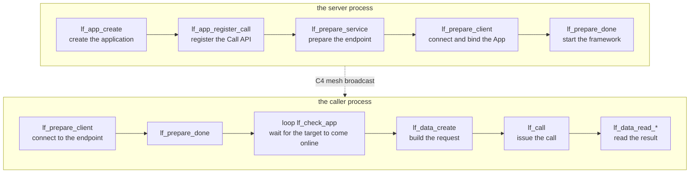

**Core rules**:

1. **register the API first, then `prepare_client`**. If you reverse the order the registration is
   not included in the broadcast, and other processes cannot see the API you registered.
2. **the caller must wait for the target to come online**. Poll with `lf_check_app` /
   `lf_check_api`, with a 5–10 second timeout.
3. **broadcast propagation takes about 3 seconds**. A freshly started node does not appear on the
   whole mesh immediately.
4. **a self-contained single-process test** (service + client + local app) must call **both**
   `prepare_service` and `prepare_client`, otherwise `prepare_done` returns 0 on timeout.

### 7.5 The cleanup order

**Follow it strictly** (matching Pascal's LF-CLEAN-001 contract):

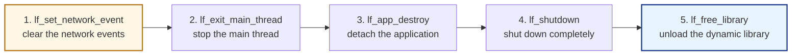

**Why the order matters**:

- `lf_exit_main_thread` clears **all data handles**, including permanent ones. Using a handle
  afterwards crashes.
- `lf_app_destroy` must precede `lf_shutdown`. The reverse touches an already destroyed pool.
- `lf_free_library` must come last. It is the bridge layer's own action, not LingoFuse's runtime.

Every step is idempotent, so wrapping them in `try / finally` or calling them repeatedly is safe.

---

## 8. API quick reference

### 8.1 Lifecycle

| Function | Kind | Notes |
|------|:----:|------|
| `lf_load_library()` | Function → int | load the dynamic library explicitly (optional; the bridge layer lazy-loads) |
| `lf_free_library()` | Subroutine | unload the dynamic library |
| `lf_shutdown()` | Subroutine | shut the LingoFuse framework down completely |
| `lf_exit_main_thread()` | Subroutine | ask the main thread to exit; clears all data handles |

### 8.2 Application handles

| Function | Kind | Notes |
|------|:----:|------|
| `lf_app_create(name, desc)` | Function → c_ptr | create an application |
| `lf_app_destroy(app)` | Subroutine | detach the application |
| `lf_app_register_call(app, api, desc, c_funloc(cb))` | Function → int | register a Call API |
| `lf_app_register_notify(app, api, desc, c_funloc(cb))` | Function → int | register a Notify API |
| `lf_app_unregister(app, api)` | Function → int | deregister an API |
| `lf_bind_app(app)` | Function → int | bind the app to unbound clients |
| `lf_get_app_name(app, out[, status])` | Subroutine | query the application name |
| `lf_generate_app_name(out[, status])` | Subroutine | generate a unique application name |

### 8.3 Process-level P2P registration

| Function | Kind | Notes |
|------|:----:|------|
| `lf_register_p2p_call(api, desc, c_funloc(cb))` | Function → int | register a process-level Call API |
| `lf_register_p2p_notify(api, desc, c_funloc(cb))` | Function → int | register a process-level Notify API |
| `lf_unregister_p2p(api)` | Function → int | deregister a process-level API |

> A process-level P2P API is reachable **only** through UID or P2PName addressing, **never** through
> the App name.

### 8.4 Data handles

| Function | Kind | Notes |
|------|:----:|------|
| `lf_data_create(api)` | Function → c_ptr | an automatically reclaimed handle |
| `lf_data_create_permanent(api)` | Function → c_ptr | a permanent handle |
| `lf_data_destroy(h)` | Subroutine | destroy the handle |

### 8.5 Scalar I/O (all little-endian)

| Category | Write (Function → int) | Read (Function → int) |
|------|-----------------------|-----------------------|
| 8-bit signed | `lf_data_write_int8` | `lf_data_read_int8` |
| 16-bit signed | `lf_data_write_int16` | `lf_data_read_int16` |
| 32-bit signed | `lf_data_write_int32` | `lf_data_read_int32` |
| 64-bit signed | `lf_data_write_int64` | `lf_data_read_int64` |
| 8-bit unsigned | `lf_data_write_uint8` | `lf_data_read_uint8` |
| 16-bit unsigned | `lf_data_write_uint16` | `lf_data_read_uint16` |
| 32-bit unsigned | `lf_data_write_uint32` | `lf_data_read_uint32` |
| 64-bit unsigned | `lf_data_write_uint64` | `lf_data_read_uint64` |
| single precision | `lf_data_write_float32` | `lf_data_read_float32` |
| double precision | `lf_data_write_float64` | `lf_data_read_float64` |

> ⚠️ **Fortran has no unsigned types**. `lf_data_write_uint8` and friends accept a `c_int8_t`
> argument, so the value must fall inside the signed range. Unsigned boundary values (255, 65535,
> 0xDEADBEEF) are covered by constructing the byte sequence with `char()` or by the C tests.

### 8.6 Strings / bytes / JSON

| Function | Kind | Notes |
|------|:----:|------|
| `lf_data_write_string(h, s)` | Function → int | write UTF-8 + NUL |
| `lf_data_read_string(h, out[, status])` | Subroutine | read up to the NUL; out is allocatable |
| `lf_data_write_string_bytes(h, data, n)` | Function → int | write raw bytes + NUL |
| `lf_data_read_string_bytes(h, buf, n[, status])` | Subroutine | read up to the NUL |
| `lf_data_write_bytes(h, data, n)` | Function → int | write raw bytes (**no NUL**) |
| `lf_data_read_bytes(h, buf, n)` | Function → int64 | read at most n bytes |
| `lf_data_read_all_bytes(h, buf, n)` | Function → int64 | read up to the end of the buffer |
| `lf_data_write_json(h, s)` | Function → int | write JSON + NUL |
| `lf_data_read_json(h, out[, status])` | Subroutine | read JSON |

### 8.7 Cursor and size

| Function | Kind | Notes |
|------|:----:|------|
| `lf_data_get_position(h)` | Function → int64 | the current cursor |
| `lf_data_set_position(h, pos)` | Subroutine | set the cursor |
| `lf_data_get_size(h)` | Function → int64 | the buffer size |
| `lf_data_set_size(h, sz)` | Subroutine | resize |

### 8.8 UID binary I/O and hex

| Function | Kind | Notes |
|------|:----:|------|
| `lf_data_write_uid(h, uid)` | Function → int | write a 32-byte UID (no terminator) |
| `lf_data_read_uid(h, uid)` | Function → int | read a 32-byte UID |
| `lf_uid_to_hex(uid, out)` | Subroutine | UID → 64-character hex |
| `lf_uid_from_hex(hex, uid)` | Function → int | hex → UID |

`LF_UID_BYTE_COUNT = 32` is an exported constant.

**Typical usage**:

```fortran
integer(c_int8_t) :: my_uid(LF_UID_BYTE_COUNT)
character(len=:), allocatable :: hex

! ... probe my_uid with whoami ...

call lf_uid_to_hex(my_uid, hex)
print *, 'My UID = ', hex    ! a 64-character hex string
```

### 8.9 P2P identity reads

| Function | Kind | Notes |
|------|:----:|------|
| `lf_data_get_p2p_uid(h, uid)` | Function → int | read the sender UID from the input handle |
| `lf_data_get_p2p_name(h, out[, status])` | Subroutine | read the sender P2PName from the input handle |

> ⚠️ **Important**: these two functions **only work on a callback's `input` argument**. Calling
> them on a self-built handle or on the `output` handle returns all zeros / an empty string.

### 8.10 Network preparation

| Function | Kind | Notes |
|------|:----:|------|
| `lf_reset_prepare()` | Subroutine | clear the preparation queue |
| `lf_prepare_service(listen, physics)` | Function → int | prepare the service endpoint |
| `lf_prepare_client(addr, app)` | Function → int | prepare the client |
| `lf_prepare_done()` | Function → int | start the framework (succeeds once per process) |

### 8.11 App-name addressing calls

| Function | Kind | Notes |
|------|:----:|------|
| `lf_call(app, param, ms)` | Function → c_ptr | synchronous remote call |
| `lf_local_call(app, param)` | Function → c_ptr | in-process call |
| `lf_notify(app, param)` | Subroutine | one-way notification |
| `lf_sequenced_notify(app, param)` | Subroutine | ordered notification |

### 8.12 UID addressing calls

| Function | Kind | Notes |
|------|:----:|------|
| `lf_call_uid(uid, param, ms)` | Function → c_ptr | target a specific client |
| `lf_notify_uid(uid, param)` | Subroutine | one-way notification |
| `lf_sequenced_notify_uid(uid, param)` | Subroutine | ordered notification |
| `lf_check_uid(uid)` | Function → logical | is the target online? |
| `lf_check_uid_api(uid, api)` | Function → logical | does the target expose this API? |

### 8.13 P2PName addressing calls

| Function | Kind | Notes |
|------|:----:|------|
| `lf_call_p2pname(p2p, param, ms)` | Function → c_ptr | load-balanced call inside the group |
| `lf_notify_p2pname(p2p, param)` | Subroutine | one-way notification |
| `lf_sequenced_notify_p2pname(p2p, param)` | Subroutine | ordered notification |
| `lf_check_p2pname(p2p)` | Function → logical | does the group exist? |
| `lf_check_p2pname_api(p2p, api)` | Function → logical | does the group expose this API? |

### 8.14 Async calls (callback style)

| Function | Kind | Notes |
|------|:----:|------|
| `lf_async_call(app, param, cb, ud)` | Function → int | App-name async call |
| `lf_async_sequenced_call(app, param, cb, ud)` | Function → int | ordered variant |
| `lf_async_call_uid(uid, param, cb, ud)` | Function → int | UID async call |
| `lf_async_sequenced_call_uid(uid, param, cb, ud)` | Function → int | ordered variant |
| `lf_async_call_p2pname(p2p, param, cb, ud)` | Function → int | P2PName async call |
| `lf_async_sequenced_call_p2pname(p2p, param, cb, ud)` | Function → int | ordered variant |

Here `cb` is a `type(c_funptr)` (created with `c_funloc(proc)`) and `ud` is a `type(c_ptr)` (the
user context).

**See §10 "The two styles of async programming" for details.**

### 8.15 Async calls (task handle style, requires `use lf_fortran_tasks`)

| Function | Kind | Notes |
|------|:----:|------|
| `lf_async_submit(app, param)` | Function → `type(lf_task)` | submit a task |
| `lf_async_submit_uid(uid, param)` | Function → `type(lf_task)` | submit by UID |
| `lf_async_submit_p2pname(p2p, param)` | Function → `type(lf_task)` | submit by P2PName |
| `lf_task_is_valid(t)` | Function → logical | is the handle valid? |
| `lf_task_is_ready(t)` | Function → logical | has it completed? |
| `lf_task_is_ok(t)` | Function → logical | did it succeed? |
| `lf_task_read_int32(t)` | Function → int32 | read int32 |
| `lf_task_read_int64(t)` | Function → int64 | read int64 |
| `lf_task_read_float32(t)` | Function → real32 | read float32 |
| `lf_task_read_float64(t)` | Function → real64 | read float64 |
| `lf_task_read_string(t, s)` | Subroutine | read a string |
| `lf_task_read_size(t)` | Function → int64 | the result size in bytes |
| `lf_task_free(t)` | Subroutine | release the slot |
| `lf_task_set_max_payload(n)` | Subroutine | configure the buffer limit |

### 8.16 Options

**Generic access**:

| Function | Kind | Notes |
|------|:----:|------|
| `lf_set_option(name, value)` | Subroutine | set any option |
| `lf_get_option(name, out[, status])` | Subroutine | read any option |

**The 16 typed shortcuts** (setters take Fortran native types, getters return Fortran native
types):

| Category | Setter | Getter |
|------|--------|--------|
| authentication | `lf_set_opt_password(s)` | `lf_get_opt_password(out)` (always returns the `"********"` mask) |
| debug | `lf_set_opt_debug(s)` | `lf_get_opt_debug(out)` (write-only option) |
| quiet | `lf_set_opt_quiet(l)` | `lf_get_opt_quiet()` → logical |
| thread ID | `lf_set_opt_show_thread_id(l)` | `lf_get_opt_show_thread_id()` |
| console | `lf_set_opt_console_output(l)` | `lf_get_opt_console_output()` |
| Overlap | `lf_set_opt_overlap_connection(l)` | `lf_get_opt_overlap_connection()` |
| WaitReady | `lf_set_opt_wait_ready_ok(l)` | `lf_get_opt_wait_ready_ok()` |
| WaitTimeout | `lf_set_opt_wait_timeout(i64)` | `lf_get_opt_wait_timeout()` |
| IPC threads | `lf_set_opt_ipc_thread_count(i)` | `lf_get_opt_ipc_thread_count()` |
| IPC queue | `lf_set_opt_ipc_max_queue(i)` | `lf_get_opt_ipc_max_queue()` |
| IPC message | `lf_set_opt_ipc_max_msg_size(i)` | `lf_get_opt_ipc_max_msg_size()` |
| Sequenced | `lf_set_opt_fixed_sequenced_time(i64)` | `lf_get_opt_fixed_sequenced_time()` |
| P2P name | `lf_set_opt_p2p_name(s)` | `lf_get_opt_p2p_name(out)` |
| Data idle | `lf_set_opt_data_idle_timeout(i64)` | `lf_get_opt_data_idle_timeout()` |
| Data scan | `lf_set_opt_data_scan_interval(i64)` | `lf_get_opt_data_scan_interval()` |
| Null flush | `lf_set_opt_null_flush_threshold(i)` | `lf_get_opt_null_flush_threshold()` |

### 8.17 Queries / diagnostics / network events

| Function | Kind | Notes |
|------|:----:|------|
| `lf_check_main_thread()` | Function → logical | is the main thread running? |
| `lf_check_app(name)` | Function → logical | is the App visible? |
| `lf_check_api(app, api)` | Function → logical | is the API visible? |
| `lf_get_status_count()` | Function → int | the number of pending log messages |
| `lf_get_status(out[, status])` | Subroutine | read one log message |
| `lf_post_status(msg)` | Subroutine | inject a log message |
| `lf_set_network_event(connect, disconnect)` | Subroutine | install global connect/disconnect callbacks |

---

## 9. The three addressing modes

LingoFuse provides **three independent addressing modes**. Each maps onto a different business
scenario, and they **can be mixed**.

### 9.1 Comparison of the three

| Addressing | Index key | Routing granularity | Local-first | Hits App registrations | Hits P2P registrations |
|------|--------|---------|:--------:|:-------------:|:-------------:|
| **App name** | a UTF-8 string | application level | ✅ | ✅ | ❌ |
| **UID** | 32 binary bytes | session level | ✅ | ✅ | ✅ |
| **P2PName** | a UTF-8 string | group level | ❌ | ✅ | ✅ |

**A mnemonic**:
- **App name = find "which application"**
- **UID = find "which specific client"**
- **P2PName = find "which group of homogeneous workers"**

### 9.2 The call sites on the Fortran side

```fortran
! ---- App name addressing ----
resp = lf_call('demo', req, 3000_c_int64_t)
call lf_notify('demo', req)
call lf_sequenced_notify('demo', req)

! ---- UID addressing ----
integer(c_int8_t) :: uid(LF_UID_BYTE_COUNT)
resp = lf_call_uid(uid, req, 3000_c_int64_t)
call lf_notify_uid(uid, req)
call lf_sequenced_notify_uid(uid, req)

! ---- P2PName addressing ----
resp = lf_call_p2pname('worker_group', req, 5000_c_int64_t)
call lf_notify_p2pname('worker_group', req)
call lf_sequenced_notify_p2pname('worker_group', req)
```

### 9.3 Where a UID comes from: the whoami pattern

**The problem**: how does a client learn its own UID?

**The answer**: call any registered `whoami` API and let the server tell **you your identity**.

```fortran
! server (any LingoFuse application can register this API)
subroutine whoami_callback(input, output) bind(C)
    type(c_ptr), value :: input, output
    integer(c_int8_t) :: uid(LF_UID_BYTE_COUNT)
    character(len=:), allocatable :: name

    ! read the sender identity from the input handle's "side data"
    if (lf_data_get_p2p_uid(input, uid) /= 1) return
    call lf_data_get_p2p_name(input, name)

    ! write the identity back to the caller
    if (lf_data_write_uid(output, uid) /= 1) return
    if (lf_data_write_string(output, name) /= 1) return
end subroutine

! register it as process-level P2P (reachable from any UID / P2PName)
rc = lf_register_p2p_call('whoami', 'return caller identity', &
                          c_funloc(whoami_callback))
```

```fortran
! client (probes its own identity)
integer(c_int8_t) :: my_uid(LF_UID_BYTE_COUNT)
character(len=:), allocatable :: my_name

req  = lf_data_create('whoami')
resp = lf_call('demo', req, 3000_c_int64_t)
call lf_data_read_uid(resp, my_uid)
call lf_data_read_string(resp, my_name)

! my_uid can now be used for subsequent UID-targeted calls
resp = lf_call_uid(my_uid, some_other_req, 3000_c_int64_t)
```

**Key points**:
- `lf_data_get_p2p_uid` / `lf_data_get_p2p_name` **only work on a callback's `input` argument**.
- Calling them on a self-built handle or on the `output` handle returns all zeros / an empty string.
- **The UID is session-scoped**: it is generated when the TunnelLink succeeds and changes after a
  reconnect. A caller that caches a UID must re-probe after reconnecting.

### 9.4 P2PName multicast: one-to-many distribution

**The scenario**: you start 3 homogeneous Fortran compute nodes, all configured with:

```fortran
call lf_set_opt_p2p_name('compute_group')
```

Any client can then call:

```fortran
resp = lf_call_p2pname('compute_group', req, 5000_c_int64_t)
```

The server side will:
1. find all the UIDs in the `compute_group` group (3 of them).
2. pick one using the `Cycle_Anchor` (round-robin) or `FixedSequenced` (sticky) policy.
3. forward the request to it.

**Key facts**:
- **P2PName routing has no local-first**: even if the caller is itself in the group, the request
  still goes over the network.
- **Load balancing**: round-robin by default; the stickiness window can be adjusted with
  `lf_set_opt_fixed_sequenced_time()`.
- **The dangling risk of async P2PName calls**: if the server side cannot find the group name, **the
  callback never fires**. The caller must implement its own timeout.

---

## 10. The two styles of async programming

The Fortran binding offers **two async call APIs**. Each has its own use cases, and they can be
mixed.

### 10.1 Callback style (the `lf_async_call` family)

**The form closest to Erlang**: pass a callback procedure as a value to an async entry point.

```fortran
module my_handlers
  use iso_c_binding
  use lf_fortran_mod
  implicit none
  private
  public :: on_result
  public :: async_done, async_result
  public :: reset_async

  logical            :: async_done   = .false.
  integer(c_int32_t) :: async_result = 0

contains
  subroutine on_result(user_data, result) bind(C)
    type(c_ptr), value :: user_data, result
    integer(c_int32_t) :: v

    if (.not. c_associated(result)) then
      async_done = .true.
      return
    end if
    if (lf_data_read_int32(result, v) == 1) async_result = v
    async_done = .true.
  end subroutine
end module

! the call site
use my_handlers

call reset_async()
req = lf_data_create('add')
if (lf_data_write_int32(req, 3_c_int32_t) /= 1) stop
if (lf_data_write_int32(req, 4_c_int32_t) /= 1) stop

! one line to launch; the business callback runs on a TCompute thread
rc = lf_async_call('demo', req, c_funloc(on_result), c_null_ptr)

! the main thread polls and waits
do while (.not. async_done)
    call sleep_ms(10)
end do

print *, 'result = ', async_result   ! 7
```

**Using `user_data` to carry a context** (the closest thing to an Erlang closure):

```fortran
type :: job_t
    integer :: id
    integer :: a, b
end type

subroutine on_job_done(user_data, result) bind(C)
    type(c_ptr), value :: user_data, result
    type(job_t), pointer :: job

    call c_f_pointer(user_data, job)
    ! job%id / job%a / job%b are accessible here
end subroutine

! the call site
type(job_t), target :: job
job%id = 42
job%a  = 3
job%b  = 4
rc = lf_async_call('demo', req, c_funloc(on_job_done), c_loc(job))
```

### 10.2 Task handle style (the `lf_async_submit` family)

**No callback**. Suited to task pools, batch processing and polling models.

```fortran
use lf_fortran_tasks

type(c_ptr)   :: req
type(lf_task) :: t
integer(c_int32_t) :: sum

req = lf_data_create('add')
if (lf_data_write_int32(req, 5_c_int32_t) /= 1) stop
if (lf_data_write_int32(req, 7_c_int32_t) /= 1) stop

! submit, returns immediately
t = lf_async_submit('demo', req)
call lf_data_destroy(req)

if (.not. lf_task_is_valid(t)) then
    print *, 'no free task slot'
    stop 1
end if

! ... do other work ...

! non-blocking check
if (lf_task_is_ready(t)) then
    if (lf_task_is_ok(t)) then
        sum = lf_task_read_int32(t)
        print *, '5 + 7 =', sum
    end if
    call lf_task_free(t)
end if
```

### 10.3 Comparing the two styles

| Dimension | `lf_async_call` (callback) | `lf_async_submit` (task handle) |
|------|------------------------|------------------------------|
| call-site shape | `rc = lf_async_call(app, req, c_funloc(cb), ud)` | `t = lf_async_submit(app, req)` |
| callback | the user must supply a `bind(C)` procedure | the user **writes no callback** |
| context passing | a `user_data` pointer | an `lf_task` handle |
| getting the result | read `result` inside the callback | read `t` on the main thread |
| threading model | the callback runs on a TCompute thread | the main thread polls with `lf_task_is_ready` |
| memory | handled immediately in the callback, no buffering | the result is copied into the slot (64 KB limit by default) |
| error handling | `if (.not. c_associated(result))` | `if (.not. lf_task_is_ok(t))` |
| slot count | unlimited (allocated per call) | a fixed 64 |
| typical use | trigger-and-handle, stateless | task pools, batch processing, polling models |

### 10.4 The four iron rules of async callbacks

1. **once the callback returns, the `result` handle is immediately invalid** (the framework owns
   it). Never keep it across callbacks.
2. **copy the data immediately if you need it** (with `lf_data_read_*`).
3. **the callback runs on a TCompute worker thread**, not the main thread. Never call `lf_call` /
   `lf_notify` / `lf_local_call` inside a callback — it deadlocks.
4. **on dispatch failure the callback is invoked synchronously once**, with `result` ==
   `c_null_ptr`. Users need only one failure path.

### 10.5 The four iron rules of task handles

1. **the number of slots is fixed at 64**. When the pool is full, `lf_async_submit` returns an
   invalid handle with `slot = 0`.
2. **`lf_task_free` refuses pending slots**: releasing a task that is still waiting is a no-op.
3. **releasing a task does not cancel the remote call**: the remote side still executes it.
4. **`user_data` is taken over by the module**: if you need to carry your own context, use the
   callback style.

---

## 11. Test projects

### 11.1 How the four test suites divide the work

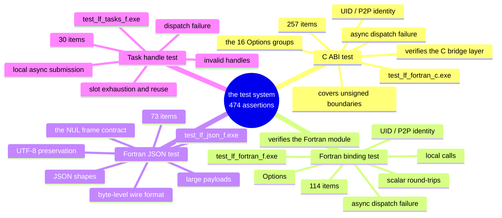

### 11.2 The C ABI test (257 items)

**Goal**: verify that `lf_fortran.h` + `lf_fortran.cpp` are complete and correct for the C side.

| Category | Coverage |
|------|----------|
| data handle scalars | round-trips for every integer type, including the unsigned boundaries 255 / 65535 / 0xDEADBEEF |
| strings | plain text, multi-byte UTF-8, NUL termination, the empty string |
| JSON | a simple object, Chinese text, the empty string |
| **UID binary I/O** | 32-byte fixed-length round-trip, out-of-range protection, NULL rejection |
| **UID ↔ Hex** | upper and lower case, invalid-character rejection, unpolluted output |
| **P2P identity** | a self-built handle returns all zeros / an empty string |
| local calls | Call registration, Notify registration, add(5,7)=12 |
| **App deregistration** | a second deregistration is rejected |
| **P2P registration** | register, duplicate rejection, deregister, re-register |
| App name | a buffer that is too small returns -2 |
| **generic Options** | known / unknown keys, a buffer that is too small |
| **Options shortcuts** | all 16 groups round-trip, the password mask, the debug placeholder |
| **query functions** | all return false while offline |
| **async dispatch failure** | returns 0, fires the callback synchronously once, result is NULL |

**Why use C and not Fortran alone**: C has real `uint8_t` / `uint16_t` / `uint32_t` types, so the
full unsigned boundary tests can be done. Fortran has no unsigned types, so this part must be
handled by C.

### 11.3 The Fortran binding test (114 items)

**Goal**: verify that `lf_fortran_mod.f90` wraps the C ABI correctly.

| Category | Coverage |
|------|----------|
| scalar round-trips | the plumbing works on both the signed and unsigned function entry points |
| strings | plain-text round-trip, size includes the NUL |
| JSON | `{"a":1}` round-trip |
| **UID binary** | sequential write and read-back, byte-by-byte comparison |
| **UID ↔ Hex** | upper and lower case, invalid characters, empty hex |
| **P2P identity** | the self-built handle contract, NULL handle rejection |
| local calls | `c_funloc` address passing, `lf_local_call` round-trip |
| duplicate registration | a second registration under the same name is rejected |
| **App deregistration** | deregistration succeeds, a second attempt is rejected |
| **P2P registration** | register / deregister / re-register |
| App name | an `allocatable` return value |
| **generic Options** | set / get / unknown key |
| **Options shortcuts** | all 16 groups round-trip, `logical` ↔ `True`/`False` |
| **offline queries** | all return `.false.` |
| **async dispatch failure** | the callback fires synchronously, result is NULL |

### 11.4 The Fortran JSON test (73 items)

**Goal**: port the approach of the C++ `test_lingofuse_json.cpp` completely onto the Fortran side.

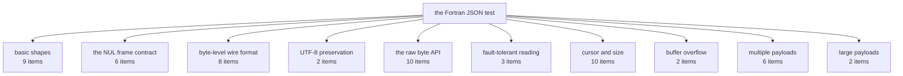

**Key category: byte-level wire format** — `{"a":1}` must produce **exactly 8 bytes**:

```
7B 22 61 22 3A 31 7D 00
│  │  │  │  │  │  │  └── the NUL frame
│  └──┴──┴──┴──┴──┘
└─ {"a":1}
```

This is the **base contract** for interoperating with Pascal / Python / C++ / C# / Rust / Go /
JavaScript.

**Key category: UTF-8 preservation** — the UTF-8 byte sequence of the character 中 is built with
`char(228) // char(184) // char(173)` to verify that the whole chain performs no transcoding at
all. An emoji uses `char(240) // char(159) // char(140) // char(141)`.

### 11.5 The task handle test (30 items)

**Goal**: verify the slot table management, atomic access and async submission of
`lf_fortran_tasks.f90`.

| Category | Coverage |
|------|----------|
| invalid handles | every operation returns safely when `slot = 0` |
| local async submission | a full round-trip with service + client + app + `lf_async_submit` |
| dispatch failure | with no client the callback fires synchronously; the task is ready but `ok = .false.` |
| slot exhaustion | submit 256 times and verify partial success and partial failure |
| slot reuse | the slot can be acquired again after free |

### 11.6 The cross-language demo (4 processes)

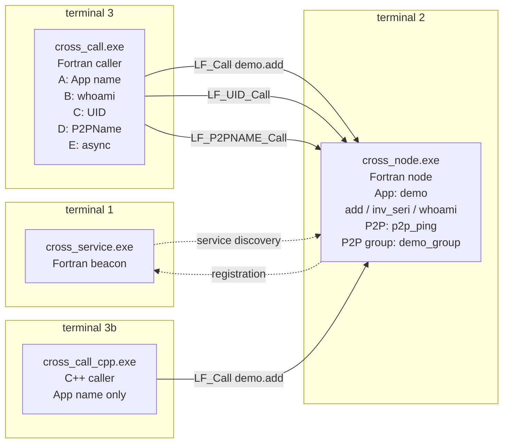

**One-command launch**:

```powershell
.\run_cross_demo.ps1
```

It automatically:
1. starts `cross_service.exe` (the beacon) in a new window
2. starts `cross_node.exe` (the Fortran node) in a new window
3. waits 5 seconds (for the mesh broadcast to propagate)
4. runs `cross_call.exe` (the Fortran caller, 5 demo sections) in the main window
5. runs `cross_call_cpp.exe` (the C++ caller, cross-language verification) in the main window

**Expected output**:

- `cross_call.exe` → `success : 32, failed : 0`
- `cross_call_cpp.exe` → `success : 25, failed : 0`

---

## 12. Test-to-scenario mapping

### 12.1 Scenario classification

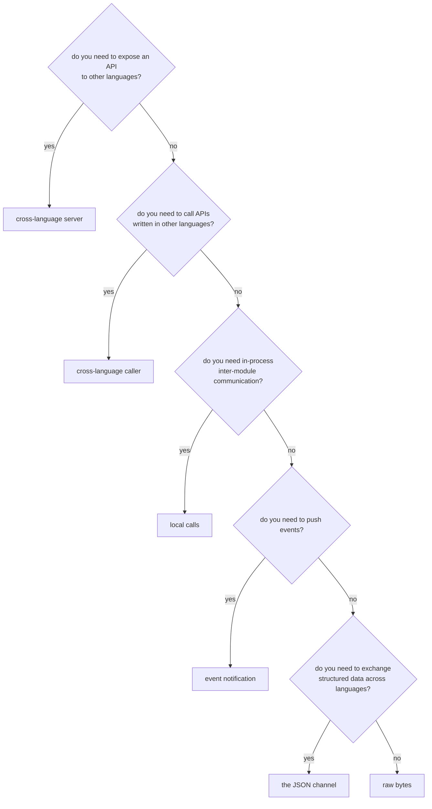

### 12.2 Mapping tests to scenarios

| Scenario | Test suite | Key test items | Real business examples |
|----------|--------------|-----------|-------------|
| **cross-language server**: Fortran functions called by Python / C++ | `test_lf_fortran_f.exe` + `cross_node.exe` | `lf_app_register_call`, `add_callback` | numerical compute services, simulation kernels |
| **cross-language caller**: Fortran calls APIs written in C++ / Python | `cross_call.exe` + `cross_call_cpp.exe` | `lf_call`, `lf_data_read_int32` | calling an existing C++ data-processing library |
| **in-process inter-module communication**: a fast path that bypasses the network | `test_lf_fortran_f.exe` | `lf_local_call`, `register_call` | decoupling modules inside one process |
| **event notification**: one-way pushes, status broadcasts | `test_lf_fortran_f.exe` | `lf_app_register_notify`, `lf_notify` | log collection, progress reporting |
| **JSON data exchange**: integrating with HTTP / web / LLM | `test_lf_json_f.exe` | `lf_data_write_json`, `lf_data_read_json` | REST API gateways, LLM tool calls |
| **binary protocol**: custom byte formats | `test_lf_json_f.exe` | `lf_data_write_bytes`, `lf_data_read_all_bytes` | video frames, sensor streams, Protobuf |
| **large payload transfer**: MB-scale messages | `test_lf_json_f.exe` | `test_large_json` | large matrices, images, log files |
| **cross-language byte interop**: aligned with Pascal / C++ | `cross_call_cpp.exe` | the byte sequence of `add` and `inv_seri` | mixed multi-language deployments |
| **UID-targeted calls**: pushing to a specific client | `cross_call.exe` Section C | `lf_call_uid`, `lf_check_uid` | session management, notifying a specific user |
| **P2PName multicast**: one-to-many load balancing | `cross_call.exe` Section D | `lf_call_p2pname` | stateless worker clusters |
| **async calls**: submit without blocking | `cross_call.exe` Section E + `test_lf_tasks_f.exe` | `lf_async_call`, `lf_async_submit` | long-task submission, event-driven work |
| **service discovery and identification**: the whoami pattern | `cross_call.exe` Section B | `lf_data_get_p2p_uid`, `lf_data_get_p2p_name` | client self-discovery, multi-tenancy |
| **elastic cluster startup**: nodes start in any order | `cross_node.exe` | `Wait_Ready=False` | Kubernetes / Docker clusters |

### 12.3 Typical scenarios in detail

#### Scenario A: a numerical compute service

**The business**: a solver written in Fortran, called by a Python ML pipeline.

| Step | Code |
|------|------|
| 1 | `app = lf_app_create('Solver', 'Linear solver')` |
| 2 | `rc = lf_app_register_call(app, 'solve', ..., c_funloc(solve_callback))` |
| 3 | `rc = lf_prepare_client('ipc:solver', app)` |
| 4 | the Python side calls `c.solve(matrix_data)` |

#### Scenario B: LLM tool calls

**The business**: Fortran algorithms exposed as LLM tools, invoked through the MCP protocol.

**The data flow**: LLM → MCP Server → Python bridge → LingoFuse → Fortran node. JSON payloads go
through Fortran's `lf_data_read_json` / `lf_data_write_json`.

#### Scenario C: a real-time data stream

**The business**: sensor data pushed at high frequency to Fortran in a binary format for
processing.

| Step | Corresponding test |
|------|----------|
| binary frames written with `lf_data_write_bytes` | `test_fault_tolerant` |
| frames containing embedded NULs | `test_raw_bytes` |
| the receiver reads the whole frame in one go | the `read_all_bytes` test item |

#### Scenario D: a mixed multi-language mesh

**The business**: a C++ front end + a Fortran compute core + a Python training backend, all
communicating over the same mesh.

**The key verification**: `cross_call_cpp.exe` calls `cross_node.exe` (Fortran), and
`cross_call.exe` (Fortran) calls the same node in 5 different ways.

#### Scenario E: a worker cluster (P2PName multicast)

**The business**: start N homogeneous workers and let clients submit tasks to the group.

```fortran
! worker: join the group
call lf_set_opt_p2p_name('compute_group')

! client: submit tasks to the group; the server side load-balances automatically
resp = lf_call_p2pname('compute_group', req, 5000_c_int64_t)
```

#### Scenario F: session targeting (UID)

**The business**: the server needs to push a message to a **particular** client.

```fortran
! capture the caller's UID from some callback
subroutine on_register(input, output) bind(C)
    type(c_ptr), value :: input, output
    integer(c_int8_t) :: uid(LF_UID_BYTE_COUNT)
    if (lf_data_get_p2p_uid(input, uid) /= 1) return
    ! save uid into the session table
end subroutine

! later, push to that specific client
call lf_notify_uid(saved_uid, req)
```

---

## 13. Troubleshooting

### 13.1 The decision tree

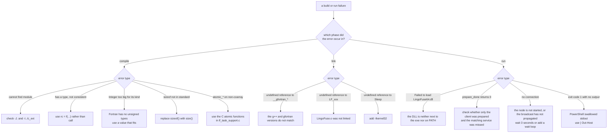

### 13.2 The common-error quick table

| Error message | Root cause | Fix |
|----------|------|------|
| `Cannot open module file 'lf_fortran_mod.mod'` | the module was not compiled or the path is wrong | start over with `make clean && make`; confirm `-J.` and `-I../c_ext` take effect |
| `has a type, not consistent with CALL` | a function was called as a subroutine | use `rc = f(...)` or `if (f(...) /= 1)` |
| `Integer too big for its kind` | the value exceeds the signed kind range | Fortran has no unsigned types; use a value that fits |
| `Function 'sizeof' has no IMPLICIT type` | a GNU extension was used | change it to `size(buf)` |
| `'atomic_cas' at (1) shall be a coarray` | an F2018 coarray builtin was used | switch to the C atomic functions in `lf_task_support.c` |
| `undefined reference to __gfortran_*` | the g++ and gfortran versions do not match | use the same toolchain |
| `undefined reference to Sleep` | kernel32 was not linked | add `-lkernel32` to the `Makefile` |
| `f77: command not found` | the `Makefile` used `FC ?=` and did not override make's built-in default | change it to `FC = gfortran` |
| `Failed to load LingoFuse64.dll` | the runtime library cannot be found | put it next to the exe or add it to PATH |
| `prepare_done returned 0` | the connection timed out (only the client was prepared, with no service) | add `lf_prepare_service` |
| `"demo" no connection` | the target node is not on the mesh | check whether the node is running; wait 3 seconds or add a wait loop |
| `exit code 1` with a blank screen | PowerShell swallowed the native output | use `\| Out-Host` in the script |
| `LF_PrepareClient returned -1` | duplicate address | change the address or set `Overlap_Connection=True` |
| Chinese text shows up garbled | the console code page is not UTF-8 | `chcp 65001` to switch to UTF-8 |

### 13.3 Debugging tips

**Turn on verbose logging**:

```fortran
call lf_set_opt_console_output(.true.)
call lf_set_opt_quiet(.false.)
call lf_set_opt_show_thread_id(.true.)
```

**Read LingoFuse's internal log**:

```fortran
character(len=:), allocatable :: msg
do while (lf_get_status_count() > 0)
  call lf_get_status(msg)
  if (len(msg) > 0) write(*, '(A,A)') '[LF] ', msg
end do
```

**Check the mesh state**:

```fortran
if (lf_check_main_thread()) write(*, *) 'Framework running'
if (lf_check_app('demo'))    write(*, *) 'demo visible'
if (lf_check_api('demo', 'add')) write(*, *) 'demo.add visible'

! if you have the target UID:
if (lf_check_uid(target_uid)) write(*, *) 'target online'
if (lf_check_uid_api(target_uid, 'add')) write(*, *) 'target exposes add'

! if you have the target P2PName:
if (lf_check_p2pname('compute_group')) write(*, *) 'group exists'
```

---

## Appendix A: core code patterns

### A.1 The standard pattern for adding a callback

```fortran
module my_callbacks
  use iso_c_binding
  use lf_fortran_mod
  implicit none
  private
  public :: my_callback
contains
  subroutine my_callback(input, output) bind(C)
    type(c_ptr), value :: input, output
    ! ... read input, write output
  end subroutine
end module

! inside the program:
use my_callbacks
! ...
if (lf_app_register_call(app, 'myapi', 'desc', &
                         c_funloc(my_callback)) /= 1) stop
```

### A.2 Four things you must remember

1. **a callback must use `bind(C)` and live in a module**. A procedure inside a program cannot have
   its address taken with `c_funloc`.
2. **write functions are Functions**, so you must use `rc = f(...)` or `if (f(...) /= 1)`.
3. **reading a string is a Subroutine**, so use `call lf_data_read_string(h, out)`.
4. **query functions return `logical`**, so use `if (lf_check_app('demo'))` directly and stop
   writing `/= 0`.

### A.3 The standard structure for a self-contained single-process test

```fortran
call lf_reset_prepare()

! 1. create the app and register the API
app = lf_app_create('MyTestApp', 'test')
rc = lf_app_register_call(app, 'echo', 'echo', c_funloc(echo_cb))

! 2. prepare both the service and the client (neither can be omitted!)
rc = lf_prepare_service('ipc:my_test', 'ipc:my_test')
rc = lf_prepare_client ('ipc:my_test', app)

! 3. start the framework
rc = lf_prepare_done()

! 4. wait for the app to become visible (broadcast latency ~3 seconds)
do i = 1, 50
  if (lf_check_app('MyTestApp')) exit
  call sleep_ms(100)
end do

! 5. test the calls
! ...

! 6. clean up
call lf_exit_main_thread()
call lf_app_destroy(app)
call lf_shutdown()
```

---

## Appendix B: comparison with the other bindings

| Feature | Fortran | C++ | Python | C# |
|------|:-------:|:---:|:------:|:--:|
| create a handle | `lf_data_create` | `DataHandle h("api")` | `DataHandle("api")` | `new DataHandle("api")` |
| write int32 | `lf_data_write_int32` | `h.write<int32_t>(42)` | `h.write_int32(42)` | `h.WriteInt32(42)` |
| write JSON | `lf_data_write_json` | `h.writeJson(obj)` | `h.write_json(obj)` | `LfIo.WriteJson(h, obj)` |
| read JSON | `lf_data_read_json` | `h.readJson()` | `h.read_json()` | `LfIo.ReadJson<T>(h)` |
| register a callback | `lf_app_register_call` + `c_funloc` | `app.registerCall` | `@app.expose` | `app.RegisterCall` |
| remote call | `lf_call` | `lingofuse::call` | `call()` | `Framework.Call` |
| **UID-targeted call** | `lf_call_uid` | `callAsyncByUid` | — | — |
| **P2PName multicast** | `lf_call_p2pname` | `callAsyncByP2PName` | — | — |
| **P2P identity reads** | `lf_data_get_p2p_uid` / `lf_data_get_p2p_name` | `DataHandle::getP2PUid` | — | — |
| **async callback style** | `lf_async_call` + `c_funloc` | `callAsync` | — | — |
| **async task handle style** | `lf_async_submit` + `lf_task_*` | — | — | — |
| network events | `lf_set_network_event` | `setNetworkEvent` | `set_network_event` | `NetworkEvents.Set` |
| Options | `lf_set_opt_*` / `lf_get_opt_*` | `lingofuse::setOption` | — | — |

**The wire format is identical**: the same logical payload `{"a":1}` round-tripping between any two
languages always yields the byte sequence `7B 22 61 22 3A 31 7D 00`.

---

*LingoFuse Fortran binding version 1.1*
*Last updated: 2026-10-16*
*Coverage: 59 exported C ABI symbols + the task handle extension + 5 addressing modes*

