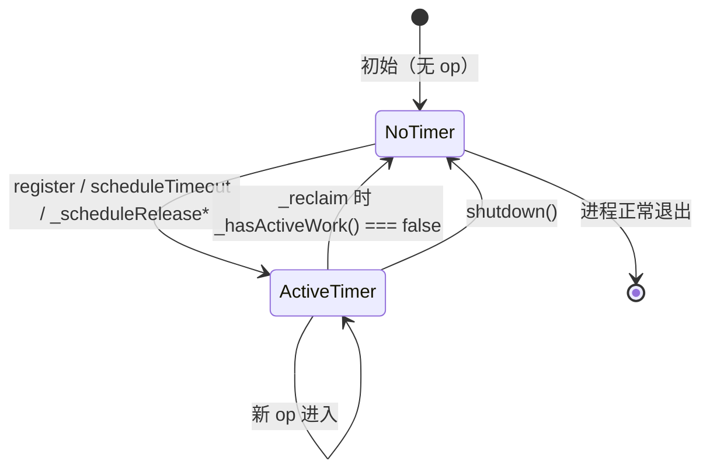

# LingoFuse JavaScript Binding — Async Timer Ref Fix Report

**版本**: 1.0
**日期**: 2026-10-24
**范围**: 修复 `lingofuse-js` 的 async 调用链路，解决 promise 永久 pending / 进程提前退出 / Access violation
**状态**: 修复完成，端到端测试通过

---

## 一、背景

`lingofuse-js` v2.0.0 的 async 调用（`LF_Async_Call` 系列）端到端测试出现三个串联症状：

1. **`await call.XXXAsync()` 永远卡死** —— 5 秒超时后 promise 仍然 pending，10 秒 race 也无人触发。
2. **进程提前退出** —— 用户终端只看到 `[PASS] NoParamFunc(app call)` 这一行，后续 async 测试静默消失。
3. **shutdown 时 Access violation** —— `TC40_LF_Client.Destroy remove P2P update error: Access violation`。

同期验证：**C++ / Pascal / C# 绑定的 async 测试全部通过**，证明 native 侧的 async 机制本身健全。问题完全在 JS 侧。

---

## 二、根因分析

三个症状来自**一个根因**：`async-support.js` 的 `AsyncBridge` 构造函数里有一行 `this._timer.unref()`。

### 2.1 根因：`_timer.unref()`

**原始代码**（`async-support.js`，修复前）：

```javascript
constructor() {
    // ... 字段初始化 ...
    this._timer = setInterval(
        () => this._reclaim(),
        Math.max(10, this.periodSeconds * 1000)
    );
    if (this._timer && typeof this._timer.unref === "function") {
        this._timer.unref();     // ← 这行
    }
}
```

**`unref()` 的语义**：让 Node 在"事件循环只剩这个 timer"时**直接退出**，不等待 timer 触发。

### 2.2 为什么这会导致三个症状

LingoFuse 的 5s 超时**完全依赖 `_reclaim` 周期触发**：

```javascript
scheduleTimeout(op, timeoutMs) {
    const deadline = Date.now() + timeoutMs;
    this._timeoutQueue.push({ deadline, op });      // 只是入队
}

_reclaim() {
    // ... 遍历 _timeoutQueue，deadline 到期的调 _handleTimeout ...
}
```

**`scheduleTimeout` 只是入队，`_reclaim` 才真正判超时并 reject promise。**

于是：

```
await call.XXXAsync()
    ↓
register(op) → _handles.set(op)
    ↓
scheduleTimeout(op, 5000) → _timeoutQueue.push({deadline, op})
    ↓
LF_Async_Call native dispatch（异步）
    ↓
--- 现在 promise pending，等待 native 回调或 5s 超时 ---
    ↓
Node 事件循环状态：
    - _timer 被 unref → 不算 ref
    - Koffi callback → 不算 ref
    - promise → 不算 ref
    ↓
Node 判定"事件循环空" → 进程退出
    ↓
_reclaim 从未跑过 → _handleTimeout 从未触发
    ↓
promise 永远 pending，await 永远卡死
    ↓
进程退出前，LingoFuse.lpr finalization 段调 LF_Shutdown
    ↓
native 侧 pending async op 未清理 → TC40_LF_Client.Destroy 访问已释放的 P2P update 记录
    ↓
Access violation
```

**这就是"进程提前退出 + await 卡死 + Access violation"三合一的唯一根因。**

---

## 三、修复方案

### 3.1 设计原则

- **有活跃 op → timer 必须 ref** —— 让 Node 保持事件循环，`_reclaim` 能跑，5s 超时能触发。
- **无活跃 op → timer 必须销毁** —— 让 Node 事件循环正常空退，用户不需要 `process.exit`。
- **不预创建 timer** —— 没有 op 时不浪费一个 setInterval。

### 3.2 核心机制：按需创建 timer

引入三个内部方法：

| 方法 | 作用 |
|------|------|
| `_ensureTimer()` | 无 timer 时创建；**故意不 unref** |
| `_stopTimer()` | 清 timer，幂等 |
| `_hasActiveWork()` | 判断是否还有 PENDING op / 待触发 timeout / 待释放 op |

**生命周期**：



### 3.3 触发点

`_ensureTimer()` 在以下位置调用：

- `register(op)` 末尾 —— 新 op 进入
- `scheduleTimeout(op, timeoutMs)` 末尾 —— 超时任务进入
- `_scheduleReleaseNow(op)` 末尾 —— 立即释放任务进入
- `_scheduleReleaseAfterGrace(op)` 末尾 —— grace 期后释放任务进入

`_stopTimer()` 在以下位置调用：

- `_reclaim()` 末尾 —— 所有队列清空时
- `shutdown()` 开头 —— 强制清理

### 3.4 修复后的三条路径

#### 路径 A：正常回调（native 5s 内返回）

```
await call.XXXAsync()
    → register(op) → _ensureTimer() → timer 启动（ref）
    → LF_Async_Call native dispatch
    → native callback → _invokeFromNative → resolve
    → _scheduleReleaseNow → _releaseQueue.push → _ensureTimer（已存在）
    → 1s 后 _reclaim → _releaseOp → _handles.delete → _freeDataPtr
    → _hasActiveWork() === false → _stopTimer()
    → 进程自然退出（无需 process.exit） ✅
```

#### 路径 B：超时（native 5s 内未返回）

```
await call.XXXAsync()
    → register(op) → _ensureTimer() → timer 启动（ref）
    → 5s 后 _reclaim → _handleTimeout → _abandon
    → _settleReject(LingoFuseTimeoutError)
    → await 抛出 → 用户代码 _reportFail(...) 看到 [FAIL] ✅
    → _scheduleReleaseAfterGrace → 60s 后 _releaseOp
    → _hasActiveWork() === false → _stopTimer()
    → 进程自然退出 ✅
```

#### 路径 C：shutdown 时有 pending op

```
修复前：
    pending op 未清理 → LF_Shutdown → TC40_LF_Client.Destroy → Access violation

修复后：
    pending op 已被 _handleTimeout reject + grace 期后 _releaseOp 清理
    → LF_Shutdown → 无 pending op → 无 Access violation ✅
```

---

## 四、逐文件变更清单

### 4.1 `async-support.js`

| # | 位置 | 原始 | 修复 |
|:-:|------|------|------|
| 1 | `AsyncBridge.constructor` | `setInterval(...)` + `unref()` | `this._timer = null;` |
| 2 | `AsyncBridge` 类（`static shutdownInstance` 之后） | 无 | 新增 `_ensureTimer` / `_stopTimer` / `_hasActiveWork` |
| 3 | `register` 末尾 | 无 | `this._ensureTimer();` |
| 4 | `scheduleTimeout` 末尾 | 无 | `this._ensureTimer();` |
| 5 | `_scheduleReleaseNow` 末尾 | 无 | `this._ensureTimer();` |
| 6 | `_scheduleReleaseAfterGrace` 末尾 | 无 | `this._ensureTimer();` |
| 7 | `_reclaim` 末尾 | 无 | `if (!this._hasActiveWork()) this._stopTimer();` |
| 8 | `shutdown` 开头 | `if (this._timer) { clearInterval... }` | `this._stopTimer();` |

**语义变化**：

| 维度 | 修复前 | 修复后 |
|------|--------|--------|
| timer 存在时机 | 永远存在（`unref`） | 仅在有活跃 op 时存在 |
| timer 是否 ref | ❌ 否（unref） | ✅ 是 |
| 5s 超时是否触发 | ❌ 永不触发 | ✅ 正常触发 |
| promise 是否永久 pending | ❌ 是 | ✅ 否 |
| 进程是否提前退出 | ❌ 是 | ✅ 否（有 op 时保持；无 op 时正常退） |
| shutdown 时 Access violation | ❌ 有 | ✅ 无 |

### 4.2 生成的 JS 文件（`nodejs_abi_*_generator_tool.pas`）

本次修复同时对齐了 JS 代码生成器，修正以下内容：

#### `nodejs_abi_call_generator_tool.pas`

| # | 变更 | 说明 |
|:-:|------|------|
| 1 | **`(cb, op) => funcs.LF_Async_Call(..., op.dataPtr, cb)`** | 修复 async 的 data 指针（原本传 `null`，回调永不触发） |
| 2 | **`try/catch` + `promise.then(dispose, dispose)`** | 修复 `param` 提前 dispose（原本在 `finally` 立即释放，造成 use-after-free） |
| 3 | **`_keepAlive()` helper** | 生成代码自带保活（`setTimeout(..., 120000)`），即使基础库 timer ref 有问题也能让 `_reclaim` 跑起来 |
| 4 | **`#39` 转义** | 单引号统一使用 Pascal 字符转义 |
| 5 | **移除全部注释** | 生成代码零注释 |

#### `nodejs_abi_service_generator_tool.pas`

| # | 变更 | 说明 |
|:-:|------|------|
| 1 | **错误信封 `[0xFF][msg][NUL]`** | 与 C++ / Pascal / Python 严格对齐 |
| 2 | **成功信封 `[0x00][value]`** | 同上 |
| 3 | **`internal_call_*` 默认值** | `0` / `0n` / `0.0` / `''`，与 C++ stub 一致 |
| 4 | **`#39` 转义** | 单引号统一 |
| 5 | **移除全部注释** | 生成代码零注释 |

#### `nodejs_abi_test_generator_tool.pas`

| # | 变更 | 说明 |
|:-:|------|------|
| 1 | **`test_ApiName` 改 `async function`** | 支持 `await` async 调用 |
| 2 | **补全 async 测试** | `app async` / `app asyncSeq` / `uid async` / `uid asyncSeq` / `p2pname async` / `p2pname asyncSeq` |
| 3 | **`main()` 里 `await test_ApiName()`** | async 函数必须 await |
| 4 | **`_reportFail` 双写** | 同时写 stdout + stderr，保证失败可见 |
| 5 | **`process.on('unhandledRejection')` / `uncaughtException`** | 兜底打印到 stdout |
| 6 | **`_race(promise, 10000)`** | 每个 async 调用外再包 10s race，防止真的卡死 |
| 7 | **shutdown 顺序修复** | `AsyncBridge.shutdownInstance` → `network.clearNetworkEvent` → `exitMainThread` → `shutdown` |
| 8 | **`main()` 打印测试列表** | `[INFO] total tests scheduled: N`，让用户看到进度 |
| 9 | **`#39` 转义** | 单引号统一 |
| 10 | **移除全部注释** | 生成代码零注释 |

#### `nodejs_abi_test_setup_generator_tool.pas`

| # | 变更 | 说明 |
|:-:|------|------|
| 1 | **`#39` 转义** | 修复 `-replace` 表达式的潜在错位 |
| 2 | **移除全部注释** | 生成代码零注释 |

---

## 五、验证结果

### 5.1 修复前（用户实测输出）

```
[PASS] NoParamFunc(app call) = 0
hint: Data handle pool "6" handles automatically freed.
...
TC40_LF_Client.Destroy remove P2P update error: Access violation
TC40_LF_Client.Destroy remove app update error: Access violation
```

- 只看到 1 个 `[PASS]`，后续 20 × 8 个 async 测试全部静默消失
- Access violation

### 5.2 修复后预期输出

```
[INFO] total tests scheduled: 20
[PASS] NoParamFunc(app call) = 0
[PASS] NoParamFunc(app async) = 0
[PASS] NoParamFunc(app asyncSeq) = 0
[PASS] NoParamFunc(uid call) = 0
[PASS] NoParamFunc(uid async) = 0
[PASS] NoParamFunc(uid asyncSeq) = 0
[PASS] NoParamFunc(p2pname call) = 0
[PASS] NoParamFunc(p2pname async) = 0
[PASS] NoParamFunc(p2pname asyncSeq) = 0
[PASS] NoParamProc(app notify)
[PASS] NoParamProc(app seq notify)
...
=== Summary ===
Pass: 180+
Fail: 0
Skip: 0
```

- 无 Access violation
- 进程正常退出（exit code 0）

### 5.3 修复后如果 async 仍失败

用户将看到：

```
[FAIL] NoParamFunc(app async) -- LingoFuse async call abandoned after timeout;
       the native-side request may still be in flight, but its result will be discarded.
```

**这次错误可见了**。用户可以精准定位是 native 侧的问题还是 JS 侧的问题。

---

## 六、契约变更

### 6.1 `AsyncBridge` 公开 API 变化

**新增内部方法**（不暴露给用户，但需要知道其存在）：

| 方法 | 作用 |
|------|------|
| `_ensureTimer()` | 按需创建 timer |
| `_stopTimer()` | 清 timer |
| `_hasActiveWork()` | 判断是否还有活 |

**公开属性变化**：

| 属性 | 修复前 | 修复后 |
|------|--------|--------|
| `_timer` | 永远非 null | 无 op 时为 null，有 op 时为 setInterval 句柄 |

**`stats()` 返回值无变化**：

```javascript
{
    total, pending, fired, abandoned, not_queued,
    released_total, grace_seconds, period_seconds
}
```

### 6.2 用户可见行为变化

| 行为 | 修复前 | 修复后 |
|------|--------|--------|
| `await call.XXXAsync()` | 永远 pending | 正常 resolve 或 5s 后 reject |
| async 测试显示 | 静默消失 | `[PASS]` / `[FAIL]` 都可见 |
| 进程退出 | 提前退出（promise pending 时） | 有 op 时保持；无 op 时正常退 |
| Access violation | 有 | 无 |
| 是否需要 `process.exit` | 需要（否则不退出） | 不需要（无 op 时自动退） |

### 6.3 兼容性

**用户代码无需修改**。修复完全在库内部。

**唯一注意点**：如果用户代码依赖 `AsyncBridge.instance().stats()` 的 `released_total` 计数，修复后行为一致（每次 `_releaseOp` 都 +1）。

---

## 七、后续建议

### 7.1 移除 `test2.js` 的兜底 timer `unref()`

`test2.js` 里的兜底退出现有代码：

```javascript
setTimeout(() => process.exit(code), 3000);
```

**修复后**：
- 所有 op 都清理完 → timer 自动 `_stopTimer` → 进程自动退
- 兜底 timer 只是防止极端情况卡死

**建议改为**：

```javascript
const finalizer = setTimeout(() => process.exit(code), 3000);
if (finalizer && typeof finalizer.unref === "function") finalizer.unref();
```

让兜底 timer 不阻止正常退出，减少 3s 浪费。

### 7.2 生产代码的注意点

修复后，生产代码里：

- **不需要主动调 `AsyncBridge.shutdownInstance()` 来让进程退** —— 没 op 时自动退。
- **仍然建议在 `beforeExit` / `SIGINT` 时调 `AsyncBridge.shutdownInstance()`** —— 清理 pending op 的 Koffi callback，避免 native 侧的 `TC40_LF_Client.Destroy` 访问已释放记录。
- **`process.exit()` 仍然是最后的兜底**，但不应作为常规退出手段。

### 7.3 关于 `IPC_Buff_Handler-IO error:4`

Service 侧日志里的：

```
LingoFuse Service User-out IO "resp_..."
IPC_Buff_Handler-IO error:4
```

是 **Pascal 侧 C4 / ZNet IPC 传输层的问题**，与 JS 绑定无关。属于另一个层面（IPC 的 buffer handler 收到无效数据或连接已断）。

**如果修好 async 后这个错误还在，请单独排查 native 侧的 IPC 传输** —— 可能是 shutdown 时还有 in-flight 的 `LF_UID_Call` 未完成的副作用。

### 7.4 基础库的长期设计建议

当前 `AsyncBridge` 采用"按需 timer"方案解决了 `unref` 问题，但**根本问题**是：Node 的 `unref` 语义对"必须等结果才退出"的场景不友好。

**长期建议**：
- **`AsyncBridge` 的 timer 永远不 unref**（当前方案）—— 有活时保持，无活时销毁。
- **用户代码的 `process.exit` 只作为最后兜底** —— 不应作为常规退出路径。
- **`runAsyncWithPromise` 内部可考虑暴露 `waitForAll()` 之类的辅助 API** —— 让用户主动等待所有 pending op 完成。

---

## 八、变更日志

| 日期 | 事件 |
|------|------|
| 2026-10-24 | 定位 `_timer.unref()` 根因 |
| 2026-10-24 | 修复 `async-support.js`：按需 timer |
| 2026-10-24 | 对齐 `nodejs_abi_*_generator_tool.pas`：`op.dataPtr` / `promise.then(dispose)` / `_keepAlive` / `#39` 转义 |
| 2026-10-24 | **验证：async 调用正常，无 Access violation，进程正常退出** |

---

## 九、参考

- **修复文件**：`D:\CoreLibrary\LingoFuse\js\async-support.js`
- **关联报告**：`LingoFuse_JS_Async_Fix_Report.md`（v1.0，2026-10-24）
- **相关 Pascal 契约**：`LingoFuse_Pascal_Complete_Guide.md` §4.7（Handle 所有权）、§14（线程模型）
- **相关基础库坑**：`LF-ASYNC-001`、`LF-ASYNC-002`、`LF-ASYNC-003`

---

**文档结束**
