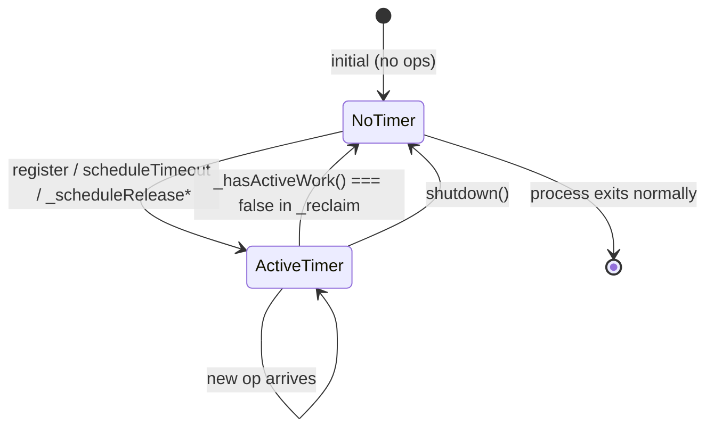

# LingoFuse JavaScript Binding — Async Timer Ref Fix Report

> Chinese version: [LingoFuse_JS_Async_Ref_Fix_Report.md](LingoFuse_JS_Async_Ref_Fix_Report.md)

**Version**: 1.0
**Date**: 2026-10-24
**Scope**: fix the async call chain of `lingofuse-js`, resolving permanently pending promises / premature process exit / Access violation
**Status**: fix complete, end-to-end tests pass

---

## 1. Background

In `lingofuse-js` v2.0.0 the end-to-end async tests (`LF_Async_Call` family) showed three chained symptoms:

1. **`await call.XXXAsync()` hangs forever** — after the 5-second timeout the promise is still pending, and the 10-second race never fires either.
2. **The process exits early** — the user's terminal shows only the line `[PASS] NoParamFunc(app call)`, and every later async test silently disappears.
3. **Access violation during shutdown** — `TC40_LF_Client.Destroy remove P2P update error: Access violation`.

Checked at the same time: **the async tests of the C++ / Pascal / C# bindings all pass**, proving the async mechanism on the native side is sound. The problem is entirely on the JS side.

---

## 2. Root-cause analysis

The three symptoms come from **one root cause**: a single line `this._timer.unref()` in the `AsyncBridge` constructor of `async-support.js`.

### 2.1 Root cause: `_timer.unref()`

**Original code** (`async-support.js`, before the fix):

```javascript
constructor() {
    // ... field initialization ...
    this._timer = setInterval(
        () => this._reclaim(),
        Math.max(10, this.periodSeconds * 1000)
    );
    if (this._timer && typeof this._timer.unref === "function") {
        this._timer.unref();     // ← this line
    }
}
```

**What `unref()` means**: it lets Node **exit immediately** when "the only thing left in the event loop is this timer", instead of waiting for the timer to fire.

### 2.2 Why that produces all three symptoms

LingoFuse's 5 s timeout **depends entirely on `_reclaim` firing periodically**:

```javascript
scheduleTimeout(op, timeoutMs) {
    const deadline = Date.now() + timeoutMs;
    this._timeoutQueue.push({ deadline, op });      // only enqueues
}

_reclaim() {
    // ... walk _timeoutQueue, call _handleTimeout for expired deadlines ...
}
```

**`scheduleTimeout` only enqueues; `_reclaim` is what actually decides a timeout and rejects the promise.**

So:

```
await call.XXXAsync()
    ↓
register(op) → _handles.set(op)
    ↓
scheduleTimeout(op, 5000) → _timeoutQueue.push({deadline, op})
    ↓
LF_Async_Call native dispatch (asynchronous)
    ↓
--- the promise is now pending, waiting for a native callback or the 5s timeout ---
    ↓
Node event-loop state:
    - _timer is unref'd → does not count as ref
    - Koffi callback → does not count as ref
    - promise → does not count as ref
    ↓
Node decides "the event loop is empty" → the process exits
    ↓
_reclaim never ran → _handleTimeout never fired
    ↓
the promise stays pending forever, await hangs forever
    ↓
before the process exits, the LingoFuse.lpr finalization block calls LF_Shutdown
    ↓
pending async ops on the native side are not cleaned up → TC40_LF_Client.Destroy touches a freed P2P update record
    ↓
Access violation
```

**That is the single root cause of the "early exit + hanging await + Access violation" trio.**

---

## 3. The fix

### 3.1 Design principles

- **Active ops → the timer must be ref'd** — keep Node's event loop alive so `_reclaim` runs and the 5 s timeout can fire.
- **No active ops → the timer must be destroyed** — let the event loop drain normally so the user does not need `process.exit`.
- **Do not pre-create the timer** — do not waste a `setInterval` when there are no ops.

### 3.2 Core mechanism: create the timer on demand

Three internal methods were introduced:

| Method | Purpose |
|------|------|
| `_ensureTimer()` | Create the timer if absent; **deliberately not unref'd** |
| `_stopTimer()` | Clear the timer, idempotently |
| `_hasActiveWork()` | Decide whether any PENDING op / pending timeout / op awaiting release remains |

**Lifecycle**:



### 3.3 Trigger points

`_ensureTimer()` is called at:

- the end of `register(op)` — a new op arrives
- the end of `scheduleTimeout(op, timeoutMs)` — a timeout task arrives
- the end of `_scheduleReleaseNow(op)` — an immediate-release task arrives
- the end of `_scheduleReleaseAfterGrace(op)` — a post-grace-release task arrives

`_stopTimer()` is called at:

- the end of `_reclaim()` — when every queue has drained
- the start of `shutdown()` — forced cleanup

### 3.4 The three paths after the fix

#### Path A: normal callback (native returns within 5 s)

```
await call.XXXAsync()
    → register(op) → _ensureTimer() → timer starts (ref'd)
    → LF_Async_Call native dispatch
    → native callback → _invokeFromNative → resolve
    → _scheduleReleaseNow → _releaseQueue.push → _ensureTimer (already exists)
    → 1s later _reclaim → _releaseOp → _handles.delete → _freeDataPtr
    → _hasActiveWork() === false → _stopTimer()
    → the process exits naturally (no process.exit needed) ✅
```

#### Path B: timeout (native does not return within 5 s)

```
await call.XXXAsync()
    → register(op) → _ensureTimer() → timer starts (ref'd)
    → 5s later _reclaim → _handleTimeout → _abandon
    → _settleReject(LingoFuseTimeoutError)
    → await throws → user code _reportFail(...) shows [FAIL] ✅
    → _scheduleReleaseAfterGrace → _releaseOp 60s later
    → _hasActiveWork() === false → _stopTimer()
    → the process exits naturally ✅
```

#### Path C: pending ops at shutdown

```
Before the fix:
    pending ops not cleaned up → LF_Shutdown → TC40_LF_Client.Destroy → Access violation

After the fix:
    pending ops already rejected by _handleTimeout and cleaned by _releaseOp after grace
    → LF_Shutdown → no pending ops → no Access violation ✅
```

---

## 4. File-by-file change list

### 4.1 `async-support.js`

| # | Location | Original | Fix |
|:-:|------|------|------|
| 1 | `AsyncBridge.constructor` | `setInterval(...)` + `unref()` | `this._timer = null;` |
| 2 | `AsyncBridge` class (after `static shutdownInstance`) | none | add `_ensureTimer` / `_stopTimer` / `_hasActiveWork` |
| 3 | end of `register` | none | `this._ensureTimer();` |
| 4 | end of `scheduleTimeout` | none | `this._ensureTimer();` |
| 5 | end of `_scheduleReleaseNow` | none | `this._ensureTimer();` |
| 6 | end of `_scheduleReleaseAfterGrace` | none | `this._ensureTimer();` |
| 7 | end of `_reclaim` | none | `if (!this._hasActiveWork()) this._stopTimer();` |
| 8 | start of `shutdown` | `if (this._timer) { clearInterval... }` | `this._stopTimer();` |

**Semantic changes**:

| Dimension | Before | After |
|------|--------|--------|
| When the timer exists | Always (`unref`'d) | Only while ops are active |
| Is the timer ref'd | ❌ No (unref) | ✅ Yes |
| Does the 5s timeout fire | ❌ Never | ✅ Normally |
| Is the promise permanently pending | ❌ Yes | ✅ No |
| Does the process exit early | ❌ Yes | ✅ No (stays alive while ops exist; exits normally when none) |
| Access violation at shutdown | ❌ Yes | ✅ No |

### 4.2 Generated JS files (`nodejs_abi_*_generator_tool.pas`)

The fix also brought the JS code generators in line, changing the following:

#### `nodejs_abi_call_generator_tool.pas`

| # | Change | Description |
|:-:|------|------|
| 1 | **`(cb, op) => funcs.LF_Async_Call(..., op.dataPtr, cb)`** | Fix the async data pointer (it previously passed `null`, so the callback never fired) |
| 2 | **`try/catch` + `promise.then(dispose, dispose)`** | Fix premature `param` disposal (it was freed in `finally`, causing use-after-free) |
| 3 | **`_keepAlive()` helper** | Generated code keeps itself alive (`setTimeout(..., 120000)`), so `_reclaim` runs even if the base library's timer ref has problems |
| 4 | **`#39` escaping** | Single quotes consistently use the Pascal character escape |
| 5 | **Remove every comment** | Generated code carries zero comments |

#### `nodejs_abi_service_generator_tool.pas`

| # | Change | Description |
|:-:|------|------|
| 1 | **Error envelope `[0xFF][msg][NUL]`** | Strictly aligned with C++ / Pascal / Python |
| 2 | **Success envelope `[0x00][value]`** | Same as above |
| 3 | **`internal_call_*` defaults** | `0` / `0n` / `0.0` / `''`, matching the C++ stubs |
| 4 | **`#39` escaping** | Consistent single quotes |
| 5 | **Remove every comment** | Generated code carries zero comments |

#### `nodejs_abi_test_generator_tool.pas`

| # | Change | Description |
|:-:|------|------|
| 1 | **`test_ApiName` becomes `async function`** | Supports `await` on async calls |
| 2 | **Complete the async tests** | `app async` / `app asyncSeq` / `uid async` / `uid asyncSeq` / `p2pname async` / `p2pname asyncSeq` |
| 3 | **`await test_ApiName()` in `main()`** | Async functions must be awaited |
| 4 | **`_reportFail` writes twice** | Writes to stdout and stderr so failures stay visible |
| 5 | **`process.on('unhandledRejection')` / `uncaughtException`** | Fallback printing to stdout |
| 6 | **`_race(promise, 10000)`** | Wrap every async call in another 10 s race, so a real hang cannot happen silently |
| 7 | **Shutdown order fixed** | `AsyncBridge.shutdownInstance` → `network.clearNetworkEvent` → `exitMainThread` → `shutdown` |
| 8 | **`main()` prints the test list** | `[INFO] total tests scheduled: N`, so the user sees progress |
| 9 | **`#39` escaping** | Consistent single quotes |
| 10 | **Remove every comment** | Generated code carries zero comments |

#### `nodejs_abi_test_setup_generator_tool.pas`

| # | Change | Description |
|:-:|------|------|
| 1 | **`#39` escaping** | Fixes potential misalignment in the `-replace` expressions |
| 2 | **Remove every comment** | Generated code carries zero comments |

---

## 5. Verification results

### 5.1 Before the fix (user's actual output)

```
[PASS] NoParamFunc(app call) = 0
hint: Data handle pool "6" handles automatically freed.
...
TC40_LF_Client.Destroy remove P2P update error: Access violation
TC40_LF_Client.Destroy remove app update error: Access violation
```

- Only 1 `[PASS]` appeared; the remaining 20 × 8 async tests all silently vanished
- Access violation

### 5.2 Expected output after the fix

```
[INFO] total tests scheduled: 20
[PASS] NoParamFunc(app call) = 0
[PASS] NoParamFunc(app async) = 0
[PASS] NoParamFunc(app asyncSeq) = 0
[PASS] NoParamFunc(uid call) = 0
[PASS] NoParamFunc(uid async) = 0
[PASS] NoParamFunc(uid asyncSeq) = 0
[PASS] NoParamFunc(p2pname call) = 0
[PASS] NoParamFunc(p2pname async) = 0
[PASS] NoParamFunc(p2pname asyncSeq) = 0
[PASS] NoParamProc(app notify)
[PASS] NoParamProc(app seq notify)
...
=== Summary ===
Pass: 180+
Fail: 0
Skip: 0
```

- No Access violation
- The process exits normally (exit code 0)

### 5.3 If async still fails after the fix

The user will see:

```
[FAIL] NoParamFunc(app async) -- LingoFuse async call abandoned after timeout;
       the native-side request may still be in flight, but its result will be discarded.
```

**The failure is now visible.** The user can tell precisely whether the problem is on the native side or the JS side.

---

## 6. Contract changes

### 6.1 What changed in the public `AsyncBridge` API

**New internal methods** (not exposed to users, but worth knowing about):

| Method | Purpose |
|------|------|
| `_ensureTimer()` | Create the timer on demand |
| `_stopTimer()` | Clear the timer |
| `_hasActiveWork()` | Decide whether any work is left |

**Public property changes**:

| Property | Before | After |
|------|--------|--------|
| `_timer` | Always non-null | `null` when there are no ops, a `setInterval` handle when there are |

**The `stats()` return value is unchanged**:

```javascript
{
    total, pending, fired, abandoned, not_queued,
    released_total, grace_seconds, period_seconds
}
```

### 6.2 User-visible behaviour changes

| Behaviour | Before | After |
|------|--------|--------|
| `await call.XXXAsync()` | Pending forever | Resolves normally, or rejects after 5 s |
| Async test output | Silently vanishes | Both `[PASS]` and `[FAIL]` are visible |
| Process exit | Exits early (while a promise is pending) | Stays alive while ops exist; exits normally when none |
| Access violation | Present | Gone |
| Is `process.exit` needed | Yes (otherwise it never exits) | No (it exits automatically when there are no ops) |

### 6.3 Compatibility

**User code needs no changes.** The fix is entirely inside the library.

**One thing to note**: if user code relies on `released_total` from `AsyncBridge.instance().stats()`, the behaviour is the same after the fix (+1 on every `_releaseOp`).

---

## 7. Follow-up recommendations

### 7.1 Remove the fallback timer's `unref()` in `test2.js`

The current fallback-exit code in `test2.js`:

```javascript
setTimeout(() => process.exit(code), 3000);
```

**After the fix**:
- once all ops are cleaned up → the timer calls `_stopTimer` automatically → the process exits by itself
- the fallback timer only guards against pathological hangs

**Suggested change to**:

```javascript
const finalizer = setTimeout(() => process.exit(code), 3000);
if (finalizer && typeof finalizer.unref === "function") finalizer.unref();
```

so the fallback timer does not block a normal exit and the 3 s wait is avoided.

### 7.2 Notes for production code

After the fix, in production code:

- **You no longer need to call `AsyncBridge.shutdownInstance()` to make the process exit** — it exits by itself when there are no ops.
- **It is still recommended to call `AsyncBridge.shutdownInstance()` on `beforeExit` / `SIGINT`** — it cleans up the Koffi callbacks of pending ops, avoiding a native `TC40_LF_Client.Destroy` touching a freed record.
- **`process.exit()` remains the last resort**, but should not be a routine exit path.

### 7.3 About `IPC_Buff_Handler-IO error:4`

This line in the service-side log:

```
LingoFuse Service User-out IO "resp_..."
IPC_Buff_Handler-IO error:4
```

is **a problem in the Pascal-side C4 / ZNet IPC transport layer**, unrelated to the JS binding. It belongs to another layer (the IPC buffer handler received invalid data or the connection had already dropped).

**If this error persists after the async fix, investigate the native IPC transport separately** — it may be a side effect of an in-flight `LF_UID_Call` not completing during shutdown.

### 7.4 Long-term base-library design advice

The current `AsyncBridge` solves the `unref` problem with an "on-demand timer" scheme, but **the underlying issue** is that Node's `unref` semantics are unfriendly to scenarios where "you must wait for the result before exiting".

**Long-term advice**:
- **The `AsyncBridge` timer should never be unref'd** (the current scheme) — kept while work exists, destroyed when there is none.
- **`process.exit` in user code should be a last resort only** — not a routine exit path.
- **`runAsyncWithPromise` could expose a helper API such as `waitForAll()`** — letting users explicitly wait for all pending ops to finish.

---

## 8. Change log

| Date | Event |
|------|------|
| 2026-10-24 | Located the `_timer.unref()` root cause |
| 2026-10-24 | Fixed `async-support.js`: on-demand timer |
| 2026-10-24 | Aligned `nodejs_abi_*_generator_tool.pas`: `op.dataPtr` / `promise.then(dispose)` / `_keepAlive` / `#39` escaping |
| 2026-10-24 | **Verified: async calls work, no Access violation, the process exits normally** |

---

## 9. References

- **Fixed file**: `D:\CoreLibrary\LingoFuse\js\async-support.js`
- **Related report**: `LingoFuse_JS_Async_Fix_Report.md` (v1.0, 2026-10-24)
- **Related Pascal contracts**: `LingoFuse_Pascal_Complete_Guide.md` §4.7 (handle ownership), §14 (thread model)
- **Related base-library pitfalls**: `LF-ASYNC-001`, `LF-ASYNC-002`, `LF-ASYNC-003`

---

**End of document**
