# LingoFuse Julia 绑定

> **跨语言 RPC 框架 LingoFuse 的 Julia 官方绑定。**
>
> Julia 写的函数可以被任何其他语言直接调用，Julia 也可以直接调用任何其他语言写的 LingoFuse 服务。
>
> **跨语言互操作已与 C++ / Pascal / Python 双向验证通过**，线格式字节级一致。

---

## 目录

- [一、文档导航](#一文档导航)
- [二、环境要求](#二环境要求)
- [三、依赖要求](#三依赖要求)
- [四、C 编译器要求](#四c-编译器要求)
- [五、构建](#五构建)
- [六、接口原理](#六接口原理)
- [七、快速开始](#七快速开始)
- [八、核心 API 速查](#八核心-api-速查)
- [九、测试](#九测试)
- [十、测试对应应用场景](#十测试对应应用场景)
- [十一、跨语言互操作](#十一跨语言互操作)
- [十二、Cross Demo](#十二cross-demo)
- [十三、已知限制](#十三已知限制)
- [十四、踩坑速查](#十四踩坑速查)
- [十五、许可](#十五许可)
- [附录 A：Julia 源文件依赖顺序](#附录-ajulia-源文件依赖顺序)

---

## 一、文档导航

**本目录下的关键文档**（点击文件名直接打开）：

- [**`c_ext/SHIM_MECHANISM_GUIDE.md`**](c_ext/SHIM_MECHANISM_GUIDE.md) — C shim 机制的完整验证文档。**修改回调层之前必读。**
- [**`example/README.md`**](example/README.md) — Cross Demo 三进程启动指南。
- [**`test/runtests.jl`**](test/runtests.jl) — 标准 Julia 测试入口（调度 mock 组 + real 组）。
- **`check_env.ps1`** — 环境诊断脚本（9 节）。
- **`build.ps1` / `clean.ps1` / `test.ps1`** — 根目录一键脚本。

### 1.1 目录结构

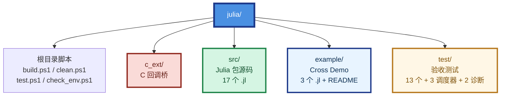

**`src/` 文件清单**（17 个）：

| 文件 | 职责 |
|------|------|
| `LingoFuse.jl` | 模块入口，include 顺序 |
| `trace.jl` | 运行时 trace（`LINGOFUSE_TRACE=1`） |
| `error.jl` | 8 个异常类型的层级 |
| `uid.jl` | UID 类型（`NTuple{32,UInt8}`）+ 转换 |
| `loader.jl` | 运行时库解析 + PATH 准备 |
| `abi.jl` | 59 个 `LF_*` ccall 绑定 |
| `shim.jl` | 66 个 `shim_*` ccall 绑定 + shim 搜索 |
| `callback.jl` | 消费循环 + 5 类事件分派 |
| `data_handle.jl` | `DataHandle` RAII + 身份访问器 |
| `binio.jl` | 小端序二进制 I/O |
| `app.jl` | `App` RAII + do-block 变体 |
| `async.jl` | `Future` 类型 |
| `target.jl` | 三寻址 + 同步/异步/do-block 全套 |
| `p2p.jl` | 进程级 P2P 注册 API |
| `network.jl` | 网络准备 + 生命周期 |
| `io.jl` | JSON3 统一 I/O |
| `status.jl` | 网络事件监听 + 状态队列 |

**`test/` 文件清单**（18 个）：

| 分类 | 文件 |
|------|------|
| **mock 组**（7） | `test_uid.jl` / `test_abi.jl` / `test_shim_bind.jl` / `test_callback.jl` / `test_async_unit.jl` / `test_target.jl` / `test_p2p.jl` |
| **real 组**（6） | `test_io.jl` / `test_raii.jl` / `test_network.jl` / `smoke.jl` / `test_status.jl` / `test_e2e_local.jl` |
| **调度器**（3） | `runtests.jl` / `runtests_mock.jl` / `runtests_real.jl` |
| **诊断**（2） | `diag.jl` / `try_module.jl` |
| **M1 遗留**（1） | `test_restart.jl` |

---

## 二、环境要求

### 2.1 系统环境

| 项目 | 要求 |
|------|------|
| 架构 | **x86_64**（32 位未验证） |
| Windows | Windows 10 / Server 2019 及以上 |
| Linux | glibc 2.17+ 或 musl |
| macOS | 11+（Apple Silicon 未验证） |
| 运行时依赖（Windows） | VC++ 2015-2022 Redistributable |

### 2.2 Julia 环境

| 项目 | 要求 |
|------|------|
| 最低版本 | **Julia 1.9** |
| 建议版本 | **Julia 1.13.1**（本文档验证环境） |
| **启动参数** | **必须 `--threads=2` 或更多** |

> ⚠️ **`--threads=2` 是硬性要求，不是建议。**
>
> 回调消费者任务必须运行在非 main 线程上。

**为什么必须 `--threads=2`**


`start_callback_consumer()` 会在运行时做两项检查：

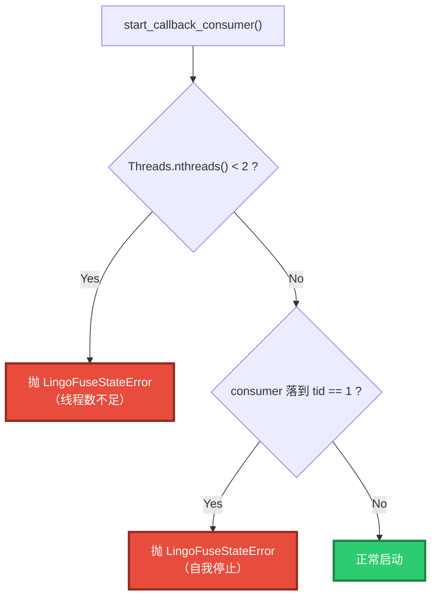

### 2.3 LingoFuse 运行时

Julia 绑定**不包含**原生库，需要单独获取：

| 平台 | 核心库 | IPC 依赖 | 内存分配器（可选） |
|------|--------|----------|--------------------|
| Windows 64 | `LingoFuse64.dll` | `z_ipc_64.dll` | `mimalloc64.dll` |
| Linux | `liblingofuse.so` | `libz_ipc.so` | `libmimalloc.so` |
| macOS | `liblingofuse.dylib` | `libz_ipc.dylib` | `libmimalloc.dylib` |

#### 2.3.1 库路径解析策略

`loader.jl` 采用与操作系统动态加载器一致的搜索方式，**不使用任何硬编码的绝对路径**，把运行时库放到系统搜索路径即可。

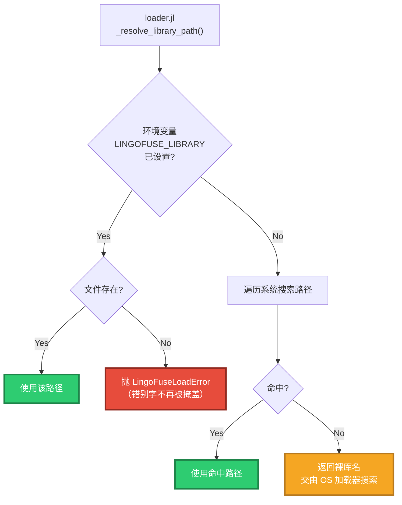

#### 2.3.2 各平台的搜索路径

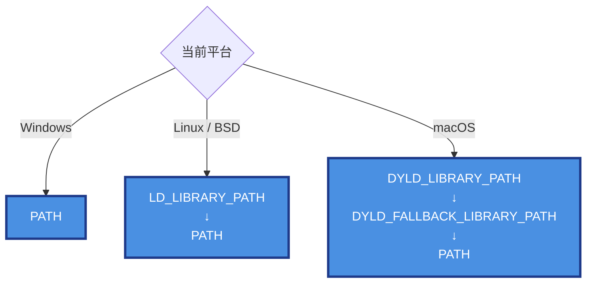

#### 2.3.3 命中后的副作用


> 当命中的目录本来就在 `PATH` 里（例如 `LD_LIBRARY_PATH` 已包含它），前置步骤是幂等的，不会重复添加。

#### 2.3.4 推荐做法

**方式 A — 把运行时目录加入系统搜索路径（推荐）**

这样整个 `julia/` 目录可以任意拷贝到其它位置，运行时仍能被自动定位。

```powershell
# Windows (PowerShell) — permanent for the current user
[Environment]::SetEnvironmentVariable(
    "PATH",
    "D:\CoreLibrary\LingoFuse\Binary;" + $env:PATH,
    "User")
```

```bash
# Linux / macOS — current session
export LD_LIBRARY_PATH=/opt/lingofuse/Binary:$LD_LIBRARY_PATH
```

**方式 B — 点对点覆盖（仅作用于当前进程）**

```powershell
# Windows
$env:LINGOFUSE_LIBRARY = "D:\CoreLibrary\LingoFuse\Binary\LingoFuse64.dll"
```

```bash
# Linux / macOS
export LINGOFUSE_LIBRARY=/opt/lingofuse/Binary/liblingofuse.so
```

> ⚠️ `LINGOFUSE_LIBRARY` 若指向不存在的文件，`loader.jl` **会显式抛错**，不会静默回退到搜索路径。这是为了避免 CI 里的错别字被掩盖。

---

## 三、依赖要求

### 3.1 Julia 包依赖

**唯一需要手动安装的外部包**：

| 包 | 版本 | 安装命令 |
|----|------|---------|
| **JSON3.jl** | 1.x（验证于 1.14.3） | `Pkg.add("JSON3")` |

**安装方法**：

```julia
using Pkg
Pkg.add("JSON3")
```

或从命令行：

```powershell
julia -e 'using Pkg; Pkg.add("JSON3")'
```

**为什么选 JSON3**：

| 特性 | 说明 |
|------|------|
| 零拷贝 | `JSON3.read` 返回视图，对大 payload 有实际意义 |
| 字面 UTF-8 | 非 ASCII 字符以原始字节输出，与其它绑定的 `ensure_ascii=False` 一致 |
| 现代 API | `JSON3.Object` / `JSON3.Array` 支持属性式访问 |

**除 JSON3 外，不需要任何其他第三方 Julia 包。**

### 3.2 Julia 标准库依赖

以下都是 Julia 自带的标准库，无需安装：

| 标准库 | 用途 |
|--------|------|
| `Libdl` | `ccall` 内部用于定位共享库（透明使用） |
| `Base.Threads` | 多线程（consumer 任务使用） |
| `Base.Threads.Atomic` | Cross demo 的计数器 |

### 3.3 系统依赖

| 依赖 | 何时需要 | 说明 |
|------|---------|------|
| C 运行时 | 总是 | Windows 上由 VC++ Redistributable 提供 |
| `pthread` | Linux / macOS | `build.sh` 会自动加 `-lpthread` |
| gcc / cc / clang | **构建 c_ext 时必需** | 见 [第四章](#四c-编译器要求) |

### 3.4 依赖关系总览

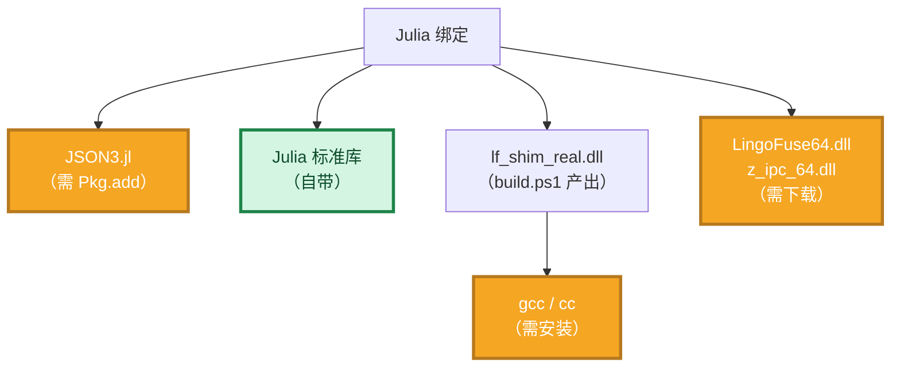

橙色 = 需要手动获取；绿色 = 自带。

---

## 四、C 编译器要求

`c_ext/` 需要 C 编译器来编译两个共享库。**这不是可选项**——Julia 绑定依赖一个 native C shim 来完成跨线程回调（原因见[第六章](#六接口原理)）。

### 4.1 编译器要求

| 项目 | 要求 |
|------|------|
| **目标架构** | **必须 x86_64**（与 Julia 的 64 位 build 匹配） |
| C 标准 | C99 |
| Windows 推荐 | **MinGW-w64 gcc**（`x86_64-w64-mingw32-gcc`） |
| Linux / macOS | `cc` 或 `clang` |
| 32 位 | 未验证 |

### 4.2 Windows 上安装 MinGW-w64

**方式 1：winget（推荐）**

```powershell
winget install --id=BrechtSanders.WinLibs.POSIX.UCRT
```

**方式 2：MSYS2**

从 https://www.msys2.org/ 下载安装后：

```bash
pacman -S mingw-w64-x86_64-gcc
```

### 4.3 验证编译器

```powershell
gcc -dumpmachine
```

**期望输出**：

```
x86_64-w64-mingw32
```

如果输出 `i686-...` 或其他 32 位目标，说明装的是 32 位工具链，**不能用于本项目**。

### 4.4 为什么不能链接 import library

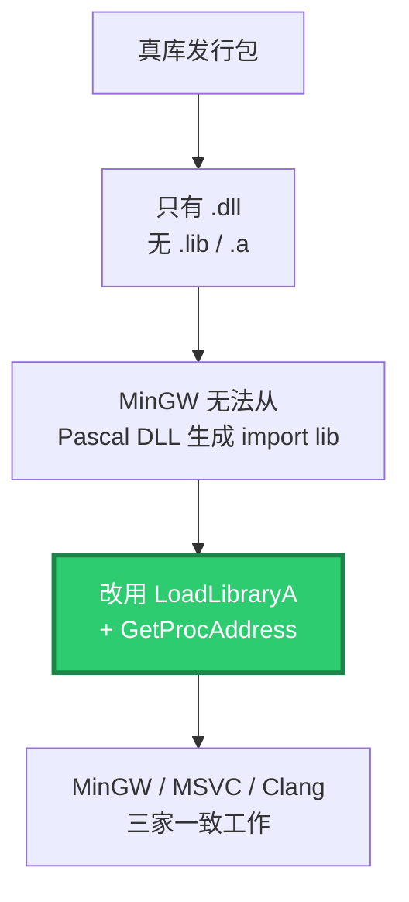

`lf_real_link.c` 用**懒加载**（首次调用时解析），避免 `DllMain` 内的 loader lock 死锁（MSDN 明确警告）。

---

## 五、构建

### 5.1 一键构建

```powershell
cd D:\CoreLibrary\LingoFuse\julia
.\build.ps1
```

### 5.2 构建流程


### 5.3 两个产物的用途

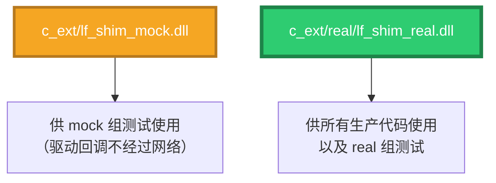

**日常使用只需要 `lf_shim_real.dll`。** mock 版只是 mock 组测试的依赖。

### 5.4 清理

```powershell
.\clean.ps1
```

删除 `c_ext/` 和 `c_ext/real/` 下的 `*.dll` / `*.o` / `*.a` / `*.so` / `*.dylib`，以及 `src/` 下的 `*.ji` 预编译缓存。**幂等**：文件不存在也不报错。

### 5.5 环境诊断

```powershell
.\check_env.ps1
```

9 节检查：


第 7 节采用与 `loader.jl` 一致的策略：优先检查 `LINGOFUSE_LIBRARY`，否则遍历 `PATH` 查找 `LingoFuse64.dll` / `LingoFuse32.dll`。

---

## 六、接口原理

### 6.1 问题的本质

LingoFuse 在 **C4 worker 线程**（native 线程）上触发回调。Julia 的 GC / JIT / Task 调度器**全部要求**进入 Julia 的线程被 runtime 认领。

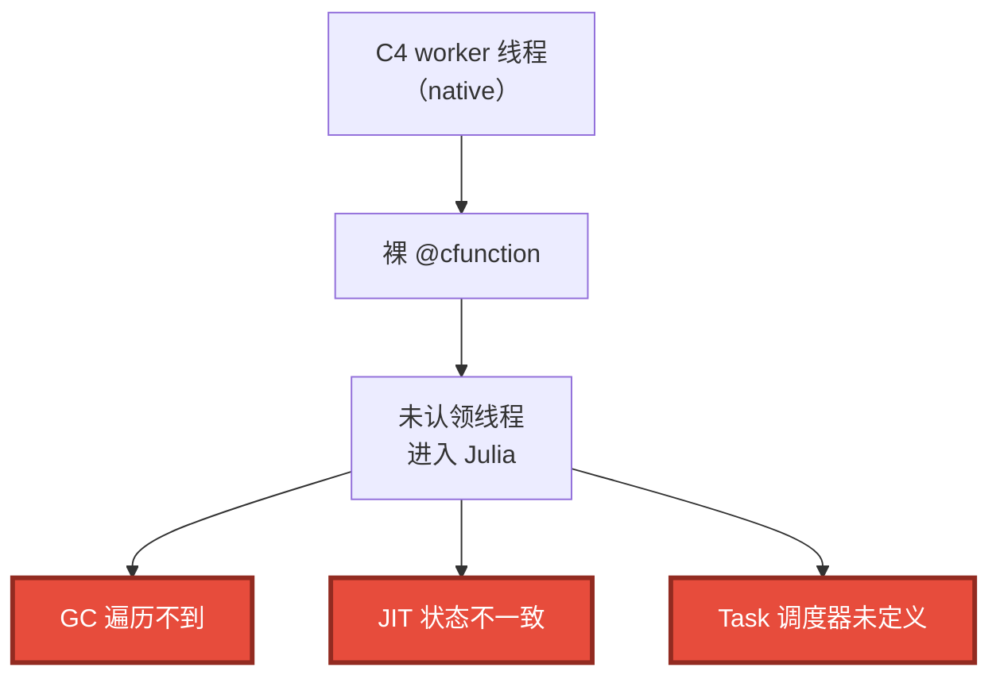

**为什么其他语言没有这个问题**：

| 语言 | 原因 |
|------|------|
| C / C++ / Rust | 无 runtime，无 GC，无调度器 |
| Python | GIL 让任意线程进入解释器都是设计内的 |
| C# | CLR 的 P/Invoke 层能"接管"外来线程 |
| **Julia** | **GC + JIT + Task 调度器都依赖线程已被 runtime 认领** |

### 6.2 解决方案：C shim

**核心思路**：在 C 和 Julia 之间建一个缓冲区。

#### 6.2.1 第一步 — C4 worker 触发回调

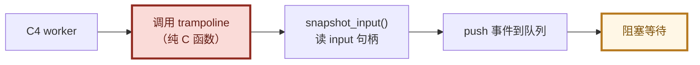

#### 6.2.2 第二步 — Julia consumer 处理事件


#### 6.2.3 第三步 — trampoline 醒来写回结果


**关键契约**：**Julia consumer 绝不触碰 native data handle**。

所有 handle I/O（读 input、写 output）都在 trampoline 线程上完成。原因是真库对每个 handle 有 per-handle 锁，如果 consumer 从另一个线程访问同一个 handle，会与正在等待的 C4 worker 线程争用锁 → 死锁。

### 6.3 分层架构

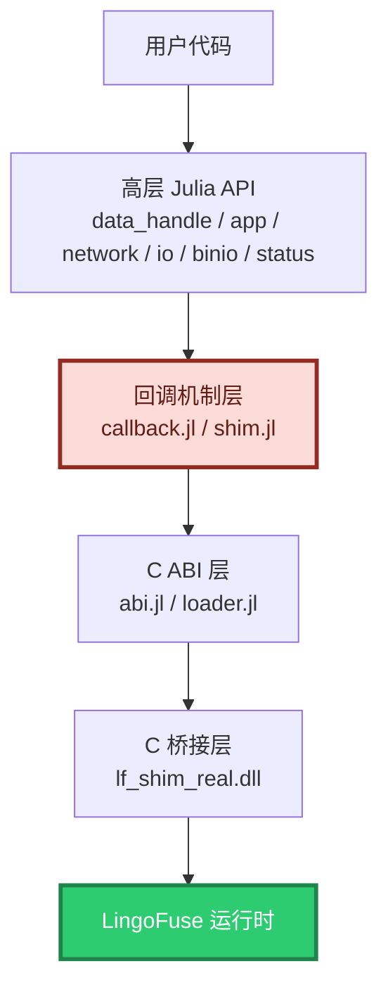

依赖方向严格单向，不允许反向依赖。

### 6.4 阻塞分类：`@threadcall` 是核心机制

Julia 的 GC 需要所有线程到 safepoint。**阻塞在 ccall 里的线程不在 safepoint。**

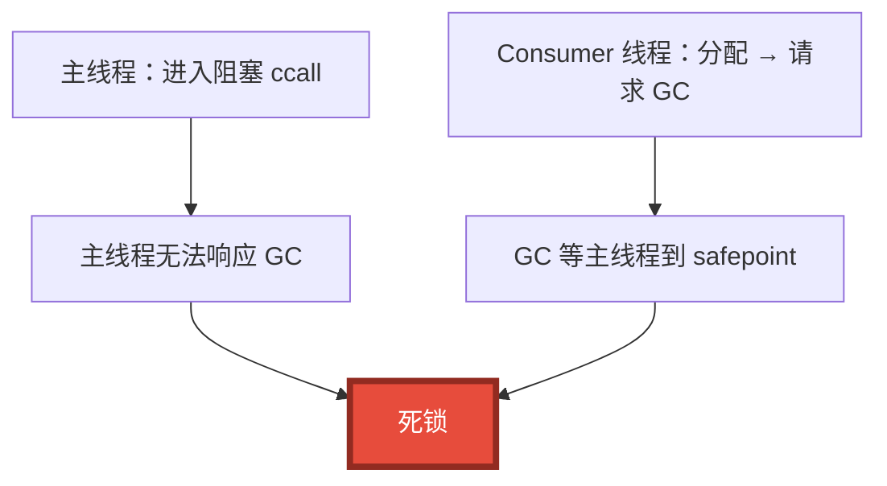

**修复**：所有可能阻塞的 C 调用走 `@threadcall`（libuv 线程池），Julia 线程保持可响应。

**已分类的 LF_* 函数**：

| LF_* 函数 | 是否阻塞 | 处理 |
|-----------|:--------:|------|
| `LF_CreateData` / `LF_FreeData` / `LF_Get*` / `LF_Set*` | 微秒级 | 普通 `ccall` |
| `LF_CreateApp` / `LF_FreeApp` | 微秒级 | 普通 `ccall` |
| `LF_RegisterCall` / `LF_RegisterNotify` | 微秒级 | 普通 `ccall` |
| `LF_SetOption` / `LF_PostStatus` | 微秒级 | 普通 `ccall` |
| `LF_LocalCall` / `LF_LocalNotify` | 同步触发回调 | **`@threadcall`** |
| `LF_Notify` / `LF_Sequenced_Notify` | 可能同步触发回调 | **`@threadcall`** |
| `LF_Call` | 秒级阻塞 | **`@threadcall`** |
| `LF_PrepareDone` | 可能阻塞 30 秒 | **`@threadcall`** |
| `LF_ExitMainThread` / `LF_Shutdown` | 等待资源 | **`@threadcall`** |

### 6.5 四条硬性规则

| # | 规则 | 违反后果 |
|:-:|------|----------|
| 1 | 所有可能阻塞的 ccall 走 `@threadcall` | 与 GC 死锁 |
| 2 | `@threadcall` 参数必须 isbits | libuv 线程进入 Julia runtime 崩溃 |
| 3 | 传指针给 native 必须 `GC.@preserve` | 悬空指针读到已回收内存 |
| 4 | 所有 handler 调用走 `Base.invokelatest` | "method too new" 报错 |

**规则 4 的根因**：

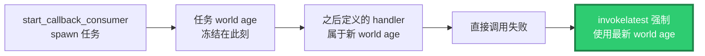

### 6.6 Handler 内是一条"纯 Julia 沙箱"

**Handler 内可以**：

- 操作 `Vector{UInt8}` / `String` / 数值
- 打印日志、计数、修改捕获的变量
- 使用 `ReentrantLock` 保护共享状态
- 抛异常（会被 consumer 吞掉并记录）

**Handler 内禁止**：

- 调用任何 `LF_*` 函数
- 创建或释放 `DataHandle` / `App`
- 使用 `binio.jl` / `data_handle.jl`
- 调用 `LF_Call` / `LF_Notify` / `prepare_*`

**根因**：handler 运行在 consumer 线程；它被触发时，caller 线程通常正阻塞在 `LF_Call` 的 libuv worker 上，持有真库的内部锁。任何来自 handler 的 `LF_*` 调用都会与那把锁争用 → 死锁。

这是本绑定最重要的使用约束，详见 [第十四章](#十四踩坑速查) 的 `PIT-HANDLER-001`。

### 6.7 DataHandle 生命周期

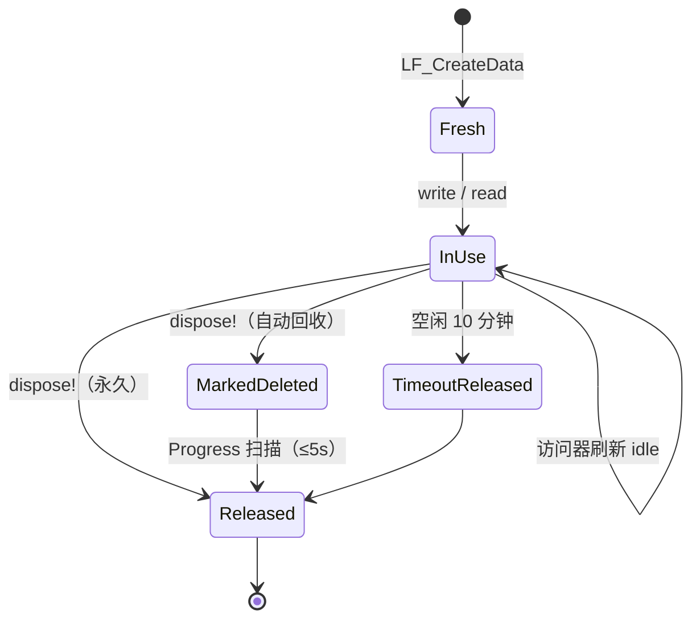

两种句柄：

| 种类 | 构造方式 | 回收方式 | 适用场景 |
|------|---------|---------|---------|
| **自动回收** | `DataHandle(name)` | 10 分钟空闲 + 5 秒扫描 | 绝大多数场景 |
| **永久句柄** | `DataHandle(name; permanent=true)` | `dispose!` 立即释放 | 缓存模板、长生命周期 scratch buffer |

---

## 七、快速开始

### 7.1 安装依赖

```julia
using Pkg
Pkg.add("JSON3")
```

### 7.2 三步上手（无网络）

```julia
push!(LOAD_PATH, "path/to/julia/src")
using LingoFuse

# 1. 注册一个 API
app = App("MyApp", "My Julia service")
register_call!(app, "echo", "Echo the payload") do in_bytes
    return in_bytes            # Vector{UInt8} in → Vector{UInt8} out
end

# 2. 本地调用（不经过网络）
param = DataHandle("echo")
write_string!(param, "hello, world")
result = local_call(app, param)
set_cursor_position!(result, 0)
println(read_string!(result))   # → "hello, world"

# 3. 清理
dispose!(result)
dispose!(param)
dispose!(app)
```

### 7.3 完整网络服务（环回 RPC）

```julia
push!(LOAD_PATH, "path/to/julia/src")
using LingoFuse

set_option("Wait_Connection_ReadyOk", "True")
set_option("Quiet", "True")

reset_prepare()
start_callback_consumer()

app = App("EchoApp", "demo")
register_call!(app, "echo", "echo") do in_bytes
    return in_bytes
end

prepare_service("ipc:my_service", "ipc:my_service")
prepare_client("ipc:my_service", app)
prepare_done()

# 调用
param = DataHandle("echo")
write_string!(param, "hello")
raw = LF_Call("EchoApp", param.handle, UInt64(5000))
result = _wrap_data_handle(raw, true)
set_cursor_position!(result, 0)
println(read_string!(result))   # → "hello"

# 清理（LF-CLEAN-001 顺序）
clear_network_event()
exit_main_thread()
dispose!(result)
dispose!(param)
dispose!(app)
stop_callback_consumer()
shutdown()
```

### 7.4 使用统一 JSON I/O

```julia
dh = DataHandle("my_api")

# 写入：字面 UTF-8，无 \uXXXX 转义，末尾自动加 NUL
write_json!(dh, Dict("name" => "张三", "age" => 30))

# 读取：返回 JSON3.Object（零拷贝视图）
set_cursor_position!(dh, 0)
obj = read_json(dh)
println(obj.name)     # → "张三"

# 需要普通 Dict 时
d = json_to_dict(obj)   # → Dict{String,Any}
```

### 7.5 监听网络事件

```julia
q = global_queue()
install!(q)

try
    while running
        evt = poll_event(q)
        if evt !== nothing
            kind, addr = evt
            println("$kind: $addr")
        end
        sleep(0.1)
    end
finally
    uninstall!(q)
end
```

### 7.6 重启回调层（进程内）

回调层支持在同一进程内多次启动和停止：

```julia
start_callback_consumer()
# ... 第一轮操作 ...
stop_callback_consumer()

start_callback_consumer()   # ← 重新启动，正常工作
# ... 第二轮操作 ...
stop_callback_consumer()
```

**约束**：`stop_callback_consumer()` 会**完全静默**（fully quiesce）consumer 任务后才返回，确保重启安全。详见 `c_ext/lf_shim.c` 头部的 "Shutdown contract" 与 "Re-initialisation contract"。

---

## 八、核心 API 速查

### 8.1 API 分类总览

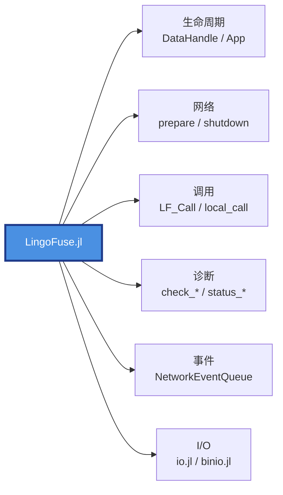

### 8.2 数据句柄 I/O（`data_handle.jl` / `binio.jl`）

| 函数 | 说明 |
|------|------|
| `DataHandle(name)` | 创建自动回收句柄 |
| `DataHandle(name; permanent=true)` | 创建永久句柄 |
| `write_buffer!(dh, bytes)` | 写原始字节，游标前进 |
| `read_buffer!(dh, n)` | 读最多 n 字节（可能短读） |
| `read_buffer_exact!(dh, n)` | 读恰好 n 字节，短读抛异常 |
| `read_all!(dh)` | 读剩余全部字节 |
| `write_string!(dh, s)` | 写 UTF-8 + NUL |
| `read_string!(dh)` | 读到 NUL（无 NUL 则读到末尾） |
| `write_json!(dh, obj)` | JSON 序列化 + NUL |
| `read_json(dh)` | 反序列化，失败抛异常 |
| `try_read_json(dh)` | 失败返回 `nothing` |
| `read_json_or_bytes(dh)` | 非 JSON 返回原始字节 |
| `cursor_position` / `set_cursor_position!` | 游标 |
| `buffer_size(dh)` | 缓冲总大小 |
| `dispose!(dh)` | 释放（幂等） |

**二进制小端 I/O**（`binio.jl`）：

| 类型 | 写入 | 读取 |
|------|------|------|
| `UInt8` | `write_uint8!` | `read_uint8` |
| `UInt16` | `write_uint16!` | `read_uint16` |
| `UInt32` | `write_uint32!` | `read_uint32` |
| `UInt64` | `write_uint64!` | `read_uint64` |
| `Int8/16/32/64` | `write_int8!` … | `read_int8` … |
| `Float32` | `write_single!` | `read_single` |
| `Float64` | `write_double!` | `read_double` |

每类都有 `try_read_*` 非抛异常版本。

### 8.3 应用（`app.jl`）

| 函数 | 说明 |
|------|------|
| `App(name, desc)` | 创建 App |
| `register_call!(app, name, desc, handler)` | 注册 Call API，默认 warmup |
| `register_notify!(app, name, desc, handler)` | 注册 Notify API |
| `unregister!(app, name)` | 注销 |
| `local_call(app, param)` | 本地执行，返回新 `DataHandle` |
| `local_notify(app, param)` | 本地通知 |
| `bind(app)` | 绑定到所有空闲客户端，返回数量 |
| `app_name(app)` | 返回 App 名 |
| `dispose!(app)` / `is_disposed(app)` | 生命周期 |

**Warmup 契约**：`register_call!` / `register_notify!` 默认 `warmup=true`，会在注册时用三个合成 payload（空、2 字节、256 字节）**真实调用**你的 handler。副作用（日志、状态修改、I/O）会发生三次。有副作用的 handler 请传 `warmup=false`。详见 [第十四章](#十四踩坑速查) 的 `PIT-WARMUP-001`。

### 8.4 网络（`network.jl`）

| 函数 | 说明 |
|------|------|
| `reset_prepare()` | 清空准备队列 |
| `prepare_service(local, public)` | 排队 C4 服务，返回 tag 或 -1 |
| `prepare_client(addr, app)` | 排队 C4 客户端 |
| `prepare_done()` | 启动主循环，每进程只返回 1 一次 |
| `exit_main_thread()` | 停止主循环，不释放资源 |
| `shutdown()` | 释放全部资源，可重复调用 |
| `set_option(key, value)` | 设置全局选项 |

### 8.5 网络事件（`status.jl`）

| 函数 | 说明 |
|------|------|
| `NetworkEventListener()` | OOP 监听器基类 |
| `NetworkEventQueue(max_size)` | 有界队列 |
| `global_queue()` | 进程级单例 |
| `install!(q)` / `uninstall!(q)` | 安装 / 卸载 |
| `take_event(q; timeout)` | 阻塞取事件 |
| `poll_event(q)` | 非阻塞取事件 |
| `clear!(q)` / `close_queue!(q)` | 清空 / 关闭 |
| `set_network_event(...)` / `clear_network_event()` | 函数式安装 |

### 8.6 诊断（`network.jl`）

| 函数 | 说明 |
|------|------|
| `check_main_thread()` | 主循环是否运行 |
| `check_app(name)` | 探测 App 是否可见（约 3 秒延迟） |
| `check_api(app, api)` | 探测 API 是否可见 |
| `generate_app_name()` | 生成全局唯一 App 名 |
| `get_app_name(app)` | 从 App 句柄读名字 |
| `status_count()` / `get_status()` / `post_status(msg)` | 状态队列 |
| `drain_status(n)` / `log_status(io; max)` | 批量排空 / 打印 |

---

## 九、测试

### 9.1 运行全部测试

```powershell
cd D:\CoreLibrary\LingoFuse\julia
julia --threads=2 test\runtests.jl
```

`runtests.jl` 是**调度器**，它依次 spawn 两个子进程：

```
runtests.jl
  ├── runtests_mock.jl    （7 个 mock 组测试，仅依赖 mock shim）
  └── runtests_real.jl    （6 个 real 组测试，依赖真库 + real shim）
```

### 9.2 为什么分 mock 组和 real 组

```mermaid
flowchart TB
    ROOT["runtests.jl"] --> M["runtests_mock.jl"]
    ROOT --> R["runtests_real.jl"]

    M --> M1["依赖 mock shim<br/>测试框架自身"]
    R --> R1["依赖 real shim<br/>测试真库集成"]

    M1 -.x.-> R1

    style M fill:#F5A623,stroke:#B7791F,stroke-width:3px,color:#FFFFFF
    style R fill:#2ECC71,stroke:#1E8449,stroke-width:3px,color:#FFFFFF
```

**两个 shim 无法在同一 Julia 进程里共存**——`src/shim.jl` 在包加载时解析一次 shim 路径，之后所有 `shim_*` 调用都走同一个变体。因此 mock 组和 real 组必须分进程。

| 分组 | shim | 测试内容 |
|------|------|---------|
| **mock 组** | `lf_shim_mock.dll` | 框架完整性、UID、async 驱动、P2P 注册、回调分派 |
| **real 组** | `lf_shim_real.dll` | I/O、RAII、真库网络、端到端 RPC |

### 9.3 单跑一个测试

```powershell
julia --threads=2 test\test_io.jl
julia --threads=2 test\test_network.jl
# ...
```

或单跑一组：

```powershell
julia --threads=2 test\runtests_mock.jl
julia --threads=2 test\runtests_real.jl
```

> ⚠️ **必须带 `--threads=2`。** 少带会立即抛 `LingoFuseStateError`。

### 9.4 mock 组（7 个测试，294 项断言）

| 文件 | 断言数 | 内容 |
|------|:------:|------|
| `test_uid.jl` | 50 | UID 类型 / 构造 / 往返 / 哈希 / Ref / show |
| `test_abi.jl` | 14 | 59 个 `LF_*` 符号完整性 + 安全调用 |
| `test_shim_bind.jl` | 71 | 66 个 `shim_*` 符号 + typed options + async 派发 + NULL 安全 |
| `test_callback.jl` | 35 | 消费循环 + 5 类事件分派 + 身份访问器 + 重启 |
| `test_async_unit.jl` | 50 | Future 状态机 + 并发竞争 + 阻塞语义 |
| `test_target.jl` | 56 | 三寻址 + payload 形态 + Future 端到端 + do-block + 软超时 |
| `test_p2p.jl` | 18 | P2P 注册 + do-block + warmup 控制 |

### 9.5 real 组（6 个测试，137 项断言 + 4 场景）

| 文件 | 断言数 | 内容 |
|------|:------:|------|
| `test_io.jl` | 40 | JSON I/O + 字符串 / 字节 / 线格式不变量 |
| `test_raii.jl` | 29 | DataHandle / App 生命周期 + 本地调用 |
| `test_network.jl` | 13 | 单进程环回 RPC + prepare + 诊断 |
| `smoke.jl` | 4 场景 | 四种 handler 定义形状兼容性 |
| `test_status.jl` | 30 | 网络事件 + 有界队列 + 状态队列 |
| `test_e2e_local.jl` | 25 | 完整端到端（service + client + call + notify） |

### 9.6 其他

| 文件 | 用途 |
|------|------|
| `test_restart.jl` | M1 遗留：进程内重启回调层 |
| `diag.jl` | Step 1 最小复现（`@threadcall` + 闭包） |
| `try_module.jl` | `using LingoFuse` 冒烟 |

### 9.7 验收状态

`julia --threads=2 test/runtests.jl` 全绿：

```
Test Summary:           | Pass  Total
LingoFuse Julia binding |    2      2
  mock shim group       |    1      1
  real shim group       |    1      1
```

**主测试合计：431 项断言 + 4 场景，全部 PASS。**

### 9.8 诊断工具

| 工具 | 用途 |
|------|------|
| `test/diag.jl` | Step 1 最小复现：`@threadcall` 跨线程闭包 |
| `test/try_module.jl` | `using LingoFuse` 冒烟 |
| `check_env.ps1` | 环境诊断（9 节） |
| `LINGOFUSE_TRACE=1` | 运行时逐步 trace |

---

## 十、测试对应应用场景

每个测试文件对应一类**真实应用场景**。

### 10.1 mock 组

| 测试 | 应用场景 | 真实使用示例 |
|------|---------|-------------|
| **`test_uid.jl`** | UID 作为会话标识 | whoami 探测、会话粘性路由 |
| **`test_abi.jl`** | 底层 ABI 完整性 | 升级 LingoFuse 后回归验证符号表 |
| **`test_shim_bind.jl`** | 回调桥完整性 | 升级 shim 后验证所有入口点 |
| **`test_callback.jl`** | 跨线程回调 | 模拟 C4 worker 触发回调，验证 consumer 分派 |
| **`test_async_unit.jl`** | 异步调用状态机 | 验证 Future 的超时 / 结果 / 错误三态 |
| **`test_target.jl`** | 三寻址调用 | App 名 / UID / P2PName 三种路由方式 |
| **`test_p2p.jl`** | 进程级 P2P 注册 | 全局工具 API（whoami / health） |

### 10.2 real 组

| 测试 | 应用场景 | 真实使用示例 |
|------|---------|-------------|
| **`test_io.jl`** | 应用与其它语言服务交换 JSON | Julia 服务作为 LLM 后端返回结构化 JSON |
| | 跨语言线格式兼容 | Julia handler 被 C++ 调用，字节必须一致 |
| **`test_raii.jl`** | 单进程本地 RPC | 单元测试：验证 API 逻辑不经过网络 |
| **`test_network.jl`** | 单进程完整环回 | 集成测试：一个进程内跑完 prepare → 调用 → 清理 |
| **`smoke.jl`** | 四种 handler 定义形状 | 具名 / 匿名 / 捕获变量 / 运行时注册 |
| **`test_status.jl`** | 网络事件监听 | 客户端上线 / 下线时触发业务逻辑 |
| **`test_e2e_local.jl`** | 完整 RPC 生命周期 | 单进程模拟 Cross Demo 全链路 |

### 10.3 场景分类

```mermaid
flowchart TB
    S["测试场景"]

    S --> A["数据交换"]
    S --> B["本地执行"]
    S --> C["跨进程通信"]
    S --> D["事件监听"]
    S --> E["生命周期管理"]
    S --> F["机制验证"]

    A --> A1["test_io.jl"]
    B --> B1["test_raii.jl"]
    C --> C1["test_network.jl"]
    C --> C2["test_e2e_local.jl"]
    C --> C3["smoke.jl"]
    D --> D1["test_status.jl"]
    E --> E1["test_restart.jl"]
    F --> F1["test_uid.jl / test_abi.jl"]
    F --> F2["test_shim_bind.jl / test_callback.jl"]
    F --> F3["test_async_unit.jl / test_target.jl / test_p2p.jl"]

    style S fill:#4A90E2,stroke:#1E3A8A,stroke-width:3px,color:#FFFFFF
```

### 10.4 什么时候跑哪个测试

| 我改了什么？ | 应该跑什么 |
|-------------|-----------|
| 回调层 / `c_ext/` | mock 组全套 + `smoke.jl` |
| I/O 层（`io.jl` / `binio.jl`） | `test_io.jl` |
| RAII / 生命周期 | `test_raii.jl` + `test_restart.jl` |
| 网络 / 诊断 | `test_network.jl` + `test_e2e_local.jl` |
| 事件 / 状态 | `test_status.jl` |
| `abi.jl` / `shim.jl` 符号 | `test_abi.jl` + `test_shim_bind.jl` |
| 不确定 | `julia --threads=2 test\runtests.jl`（全套） |

---

## 十一、跨语言互操作

LingoFuse 的**核心价值是跨语言互操作**。Julia 绑定完全融入这套体系。

### 11.1 互操作契约

```mermaid
flowchart LR
    J["Julia"] -->|"line format"| BUS["LingoFuse 总线"]
    BUS --> C["C / C++"]
    BUS --> P["Pascal"]
    BUS --> PY["Python"]
    BUS --> CS["C#"]
    BUS --> JS["JavaScript"]
    BUS --> MORE["12+ more"]

    style BUS fill:#4A90E2,stroke:#1E3A8A,stroke-width:4px,color:#FFFFFF
    style J fill:#2ECC71,stroke:#1E8449,stroke-width:3px,color:#FFFFFF
```

**互操作的四条契约**（所有绑定共同遵守）：

| # | 契约 | 说明 |
|:-:|------|------|
| 1 | **UTF-8 字符串 + NUL 结尾** | 所有字符串参数、API 名、App 名都是 UTF-8 |
| 2 | **小端字节序** | 所有整数 / 浮点写入都是小端 |
| 3 | **Raw binary payload** | 数据句柄承载任意字节，协议层不解释 |
| 4 | **回调必须 cdecl** | C ABI 约定的调用方式 |

### 11.2 已验证的互通语言

| 组合 | 状态 | 测试方式 |
|------|:----:|----------|
| **Julia ↔ Julia** | ✅ 已验证 | `test_e2e_local.jl`（同进程）+ Cross Demo（跨进程） |
| **Julia ↔ C++** | ✅ 已验证 | Cross Demo 与 C++ 版 `CrossCall` / `CrossNode` 互通 |
| **Julia ↔ Pascal** | ✅ 已验证 | Cross Demo 与 Pascal 版 `cross_call` / `cross_node` 互通 |
| **Julia ↔ Python** | ✅ 已验证 | Cross Demo 与 Python 版 `cross_call.py` / `cross_node.py` 互通 |

### 11.3 Wire 契约细节

**Call 请求（payload 结构）**：

```
[apiName] [FromUID:32B] [FromP2PName] [Param.Size:Int32] [Param:bytes]
```

**Call 响应（payload 结构）**：

```
[Result:bytes]
```

**跨语言能见度**：调用方只需知道 `apiName` + `Param` 的字节布局；接收方的 `FromUID` / `FromP2PName` 由框架自动注入，业务层无需处理。

### 11.4 二进制 payload 示例（`inv_seri` 的跨语言字节布局）

| 字段 | 类型 | 偏移 | 长度 |
|------|------|:----:|:----:|
| `b` | `uint8` | 0 | 1 |
| `w` | `uint16` | 1 | 2 |
| `c` | `uint32` | 3 | 4 |
| `u64` | `uint64` | 7 | 8 |
| `s` | `string`（NUL 结尾） | 15 | 变长 |
| `f` | `float32` | 15+n | 4 |

**任何语言的绑定**写入这段字节，另一端都能正确解析。详见 `example/README.md`。

### 11.5 JSON payload 跨语言一致

除了 raw binary，JSON 也是常用的跨语言 payload 形态。工具的**统一 JSON 策略**：

- **`ensure_ascii=False`**：中文、emoji 等非 ASCII 字符以字面 UTF-8 输出，不出现 `\uXXXX` 转义
- **末尾追加 `#0`**：与 raw binary 的 NUL 结尾一致
- **读取容错**：无 NUL 时读到末尾（兼容 HTTP bridge 等非标准生产者）

| 语言 | JSON 库 | 策略 |
|------|---------|------|
| Julia | JSON3.jl | 字面 UTF-8 |
| Python | json | `ensure_ascii=False` |
| C++ | nlohmann/json | 字面 UTF-8 |
| C# | System.Text.Json | `UnsafeRelaxedJsonEscaping` |
| Pascal | Z.Json | 字面 UTF-8 |

**四个生产者对同一逻辑 payload 输出完全相同的字节序列。**

### 11.6 未来可对接语言

只要该语言能：

1. 调用 C ABI（`ccall` / FFI / P/Invoke / JNI / NIF / `ccall`）
2. 提供回调函数指针

就能接入 LingoFuse。当前官方支持列表之外的常见候选：

- **Rust**（`extern "C"` + FFI）
- **Go**（`purego` / `cgo`）
- **Swift**（`@convention(c)`）
- **Erlang/Elixir**（NIF）
- **Ruby**（Fiddle / C 扩展）
- **Matlab / R / Julia**（`ccall` + 语言侧序列化）
- **Fortran**（`iso_c_binding`）

Julia 绑定已经完成，可作为**接入其他语言的参考实现**。

---

## 十二、Cross Demo

三个进程的端到端演示，与 C++ / C# / Pascal / Python / JavaScript 的 Cross Demo **字节级兼容**。

### 12.1 三进程角色

```mermaid
flowchart LR
    S["CrossService.jl<br/>信标"] --> N["CrossNode.jl<br/>Worker"]
    S --> C["CrossCall.jl<br/>压测客户端"]
    N -->|"demo.add / demo.inv_seri"| C

    style S fill:#F5A623,stroke:#B7791F,stroke-width:3px,color:#FFFFFF
    style N fill:#2ECC71,stroke:#1E8449,stroke-width:3px,color:#FFFFFF
    style C fill:#4A90E2,stroke:#1E3A8A,stroke-width:3px,color:#FFFFFF
```

### 12.2 启动命令

```powershell
# 终端 1
julia --threads=2 example\CrossService.jl

# 终端 2（等终端 1 打印 "running" 后）
julia --threads=2 example\CrossNode.jl

# 终端 3（等终端 2 打印 "Online" 后）
julia --threads=2 example\CrossCall.jl
```

### 12.3 跨语言混合部署

**Cross Demo 的三个进程可以用不同语言实现**。例如：

```
终端 1:  cross_service.exe       （Pascal 信标）
终端 2:  CrossNode.exe           （C++ Worker）
终端 3:  julia CrossCall.jl      （Julia 压测客户端）
```

或：

```
终端 1:  cross_service.lpr       （Pascal 信标）
终端 2:  julia CrossNode.jl      （Julia Worker）
终端 3:  python cross_call.py    （Python 压测客户端）
```

**只要三端连到同一个 `ipc:cross` 端点，跨语言调用自动生效。**

### 12.4 CrossNode 的实时输出

handler 内每次调用都会打印（`handler 内不能触碰 LF_*` 是唯一约束，打印不受影响）：

```
[Node] add(5, 7) = 12
[Node] inv_seri received: [200, 16, 47, 63, "hello world", 3.14]
[Node] inv_seri replied:  [3.14, "hello world", 63, 47, 16, 200]
```

### 12.5 并发限制与 `UV_THREADPOOL_SIZE`

8 task 并发压测受 libuv 线程池限制（默认 4）。要更高并发需先设置：

```powershell
$env:UV_THREADPOOL_SIZE = "32"
julia --threads=2 example\CrossCall.jl
```

### 12.6 详细指南

见 `example/README.md`。

---

## 十三、已知限制

| 限制 | 说明 | 规避 |
|------|------|------|
| **必须 `--threads=2`** | 回调 consumer 不能落在 main 线程 | 无（硬性要求） |
| **Handler 内禁止调 `LF_*`** | handler 运行在 consumer 线程，与 caller 争真库锁 | 详见 `PIT-HANDLER-001` |
| **libuv 线程池默认 4** | 影响 `@threadcall` 的并发上限 | `UV_THREADPOOL_SIZE` 环境变量 |
| **32 位未验证** | 只在 x86_64 上验证 | 用 64 位 Julia |
| **Apple Silicon 未验证** | 只在 x64 上验证 | Rosetta 或等后续版本 |
| **`String(v::Vector{UInt8})` 转移所有权** | 调用后 v 变空 | 用 `String(copy(v))` |
| **`LF_PrepareDone` 每进程只返回 1 一次** | 二次调用返回 0 | 状态守卫 |
| **`LF_FreeData` 在 `LF_PrepareDone` 前是 no-op** | 初始化期间的句柄释放被忽略 | 用 `create_permanent` 或延后释放 |
| **`LF_GetStatus` 返回静态缓冲** | 下次调用失效 | 立即拷贝为 Julia `String` |
| **`read_string!` / `read_string_bytes` 无 NUL 时会扩展 buffer** | 触发 `LF_SetPos(size + 1)`，buffer +1 字节 | 契约行为，与其它绑定一致 |
| **warmup 会真实调用 handler 三次** | 有副作用的 handler 需 `warmup=false` | 详见 `PIT-WARMUP-001` |
| **`peek_string_bytes` 是纯读** | 不修改 cursor / size | 与非 peek 版本行为不同 |
| **库路径依赖系统搜索路径** | `LINGOFUSE_LIBRARY` 未设时靠 `PATH` / `LD_LIBRARY_PATH` / `DYLD_LIBRARY_PATH` | 见 2.3 节 |
| **`shim.jl` 的 real / mock 选择是进程级锁定** | 一次加载后无法在同一进程切换 | mock 测试与 real 测试分进程 |

---

## 十四、踩坑速查

本章列出**开发和使用 Julia 绑定时反复踩到的坑**，每条都有 ID、症状、根因、修复。

### 14.1 命名约定

```
PIT-<子系统>-<三位序号>
```

| 子系统 | 范围 |
|--------|------|
| `HANDLER` | handler 编写 |
| `SHIM` | shim 搜索 / 加载 |
| `WARMUP` | warmup 语义 |
| `WAIT` | `Wait_Connection_ReadyOk` |
| `STR` | Julia 字符串所有权 |

### 14.2 PIT-HANDLER-001：handler 内禁止调 `LF_*`

**症状**：调用发起后整个进程挂起，无任何输出。Ctrl+C 也无法中断（真库锁死）。

**根因**：handler 运行在 consumer 线程；它被触发时，caller 线程正阻塞在 `LF_Call` 的 libuv worker 上，持有真库的内部锁。任何来自 handler 的 `LF_*` 调用（例如 `LF_CreateData` 创建 scratch `DataHandle`）都会争用同一把锁。

**典型触发写法**：

```julia
# ✗ 错误
function handle_add(in_bytes::Vector{UInt8})
    in_dh = DataHandle("add")          # ← LF_CreateData → 死锁
    out_dh = DataHandle("add")         # ← LF_CreateData → 死锁
    write_buffer!(in_dh, in_bytes)
    ...
end
```

**正确写法**：

```julia
# ✓ 正确：纯 Julia 字节操作
function handle_add(in_bytes::Vector{UInt8})
    length(in_bytes) == 8 || return UInt8[]
    a = _le_i32(in_bytes, 0)          # 私有 helper
    b = _le_i32(in_bytes, 4)
    c = a + b
    out = UInt8[]
    _push_i32!(out, c)
    return out
end
```

**通用规律**：handler 内可以操作 `Vector{UInt8}` / `String` / 数值，但禁止触碰 `DataHandle` / `App` / `binio.jl` / `abi.jl` / `network.jl`。

### 14.3 PIT-SHIM-001：`shim.jl` 的搜索顺序

**症状**：`shim_is_real()` 返回 `false`，即使 `$env:LINGOFUSE_SHIM` 已指向 real。或反过来，构建了 real 却加载了 mock。

**根因**：`shim.jl` 的搜索顺序决定实际加载哪个。历史版本中 PATH 搜索优先于 in-tree，导致 `c_ext/lf_shim_mock.dll` 先命中。

**当前搜索顺序**（v0.2.0）：

```
1. $env:LINGOFUSE_SHIM          ← 显式覆盖，永远最先
2. c_ext/real/lf_shim_real.dll  ← in-tree，real 优先
3. c_ext/lf_shim_real.dll
4. c_ext/lf_shim_mock.dll
5. PATH 中的 real / mock
6. 可执行文件旁
```

**调试**：

```powershell
julia --threads=2 -e 'push!(LOAD_PATH, "src"); using LingoFuse; println(shim_path()); println(shim_is_real())'
```

**mock 组测试的 pin**：三个 mock 测试文件在开头显式设置 `ENV["LINGOFUSE_SHIM"]` 指向 mock。这是为了在 real 已构建的环境下仍能跑 mock 组测试。

### 14.4 PIT-WARMUP-001：warmup 会真实调用 handler 三次

**症状**：注册 API 时 handler 被调用 3 次（空、2 字节、256 字节 payload），日志出现 3 条噪音，状态被改 3 次。

**根因**：`register_call!` 默认 `warmup=true`，用三个合成 payload 提前触发 JIT 编译，避免 handler 首次被调用时在 consumer 线程上编译引发崩溃（历史上的 Julia 1.13 JIT 边界 case）。

**修复**：

```julia
# 选项 1：handler 内做长度检查，让 warmup payload 静默返回
function handle_add(in_bytes)
    length(in_bytes) == 8 || return UInt8[]   # ← 三个 warmup payload 都被拒绝
    ...
end

# 选项 2：如果 handler 有副作用（DB / 网络 / 计费），禁用 warmup
register_call!(app, "add", "", handle_add; warmup = false)
```

**权衡**：`warmup=false` 会推迟 JIT 编译到首次真实调用，理论上存在编译竞争风险（见 `c_ext/lf_shim.jl` 头部的 "JIT COMPILATION THREAD RACE"）。除非 handler 有强副作用，否则**推荐用长度检查**保留 warmup。

### 14.5 PIT-WAIT-001：`Wait_Connection_ReadyOk` 的两种场景

**症状**：单进程内 `prepare_service` + `prepare_client` + `prepare_done` 后，`check_api` 返回 false，`LF_Call` 报 `no found app`。

**根因**：`Wait_Connection_ReadyOk=False`（部署模式）让 `prepare_done` 立即返回，此时 ClientConnected 事件尚未触发，App 未绑定到客户端，本地路由表查不到。

**正确用法**：

| 场景 | 推荐值 | 理由 |
|------|:------:|------|
| **单进程** service + client + call | `True` | App 必须在本进程可见才能本地短路 |
| **跨进程** service 与 worker | `False` | 无序启动，allow worker 先启动 |
| **跨进程** caller | `True` | caller 需要 mesh 完全就绪才发起调用 |

**修正后的写法**：

```julia
# 单进程 e2e（test_e2e_local.jl）
set_option("Wait_Connection_ReadyOk", "True")

# Cross worker（example/CrossNode.jl），与 C++ / Pascal / Python 一致
set_option("Wait_Connection_ReadyOk", "False")
```

### 14.6 PIT-STR-001：`String(v::Vector{UInt8})` 转移所有权

**症状**：第二次读同一 `Vector{UInt8}` 内容为空。

**根因**：Julia 的 `String(::Vector{UInt8})` 会**接管**向量的底层存储（零拷贝），原向量变空。

**修复**：

```julia
# ✗ 错误
raw = read_buffer!(dh, n)
text1 = String(raw)     # ← raw 变空
text2 = String(raw)     # ← ""

# ✓ 正确
text1 = String(copy(raw))   # 拷贝一份给 String
text2 = String(raw)         # 原向量仍可用
```

### 14.7 PIT-STR-002：字符串参数的 API 名 / App 名必须 NUL 结尾

**症状**：`no found app("...")` 但 App 明明存在；或者 App 名末尾多一个乱码字符。

**根因**：C ABI 的字符串参数是 `PAnsiChar`，必须 NUL 结尾。Julia 的 `String` → `Ptr{UInt8}` 通过 `Base.unsafe_convert` 转换，**会自动追加 NUL**，但如果手动构造指针就需要自己加。

**修复**：用 `AbstractString` 类型，让 Julia 自动处理。**不要**手动 `pointer(s)`。

```julia
# ✓ 正确
prepare_client("ipc:cross", app)

# ✗ 危险
prepare_client(unsafe_string(pointer(s), n), app)   # 需要自己保证 n 后跟 NUL
```

### 14.8 坑 ID 速查表

| ID | 一句话 |
|----|--------|
| `PIT-HANDLER-001` | Handler 内禁止调 `LF_*` / `DataHandle` / `binio.jl` |
| `PIT-SHIM-001` | `shim.jl` 搜索顺序：env → in-tree real → PATH |
| `PIT-WARMUP-001` | Warmup 会真实调用 handler 三次，长度检查或禁用 |
| `PIT-WAIT-001` | 单进程用 `Wait=True`，跨进程 worker 用 `False` |
| `PIT-STR-001` | `String(v)` 转移所有权，用 `String(copy(v))` |
| `PIT-STR-002` | 字符串参数用 `AbstractString`，让 Julia 加 NUL |

---

## 十五、许可

MIT License. 详见仓库根目录 `LICENSE`。

---

## 附录 A：Julia 源文件依赖顺序

`src/LingoFuse.jl` 的 `include` 顺序是有意义的。

### A.1 第一组 — 基础层

```mermaid
flowchart LR
    A["trace.jl"] --> B["error.jl"]
    B --> C["uid.jl"]
    C --> D["loader.jl"]
    D --> E["abi.jl"]

    style A fill:#E8F4FF,stroke:#1E3A8A,stroke-width:2px,color:#0D2F52
    style E fill:#E8F4FF,stroke:#1E3A8A,stroke-width:2px,color:#0D2F52
```

### A.2 第二组 — 回调与封装

```mermaid
flowchart LR
    E["abi.jl"] --> F["shim.jl"]
    F --> G["callback.jl"]
    G --> H["data_handle.jl"]
    H --> I["binio.jl"]
    I --> J["app.jl"]

    style E fill:#E8F4FF,stroke:#1E3A8A,stroke-width:2px,color:#0D2F52
    style J fill:#D5F5E3,stroke:#1E8449,stroke-width:2px,color:#0E4D2A
```

### A.3 第三组 — 异步与寻址

```mermaid
flowchart LR
    J["app.jl"] --> K["async.jl"]
    K --> L["target.jl"]
    L --> M["p2p.jl"]

    style J fill:#D5F5E3,stroke:#1E8449,stroke-width:2px,color:#0E4D2A
    style M fill:#D5F5E3,stroke:#1E8449,stroke-width:2px,color:#0E4D2A
```

### A.4 第四组 — 网络与 I/O

```mermaid
flowchart LR
    M["p2p.jl"] --> N["network.jl"]
    N --> O["io.jl"]
    O --> P["status.jl"]

    style M fill:#D5F5E3,stroke:#1E8449,stroke-width:2px,color:#0E4D2A
    style P fill:#D5F5E3,stroke:#1E8449,stroke-width:2px,color:#0E4D2A
```

### A.5 硬性约束

```mermaid
flowchart TD
    C1["error.jl 必须在 loader.jl 之前<br/>（loader 会抛 LingoFuseLoadError）"]
    C2["uid.jl 必须在 abi.jl 之前<br/>（abi 的签名引用 LFShimUID）"]
    C3["abi.jl 必须在所有包装层之前"]
    C4["shim.jl 必须在 callback.jl 之前"]
    C5["app.jl 必须在 p2p.jl 之前<br/>（p2p 复用 _warmup_handler）"]
    C6["async.jl 必须在 target.jl 之前"]

    style C1 fill:#FFF7E6,stroke:#B7791F,stroke-width:3px,color:#7E5109
    style C2 fill:#FFF7E6,stroke:#B7791F,stroke-width:3px,color:#7E5109
    style C3 fill:#FFF7E6,stroke:#B7791F,stroke-width:3px,color:#7E5109
    style C4 fill:#FFF7E6,stroke:#B7791F,stroke-width:3px,color:#7E5109
    style C5 fill:#FFF7E6,stroke:#B7791F,stroke-width:3px,color:#7E5109
    style C6 fill:#FFF7E6,stroke:#B7791F,stroke-width:3px,color:#7E5109
```

---

*本文档对应的 LingoFuse 运行时版本：v3.10。Julia 绑定版本：v0.2.0。*
