# LingoFuse Julia binding

> Chinese version: [README.md](README.md)

> **The official Julia binding of the cross-language RPC framework LingoFuse.**
>
> A function written in Julia can be called directly from any other language, and Julia can call a LingoFuse service written in any other language directly.
>
> **Cross-language interoperability has been verified in both directions with C++ / Pascal / Python**, with a byte-level identical wire format.

---

## Contents

- [1. Documentation map](#1-documentation-map)
- [2. System requirements](#2-system-requirements)
- [3. Dependency requirements](#3-dependency-requirements)
- [4. C compiler requirements](#4-c-compiler-requirements)
- [5. Building](#5-building)
- [6. How the interface works](#6-how-the-interface-works)
- [7. Quick start](#7-quick-start)
- [8. Core API quick reference](#8-core-api-quick-reference)
- [9. Testing](#9-testing)
- [10. The application scenarios each test covers](#10-the-application-scenarios-each-test-covers)
- [11. Cross-language interoperability](#11-cross-language-interoperability)
- [12. The Cross Demo](#12-the-cross-demo)
- [13. Known limitations](#13-known-limitations)
- [14. A quick reference of pitfalls](#14-a-quick-reference-of-pitfalls)
- [15. License](#15-license)
- [Appendix A: the Julia source-file dependency order](#appendix-a-the-julia-source-file-dependency-order)

---

## 1. Documentation map

**The key documents in this directory** (click a file name to open it):

- [**`c_ext/SHIM_MECHANISM_GUIDE.md`**](c_ext/SHIM_MECHANISM_GUIDE.md) — the complete verification record of the C shim mechanism. **Read before modifying the callback layer.**
- [**`example/README.md`**](example/README.md) — the guide to starting the three Cross Demo processes.
- [**`test/runtests.jl`**](test/runtests.jl) — the standard Julia test entry point (dispatching the mock group + the real group).
- **`check_env.ps1`** — the environment diagnostics script (9 sections).
- **`build.ps1` / `clean.ps1` / `test.ps1`** — one-key scripts at the root.

### 1.1 Directory structure

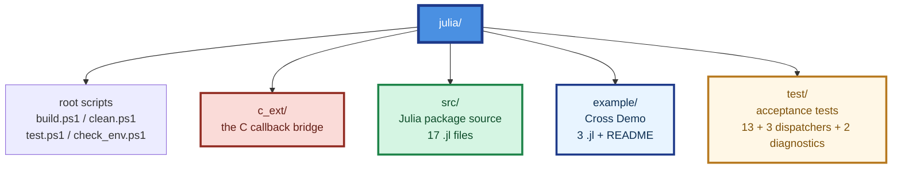

**The `src/` file list** (17 files):

| File | Responsibility |
|------|------|
| `LingoFuse.jl` | module entry point, the include order |
| `trace.jl` | runtime tracing (`LINGOFUSE_TRACE=1`) |
| `error.jl` | the hierarchy of 8 exception types |
| `uid.jl` | the UID type (`NTuple{32,UInt8}`) + conversion |
| `loader.jl` | runtime library resolution + PATH preparation |
| `abi.jl` | the 59 `LF_*` ccall bindings |
| `shim.jl` | the 66 `shim_*` ccall bindings + shim search |
| `callback.jl` | the consumer loop + dispatch of the 5 event classes |
| `data_handle.jl` | `DataHandle` RAII + identity accessors |
| `binio.jl` | little-endian binary I/O |
| `app.jl` | `App` RAII + do-block variants |
| `async.jl` | the `Future` type |
| `target.jl` | three addressing schemes + the full synchronous/asynchronous/do-block set |
| `p2p.jl` | the process-level P2P registration API |
| `network.jl` | network preparation + lifecycle |
| `io.jl` | unified JSON3 I/O |
| `status.jl` | network event listening + the status queue |

**The `test/` file list** (18 files):

| Category | Files |
|------|------|
| **mock group** (7) | `test_uid.jl` / `test_abi.jl` / `test_shim_bind.jl` / `test_callback.jl` / `test_async_unit.jl` / `test_target.jl` / `test_p2p.jl` |
| **real group** (6) | `test_io.jl` / `test_raii.jl` / `test_network.jl` / `smoke.jl` / `test_status.jl` / `test_e2e_local.jl` |
| **dispatchers** (3) | `runtests.jl` / `runtests_mock.jl` / `runtests_real.jl` |
| **diagnostics** (2) | `diag.jl` / `try_module.jl` |
| **M1 leftover** (1) | `test_restart.jl` |

---

## 2. System requirements

### 2.1 The system environment

| Item | Requirement |
|------|------|
| Architecture | **x86_64** (32-bit not verified) |
| Windows | Windows 10 / Server 2019 or later |
| Linux | glibc 2.17+ or musl |
| macOS | 11+ (Apple Silicon not verified) |
| Runtime dependency (Windows) | the VC++ 2015-2022 Redistributable |

### 2.2 The Julia environment

| Item | Requirement |
|------|------|
| Minimum version | **Julia 1.9** |
| Recommended version | **Julia 1.13.1** (the environment this document was verified in) |
| **Startup argument** | **`--threads=2` or more is mandatory** |

> ⚠️ **`--threads=2` is a hard requirement, not a suggestion.**
>
> The callback consumer task must run on a non-main thread.

**Why `--threads=2` is mandatory**

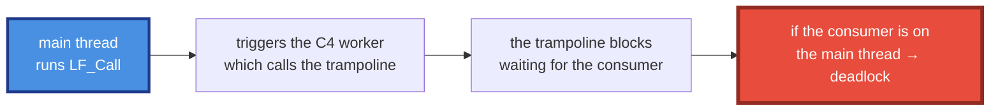

`start_callback_consumer()` performs two runtime checks:

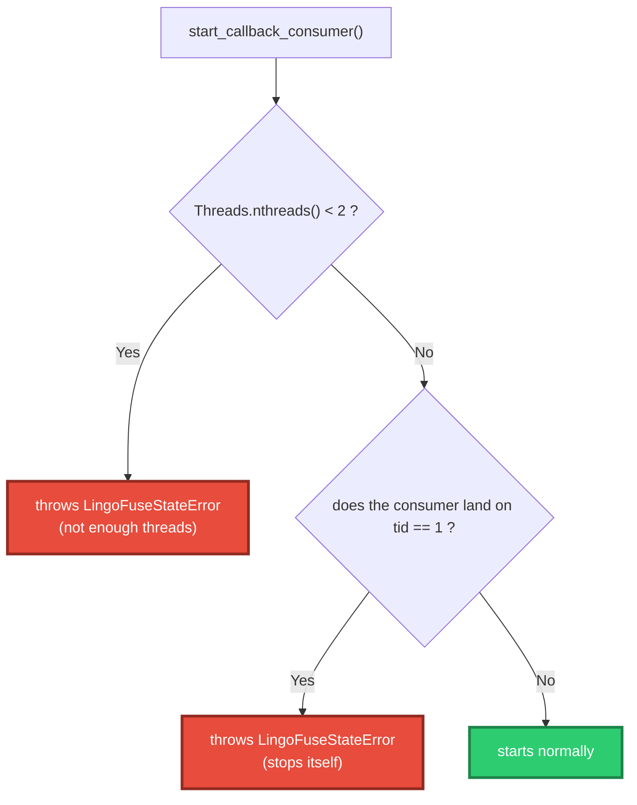

### 2.3 The LingoFuse runtime

The Julia binding **does not include** the native library; you must obtain it separately:

| Platform | Core library | IPC dependency | Memory allocator (optional) |
|------|--------|----------|--------------------|
| Windows 64 | `LingoFuse64.dll` | `z_ipc_64.dll` | `mimalloc64.dll` |
| Linux | `liblingofuse.so` | `libz_ipc.so` | `libmimalloc.so` |
| macOS | `liblingofuse.dylib` | `libz_ipc.dylib` | `libmimalloc.dylib` |

#### 2.3.1 The library path resolution strategy

`loader.jl` uses the same search approach as the operating system's dynamic loader and **hard-codes no absolute paths**; putting the runtime library on the system search path is enough.

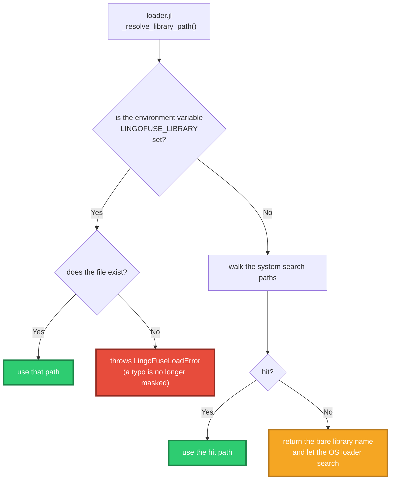

#### 2.3.2 The search paths per platform

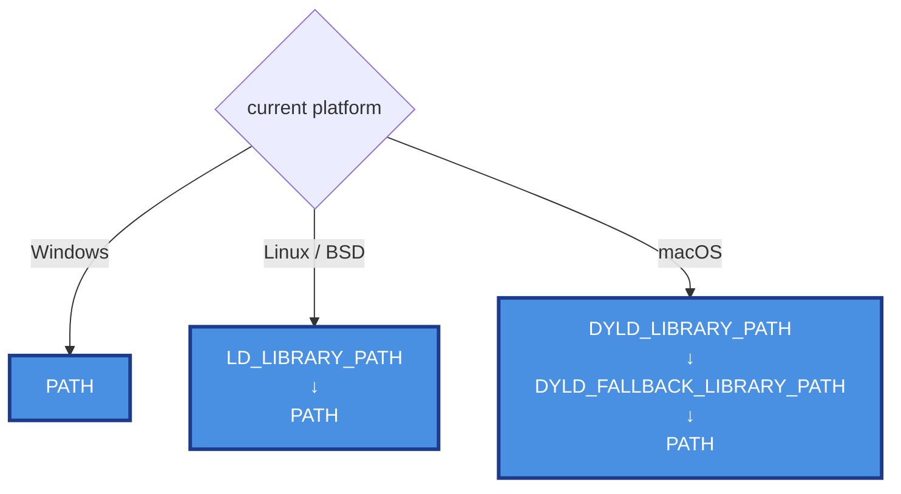

#### 2.3.3 Side effects of a hit

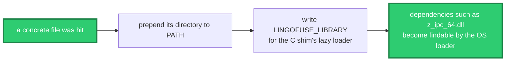

> When the hit directory is already on `PATH` (because `LD_LIBRARY_PATH` already contains it, say), the prepend step is idempotent and does not add it twice.

#### 2.3.4 The recommended approach

**Option A — put the runtime directory on the system search path (recommended)**

That way the whole `julia/` directory can be copied anywhere and the runtime is still located automatically.

```powershell
# Windows (PowerShell) — permanent for the current user
[Environment]::SetEnvironmentVariable(
    "PATH",
    "D:\CoreLibrary\LingoFuse\Binary;" + $env:PATH,
    "User")
```

```bash
# Linux / macOS — current session
export LD_LIBRARY_PATH=/opt/lingofuse/Binary:$LD_LIBRARY_PATH
```

**Option B — a point-to-point override (affects only the current process)**

```powershell
# Windows
$env:LINGOFUSE_LIBRARY = "D:\CoreLibrary\LingoFuse\Binary\LingoFuse64.dll"
```

```bash
# Linux / macOS
export LINGOFUSE_LIBRARY=/opt/lingofuse/Binary/liblingofuse.so
```

> ⚠️ If `LINGOFUSE_LIBRARY` points at a file that does not exist, `loader.jl` **throws explicitly** and does not silently fall back to the search path. That is to stop typos in CI from being masked.

---

## 3. Dependency requirements

### 3.1 Julia package dependencies

**The only external package you must install manually**:

| Package | Version | Install command |
|----|------|---------|
| **JSON3.jl** | 1.x (verified on 1.14.3) | `Pkg.add("JSON3")` |

**How to install**:

```julia
using Pkg
Pkg.add("JSON3")
```

Or from the command line:

```powershell
julia -e 'using Pkg; Pkg.add("JSON3")'
```

**Why JSON3**:

| Property | Notes |
|------|------|
| zero copy | `JSON3.read` returns a view, which matters for large payloads |
| literal UTF-8 | non-ASCII characters are emitted as raw bytes, matching `ensure_ascii=False` in the other bindings |
| a modern API | `JSON3.Object` / `JSON3.Array` support property-style access |

**Apart from JSON3, no other third-party Julia package is needed.**

### 3.2 Julia standard-library dependencies

All of the following are standard libraries that ship with Julia; nothing needs installing:

| Standard library | Purpose |
|--------|------|
| `Libdl` | used internally by `ccall` to locate shared libraries (transparent) |
| `Base.Threads` | multithreading (used by the consumer task) |
| `Base.Threads.Atomic` | the Cross demo's counters |

### 3.3 System dependencies

| Dependency | When needed | Notes |
|------|---------|------|
| C runtime | always | provided by the VC++ Redistributable on Windows |
| `pthread` | Linux / macOS | `build.sh` adds `-lpthread` automatically |
| gcc / cc / clang | **required when building c_ext** | see [Chapter 4](#4-c-compiler-requirements) |

### 3.4 An overview of the dependencies

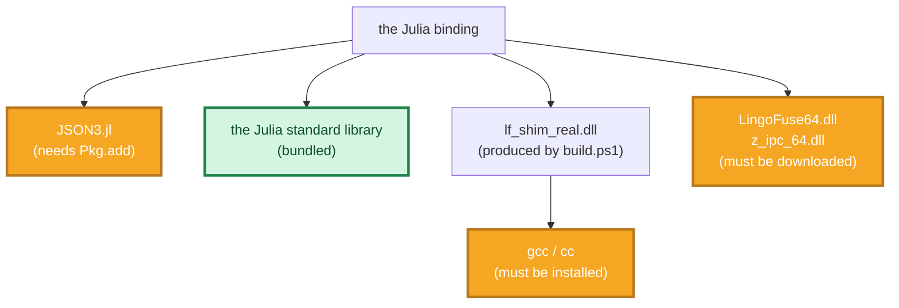

Orange = must be obtained manually; green = bundled.

---

## 4. C compiler requirements

`c_ext/` needs a C compiler to build two shared libraries. **This is not optional** — the Julia binding depends on a native C shim to carry cross-thread callbacks (the reason is in [Chapter 6](#6-how-the-interface-works)).

### 4.1 Compiler requirements

| Item | Requirement |
|------|------|
| **Target architecture** | **must be x86_64** (to match Julia's 64-bit build) |
| C standard | C99 |
| Recommended on Windows | **MinGW-w64 gcc** (`x86_64-w64-mingw32-gcc`) |
| Linux / macOS | `cc` or `clang` |
| 32-bit | not verified |

### 4.2 Installing MinGW-w64 on Windows

**Option 1: winget (recommended)**

```powershell
winget install --id=BrechtSanders.WinLibs.POSIX.UCRT
```

**Option 2: MSYS2**

After downloading and installing from https://www.msys2.org/:

```bash
pacman -S mingw-w64-x86_64-gcc
```

### 4.3 Verifying the compiler

```powershell
gcc -dumpmachine
```

**Expected output**:

```
x86_64-w64-mingw32
```

If it prints `i686-...` or another 32-bit target, you have a 32-bit toolchain, which **cannot be used for this project**.

### 4.4 Why the import library cannot be linked

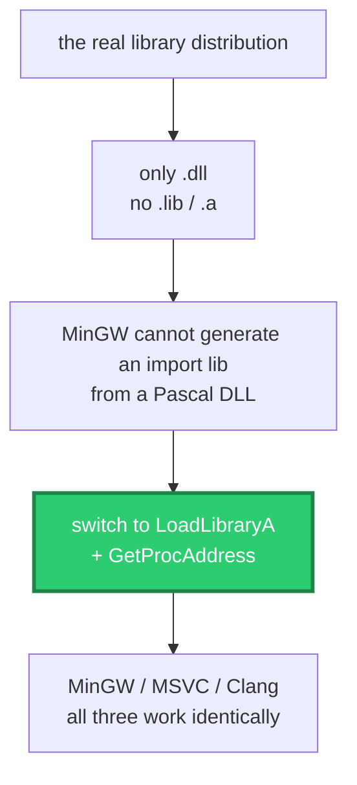

`lf_real_link.c` uses **lazy loading** (resolving on the first call), avoiding the loader-lock deadlock inside `DllMain` (which MSDN explicitly warns about).

---

## 5. Building

### 5.1 The one-key build

```powershell
cd D:\CoreLibrary\LingoFuse\julia
.\build.ps1
```

### 5.2 The build flow

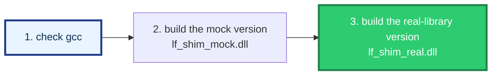

### 5.3 What the two artifacts are for

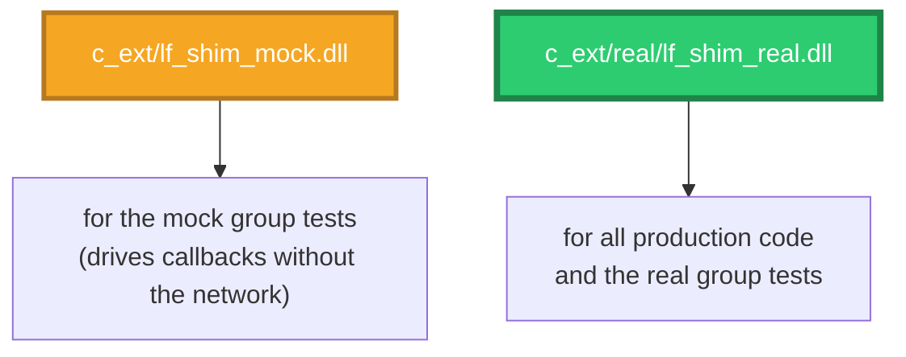

**Day-to-day use needs only `lf_shim_real.dll`.** The mock version is only a dependency of the mock group tests.

### 5.4 Cleaning

```powershell
.\clean.ps1
```

It deletes `*.dll` / `*.o` / `*.a` / `*.so` / `*.dylib` under `c_ext/` and `c_ext/real/`, plus the `*.ji` precompile cache under `src/`. It is **idempotent**: a missing file is not an error.

### 5.5 Environment diagnostics

```powershell
.\check_env.ps1
```

Its 9 checks:


Section 7 uses the same strategy as `loader.jl`: it checks `LINGOFUSE_LIBRARY` first, and otherwise walks `PATH` looking for `LingoFuse64.dll` / `LingoFuse32.dll`.

---

## 6. How the interface works

### 6.1 The nature of the problem

LingoFuse triggers callbacks on **C4 worker threads** (native threads). Julia's GC / JIT / Task scheduler **all require** that a thread entering Julia be claimed by the runtime.

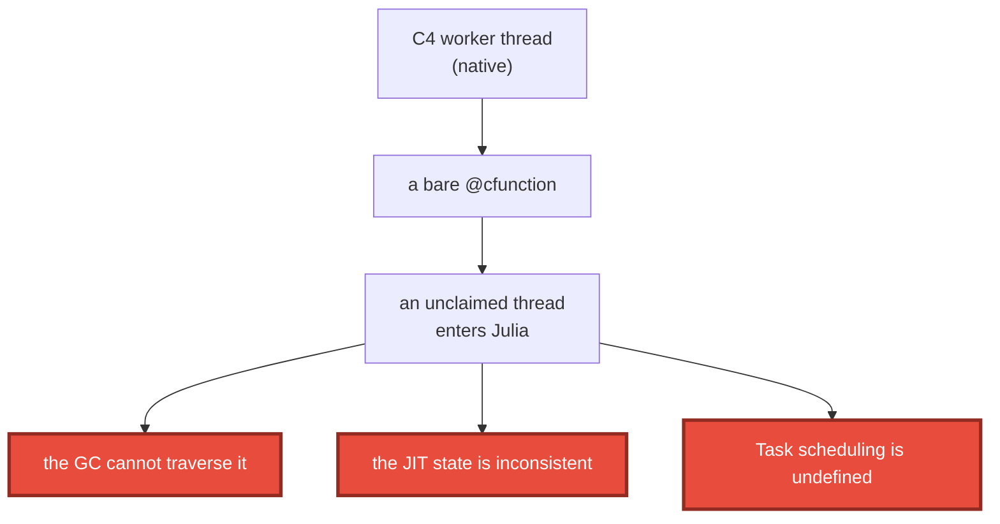

**Why the other languages do not have this problem**:

| Language | Reason |
|------|------|
| C / C++ / Rust | no runtime, no GC, no scheduler |
| Python | the GIL makes entering the interpreter from any thread a designed-for case |
| C# | the CLR's P/Invoke layer can "take over" a foreign thread |
| **Julia** | **the GC + JIT + Task scheduler all depend on the thread already being claimed by the runtime** |

### 6.2 The solution: a C shim

**The core idea**: put a buffer between C and Julia.

#### 6.2.1 Step one — a C4 worker triggers a callback

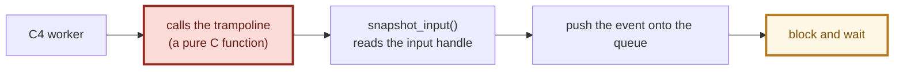

#### 6.2.2 Step two — a Julia consumer handles the event


#### 6.2.3 Step three — the trampoline wakes up and writes the result back

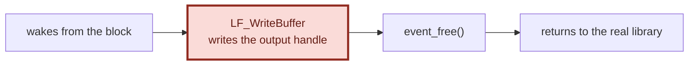

**The key contract**: **the Julia consumer never touches a native data handle**.

All handle I/O (reading input, writing output) happens on the trampoline thread. The reason is that the real library has a per-handle lock for each handle; if the consumer accessed the same handle from another thread it would contend with the C4 worker thread that is waiting on it → deadlock.

### 6.3 The layered architecture

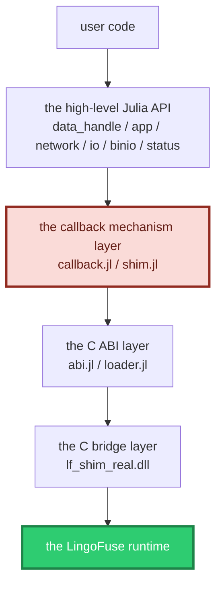

Dependencies flow strictly one way; reverse dependencies are not allowed.

### 6.4 Blocking classification: `@threadcall` is the core mechanism

Julia's GC requires every thread to reach a safepoint. **A thread blocked inside a ccall is not at a safepoint.**

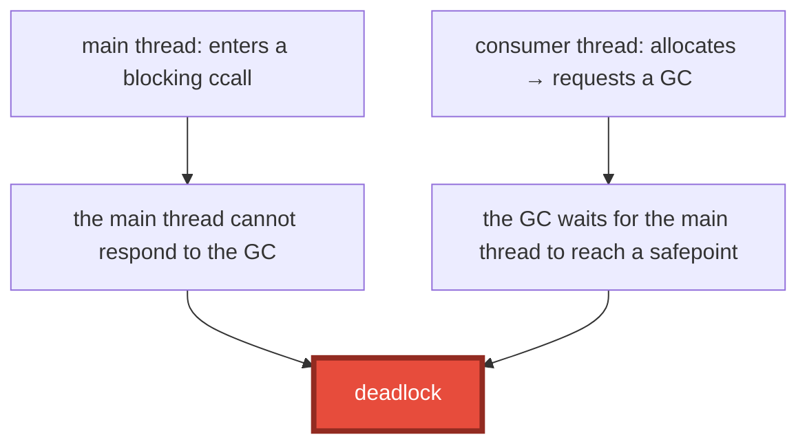

**The fix**: every C call that may block goes through `@threadcall` (the libuv thread pool), keeping the Julia thread responsive.

**The classified `LF_*` functions**:

| `LF_*` function | Blocking? | Handling |
|-----------|:--------:|------|
| `LF_CreateData` / `LF_FreeData` / `LF_Get*` / `LF_Set*` | microseconds | ordinary `ccall` |
| `LF_CreateApp` / `LF_FreeApp` | microseconds | ordinary `ccall` |
| `LF_RegisterCall` / `LF_RegisterNotify` | microseconds | ordinary `ccall` |
| `LF_SetOption` / `LF_PostStatus` | microseconds | ordinary `ccall` |
| `LF_LocalCall` / `LF_LocalNotify` | triggers a callback synchronously | **`@threadcall`** |
| `LF_Notify` / `LF_Sequenced_Notify` | may trigger a callback synchronously | **`@threadcall`** |
| `LF_Call` | blocks for seconds | **`@threadcall`** |
| `LF_PrepareDone` | may block for 30 seconds | **`@threadcall`** |
| `LF_ExitMainThread` / `LF_Shutdown` | waits for resources | **`@threadcall`** |

### 6.5 Four hard rules

| # | Rule | What violating it causes |
|:-:|------|----------|
| 1 | every ccall that may block goes through `@threadcall` | deadlock with the GC |
| 2 | `@threadcall` arguments must be isbits | a libuv thread entering the Julia runtime crashes |
| 3 | passing a pointer to native code requires `GC.@preserve` | a dangling pointer reads reclaimed memory |
| 4 | every handler call goes through `Base.invokelatest` | a "method too new" error |

**The root cause of rule 4**:

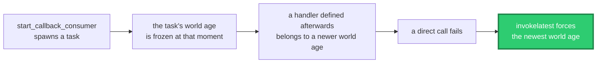

### 6.6 Inside a handler is a pure Julia sandbox

**Allowed inside a handler**:

- operating on `Vector{UInt8}` / `String` / numbers
- printing logs, counting, modifying captured variables
- using `ReentrantLock` to protect shared state
- throwing exceptions (the consumer swallows and records them)

**Forbidden inside a handler**:

- calling any `LF_*` function
- creating or freeing a `DataHandle` / `App`
- using `binio.jl` / `data_handle.jl`
- calling `LF_Call` / `LF_Notify` / `prepare_*`

**The root cause**: a handler runs on the consumer thread; when it is triggered the caller thread is usually blocked in `LF_Call`'s libuv worker holding the real library's internal lock. Any `LF_*` call from the handler contends for that lock → deadlock.

That is the binding's single most important usage constraint; see `PIT-HANDLER-001` in [Chapter 14](#14-a-quick-reference-of-pitfalls).

### 6.7 The DataHandle lifecycle

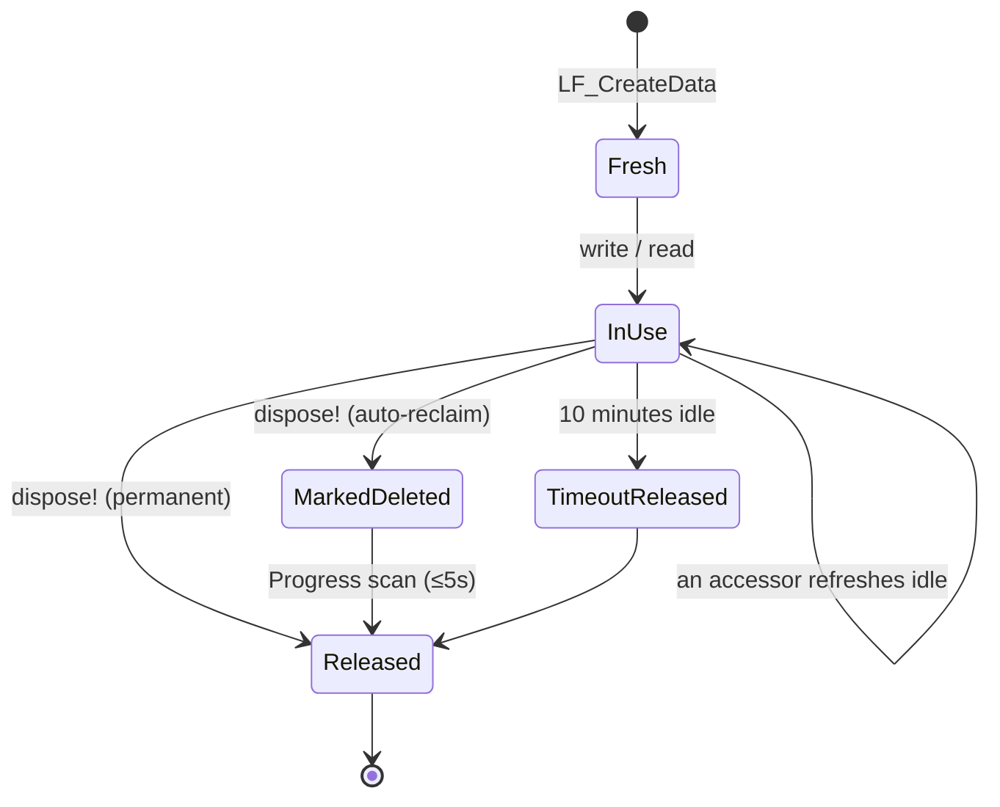

The two kinds of handle:

| Kind | How it is constructed | How it is reclaimed | Suited to |
|------|---------|---------|---------|
| **auto-reclaim** | `DataHandle(name)` | 10 minutes idle + a 5-second scan | the vast majority of scenarios |
| **permanent** | `DataHandle(name; permanent=true)` | `dispose!` frees it immediately | cached templates, long-lived scratch buffers |

---

## 7. Quick start

### 7.1 Installing the dependency

```julia
using Pkg
Pkg.add("JSON3")
```

### 7.2 Three steps to get going (no network)

```julia
push!(LOAD_PATH, "path/to/julia/src")
using LingoFuse

# 1. register an API
app = App("MyApp", "My Julia service")
register_call!(app, "echo", "Echo the payload") do in_bytes
    return in_bytes            # Vector{UInt8} in → Vector{UInt8} out
end

# 2. call it locally (no network)
param = DataHandle("echo")
write_string!(param, "hello, world")
result = local_call(app, param)
set_cursor_position!(result, 0)
println(read_string!(result))   # → "hello, world"

# 3. clean up
dispose!(result)
dispose!(param)
dispose!(app)
```

### 7.3 A complete network service (loopback RPC)

```julia
push!(LOAD_PATH, "path/to/julia/src")
using LingoFuse

set_option("Wait_Connection_ReadyOk", "True")
set_option("Quiet", "True")

reset_prepare()
start_callback_consumer()

app = App("EchoApp", "demo")
register_call!(app, "echo", "echo") do in_bytes
    return in_bytes
end

prepare_service("ipc:my_service", "ipc:my_service")
prepare_client("ipc:my_service", app)
prepare_done()

# call
param = DataHandle("echo")
write_string!(param, "hello")
raw = LF_Call("EchoApp", param.handle, UInt64(5000))
result = _wrap_data_handle(raw, true)
set_cursor_position!(result, 0)
println(read_string!(result))   # → "hello"

# clean up (the LF-CLEAN-001 order)
clear_network_event()
exit_main_thread()
dispose!(result)
dispose!(param)
dispose!(app)
stop_callback_consumer()
shutdown()
```

### 7.4 Using the unified JSON I/O

```julia
dh = DataHandle("my_api")

# write: literal UTF-8, no \uXXXX escapes, NUL appended automatically
write_json!(dh, Dict("name" => "张三", "age" => 30))

# read: returns a JSON3.Object (a zero-copy view)
set_cursor_position!(dh, 0)
obj = read_json(dh)
println(obj.name)     # → "张三"

# when you need a plain Dict
d = json_to_dict(obj)   # → Dict{String,Any}
```

### 7.5 Listening for network events

```julia
q = global_queue()
install!(q)

try
    while running
        evt = poll_event(q)
        if evt !== nothing
            kind, addr = evt
            println("$kind: $addr")
        end
        sleep(0.1)
    end
finally
    uninstall!(q)
end
```

### 7.6 Restarting the callback layer (in-process)

The callback layer can be started and stopped several times within one process:

```julia
start_callback_consumer()
# ... the first round of operations ...
stop_callback_consumer()

start_callback_consumer()   # ← restart; works normally
# ... the second round of operations ...
stop_callback_consumer()
```

**Constraint**: `stop_callback_consumer()` **fully quiesces** the consumer task before returning, guaranteeing that a restart is safe. See the "Shutdown contract" and "Re-initialisation contract" at the top of `c_ext/lf_shim.c`.

---

## 8. Core API quick reference

### 8.1 An overview of the API categories

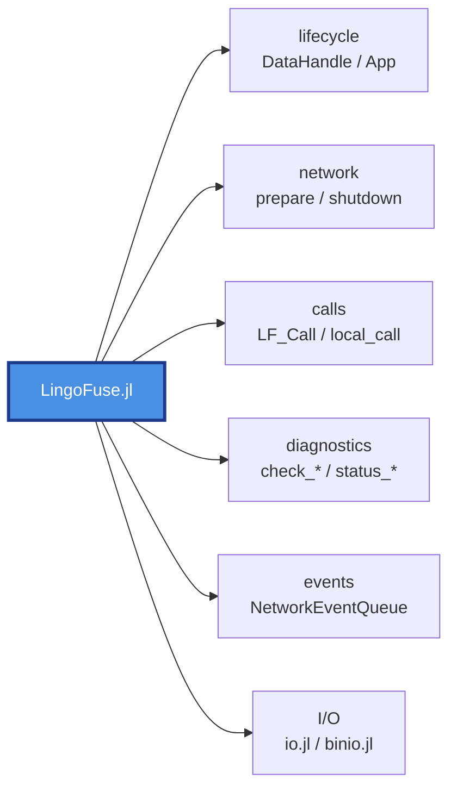

### 8.2 Data handle I/O (`data_handle.jl` / `binio.jl`)

| Function | Notes |
|------|------|
| `DataHandle(name)` | create an auto-reclaimed handle |
| `DataHandle(name; permanent=true)` | create a permanent handle |
| `write_buffer!(dh, bytes)` | write raw bytes; the cursor advances |
| `read_buffer!(dh, n)` | read up to n bytes (may short-read) |
| `read_buffer_exact!(dh, n)` | read exactly n bytes; a short read throws |
| `read_all!(dh)` | read all remaining bytes |
| `write_string!(dh, s)` | write UTF-8 + NUL |
| `read_string!(dh)` | read to the NUL (or to the end when there is none) |
| `write_json!(dh, obj)` | JSON serialisation + NUL |
| `read_json(dh)` | deserialise; throws on failure |
| `try_read_json(dh)` | returns `nothing` on failure |
| `read_json_or_bytes(dh)` | returns the raw bytes when the payload is not JSON |
| `cursor_position` / `set_cursor_position!` | the cursor |
| `buffer_size(dh)` | the total buffer size |
| `dispose!(dh)` | free (idempotent) |

**Little-endian binary I/O** (`binio.jl`):

| Type | Write | Read |
|------|------|------|
| `UInt8` | `write_uint8!` | `read_uint8` |
| `UInt16` | `write_uint16!` | `read_uint16` |
| `UInt32` | `write_uint32!` | `read_uint32` |
| `UInt64` | `write_uint64!` | `read_uint64` |
| `Int8/16/32/64` | `write_int8!` … | `read_int8` … |
| `Float32` | `write_single!` | `read_single` |
| `Float64` | `write_double!` | `read_double` |

Each type also has a `try_read_*` non-throwing version.

### 8.3 Apps (`app.jl`)

| Function | Notes |
|------|------|
| `App(name, desc)` | create an App |
| `register_call!(app, name, desc, handler)` | register a Call API; warmup on by default |
| `register_notify!(app, name, desc, handler)` | register a Notify API |
| `unregister!(app, name)` | unregister |
| `local_call(app, param)` | execute locally; returns a new `DataHandle` |
| `local_notify(app, param)` | notify locally |
| `bind(app)` | bind to every idle client; returns the count |
| `app_name(app)` | return the App name |
| `dispose!(app)` / `is_disposed(app)` | lifecycle |

**The warmup contract**: `register_call!` / `register_notify!` default to `warmup=true`, which at registration **really calls** your handler three times with synthetic payloads (empty, 2 bytes, 256 bytes). Side effects (logging, state changes, I/O) therefore happen three times. Handlers with side effects should pass `warmup=false`. See `PIT-WARMUP-001` in [Chapter 14](#14-a-quick-reference-of-pitfalls).

### 8.4 Network (`network.jl`)

| Function | Notes |
|------|------|
| `reset_prepare()` | clear the preparation queue |
| `prepare_service(local, public)` | queue a C4 service; returns a tag or -1 |
| `prepare_client(addr, app)` | queue a C4 client |
| `prepare_done()` | start the main loop; returns 1 only once per process |
| `exit_main_thread()` | stop the main loop without freeing resources |
| `shutdown()` | free every resource; may be called repeatedly |
| `set_option(key, value)` | set a global option |

### 8.5 Network events (`status.jl`)

| Function | Notes |
|------|------|
| `NetworkEventListener()` | the OOP listener base class |
| `NetworkEventQueue(max_size)` | a bounded queue |
| `global_queue()` | the process-level singleton |
| `install!(q)` / `uninstall!(q)` | install / uninstall |
| `take_event(q; timeout)` | take an event, blocking |
| `poll_event(q)` | take an event, non-blocking |
| `clear!(q)` / `close_queue!(q)` | clear / close |
| `set_network_event(...)` / `clear_network_event()` | functional installation |

### 8.6 Diagnostics (`network.jl`)

| Function | Notes |
|------|------|
| `check_main_thread()` | whether the main loop is running |
| `check_app(name)` | probe whether an App is visible (about a 3-second delay) |
| `check_api(app, api)` | probe whether an API is visible |
| `generate_app_name()` | generate a globally unique App name |
| `get_app_name(app)` | read the name from an App handle |
| `status_count()` / `get_status()` / `post_status(msg)` | the status queue |
| `drain_status(n)` / `log_status(io; max)` | drain in bulk / print |

---

## 9. Testing

### 9.1 Running the full test suite

```powershell
cd D:\CoreLibrary\LingoFuse\julia
julia --threads=2 test\runtests.jl
```

`runtests.jl` is a **dispatcher**; it spawns two subprocesses in order:

```
runtests.jl
  ├── runtests_mock.jl    (the 7 mock-group tests, depending only on the mock shim)
  └── runtests_real.jl    (the 6 real-group tests, depending on the real library + the real shim)
```

### 9.2 Why the mock group and the real group are split

```mermaid
flowchart TB
    ROOT["runtests.jl"] --> M["runtests_mock.jl"]
    ROOT --> R["runtests_real.jl"]

    M --> M1["depends on the mock shim<br/>tests the framework itself"]
    R --> R1["depends on the real shim<br/>tests integration with the real library"]

    M1 -.x.-> R1

    style M fill:#F5A623,stroke:#B7791F,stroke-width:3px,color:#FFFFFF
    style R fill:#2ECC71,stroke:#1E8449,stroke-width:3px,color:#FFFFFF
```

**The two shims cannot coexist in the same Julia process** — `src/shim.jl` resolves the shim path once at package load time, and every `shim_*` call afterwards goes through the same variant. The mock group and the real group must therefore run in separate processes.

| Group | Shim | What it tests |
|------|------|---------|
| **mock group** | `lf_shim_mock.dll` | framework integrity, UID, async driving, P2P registration, callback dispatch |
| **real group** | `lf_shim_real.dll` | I/O, RAII, real-library networking, end-to-end RPC |

### 9.3 Running a single test

```powershell
julia --threads=2 test\test_io.jl
julia --threads=2 test\test_network.jl
# ...
```

Or a single group:

```powershell
julia --threads=2 test\runtests_mock.jl
julia --threads=2 test\runtests_real.jl
```

> ⚠️ **`--threads=2` is mandatory.** Omitting it throws `LingoFuseStateError` immediately.

### 9.4 The mock group (7 tests, 294 assertions)

| File | Assertions | Content |
|------|:------:|------|
| `test_uid.jl` | 50 | the UID type / construction / round trip / hashing / Ref / show |
| `test_abi.jl` | 14 | the integrity of all 59 `LF_*` symbols + safe calls |
| `test_shim_bind.jl` | 71 | the 66 `shim_*` symbols + typed options + async dispatch + NULL safety |
| `test_callback.jl` | 35 | the consumer loop + dispatch of the 5 event classes + identity accessors + restart |
| `test_async_unit.jl` | 50 | the Future state machine + concurrent races + blocking semantics |
| `test_target.jl` | 56 | three addressing schemes + payload shapes + Future end-to-end + do-block + soft timeouts |
| `test_p2p.jl` | 18 | P2P registration + do-block + warmup control |

### 9.5 The real group (6 tests, 137 assertions + 4 scenarios)

| File | Assertions | Content |
|------|:------:|------|
| `test_io.jl` | 40 | JSON I/O + string / byte / wire-format invariants |
| `test_raii.jl` | 29 | the DataHandle / App lifecycle + local calls |
| `test_network.jl` | 13 | single-process loopback RPC + prepare + diagnostics |
| `smoke.jl` | 4 scenarios | compatibility with four handler-definition shapes |
| `test_status.jl` | 30 | network events + the bounded queue + the status queue |
| `test_e2e_local.jl` | 25 | the full end-to-end flow (service + client + call + notify) |

### 9.6 Others

| File | Purpose |
|------|------|
| `test_restart.jl` | the M1 leftover: restarting the callback layer in-process |
| `diag.jl` | the Step 1 minimal reproduction (`@threadcall` + a closure) |
| `try_module.jl` | a `using LingoFuse` smoke test |

### 9.7 Acceptance status

`julia --threads=2 test/runtests.jl` is fully green:

```
Test Summary:           | Pass  Total
LingoFuse Julia binding |    2      2
  mock shim group       |    1      1
  real shim group       |    1      1
```

**Main tests combined: 431 assertions + 4 scenarios, all PASS.**

### 9.8 Diagnostic tools

| Tool | Purpose |
|------|------|
| `test/diag.jl` | the Step 1 minimal reproduction: a `@threadcall` cross-thread closure |
| `test/try_module.jl` | a `using LingoFuse` smoke test |
| `check_env.ps1` | environment diagnostics (9 sections) |
| `LINGOFUSE_TRACE=1` | step-by-step runtime tracing |

---

## 10. The application scenarios each test covers

Each test file corresponds to a class of **real application scenario**.

### 10.1 The mock group

| Test | Application scenario | A real usage example |
|------|---------|-------------|
| **`test_uid.jl`** | UID as a session identifier | whoami probing, session-affinity routing |
| **`test_abi.jl`** | low-level ABI integrity | regression-check the symbol table after upgrading LingoFuse |
| **`test_shim_bind.jl`** | callback bridge integrity | verify every entry point after upgrading the shim |
| **`test_callback.jl`** | cross-thread callbacks | simulate a C4 worker triggering a callback and verify consumer dispatch |
| **`test_async_unit.jl`** | the async call state machine | verify the three states of a Future: timeout / result / error |
| **`test_target.jl`** | calls through the three addressing schemes | App name / UID / P2PName routing |
| **`test_p2p.jl`** | process-level P2P registration | global utility APIs (whoami / health) |

### 10.2 The real group

| Test | Application scenario | A real usage example |
|------|---------|-------------|
| **`test_io.jl`** | an application exchanging JSON with services in other languages | a Julia service returning structured JSON as an LLM backend |
| | cross-language wire compatibility | a Julia handler called from C++, where the bytes must agree |
| **`test_raii.jl`** | single-process local RPC | unit tests: verify API logic without the network |
| **`test_network.jl`** | a complete single-process loopback | integration tests: prepare → call → cleanup within one process |
| **`smoke.jl`** | four handler-definition shapes | named / anonymous / capturing variables / registered at runtime |
| **`test_status.jl`** | network event listening | trigger business logic when a client comes online or goes offline |
| **`test_e2e_local.jl`** | the complete RPC lifecycle | simulate the full Cross Demo chain in a single process |

### 10.3 The scenario categories

```mermaid
flowchart TB
    S["test scenarios"]

    S --> A["data exchange"]
    S --> B["local execution"]
    S --> C["cross-process communication"]
    S --> D["event listening"]
    S --> E["lifecycle management"]
    S --> F["mechanism verification"]

    A --> A1["test_io.jl"]
    B --> B1["test_raii.jl"]
    C --> C1["test_network.jl"]
    C --> C2["test_e2e_local.jl"]
    C --> C3["smoke.jl"]
    D --> D1["test_status.jl"]
    E --> E1["test_restart.jl"]
    F --> F1["test_uid.jl / test_abi.jl"]
    F --> F2["test_shim_bind.jl / test_callback.jl"]
    F --> F3["test_async_unit.jl / test_target.jl / test_p2p.jl"]

    style S fill:#4A90E2,stroke:#1E3A8A,stroke-width:3px,color:#FFFFFF
```

### 10.4 Which test to run after which change

| What did I change? | What should I run? |
|-------------|-----------|
| the callback layer / `c_ext/` | the whole mock group + `smoke.jl` |
| the I/O layer (`io.jl` / `binio.jl`) | `test_io.jl` |
| RAII / lifecycle | `test_raii.jl` + `test_restart.jl` |
| networking / diagnostics | `test_network.jl` + `test_e2e_local.jl` |
| events / status | `test_status.jl` |
| the `abi.jl` / `shim.jl` symbols | `test_abi.jl` + `test_shim_bind.jl` |
| not sure | `julia --threads=2 test\runtests.jl` (the whole suite) |

---

## 11. Cross-language interoperability

LingoFuse's **core value is cross-language interoperability**. The Julia binding is fully integrated into that system.

### 11.1 The interoperability contract

```mermaid
flowchart LR
    J["Julia"] -->|"line format"| BUS["the LingoFuse bus"]
    BUS --> C["C / C++"]
    BUS --> P["Pascal"]
    BUS --> PY["Python"]
    BUS --> CS["C#"]
    BUS --> JS["JavaScript"]
    BUS --> MORE["12+ more"]

    style BUS fill:#4A90E2,stroke:#1E3A8A,stroke-width:4px,color:#FFFFFF
    style J fill:#2ECC71,stroke:#1E8449,stroke-width:3px,color:#FFFFFF
```

**The four interoperability contracts** (shared by every binding):

| # | Contract | Notes |
|:-:|------|------|
| 1 | **UTF-8 strings + NUL terminator** | every string argument, API name and App name is UTF-8 |
| 2 | **little-endian byte order** | every integer / float is written little-endian |
| 3 | **raw binary payload** | the data handle carries arbitrary bytes; the protocol layer does not interpret them |
| 4 | **callbacks must be cdecl** | the calling convention required by the C ABI |

### 11.2 The verified interoperable languages

| Combination | Status | How it was tested |
|------|:----:|----------|
| **Julia ↔ Julia** | ✅ verified | `test_e2e_local.jl` (same process) + the Cross Demo (cross-process) |
| **Julia ↔ C++** | ✅ verified | the Cross Demo interoperates with the C++ `CrossCall` / `CrossNode` |
| **Julia ↔ Pascal** | ✅ verified | the Cross Demo interoperates with the Pascal `cross_call` / `cross_node` |
| **Julia ↔ Python** | ✅ verified | the Cross Demo interoperates with the Python `cross_call.py` / `cross_node.py` |

### 11.3 Wire contract details

**A Call request (payload structure)**:

```
[apiName] [FromUID:32B] [FromP2PName] [Param.Size:Int32] [Param:bytes]
```

**A Call response (payload structure)**:

```
[Result:bytes]
```

**Cross-language visibility**: the caller only needs to know the `apiName` and the byte layout of `Param`; the receiver's `FromUID` / `FromP2PName` are injected automatically by the framework, so the business layer never handles them.

### 11.4 A binary payload example (the cross-language byte layout of `inv_seri`)

| Field | Type | Offset | Length |
|------|------|:----:|:----:|
| `b` | `uint8` | 0 | 1 |
| `w` | `uint16` | 1 | 2 |
| `c` | `uint32` | 3 | 4 |
| `u64` | `uint64` | 7 | 8 |
| `s` | `string` (NUL-terminated) | 15 | variable |
| `f` | `float32` | 15+n | 4 |

A binding in **any language** that writes this byte sequence is parsed correctly on the other end. See `example/README.md`.

### 11.5 JSON payloads are consistent across languages

Besides raw binary, JSON is a common cross-language payload form. The toolchain's **unified JSON policy**:

- **`ensure_ascii=False`**: Chinese, emoji and other non-ASCII characters are emitted as literal UTF-8, with no `\uXXXX` escapes
- **append `#0` at the end**: consistent with the NUL terminator of raw binary
- **tolerant reading**: when there is no NUL, read to the end (compatible with non-standard producers such as the HTTP bridge)

| Language | JSON library | Policy |
|------|---------|------|
| Julia | JSON3.jl | literal UTF-8 |
| Python | json | `ensure_ascii=False` |
| C++ | nlohmann/json | literal UTF-8 |
| C# | System.Text.Json | `UnsafeRelaxedJsonEscaping` |
| Pascal | Z.Json | literal UTF-8 |

**The four producers emit exactly the same byte sequence for the same logical payload.**

### 11.6 Languages that could be integrated in future

Any language that can:

1. call a C ABI (`ccall` / FFI / P/Invoke / JNI / NIF / `ccall`)
2. provide a callback function pointer

can join LingoFuse. Common candidates outside the currently official list:

- **Rust** (`extern "C"` + FFI)
- **Go** (`purego` / `cgo`)
- **Swift** (`@convention(c)`)
- **Erlang/Elixir** (NIF)
- **Ruby** (Fiddle / a C extension)
- **Matlab / R / Julia** (`ccall` + language-side serialisation)
- **Fortran** (`iso_c_binding`)

The Julia binding is already done and can serve as a **reference implementation for integrating other languages**.

---

## 12. The Cross Demo

A three-process end-to-end demo, **byte-level compatible** with the Cross Demos of C++ / C# / Pascal / Python / JavaScript.

### 12.1 The three process roles

```mermaid
flowchart LR
    S["CrossService.jl<br/>beacon"] --> N["CrossNode.jl<br/>worker"]
    S --> C["CrossCall.jl<br/>load client"]
    N -->|"demo.add / demo.inv_seri"| C

    style S fill:#F5A623,stroke:#B7791F,stroke-width:3px,color:#FFFFFF
    style N fill:#2ECC71,stroke:#1E8449,stroke-width:3px,color:#FFFFFF
    style C fill:#4A90E2,stroke:#1E3A8A,stroke-width:3px,color:#FFFFFF
```

### 12.2 The startup commands

```powershell
# terminal 1
julia --threads=2 example\CrossService.jl

# terminal 2 (after terminal 1 prints "running")
julia --threads=2 example\CrossNode.jl

# terminal 3 (after terminal 2 prints "Online")
julia --threads=2 example\CrossCall.jl
```

### 12.3 Mixed cross-language deployment

**The three Cross Demo processes can each be implemented in a different language**. For example:

```
terminal 1:  cross_service.exe       (Pascal beacon)
terminal 2:  CrossNode.exe           (C++ worker)
terminal 3:  julia CrossCall.jl      (Julia load client)
```

Or:

```
terminal 1:  cross_service.lpr       (Pascal beacon)
terminal 2:  julia CrossNode.jl      (Julia worker)
terminal 3:  python cross_call.py    (Python load client)
```

**As long as all three connect to the same `ipc:cross` endpoint, cross-language calls work automatically.**

### 12.4 CrossNode's live output

Each call inside the handler prints something (the only constraint is that the handler must not touch `LF_*`; printing is unaffected):

```
[Node] add(5, 7) = 12
[Node] inv_seri received: [200, 16, 47, 63, "hello world", 3.14]
[Node] inv_seri replied:  [3.14, "hello world", 63, 47, 16, 200]
```

### 12.5 The concurrency limit and `UV_THREADPOOL_SIZE`

An 8-task concurrent load test is limited by the libuv thread pool (4 by default). For higher concurrency set this first:

```powershell
$env:UV_THREADPOOL_SIZE = "32"
julia --threads=2 example\CrossCall.jl
```

### 12.6 The detailed guide

See `example/README.md`.

---

## 13. Known limitations

| Limitation | Notes | Workaround |
|------|------|------|
| **`--threads=2` is mandatory** | the callback consumer must not land on the main thread | none (hard requirement) |
| **`LF_*` must not be called inside a handler** | the handler runs on the consumer thread and contends with the caller for the real library's lock | see `PIT-HANDLER-001` |
| **the libuv thread pool defaults to 4** | limits the concurrency of `@threadcall` | the `UV_THREADPOOL_SIZE` environment variable |
| **32-bit not verified** | only verified on x86_64 | use 64-bit Julia |
| **Apple Silicon not verified** | only verified on x64 | Rosetta, or wait for a later version |
| **`String(v::Vector{UInt8})` takes ownership** | `v` becomes empty after the call | use `String(copy(v))` |
| **`LF_PrepareDone` returns 1 only once per process** | a second call returns 0 | guard with state |
| **`LF_FreeData` is a no-op before `LF_PrepareDone`** | a handle freed during initialisation is ignored | use `create_permanent` or free later |
| **`LF_GetStatus` returns a static buffer** | it is invalidated on the next call | copy it into a Julia `String` immediately |
| **`read_string!` / `read_string_bytes` extend the buffer when there is no NUL** | triggers `LF_SetPos(size + 1)`, growing the buffer by 1 byte | contractual behaviour, identical to the other bindings |
| **warmup really calls the handler three times** | handlers with side effects need `warmup=false` | see `PIT-WARMUP-001` |
| **`peek_string_bytes` is a pure read** | it does not modify the cursor / size | different from the non-peek version |
| **the library path depends on the system search path** | without `LINGOFUSE_LIBRARY` it relies on `PATH` / `LD_LIBRARY_PATH` / `DYLD_LIBRARY_PATH` | see section 2.3 |
| **the real / mock choice in `shim.jl` is locked per process** | it cannot be switched within the same process after loading | run the mock tests and the real tests in separate processes |

---

## 14. A quick reference of pitfalls

This chapter lists **the pitfalls repeatedly hit while developing and using the Julia binding**; each has an ID, symptoms, root cause and fix.

### 14.1 The naming convention

```
PIT-<subsystem>-<three-digit number>
```

| Subsystem | Scope |
|--------|------|
| `HANDLER` | writing handlers |
| `SHIM` | shim search / loading |
| `WARMUP` | warmup semantics |
| `WAIT` | `Wait_Connection_ReadyOk` |
| `STR` | Julia string ownership |

### 14.2 PIT-HANDLER-001: `LF_*` must not be called inside a handler

**Symptoms**: after a call is made the whole process hangs with no output. Ctrl+C cannot interrupt it either (the real library's lock is stuck).

**Root cause**: the handler runs on the consumer thread; when it is triggered the caller thread is blocked in `LF_Call`'s libuv worker holding the real library's internal lock. Any `LF_*` call from the handler (creating a scratch `DataHandle` with `LF_CreateData`, say) contends for the same lock.

**The typical triggering code**:

```julia
# ✗ wrong
function handle_add(in_bytes::Vector{UInt8})
    in_dh = DataHandle("add")          # ← LF_CreateData → deadlock
    out_dh = DataHandle("add")         # ← LF_CreateData → deadlock
    write_buffer!(in_dh, in_bytes)
    ...
end
```

**The correct code**:

```julia
# ✓ correct: pure Julia byte manipulation
function handle_add(in_bytes::Vector{UInt8})
    length(in_bytes) == 8 || return UInt8[]
    a = _le_i32(in_bytes, 0)          # a private helper
    b = _le_i32(in_bytes, 4)
    c = a + b
    out = UInt8[]
    _push_i32!(out, c)
    return out
end
```

**The general rule**: inside a handler you may manipulate `Vector{UInt8}` / `String` / numbers, but you must not touch `DataHandle` / `App` / `binio.jl` / `abi.jl` / `network.jl`.

### 14.3 PIT-SHIM-001: the `shim.jl` search order

**Symptoms**: `shim_is_real()` returns `false` even though `$env:LINGOFUSE_SHIM` points at the real one. Or the reverse: the real one was built but the mock one was loaded.

**Root cause**: the search order in `shim.jl` decides which one is actually loaded. In an earlier version the PATH search took precedence over the in-tree files, so `c_ext/lf_shim_mock.dll` was hit first.

**The current search order** (v0.2.0):

```
1. $env:LINGOFUSE_SHIM          ← explicit override, always first
2. c_ext/real/lf_shim_real.dll  ← in-tree, real first
3. c_ext/lf_shim_real.dll
4. c_ext/lf_shim_mock.dll
5. the real / mock on PATH
6. next to the executable
```

**Debugging**:

```powershell
julia --threads=2 -e 'push!(LOAD_PATH, "src"); using LingoFuse; println(shim_path()); println(shim_is_real())'
```

**The mock group's pin**: the three mock test files set `ENV["LINGOFUSE_SHIM"]` to the mock one explicitly at the top. That is so the mock group can still run in an environment where the real one has already been built.

### 14.4 PIT-WARMUP-001: warmup really calls the handler three times

**Symptoms**: when an API is registered the handler is called 3 times (empty, 2-byte and 256-byte payloads); three noise lines appear in the log and the state is modified 3 times.

**Root cause**: `register_call!` defaults to `warmup=true`, which triggers JIT compilation ahead of time with three synthetic payloads, avoiding a crash if the handler is first compiled on the consumer thread when it is first invoked (a historical Julia 1.13 JIT boundary case).

**The fix**:

```julia
# option 1: check the length inside the handler so the warmup payloads return silently
function handle_add(in_bytes)
    length(in_bytes) == 8 || return UInt8[]   # ← all three warmup payloads are rejected
    ...
end

# option 2: if the handler has side effects (DB / network / billing), disable warmup
register_call!(app, "add", "", handle_add; warmup = false)
```

**The trade-off**: `warmup=false` postpones JIT compilation to the first real call, which in theory carries a compilation race risk (see "JIT COMPILATION THREAD RACE" at the top of `c_ext/lf_shim.jl`). Unless the handler has strong side effects, **a length check with warmup kept on is recommended**.

### 14.5 PIT-WAIT-001: the two scenarios of `Wait_Connection_ReadyOk`

**Symptoms**: within a single process, after `prepare_service` + `prepare_client` + `prepare_done`, `check_api` returns false and `LF_Call` reports `no found app`.

**Root cause**: `Wait_Connection_ReadyOk=False` (deployment mode) makes `prepare_done` return immediately, at which point the ClientConnected event has not fired, the App is not bound to a client, and the local routing table cannot find it.

**The correct usage**:

| Scenario | Recommended value | Reason |
|------|:------:|------|
| **single process** service + client + call | `True` | the App must be visible in this process for the local short-circuit |
| **cross-process** service and worker | `False` | startup order is undefined, so let the worker start first |
| **cross-process** caller | `True` | the caller needs the mesh fully ready before calling |

**The corrected code**:

```julia
# single-process e2e (test_e2e_local.jl)
set_option("Wait_Connection_ReadyOk", "True")

# Cross worker (example/CrossNode.jl), consistent with C++ / Pascal / Python
set_option("Wait_Connection_ReadyOk", "False")
```

### 14.6 PIT-STR-001: `String(v::Vector{UInt8})` takes ownership

**Symptoms**: reading the same `Vector{UInt8}` a second time gives empty content.

**Root cause**: Julia's `String(::Vector{UInt8})` **takes over** the vector's underlying storage (zero copy), leaving the original vector empty.

**The fix**:

```julia
# ✗ wrong
raw = read_buffer!(dh, n)
text1 = String(raw)     # ← raw becomes empty
text2 = String(raw)     # ← ""

# ✓ correct
text1 = String(copy(raw))   # copy once for String
text2 = String(raw)         # the original vector is still usable
```

### 14.7 PIT-STR-002: API names / App names passed as strings must be NUL-terminated

**Symptoms**: `no found app("...")` even though the App exists; or a garbled character at the end of the App name.

**Root cause**: a string argument of the C ABI is a `PAnsiChar` and must be NUL-terminated. Julia converts `String` → `Ptr{UInt8}` through `Base.unsafe_convert`, which **appends the NUL automatically**; but if you build the pointer by hand you must add it yourself.

**The fix**: use the `AbstractString` type and let Julia handle it. **Do not** call `pointer(s)` manually.

```julia
# ✓ correct
prepare_client("ipc:cross", app)

# ✗ dangerous
prepare_client(unsafe_string(pointer(s), n), app)   # you must ensure a NUL follows n
```

### 14.8 The pitfall ID quick reference

| ID | In one line |
|----|--------|
| `PIT-HANDLER-001` | `LF_*` / `DataHandle` / `binio.jl` are forbidden inside a handler |
| `PIT-SHIM-001` | `shim.jl` search order: env → in-tree real → PATH |
| `PIT-WARMUP-001` | warmup really calls the handler three times; check the length or disable it |
| `PIT-WAIT-001` | use `Wait=True` in a single process, `False` for a cross-process worker |
| `PIT-STR-001` | `String(v)` takes ownership; use `String(copy(v))` |
| `PIT-STR-002` | string arguments should be `AbstractString` so Julia adds the NUL |

---

## 15. License

MIT License. See `LICENSE` at the repository root.

---

## Appendix A: the Julia source-file dependency order

The `include` order in `src/LingoFuse.jl` is meaningful.

### A.1 Group one — the foundation layer

```mermaid
flowchart LR
    A["trace.jl"] --> B["error.jl"]
    B --> C["uid.jl"]
    C --> D["loader.jl"]
    D --> E["abi.jl"]

    style A fill:#E8F4FF,stroke:#1E3A8A,stroke-width:2px,color:#0D2F52
    style E fill:#E8F4FF,stroke:#1E3A8A,stroke-width:2px,color:#0D2F52
```

### A.2 Group two — callbacks and wrappers

```mermaid
flowchart LR
    E["abi.jl"] --> F["shim.jl"]
    F --> G["callback.jl"]
    G --> H["data_handle.jl"]
    H --> I["binio.jl"]
    I --> J["app.jl"]

    style E fill:#E8F4FF,stroke:#1E3A8A,stroke-width:2px,color:#0D2F52
    style J fill:#D5F5E3,stroke:#1E8449,stroke-width:2px,color:#0E4D2A
```

### A.3 Group three — asynchrony and addressing

```mermaid
flowchart LR
    J["app.jl"] --> K["async.jl"]
    K --> L["target.jl"]
    L --> M["p2p.jl"]

    style J fill:#D5F5E3,stroke:#1E8449,stroke-width:2px,color:#0E4D2A
    style M fill:#D5F5E3,stroke:#1E8449,stroke-width:2px,color:#0E4D2A
```

### A.4 Group four — networking and I/O

```mermaid
flowchart LR
    M["p2p.jl"] --> N["network.jl"]
    N --> O["io.jl"]
    O --> P["status.jl"]

    style M fill:#D5F5E3,stroke:#1E8449,stroke-width:2px,color:#0E4D2A
    style P fill:#D5F5E3,stroke:#1E8449,stroke-width:2px,color:#0E4D2A
```

### A.5 The hard constraints

```mermaid
flowchart TD
    C1["error.jl must come before loader.jl<br/>(loader throws LingoFuseLoadError)"]
    C2["uid.jl must come before abi.jl<br/>(abi's signatures reference LFShimUID)"]
    C3["abi.jl must come before every wrapper layer"]
    C4["shim.jl must come before callback.jl"]
    C5["app.jl must come before p2p.jl<br/>(p2p reuses _warmup_handler)"]
    C6["async.jl must come before target.jl"]

    style C1 fill:#FFF7E6,stroke:#B7791F,stroke-width:3px,color:#7E5109
    style C2 fill:#FFF7E6,stroke:#B7791F,stroke-width:3px,color:#7E5109
    style C3 fill:#FFF7E6,stroke:#B7791F,stroke-width:3px,color:#7E5109
    style C4 fill:#FFF7E6,stroke:#B7791F,stroke-width:3px,color:#7E5109
    style C5 fill:#FFF7E6,stroke:#B7791F,stroke-width:3px,color:#7E5109
    style C6 fill:#FFF7E6,stroke:#B7791F,stroke-width:3px,color:#7E5109
```

---

*The LingoFuse runtime version this document corresponds to: v3.10. Julia binding version: v0.2.0.*

