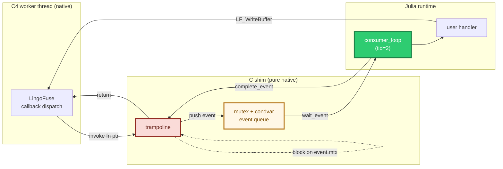
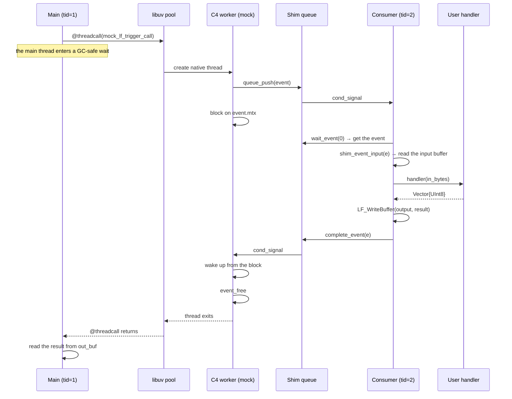
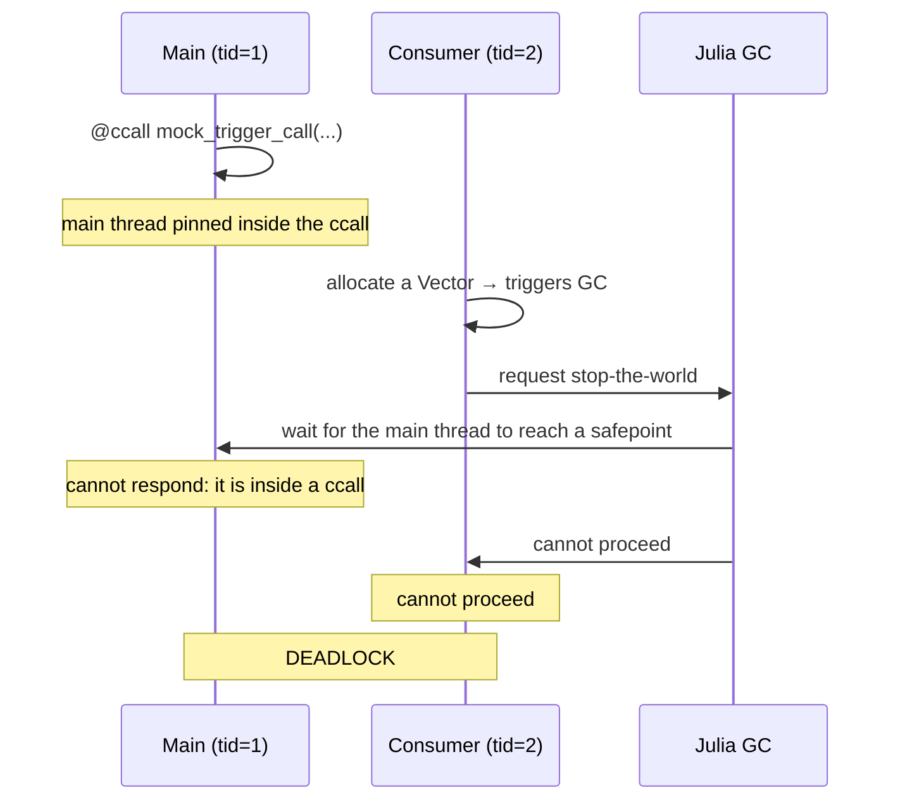

# LingoFuse Julia Binding · C Shim Mechanism Verification Document

> Chinese version: [SHIM_MECHANISM_GUIDE.md](SHIM_MECHANISM_GUIDE.md)

> **Document version**: v1.0
> **Verification environment**: Windows Server 2022 · Julia 1.13.1 · MinGW-w64 gcc 16.1.0 · x86_64
> **Verification time**: on completion of Step 1
> **Verification result**: 11/11 checks passed (see the `main: DONE` line in `test_shim.jl`'s output)
> **Purpose**: this document explains "why a C shim is needed", "how the mechanism works", "which pitfalls were hit", "the hard rules for later development". It is required reading before Steps 2/3/4.

---

## Part 1: The conclusion first

### 1.1 What was verified

`test_shim.jl` verified the following facts:

| # | Conclusion | Evidence |
|:-:|------|------|
| 1 | The C shim can safely fire callbacks on a **real native thread** | `mock_lf.c` creates threads with `CreateThread`/`pthread_create`, and the log shows the consumer receiving an event every time |
| 2 | Callback arguments (the `input` / `output` handles) cross threads and stay valid | The log shows `handle_call: got handles  input=0x...  output=0x...`, and both reads and writes succeed |
| 3 | Results from the Julia-side handler are written back to the C-side buffer | `test_add_call` returns `12`, matching the value read on the C side |
| 4 | String addresses (`addr`) cross threads intact | `test_network_events` receives `ipc:test_endpoint` |
| 5 | The event-completion signal makes the C-side trampoline return correctly | Every event's log runs `mock_trigger_call: ENTER` → `...` → `mock_trigger_call: RETURNED` |
| 6 | The whole mechanism has **no deadlock, no crash, no out-of-bounds memory access** | `main: DONE  checks_passed=11  checks_failed=0`, and the process exits normally |

### 1.2 What was not verified

This document **covers the callback mechanism only**. The following belong to later steps:

- calling the 33 non-callback ABIs of the real LingoFuse library (Step 2)
- the higher-level JSON / string wrappers (Step 3)
- porting the Cross demo (Step 4)

---

## Part 2: Why a C shim is needed

### 2.1 The nature of the problem

LingoFuse API callbacks fire on **C4 worker threads** (see `TCompute.RunC` in `Z.Net.C4.LingoFuse.pas`). From LingoFuse's point of view it is merely calling a C function pointer.

But for Julia, a call that "enters the Julia runtime from a foreign thread" is **illegal**, because:

| Subsystem | Dependency | Consequence of a foreign thread |
|--------|------|----------------|
| **GC** | Every Julia thread is registered in TLS, and the GC stops the world by walking all registered threads | An unregistered thread enters → the GC cannot walk it → live objects may be misjudged as garbage |
| **JIT** | The compile cache and scheduling depend on runtime state | An unregistered thread calls JIT-related code → inconsistent state, crash |
| **Task scheduler** | Each thread keeps its own run queue | An unregistered thread tries `@async` / `yield` / `sleep` → undefined behaviour |

### 2.2 Why other languages do not have this problem

| Language | Callback mechanism | Why it is safe |
|------|----------|-----------|
| C / C++ | Native function pointers | No runtime, no GC, no scheduler |
| Python | `ctypes.CFUNCTYPE` | CPython's GIL makes entering the interpreter from any thread a designed-in case |
| C# | `Marshal.GetFunctionPointerForDelegate` | The CLR's P/Invoke layer can "adopt" foreign threads |
| Rust | `extern "C" fn` | No GC, no JIT, no scheduler |
| **Julia** | `@cfunction` | ❌ **All four subsystems require the thread to have been claimed by the runtime** |

### 2.3 Three candidate paths

| Path | Approach | Verdict |
|------|------|------|
| A | Call `jl_adopt_thread()` inside the trampoline | ❌ Internal API, unstable across versions; each thread must be adopted once; conflicts with the reuse semantics of the C4 thread pool |
| B | **Relay through a C shim** | ✅ **This approach** |
| C | Be a caller only, never a server | ✅ Fine for simple cases, but gives up half of LingoFuse's value |

**We chose path B.** It is not "dodging the problem" but **building a buffer between C and Julia**: everything on the C side stays purely native, and the Julia side runs only on its own threads.

---

## Part 3: How the mechanism works

### 3.1 Overall architecture



### 3.2 Full timing of one callback

Taking `test_add_call` as the example, from Julia's `mock_trigger_call("add", req)` to the return:



### 3.3 Key data structures

`struct lf_shim_event` is the heart of the whole mechanism:

```c
struct lf_shim_event {
    int      kind;         // CALL / NOTIFY / NET_CONNECT / NET_DISCONNECT
    int64_t  user_id;      // used on the Julia side to route to the right handler
    void*    trigger;      // passed through unchanged by LingoFuse
    void*    input;        // borrowed DataHnd, valid while the trampoline blocks
    void*    output;       // borrowed DataHnd, present only for Call events
    char*    addr;         // address copy for network events (self-managed lifetime)

    lf_mutex_t  mtx;       // per-event mutex
    lf_cond_t   cv;        // per-event condvar
    int         done;      // completion flag

    struct lf_shim_event* next;  // queue linked list
};
```

**Why each event gets its own mutex/condvar**: with a single shared lock, all C4 workers would serialise while waiting for completion and throughput would collapse. Independent locks let each worker wait only on its own event.

### 3.4 The `user_id` routing mechanism

LingoFuse's `trigger` argument is a `void*` that LingoFuse itself never uses — it just "stores it and hands it back verbatim at callback time". The shim uses that field as the carrier of an **int64 user_id**:

```c
// at registration
LF_RegisterCall(app, name, desc,
                (void*)(intptr_t)user_id,     // ← trigger carries the user_id
                shim_call_trampoline);

// at trigger time
int64_t uid = (int64_t)(intptr_t)trigger;     // ← taken back out of trigger
```

The Julia side keeps `HANDLERS = Dict{Int64, Function}()`, and `consumer_loop` dispatches by looking up `shim_event_uid(e)`.

**Why use an id rather than a pointer**: Julia objects move under the GC, so pointers are unstable; `Int64` is isbits and unambiguous across languages.

### 3.5 Memory lifetime contract

| Object | Ownership | When released |
|------|--------|----------|
| `lf_shim_event_t` | allocated by the trampoline, freed by the trampoline | after `lf_shim_complete_event` returns, the trampoline frees it itself |
| `input` / `output` handles | owned by LingoFuse | freed by LingoFuse after the trampoline returns |
| the `addr` string | the shim `malloc`s its own copy | freed in `event_free` |
| the Julia-side `Vector{UInt8}` | Julia GC | normal GC |

**Key contract**: the Julia side must **never** touch `e` after `shim_complete(e)`. The trampoline has already freed it.

---

## Part 4: Pitfall log (the key findings from this debugging session)

Each item below is a pitfall actually encountered during this debugging session that **later development must avoid**.

### 4.1 Syntax limitations of the `@ccall` macro

**Symptom**:

```julia
@ccall LIB.fn()::Cint == 1 || error("...")
```

fails with `ArgumentError: @ccall needs a function signature with a return type`.

**Root cause**: the Julia parser takes the **whole expression** after `@ccall` (to the end of the line) as the macro argument. For `X == 1 || err()` the top-level operator is `||`, so `@ccall` finds no `::` inside.

**Rule**: `@ccall` must **occupy** the right-hand side of an assignment or the entire statement on its own. Any mix with operators must be split: **assign first, operate afterwards**.

```julia
# ✅ correct
ret = @ccall LIB.fn()::Cint
ret == 1 || error("...")

# ❌ wrong
@ccall LIB.fn()::Cint == 1 || error("...")
```

### 4.2 `@ccall` does not support `$(...)` library interpolation

**Symptom**:

```julia
const H = dlopen("lib.so")
@ccall $(H).fn()::Cint   # ❌ TypeError: in ccall library name, expected Symbol
```

**Root cause**: `@ccall`'s library interpolation works differently from an ordinary `$var`, requiring the interpolated value to be a `Symbol` or `LazyLibrary`; it does not accept the `Ptr{Nothing}` returned by `dlopen`.

**Workaround**: switch to the raw `ccall` form:

```julia
ccall((:fn, LIB_PATH), Cint, ())
```

### 4.3 The `ccall` library argument type in Julia 1.13

**Symptom**:

```julia
const H = Libdl.dlopen("lib.so")
ccall((:fn, H), Cint, ())    # ❌ TypeError: in dlopen, expected Union{String, Symbol, LazyLibrary}
```

**Root cause**: since Julia 1.13 the `ccall` library argument **only accepts** `String` / `Symbol` / `LazyLibrary`. Passing a `dlopen` handle has been removed.

**Rule**:

```julia
const LIB = "path/to/lib.so"   # String
ccall((:fn, LIB), ...)          # ✅ Julia caches the dlopen internally, no repeated cost
```

### 4.4 `Cstring` as a return type is decoded automatically

**Symptom**:

```julia
p = @ccall LIB.get_addr()::Cstring
p == C_NULL && return nothing     # ❌ p is a String, never == C_NULL
unsafe_string(p)                  # ❌ a String cannot be passed to unsafe_string
```

**Root cause**: when `Cstring` is a `ccall` return type, Julia **automatically** converts the C string into a Julia `String`. A null pointer throws immediately.

**Rule**: to check for NULL, declare the return type as `Ptr{UInt8}`:

```julia
function get_addr()::Union{String,Nothing}
    p = ccall((:get_addr, LIB), Ptr{UInt8}, ())
    p == C_NULL && return nothing
    return unsafe_string(p)
end
```

### 4.5 Deadlock between GC stop-the-world and a blocking ccall (**the most serious**)

**Symptom**: the Julia-side consumer hangs after receiving an event, with no log after `handle_call: input read`.

**Root cause**:



**Key insight**: **Julia's GC needs every thread to reach a safepoint**, and a thread blocked inside a C call is **not at a safepoint**.

**Fix**: every C call that may block for long must go through `@threadcall`:

```julia
# ❌ pins the Julia thread
ccall((:blocking_fn, LIB), Cvoid, (Cstring,), s)

# ✅ goes through the libuv thread pool; the Julia thread can respond to GC
name_ptr = Base.unsafe_convert(Ptr{UInt8}, s)
GC.@preserve s begin
    @threadcall((:blocking_fn, LIB), Cvoid, (Ptr{UInt8},), name_ptr)
end
```

**Why `@threadcall` arguments must be isbits**: libuv threads are not Julia threads and cannot call the Julia runtime. Passing a `String` triggers a conversion, and that conversion enters the Julia runtime → a foreign thread enters → a new problem. Every pointer must be converted **before** the call with `Base.unsafe_convert`.

**Pair it with `GC.@preserve`**: `@threadcall` does not keep argument references alive. After passing `pointer(buf)`, `buf` may be collected and the libuv thread reads dangling memory. `GC.@preserve buf begin ... end` is mandatory.

### 4.6 Long timeout polling in the consumer also pins the GC

**Symptom**: inside the `shim_wait_event(100)` loop, even though the main thread uses `@threadcall`, the test still occasionally hung at teardown.

**Root cause**: `shim_wait_event(100)` is a **ccall that blocks for 100 ms**. When a GC request arrives, the consumer is inside that ccall and likewise cannot reach a safepoint. Every GC waits 100 ms, and with frequent GC requests this shows up as starvation.

**Fix**: change the consumer loop to **non-blocking polling**:

```julia
while RUNNING[]
    e = shim_wait_event(0)         # returns immediately; a few microseconds of ccall
    if e == C_NULL
        sleep(0.005)                # yield voluntarily so the GC can finish
        continue
    end
    # ... handle the event ...
    sleep(0)                        # yield once more after handling
end
```

**Cost**: CPU usage rises slightly (one syscall every 5 ms), in exchange for a completely smooth GC.

---

## Part 5: Hard rules for later development

The following rules **apply to every piece of Julia-side code in Steps 2 / 3 / 4**.

### Rule 1: any ccall longer than 1 ms must go through `@threadcall`

**Test**: if the C function may block (network, disk, waiting, locks), use `@threadcall`.

**Applies to**:

| LingoFuse function | Blocking? | Handling |
|----------------|:--------:|----------|
| `LF_CreateData` / `LF_FreeData` | microseconds | plain `ccall` |
| `LF_WriteBuffer` / `LF_ReadBuffer` | microseconds | plain `ccall` |
| `LF_GetPos` / `LF_SetPos` / `LF_GetSize` / `LF_SetSize` | microseconds | plain `ccall` |
| `LF_CreateApp` / `LF_FreeApp` | microseconds | plain `ccall` |
| `LF_RegisterCall` / `LF_RegisterNotify` | microseconds | plain `ccall` |
| `LF_SetOption` / `LF_PostStatus` | microseconds | plain `ccall` |
| **`LF_Call`** | **seconds** (blocks waiting for a response) | **`@threadcall`** |
| **`LF_PrepareDone`** | **may block for 30 seconds** | **`@threadcall`** |
| **`LF_ExitMainThread`** | **may wait for the main thread to exit** | **`@threadcall`** |
| **`LF_Shutdown`** | **may wait for resources to be released** | **`@threadcall`** |
| `LF_Notify` / `LF_Sequenced_Notify` | returns immediately after queueing | plain `ccall` (unless the queue is full) |

### Rule 2: every `@threadcall` argument must be isbits

```julia
# ✅ correct
name_ptr = Base.unsafe_convert(Ptr{UInt8}, name)
GC.@preserve name begin
    @threadcall((:fn, LIB), Cvoid,
                (Ptr{UInt8}, Csize_t),    # both are isbits
                name_ptr, length(name))
end

# ❌ wrong: passing a String makes the libuv thread perform a conversion
@threadcall((:fn, LIB), Cvoid, (Cstring,), name)
```

**Exception**: `Cstring` **is** allowed as a `@threadcall` argument type, but **what you pass must be an already-converted `Cstring`**, never a `String`:

```julia
cstr = Base.unsafe_convert(Cstring, name)
GC.@preserve name begin
    @threadcall((:fn, LIB), Cvoid, (Cstring,), cstr)
end
```

### Rule 3: every call that passes a pointer to native needs `GC.@preserve`

```julia
buf = Vector{UInt8}(undef, 1024)
GC.@preserve buf begin
    ccall((:fn, LIB), Cvoid, (Ptr{UInt8},), pointer(buf))
end
```

**Cases where you cannot skip it**:
- `@threadcall` (because it runs on another OS thread)
- long ccalls (because a GC may fire meanwhile)
- immediately using the result of `unsafe_convert` (local-variable promotion may be optimised away)

### Rule 4: every Julia-side consumer loop must be "non-blocking + yield"

```julia
while RUNNING[]
    e = wait_event(0)          # returns immediately
    if e == C_NULL
        sleep(SMALL_INTERVAL)  # yield
        continue
    end
    # ... handle ...
    sleep(0)                   # yield
end
```

**Never allowed**: `wait_event(100)` or any longer block.

### Rule 5: the Julia-side consumer must run on a **non-main thread**

```julia
consumer = Threads.@spawn consumer_loop()   # ✅
sleep(0.2)                                   # give the scheduler time to migrate
if CONSUMER_TID[] == 1
    @error "consumer on main thread: will deadlock"
end
```

**Julia must be started with `--threads=2`** (or more).

### Rule 6: the closure limitation of `@cfunction`

Passing a closure to `@cfunction` is **not allowed**:

```julia
# ❌ compile error
cb = @cfunction(x -> handler(ctx, x), Cvoid, (Ptr{Cvoid},))
```

You **must** use a top-level function plus explicit state:

```julia
# ✅
function _cb(state::Ptr{Cvoid}, arg::Ptr{Cvoid})::Cvoid
    ctx = unsafe_pointer_to_objref(state)::MyContext
    ...
end

# or a global id table (this project's approach)
const HANDLERS = Dict{Int64, Function}()
```

### Rule 7: use a `String` constant for the library path, not `dlopen`

```julia
const LIB = "/path/to/library"   # String
# every later ccall / @threadcall uses LIB
```

Julia caches the `dlopen` result internally, so there is no repeated cost.

---

## Part 6: Acceptance checklist

Any future change to the shim or the Julia call layer must pass the checklist below.

### C side

- [ ] every argument that must cross a thread boundary (handles, pointers) is correctly carried by the shim
- [ ] each event has its own mutex / condvar, never shared
- [ ] after `lf_shim_complete_event`, the C side no longer touches the event
- [ ] `lf_shim_shutdown` can wake every blocked consumer
- [ ] both the Windows and the POSIX thread primitives are correct

### Julia side

- [ ] every blocking ccall goes through `@threadcall`
- [ ] every `@threadcall` argument is isbits (or a pre-converted `Cstring`)
- [ ] every place that passes a pointer to native has `GC.@preserve`
- [ ] the consumer loop is non-blocking with `sleep(0)` / `sleep(small)`
- [ ] the consumer runs on a non-main thread
- [ ] started with `--threads >= 2`
- [ ] startup validates `consumer_tid`

### Integration

- [ ] run `test_shim.jl` once end to end
- [ ] see `main: DONE  checks_passed=N  checks_failed=0`
- [ ] the process exits normally, without `Ctrl+C` killing it
- [ ] tested on both Windows and Linux (if both are target platforms)

---

## Part 7: Looking ahead to Step 2

Step 1 verified the **callback mechanism**. Step 2 will:

1. compile a **real shim** (unlike `mock_lf.c`, linked against the actual library)
2. implement the 33 **non-callback** LF_* functions with `ccall` / `@threadcall`
3. build RAII wrappers for `DataHandle` / `App` on the Julia side
4. run **network-free** end-to-end tests with `LF_LocalCall` / `LF_LocalNotify`

**New pitfalls Step 2 will hit** (predicted):

| Pitfall | Description | Prevention |
|----|------|------|
| `LF_CreateApp` returns an `AppHnd`, but Julia has no `finalizer` and may collect it prematurely | an explicit `finalizer` is needed | use a mutable struct plus a finalizer |
| `LF_FreeData` is a no-op before `LF_PrepareDone` (see LF-DATA-008) | the wrapper layer must manage the lifetime explicitly | track an `owned` flag in the wrapper |
| `LF_PrepareDone` returns 1 only once per process | later calls return 0 | add a state guard on the Julia layer |
| `LF_GetStatus` returns a static buffer | must be copied immediately | already stated in the documentation |

**Acceptance criteria for Step 2**: able to write an App in Julia, register an API, and call it successfully through `LF_LocalCall`.

---

## Appendix A: File inventory

| File | Purpose |
|------|------|
| `lf_shim.h` | Public interface of the C shim |
| `lf_shim.c` | Implementation of the C shim (queue + trampoline) |
| `mock_lf.h` / `mock_lf.c` | Simulated LingoFuse ABI (for tests), including the native-thread driver |
| `build.ps1` / `build.sh` | Build `lf_shim_mock.dll` / `.so` / `.dylib` |
| `test_shim.jl` | The Julia simulation test (the subject verified by this document) |

## Appendix B: Versions and compatibility

| Component | Minimum version | Notes |
|------|----------|------|
| Julia | **1.9** (1.10+ recommended) | `@threadcall` stability |
| Julia target | **1.13+** | the `ccall` library argument accepts only `String` / `Symbol` / `LazyLibrary` |
| gcc (MinGW-w64) | any x86_64 version | must be 64-bit, matching Julia |
| Platform | Windows x64 / Linux x64 / macOS x64 | 32-bit untested |

## Appendix C: Glossary

| Term | Meaning |
|------|------|
| **C4 worker thread** | the native thread LingoFuse uses internally to handle network events |
| **safepoint** | a code location where the Julia GC can safely pause a thread; the inside of a blocking ccall is **not** a safepoint |
| **isbits** | a Julia value type with "no GC references"; safe to pass to `@threadcall` |
| **adopt thread** | `jl_adopt_thread()`, which has the Julia runtime claim a foreign thread (not used) |
| **trampoline** | the native callback function in the C shim that is registered with LingoFuse |
| **user_id** | an integer identifier used on the Julia side to route events to the right handler |

---

*End of document. Before changing the shim or writing Step 2 next time, read Parts 4 and 5 first.*
