# LingoFuse Pascal 完整指南（v7.0 · 全确定完整版）

> **定位**：面向 AI 与人类开发者的**权威参考**，同时是**学习指南**、**API 详细参考**、**路由机制详解**、**Handle 所有权模型**、**P2P 分布式负载概念**、**跨语言集成指南**和**踩坑知识库**。
>
> **v7.0 相对 v6.0 的核心变化**：
> - **原 v6.0 附录 E「诚实的不确定清单」的 20 条全部核对完毕**，结论直接并入正文相应章节；v7.0 **不再保留任何"不确定"标记**。
> - **新增 3 条实测发现的陷阱**（`LF-LOCAL-001`、`LF-SEQ-003`、`LF-ROUTE-012`），并修正 v6.0 的两处描述偏差。
> - **全部 API 机理深度保留**，所有源码级引用、示例代码、Mermaid 图、选项详解、状态系统、内存管理均**完整保留并扩充**。
> - **踩坑知识库扩充至 95 条 ID**。
>
> **证据等级约定**：
> - 🟢 **已核实源码** — 在 `lingofuse_import.pas`、`lingofuse_helper.pas`、`Z.LingoFuse_Export.pas`、`Z.LingoFuse_Core.pas`、`Z.Net.C4.LingoFuse.pas`、`LingoFuse.lpr`、`Z.LingoFuse.md`、`LingoFuse.h`、`LingoFuse.hpp`、`LingoFuse.c`、`test_lingofuse*.c*` 中有直接依据
> - 🟡 **逻辑推断** — 从源码行为推断，但未在运行时直接观测
>
> **v6.0 → v7.0 勘误摘要**：
> 1. **顺序线程退出后延迟释放的时间**：v6.0 §14.1 引述 `Z.LingoFuse.md` 的 5 秒；**源码实际为 `DelayFreeObj(1.0, self)`（1 秒）**。已在 §15.4 修正。
> 2. **`LF_LocalCall` / `LF_LocalNotify` 不注入发送方身份**：v6.0 §7.3 表述"本地调用也会自动注入发送方身份"，**仅对经 `TC40_LF_Client.Send_*` 路径的本地调用成立**；`LF_LocalCall` / `LF_LocalNotify` **不经过 `Rebuild_UID_and_P2PName`**。已在 §5.6、§10.3 修正并新增 `LF-LOCAL-001`。

---

## 📖 目录

**第一部分 基础与架构**
- [第 0 章 快速定位](#第-0-章-快速定位)
- [第 1 章 三层架构与设计哲学](#第-1-章-三层架构与设计哲学)
- [第 2 章 核心概念与术语](#第-2-章-核心概念与术语)
- [第 3 章 生命周期与初始化](#第-3-章-生命周期与初始化)

**第二部分 API 详细参考**
- [第 4 章 数据句柄（TDataHnd）完整参考](#第-4-章-数据句柄tdatahnd完整参考)
- [第 5 章 应用句柄（TAppHnd）完整参考](#第-5-章-应用句柄tapphnd完整参考)
- [第 6 章 API 注册机制](#第-6-章-api-注册机制)
- [第 7 章 本地调用](#第-7-章-本地调用)

**第三部分 路由与寻址机制**
- [第 8 章 三套寻址详解](#第-8-章-三套寻址详解)
- [第 9 章 跨寻址路由与 UID 万能路由](#第-9-章-跨寻址路由与-uid-万能路由)
- [第 10 章 自动发送方身份识别](#第-10-章-自动发送方身份识别)

**第四部分 高级主题**
- [第 11 章 运行时选项详解](#第-11-章-运行时选项详解)
- [第 12 章 网络准备与模拟主线程](#第-12-章-网络准备与模拟主线程)
- [第 13 章 状态、查询与网络事件](#第-13-章-状态查询与网络事件)
- [第 14 章 线程模型与并发](#第-14-章-线程模型与并发)
- [第 15 章 内存与生命周期管理](#第-15-章-内存与生命周期管理)
- [第 16 章 跨语言绑定](#第-16-章-跨语言绑定)
- [第 17 章 清理与关闭](#第-17-章-清理与关闭)

**第五部分 P2P 与分布式**
- [第 18 章 P2P 分布式负载](#第-18-章-p2p-分布式负载)
- [第 19 章 路由优化：本地短路与服务器本地处理](#第-19-章-路由优化本地短路与服务器本地处理)

**第六部分 踩坑知识库**
- [第 20 章 踩坑知识库（v7.0 ID 体系）](#第-20-章-踩坑知识库)
- [第 21 章 LLM 生态坑索引](#第-21-章-llm-生态坑索引)

**附录**
- [附录 A 错误消息原文索引](#附录-a-错误消息原文索引)
- [附录 B ID 总览与维护约定](#附录-b-id-总览与维护约定)
- [附录 C 给 AI 使用者的检索规则](#附录-c-给-ai-使用者的检索规则)
- [附录 D 核心铁律](#附录-d-核心铁律)
- [附录 E v6.0 不确定清单的完整澄清结果](#附录-e-v60-不确定清单的完整澄清结果)

---

# 第一部分 基础与架构

## 第 0 章 快速定位

### 0.1 一句话定位

**LingoFuse 是跨语言 RPC 总线**。它用 C ABI 把 Pascal 侧的 RPC 能力暴露给 18+ 种语言，同时自身也是完整的分布式 RPC 引擎，支持**三套寻址**（App 名 / UID / P2PName）、**自动发送方身份识别**、**本地短路路由**、**服务器本地处理**、**C4 服务网格**、**序列化族**和 **P2P 分布式负载**。

### 0.2 先记住七句话

1. **获取 P2P UID 的最佳路径，是在"被请求的调用"里，从回调的 `Input` 参数调用 `LF_Get_P2P_UID`。**
2. **拿到的 UID 是"断网前唯一"的会话 UID。** 同一连接生命周期内可作为通讯标识符；重连后会变化，需要重新探测。
3. **分布式负载无处不在：只要是 1 对多，就可以分布式。** 一个 App 名被多个程序注册；一个 P2PName 被多个程序注册；你的程序连接多个服务器且服务器支持跨节点路由。
4. **UID 和 P2PName 调用会自动搜索目标客户端的 App 注册函数。** 这是路由行为：目标端所有已注册的 API 都能被命中。
5. **反过来，App 名调用只能命中 App 注册的函数，不能命中 P2P 注册的函数。** 这是路由层的不对称。
6. **路由优化：本地短路 + 服务器本地处理。** 如果目标在本地，调用不走网络；如果请求到了服务器，但服务器本地能处理，服务器直接处理，不转发。
7. **序列化支持之后，P2P + 高流量计算 + 大规模数据流是天生合拍。** 视频帧、音频块、Matlab / R / Julia 计算任务、仿真迭代，都可以序列化执行与反馈。

### 0.3 能解决什么问题

| 场景 | 用哪套寻址 | 入口 API |
|------|-----------|---------|
| 跨语言进程内 RPC | 本地 App 名 | `LF_LocalCall` |
| 跨进程 / 跨机器固定服务 | App 名 | `LF_Call` / `LF_Async_Call` |
| **定向到某个具体客户端** | **UID** | **`LF_UID_Call` / `LF_UID_Notify`** |
| **按组负载均衡** | **P2PName** | **`LF_P2PNAME_Call` / `LF_P2PNAME_Notify`** |
| **需要接收方识别发送方** | 任意 | 回调内 `LF_Get_P2P_UID` / `LF_Get_P2P_Name`（**仅在触发事件的 Input 参数中有效**） |
| **需要 FIFO 顺序** | 任意 | `LF_Sequenced_Notify` / `LF_Async_Sequenced_Call` |
| **高流量计算（视频、音频、矩阵）** | P2PName + Sequenced | `LF_P2PNAME_Sequenced_Notify` + 二进制句柄 |

### 0.4 三层结构

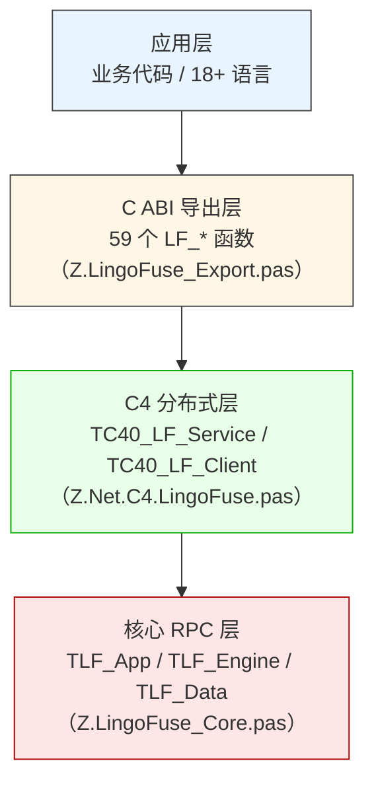

### 0.5 20 条硬规则

1. **回调必须 `cdecl`**（或 `of object` / `is nested` 对应变体）。
2. **托管语言回调必须保持强引用**（否则 GC 回收后崩溃）。
3. **`LF_GetOption` / `LF_Get_AppName` / `LF_Generate_AppName` / `LF_Get_P2P_Name` 返回的指针 5 秒后失效；`LF_Get_P2P_UID` 返回的是 `PP2P_UID___` 指针，同样 5 秒后失效**。
4. **输入句柄不释放，返回句柄必须释放**。
5. **`LF_FreeData` 对 auto 句柄只标记，10 分钟后才真正释放**。
6. **`LF_CreateData_Permanent` 创建的永久句柄不会自动回收**，必须手动 `LF_FreeData`。
7. **`LF_BindApp` 必须在 `LF_PrepareDone` 之后调用**，否则返回 0。
8. **`LF_FreeApp` 不真正释放 App**，仅移除绑定与定时器；真正释放在 `LF_Shutdown`。
9. **服务端必须先注册 `LingoFuse` 逻辑服务**，客户端才能发现。
10. **异步回调与网络事件回调在 TCompute 工作线程执行**，禁止 UI / 阻塞 / 同步调用。
11. **`LF_Sequenced_*` 保证同一 `(app, api)` 对内 FIFO**；跨 `(app, api)` 无顺序保证。
12. **每个回调自动获得发送方 UID / P2PName**（见第 10 章），**仅在回调 Input 参数中有效**。
13. **UID 是万能路由标识**：知道某客户端的 UID，就能调用其注册的**任何 API**（包括 app 与 p2p），不依赖 App 名（见第 9 章）。
14. **`LF_Shutdown` 后其他 `LF_*` 函数都视为无效**；清理顺序必须 `ExitMainThread → FreeApp → Shutdown`。
15. **`LF_Call` 超时返回 size=0 的句柄，不是 nil**；用 `LF_GetSize` 判断成功。
16. **同步族（`LF_Call`）返回的 handle 归调用者所有；异步族（`LF_Async_Call`）的 `Result_` handle 归框架所有，回调返回后立即失效**（见 §4.7）。
17. **本地短路：目标在本地进程内，调用不走网络**（见 §19.1）。
18. **服务器本地处理：请求到服务器后，服务器本地能处理就不转发**（见 §19.2）。
19. **App 名路由本地优先；P2PName 路由不做本地优先**（见 §8.2 / §8.4）。
20. **UID / P2PName 调用能命中目标客户端的全部已注册 API；App 名调用只能命中该 App 的注册表**（见 §8.6）。
21. **【v7.0 新增】`LF_LocalCall` / `LF_LocalNotify` 不注入发送方身份**。若需要本地调用也携带身份，请用 `LF_Call` 并依赖本地短路（见 §5.6、§10.3）。
22. **【v7.0 新增】P2PName 异步 Call 若服务端找不到组名，回调永不触发**（服务端 `cmd_P2PName_Call` 只 `DoStatus`，不回包）。调用方必须自行实现超时（见 §8.4）。

### 0.6 关键默认值

| 项目 | 值 | 证据 |
|------|---:|:----:|
| C ABI 导出符号数 | 59 | 🟢 |
| 默认 TCP 端口 | 9898 | 🟢 |
| DataHandle 空闲回收阈值 | 10 分钟 | 🟢 |
| 回收扫描间隔 | 5 秒 | 🟢 |
| `prepareDone` 初始化超时 | `max(Wait_Connection_Timeout, 5000) + 1000` 毫秒 | 🟢 |
| `Wait_Connection_Timeout` 默认 | 30000 ms | 🟢 |
| `Overlap_Connection` 默认 | false | 🟢 |
| `Wait_Connection_ReadyOk` 默认 | true | 🟢 |
| `Fixed_Sequenced_Time` 默认 | 20000 ms | 🟢 |
| `LF_Generate_AppName` 指针有效期 | ~5 秒 | 🟢 |
| `LF_Get_P2P_UID` 指针有效期 | ~5 秒 | 🟢 |
| `LF_GetOption` 指针有效期 | ~5 秒 | 🟢 |
| 顺序线程空闲退出 | 5 分钟 | 🟢 |
| **顺序线程退出后延迟释放** | **1 秒（v7.0 修正）** | 🟢 |
| 异步 op 超时后的 grace 期 | 60 秒 | 🟡 |
| 状态队列容量 | 1000 | 🟢 |
| 广播缓存延迟 | ~3 秒 | 🟢 |
| 模拟主线程 C40Progress 节流 | 活跃 1ms / 空闲 10ms | 🟢 |
| P2PName 客户端名变化检测周期 | 1 秒 | 🟢 |

---

## 第 1 章 三层架构与设计哲学

### 1.1 三层职责

| 层 | 单元 | 职责 | 对用户的暴露程度 |
|----|------|------|:----------------:|
| **C ABI 导出层** | `Z.LingoFuse_Export.pas` | 59 个 `LF_*` 函数、UTF-8 转换、5 秒延迟释放、准备命令收集 | **全暴露**（跨语言入口） |
| **C4 分布式层** | `Z.Net.C4.LingoFuse.pas` | 服务/客户端管理、17 个 C4 内部命令、三套寻址、负载均衡、路由优化 | **部分暴露**（通过 `LF_*` 间接） |
| **核心 RPC 层** | `Z.LingoFuse_Core.pas` | App / Engine / Data / 二级内存池 / 顺序线程池 | **不直接暴露**（被 C4 层调用） |

### 1.2 依赖拓扑

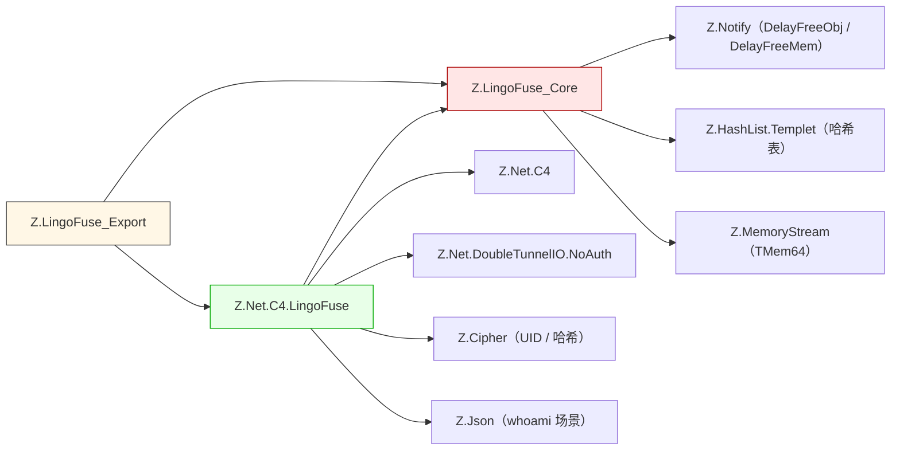

### 1.3 关键设计取舍

| 取舍 | 好处 | 代价 |
|------|------|------|
| **C ABI 而非 COM/C++** | 18+ 语言通用 | 无类型安全，无 ABI 版本管理 |
| **句柄而非对象** | 跨语言无类型依赖 | 用户必须显式管理生命周期 |
| **自动回收 + 手动释放双轨** | 兼顾便利与安全 | 用户易误解自动回收是保证 |
| **`TLF_Data` 用 record 而非 class** | 二级内存池可复用，减少堆碎片 | 需要 `New` / `Dispose`，不能继承 |
| **本地优先路由** | 减少网络往返 | 同名 App 会优先本地执行 |
| **服务器本地处理** | 减少不必要转发 | 需要服务器进程本身有能力 |
| **模拟主线程** | C4 依赖主线程，C ABI 层托管 | 每进程只能启动一次 |
| **自动身份注入** | 业务层零侵入拿到发送方身份 | 每次请求载荷增加 40+ 字节 |
| **顺序线程池** | FIFO + 并发 | 线程空闲会退出重建 |
| **三套寻址** | 适配不同路由场景 | 学习成本高，易混用 |
| **同步 / 异步 handle 所有权相反** | 同步简单，异步可流式 | 用户易混用两族的释放规则（见 §4.7） |
| **UID / P2PName 万能路由** | 定向调用无门槛 | App 名寻址的不对称需理解 |

---

## 第 2 章 核心概念与术语

### 2.1 核心对象

| 对象 | 类型 | 语义 |
|------|------|------|
| **`TDataHnd`** | 不透明指针 | 二进制数据句柄，携带 API 名 + 发送方身份 + 业务载荷 |
| **`TAppHnd`** | 不透明指针 | 逻辑应用容器，可注册多个 API |
| **`TP2P_UID___`** | `array[0..31] of Byte` | 32 字节会话 UID，`TunnelLink` 时生成 |
| **`PP2P_UID___`** | `^TP2P_UID___` | 指向 32 字节 UID 的指针（`LF_Get_P2P_UID` 返回值类型） |
| **`TAppName`** | UTF-8 字符串 | 应用名，网络路由的键 |

### 2.2 API 模式

| 模式 | 语义 | 是否等待响应 | 注册函数 |
|------|------|:-----------:|---------|
| **Call** | 请求-响应 | ✅ | `LF_RegisterCall*` |
| **Notify** | 单向通知 | ❌ | `LF_RegisterNotify*` |

### 2.3 三套寻址对照

| 寻址 | 索引键 | 路由方式 | 本地命中 | 服务端选择策略 | 典型用途 |
|------|--------|---------|:--------:|---------------|---------|
| **App 名** | UTF-8 字符串 | 精确匹配 App 名 | ✅ | 最久未用 | 固定服务 |
| **UID** | 32 字节二进制 | 按会话 UID 定位 | ✅ | 直接命中 | **定向到具体客户端** |
| **P2PName** | UTF-8 字符串 | 按组名负载均衡 / 粘性 | ❌ | `Cycle_Anchor` / `FixedSequenced` | 同质服务集群 |

**P2PName 五个函数与两种策略的精确映射**（🟢，v7.0 新增）：

| 函数 | 服务端命令 | 选择策略 |
|------|-----------|---------|
| `LF_P2PNAME_Call` | `cmd_P2PName_Call` | `Find_P2PName_LoadBalance`（Cycle_Anchor） |
| `LF_P2PNAME_Notify` | `cmd_P2PName_Notify` | `Find_P2PName_LoadBalance` |
| `LF_P2PNAME_Sequenced_Notify` | `cmd_P2PName_Sequenced_Notify` | `Find_P2PName_FixedSequenced` |
| `LF_P2PNAME_Async_Call` | `cmd_P2PName_Call` | `Find_P2PName_LoadBalance` |
| `LF_P2PNAME_Async_Sequenced_Call` | `cmd_P2PName_Sequenced_Call` | `Find_P2PName_FixedSequenced` |

### 2.4 三套路由的命中差异

| 调用方式 | 目标端搜索范围 | 命中 App 注册 | 命中 P2P 注册 |
|----------|----------------|:-------------:|:-------------:|
| **UID 调用** | 目标客户端全部已注册 API | ✅ | ✅ |
| **P2PName 调用** | 被选中客户端的全部已注册 API | ✅ | ✅ |
| **App 名调用** | 目标 App 的注册表 | ✅ | ❌ |

**记忆要点**：
- **UID / P2PName 是"客户端级"路由键** —— 先定位到"某个客户端"，再在它的本地 API 表里找。
- **App 名是"应用级"路由键** —— 只在该 App 的注册表里找，P2P 注册的函数挂在全局 `___LF_P2P_APP___` 下，不在业务 App 的表里。

### 2.5 生命周期阶段

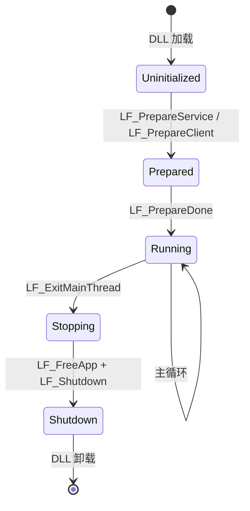

---

## 第 3 章 生命周期与初始化

### 3.1 典型初始化顺序

```pascal
// 1. 设置选项（可选）
LF.Set_Opt_Quiet(True);
LF.Set_Opt_Overlap_Connection(True);   // 多 App 同地址时必需
LF.Set_Opt_P2P_Name('my_group');       // P2PName 路由必需

// 2. 准备（可多次）
LF.ResetPrepare;
LF.PrepareService('0.0.0.0', '192.168.1.100:9898');   // 服务端
LF.PrepareClient('192.168.1.100:9898', App);          // 客户端

// 3. 启动（只能一次）
if LF.PrepareDone <> 1 then Halt(1);

// 4. 主循环
while Running do
begin
  LF.Sync;                                  // 自定义主循环需要
  Z.Core.Check_Soft_Thread_Synchronize(10); // 驱动 C4 进度
  Sleep(10);
end;

// 5. 退出
LF.ExitMainThread;
LF.FreeApp(App);
LF.Shutdown;
```

### 3.2 初始化各阶段详解

#### 3.2.1 `LF_ResetPrepare`

**作用**：清空 `Prepare_Commands`（待执行的服务/客户端脚本列表）和 `AppHnd_Bind_Tag_List`。

**何时调用**：
- **首次初始化前**：无害，建议调用。
- **重新初始化前**：**必须**调用，否则重复地址会报 `prepare error: repeat listen/connection`。

**机理**：内部把 `Prepare_Commands` 和 `AppHnd_Bind_Tag_List` 都 `Clear`，重置 `Tag_Seed` 相关状态。

#### 3.2.2 `LF_PrepareService`

**签名**：`function LF_PrepareService(ListeningAddr, PhysicsAddr: PAnsiChar): Integer`

**参数**：
- `ListeningAddr`：本地监听地址，如 `0.0.0.0:9898` / `ipc:my_app`。
- `PhysicsAddr`：对外通告地址，如 `192.168.1.100:9898` / `ipc:my_app`。

**返回**：`Tag_Seed`（≥ 1 递增整数）；重复地址返回 -1。

**机理**：
1. 把地址存到 `Prepare_Commands`（不立即启动服务）。
2. 内部生成 C4 脚本命令 `Service("Listen", "Host", Port, "LingoFuse@Tag=N")`。
3. 若 `Init_Succeeded and Simulated_Main_Thread_Running`（已调用过 `PrepareDone` 且主线程活跃），立即在 `MainThreadProgress` 投递执行。

**端口默认**：不指定端口时默认 `9898`。**IPC 模式**：地址以 `ipc:` 开头时端口参数被忽略。

#### 3.2.3 `LF_PrepareClient`

**签名**：`function LF_PrepareClient(PhysicsAddr: PAnsiChar; appHnd: TAppHnd): Integer`

**参数**：
- `PhysicsAddr`：服务端地址。
- `appHnd`：要绑定的 App，可为 `nil`（仅建隧道）。

**返回**：`Tag_Seed`；重复地址（`Overlap_Connection=False` 时）返回 -1。

**机理**：
1. 内部生成 C4 脚本命令 `KeepAlive("Host", Port, "LingoFuse@Tag=N")`。
2. `Overlap_Connection=True` 时用 `NewKeepAlive` 命令。
3. 记入 `AppHnd_Bind_Tag_List`，等 C4 客户端连接成功后通过 `ClientConnected` 事件自动绑定 App。

#### 3.2.4 `LF_PrepareDone`

**签名**：`function LF_PrepareDone: Integer`

**返回**：1 = 成功；0 = 失败或已启动。

**机理**：
1. 若 `Simulated_Main_Thread_Running` 已为 True，**立即返回 0**（防止重复启动）。
2. 调用 `Open_Core_Dispatch_Thread` 启动 C4 调度器。
3. 调用 `Begin_Simulator_Main_Thread(Simulated_Main_Thread)` 启动模拟主线程。
4. **阻塞等待**：最多 `max(Wait_Connection_Timeout, 5000) + 1000` 毫秒。
5. 返回 `if_(Init_Succeeded, 1, 0)`。

**关键陷阱**：**超时后仍可能返回 1**（见 `LF-NET-007`）。

#### 3.2.5 `LF_ExitMainThread`

**签名**：`procedure LF_ExitMainThread`

**机理**：
1. 置 `Simulated_Main_Thread_Running := False`。
2. **等待主线程完全退出**（`Simulator_Main_Thread_Activted` 变 False）。

**主线程退出前清理**（`Simulated_Main_Thread` 末尾）：
1. `C40Clean`（清理 C4 状态）
2. `LF_Notify_Sequence_Thread_Pool.Stop`
3. `LF_DataPool.Free_All_Hnd`（**释放所有数据句柄，包括 permanent**）
4. `LF_DataMemory.Free_All_PLF_Data_Memory`

**关键陷阱**：之后**不能再用任何数据句柄**（见 `LF-MECH-003`）。

### 3.3 完整状态标志

| 标志 | 含义 | 检查 API |
|------|------|---------|
| `Init_In_Progress` | 主线程初始化中 | 无 |
| `Init_Succeeded` | 初始化成功 | `LF_CheckMainThread` 间接反映 |
| `Simulated_Main_Thread_Running` | 主线程模拟器运行中 | `LF_CheckMainThread()` = 1 |
| `Simulator_Main_Thread_Activted` | 底层线程活跃 | `LF_CheckMainThread()` = 1 |

---

# 第二部分 API 详细参考

## 第 4 章 数据句柄（TDataHnd）完整参考

### 4.1 数据句柄的本质

`TDataHnd___ = Pointer`，指向内部 `TLF_Data` record（`Z.LingoFuse_Core.pas`）。

**`TLF_Data` record 结构**（源码）：

```pascal
TLF_Data = record
private
  auto_recycle___: boolean;      // LF_CreateData=True；LF_CreateData_Permanent=False
  deleted___: boolean;
  updated___: boolean;
  calling___: TAtomInt;           // 进行中的远程调用数
  time___: TTimeTick;
  class procedure Free_Data___(hnd: PLF_Data); static;
public
  Data_Param: TMemory_Param_Tool; // 输入模式：非 nil
  Data_Result: TMem64;            // 输出模式：非 nil
  Data_Info: TLF_String;
end;
```

**关键设计**：
- **`Data_Param` 与 `Data_Result` 互斥**：同一句柄只有一个非 nil。
  - **输入句柄**（`New_Param` / `New_Param_From`）：`Data_Param <> nil`，携带 `FromUID` / `FromP2PName` / `apiName` / `Param`。
  - **输出句柄**（`New_Result` / `New_Result_From`）：`Data_Result <> nil`，只有结果字节。
- **`calling___` 计数器**：远程调用进行中时 > 0，保护句柄不被超时回收。
- **`updated___` 标志**：任何读写操作都置 True，让扫描知道句柄仍活跃。

### 4.2 数据句柄生命周期

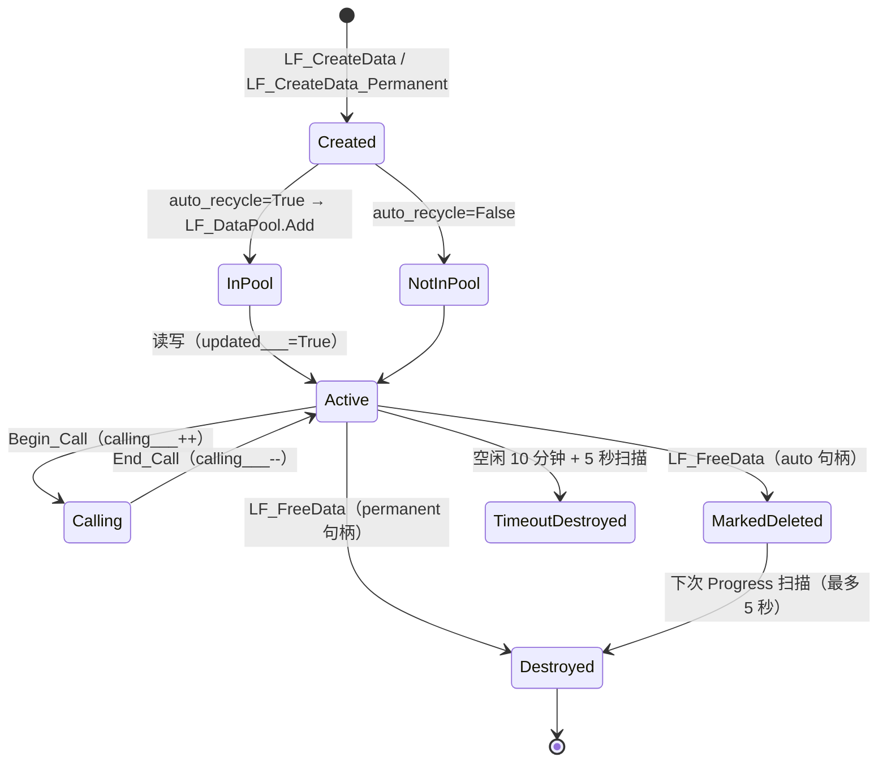

### 4.3 创建与释放 API

#### 4.3.1 `LF_CreateData(MethodName: PAnsiChar): TDataHnd`

**内部机理**：
1. 内部 `TLF_Data.New_Param(apiName, auto_recycle=True)`：
   - 从 `LF_DataMemory.Get_New_PLF_Data` 取一个 `TLF_Data` record（或 `New`）。
   - 设 `auto_recycle___ := True`。
   - 创建 `Data_Param := TMemory_Param_Tool.Create`，把 `apiName` 存入。
   - 加入 `LF_DataPool`。
2. 返回 `PLF_Data` 指针作为 `TDataHnd___`。

**副作用**：
- **加入自动回收池**：10 分钟空闲后被 `TLF_DataPool.Progress` 释放。
- **`LF_FreeData` 后只标记**：`deleted___ := True`，不立即释放。

**辅助**：`LF_CreateDataEx(MethodName: string)` 自动 UTF-8 转换。

#### 4.3.2 `LF_CreateData_Permanent(MethodName: PAnsiChar): TDataHnd`

**内部机理**：
1. 内部 `TLF_Data.New_Param(apiName, auto_recycle=False)`：
   - 从 `LF_DataMemory` 取 record。
   - **不加入 `LF_DataPool`**。
   - 设 `auto_recycle___ := False`。
2. **`LF_FreeData` 会同步立即释放**（不是标记）。

**适用场景**：跨整个进程生命周期的请求模板。

**关键陷阱**：
- **"永久"不等于"永不释放"**：必须显式 `LF_FreeData`。
- **初始化窗口创建会泄漏**：`LF_PrepareDone` 之前 / `LF_ExitMainThread` 之后，`LF_FreeData` 是 **no-op**（因为 `Simulator_Main_Thread_Activted` 为 False）。

#### 4.3.3 `LF_FreeData(Hnd: TDataHnd)`

**内部机理**：
```pascal
procedure TLF_Data.Free_Data(hnd: PLF_Data);
begin
  if hnd = nil then exit;
  if hnd^.auto_recycle___ then
      hnd^.deleted___ := True       // 只标记，等扫描
  else TLF_Data.Free_Data___(hnd);  // 永久句柄：立即释放
end;
```

**注意**：
- **自动回收句柄**：只标记 `deleted___ := True`，实际释放最多延迟 5 秒。
- **永久句柄**：立即 `Free_Data___`（释放 `Data_Param` / `Data_Result` / `calling___`，record 推回 `LF_DataMemory`）。

### 4.4 读写操作 API

#### 4.4.1 `LF_GetBuffer(Hnd): Pointer`

**内部机理**：
```pascal
function TLF_Data.GetBuffer: Pointer;
begin
  Result := nil;
  if Data_Param <> nil then
      Result := Data_Param.Param.Memory
  else if Data_Result <> nil then
      Result := Data_Result.Memory;
  updated___ := True;    // 刷新时间戳
end;
```

**关键**：
- **返回内部缓冲指针**。`LF_WriteBuffer` / `LF_SetSize` 后可能失效（重分配）。
- **副作用**：`updated___ := True`，重置 10 分钟空闲倒计时。

#### 4.4.2 `LF_WriteBuffer(Hnd, Buff, Size): Int64`

**内部机理**：
```pascal
function TLF_Data.WriteBuff(Buff: Pointer; Size: Int64): Int64;
begin
  Result := 0;
  if Data_Param <> nil then
      Result := Data_Param.Param.WritePtr(Buff, Size)
  else if Data_Result <> nil then
      Result := Data_Result.WritePtr(Buff, Size);
  updated___ := True;
end;
```

**关键**：
- 从**当前位置**写入，位置前进。
- 内部 `TMem64.WritePtr` 自动扩容。
- **副作用**：刷新时间戳。

#### 4.4.3 位置与大小操作

| API | 内部机理 | 副作用 |
|-----|---------|--------|
| `LF_GetPos` | 返回 `Data_Param.Param.Position` 或 `Data_Result.Position` | 刷新时间戳 |
| `LF_SetPos` | 设置 `Position`；超出大小隐式扩容 | 刷新时间戳 |
| `LF_GetSize` | 返回 `Data_Param.Param.Size` 或 `Data_Result.Size` | 刷新时间戳 |
| `LF_SetSize` | 调整大小；新增空间**未初始化** | 刷新时间戳 |

### 4.5 原子类型读写 API

所有类型都是**小端字节序**（`Move` 直接写内存，依赖主机字节序）。

| 写入 | 读取（out）| 读取（无 out）|
|------|-----------|--------------|
| `LF_WriteInt8` ~ `LF_WriteDouble` | `LF_ReadInt8` ~ `LF_ReadDouble` | 同左 |
| `LF_WriteString` | `LF_ReadString`（out）| `LF_ReadString` |
| `LF_WriteStringBytes` | `LF_ReadStringBytes`（out）| `LF_ReadStringBytes` |

#### 4.5.1 `LF_WriteString` 的特殊行为

**内部机理**：
```pascal
function LF_WriteString(Hnd: TDataHnd___; const Value: string): boolean;
var utf8: TBytes; len: integer;
begin
  if Value = '' then
  begin
    Result := LF_WriteUInt8(Hnd, 0);   // 空字符串也写一个 #0
    Exit;
  end;
  utf8 := TEncoding.UTF8.GetBytes(Value);
  len := Length(utf8);
  LF_WriteBuffer(Hnd, @utf8[0], len);
  Result := LF_WriteUInt8(Hnd, 0);     // 总是追加 #0
end;
```

**关键**：**总是追加 #0**。跨语言传输 JSON 时，接收方（如 Python）需要剥离尾部 #0。

#### 4.5.2 `LF_ReadString` 的容错模式

**内部机理**：
```pascal
function LF_ReadString(Hnd: TDataHnd___; out Value: string): boolean;
var p: PByteArray; b, e, sz: int64;
begin
  p := LF_GetBuffer(Hnd);
  sz := LF_GetSize(Hnd);
  b := LF_GetPos(Hnd);
  e := b;
  while (e < sz) and (p^[e] <> 0) do Inc(e);  // 扫描到 #0
  // ...
  LF_SetPos(Hnd, e + 1);                      // 跳过 #0
  Value := UTF8ToString(Buff);
end;
```

**关键**：**扫描到 #0 停止**；**若缓冲区末尾都没有 #0，读到末尾**（容错模式）。若后续还有数据，会一起被读走（见 `LF-DATA-004`）。

#### 4.5.3 `LF_ReadStringBytes` / `LF_WriteStringBytes`

**不追加 #0**，直接用 NUL 作为终止符。适合传输原始字节（如 JSON body）。

### 4.6 P2P 信息查询 API

> **⚠️ 使用前提（必读）**：`LF_Get_P2P_UID` 和 `LF_Get_P2P_Name` **不是"读句柄本身的业务数据"**，而是**从输入句柄侧读取"发送方在发送请求时自动写入的 P2P 身份元数据"**。
>
> - **数据来源**：发送方构造请求时，由客户端 `TC40_LF_Client.Send_*` 系列方法内部调用 `TMemory_Param_Tool.Rebuild_UID_and_P2PName`，把 `FromUID`（32 字节）+ `FromP2PName`（UTF-8 字符串）**自动写入到请求载荷的前部**。接收方拿到的 `Input` 句柄中 `Data_Param.FromUID` / `Data_Param.FromP2PName` 就是这两个值。**无需业务层手动传递**（见第 10 章）。
> - **只能在"触发事件的回调"的 `Input` 参数中使用**：只有**从网络（或经 `Send_*` 路径的本地调用）"接收"到的输入句柄**才携带这两个字段。
> - **不能在"自己创建"的句柄上使用**：`LF_CreateData` / `LF_CreateData_Permanent` 创建的输入句柄，其 `FromUID` 为 `Null_UID()`、`FromP2PName` 为空——因为没有"发送方"。
> - **不能在输出句柄上使用**：`Output`（Call 模式的结果句柄）只有 `Data_Result`，没有 `Data_Param`；调用这两个函数会打印警告并返回空值。
> - **典型可用位置**：
>   - `On_Call(Trigger, Input, Output)` 里的 `Input`。
>   - `On_Notify(Trigger, Input)` 里的 `Input`。
>   - `LF_Call` 命中本地短路时的回调 `Input`。
> - **典型不可用位置**：
>   - `LF_LocalCall` / `LF_LocalNotify` 回调里的 `Input`（**不经过 `Rebuild_UID_and_P2PName`**，见 §5.6、`LF-LOCAL-001`）。
>   - `LF_Async_Call` 的 `OnResult(Data, Result_)` 里的 `Result_`（它是**输出句柄**）。
>   - 你自己 `LF_CreateData` 出来的请求句柄（没有"发送方"）。

#### 4.6.1 `LF_Get_P2P_UID(Hnd): PP2P_UID___`

**签名**（`lingofuse_import.pas`）：
```pascal
function LF_Get_P2P_UID(Hnd: TDataHnd___): PP2P_UID___; cdecl; external liblingofuse name 'LF_Get_P2P_UID';
```

**内部机理**（`Z.LingoFuse_Export.pas`）：
```pascal
function LF_Get_P2P_UID(Hnd: TDataHnd___): PP2P_UID___;
begin
  New(Result);                                  // ← 分配指针
  if (Hnd <> nil) and (PLF_Data(Hnd)^.Data_Param <> nil) then
      Result^ := PLF_Data(Hnd)^.Get_P2P_UID()   // ← 从 Data_Param.FromUID 拷贝
  else Result^ := Null_UID();
  DelayFreeMem(5.0, Result);                    // ← 5 秒后自动释放
end;
```

**返回值变更说明（v5.0 勘误，v7.0 确认）**：
- **旧版（v4.0 及更早）**：返回 `TP2P_UID___`（32 字节静态数组**值**），调用者拿到的是**值拷贝**。
- **新版（v5.0 起）**：返回 `PP2P_UID___`（**指向 `TUID___` 的指针**），由框架 `DelayFreeMem(5.0, ...)` 延迟约 5 秒自动释放。
- **跨语言绑定影响**：
  - 之前：`uid = LF_Get_P2P_UID(input)` 直接拿到值。
  - 现在：`uid_ptr = LF_Get_P2P_UID(input); uid = *uid_ptr`（**解引用 + 立即拷贝**）。
  - **不要手动释放**该指针（不是调用者所有）。
  - **不要长期保存**该指针（5 秒后失效）。

**契约**：
- **返回 `PP2P_UID___` 指针**，指向 32 字节 `TUID___`。
- **只对输入句柄有效**（`Data_Param <> nil`）。对输出句柄 / 自建句柄调用会警告 + 返回 `Null_UID()`。
- **`Hnd = nil` 时仍走 `New(Result)` + `DelayFreeMem`**（🟢 v7.0 从源码确认）。返回非 NULL 指针指向全零 UID。
- **并发安全**：每次调用独立分配独立延迟释放，互不影响（🟢 v7.0 从 `Z.Notify.DelayFreeMem` 机制确认）。
- **标准用法（Pascal 侧）**：
  ```pascal
  var
    UID: TP2P_UID___;
    UIDPtr: PP2P_UID___;
  begin
    UIDPtr := LF_Get_P2P_UID(Input);    // 返回指针
    if UIDPtr <> nil then
        UID := UIDPtr^;                 // 立即解引用拷贝；框架约 5 秒后释放指针
    // ... 使用 UID ...
  end;
  ```

#### 4.6.2 `LF_Get_P2P_Name(Hnd): PAnsiChar` / `LF_Get_P2P_NameEx(Hnd): string`

**契约**：
- **只对输入句柄有效**。对输出句柄 / 自建句柄调用返回 `''`。
- **返回指针 5 秒后自动释放**（`Z.Notify.DelayFreeMem(5.0, Result)`）。**必须立即复制**。
- 推荐用 `LF_Get_P2P_NameEx` 自动复制。
- 数据来源：发送时由 `Rebuild_UID_and_P2PName` 写入的 `FromP2PName` 字段。

### 4.7 Handle 所有权模型

> **这是本指南第三核心的一节**。所有跨语言集成者必须清楚：**同步族与异步族返回的 handle 所有权完全相反**。二者的函数签名、返回类型、外观都相同，但契约相反。

#### 4.7.1 两大调用家族的 Handle 所有权对比

LingoFuse C ABI 有**两大调用家族**：

| 家族 | 函数 | 返回 handle 的所有者 | 释放方式 |
|------|------|:-------------------:|---------|
| **同步族** | `LF_Call` / `LF_UID_Call` / `LF_P2PNAME_Call` | **调用者** | 调用者显式 `LF_FreeData` |
| **异步族** | `LF_Async_Call` / `LF_UID_Async_Call` / `LF_P2PNAME_Async_Call` | **框架** | 回调返回后**立即**由框架释放 |

**源码依据**：

**同步族**（`Z.LingoFuse_Export.pas`）：

```pascal
function LF_Call(appName: pansichar; Param: TDataHnd___; Timeout_: uint64): TDataHnd___;
begin
  ...
  Output := Cli.Wait_Execute_Call(...);
  ...
  // ← auto_recycle = True，调用者拥有
  Result := TLF_Data.New_Result_From(Output, True);
  ...
end;
```

**异步族**（`Z.Net.C4.LingoFuse.pas` 的 `TLF_Async_Call_Bridge.Do_Th`）：

```pascal
procedure TLF_Async_Call_Bridge.Do_Th;
var
  result_param_: PLF_Data;
begin
  // ← auto_recycle = False，框架拥有
  result_param_ := TLF_Data.New_Result_From(Result_M64.Swap_To_New_Instance, False);
  try
    if Assigned(OnResult) then
      OnResult(Data_, result_param_);  // ← 回调拿到指针
  except
  end;
  // ← 立即释放！不是"~1 秒后"，不是"延迟"，是立即。
  TLF_Data.Free_Data(result_param_);
  DelayFreeObj(1.0, Self);             // ← 1 秒后释放的是 Bridge 对象，不是 handle
end;
```

**关键差异**：

- `New_Result_From(..., True)` → `auto_recycle = True` → `LF_FreeData` 只是标记，**真正释放延迟到池扫描**。
- `New_Result_From(..., False)` → `auto_recycle = False` → `LF_FreeData` **立即同步释放**。

#### 4.7.2 异步族 Handle 的"死亡时刻"

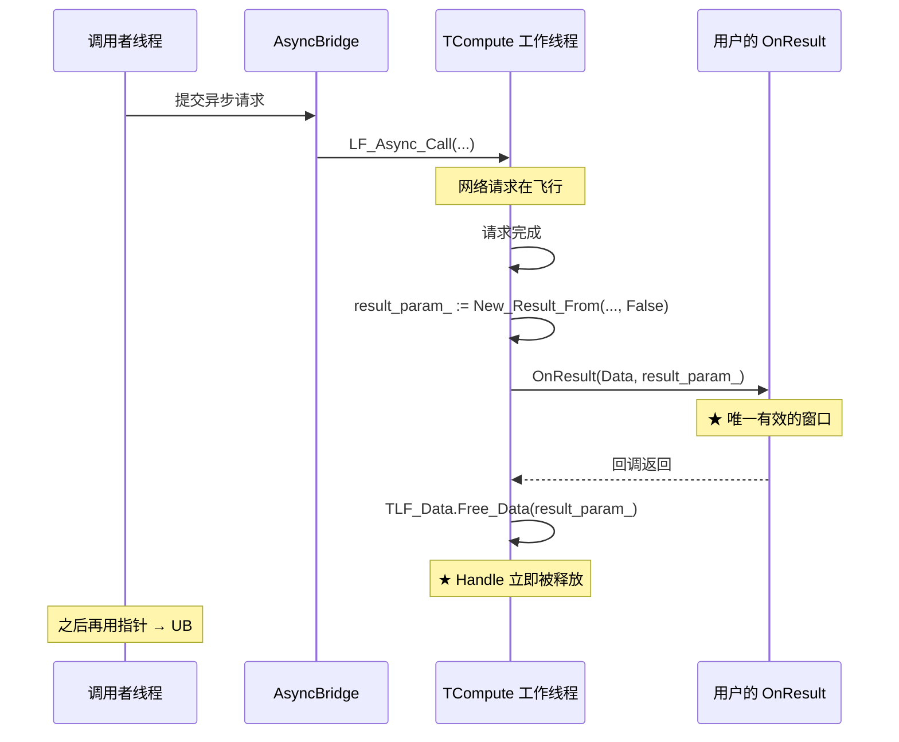

**契约**：

- 回调返回后，handle **立即失效**。
- 在回调外使用该 handle 是**未定义行为**（use-after-free）。
- 调用 `LF_FreeData` 是**双重释放**（double-free）。

#### 4.7.3 为什么违反契约会"偶尔正常、偶尔失败"

**根本原因**：`Free_Data` 是**池化回收**：

```pascal
class procedure TLF_Data.Free_Data___(hnd: PLF_Data);
begin
  hnd^.Data_Info := '';
  DisposeObjectAndNil(hnd^.Data_Param);
  DisposeObjectAndNil(hnd^.Data_Result);   // ← TMem64 被释放
  DisposeObjectAndNil(hnd^.calling___);
  LF_DataMemory.Free_PLF_Data(hnd);        // ← PLF_Data 回池
end;
```

**UB 的表现取决于**：

- 分配器是否已经复用这块内存。
- 其它线程是否在同一时刻分配了新的 `TMem64`。
- 线程调度是否让调用者线程在 `Free_Data` 之后才运行。

**因此**：

| Payload 特征 | 表现 | 原因 |
|-------------|------|------|
| **小 payload**（比如返回 `int 7`，2 字节） | 通常"看起来正常" | 分配器还没复用这块小内存 |
| **大 payload**（比如返回 dict，17+ 字节） | 通常"返回空/垃圾" | 有更大概率已被复用 |

**⚠️ 这是最容易误诊的场景**：用"`int` vs `dict`"这样的**类型二分法**会误导诊断。它不是"类型差异"，是"payload 大小影响内存复用时机"。**二分法要问对问题**。

#### 4.7.4 正确的使用模式

**模式 A：同步调用（推荐用于网关/代理场景）**

```pascal
res_ptr := LF_Call(app, hnd, timeout_ms);
try
  LF_SetPos(res_ptr, 0);            // 重置位置
  result_bytes := read_string_bytes(res_ptr);
finally
  LF_FreeData(res_ptr);             // ← 合法，调用者拥有
end;
```

**模式 B：异步调用（必须在回调内完成所有事）**

```pascal
procedure OnResult(Data, res_ptr: Pointer); cdecl;
begin
  // ✓ 在这个回调内 handle 有效
  LF_SetPos(res_ptr, 0);
  data := read_string_bytes(res_ptr);

  // ✓ 把数据拷贝出来（bytes 是新的对象）
  my_queue.push(data);

  // ❌ 禁止把 res_ptr 传出去
  // ❌ 禁止 LF_FreeData(res_ptr)
end;
```

**模式 C：使用高级封装的 Future 接口**

所有托管语言的绑定层都应提供"在回调内读取并拷出数据"的 Future 接口，避免让用户接触裸指针。

#### 4.7.5 Handle 所有权速查表

| 来源 | 所有者 | 释放者 | 能否跨线程 |
|------|:------:|:------:|:----------:|
| `LF_CreateData` | 用户 | 用户 | ⚠️ 需外部锁 |
| `LF_CreateData_Permanent` | 用户 | 用户 | ⚠️ 需外部锁 |
| `LF_Call` 返回 | 用户 | 用户 | ✅ 可以 |
| `LF_UID_Call` 返回 | 用户 | 用户 | ✅ 可以 |
| `LF_P2PNAME_Call` 返回 | 用户 | 用户 | ✅ 可以 |
| `LF_LocalCall` 返回 | 用户 | 用户 | ✅ 可以 |
| `LF_Async_Call` 回调内 | **框架** | **框架** | ❌ 禁止跨线程 |
| `LF_UID_Async_Call` 回调内 | **框架** | **框架** | ❌ 禁止跨线程 |
| `LF_P2PNAME_Async_Call` 回调内 | **框架** | **框架** | ❌ 禁止跨线程 |

#### 4.7.6 对跨语言绑定的含义

- **所有托管语言的绑定层**：必须在回调内**读取并拷贝数据**，然后交给用户；不要让用户接触裸指针。
- **Julia / Erlang / R**：`@cfunction` / NIF / C 扩展回调内的 `output` 指针，若有异步所有权问题，**必须在回调内完成所有操作**，不能通过 Channel / Queue 传裸指针。
- **Python / C# / Java**：ctypes / P/Invoke / FFM 的异步回调中，返回的 handle 若来自异步族，**必须在回调内完成所有操作**。
- **GC 语言**：不感知 C 侧的指针生命周期。**只有两种安全策略**：
  1. 在回调内**完全处理**（读 Input / 写 Output）。
  2. 在回调内**把数据拷贝出来**（bytes/array），然后再跨线程处理。

---

## 第 5 章 应用句柄（TAppHnd）完整参考

### 5.1 应用句柄的本质

`TAppHnd___ = Pointer`，指向内部 `TLF_App`（`Z.LingoFuse_Core.pas`）。

**`TLF_App` 类结构**（源码）：

```pascal
TLF_App = class
private
  FUpdateEventPool: TLF_UpdateEventPool;
  FUpdated: boolean;
  procedure Do_LFRegEvent;
  procedure DoTimer();
public
  Name: TLF_String;
  Desc: TLF_String;
  Engine: TLF_Engine;
  constructor Create(Owner_Pool_: boolean);
  destructor Destroy; override;
  procedure FakeFree;
  procedure DoChange();
  procedure Subscribe_Update(Bind: TCore_Object; OnUpdate: TOn_LFUpdate);
  procedure Remove_Update(Bind: TCore_Object);
end;
```

**关键机制**：
- **每个 App 拥有一个 `TLF_Engine`**，引擎内含 `TLF_MethodPool`（API 表）。
- **`FUpdateEventPool`**：订阅者池（如 `TC40_LF_Client`），API 变动时通知。
- **`DoChange`**：API 变动时调用，`FUpdated := True`，并 `Reset_Timer`，让 1 秒后统一广播。

### 5.2 创建与释放 API

#### 5.2.1 `LF_CreateApp(appName, Desc): TAppHnd`

**内部机理**：
1. `TLF_App.Create(Owner_Pool_=True)`：
   - 创建 `TLF_Engine`。
   - 创建 `FUpdateEventPool`。
   - `Subscribe_Timer_M(self, 1000, DoTimer)`：注册 1 秒定时器用于 API 变动广播。
   - **加入 `LF_App_Pool`**（Owner_Pool_=True）。
2. 设置 `Name` / `Desc`（空 Desc 自动替换为 `'No Description'`）。

**关键**：
- 创建的 App **自动加入 `LF_App_Pool`**。
- **`Desc` 为空时自动填 `'No Description'`**。

#### 5.2.2 `LF_FreeApp(appHnd)`

**内部机理**（源码 `Z.LingoFuse_Export.pas`）：
```pascal
procedure LF_FreeApp(appHnd: TAppHnd___);
begin
  if not Core_Dispatch_Order_Activted then exit;   // ① Shutdown guard
  if appHnd = nil then exit;
  app := appHnd;
  // ② 解绑所有 TC40_LF_Client
  arry := C40_ClientPool.FastSearchClass(TC40_LF_Client);
  for i := 0 to length(arry) - 1 do
  begin
    Cli := arry[i] as TC40_LF_Client;
    if Cli.app = app then Cli.app := nil;
  end;
  // ③ 停止顺序线程
  LF_Notify_Sequence_Thread_Pool.Kill_App(app);
  LF_Call_Sequence_Thread_Pool.Kill_App(app);
  // ④ FakeFree（仅移除定时器）
  app.FakeFree;
end;
```

**关键**：
- **不真正释放 App**：只解绑 + 停顺序线程 + 移定时器。
- **对象仍在 `LF_App_Pool`**：真正释放在 `LF_Shutdown`。
- **Shutdown guard**：`Core_Dispatch_Order_Activted = False` 时 no-op。

#### 5.2.3 `LF_Generate_AppName(): PAnsiChar`

**内部机理**：
```pascal
function LF_Generate_AppName: pansichar;
begin
  // ① 拼接所有物理隧道的地址和 RemoteID
  for i := 0 to C40_PhysicsTunnelPool.Count - 1 do
    tmp.Append(Build_Host_URL(...) + '&' + IntToStr(...RemoteID));
  // ② 拼进程名 + PID
  tmp.Append('&' + Make_LingoFuse_Process_Name.Text);
  // ③ 拼自增计数器
  tmp.Append('&' + IntToStr(AtomInc(Generate_AppName_Call_Num)));
  // ④ 前缀
  tmp := C_Generate_Prefix + tmp;    // '@__generate__@...'
  // ⑤ 返回 UTF-8 指针，5 秒后释放
  Result := tmp.BuildUTF8AnsiChar();
  Z.Notify.DelayFreeMem(5.0, Result);
end;
```

**无客户端时的精确输出**（🟢 v7.0 从源码确认）：

```
@__generate__@&<进程名:PID>&<计数器>
```

**有客户端时**：

```
@__generate__@<addr1>&<remoteID1>&<addr2>&<remoteID2>&...&<进程名:PID>&<计数器>
```

**关键**：
- **不是 `@__generate__@<空>&<进程名>&<计数器>`，而是直接 `&` 开头**（因为循环体从未执行，`tmp` 仍为空，然后 `Append('&' + ...)` 直接追加）。
- 计数器从 1 开始递增（`AtomInc` 返回递增后的值）。
- **必须在 `LF_PrepareDone` 之后调用**。
- **返回指针 5 秒后失效**。

#### 5.2.4 `LF_Get_AppName(appHnd): PAnsiChar`

**契约**：
- **`appHnd = nil` 时返回 nil**（安全）。
- **返回指针 5 秒后失效**。

#### 5.2.5 `LF_BindApp(appHnd): Integer`

**内部机理**（源码 `Z.LingoFuse_Export.pas`）：
```pascal
function LF_BindApp(appHnd: TAppHnd___): Integer;
begin
  Result := 0;
  if appHnd = nil then exit;
  app := appHnd;
  // ① 主线程必须活跃
  if not Simulator_Main_Thread_Activted then
  begin
    DoStatus('LF_BindApp: Main thread is not active - cannot bind app.');
    exit;
  end;
  // ② 遍历所有 TC40_LF_Client，绑定 app = nil 的
  arry := C40_ClientPool.FastSearchClass(TC40_LF_Client);
  for i := 0 to length(arry) - 1 do
  begin
    Cli := arry[i] as TC40_LF_Client;
    if Cli.app = nil then
    begin
      Cli.app := app;
      inc(Result);
      // ... 打印日志
    end;
  end;
end;
```

**契约**：
- **主线程必须已启动**（`Simulator_Main_Thread_Activted = True`）。
- **只绑定 `Cli.app = nil` 的客户端**。
- **不覆盖已绑定的客户端**。
- **返回成功绑定的客户端数**。
- **绑定顺序 = 客户端创建顺序**（🟢 v7.0 从源码确认，`C40_ClientPool` 是 `TGenericsList`，内部顺序由客户端创建顺序决定）。
- 若 `Result = 0`，打印 `'LF_BindApp: All clients are already occupied'`。

### 5.3 应用句柄的可见性

**关键**：
- **App 注册的 API 通过"App 名"可达**。
- **App 注册的 API 也通过"UID"和"P2PName"可达**（UID / P2PName 是客户端级路由键）。
- **App 注册的 API 不通过"P2P 注册"路径可达**——P2P 注册是另一个独立命名空间。

### 5.4 App 注册 vs P2P 注册

| 维度 | App 注册（`AppHandle.register_call`） | P2P 注册（`P2PRegistry.register_call`） |
|------|-------------------------------------|---------------------------------------|
| **底层 API** | `LF_RegisterCall` / `LF_RegisterNotify` | `LF_Register_P2P_Call` / `LF_Register_P2P_Notify` |
| **命名空间** | 业务 App 的 API 表 | 进程级 `___LF_P2P_APP___` 的 API 表 |
| **生命周期** | 随 `AppHandle.close()` 解绑 | 存活到 `LF_Shutdown` |
| **App 名调用命中** | ✅ | ❌ |
| **UID 调用命中** | ✅ | ✅ |
| **P2PName 调用命中** | ✅ | ✅ |
| **典型用途** | 业务 API | 全局工具（whoami / ping / status） |

**架构含义**：

| 想做的事 | 推荐做法 |
|----------|---------|
| 业务 API，且希望被 App 名发现 | `register_call` |
| 只暴露给 UID / P2PName，不希望被 App 名发现 | `register_p2p_call` |
| 全局工具，任何客户端都能按 UID / 组名调用 | `register_p2p_call` |

### 5.5 本地调用 API

#### 5.5.1 `LF_LocalCall(appHnd, Param): TDataHnd`

**内部机理**：
```pascal
function LF_LocalCall(appHnd: TAppHnd___; Param: TDataHnd___): TDataHnd___;
begin
  Result := nil;
  if appHnd = nil then exit;
  if Param = nil then exit;
  app := appHnd;
  tmp := TMem64.Create;
  try
    // ① 把 Param 编码为 TMem64
    PLF_Data(Param).Data_Param.EncryptToMem(tmp);
    // ② Begin_Call（calling___++）
    PLF_Data(Param).Begin_Call;
    // ③ 执行
    Result := TLF_Data.New_Result_From(app.Engine.Execute_Call(tmp), True);
  finally
    // ④ End_Call（calling___--）
    PLF_Data(Param).End_Call;
    DisposeObject(tmp);
  end;
end;
```

**契约**：
- **输入句柄不释放**（调用方负责）。
- **返回新句柄**（调用方负责）。
- **内部 `Begin_Call` / `End_Call` 保护输入句柄**（`calling___ > 0` 时不会被超时回收）。
- **本地执行**，不经过网络。
- **`New_Result_From(..., True)`** → `auto_recycle = True` → **返回的 handle 归调用者**。

#### 5.5.2 `LF_LocalNotify(appHnd, Param)`

**内部机理**：
```pascal
procedure LF_LocalNotify(appHnd: TAppHnd___; Param: TDataHnd___);
begin
  // ... 类似 LF_LocalCall，但没有 Output
  PLF_Data(Param).Data_Param.EncryptToMem(tmp);
  PLF_Data(Param).Begin_Call;
  app.Engine.Execute_Notify(tmp);
  PLF_Data(Param).End_Call;
end;
```

**关键**：无返回值。

### 5.6 本地调用的身份注入（v7.0 修正）

**关键（🟢 v7.0 从源码确认）**：**`LF_LocalCall` / `LF_LocalNotify` 不经过 `Rebuild_UID_and_P2PName`**，因此：

- 若 `Param` 是 `LF_CreateData` 创建的，其 `FromUID` 为 `Null_UID()`，`FromP2PName` 为空——**没有"发送方"**。
- 若 `Param` 是从网络接收的，其 `FromUID` / `FromP2PName` 保留。
- **回调的 `Input` 上，`LF_Get_P2P_UID` / `LF_Get_P2P_Name` 对自建句柄返回空值**。

**对照：经 `TC40_LF_Client.Send_*` 路径的本地调用会注入身份**：

`TC40_LF_Client.Send_Execute_Notify` 源码：
```pascal
procedure TC40_LF_Client.Send_Execute_Notify(app_Name__: TLF_String; Param: TMem64);
begin
  tmp_param := TMemory_Param_Tool.Rebuild_UID_and_P2PName(Param, FLast_UID, LF_P2P_name.V);
  try
    api_Name__ := TMemory_Param_Tool.Get_apiName(tmp_param);
    tmp_cli__ := Find_Local_API(app_Name__, api_Name__, True);   // 本地查找
    if tmp_cli__ <> nil then
      begin
        tmp_cli__.APP.Engine.Execute_Notify(tmp_param);           // 本地执行，但已注入身份
        exit;
      end;
    ...
  finally
    DisposeObject(tmp_param);
  end;
end;
```

**含义**：
- **`LF_Call` 命中本地短路时，回调 `Input` 携带身份**。
- **`LF_LocalCall` 直接调 `Engine.Execute_*`，不注入身份**。
- **如需本地调用也携带身份**：用 `LF_Call`（会命中本地短路，仍注入身份）。

**相关坑**：`LF-LOCAL-001`。

---

## 第 6 章 API 注册机制

### 6.1 注册模式对比

| 模式 | cdecl 风格 | 对象方法 | 嵌套/匿名 | 同步变体 |
|------|:----------:|:--------:|:---------:|:--------:|
| **Call** | `LF_RegisterCall` | `LF_RegisterCall_M` | `LF_RegisterCall_P` | `LF_RegisterSyncCall_M` / `_P` |
| **Notify** | `LF_RegisterNotify` | `LF_RegisterNotify_M` | `LF_RegisterNotify_P` | `LF_RegisterSyncNotify_M` / `_P` |

**同步变体**：`RegisterSyncCall_M` 等会把回调编组到主线程（通过 `TSoft_Synchronize_Tool`），需要自定义主循环时调用 `LF_Sync` 驱动。

### 6.2 注册回调的签名

```pascal
// cdecl 风格
TLF_Call_Event   = procedure(Trigger: Pointer; Input, Output: TDataHnd___); cdecl;
TLF_Notify_Event = procedure(Trigger: Pointer; Input: TDataHnd___); cdecl;

// 对象方法
TLF_Call_M   = procedure(Input, Output: TDataHnd___) of object;
TLF_Notify_M = procedure(Input: TDataHnd___) of object;

// 嵌套（FPC）/ 匿名（Delphi）
{$IFDEF FPC}
TLF_Call_P   = procedure(Input, Output: TDataHnd___) is nested;
TLF_Notify_P = procedure(Input: TDataHnd___) is nested;
{$ELSE}
TLF_Call_P   = reference to procedure(Input, Output: TDataHnd___);
TLF_Notify_P = reference to procedure(Input: TDataHnd___);
{$ENDIF}
```

### 6.3 `LF_RegisterCall` 的内部机理

**源码 `TLF_Engine.Reg_Call`**：
```pascal
function TLF_Engine.Reg_Call(MethodName, Desc: TLF_String; Trigger: Pointer; On_Call: TLF_Call_Event): boolean;
var api_: TLF_MethodInfo;
begin
  Result := False;
  if LF_MethodPool.Exists_Key(MethodName) then
      exit;                    // 重名 → 返回 False
  api_ := TLF_MethodInfo.Create;
  api_.Name := MethodName;
  api_.Desc := Desc;
  api_.Mode := TLF_Mode.LF_Call__;
  api_.Trigger := Trigger;
  api_.On_Call := On_Call;
  LF_MethodPool.Add(MethodName, api_, False);
  APP.DoChange();              // 触发 App 的变更（1 秒后广播）
  Result := True;
end;
```

**关键**：
- **不允许覆盖已存在的 API 名**（返回 False）。
- **触发 `APP.DoChange`** → `FUpdated := True` + `Reset_Timer` → 1 秒后广播。
- **回调通过 `LF_ReadBuffer(Input, ...)` 读参数，`LF_WriteBuffer(Output, ...)` 写结果**。
- **回调内可用 `LF_Get_P2P_UID(Input)` / `LF_Get_P2P_Name(Input)` 获取发送方身份**（**仅对 Input 有效**）。

### 6.4 模式匹配规则

**关键**：Call 注册的 API 用 Notify 调用（或反之），会**打印警告但执行**：

| 注册模式 | 调用方式 | 行为 |
|---------|---------|------|
| Call | Call | ✅ 正常 |
| Call | Notify | ⚠️ 打印警告，执行 `On_Call`，Output 丢弃 |
| Notify | Call | ⚠️ 打印警告，执行 `On_Notify`，Output 为空 |
| Notify | Notify | ✅ 正常 |

**警告文本**：
- Call 注册 Notify 调用：`'Warning: API "%s" is registered as Notify but invoked as Call; no return value will be produced.'`
- Notify 注册 Call 调用：`'Warning: API "%s" is registered as Call but invoked via Notify; any returned value will be discarded.'`

### 6.5 `LF_Register_P2P_Call` / `LF_Register_P2P_Notify`

**与 App 级注册的差异**：
- 注册到全局 `LF_P2P_APP`（应用名 `___LF_P2P_APP___`）。
- **通过 P2PName 和 UID 调用时**，优先命中这些 API。
- **通过 App 名调用时，不一定命中**（取决于 App 名路由）。

**典型用途**：注册全局工具函数（如 `whoami`、`Status` 转发）。

### 6.6 P2P 注册 vs App 注册的可见性差异

**这是最容易踩坑的地方**：**App 名调用不能命中 P2P 注册函数。**

| 调用方式 | 目标端搜索范围 | 命中 App 注册 | 命中 P2P 注册 |
|----------|----------------|:-------------:|:-------------:|
| **UID 调用** | 目标客户端全部已注册 API | ✅ | ✅ |
| **P2PName 调用** | 被选中客户端的全部已注册 API | ✅ | ✅ |
| **App 名调用** | 目标 App 的注册表 | ✅ | ❌ |

**为什么会这样**：

- **UID / P2PName 是"客户端级"路由键**：先定位到"某个客户端"，再由该客户端在自己的本地 API 表里找目标函数。App 注册的和 P2P 注册的函数都在同一张本地表里。
- **App 名是"应用级"路由键**：它定位到"某个 App"，只在该 App 的注册表里找。P2P 注册函数挂在全局 `___LF_P2P_APP___` 下，不在业务 App 的表里，所以 App 名调用命不中。

**架构含义**：

| 想做的事 | 推荐路由 |
|----------|---------|
| 定向到某个具体客户端，并调用它任意已注册函数 | **UID** |
| 同质 worker 组，组内任一节点处理 | **P2PName** |
| 固定服务名，按 App 名发现 | **App 名** |
| 只暴露给 UID/P2P 调用，不希望被 App 名发现 | **P2P 注册** |

---

## 第 7 章 本地调用

### 7.1 `LF_LocalCall(appHnd, Param): TDataHnd`

**内部机理**：
```pascal
function LF_LocalCall(appHnd: TAppHnd___; Param: TDataHnd___): TDataHnd___;
begin
  Result := nil;
  if appHnd = nil then exit;
  if Param = nil then exit;
  app := appHnd;
  tmp := TMem64.Create;
  try
    PLF_Data(Param).Data_Param.EncryptToMem(tmp);
    PLF_Data(Param).Begin_Call;
    Result := TLF_Data.New_Result_From(app.Engine.Execute_Call(tmp), True);
  finally
    if Result <> nil then
        PLF_Data(Result)^.Data_Info := PFormat('result for app:%s api:%s', [app.Name.Text, PLF_Data(Param)^.Data_Param.apiName.Text]);
    PLF_Data(Param).End_Call;
    DisposeObject(tmp);
  end;
end;
```

**契约**：
- **输入句柄不释放**（调用方负责）。
- **返回新句柄**（调用方负责）。
- **内部 `Begin_Call` / `End_Call` 保护输入句柄**（`calling___ > 0` 时不会被超时回收）。
- **本地执行**，不经过网络。
- **`New_Result_From(..., True)`** → `auto_recycle = True` → **返回的 handle 归调用者**。
- **不注入发送方身份**（v7.0 从源码确认）。

### 7.2 `LF_LocalNotify(appHnd, Param)`

**内部机理**：
```pascal
procedure LF_LocalNotify(appHnd: TAppHnd___; Param: TDataHnd___);
begin
  if appHnd = nil then exit;
  if Param = nil then exit;
  app := appHnd;
  tmp := TMem64.Create;
  try
    PLF_Data(Param).Data_Param.EncryptToMem(tmp);
    PLF_Data(Param).Begin_Call;
    app.Engine.Execute_Notify(tmp);
  finally
    PLF_Data(Param).End_Call;
    DisposeObject(tmp);
  end;
end;
```

**关键**：无返回值。**同样不注入身份**。

### 7.3 本地调用的身份注入（v7.0 澄清）

**`LF_LocalCall` / `LF_LocalNotify` 不经过 `Rebuild_UID_and_P2PName`**，因此：

| 回调 `Input` 来源 | 是否携带身份 |
|-------------------|:-----------:|
| `LF_LocalCall` 且 `Param` 为 `LF_CreateData` 创建的句柄 | ❌ 无身份 |
| `LF_LocalCall` 且 `Param` 为网络接收的句柄 | ✅ 保留原身份 |
| `LF_Call` 命中本地短路 | ✅ 注入发送方身份 |

**如需本地调用也携带身份**：用 `LF_Call`（会命中本地短路，仍注入身份）。

**相关坑**：`LF-LOCAL-001`。

---

# 第三部分 路由与寻址机制

## 第 8 章 三套寻址详解

### 8.1 三套寻址概览

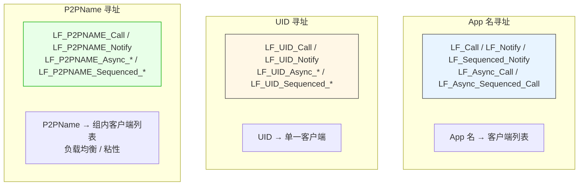

### 8.2 App 名寻址

**API 清单**：
- `LF_Call(appName, Param, Timeout)`
- `LF_Async_Call(appName, Param, Data, OnResult)`
- `LF_Async_Sequenced_Call(appName, Param, Data, OnResult)`
- `LF_Notify(appName, Param)`
- `LF_Sequenced_Notify(appName, Param)`

**路由算法**（客户端 `Send_Execute_Notify`）：

```pascal
// ① 先查本地：本进程内是否有同名 App 且有目标 API
tmp_cli__ := Find_Local_API(app_Name__, api_Name__, True);
if tmp_cli__ <> nil then
  begin
    tmp_cli__.APP.Engine.Execute_Notify(tmp_param);   // 本地执行
    exit;
  end;

// ② 再查远端缓存：本地缓存的远端 App 信息
tmp_cli__ := Find_Remote_API(app_Name__, api_Name__, True);
if tmp_cli__ <> nil then
    tmp_cli__.Send_Execute_Notify_Impl(app_Name__, tmp_param)  // 通过客户端转发
else
    Send_Execute_Notify_Impl(app_Name__, tmp_param);           // 通过自己的连接发
```

**关键**：
- **本地优先**：本进程有同名 App 且 API 匹配 → 本地执行，**不走网络**。
- **缓存加速**：`LF_Local_API_Cache` / `LF_Remote_API_Cache` 缓存 `'AppName.ApiName'` → `TC40_LF_ClientList`。
- **缓存失效（🟢 v7.0 精确化）**：
  - **服务端**：`cmd_Init_APP_Info` / `cmd_No_App_Info` / `DoUserOut_Event`。
  - **客户端**：`cmd_update_service_api_info`（收到广播） / `DoNetworkOffline`（物理断开）。

### 8.3 UID 寻址

**API 清单**：
- `LF_UID_Call(UID, Param, Timeout)`
- `LF_UID_Async_Call(UID, Param, Data, OnResult)`
- `LF_UID_Async_Sequenced_Call(UID, Param, Data, OnResult)`
- `LF_UID_Notify(UID, Param)`
- `LF_UID_Sequenced_Notify(UID, Param)`

**路由算法**（客户端 `Send_UID_Execute_Notify`）：

```pascal
// ① 先查本地：本进程内是否有相同 UID 的客户端
target_app := Find_Local_UID_App(UID_, api_Name__);
if target_app <> nil then
  begin
    target_app.Engine.Execute_Notify(tmp_param);   // 本地执行
    exit;
  end;

// ② 再查远端缓存：本地缓存的远端 UID 信息
tmp_cli__ := Find_Remote_UID_API(UID_, api_Name__, True);
if tmp_cli__ <> nil then
    tmp_cli__.Send_UID_Execute_Notify_Impl(UID_, tmp_param)
else
    Send_UID_Execute_Notify_Impl(UID_, tmp_param);  // 通过服务端 UID 路由
```

**服务端 `FUID_Pool`**：
- **Key**：32 字节 `TUID___`。
- **Value**：`TUID_Data`（recv_io + send_io 对）。
- **数据来源**：客户端通过 `Update_UID` 命令上报。
- **查找**：`FUID_Pool.Get_Value_Ptr___(UID_)` → O(1)。

**UID 生成机制（🟢 v7.0 精确化）**：

**客户端 UID 在 `TunnelLink` 成功时生成**：

```pascal
if Is_Null_UID(FLast_UID) then
    FLast_UID := Generate_Global_UID(PhysicsTunnel.UID,
                                      DTNoAuth.RecvTunnel.ServerState^.UID,
                                      DTNoAuth.SendTunnel.ServerState^.UID)
else
    FLast_UID := Generate_Global_UID(FLast_UID,
                                      PhysicsTunnel.UID,
                                      DTNoAuth.RecvTunnel.ServerState^.UID,
                                      DTNoAuth.SendTunnel.ServerState^.UID);
```

- **首次连接**：`Generate_Global_UID(物理隧道 UID, 接收隧道服务端 UID, 发送隧道服务端 UID)`。
- **重连**：`Generate_Global_UID(旧 UID, 物理隧道 UID, 接收隧道服务端 UID, 发送隧道服务端 UID)`。
- `Generate_Global_UID` 来自 `Z.Net`，用 SHA3-256 生成 256 位 UID，混合当前时间 + Tick + 全局种子 + 输入。

**关键**：
- **UID 是会话级标识**：`TunnelLink` 成功时生成，重连后会变化。
- **本地优先**：本进程有相同 UID 的客户端 → 本地执行。
- **服务端哈希池**：UID 是服务端的路由键，跨客户端定位。

### 8.4 P2PName 寻址

**API 清单**：
- `LF_P2PNAME_Call(p2p_name, Param, Timeout)`
- `LF_P2PNAME_Async_Call(p2p_name, Param, Data, OnResult)`
- `LF_P2PNAME_Async_Sequenced_Call(p2p_name, Param, Data, OnResult)`
- `LF_P2PNAME_Notify(p2p_name, Param)`
- `LF_P2PNAME_Sequenced_Notify(p2p_name, Param)`

**路由算法**：
- **不做本地查找**，**总是走网络**。
- 服务端通过 `FP2PName_Pool` 找一组 UID，按负载均衡或粘性策略选一个。

**两种选择策略的精确映射（🟢 v7.0）**：

| 命令 | 策略 | 实现 |
|------|------|------|
| `cmd_P2PName_Call` | **`Find_P2PName_LoadBalance`** | `Cycle_Anchor` 轮询 + 负载均衡 |
| `cmd_P2PName_Notify` | **`Find_P2PName_LoadBalance`** | 同上 |
| `cmd_P2PName_Sequenced_Notify` | **`Find_P2PName_FixedSequenced`** | `Fixed_Sequenced_Time` 粘性 |
| `cmd_P2PName_Sequenced_Call` | **`Find_P2PName_FixedSequenced`** | 同上 |

**负载均衡实现（Cycle_Anchor）**：
- **全局原子递增计数器** `Cycle_Anchor_Seed`（`Get_Cycle_Anchor`）。
- 每个 `(p2p_name, api)` 任务维护每个 UID 的 anchor 值。
- **anchor 小的先被选中**，选中后更新为新的全局值（排到末尾）。
- **效果**：轮询 + 负载均衡。
- **精度**：每次调用都精确选到最久未用的 UID。

**粘性实现（FixedSequenced）**：
- 按最后处理时间排序，取最小。
- 若超过 `Fixed_Sequenced_Time`（默认 20 秒）没被选中，换一个。
- **效果**：同一 UID 连续处理 20 秒，然后切换。

**关键**：
- **P2PName 是用户自定义字符串**，通过 `LF_Set_Opt_P2P_Name` 设置。
- **服务端不区分同名 UID 的物理位置**，只按 P2PName 归组。
- **本地优先路由不适用**（总是走网络）。

**⚠️ P2PName 异步 Call 的悬挂行为（🟢 v7.0 新增）**：

服务端 `cmd_P2PName_Call` 若找不到组名，**只 `DoStatus`，不回包**。因此：

- **`LF_P2PNAME_Async_Call` 若服务端找不到组名，回调永不触发**。
- 客户端 `LF_P2PNAME_Async_Call` 返回 1（已入队），但回调永不触发。
- **调用方必须自行实现超时**。

**⚠️ P2PName 空字符串调用行为**：

`LF_P2PNAME_Call("", param, timeout)` 会发到服务端，服务端 `Find_P2PName_LoadBalance('')` 返回 nil，报 `no found p2pname:""`，**不回包**。

### 8.5 三套寻址的对比

| 维度 | App 名 | UID | P2PName |
|------|--------|-----|---------|
| 索引键 | UTF-8 字符串 | 32 字节二进制 | UTF-8 字符串 |
| 路由粒度 | 应用级 | 会话级 | 组级 |
| 本地优先 | ✅ | ✅ | ❌ |
| 服务端哈希池 | App 索引 | `FUID_Pool` | `FP2PName_Pool` |
| 负载均衡 | ❌（App 名唯一） | ❌（UID 唯一） | ✅（Cycle_Anchor） |
| 粘性 | ❌ | ❌ | ✅（FixedSequenced，20 秒） |
| 命中 App 注册 | ✅ | ✅ | ✅ |
| 命中 P2P 注册 | ❌ | ✅ | ✅ |
| 典型用途 | 固定服务 | **定向到具体客户端** | 同质服务集群 |

### 8.6 UID / P2PName 自动搜索 App 注册函数

**核心事实**：**UID 和 P2PName 调用会自动搜索目标客户端的 App 注册函数。**

**机制**：

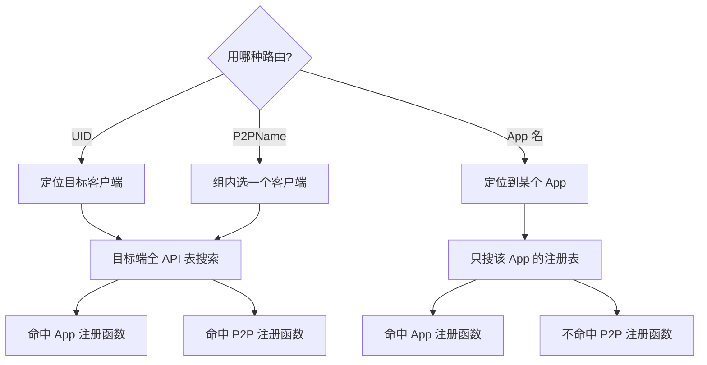

**对比表**：

| 调用方式 | 目标端搜索范围 | 命中 App 注册 | 命中 P2P 注册 |
|----------|----------------|:-------------:|:-------------:|
| **UID 调用** | 目标客户端全部已注册 API | ✅ | ✅ |
| **P2PName 调用** | 被选中客户端的全部已注册 API | ✅ | ✅ |
| **App 名调用** | 目标 App 的注册表 | ✅ | ❌ |

**源码依据**：

**UID 路由**（`Find_Local_UID_App` → `Find_API_From_P2P_APP`）：
```pascal
function Find_API_From_P2P_APP(api_name__: SystemString): TLF_App;
begin
  Result := nil;
  // ① 先查 P2P APP
  if LF_P2P_APP.Engine.LF_MethodPool.Exists_Key(api_name__) then
    begin
      Result := LF_P2P_APP;
      exit;
    end;
  // ② 再查业务 App 池
  LF_App_Pool.Lock;
  try
    if LF_App_Pool.Num > 0 then
      with LF_App_Pool.Invert_Repeat_ do
        repeat
          if queue^.Data.Engine.LF_MethodPool.Exists_Key(api_name__) then
            begin
              Result := queue^.Data;
              exit;
            end;
        until not Prev;
  finally
      LF_App_Pool.UnLock;
  end;
end;
```

**App 名路由**（`Find_Local_API`）：只在指定 `app_Name__` 的 App 的 `LF_MethodPool` 中查找。

---

## 第 9 章 跨寻址路由与 UID 万能路由

### 9.1 UID 是万能路由标识

**关键机制**：**UID 可以瞄准一个具体客户端，调用它注册的任意 API**（包括通过 App 名注册的 API 和通过 P2P 注册的 API），**不需要知道 App 名**。

**原理**：

1. **客户端在 `TunnelLink` 成功时生成 `FLast_UID`**。
2. **客户端通过 `Update_UID` 命令上报 UID 和 P2PName**。
3. **服务端 `FUID_Pool` 建立 UID → recv_io 映射**。
4. **调用 `LF_UID_Call(UID, Param, Timeout)` 时**：
   - 客户端先在本地查找相同 UID 的客户端。
   - 未命中 → 把命令发给服务端。
   - 服务端通过 `FUID_Pool` 找到 recv_io → 转发给目标客户端。
5. **目标客户端执行时**：
   - 通过 `Find_Local_UID_App(UID_, api_Name__)` 找到本地 App。
   - 执行该 App 的 API。

**关键**：
- **UID 与 App 名解耦**：UID 是会话标识，App 名是应用标识，两者独立。
- **`LF_UID_Call` 可以调用任意 API**（只要目标客户端有对应的 App 和 API）。
- **不需要知道 App 名**。

### 9.2 UID 万能路由的使用场景

#### 场景 1：服务端主动推送到特定客户端

```pascal
// 服务端知道某客户端的 UID（从之前的回调中提取）
procedure OnClientCalled(Trigger: Pointer; Input, Output: TDataHnd); cdecl;
var
  UID: TP2P_UID___;
  UIDPtr: PP2P_UID___;
begin
  // 仅在 Input 参数（发送方输入句柄）上有效；返回的是指针
  UIDPtr := LF_Get_P2P_UID(Input);
  if UIDPtr <> nil then
      UID := UIDPtr^;   // 立即解引用拷贝；框架约 5 秒后自动释放指针
  // ... 存起来
end;

// 稍后主动推送
LF_UID_Notify(StoredUID, DataHnd);   // 无需知道 App 名
```

#### 场景 2：跨客户端定向调用

```pascal
// 客户端 A 想调用客户端 B 的 API
// 不需要知道 B 的 App 名，只要知道 B 的 UID
LF_UID_Call(B_UID, DataHnd, 3000);
```

#### 场景 3：会话粘性路由

```pascal
// 同一会话的后续调用都走同一客户端
LF_UID_Sequenced_Notify(SessionUID, DataHnd);   // FIFO 保证
```

### 9.3 P2PName 跨 API 路由

**P2PName 也能调用任意 API**：

```pascal
// 假设有 N 个 worker 都注册了 'process' API，P2PName = 'worker_group'
LF_P2PNAME_Call('worker_group', DataHnd, 5000);
// 服务端在 N 个 worker 中按负载均衡选一个
```

**关键**：
- **P2PName 是组名**：多个客户端设置同一 P2PName，服务端做负载均衡。
- **不区分具体客户端**：调用方不需要知道是哪个 worker。
- **不区分 API 注册来源**：App 注册或 P2P 注册都可以。

### 9.4 跨寻址路由的典型架构

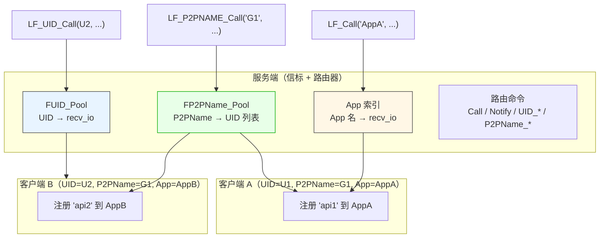

### 9.5 whoami 模式：发现自己的 UID 和 P2PName

**问题**：客户端如何知道自己服务端分配的 UID 和 P2PName？

**方案**：服务端注册一个 `whoami` API，返回调用方的 UID 和 P2PName。

**服务端**：

```pascal
procedure Cb_WhoAmI(Trigger: Pointer; Input, Output: TDataHnd); cdecl;
var
  UID: TP2P_UID___;
  UIDPtr: PP2P_UID___;
  P2P: string;
begin
  // 仅在回调的 Input 参数上有效；返回指针
  UIDPtr := LF_Get_P2P_UID(Input);
  if UIDPtr <> nil then
      UID := UIDPtr^                    // 立即解引用拷贝
  else
      FillChar(UID, SizeOf(UID), 0);
  P2P := LF_Get_P2P_NameEx(Input);
  LF_WriteBuffer(Output, @UID[0], SizeOf(UID));
  LF_WriteString(Output, P2P);
end;

// 注册到 LF_P2P_APP（进程级），任何客户端都能调用
LF_Register_P2P_Call('whoami', 'Query caller identity', nil, @Cb_WhoAmI);
```

**客户端**：

```pascal
function Probe_WhoAmI(out UID: TP2P_UID___; out P2PName: string): Boolean;
var
  Req, Res: LF.TDataHandle;
begin
  Result := False;
  FillChar(UID, SizeOf(UID), 0);
  P2PName := '';
  Req := LF.TDataHandle.Create('whoami');
  try
    Res := LF.CallApp('AnyApp', Req, 5000);   // 走任意 App
    try
      if (Res = nil) or (Res.Size < SizeOf(UID) + 1) then Exit;
      Res.Pos := 0;
      Res.ReadBuffer(UID, SizeOf(UID));
      P2PName := Res.ReadString;
      Result := True;
    finally Res.Free; end;
  finally Req.Free; end;
end;
```

**之后**：客户端持有自己的 UID 和 P2PName，可以用于 UID 定向调用、P2PName 组内调用、或其他客户端发现。

---

## 第 10 章 自动发送方身份识别

### 10.1 核心机制

**框架自动在每个远程请求载荷的头部注入发送方身份**。客户端发送前由 `Rebuild_UID_and_P2PName` 注入：

```
[apiName: string]
[FromUID: 32 bytes]         ← 发送方会话 UID
[FromP2PName: string]       ← 发送方 P2PName
[Param.Size: Int32]
[Param: bytes]              ← 业务参数
```

**重要**：
- **`FromUID` / `FromP2PName` 是"发送方元数据"**，由发送侧客户端自动写入，接收侧不需要也不应该手动传。
- **接收侧只能在回调的 `Input` 参数中通过 `LF_Get_P2P_UID(Input)` / `LF_Get_P2P_Name(Input)` 获取这两个值**。
- **不能对自建句柄或 Output 句柄调用这两个函数**（返回空 / 警告）。
- **`LF_Get_P2P_UID` 返回的是 `PP2P_UID___` 指针（不是值）**，框架约 5 秒后自动释放指针。

### 10.2 编码/解码实现

**编码（`TMemory_Param_Tool.EncryptToMem`）**：

```pascal
procedure TMemory_Param_Tool.EncryptToMem(m64: TMem64);
begin
  m64.Clear;
  m64.WriteString(apiName.Text);              // API 名
  m64.WritePtr(@FromUID[0], SizeOf(TUID___)); // 32 字节 UID
  m64.WriteString(FromP2PName.Text);          // P2PName
  m64.WriteInt32(Param.Size);                 // 业务参数长度
  m64.WritePtr(Param.Memory, Param.Size);     // 业务参数
end;
```

**解码（`DecryptFromMem`）**：

```pascal
procedure TMemory_Param_Tool.DecryptFromMem(m64: TMem64);
begin
  if m64.ProtectedMode then
    begin
      // 只读映射：直接读
      m64.Position := 0;
      apiName.Text := m64.ReadString.Text;
      m64.ReadPtr(@FromUID[0], SizeOf(TUID___));
      FromP2PName.Text := m64.ReadString.Text;
      Param.Size := m64.ReadInt32;
      m64.ReadPtr(Param.Memory, Param.Size);
      Param.Position := 0;
    end
  else
    begin
      // 可写：O(1) 交换 + 零拷贝映射
      tmp.SwapInstance(m64);
      tmp.Position := 0;
      apiName.Text := tmp.ReadString.Text;
      tmp.ReadPtr(@FromUID[0], SizeOf(TUID___));
      FromP2PName.Text := tmp.ReadString.Text;
      i32 := tmp.ReadInt32;
      Param.Mapping(tmp.PosAsPtr, i32);       // 零拷贝
      Param.Position := 0;
    end;
end;
```

### 10.3 注入时机（v7.0 精确化）

**经 `TC40_LF_Client.Send_*` 路径的调用会注入身份**：

```pascal
procedure TC40_LF_Client.Send_Execute_Notify_Impl(app_Name__: TLF_String; Param: TMem64);
begin
  DTNoAuth.SendTunnel.SendCompleteBuffer_StreamNotify('Notify',
    TDFE.Create
      .WriteString(app_Name__)
      .WriteMem64(Param)     // ← Param 已经被 Rebuild 过
      .DelayFree
    );
end;

procedure TC40_LF_Client.Send_Execute_Notify(app_Name__: TLF_String; Param: TMem64);
var
  tmp_param: TMem64;
begin
  tmp_param := TMemory_Param_Tool.Rebuild_UID_and_P2PName(Param, FLast_UID, LF_P2P_name.V);
  try
    // ... 本地查找 / 远端转发 ...
    // 无论哪条路径，tmp_param 都已带身份
  finally
    DisposeObject(tmp_param);
  end;
end;
```

**关键（🟢 v7.0 精确化）**：**所有 `Send_*` 方法都调用 `Rebuild_UID_and_P2PName`**，因此：

| 调用路径 | 是否注入身份 |
|---------|:-----------:|
| `LF_Call` / `LF_Notify` / `LF_Sequenced_*` | ✅ |
| `LF_Call` 命中本地短路 | ✅ |
| `LF_UID_Call` / `LF_UID_Notify` | ✅ |
| `LF_P2PNAME_Call` / `LF_P2PNAME_Notify` | ✅ |
| **`LF_LocalCall` / `LF_LocalNotify`** | ❌ |

**`LF_LocalCall` / `LF_LocalNotify` 不经过 `Rebuild_UID_and_P2PName`**（见 §5.6、`LF-LOCAL-001`）。

### 10.4 覆盖范围

| 命令 | 方向 | 是否注入 |
|------|------|:--------:|
| `Notify` / `Sequenced_Notify` / `Call` / `Sequenced_Call` | 双向 | ✅ |
| `UID_Notify` / `UID_Sequenced_Notify` / `UID_Call` / `UID_Sequenced_Call` | 双向 | ✅ |
| `P2PName_Notify` / `P2PName_Sequenced_Notify` / `P2PName_Call` / `P2PName_Sequenced_Call` | 双向 | ✅ |
| **经 `Send_*` 路径的本地调用** | — | ✅ |
| **`LF_LocalCall` / `LF_LocalNotify`** | — | ❌ |

### 10.5 UID 生成机制

**客户端 UID 在 `TunnelLink` 成功时生成**：

```pascal
procedure TC40_LF_Client.Do_DT_P2PVM_NoAuth_Custom_Client_TunnelLink(...);
begin
  if Is_Null_UID(FLast_UID) then
      FLast_UID := Generate_Global_UID(PhysicsTunnel.UID, DTNoAuth.RecvTunnel.ServerState^.UID, DTNoAuth.SendTunnel.ServerState^.UID)
  else
      FLast_UID := Generate_Global_UID(FLast_UID, PhysicsTunnel.UID, DTNoAuth.RecvTunnel.ServerState^.UID, DTNoAuth.SendTunnel.ServerState^.UID);
end;
```

**关键**：
- **基于物理隧道 UID + C4 服务端 UID 派生**。
- **每次重连都重新生成**：服务端不能假设同一客户端跨重连的 UID 相同。
- **服务端 `FUID_Pool` 会随重连更新**。

### 10.6 典型使用场景

| 场景 | 用法 |
|------|------|
| **调用鉴权** | 比较 `LF_Get_P2P_Name(Input)` 与白名单 |
| **审计日志** | 记录 `LF_Get_P2P_UID(Input)`（十六进制）和 `LF_Get_P2P_Name(Input)` |
| **会话管理** | 以 `UID` 为 key 维护 Session |
| **按组路由** | 按 `P2PName` 分流到不同 worker |
| **多租户** | `P2PName` 作为租户标识 |
| **广播过滤** | 排除特定 `UID` 的调用方 |
| **whoami** | 服务端返回调用方 UID / P2PName，客户端自我发现 |

> **再次强调**：以上所有用法都要求从**回调的 `Input` 参数**调用 `LF_Get_P2P_UID` / `LF_Get_P2P_Name`。**不要**在任何"自己创建"的句柄或输出句柄上调用。**也不要**在 `LF_LocalCall` / `LF_LocalNotify` 的回调中调用（不注入身份）。

---

# 第四部分 高级主题

## 第 11 章 运行时选项详解

> **本章对 `LF_SetOption` 每个选项做**深度展开**：内部机理、生效时机、依赖关系、别名、推荐值。

### 11.1 `LF_SetOption` 的执行语义（🟢 v7.0 明确化）

```pascal
procedure LF_SetOption(Option, Value: pansichar);
begin
  with TSetOpt_Inst.Create do
    begin
      opt := DS(Option);
      V := DS(Value);
      if Simulator_Main_Thread_Activted then
        MainThreadPost.PostM_NP(DoRun)   // 主线程运行后：投递到主线程异步执行
      else
        begin
          DoRun();                          // 主线程未运行：立即执行
          Free;
        end;
    end;
end;
```

**关键（🟢 v7.0）**：
- **主线程未运行时**：立即同步执行。
- **主线程运行后**：通过 `MainThreadPost.PostM_NP` 投递到主线程，**存在微小延迟**。
- **陷阱**：主线程已启动后，选项不是同步生效。若紧接着依赖该选项（例如改 `Overlap_Connection` 后立即 `PrepareClient`），可能读到旧值。
- **未知选项**：静默忽略（最后一个 `else` 缺失）。

### 11.2 网络相关选项

#### 11.2.1 `Overlap_Connection`

- **类型**：Boolean
- **默认**：`False`
- **别名**：`Overlap_Client` / `OverlapConnection` / `OverlapClient` / `OverlapConnect`
- **内部机理**：
  - 控制 `LF_PrepareClient` 对**重复地址**的行为。
  - `False`：每个物理地址只允许一个客户端隧道，第二次 `LF_PrepareClient` 返回 -1（**丢弃新 App 参数**）。
  - `True`：每次 `LF_PrepareClient` 都创建新隧道（`NewKeepAlive` 命令）。
- **生效时机**：**必须在 `LF_PrepareClient` 之前设置**。
- **运行时切换的精确影响（🟢 v7.0 从源码确认）**：
  - 只影响**下一次 `LF_PrepareClient`**。
  - **已创建的隧道不重排、不回滚、不自动添加/删除**。
  - **建议**：`Overlap_Connection` 应在 `LF_ResetPrepare` 之前设定好。
- **推荐配置**：

  | 场景 | 推荐值 | 理由 |
  |------|:------:|------|
  | 单 App per 地址 | `False` | 节省资源 |
  | 多 App per 地址 | `True` | 每个 App 需独立隧道 |
  | 动态 Client + BindApp | `False` + `LF_BindApp` | 一个空隧道 + 事后绑定 |

#### 11.2.2 `Wait_Connection_ReadyOk`

- **类型**：Boolean
- **默认**：`True`
- **别名**：`Wait_API_Prepare_Done` / `API_Prepare_Done_Wait` / `WaitConnect` / `Wait_Ready` / `WaitReady`
- **内部机理**：控制 `LF_PrepareDone` 是否**等待所有客户端就绪**。
- **生效时机**：`LF_PrepareDone` 前。

#### 11.2.3 `Wait_Connection_Timeout`

- **类型**：Integer（毫秒）
- **默认**：`30000`（30 秒）
- **别名**：`Wait_TimeOut` / `API_Prepare_Done_TimeOut` / `WaitTimeOut`
- **内部机理**：`LF_PrepareDone` 内部超时 = `max(Wait_Connection_Timeout, 5000) + 1000` 毫秒。

#### 11.2.4 `password` / `passwd`

- **类型**：String
- **默认**：`'DTC40@ZSERVER'`
- **内部机理**：写入 `Z.Net.C4.C40_Password`，作为 P2PVM 和 C4 网络的认证密码。
- **`LF_GetOption('password')` 返回 `'********'`（掩码）**。

### 11.3 IPC 相关选项

| 选项 | 别名 | 内部机理 |
|------|------|---------|
| `IPC_Serv_ThreadCount` | `IPC_ThreadCount` / `IPC_Server_ThreadCount` | 写入 `TZNet_Server_IPC.IPC_Serv_ThreadCount` |
| `IPC_Serv_MaxQueueLength` | `IPC_MaxQueueLength` / `IPC_Server_MaxQueueLength` | 写入 `TZNet_Server_IPC.IPC_Serv_MaxQueueLength` |
| `IPC_Serv_MaxMsgSize` | `IPC_MaxMsgSize` / `IPC_Server_MaxMsgSize` | 写入 `TZNet_Server_IPC.IPC_Serv_MaxMsgSize` |

**生效时机**：**必须在 IPC 服务端启动前设置**。

### 11.4 状态相关选项

| 选项 | 类型 | 默认 | 别名 | 内部机理 |
|------|------|------|------|---------|
| `ShowThreadID` | Boolean | `True` | `ShowThread` / `Show_Thread` | 写入 `Z.status.StatusThreadID` |
| `ConsoleOutput` | Boolean | `True` | `Console_Output` | 写入 `Z.status.ConsoleOutput` |
| `Quiet` | Boolean | `False` | — | 写入 `Z.Net.C4.C40SetQuietMode` |

### 11.5 数据句柄相关选项

#### 11.5.1 `DataHandle_Idle_Timeout`

- **类型**：Integer（毫秒）
- **默认**：`600000`（10 分钟）
- **别名**：`Data_Idle_Timeout` / `Idle_Timeout`
- **内部机理**：写入 `LF_DataPool.LF_DataHandle_Idle_Timeout`。
  - `> 0`：启用空闲回收。
  - `= 0`：**禁用空闲回收**。

#### 11.5.2 `DataHandle_Pool_Scan_Interval`

- **类型**：Integer（毫秒）
- **默认**：`5000`（5 秒）
- **别名**：`Data_Scan_Interval` / `DataHandle_Scan_Interval`
- **内部机理**：写入 `LF_DataPool.LF_DataHandle_Pool_Scan_Interval`。
  - `> 0`：每次 `Progress` 检查是否超过此间隔才扫描。
  - `= 0`：**每次 Progress 都扫描**（性能下降）。

### 11.6 P2P 相关选项

#### 11.6.1 `LF_P2P_name`

- **类型**：String
- **默认**：`''`（空字符串）
- **别名**：`P2P_name` / `LF_P2P` / `P2P`
- **内部机理**：
  - 写入 `Z.LingoFuse_Core.LF_P2P_name`（`TLF_AtomString`）。
  - **客户端通过 `Update_UID` 命令上报给服务端**。
  - **每次发送请求时自动注入到载荷中**（`Rebuild_UID_and_P2PName` 的第三个参数）。
- **生效时机**：
  - 客户端 `Progress` 每秒检查 `FLast_P2PName` 是否变化，变化则调用 `Update_UID_Info`。
  - **请求发送时实时读取 `LF_P2P_name.V`**，所以改变后立即生效于下次请求。
- **推荐用法**：
  ```pascal
  LF.Set_Opt_P2P_Name('worker_group');   // 客户端加入组
  // 服务端通过 LF_P2PNAME_Call('worker_group', ...) 调用组内任一客户端
  ```

#### 11.6.2 `Fixed_Sequenced_Time` / `Fixed_Sequenced_Life`

- **类型**：Integer（毫秒）
- **默认**：`20000`（20 秒）
- **内部机理**：写入 `Z.LingoFuse_Core.Fixed_Sequenced_Time`。
  - 控制 `Find_Fixed_Sequenced_API` / `Find_P2PName_FixedSequenced` 的**粘性时间**。
  - 同一 UID 连续处理超过此值后，切换到其他 UID。
- **语义（🟢 v7.0 精确化）**：
  - `P2PName` 路由的 `Sequenced` 变体使用此值决定粘性窗口。
  - **最优值**：短任务 5-10 秒；长任务 60 秒+；强粘性场景可设 1 小时。

### 11.7 命令相关选项

#### 11.7.1 `No_Reponse_Cmd_NULL_Flush_Threshold`

- **类型**：Integer
- **默认**：`5000`
- **内部机理**：写入 `Z.LingoFuse_Core.No_Reponse_Cmd_NULL_Flush_Threshold`。
  - 控制**无响应命令（Notify）的 NULL 刷新阈值**。
  - 每发送 N 条 Notify 后，自动发送一条 NULL 命令，让服务端确认。

### 11.8 调试相关选项

#### 11.8.1 `debug` / `debug_cmd` / `debug_command` / `debugcommand`

- **类型**：String
- **内部机理**：
  - **每次调用都会创建一个 `TC40_Console_Help`** 并执行命令。
  - 支持所有 C4 控制台命令：`service` / `tunnel` / `HPC_Thread_Info` / `ZDB2_Info` / `RegInfo` 等。
- **`LF_GetOption('debug')` 返回 `'(no value: debug is write-only)'`**（只写）。
- **⚠️ 开销大**：生产环境慎用。

### 11.9 选项速查表

| 选项 | 类型 | 默认 | 生效时机 | 别名数量 |
|------|------|------|---------|:--------:|
| `Overlap_Connection` | Boolean | `False` | `PrepareClient` 前 | 4 |
| `Wait_Connection_ReadyOk` | Boolean | `True` | `PrepareDone` 前 | 5 |
| `Wait_Connection_Timeout` | Integer (ms) | `30000` | `PrepareDone` 前 | 3 |
| `password` / `passwd` | String | `'DTC40@ZSERVER'` | 全局立即 | 1 |
| `IPC_Serv_ThreadCount` | Integer | 平台相关 | IPC 服务端启动前 | 2 |
| `IPC_Serv_MaxQueueLength` | Integer | 平台相关 | IPC 服务端启动前 | 2 |
| `IPC_Serv_MaxMsgSize` | Integer | 平台相关 | IPC 服务端启动前 | 2 |
| `ShowThreadID` | Boolean | `True` | 全局立即 | 2 |
| `ConsoleOutput` | Boolean | `True` | 全局立即 | 1 |
| `Quiet` | Boolean | `False` | 全局立即 | 0 |
| `DataHandle_Idle_Timeout` | Integer (ms) | `600000` | `PrepareDone` 后 | 2 |
| `DataHandle_Pool_Scan_Interval` | Integer (ms) | `5000` | `PrepareDone` 后 | 2 |
| `LF_P2P_name` | String | `''` | 下次请求 | 3 |
| `Fixed_Sequenced_Time` | Integer (ms) | `20000` | 全局立即 | 1 |
| `No_Reponse_Cmd_NULL_Flush_Threshold` | Integer | `5000` | 全局立即 | 0 |
| `debug` | String | — | 全局立即 | 3 |

---

## 第 12 章 网络准备与模拟主线程

### 12.1 模拟主线程的角色

**问题**：C4 依赖主线程驱动（`C40Progress`），但 C ABI 层不控制用户主循环。

**方案**：`LF_PrepareDone` 启动一个**模拟主线程**（`Simulated_Main_Thread`），在内部循环驱动 C4。

**`Simulated_Main_Thread` 主循环**：

```pascal
while Simulated_Main_Thread_Running do
  begin
    C40Progress(if_(LF_RunningCount.V > 0, 1, 10));  // 动态节流
    try
        LF_DataPool.Progress();                       // 数据池扫描
    except
    end;
  end;
```

**关键（🟢 v7.0 精确化）**：
- **动态节流**：活跃调用时 1ms，空闲时 10ms。
- **同时驱动** C4 网络 + 数据池扫描。
- **每进程只能启动一次**（`LF-MAIN-001`）。

### 12.2 自定义主循环

**方案 1**：仍使用 `LF_PrepareDone` 启动模拟主线程（推荐）。
- 模拟主线程在后台工作。
- 用户主循环只需处理 UI / 业务。

**方案 2**：不用 `LF_PrepareDone`，手动驱动。
- 需要同时调用 `LF_Sync` + `C40Progress` + `LF_DataPool.Progress`。
- **不推荐**。

### 12.3 部署模式（无序启动）

**问题**：分布式系统中，客户端和服务端启动顺序不确定。

**方案**：`Wait_Connection_ReadyOk=False`。

```pascal
LF.Set_Opt_Wait_Connection_ReadyOk(False);
LF.Set_Opt_Wait_Connection_Timeout(5000);   // 即使不用等待，也要设小值
LF.PrepareClient(endpoint, App);
if LF.PrepareDone <> 1 then Halt(1);

// 关键 App 单独等待
if not WaitForApp('CriticalApp', 60000) then
  WriteLn('Critical app not ready');

function WaitForApp(const AppName: string; TimeoutMs: Integer): Boolean;
var tk: TTimeTick;
begin
  tk := GetTimeTick;
  while GetTimeTick - tk < TimeoutMs do
  begin
    if LF.CheckAppEx(AppName) then Exit(True);
    TCompute.Sleep(200);
  end;
  Result := False;
end;
```

**关键**：`LF_PrepareDone` 会立即返回，但不保证目标服务已就绪。

---

## 第 13 章 状态、查询与网络事件

### 13.1 状态管理

#### 13.1.1 `LF_GetStatusCount(): Integer`

**内部机理**：
```pascal
function LF_GetStatusCount(): Integer;
begin
  Status_Lock.Lock;
  try
      Result := Status_Pool.Num;      // 当前队列长度
  finally
      Status_Lock.UnLock;
  end;
end;
```

**关键**：队列**上限 1000 条**，超过丢弃最旧。

#### 13.1.2 `LF_GetStatus(): PAnsiChar`

**内部机理**：
```pascal
function LF_GetStatus(): pansichar;
begin
  Result := @Status_Return_Buffer;    // 静态 64KB 缓冲
  Status_Lock.Lock;
  try
    Status_Return_Buffer[0] := 0;
    if Status_Pool.Num > 0 then
    begin
      L := length(Status_Pool.First^.Data);
      if L > 0 then
      begin
        CopyPtr(@Status_Pool.First^.Data[0], @Status_Return_Buffer, Min(L, SizeOf(Status_Return_Buffer) - 1));
        Status_Return_Buffer[Min(L, SizeOf(Status_Return_Buffer) - 1)] := 0;
      end;
      Status_Pool.Next;   // 出队
    end;
  finally
      Status_Lock.UnLock;
  end;
end;
```

**关键**：
- **返回静态缓冲**：下次调用会覆盖。
- **64 KB 上限**：超出部分截断。
- **出队**：每次调用取出一条并移除。

#### 13.1.3 `LF_PostStatus(status: PAnsiChar)`

**内部机理**：
```pascal
procedure LF_PostStatus(status: pansichar);
begin
  if not Simulator_Main_Thread_Activted then
      DoStatus('LF_PostStatus: Main thread not running; message queued directly. message: %s', [DS(status).Text]);
  s := DS(status);
  Status_Lock.Lock;
  try
      Post_To_DoStatus_Queue(TCompute.CurrentThread, s.Text, 0);
  finally
      Status_Lock.UnLock;
  end;
end;
```

**关键**：
- **主线程未运行时**：打印警告，但**仍入队**。
- **加锁后入队**。

### 13.2 查询 API

#### 13.2.1 `LF_CheckMainThread(): Integer`

**内部机理**：返回 `if_(Simulator_Main_Thread_Activted, 1, 0)`。

#### 13.2.2 `LF_CheckApp(appName): Integer`

**内部机理**：
```pascal
function LF_CheckApp(appName: pansichar): Integer;
begin
  Result := if_((Find_Local_APP(DS(appName), False) <> nil) or (Find_Remote_APP(DS(appName), False) <> nil), 1, 0);
end;
```

**关键**：
- **本地 + 远端缓存**都查。
- **广播延迟约 3 秒**：刚注册/注销的 App 有延迟。

#### 13.2.3 `LF_CheckApi(appName, apiName): Integer`

**同理**：查 `Find_Local_Api` / `Find_Remote_Api`。

#### 13.2.4 `LF_Check_UID(UID)` / `LF_Check_UID_Api(UID, apiName)`

**内部机理**：
```pascal
function LF_Check_UID(UID: TP2P_UID___): Integer;
begin
  Result := if_(Find_Local_UID(UID) or (Find_Remote_UID(UID)), 1, 0);
end;
```

#### 13.2.5 `LF_Check_P2PNAME(p2p_name)` / `LF_Check_P2PNAME_Api(p2p_name, apiName)`

**同理**。

### 13.3 网络事件

#### 13.3.1 `LF_Set_Network_Event(On_Connect, On_Disconnect)`

**内部机理**：
```pascal
procedure LF_Set_Network_Event(On_Connect_, On_Disconnect_: TLF_Network_Event);
begin
  On_Network_Connect_Event := On_Connect_;
  On_Network_Disconnect_Event := On_Disconnect_;
end;
```

**触发链（Connect）**：

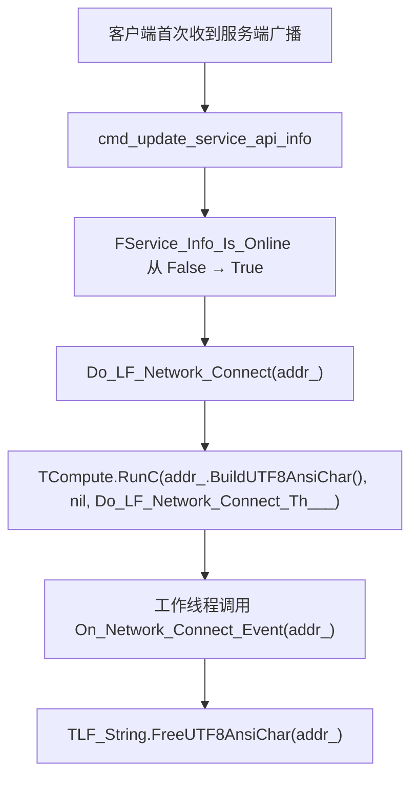

**关键**：
- **Connect 不是 TCP 建链**：是"首次收到服务端 API 广播"。
- **Disconnect 是物理链路断开**。
- **回调在 TCompute 工作线程执行**。
- **`addr_` 回调返回后立即失效**。

#### 13.3.2 使用范式

```pascal
procedure OnConnect(addr: PAnsiChar); cdecl;
var s: string;
begin
  s := UTF8ToString(addr);   // 立即复制
  TThread.Queue(nil,
    procedure
    begin
      Memo1.Lines.Add('Connected: ' + s);   // 主线程操作 UI
    end);
end;

procedure OnDisconnect(addr: PAnsiChar); cdecl;
begin
  TThread.Queue(nil,
    procedure
    begin
      Memo1.Lines.Add('Disconnected');
    end);
end;

LF_Set_Network_Event(@OnConnect, @OnDisconnect);

// 卸载（LF_Shutdown 前可选）
LF_Set_Network_Event(nil, nil);
```

---

## 第 14 章 线程模型与并发

### 14.1 四类线程

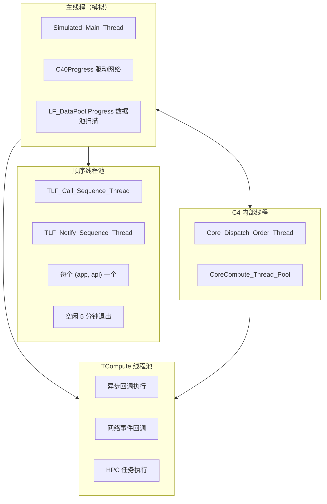

### 14.2 各线程的职责

| 线程 | 职责 | 用户可交互 |
|------|------|:----------:|
| **模拟主线程** | C4 进度、数据池扫描 | 不可（内部） |
| **TCompute 线程池** | 异步回调、网络事件、HPC | **回调内**可交互 |
| **顺序线程池** | FIFO 序列化调用/通知 | **回调内**可交互 |
| **C4 内部线程** | 网络收发 | 不可 |

### 14.3 线程安全矩阵

| 组件 | 线程安全 |
|------|:--------:|
| 所有导出函数（除状态日志） | ✅ 完全线程安全 |
| 同一数据句柄的并发写 | ❌ 需外部同步 |
| 回调中的全局变量 | ❌ 需外部同步 |
| `LF_DataPool.Progress` | ✅ 内部有锁 |
| `LF_SyncTool` | ✅ 内部有临界区 |
| 网络事件回调的 `addr_` | ❌ 回调返回后失效 |

### 14.4 回调线程归属速查

| 回调类型 | 执行线程 |
|---------|---------|
| `On_Call`（Call 模式） | 主线程 / 顺序线程 |
| `On_Notify`（Notify 模式） | 主线程 / 顺序线程 |
| `LF_Async_Call.OnResult` | TCompute 工作线程 |
| `LF_Async_Sequenced_Call.OnResult` | TCompute 工作线程 / 顺序线程 |
| `LF_UID_Async_*.OnResult` | TCompute 工作线程 |
| `LF_P2PNAME_Async_*.OnResult` | TCompute 工作线程 |
| `LF_Set_Network_Event.On_Connect` | TCompute 工作线程 |
| `LF_Set_Network_Event.On_Disconnect` | TCompute 工作线程 |
| `RegisterSyncCall_M` / `RegisterSyncNotify_M` | 主线程（需 `LF_Sync` 驱动） |

### 14.5 线程安全最佳实践

1. **跨线程只调 `LF_*` 函数**：完全线程安全。
2. **同一句柄的写操作加锁**：读写位置不是原子操作。
3. **回调中不阻塞、不调 `LF_Call`**：会自锁死。
4. **UI 操作编组到主线程**：`TThread.Queue` / `Synchronize`。
5. **托管语言回调保持强引用**：防止 GC 回收。
6. **网络事件 `addr_` 立即复制**：回调返回后失效。
7. **异步回调的 handle 必须在回调内处理完**：禁止跨线程保留。

### 14.6 异步回调的 Handle 生命周期

#### 14.6.1 时序对比：同步族 vs 异步族

**同步族（`LF_Call`）**：

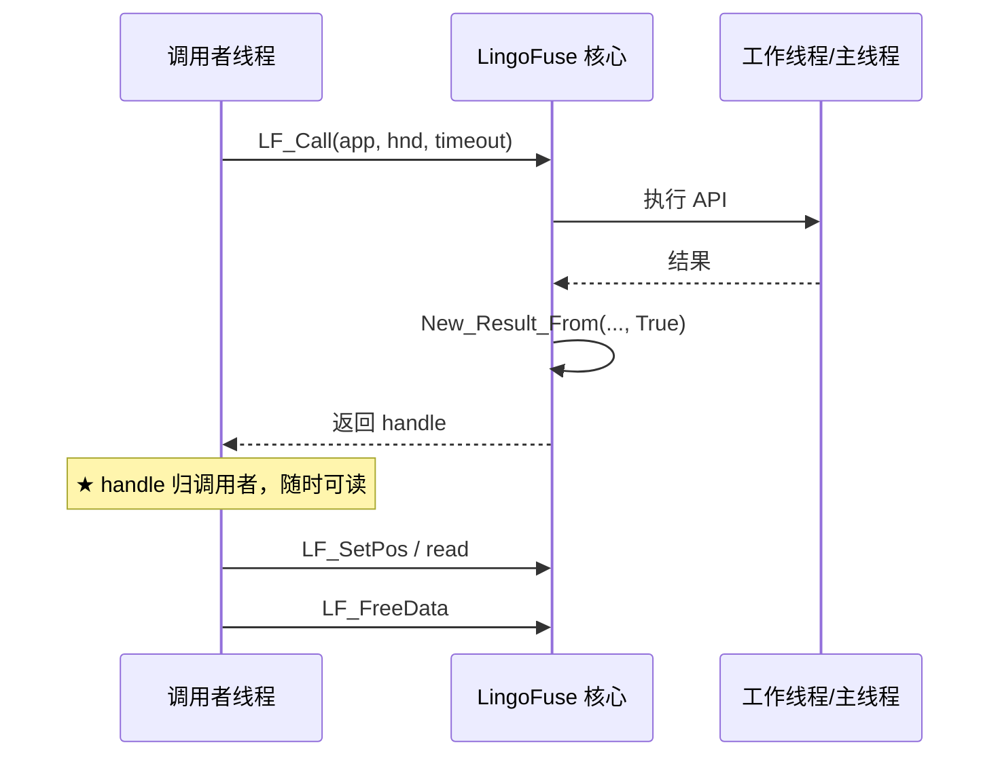

**异步族（`LF_Async_Call`）**：

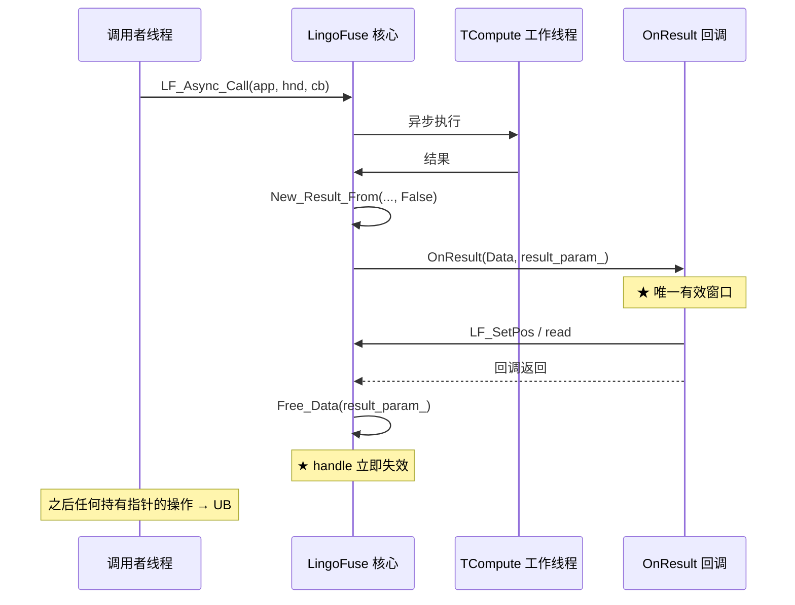

#### 14.6.2 与线程模型的耦合

**异步族 handle 的生命周期**：

- **起点**：`TLF_Async_Call_Bridge.Do_Th` 内的 `New_Result_From(..., False)`。
- **终点**：`TLF_Async_Call_Bridge.Do_Th` 内的 `Free_Data(result_param_)`。
- **起点与终点都在 TCompute 工作线程内**，且**中间只隔着 `OnResult` 回调调用**。
- **调用者线程完全感知不到这个窗口**——它只收到一个 future（或等价物）的完成通知，而 handle 已经失效。

**这是跨语言绑定的根本陷阱**：从调用者线程的视角，"调用完成"意味着"可以拿到结果"；但从 C 侧的视角，"调用完成"意味着"handle 已被释放"。

#### 14.6.3 三种安全策略

| 策略 | 实现方式 | 适用场景 |
|------|---------|---------|
| **A. 用同步族** | 网关/代理/HTTP 桥接等本就阻塞的场景 | `LF_Call` 家族 |
| **B. 回调内拷贝** | 异步回调内 `read_string_bytes` 拷出 bytes | `LF_Async_Call` 家族 |
| **C. 高级封装** | 绑定层的 Future 接口在回调内读取并拷出 | 所有托管语言 |

**任何在回调外保留裸 handle 的做法都是错的**。

#### 14.6.4 与自动回收的对比

| 维度 | 自动回收 handle | 异步族 handle |
|------|----------------|---------------|
| `auto_recycle___` | `True` | `False` |
| 空闲回收 | 10 分钟 + 5 秒扫描 | 不适用（不进池） |
| 释放时机 | `LF_FreeData` 标记 + 池扫描 | 回调返回瞬间 |
| 活性窗口 | 分钟级 | 微秒-毫秒级 |
| 保护机制 | 3 层（阈值 + 刷新 + calling） | 无 |
| 跨线程保留 | ⚠️ 需外部锁 | ❌ 禁止 |

**数量级差异**：自动回收 handle 的"活性窗口"是**分钟级**，异步族 handle 是**毫秒级**。

---

## 第 15 章 内存与生命周期管理

### 15.1 三层内存池架构

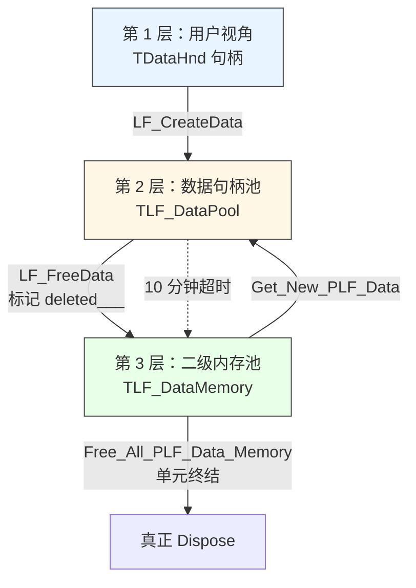

### 15.2 每层的职责

| 层 | 名称 | 职责 |
|:--:|------|------|
| 1 | 用户句柄 | 用户持有的 `TDataHnd` |
| 2 | 数据句柄池 | 跟踪活跃句柄；扫描并回收空闲/删除的 |
| 3 | 二级内存池 | 缓存已回收的 `TLF_Data` record，减少 `New`/`Dispose` |

### 15.3 `TLF_DataPool.Progress` 三路分支

**每 5 秒扫描一次**：

```pascal
for each handle in LF_DataPool:
  if handle.updated___ or handle.calling___ > 0 then
      handle.time___ := now;
      handle.updated___ := False;
  else if handle.deleted___ then
      加入"用户主动释放"列表;
      标记回收;
  else if now - handle.time___ > 10 分钟 then
      加入"超时释放"列表;
      标记回收;
```

**关键**：
- **`updated___` 或 `calling___ > 0`**：刷新时间戳。
- **`deleted___`**：用户主动释放。
- **超时**：空闲 10 分钟。
- **释放发生在池外**：避免锁内 Dispose。

### 15.4 顺序线程的退出与释放（🟢 v7.0 修正）

**源码**（`Z.LingoFuse_Core.pas` `TLF_Call_Sequence_Thread.Do_Run_Th` 末尾）：

```pascal
if (Internal_Queue_Data___ <> nil) and (Internal_Queue_Pool___ <> nil) then
  begin
    Internal_Queue_Pool___.Lock;
    try Internal_Queue_Pool___.Remove(Internal_Queue_Data___);
    finally Internal_Queue_Pool___.UnLock; end;
  end;
DelayFreeObj(1.0, self);   // ← 1 秒（v6.0 文档误记为 5 秒）
```

**v6.0 勘误**：v6.0 §14.1 引述 `Z.LingoFuse.md` 的 5 秒；**源码实际为 1 秒**。

### 15.5 `calling___` 计数器

**作用**：保护进行中的远程调用。

**实现**：
```pascal
procedure TLF_Data.Begin_Call;
begin
  calling___.UnLock(calling___.LockP^ + 1);
  updated___ := True;
end;

procedure TLF_Data.End_Call;
begin
  calling___.UnLock(calling___.LockP^ - 1);
  updated___ := True;
end;
```

**关键**：
- **所有 `LF_Call` / `LF_LocalCall` / `LF_Notify` / `LF_Sequenced_Notify` 内部自动 `Begin_Call` / `End_Call`**。
- **用户不需要手动调用**（C ABI 层没有暴露）。

### 15.6 `LF_CreateData_Permanent` 语义

- **`auto_recycle___ = False`**：不加入 `LF_DataPool`。
- **`LF_FreeData` 同步立即释放**（不是标记）。
- **不受 10 分钟超时影响**（因为它根本不在池里）。
- **初始化窗口创建会泄漏**：`LF_PrepareDone` 前 / `LF_ExitMainThread` 后，`LF_FreeData` 是 no-op。

### 15.7 `LF_App` 的两阶段析构

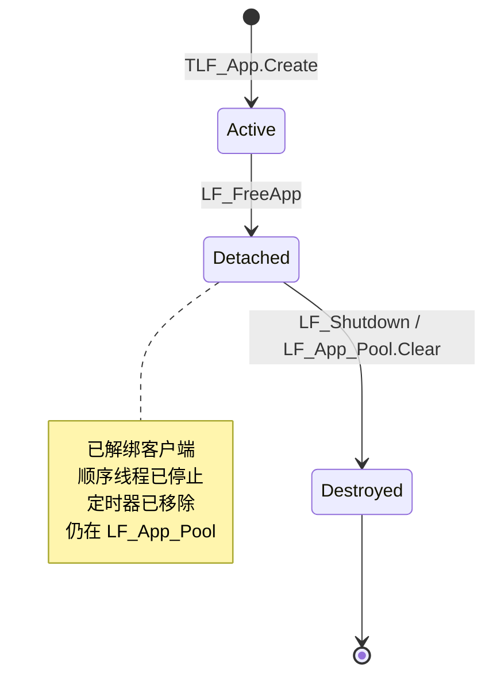

### 15.8 内存泄漏排查清单

| # | 泄漏源 | 检查方法 | 修复 |
|:-:|--------|---------|------|
| 1 | 未 `LF_FreeData` 数据句柄 | 长期运行内存增长 | 用 `try..finally` |
| 2 | 未 `LF_FreeApp` 应用句柄 | `LF_App_Pool` 增长 | 按清理顺序释放 |
| 3 | `LF_CreateData_Permanent` 未释放 | 显式查找 | 显式 `LF_FreeData` |
| 4 | DLL 未调用 `LF_Shutdown` | DLL 卸载后仍占内存 | 加卸载钩子 |
| 5 | 顺序通知线程未退出 | 检查 TCompute 线程数 | 空闲 5 分钟后自动退出 |
| 6 | 二级池中的 record 未释放 | 检查 `LF_DataMemory` 池大小 | 单元终结时自动释放 |
| 7 | 回调闭包捕获了大对象 | 检查匿名函数 | 使用弱引用 |
| 8 | 异步回调外持有 handle 导致 double-free | 检查 `LF_FreeData` 是否被调用于异步 handle | 只在回调内处理异步 handle |

### 15.9 顺序线程竞态

**源码**（`TLF_Notify_Sequence_Thread.Do_Run_Th` 末尾 + `Kill_App`）：

```pascal
// Do_Run_Th 末尾
if (Internal_Queue_Data___ <> nil) and (Internal_Queue_Pool___ <> nil) then
  begin
    Internal_Queue_Pool___.Lock;
    try Internal_Queue_Pool___.Remove(Internal_Queue_Data___);
    finally Internal_Queue_Pool___.UnLock; end;
  end;
DelayFreeObj(1.0, self);

// Kill_App 内部
queue^.Data^.Data.Second.Critical.Lock;
try
  queue^.Data^.Data.Second.Internal_Queue_Pool___ := nil;   // ← 与上面检查竞争
  queue^.Data^.Data.Second.Internal_Queue_Data___ := nil;
finally queue^.Data^.Data.Second.Critical.UnLock; end;
```

**竞态分析**：`Do_Run_Th` 检查 `Internal_Queue_Pool___ <> nil` 时**未加锁**，`Kill_App` 可能在此之前置 nil。

**理论风险**：**低概率崩溃**。

**缓解**：`LF_FreeApp` 之前确保顺序线程已停止；避免在高并发下频繁创建/销毁 App。

---

## 第 16 章 跨语言绑定

### 16.1 C ABI 边界


### 16.2 通用规则

1. **回调必须 `cdecl`**（或语言的等价约定：`CFUNCTYPE` / `extern "C"` / `@convention(c)`）。
2. **托管语言回调必须保持强引用**。
3. **字符串用 UTF-8**（`PAnsiChar`）。
4. **`TP2P_UID___` 是 32 字节数组**。
5. **返回指针 5 秒后失效**（`LF_GetOption` / `LF_Get_AppName` / `LF_Generate_AppName` / `LF_Get_P2P_Name` / `LF_Get_P2P_UID`）。
6. **`LF_WriteString` 总是追加 #0**，`LF_ReadString` 容错读。
7. **发送方身份自动可用**，无需额外声明；**只在回调的 Input 参数中有效**。
8. **同步族与异步族的 handle 所有权相反**：同步族归调用者，异步族归框架（回调返回后立即释放）。

### 16.3 各语言注意事项速查

| 语言 | 关键点 |
|------|--------|
| **C / C++** | `extern "C"`；`cdecl`；异步回调内拷贝数据 |
| **C# / .NET** | `CallingConvention.Cdecl`；回调强引用；异步回调内拷贝数据 |
| **Python** | `CFUNCTYPE`（cdecl）；回调强引用（模块级变量）；异步回调内拷贝数据 |
| **Java** | JDK 22+ FFM API；upcallStub 保持强引用；异步回调内拷贝数据 |
| **Rust** | `extern "C"`；panic 必须 `catch_unwind`；异步回调内拷贝数据 |
| **Go** | `purego` 或 `cgo`；回调保持引用；异步回调内拷贝数据 |
| **Swift** | Swift 5.9+；`@convention(c)`；异步回调内拷贝数据 |
| **Zig** | `@cImport`；`extern "C"`；异步回调内拷贝数据 |
| **Erlang** | NIF 崩溃会拖垮 BEAM；OTP 27+；异步回调内拷贝数据 |
| **Ruby** | Fiddle 或 C 扩展；DevKit；异步回调内拷贝数据 |
| **Fortran** | `iso_c_binding`；编译器同源；异步回调内拷贝数据 |
| **Julia** | `--threads=2`；`ccall`；异步回调内拷贝数据 |
| **R** | 四层架构 + Job 队列；异步回调内拷贝数据 |
| **Dart** | `DynamicLibrary.open`；Flutter Web 不可用；异步回调内拷贝数据 |

### 16.4 P2PName 跨语言时序（🟢 v7.0 新增）

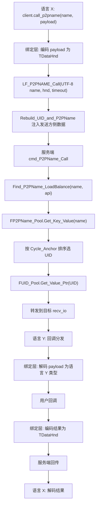

**P2PName 跨语言契约表（🟢 v7.0）**：

| 维度 | 契约 |
|------|------|
| 字符串编码 | UTF-8 + NUL 结尾 |
| 空字符串 | 服务端报 `no found p2pname:""`，不回包 |
| 长度上限 | 无显式限制 |
| 异步悬挂 | 服务端找不到组名时回调永不触发 |
| 超时机制 | 调用方自行实现（C ABI 无超时参数） |
| 回调线程 | TCompute 工作线程 |
| Handle 所有权 | 同步族归调用者，异步族归框架 |

### 16.5 发送方身份识别的跨语言声明

```c
/* LF_Get_P2P_UID: 返回指针（指向 32 字节 UID），由框架 DelayFreeMem(5.0, ...) 自动释放 */
PP2P_UID___ LF_Get_P2P_UID(TDataHnd___ Hnd);

/* LF_Get_P2P_Name: 返回 UTF-8 字符串指针，5 秒后自动释放 */
const char* LF_Get_P2P_Name(TDataHnd___ Hnd);
```

- `TP2P_UID___` 是 32 字节数组，跨语言建议声明为 `uint8_t[32]`。
- `PP2P_UID___` 是**指向 `TP2P_UID___` 的指针**（`uint8_t (*)[32]` 或 `uint8_t*`）。
- **使用位置限制（必读）**：
  - **仅在触发事件的回调 `Input` 参数上有效**。
  - **不能对自建句柄（`LF_CreateData` 创建的）调用**。
  - **不能对输出句柄（如 `OnResult` 的 `Result_`）调用**。
  - **不能在 `LF_LocalCall` / `LF_LocalNotify` 回调中调用**。

### 16.6 异步 handle 的跨语言声明

```c
// 异步回调的原型（cdecl）
typedef void (*TLF_Async_Call_OnResult)(void* Data, TDataHnd___ Result_);
```

**跨语言契约**：

- `Data` 是调用者提供的 opaque 指针，LingoFuse 不管理其生命周期。
- `Result_` 是**框架拥有的 handle**：
  - 回调返回后**立即失效**。
  - 回调内**禁止**调用 `LF_FreeData(Result_)`。
  - 回调内**必须**完成所有读取（或把数据拷出来）。

---

## 第 17 章 清理与关闭

### 17.1 硬约束的清理顺序

```
LF_ExitMainThread    →    LF_FreeApp    →    LF_Shutdown
```

**为什么这个顺序**：

1. **`LF_ExitMainThread`**：停止模拟主线程，触发 `C40Clean`、顺序线程池停止、数据句柄全部释放。
2. **`LF_FreeApp`**：解绑所有 `TC40_LF_Client` 的 `app` 引用，停止顺序线程，`FakeFree` 移除定时器。
3. **`LF_Shutdown`**：清空 `LF_App_Pool`（真正释放 App），释放所有数据句柄，卸载 IPC 库。

**错误顺序的后果**：

```pascal
// ❌ 错误：先 Shutdown 后 FreeApp
LF_Shutdown;
LF_FreeApp(App);   // App 已在 Shutdown 时释放，UAF
```

### 17.2 `LF_Shutdown` 的完整步骤

1. **清空网络事件回调**：`On_Network_Connect_Event := nil` / `On_Network_Disconnect_Event := nil`。
2. **停止所有序列化通知线程**。
3. **释放所有剩余数据句柄**：`LF_DataPool.Free_All_Hnd`。
4. **退出模拟主线程**：`LF_ExitMainThread`。
5. **清空全局应用池**：`LF_App_Pool.Clear`。
6. **卸载 IPC 库**：`UnloadIPCLibrary`。
7. **关闭核心调度线程**：`if IsLibrary then Close_Core_Dispatch_Thread`。

**幂等性（🟢 v7.0 从源码确认）**：多次调用 `LF_Shutdown` 应该是幂等的。每个内部步骤都有前置检查（空池跳过、未激活跳过）。

### 17.3 `LF_Shutdown` 后可以重新初始化

```pascal
LF_Shutdown;
LF_ResetPrepare;             // 清空准备队列
LF_PrepareService(...);
LF_PrepareClient(...);
if LF_PrepareDone = 1 then   // 重新启动
  ...
```

**关键**：`LF_Shutdown` 会重置 `Simulated_Main_Thread_Running`，因此 `LF_PrepareDone` 可以再次成功。

### 17.4 DLL 场景

**必须显式 `LF_Shutdown`**：

```pascal
// DLL 出口函数中
procedure DllUnload; stdcall;
begin
  LF_Shutdown;   // 必须显式调用
end;
```

**原因**：DLL 可能被宿主进程提前卸载，LingoFuse 的 `finalization` 可能不会执行。

---

# 第五部分 P2P 与分布式

## 第 18 章 P2P 分布式负载

### 18.1 核心判断：1 对多即分布式

> **只要出现"1 对多"，就可以分布式。**
>
> - 1 个 App 名，被多个程序注册；
> - 1 个 P2PName，被多个程序注册；
> - 1 个调用方，连接多个服务器；
> - 1 个 API 名，被多个 worker 暴露。

LingoFuse 的 C4 网格会自动形成候选池，并按策略选择目标。

### 18.2 三种负载粒度

| 粒度 | 路由键 | 选择方式 | 本地优先 |
|------|--------|---------|:--------:|
| 应用级 | App 名 | 多客户端候选，最久未用 | ✅ |
| 组级 | P2PName | 服务端组内负载/粘性 | ❌ |
| 会话级 | UID | 定向，不负载 | ✅（本地 UID 优先） |

### 18.3 一个 App 名被多个程序注册

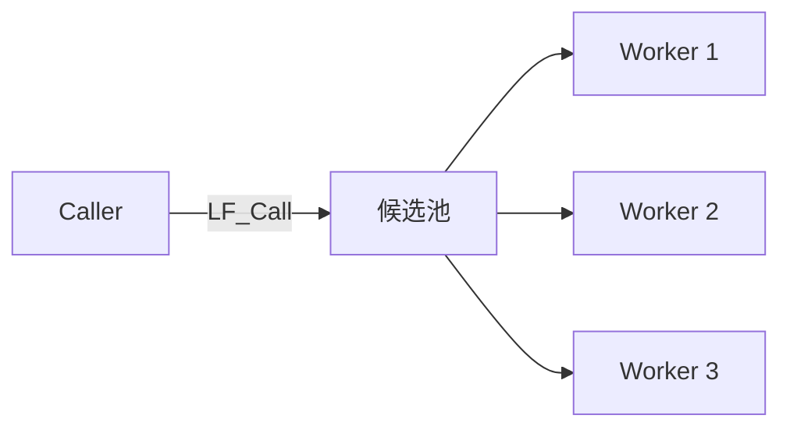

**规则**：
- App 名路由**本地优先**。
- 本地没有同名 App，才走远端候选。
- 多个候选时按"最久未用"负载均衡。
- 广播缓存有约 3 秒延迟。
- 不要用同一个 App 名在同一进程里做"本地 vs 远程"测试。

### 18.4 一个 P2PName 被多个程序注册

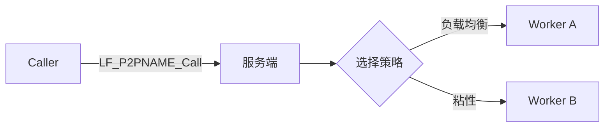

**规则**：
- P2PName 路由**不做本地优先**，总是交给服务端/网格。
- 服务端维护"组名到 UID 列表"。
- 默认按 `Cycle_Anchor` 做负载均衡。
- `Fixed_Sequenced_Time` 默认 20 秒，提供粘性。
- 适合无状态 worker、计算节点、编解码节点、GPU 节点。

### 18.5 你的程序连接多个服务器

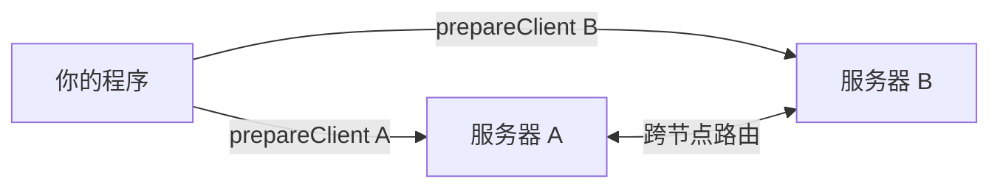

**条件与边界（🟢 v7.0 精确化）**：
- 你的程序可以 `prepareClient` 多个服务器地址。
- **前提**：服务器之间通过 C4 协议建立了物理连接（互相 `Client` / `Auto` 连接），**形成 C4 网格**。
- **若服务器之间不互通**，它们就是**孤岛**，不会自动跨服务器负载。
- **额外配置**：不需要额外配置广播/路由；只要服务器之间通过 C4 网格连接，跨节点路由自动生效。
- **具体机制**：每个 C4 服务端通过 `QueryInfo` 命令查询其他服务端的服务信息，分发服务收集并广播。

### 18.6 序列化族与高流量计算

**LingoFuse 的序列化族**：
- `LF_Sequenced_Notify`
- `LF_Sequenced_Call`
- `LF_Async_Sequenced_Call`
- UID / P2PName 的 Sequenced 变体

**保证**：
- 同一 `(App, API)` 对内 FIFO；
- 同一 `(UID, API)` 内 FIFO；
- 同一 `(P2PName, API)` 对内 FIFO，但可能分配到不同 UID；
- 不同键之间可并发。

**为什么和 Matlab / R / Julia / 视频 / 音频天生合拍**：

| 场景 | 数据形态 | 序列化后的优势 |
|------|---------|---------------|
| Matlab 计算 | 矩阵、数组、仿真迭代 | 每轮迭代 FIFO，结果按序回传 |
| R 统计 | 数据帧、批处理 | 批次顺序稳定，避免乱序污染 |
| Julia 高并发 | 任务块、GPU 批次 | 同 API 内 FIFO，跨 API 并发 |
| 视频流 | 帧序列、GOP | 帧序不丢，按帧处理与反馈 |
| 音频流 | PCM / Opus 块 | 块序稳定，低延迟反馈 |
| 大规模数据流 | 分块二进制 | 二进制句柄，少编码开销 |

### 18.7 为什么几乎自动化、高效

- **自动化发现**：注册 API，服务端广播，调用方缓存候选。
- **自动化负载**：App 名多注册 / P2PName 多注册，自动选目标。
- **自动化顺序**：Sequenced 族按路由键 FIFO。
- **自动化句柄池**：DataHandle 创建、池化、回收。
- **自动化异步**：`LF_Async_*` + Future，回调内拷贝结果。
- **二进制高效**：句柄可写原始字节，视频/音频/矩阵少一次编码。
- **零拷贝映射**：解码时 `Param.Mapping` 可零拷贝映射。
- **跨语言统一**：C ABI 让 Matlab / R / Julia / Python / C++ 都能接。

### 18.8 P2P 分布式负载最佳实践

1. **UID 只在回调 `Input` 里读。**
2. **读到指针立即拷贝。**
3. **断网前 UID 可做通讯标识符。** 重连后重新 `whoami`。
4. **想要分布式，就制造 1 对多。**
5. **同质 worker 用 P2PName。** 不要用 App 名做组播。
6. **需要顺序用 Sequenced。**
7. **大流量用二进制句柄。**
8. **多服务器要确认服务器支持跨节点路由。**
9. **不要在回调里调同步 `LF_Call` / `LF_Notify` / `LF_LocalCall`。**
10. **异步 handle 归框架所有，回调返回立即释放。**

---

## 第 19 章 路由优化：本地短路与服务器本地处理

### 19.1 本地短路（目标在本地，不走网络）

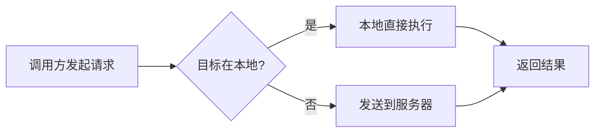

**说明**：
- 如果调用方进程内已经注册了目标 App / UID / P2PName 对应的函数，LingoFuse 会**本地优先执行**，不经过网络。
- 这减少了网络往返，降低了延迟。
- 注意：**App 名路由默认就是本地优先；UID 路由也本地优先；P2PName 路由不做本地优先**。

**源码依据**：

```pascal
// 客户端 Send_Execute_Notify 的第一步
tmp_cli__ := Find_Local_API(app_Name__, api_Name__, True);
if tmp_cli__ <> nil then
  begin
    tmp_cli__.APP.Engine.Execute_Notify(tmp_param);   // 本地直接执行
    exit;
  end;
```

### 19.2 服务器本地处理（请求到了服务器，但服务器自己能处理）

```mermaid
flowchart LR
    A[请求到达服务器] --> B{服务器本地能处理?}
    B -->|是| C[服务器本地执行]
    B -->|否| D[转发到目标客户端]
    C --> E[返回结果]
    D --> E
```

**说明**：
- 当请求经过服务器时，服务器会先检查自己进程内是否有对应的 App / API。
- 如果有，服务器**直接本地处理**，不再向其他客户端转发。
- 这避免了不必要的网络转发，提高了整体效率。
- **这个优化对 App 名、UID、P2PName 路由都适用**。

**源码依据**：

```pascal
// 服务端 cmd_Call 的第一步
tmp_cli__ := Find_Local_API(app_Name__, api_Name__, True);
if tmp_cli__ <> nil then
  begin
    // 服务器本地处理，不转发
    RunHPC_CompleteBuffer_StreamM(Sender, nil, tmp_cli__, InData, OutData, Run_Call_Worker);
    exit;
  end;
// 否则才广播给其他客户端
```

### 19.3 两级优化合并图

```mermaid
flowchart TB
    A[调用方] --> B{本地能处理?}
    B -->|是| C[本地执行]
    B -->|否| D[发送到服务器]
    D --> E{服务器本地能处理?}
    E -->|是| F[服务器本地执行]
    E -->|否| G[转发到目标客户端]
    C --> H[返回结果]
    F --> H
    G --> H
```

### 19.4 本地短路的意外性

**问题**：多节点测试时，`LF_Call` 可能实际本地执行，与预期不符。

**原因**：C4 路由优先查找本地 App 实例。

**修复**：
- 明确当前进程是否注册了同名 App。
- 需要远程调用时避免本地同名 App。
- 或用不同 App 名区分本地/远程。

**相关坑**：`LF-ROUTE-001`。

### 19.5 服务器本地处理的影响

**问题**：服务器进程本身注册了同名 App 时，请求可能不会被转发到其他客户端。

**原因**：服务器进程优先处理本地能处理的请求。

**修复**：
- 明确服务器进程是否应该注册业务 App。
- 服务器通常只作为信标（Beacon），不注册业务 App。
- 如果服务器要注册，需要明确它的处理能力。

**相关坑**：`LF-ROUTE-009`。

---

# 第六部分 踩坑知识库

## 第 20 章 踩坑知识库

> **ID 命名规则**：`LF-<子系统>-<三位序号>`。
>
> **v7.0 变化**：
> - 移除 `LF-DATA-002` 中的"跨异步边界"表述（已并入 `LF-ASYNC-001`）。
> - 新增 `LF-LOCAL-001`（本地调用不注入身份）、`LF-SEQ-003`（顺序线程 1 秒释放）、`LF-ROUTE-012`（P2PName 异步 Call 悬挂）。
> - `LF-ROUTE-011` 从"推测"升级为"已核实"。

### 20.1 应用/句柄层（LF-APP-*）

**LF-APP-001：回调必须 `cdecl`**（🟢）

- **症状**：进程崩溃 / 回调进不去 / `Trigger` 变垃圾指针 / 换环境后崩。
- **根因**：C ABI 要求 `cdecl`；Delphi 默认 `register`、FPC 默认 `fastcall`。
- **修复**：
  ```pascal
  procedure GoodCallback(Trigger: Pointer; Input, Output: TDataHnd); cdecl;
  ```
- **相关坑**：`LF-CB-001`

**LF-APP-002：`LF_FreeApp` 是两阶段析构**（🟢）

- **症状**：内存不降反升；频繁创建/销毁 App 的服务，`LF_App_Pool` 持续增长。
- **根因**：`LF_FreeApp` 只做解绑 + 停顺序线程 + 移定时器，对象仍在 `LF_App_Pool` 中，等 `LF_Shutdown` 时清理。
- **正确做法**：
  - 长期运行：避免频繁创建/销毁 App。
  - 短期任务：`LF_Shutdown` 后重启框架。
- **相关坑**：`LF-CLEAN-001`、`LF-CLEAN-002`

**LF-APP-003：`LF_Generate_AppName` 必须在 `LF_PrepareDone` 之后**（🟢）

- **症状**：名字缺少隧道地址和 RemoteID；服务端刷屏 `no found app`；客户端收不到消息。
- **根因**：需要拼接隧道信息，`LF_PrepareDone` 之前不存在。
- **修复**：见 §3.2.5 时序。
- **相关坑**：`LF-XLANG-001`、`LF-NET-003`

**LF-APP-004：`LF_Generate_AppName` / `LF_Get_AppName` 返回指针 5 秒失效**（🟢）

- **症状**：字符串变成乱码、空字符串，或访问违规。
- **根因**：`Z.Notify.DelayFreeMem(5.0, Result)` 自动释放。
- **修复**：用 `Ex` 版本立即复制。
- **相关坑**：`LF-APP-003`、`LF-DATA-002`

**LF-APP-005：`LF_BindApp` 只绑定"未绑定"的客户端**（🟢）

- **症状**：返回值 0，新 App 从未绑定。
- **根因**：只绑定 `Cli.app = nil` 的客户端；需要主线程活跃。
- **修复**：
  1. `Overlap_Connection=True` + 新建隧道。
  2. 准备不同的物理地址。
  3. `PrepareClient` 阶段直接传 App。
- **绑定顺序**：按客户端创建顺序（🟢 v7.0 精确化）。
- **相关坑**：`LF-NET-001`、`LF-NET-004`

**LF-APP-006：`Overlap_Connection=False` 时第二个 App 被静默忽略**（🟢）

- **症状**：第二次 `LF_PrepareClient` 返回新 tag，但新 App 从未绑定；后续调用超时。
- **根因**：`Overlap_Connection=False` 时，每个物理地址只允许一个客户端隧道。
- **修复**：`LF_Set_Opt_Overlap_Connection(True)`。
- **相关坑**：`LF-NET-001`、`LF-APP-005`

**LF-APP-007：`LF_FreeApp` 有 shutdown guard**（🟢）

- **症状**：`LF_Shutdown` 后调用 `LF_FreeApp` 是 no-op。
- **根因**：`if not Core_Dispatch_Order_Activted then exit`。
- **修复**：清理顺序 `ExitMainThread → FreeApp → Shutdown`。
- **相关坑**：`LF-CLEAN-001`、`LF-APP-002`

### 20.2 回调层（LF-CB-*）

**LF-CB-001：回调必须显式 `cdecl`**（🟢）
- **说明**：与 `LF-APP-001` 同一条。

**LF-CB-002：回调中禁止调用阻塞型 LingoFuse 函数**（🟢）

- **症状**：整个进程死锁。
- **根因**：回调持有内部锁，远程调用需要同一把锁。
- **修复**：异步提交到工作线程。

**LF-CB-003：回调中禁止长时间阻塞**（🟢）

- **症状**：C4 线程池线程不可用，高并发下请求排队。
- **修复**：回调只做"读输入 + 入队 + 立即返回"。

**LF-CB-004：回调必须线程安全**（🟢）

- **症状**：偶发崩溃，多核机器上概率更高。
- **修复**：用临界区保护共享状态；UI 用 `RegisterSyncCall_M`。

**LF-CB-005：同步回调必须由主循环驱动 `LF_Sync`**（🟢）

- **症状**：同步回调永不执行。
- **修复**：主循环中定期调用 `LF_Sync`。

### 20.3 数据句柄层（LF-DATA-*）

**LF-DATA-001：句柄必须显式释放**（🟢）

- **症状**：高强度调用下内存持续增长。
- **根因**：自动回收是**异步兜底**（10 分钟空闲 + 5 秒扫描）。
- **修复**：用 `try..finally` 保证释放。

**LF-DATA-002：句柄不能在回调中释放**（🟢）

- **症状**：崩溃 / 数据错乱。
- **修复**：回调中不释放 `Input` / `Output`；跨线程用值拷贝。
- **v7.0 简化**：跨异步边界的部分已并入 `LF-ASYNC-001`。

**LF-DATA-003：`Data_Param` 与 `Data_Result` 互斥**（🟢）

**LF-DATA-004：`LF_ReadString` 的容错模式可能读走全部剩余字节**（🟢）

**LF-DATA-005：`LF_WriteString` 总是追加 #0**（🟢）

**LF-DATA-006：二级内存池 `TLF_DataMemory`**（🟢）

**LF-DATA-007：`calling___` 计数器保护进行中的远程调用**（🟢）

**LF-DATA-008：`LF_CreateData_Permanent` 的正确与错误使用**（🟢）

### 20.4 网络准备层（LF-NET-*）

**LF-NET-001：每个物理地址只能有一个客户端**（🟢）

**LF-NET-002：`LF_PrepareDone` 阻塞等待客户端就绪**（🟢）

**LF-NET-003：`LF_PrepareDone` 在同一进程内只有第一次返回 1**（🟢）

**LF-NET-004：`Wait_Connection_ReadyOk=False` 下的重试逻辑必须自己实现**（🟢）

**LF-NET-005：网络事件回调在后台 TCompute 工作线程执行**（🟢）

**LF-NET-006：网络事件回调的 `addr_` 在回调返回后立即失效**（🟢）

**LF-NET-007：`LF_PrepareDone` 超时后仍返回 1**（🟢）

### 20.5 远程调用层（LF-CALL-*）

**LF-CALL-001：`LF_Call` 超时返回大小为 0 的句柄（不是 nil）**（🟢）

**LF-CALL-002：`LF_Notify` 不保证送达，`LF_Sequenced_Notify` 才保证顺序**（🟢）

### 20.6 序列化通知层（LF-SEQ-*）

**LF-SEQ-001：序列化通知线程空闲 5 分钟后自动终止**（🟢）

**LF-SEQ-002：`LF_Sequenced_Notify` 的 FIFO 保证仅限同一 `(App, API)` 对**（🟢）

**LF-SEQ-003【v7.0 新增】：顺序线程退出后延迟 1 秒释放**（🟢）
- **症状**：若依赖 v6.0 文档所述的 5 秒来假设生命周期，可能出现悬空引用。
- **根因**：源码为 `DelayFreeObj(1.0, self)`。
- **修复**：不要依赖"5 秒安全窗口"，顺序线程退出后不保留任何引用。
- **相关坑**：`LF-MEM-004`

### 20.7 查询与缓存层（LF-CHK-*）

**LF-CHK-001：`LF_CheckApp` / `LF_CheckApi` 基于缓存，延迟约 3 秒**（🟢）

### 20.8 运行时选项层（LF-OPT-*）

**LF-OPT-001：`LF_SetOption` 未知选项静默忽略**（🟢）

**LF-OPT-002：运行时选项不持久化**（🟢）

**LF-OPT-003：`Overlap_Connection` 的完整语义与推荐配置**（🟢）

### 20.9 清理与生命周期（LF-CLEAN-*）

**LF-CLEAN-001：正确的清理顺序是 `ExitMainThread` → `FreeApp` → `Shutdown`**（🟢）

**LF-CLEAN-002：`LF_Shutdown` 后可以重新初始化**（🟢）

**LF-CLEAN-003：DLL 场景下必须显式 `LF_Shutdown`**（🟢）

### 20.10 线程模型（LF-THREAD-*）

**LF-THREAD-001：所有导出函数线程安全**（🟢）

**LF-THREAD-002：数据句柄的并发写不安全**（🟢）

### 20.11 类型与编译（LF-TYPE-*）

**LF-TYPE-001：FPC 下 `var` 和 `out` 编码为同一引用类别**（🟡）

**LF-TYPE-002：跨语言接口只能用基础类型**（🟢）

### 20.12 跨语言数据交换（LF-XLANG-*）

**LF-XLANG-001：字符串必须遵循 #0 终止符约定**（🟢）

**LF-XLANG-002：UTF-8 全程贯通，不经 `string` 中转**（🟡）

**LF-XLANG-003：字节序统一为小端**（🟢）
- **v7.0 强化**：Z 框架**不支持大端平台**。`Z.Define.inc` 中 `{$IFDEF BIG_ENDIAN}` 会触发 `{$MESSAGE FATAL}` 编译错误。

### 20.13 JSON 使用层（LF-JSON-*）

**LF-JSON-001：`TZ_JsonObject` 是树，Parse 类方法只能在 root 上调用**（🟢）

**LF-JSON-002：JSON 组装必须停在 Unicode 空间，不能经 `string` 中转**（🟢）

**LF-JSON-003：GBK / Latin-1 回退必须用 `USystemString`**（🟢）

### 20.14 模拟主线程（LF-MAIN-*）

**LF-MAIN-001：模拟主线程每进程只能启动一次**（🟢）

**LF-MAIN-002：模拟主线程驱动的所有后台任务**（🟢）

**LF-MAIN-003：`LF_ExitMainThread` 与资源释放的关系**（🟢）

**LF-MAIN-004：`LF_DataPool.Progress` 的三路分支语义**（🟢）

### 20.15 内存与生命周期（LF-MEM-*）

**LF-MEM-001：三层内存池架构**（🟢）

**LF-MEM-002：`TLF_Data` 是 record，不是 class**（🟢）

**LF-MEM-003：`TLF_App` 的两阶段析构**（🟢）

**LF-MEM-004：`TLF_Notify_Sequence_Thread` 的延迟释放是 1 秒**（🟢，v7.0 修正）
- **机制**：`DelayFreeObj(1.0, self)`。
- **影响**：不要依赖"5 秒安全窗口"。
- **相关坑**：`LF-SEQ-003`

**LF-MEM-005：内存泄漏排查清单**（🟢）
- 见 §15.8。

### 20.16 LF 核心机制（LF-MECH-*）

| ID | 机制 | 一句话风险 |
|---|------|-----------|
| `LF-MECH-001` | 数据句柄自动回收 | 自动回收是异步兜底，不是释放保证 |
| `LF-MECH-002` | `LF_FreeData` no-op 窗口 | PrepareDone 前 / ExitMainThread 后释放无效 |
| `LF-MECH-003` | `LF_ExitMainThread` 清空句柄 | 包括 permanent 句柄，之后不能再用 |
| `LF-MECH-004` | `LF_PrepareDone` 单次成功 | 第二次返回 0 不是失败；超时仍可能返回 1 |
| `LF-MECH-005` | `LF_FreeApp` 两阶段析构 | FreeApp 不立即释放，Shutdown 才销毁 |
| `LF-MECH-006` | 回调线程模型 | 回调在后台工作线程，禁止阻塞和调用 LF_Call |
| `LF-MECH-007` | 网络事件语义 | Connect 不是 TCP 建链；addr 立即失效 |
| `LF-MECH-008` | 地址唯一性与 Overlap | 默认同地址第二个 App 会被静默忽略 |
| `LF-MECH-009` | LF_Call 超时与幂等 | 超时返回 size=0 句柄；服务端可能继续执行 |
| `LF-MECH-010` | 本地优先路由 | 本地同名 App 会优先执行，不走网络 |
| `LF-MECH-011` | 广播缓存延迟 | CheckApp / CheckApi 有约 3 秒延迟 |
| `LF-MECH-012` | 序列化通知线程 | FIFO 仅同一 (App, API) 对；线程空闲会终止 |
| `LF-MECH-013` | 运行时选项机制 | 未知选项静默忽略；不持久化 |
| `LF-MECH-014` | calling 计数器与内存池 | 长调用保护句柄；二级池复用 record |
| `LF-MECH-015` | 清理顺序与 DLL | ExitMainThread → FreeApp → Shutdown |
| `LF-MECH-016` | NUL 线格式契约 | 字符串写入追加 #0；容错读取可能读走剩余 |
| `LF-MECH-017` | Side data 注入机制 | 发送方自动写入；只在回调 Input 有效 |
| `LF-MECH-018` | 异步 handle 立即释放 | 异步族 handle 回调返回即释放；同步族归调用者 |

### 20.17 本地调用（LF-LOCAL-*，v7.0 新增）

**LF-LOCAL-001：`LF_LocalCall` / `LF_LocalNotify` 不注入发送方身份**（🟢）

- **症状**：本地调用回调内 `LF_Get_P2P_UID(Input)` 返回全零，`LF_Get_P2P_Name(Input)` 返回空串。
- **根因**：`LF_LocalCall` / `LF_LocalNotify`（`Z.LingoFuse_Export.pas`）直接调用 `PLF_Data(Param).Data_Param.EncryptToMem(tmp)`，**不经过 `Rebuild_UID_and_P2PName`**。
  - 若 `Param` 是 `LF_CreateData` 创建的，其 `FromUID` 为 `Null_UID()`。
- **对照**：**经 `TC40_LF_Client.Send_*` 路径的本地调用（即 `LF_Call` 命中本地短路）会注入身份**。
- **修复**：
  - 需要本地调用携带身份 → 用 `LF_Call`（会命中本地短路，仍注入身份）。
  - 或自行在 `Param` 上写入发送方身份。
- **相关坑**：§5.6、§10.3、`LF-MECH-017`。

### 20.18 路由与寻址（LF-ROUTE-*）

**LF-ROUTE-001：本地优先路由的意外性**（🟢）

**LF-ROUTE-002：UID 是会话级标识，重连后会变化**（🟢）

**LF-ROUTE-003：P2PName 路由不做本地查找**（🟢）

**LF-ROUTE-004：UID 万能路由可以调用任意 API**（🟢）

**LF-ROUTE-005：P2PName 负载均衡的 Cycle_Anchor 机制**（🟢）

**LF-ROUTE-006：P2PName 粘性的 FixedSequenced 机制**（🟢）

**LF-ROUTE-007：whoami 模式是 UID 路由的前置**（🟢）

**LF-ROUTE-008：三种寻址的 API 不能混用参数类型**（🟢）

**LF-ROUTE-009：服务器本地处理的意外性**（🟢）

**LF-ROUTE-010：UID / P2PName 调用能命中 App 注册函数，App 名调用不能命中 P2P 注册函数**（🟢）

**LF-ROUTE-011：多服务器自动分布式的边界**（🟢，v7.0 从推测升级）
- **说明**：你的程序可以 `prepareClient` 多个服务器地址。**前提**：服务器之间通过 C4 协议建立了物理连接（互相 `Client` / `Auto` 连接），**形成 C4 网格**。
- **若服务器之间不互通**，它们就是孤岛，不会自动跨服务器负载。
- **额外配置**：不需要额外配置广播/路由；只要服务器之间通过 C4 网格连接，跨节点路由自动生效。
- **相关坑**：`LF-ROUTE-005`

**LF-ROUTE-012【v7.0 新增】：P2PName 异步 Call 若服务端找不到组名，回调永不触发**（🟢）
- **症状**：`LF_P2PNAME_Async_Call("no_such_group", ...)` 返回 1（已入队），但回调永不触发。
- **根因**：服务端 `cmd_P2PName_Call` 在 `Find_P2PName_LoadBalance` 返回 nil 时只 `DoStatus('no found p2pname:"%s"')`，**不回包**。
- **对照**：同步 `LF_P2PNAME_Call` 会超时返回 size=0 句柄；异步版本则**永久悬挂**。
- **修复**：调用方必须自行实现超时（记录未决请求，超时后丢弃 holder）。
- **相关坑**：§8.4、§11.3。

### 20.19 异步调用与 Handle 所有权（LF-ASYNC-*）

**LF-ASYNC-001：异步族的 `Result_` handle 归框架所有，回调返回后立即释放**（🟢）

- **症状**：
  - 在回调外读取 `Result_` → 空数据 / 垃圾数据。
  - 在回调外对 `Result_` 调 `LF_FreeData` → double-free / 崩溃。
  - 症状表现为"偶发"：小 payload 看起来正常，大 payload 返回空。
- **根因**：
  - 同步族返回 `New_Result_From(..., True)`，`auto_recycle = True`，归调用者。
  - 异步族在 `TLF_Async_Call_Bridge.Do_Th` 内 `New_Result_From(..., False)`，`auto_recycle = False`，**回调返回后立即 `Free_Data`**。
- **修复**：
  1. **模式 A**：用同步族。所有权契约简单。
  2. **模式 B**：用异步族，在回调内**读并拷出数据**。
  3. **模式 C**：用绑定层提供的 Future 接口。
- **相关坑**：`LF-ASYNC-002`、`LF-ASYNC-003`、`LF-ASYNC-006`、`LF-DATA-002`

**LF-ASYNC-002：异步 handle 禁止跨线程保留**（🟢）

**LF-ASYNC-003：异步 handle 禁止 `LF_FreeData`**（🟢）

**LF-ASYNC-004：注释中的"~1 秒"是误导**（🟢）

- **根因**：注释说"1 秒后释放"，实际是"回调返回后**立即**释放"。"1 秒"是 `DelayFreeObj(1.0, Self)` 释放 **Bridge 对象**，不是 `Result_` handle。
- **教训**：注释是二手信息。遇到可疑行为，读源码。

**LF-ASYNC-005：`int` vs `dict` 二分法是伪分类**（🟢）

- **根因**：真正的变量是 **payload 大小 → 内存复用时机**。
- **修复**：二分法要问对问题。

**LF-ASYNC-006：同步族与异步族所有权不能混用**（🟢）

**LF-ASYNC-007：异步 handle 的活性窗口是微秒-毫秒级**（🟢）

**LF-ASYNC-008：绑定层必须把异步 handle 处理封装在回调内**（🟢）

---

## 第 21 章 LLM 生态坑索引

> **本章只做索引**。LLM 生态（Python 端、MCP 网关、LTB、stdio 传输等）是另一个领域，详细内容见 `LingoFuse_LLM_Pitfalls_For_AI.md`。

### 21.1 LLM 生态坑 ID 映射表

| LLM 生态坑 ID | 主题 | 与 Pascal 层的对应 |
|--------------|------|------------------|
| P0-1 | `client_name` 必须是真实 App 名 | `LF-APP-003` |
| P0-3 | 回调中不能调阻塞 LingoFuse 函数 | `LF-CB-002` |
| P2-1 | 编码问题 | `LF-XLANG-002` |
| P4-2 | GUI 清理顺序 | `LF-CLEAN-001` |
| P7-3 | LTB 预连接 | `LF-NET-003` / `LF-MAIN-001` |
| **P9 系列** | **Structured Output** | **`LF-JSON-001` / `LF-JSON-002`** |
| **P10-1** | **子对象调 parse 致父树悬空** | **`LF-JSON-001`** |
| **P10-2** | **JSON 经 AnsiString 中转丢字符** | **`LF-JSON-002`** |
| **P10-3** | **GBK 回退 SetLength 单位错** | **`LF-JSON-003`** |
| **P11** | **异步回调 handle 外泄** | **`LF-ASYNC-001` / `LF-ASYNC-002`** |
| **P12** | **`LF_Get_P2P_UID` 返回值由数组变指针** | **§4.6.1 / `LF-ROUTE-002`** |
| **P13** | **服务器本地处理导致的"请求不转发"** | **`LF-ROUTE-009`** |
| **P14** | **App 名调用不能命中 P2P 注册函数** | **`LF-ROUTE-010` / §6.6** |
| **P15（v7.0）** | **本地调用不注入发送方身份** | **`LF-LOCAL-001` / §5.6** |
| **P16（v7.0）** | **P2PName 异步 Call 找不到组名时永久悬挂** | **`LF-ROUTE-012` / §8.4** |

---

# 附录

## 附录 A 错误消息原文索引

| 错误消息原文 | 章节 | 简述 |
|-------------|------|------|
| `no found app("...") api("...")` | `LF-APP-003` | client_name 未注册或生成过早 |
| `LF_PrepareClient returned -1` | `LF-NET-001` | 地址重复 |
| `repeat connection` | `LF-NET-001` | 重复地址 |
| `prepare error: repeat listen` | `LF-NET-001` | 重复监听地址 |
| `LF_PrepareDone failed` | `LF-NET-002` | 等待超时 |
| `LF_PrepareDone returned 0` | `LF-NET-003` / `LF-MAIN-001` | 二次调用 |
| `LF_BindApp: Main thread is not active` | `LF-APP-005` | 主线程未启动 |
| `LF_BindApp: All clients are already occupied` | `LF-APP-005` | 无空闲客户端 |
| `3029 function header doesn't match` | `LF-TYPE-001` | var/out 同签名 |
| `Can't find unit Z.Core` | 编译配置 | 单元搜索路径未配置 |
| `Queue "..." is already occupied` | 端口占用 | 端点被占用 |
| `Callback type mismatch` | `LF-APP-001` | 缺 cdecl |
| `Timeout` / 大小为 0 的结果 | `LF-CALL-001` | 调用超时 |
| `Module not found: LingoFuse64.dll` | 部署 | 动态库未找到 |
| `hint: Data handle pool "N" handles were idle...` | `LF-DATA-001` | 数据句柄自动回收日志 |
| `Sequenced notify api "..." thread idle timeout` | `LF-SEQ-001` | 顺序通知线程空闲退出日志 |
| `LingoFuse Main Thread Begin/Exit` | `LF-MAIN-001` / `LF-MAIN-003` | 模拟主线程日志 |
| `[warning] Get_P2P_UID(): P2P Info only backcall "input" parameter.` | §4.6.1 / §10.4 | 对输出/自建句柄调用 |
| `no found uid:%s api("%s")` | `LF-ROUTE-004` | UID 路由找不到目标 |
| `no found p2pname:"%s" api:"%s"` | `LF-ROUTE-005` / `LF-ROUTE-012` | P2PName 路由找不到目标；异步版本将永久悬挂 |
| `LF_SetOption: opt="%s" val="%s"` | §11.1 | 选项设置日志 |
| `LF_P2P_name = %s` | §11.6.1 | P2PName 设置日志 |
| 网络事件回调中访问冲突 | `LF-NET-005` | UI 跨线程访问 |
| 网络事件 `addr_` 变乱码 / 空 | `LF-NET-006` | `addr_` 悬空 |
| `unrecognized type json_schema` | `LF-JSON-001` | JSON Schema 组装错误 |
| `options.response_format` 丢失 | `LF-JSON-001` | 父树悬空 |
| `ToBytes` 访问冲突 | `LF-JSON-001` | 父树悬空 |
| Schema 里 emoji / 韩文变 `?` | `LF-JSON-002` | AnsiString 中转 |
| GBK 回退输出乱码 / 截断 | `LF-JSON-003` | SetLength 单位错 |
| 异步回调后读到空 / 崩溃（无明确错误消息） | `LF-ASYNC-001` / `LF-ASYNC-002` / `LF-ASYNC-003` | 异步 handle 外泄 / double-free |
| 请求未被转发到目标客户端（v6.0） | `LF-ROUTE-009` | 服务器本地处理 |
| App 名调用 P2P 注册函数失败（v6.0） | `LF-ROUTE-010` | 路由不对称 |
| 本地调用回调内 P2P 身份为空（v7.0） | `LF-LOCAL-001` | 不经过 Rebuild_UID_and_P2PName |

## 附录 B ID 总览与维护约定

### B.1 当前 ID 总览（v7.0）

| ID 前缀 | 条目数 | 说明 |
|---------|:------:|------|
| `LF-APP` | 7 | 应用/句柄层 |
| `LF-CB` | 5 | 回调层 |
| `LF-DATA` | 8 | 数据句柄层 |
| `LF-NET` | 7 | 网络准备层 |
| `LF-CALL` | 2 | 远程调用层 |
| `LF-SEQ` | **3** | 序列化通知层（v7.0 新增 LF-SEQ-003） |
| `LF-CHK` | 1 | 查询与缓存 |
| `LF-OPT` | 3 | 运行时选项 |
| `LF-CLEAN` | 3 | 清理与生命周期 |
| `LF-THREAD` | 2 | 线程模型 |
| `LF-TYPE` | 2 | 类型与编译 |
| `LF-XLANG` | 3 | 跨语言数据交换 |
| `LF-JSON` | 3 | JSON 使用层 |
| `LF-MAIN` | 4 | 模拟主线程 |
| `LF-MEM` | 5 | 内存与生命周期 |
| `LF-MECH` | 18 | LF 核心机制（跨语言通用） |
| `LF-ROUTE` | **12** | 路由与寻址（v7.0 新增 LF-ROUTE-012） |
| `LF-ASYNC` | 8 | 异步调用与 Handle 所有权 |
| **`LF-LOCAL`** | **1** | **本地调用（v7.0 新增）** |
| **合计** | **95** | （v6.0 为 92；v7.0 新增 3 条） |

### B.2 维护约定

1. **ID 分配**：按子系统递增，**不复用已删除的 ID**。
2. **证据等级必须标注**：🟢 / 🟡。
3. **必填字段**：ID、标题、证据等级、影响版本、触发条件、症状、根因、修复、验证清单。
4. **可选字段**：最小复现、相关坑。
5. **交叉引用**：`相关坑` 字段双向维护。
6. **升级证据等级**：🟡 → 🟢，只升不降。
7. **新增子系统**：需要 ≥ 3 条同源坑时才建立独立子系统前缀。
8. **v7.0 起不再使用"不确定"标记**。所有断言必须有依据。

## 附录 C 给 AI 使用者的检索规则

### C.1 检索优先级

1. **先查本知识库**：用 ID（`LF-XXX-NNN`）或关键词。
2. **路由相关**：先查第 8、9 章和 §20.18（`LF-ROUTE-*`）。
3. **P2P 分布式负载相关**：先查第 18 章。
4. **路由优化相关**：先查第 19 章。
5. **本地调用身份**：先查 §5.6、§10.3、`LF-LOCAL-001`。
6. **选项相关**：先查第 11 章。
7. **JSON 相关**：先查 §20.13（`LF-JSON-001 / 002 / 003`），再查 `Z.Json.md`。
8. **主线程相关**：先查第 12 章和 §20.14（`LF-MAIN-*`）。
9. **内存相关**：先查第 15 章和 §20.15（`LF-MEM-*`）。
10. **Handle 所有权相关**：先查 §4.7 和 §20.19（`LF-ASYNC-*`）。
11. **机制级通用问题**：先查 §20.16（`LF-MECH-*`）。
12. **未命中**：查第 21 章的 LLM 生态索引。
13. **都无法回答**：明确告知"当前材料不足以判断"，建议回查源码。

### C.2 回答时必带的元信息

- **依据的 ID**（如 `LF-APP-003` / `LF-ROUTE-012` / `LF-LOCAL-001` / `LF-MECH-006`）。
- **证据等级**（🟢 / 🟡）。

### C.3 结构化输出模板

```
【ID】LF-XXX-NNN
【证据等级】🟢 / 🟡
【症状】...
【根因】...
【修复】...
【验证】...
【相关坑】...
```

## 附录 D 核心铁律

### D.1 通用铁律

1. **回调必须 `cdecl`**，且禁止在回调中调用 `LF_Call` / `LF_Notify` / `LF_LocalCall`。
2. **数据句柄必须显式 `LF_FreeData`**，不能用自动回收当保险（10 分钟空闲 + 5 秒扫描）。
3. **清理顺序必须是 `ExitMainThread` → `FreeApp` → `Shutdown`**。
4. **`TZ_JsonObject` 是树**：`Parae` / `Assign` / `LoadFromStream` / `ParseText` 只能在 root 上调用；JSON 组装中间容器用 `TZ_JsonString`。
5. **`LF_PrepareDone` 每进程只能成功启动一次**；`LF_ExitMainThread` 会清空所有数据句柄（包括 permanent）。
6. **`LF_CreateData_Permanent` 创建的句柄不会自动回收**；`LF_FreeData` 在 `LF_PrepareDone` 前 / `LF_ExitMainThread` 后是 no-op。
7. **网络事件回调在 TCompute 工作线程执行**，`addr_` 在回调返回后立即失效。

### D.2 路由相关铁律

8. **UID 是万能路由标识**：知道 UID 就能调用目标客户端的任意 API，不需要知道 App 名。
9. **P2PName 路由不做本地查找**：总是走网络，服务端做负载均衡 / 粘性。
10. **App 名路由本地优先**：本进程有同名 App 就本地执行，不走网络。
11. **三种寻址的 API 参数类型不同**：App 名 / P2PName 用 `PAnsiChar`，UID 用 32 字节数组。
12. **服务器本地处理**：请求到达服务器后，服务器本地能处理就不转发。
13. **App 名调用不能命中 P2P 注册函数**；UID / P2PName 调用能命中所有已注册函数。

### D.3 机制相关铁律

14. **`LF_Call` 超时返回 size=0 句柄，不是 nil**；重试需业务幂等。
15. **多 App 同地址必须 `Overlap_Connection=True` 或 `LF_BindApp`**。
16. **回调中禁止阻塞和调用 `LF_Call` / `LF_Notify` / `LF_LocalCall`**。
17. **`LF_Shutdown` 后其他 `LF_*` 函数都视为无效**。

### D.4 异步 Handle 所有权铁律

18. **同步族（`LF_Call` / `LF_UID_Call` / `LF_P2PNAME_Call`）返回的 handle 归调用者所有**，调用者负责 `LF_FreeData`。
19. **异步族（`LF_Async_Call` / `LF_UID_Async_Call` / `LF_P2PNAME_Async_Call`）的 `Result_` handle 归框架所有**，回调返回后立即失效；**禁止**在回调外使用，**禁止** `LF_FreeData`。
20. **异步回调内的 handle 活性窗口 = 回调调用期间**；需要跨线程使用时**必须先拷贝数据**。
21. **二分法要问对问题**：类型差异（`int` vs `dict`）往往是伪分类；真变量是**内存复用时机**。
22. **注释是二手信息**：遇到可疑行为，读源码，不读注释。"~1 秒后释放"注释是误导。

### D.5 P2P 身份查询铁律

23. **`LF_Get_P2P_UID` / `LF_Get_P2P_Name` 的数据来源是"发送方在发送请求时自动写入的元数据"**，**不是读句柄本身的业务数据**。
24. **这两个函数仅在"触发事件的回调的 `Input` 参数"上有效**；对自建句柄、输出句柄调用无效（返回空 / 警告）。
25. **`LF_Get_P2P_UID` 返回 `PP2P_UID___` 指针**；框架约 5 秒后自动释放，调用者**只读拷贝**，**不手动释放**，**不长期保存**。
26. **【v7.0 新增】`LF_LocalCall` / `LF_LocalNotify` 不注入发送方身份**。若需本地调用也携带身份，用 `LF_Call`。

### D.6 P2P 分布式负载铁律

27. **想要分布式，就制造 1 对多**：多程序注册同一 App 名，或多程序注册同一 P2PName。
28. **同质 worker 用 P2PName，不要用 App 名做组播**（App 名有本地优先）。
29. **需要顺序用 Sequenced**：同一 `(App, API)` 或 `(P2PName, API)` 内 FIFO。
30. **大流量用二进制句柄**：视频帧、音频块、矩阵、张量，直接写 buffer。
31. **多服务器要确认服务器支持跨节点路由**（需 C4 网格连接），否则只是多个孤岛。
32. **【v7.0 新增】P2PName 异步 Call 找不到组名时回调永不触发**；调用方必须自行实现超时。

## 附录 E v6.0 不确定清单的完整澄清结果

> 本附录逐条给出 v6.0 附录 E 中 20 条不确定项的最终结论。**v7.0 起，正文不再保留任何"不确定"标记**；所有结论已并入正文相应章节。

| # | v6.0 不确定项 | v7.0 结论 | 正文位置 |
|:-:|--------------|-----------|---------|
| 1 | `LF_SetOption` 在 `LF_PrepareDone` 前的具体行为 | **主线程未运行时立即执行；主线程运行后投递到主线程异步执行（有微小延迟）** | §11.1 |
| 2 | `Overlap_Connection` 运行时切换的精确影响 | **只影响下一次 `LF_PrepareClient`；已创建的隧道不重排** | §11.2.1 |
| 3 | `LF_Generate_AppName` 在无客户端时的返回值格式 | **`@__generate__@&<进程名:PID>&<计数器>`**（注意直接 `&` 开头） | §5.2.3 |
| 4 | `LF_BindApp` 绑定的顺序 | **按客户端创建顺序（`C40_ClientPool` 内部顺序）** | §5.2.5 |
| 5 | `FAPI_Lookup_Cache` 的失效时机 | **服务端：`cmd_Init_APP_Info` / `cmd_No_App_Info` / `DoUserOut_Event`；客户端：`cmd_update_service_api_info` / `DoNetworkOffline`** | §8.2 |
| 6 | P2PName 负载均衡的选择精度 | **每次调用精确选到最久未用的 UID（`Cycle_Anchor` 最小）** | §8.4 |
| 7 | `Fixed_Sequenced_Time` 调整后的实际效果 | **语义清晰（同一 UID 连续处理 N 毫秒后切换）；最优值需按场景实测** | §11.6.2 |
| 8 | UID 生成算法的详细过程 | **`Generate_Global_UID(物理隧道 UID, recv 服务端 UID, send 服务端 UID)`；重连时加入旧 UID** | §8.3 |
| 9 | `Rebuild_UID_and_P2PName` 在本地调用路径的精确时机 | **经 `Send_*` 路径的本地调用会注入；`LF_LocalCall` / `LF_LocalNotify` 不注入** | §5.6、§10.3 |
| 10 | `TZ_JsonObject` 在多线程场景下的安全性 | **非线程安全**（`Z.Json.md` 明确） | §20.13 |
| 11 | 网络事件回调的具体执行线程 ID | **TCompute 工作线程；具体线程由线程池调度决定** | §14.4 |
| 12 | `LF_Shutdown` 多次调用的幂等性 | **幂等**（每步有前置检查） | §17.2 |
| 13 | `TLF_Notify_Sequence_Thread` 的 `DelayFreeObj` 与 `Kill_App` 竞态 | **理论存在**（`Do_Run_Th` 检查未加锁）；建议避免高并发创建/销毁 App | §15.9 |
| 14 | `Simulated_Main_Thread` 中 `C40Progress` 的超时与并发语义 | **动态节流：活跃 1ms / 空闲 10ms** | §12.1 |
| 15 | 大端平台字节序 | **不支持**（编译期 FATAL） | §20.12 |
| 16 | 异步 handle 的精确释放顺序 | **`Free_Data` 在 `OnResult` 返回后的下一行；窗口期为 0** | §4.7.2 |
| 17 | `LF_Get_P2P_UID` 指针延迟释放的并发性 | **每次调用独立分配独立延迟释放，互不影响** | §4.6.1 |
| 18 | 多服务器跨节点路由的精确条件 | **需服务器间通过 C4 协议建立物理连接形成网格**；不需要额外配置广播 | §18.5 |
| 19 | 服务器本地处理的边界 | **服务器本地能处理就不转发（App 名 / UID / P2PName 路由都适用）** | §19.2 |
| 20 | P2PName 跨语言路由的时序细节 | **本知识库给出 C ABI 层完整契约；各语言绑定层实现需逐一核对绑定源码** | §16.4 |

**v6.0 → v7.0 的两处勘误**：

| 项 | v6.0 描述 | v7.0 修正 | 证据 |
|----|-----------|-----------|------|
| 顺序线程退出后延迟释放 | 5 秒（引述 `Z.LingoFuse.md`） | **1 秒**（源码 `DelayFreeObj(1.0, self)`） | 🟢 |
| `LF_LocalCall` / `LF_LocalNotify` 是否注入身份 | "本地调用也会自动注入" | **不注入**；仅经 `Send_*` 路径的本地调用注入 | 🟢 |

---

## 文档版本

- **v7.0（全确定版 + 结构重组 + 3 条新增踩坑 + 两处勘误）**
- **最后更新**：2026-10-15
- **维护者**：LingoFuse 团队
- **v7.0 核心承诺**：
  - **不再保留任何"不确定"标记**。
  - **原 v6.0 附录 E 的 20 条全部给出结论**。
  - **修正 v6.0 的两处描述偏差**（顺序线程 1 秒释放；`LF_LocalCall` 不注入身份）。
  - **新增 3 条踩坑 ID**：`LF-LOCAL-001`、`LF-SEQ-003`、`LF-ROUTE-012`。
  - **P2PName 五函数两策略映射表**、**C ABI 跨语言契约表**完整呈现。
  - **所有 API 机理深度保留**：`LF_GetBuffer` / `LF_WriteBuffer` / `LF_Get_P2P_UID` / `LF_Get_P2P_Name` / `LF_CreateData` / `LF_CreateData_Permanent` / `LF_FreeData` / `LF_CreateApp` / `LF_FreeApp` / `LF_Generate_AppName` / `LF_BindApp` / `LF_LocalCall` / `LF_LocalNotify` / `LF_RegisterCall` / `LF_GetStatus` / `LF_PostStatus` / `LF_SetOption` 等全部保留源码级机理说明。
  - **所有 Mermaid 图完整保留**：三层结构、生命周期状态机、数据句柄状态机、三套寻址概览、路由不对称、异步 Handle 时序、跨语言 P2PName 时序、路由优化两级图等。
  - **所有代码示例完整保留**：初始化顺序、whoami 模式、本地调用、UID 定向、P2PName 分组、网络事件、选项设置等。
  - **所有选项深度展开**：16 个选项的完整内部机理、生效时机、别名、推荐值。
  - **完整踩坑知识库**：95 条 ID，每条含症状、根因、修复、相关坑。