# The LingoFuse Pascal complete guide (v7.0 · fully settled edition)

> **Positioning**: the **authoritative reference** for AI and human developers, and at the same time a
> **learning guide**, a **detailed API reference**, an **explanation of the routing mechanism**, the
> **handle ownership model**, the **P2P distributed load concept**, a **cross-language integration
> guide** and a **pitfalls knowledge base**.
>
> **The core changes from v6.0 to v7.0**:
> - **All 20 items of the former v6.0 Appendix E "honest uncertainty list" have been checked**, and
>   the conclusions merged directly into the corresponding chapters. v7.0 **keeps no "uncertain" markers**.
> - **3 newly measured pitfalls were added** (`LF-LOCAL-001`, `LF-SEQ-003`, `LF-ROUTE-012`), and two
>   inaccuracies in v6.0 were corrected.
> - **All API mechanics are preserved in depth**: every source-level reference, example, Mermaid
>   diagram, option explanation, status-system detail and memory-management note is **fully retained
>   and extended**.
> - **The pitfalls knowledge base grew to 95 IDs**.
>
> **Evidence-level convention**:
> - 🟢 **source verified** — direct evidence in `lingofuse_import.pas`, `lingofuse_helper.pas`,
>   `Z.LingoFuse_Export.pas`, `Z.LingoFuse_Core.pas`, `Z.Net.C4.LingoFuse.pas`, `LingoFuse.lpr`,
>   `Z.LingoFuse.md`, `LingoFuse.h`, `LingoFuse.hpp`, `LingoFuse.c` and `test_lingofuse*.c*`
> - 🟡 **logical inference** — inferred from source behaviour, but not directly observed at runtime
>
> **v6.0 → v7.0 corrections in brief**:
> 1. **The deferred release after a sequencing thread exits**: v6.0 §14.1 quoted the 5 seconds from
>    `Z.LingoFuse.md`; **the source is actually `DelayFreeObj(1.0, self)` (1 second)**. Corrected in §15.4.
> 2. **`LF_LocalCall` / `LF_LocalNotify` do not inject the sender identity**: v6.0 §7.3 said
>    "local calls also inject the sender identity automatically", **which holds only for local calls
>    that go through the `TC40_LF_Client.Send_*` path**; `LF_LocalCall` / `LF_LocalNotify` **do not pass
>    through `Rebuild_UID_and_P2PName`**. Corrected in §5.6 and §10.3, with `LF-LOCAL-001` added.

> Chinese version: [LingoFuse_Pascal_Complete_Guide.md](LingoFuse_Pascal_Complete_Guide.md)

---

## 📖 Contents

**Part 1 — Fundamentals and architecture**
- [Chapter 0 Quick orientation](#chapter-0--quick-orientation)
- [Chapter 1 The three-layer architecture and design philosophy](#chapter-1--the-three-layer-architecture-and-design-philosophy)
- [Chapter 2 Core concepts and terminology](#chapter-2--core-concepts-and-terminology)
- [Chapter 3 Lifecycle and initialization](#chapter-3--lifecycle-and-initialization)

**Part 2 — Detailed API reference**
- [Chapter 4 The data handle (TDataHnd) in full](#chapter-4--the-data-handle-tdatahnd-in-full)
- [Chapter 5 The application handle (TAppHnd) in full](#chapter-5--the-application-handle-tapphnd-in-full)
- [Chapter 6 The API registration mechanism](#chapter-6--the-api-registration-mechanism)
- [Chapter 7 Local calls](#chapter-7--local-calls)

**Part 3 — Routing and addressing**
- [Chapter 8 The three addressing schemes in detail](#chapter-8--the-three-addressing-schemes-in-detail)
- [Chapter 9 Cross-addressing routing and the UID universal route](#chapter-9--cross-addressing-routing-and-the-uid-universal-route)
- [Chapter 10 Automatic sender identity](#chapter-10--automatic-sender-identity)

**Part 4 — Advanced topics**
- [Chapter 11 Runtime options in detail](#chapter-11--runtime-options-in-detail)
- [Chapter 12 Network preparation and the simulated main thread](#chapter-12--network-preparation-and-the-simulated-main-thread)
- [Chapter 13 Status queries and network events](#chapter-13--status-queries-and-network-events)
- [Chapter 14 The threading model and concurrency](#chapter-14--the-threading-model-and-concurrency)
- [Chapter 15 Memory and lifetime management](#chapter-15--memory-and-lifetime-management)
- [Chapter 16 Cross-language bindings](#chapter-16--cross-language-bindings)
- [Chapter 17 Cleanup and shutdown](#chapter-17--cleanup-and-shutdown)

**Part 5 — P2P and distribution**
- [Chapter 18 P2P distributed load](#chapter-18--p2p-distributed-load)
- [Chapter 19 Route optimizations: local short circuit and server-side local handling](#chapter-19--route-optimizations-local-short-circuit-and-server-side-local-handling)

**Part 6 — The pitfalls knowledge base**
- [Chapter 20 The pitfalls knowledge base (the v7.0 ID system)](#chapter-20--the-pitfalls-knowledge-base)
- [Chapter 21 The LLM ecosystem pitfall index](#chapter-21--the-llm-ecosystem-pitfall-index)

**Appendices**
- [Appendix A Error message index](#appendix-a--error-message-index)
- [Appendix B ID overview and maintenance rules](#appendix-b--id-overview-and-maintenance-rules)
- [Appendix C Retrieval rules for AI users](#appendix-c--retrieval-rules-for-ai-users)
- [Appendix D The core iron rules](#appendix-d--the-core-iron-rules)
- [Appendix E Full clarification of the v6.0 uncertainty list](#appendix-e--full-clarification-of-the-v60-uncertainty-list)

---

# Part 1 — Fundamentals and architecture

## Chapter 0 Quick orientation

### 0.1 Orientation in one sentence

**LingoFuse is a cross-language RPC bus**. It exposes the Pascal side's RPC capability to 18+ languages
through a C ABI, and is itself a complete distributed RPC engine supporting **three addressing
schemes** (App name / UID / P2PName), **automatic sender identity**, **local short-circuit routing**,
**server-side local handling**, the **C4 service mesh**, **serialization families** and **P2P distributed
load**.

### 0.2 Seven sentences to remember first

1. **The best way to obtain a P2P UID is, inside the call being requested, to call `LF_Get_P2P_UID` on
   the callback's `Input` parameter.**
2. **The UID you get is the session UID, unique until the link drops.** It can serve as a communication
   identifier for the lifetime of the same connection; it changes after a reconnect, so you must re-probe.
3. **Distributed load is everywhere: whenever it is one-to-many, it can be distributed.** One App name
   registered by several programs; one P2PName registered by several programs; your program connecting
   to several servers that support cross-node routing.
4. **UID and P2PName calls automatically search the target client's App-registered functions.** That is
   routing behaviour: every API registered on the target can be hit.
5. **Conversely, App-name calls can only hit App-registered functions, never P2P-registered ones.** That
   is the asymmetry of the routing layer.
6. **Route optimizations: local short circuit plus server-side local handling.** If the target is local,
   the call does not touch the network; if a request reaches the server and the server can handle it
   locally, the server handles it directly without forwarding.
7. **With serialization support, P2P + high-volume compute + large data streams are a natural fit.**
   Video frames, audio blocks, Matlab / R / Julia compute jobs, simulation iterations — all can execute
   and report back through serialization.

### 0.3 What it can solve

| Scenario | Which addressing | Entry API |
|------|-----------|---------|
| in-process cross-language RPC | the local App name | `LF_LocalCall` |
| a fixed service across processes / machines | the App name | `LF_Call` / `LF_Async_Call` |
| **targeting one specific client** | **UID** | **`LF_UID_Call` / `LF_UID_Notify`** |
| **group load balancing** | **P2PName** | **`LF_P2PNAME_Call` / `LF_P2PNAME_Notify`** |
| **the receiver must identify the sender** | any | `LF_Get_P2P_UID` / `LF_Get_P2P_Name` inside the callback (**valid only on the Input parameter of the triggering event**) |
| **FIFO ordering required** | any | `LF_Sequenced_Notify` / `LF_Async_Sequenced_Call` |
| **high-volume compute (video, audio, matrices)** | P2PName + Sequenced | `LF_P2PNAME_Sequenced_Notify` + a binary handle |

### 0.4 The three-layer structure

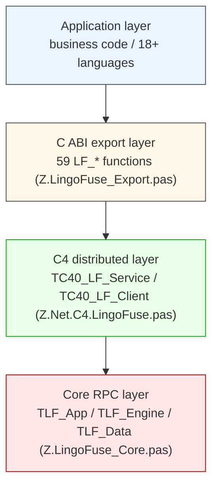

### 0.5 The 20 hard rules

1. **A callback must be `cdecl`** (or the corresponding `of object` / `is nested` variant).
2. **A managed-language callback must be kept strongly referenced** (otherwise a GC collection crashes
   the process).
3. **The pointers returned by `LF_GetOption` / `LF_Get_AppName` / `LF_Generate_AppName` /
   `LF_Get_P2P_Name` expire after 5 seconds; `LF_Get_P2P_UID` returns a `PP2P_UID___` pointer, which
   also expires after 5 seconds**.
4. **An input handle is not released; a returned handle must be released**.
5. **`LF_FreeData` on an auto handle only marks it; the real release happens 10 minutes later**.
6. **A permanent handle created by `LF_CreateData_Permanent` is never reclaimed automatically**; it must
   be freed with `LF_FreeData` manually.
7. **`LF_BindApp` must be called after `LF_PrepareDone`**, otherwise it returns 0.
8. **`LF_FreeApp` does not really free the App**; it only removes bindings and timers. The real release
   happens in `LF_Shutdown`.
9. **The server must register the `LingoFuse` logical service first** before a client can discover it.
10. **Async callbacks and network event callbacks run on TCompute worker threads**; no UI work, no
    blocking, no synchronous calls.
11. **`LF_Sequenced_*` guarantees FIFO within the same `(app, api)` pair**; across `(app, api)` there is
    no ordering guarantee.
12. **Every callback automatically receives the sender UID / P2PName** (see Chapter 10), **valid only
    on the callback's Input parameter**.
13. **The UID is the universal routing identifier**: knowing a client's UID is enough to call **any**
    API it registered (both app and p2p), without knowing the App name (see Chapter 9).
14. **After `LF_Shutdown` every other `LF_*` function is invalid**; the cleanup order must be
    `ExitMainThread → FreeApp → Shutdown`.
15. **A `LF_Call` timeout returns a size=0 handle, not nil**; test success with `LF_GetSize`.
16. **The handle returned by the synchronous family (`LF_Call`) belongs to the caller; the `Result_`
    handle of the async family (`LF_Async_Call`) belongs to the framework and becomes invalid as soon
    as the callback returns** (see §4.7).
17. **Local short circuit: when the target is inside the local process, the call does not touch the
    network** (see §19.1).
18. **Server-side local handling: once a request reaches the server, the server handles it locally if
    it can, without forwarding** (see §19.2).
19. **App-name routing is local-first; P2PName routing is not local-first** (see §8.2 / §8.4).
20. **UID / P2PName calls can hit every API registered on the target client; App-name calls can only hit
    that App's registry** (see §8.6).
21. **[new in v7.0] `LF_LocalCall` / `LF_LocalNotify` do not inject the sender identity.** If a local
    call must also carry identity, use `LF_Call` and rely on the local short circuit (see §5.6, §10.3).
22. **[new in v7.0] If the server cannot find the group name for a P2PName async Call, the callback never
    fires** (the server's `cmd_P2PName_Call` only calls `DoStatus` and never replies). The caller must
    implement its own timeout (see §8.4).

### 0.6 Key defaults

| Item | Value | Evidence |
|------|---:|:----:|
| number of C ABI export symbols | 59 | 🟢 |
| default TCP port | 9898 | 🟢 |
| DataHandle idle reclamation threshold | 10 minutes | 🟢 |
| reclamation scan interval | 5 seconds | 🟢 |
| `prepareDone` initialization timeout | `max(Wait_Connection_Timeout, 5000) + 1000` ms | 🟢 |
| `Wait_Connection_Timeout` default | 30000 ms | 🟢 |
| `Overlap_Connection` default | false | 🟢 |
| `Wait_Connection_ReadyOk` default | true | 🟢 |
| `Fixed_Sequenced_Time` default | 20000 ms | 🟢 |
| validity of a `LF_Generate_AppName` pointer | ~5 seconds | 🟢 |
| validity of a `LF_Get_P2P_UID` pointer | ~5 seconds | 🟢 |
| validity of a `LF_GetOption` pointer | ~5 seconds | 🟢 |
| sequencing thread idle exit | 5 minutes | 🟢 |
| **deferred release after a sequencing thread exits** | **1 second (corrected in v7.0)** | 🟢 |
| grace period after an async op timeout | 60 seconds | 🟡 |
| status queue capacity | 1000 | 🟢 |
| broadcast cache delay | ~3 seconds | 🟢 |
| simulated main thread C40Progress throttling | 1ms active / 10ms idle | 🟢 |
| P2PName client-name change detection period | 1 second | 🟢 |

---

## Chapter 1 The three-layer architecture and design philosophy

### 1.1 The responsibilities of the three layers

| Layer | Unit | Responsibility | Degree of exposure |
|----|------|------|:----------------:|
| **C ABI export layer** | `Z.LingoFuse_Export.pas` | the 59 `LF_*` functions, UTF-8 conversion, 5-second deferred release, prepare-command collection | **fully exposed**(the cross-language entry point) |
| **C4 distributed layer** | `Z.Net.C4.LingoFuse.pas` | service/client management, 17 internal C4 commands, the three addressing schemes, load balancing, route optimization | **partially exposed** (indirectly, through `LF_*`) |
| **Core RPC layer** | `Z.LingoFuse_Core.pas` | App / Engine / Data / the second-level memory pool / the sequencing thread pool | **not exposed directly** (called by the C4 layer) |

### 1.2 The dependency topology

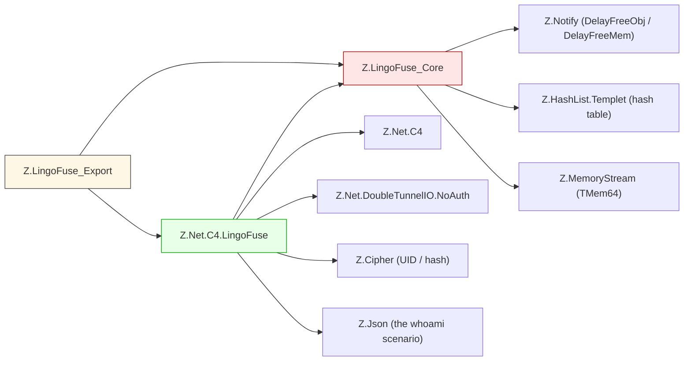

### 1.3 The key design trade-offs

| Trade-off | Benefit | Cost |
|------|------|------|
| **C ABI rather than COM/C++** | usable from 18+ languages | no type safety, no ABI version management |
| **handles rather than objects** | no cross-language type dependency | users must manage lifetimes explicitly |
| **automatic reclamation plus manual release** | convenience and safety | users easily mistake automatic reclamation for a guarantee |
| **`TLF_Data` as a record rather than a class** | the second-level memory pool is reusable, less heap fragmentation | needs `New` / `Dispose`, cannot be inherited |
| **local-first routing** | fewer network round trips | an App with the same name runs locally first |
| **server-side local handling** | fewer pointless forwards | the server process itself must be capable |
| **simulated main thread** | C4 depends on a main thread, the C ABI layer hosts it | only one start per process |
| **automatic identity injection** | the business layer gets the sender identity with zero intrusion | 40+ extra bytes per request payload |
| **the sequencing thread pool** | FIFO + concurrency | idle threads exit and are recreated |
| **three addressing schemes** | fits different routing scenarios | a steep learning curve, easy to mix up |
| **opposite handle ownership for sync / async** | sync is simple, async can stream | users easily mix up the two families' release rules (see §4.7) |
| **UID / P2PName universal routing** | targeted calls with no barrier | the asymmetry of App-name addressing must be understood |

---

## Chapter 2 Core concepts and terminology

### 2.1 The core objects

| Object | Type | Semantics |
|------|------|------|
| **`TDataHnd`** | an opaque pointer | a binary data handle carrying the API name + the sender identity + the business payload |
| **`TAppHnd`** | an opaque pointer | a logical application container that can register several APIs |
| **`TP2P_UID___`** | `array[0..31] of Byte` | the 32-byte session UID, generated at `TunnelLink` |
| **`PP2P_UID___`** | `^TP2P_UID___` | a pointer to the 32-byte UID (the `LF_Get_P2P_UID` return type) |
| **`TAppName`** | a UTF-8 string | the application name, the key of network routing |

### 2.2 API patterns

| Pattern | Semantics | Waits for a response | Registration function |
|------|------|:-----------:|---------|
| **Call** | request-response | ✅ | `LF_RegisterCall*` |
| **Notify** | one-way notification | ❌ | `LF_RegisterNotify*` |

### 2.3 The three addressing schemes compared

| Addressing | Index key | Routing | Local hit | Server selection strategy | Typical use |
|------|--------|---------|:--------:|---------------|---------|
| **App name** | a UTF-8 string | exact App-name match | ✅ | least recently used | a fixed service |
| **UID** | 32 binary bytes | locate by session UID | ✅ | direct hit | **targeting a specific client** |
| **P2PName** | a UTF-8 string | group-name load balancing / sticky | ❌ | `Cycle_Anchor` / `FixedSequenced` | a cluster of homogeneous services |

**The exact mapping of the five P2PName functions to the two strategies** (🟢, new in v7.0):

| Function | Server command | Selection strategy |
|------|-----------|---------|
| `LF_P2PNAME_Call` | `cmd_P2PName_Call` | `Find_P2PName_LoadBalance` (Cycle_Anchor) |
| `LF_P2PNAME_Notify` | `cmd_P2PName_Notify` | `Find_P2PName_LoadBalance` |
| `LF_P2PNAME_Sequenced_Notify` | `cmd_P2PName_Sequenced_Notify` | `Find_P2PName_FixedSequenced` |
| `LF_P2PNAME_Async_Call` | `cmd_P2PName_Call` | `Find_P2PName_LoadBalance` |
| `LF_P2PNAME_Async_Sequenced_Call` | `cmd_P2PName_Sequenced_Call` | `Find_P2PName_FixedSequenced` |

### 2.4 How the three routes differ in what they hit

| Call style | Search scope on the target | Hits App registrations | Hits P2P registrations |
|----------|----------------|:-------------:|:-------------:|
| **a UID call** | every API registered on the target client | ✅ | ✅ |
| **a P2PName call** | every API registered on the selected client | ✅ | ✅ |
| **an App-name call** | the target App's registry | ✅ | ❌ |

**Points to remember**:
- **UID / P2PName are "client-level" routing keys** — first locate "some client", then look in its local
  API table.
- **The App name is an "application-level" routing key** — it looks only in that App's registry; P2P-registered
  functions hang under the global `___LF_P2P_APP___`, not in a business App's table.

### 2.5 Lifecycle phases

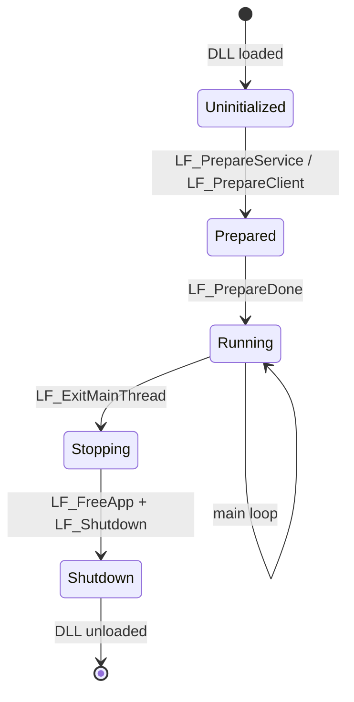

---

## Chapter 3 Lifecycle and initialization

### 3.1 The typical initialization order

```pascal
// 1. Set options (optional).
LF.Set_Opt_Quiet(True);
LF.Set_Opt_Overlap_Connection(True);   // required when several Apps share an address
LF.Set_Opt_P2P_Name('my_group');       // required for P2PName routing

// 2. Prepare (can be repeated).
LF.ResetPrepare;
LF.PrepareService('0.0.0.0', '192.168.1.100:9898');   // the server
LF.PrepareClient('192.168.1.100:9898', App);          // the client

// 3. Start (only once).
if LF.PrepareDone <> 1 then Halt(1);

// 4. The main loop.
while Running do
begin
  LF.Sync;                                  // needed by a custom main loop
  Z.Core.Check_Soft_Thread_Synchronize(10); // drives C4 progress
  Sleep(10);
end;

// 5. Exit.
LF.ExitMainThread;
LF.FreeApp(App);
LF.Shutdown;
```

### 3.2 The initialization stages in detail

#### 3.2.1 `LF_ResetPrepare`

**Effect**: clears `Prepare_Commands` (the list of pending service/client scripts) and
`AppHnd_Bind_Tag_List`.

**When to call it**:
- **before the first initialization**: harmless, recommended.
- **before a reinitialization**: **mandatory**, otherwise a duplicate address reports
  `prepare error: repeat listen/connection`.

**Mechanics**: internally `Clear`s both `Prepare_Commands` and `AppHnd_Bind_Tag_List` and resets the
`Tag_Seed`-related state.

#### 3.2.2 `LF_PrepareService`

**Signature**: `function LF_PrepareService(ListeningAddr, PhysicsAddr: PAnsiChar): Integer`

**Parameters**:
- `ListeningAddr`: the local listening address, such as `0.0.0.0:9898` / `ipc:my_app`.
- `PhysicsAddr`: the externally advertised address, such as `192.168.1.100:9898` / `ipc:my_app`.

**Returns**: `Tag_Seed` (an incrementing integer ≥ 1); a duplicate address returns -1.

**Mechanics**:
1. stores the address in `Prepare_Commands` (the service is not started immediately).
2. generates the internal C4 script command `Service("Listen", "Host", Port, "LingoFuse@Tag=N")`.
3. if `Init_Succeeded and Simulated_Main_Thread_Running` (that is, `PrepareDone` was already called and
   the main thread is live), it posts the execution to `MainThreadProgress` immediately.

**Port default**: 9898 when no port is given. **IPC mode**: when the address starts with `ipc:`, the
port parameter is ignored.

#### 3.2.3 `LF_PrepareClient`

**Signature**: `function LF_PrepareClient(PhysicsAddr: PAnsiChar; appHnd: TAppHnd): Integer`

**Parameters**:
- `PhysicsAddr`: the server address.
- `appHnd`: the App to bind, may be `nil` (tunnel only).

**Returns**: `Tag_Seed`; a duplicate address (when `Overlap_Connection=False`) returns -1.

**Mechanics**:
1. generates the internal C4 script command `KeepAlive("Host", Port, "LingoFuse@Tag=N")`.
2. when `Overlap_Connection=True` it uses the `NewKeepAlive` command.
3. records into `AppHnd_Bind_Tag_List` and binds the App automatically through the `ClientConnected` event
   once the C4 client connects successfully.

#### 3.2.4 `LF_PrepareDone`

**Signature**: `function LF_PrepareDone: Integer`

**Returns**: 1 = success; 0 = failure or already started.

**Mechanics**:
1. if `Simulated_Main_Thread_Running` is already True, **returns 0 immediately** (to prevent double start).
2. calls `Open_Core_Dispatch_Thread` to start the C4 dispatcher.
3. calls `Begin_Simulator_Main_Thread(Simulated_Main_Thread)` to start the simulated main thread.
4. **blocks and waits**: up to `max(Wait_Connection_Timeout, 5000) + 1000` milliseconds.
5. returns `if_(Init_Succeeded, 1, 0)`.

**The key trap**: **it may still return 1 after a timeout** (see `LF-NET-007`).

#### 3.2.5 `LF_ExitMainThread`

**Signature**: `procedure LF_ExitMainThread`

**Mechanics**:
1. sets `Simulated_Main_Thread_Running := False`.
2. **waits for the main thread to exit completely** (`Simulator_Main_Thread_Activted` becomes False).

**Cleanup before the main thread exits** (at the end of `Simulated_Main_Thread`):
1. `C40Clean` (clears the C4 state)
2. `LF_Notify_Sequence_Thread_Pool.Stop`
3. `LF_DataPool.Free_All_Hnd` (**releases every data handle, including permanent ones**)
4. `LF_DataMemory.Free_All_PLF_Data_Memory`

**The key trap**: afterwards **no data handle may be used** (see `LF-MECH-003`).

### 3.3 The complete set of status flags

| Flag | Meaning | Checking API |
|------|------|---------|
| `Init_In_Progress` | the main thread is initializing | none |
| `Init_Succeeded` | initialization succeeded | indirectly reflected by `LF_CheckMainThread` |
| `Simulated_Main_Thread_Running` | the main-thread simulator is running | `LF_CheckMainThread()` = 1 |
| `Simulator_Main_Thread_Activted` | the underlying thread is live | `LF_CheckMainThread()` = 1 |

---

# Part 2 — Detailed API reference

## Chapter 4 The data handle (TDataHnd) in full

### 4.1 The essence of a data handle

`TDataHnd___ = Pointer`, pointing at the internal `TLF_Data` record (`Z.LingoFuse_Core.pas`).

**The `TLF_Data` record structure** (source):

```pascal
TLF_Data = record
private
  auto_recycle___: boolean;      // LF_CreateData=True; LF_CreateData_Permanent=False
  deleted___: boolean;
  updated___: boolean;
  calling___: TAtomInt;           // number of in-flight remote calls
  time___: TTimeTick;
  class procedure Free_Data___(hnd: PLF_Data); static;
public
  Data_Param: TMemory_Param_Tool; // input mode: non-nil
  Data_Result: TMem64;            // output mode: non-nil
  Data_Info: TLF_String;
end;
```

**The key design points**:
- **`Data_Param` and `Data_Result` are mutually exclusive**: only one of them is non-nil on any handle.
  - **an input handle** (`New_Param` / `New_Param_From`): `Data_Param <> nil`, carrying
    `FromUID` / `FromP2PName` / `apiName` / `Param`.
  - **an output handle** (`New_Result` / `New_Result_From`): `Data_Result <> nil`, holding only
    the result bytes.
- **the `calling___` counter**: greater than 0 while a remote call is in flight, protecting the
  handle from timeout reclamation.
- **the `updated___` flag**: set True by any read or write, telling the scanner the handle is still
  active.

### 4.2 The data handle lifecycle

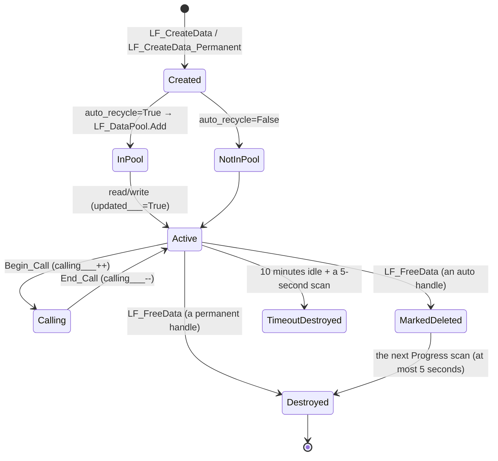

### 4.3 Creation and release APIs

#### 4.3.1 `LF_CreateData(MethodName: PAnsiChar): TDataHnd`

**Internal mechanics**:
1. internally `TLF_Data.New_Param(apiName, auto_recycle=True)`:
   - takes a `TLF_Data` record from `LF_DataMemory.Get_New_PLF_Data` (or `New`s one).
   - sets `auto_recycle___ := True`.
   - creates `Data_Param := TMemory_Param_Tool.Create` and stores `apiName` in it.
   - adds it to `LF_DataPool`.
2. returns the `PLF_Data` pointer as a `TDataHnd___`.

**Side effects**:
- **it joins the automatic reclamation pool**: after 10 idle minutes it is released by
  `TLF_DataPool.Progress`.
- **after `LF_FreeData` it is only marked**: `deleted___ := True`, not released immediately.

**Helper**: `LF_CreateDataEx(MethodName: string)` converts to UTF-8 automatically.

#### 4.3.2 `LF_CreateData_Permanent(MethodName: PAnsiChar): TDataHnd`

**Internal mechanics**:
1. internally `TLF_Data.New_Param(apiName, auto_recycle=False)`:
   - takes a record from `LF_DataMemory`.
   - **does not add it to `LF_DataPool`**.
   - sets `auto_recycle___ := False`.
2. **`LF_FreeData` releases it immediately and synchronously** (no marking).

**When to use it**: request templates that live for the whole process lifetime.

**The key traps**:
- **"permanent" does not mean "never released"**: you must still call `LF_FreeData` explicitly.
- **creating one in an initialization gap leaks it**: before `LF_PrepareDone` / after
  `LF_ExitMainThread`, `LF_FreeData` is a **no-op** (because `Simulator_Main_Thread_Activted` is False).

#### 4.3.3 `LF_FreeData(Hnd: TDataHnd)`

**Internal mechanics**:
```pascal
procedure TLF_Data.Free_Data(hnd: PLF_Data);
begin
  if hnd = nil then exit;
  if hnd^.auto_recycle___ then
      hnd^.deleted___ := True       // only mark, wait for the scan
  else TLF_Data.Free_Data___(hnd);  // a permanent handle: released immediately
end;
```

**Note**:
- **an automatically reclaimed handle**: only marks `deleted___ := True`; the actual release is delayed
  by at most 5 seconds.
- **a permanent handle**: `Free_Data___` runs immediately (releasing `Data_Param` / `Data_Result` /
  `calling___` and pushing the record back to `LF_DataMemory`).

### 4.4 Read and write APIs

#### 4.4.1 `LF_GetBuffer(Hnd): Pointer`

**Internal mechanics**:
```pascal
function TLF_Data.GetBuffer: Pointer;
begin
  Result := nil;
  if Data_Param <> nil then
      Result := Data_Param.Param.Memory
  else if Data_Result <> nil then
      Result := Data_Result.Memory;
  updated___ := True;    // refresh the timestamp
end;
```

**Key points**:
- **it returns the internal buffer pointer**. It may become invalid after `LF_WriteBuffer` / `LF_SetSize`
  (reallocation).
- **side effect**: `updated___ := True`, resetting the 10-minute idle countdown.

#### 4.4.2 `LF_WriteBuffer(Hnd, Buff, Size): Int64`

**Internal mechanics**:
```pascal
function TLF_Data.WriteBuff(Buff: Pointer; Size: Int64): Int64;
begin
  Result := 0;
  if Data_Param <> nil then
      Result := Data_Param.Param.WritePtr(Buff, Size)
  else if Data_Result <> nil then
      Result := Data_Result.WritePtr(Buff, Size);
  updated___ := True;
end;
```

**Key points**:
- it writes from the **current position** and advances it.
- the internal `TMem64.WritePtr` grows the buffer automatically.
- **side effect**: refreshes the timestamp.

#### 4.4.3 Position and size operations

| API | Internal mechanics | Side effect |
|-----|---------|--------|
| `LF_GetPos` | returns `Data_Param.Param.Position` or `Data_Result.Position` | refreshes the timestamp |
| `LF_SetPos` | sets `Position`; a value beyond the size grows the buffer implicitly | refreshes the timestamp |
| `LF_GetSize` | returns `Data_Param.Param.Size` or `Data_Result.Size` | refreshes the timestamp |
| `LF_SetSize` | resizes; the new space is **uninitialized** | refreshes the timestamp |

### 4.5 Atomic read and write APIs

Every type is **little-endian** (`Move` writes memory directly and depends on host byte order).

| Write | Read (out) | Read (no out) |
|------|-----------|--------------|
| `LF_WriteInt8` ~ `LF_WriteDouble` | `LF_ReadInt8` ~ `LF_ReadDouble` | the same as the left |
| `LF_WriteString` | `LF_ReadString` (out) | `LF_ReadString` |
| `LF_WriteStringBytes` | `LF_ReadStringBytes` (out) | `LF_ReadStringBytes` |

#### 4.5.1 The special behaviour of `LF_WriteString`

**Internal mechanics**:
```pascal
function LF_WriteString(Hnd: TDataHnd___; const Value: string): boolean;
var utf8: TBytes; len: integer;
begin
  if Value = '' then
  begin
    Result := LF_WriteUInt8(Hnd, 0);   // an empty string still writes one #0
    Exit;
  end;
  utf8 := TEncoding.UTF8.GetBytes(Value);
  len := Length(utf8);
  LF_WriteBuffer(Hnd, @utf8[0], len);
  Result := LF_WriteUInt8(Hnd, 0);     // always append #0
end;
```

**Key point**: **it always appends #0**. When JSON crosses languages, the receiver (Python, for
instance) must strip the trailing #0.

#### 4.5.2 The tolerant mode of `LF_ReadString`

**Internal mechanics**:
```pascal
function LF_ReadString(Hnd: TDataHnd___; out Value: string): boolean;
var p: PByteArray; b, e, sz: int64;
begin
  p := LF_GetBuffer(Hnd);
  sz := LF_GetSize(Hnd);
  b := LF_GetPos(Hnd);
  e := b;
  while (e < sz) and (p^[e] <> 0) do Inc(e);  // scan for #0
  // ...
  LF_SetPos(Hnd, e + 1);                      // skip #0
  Value := UTF8ToString(Buff);
end;
```

**Key points**: **it stops at the first #0**; **if there is no #0 up to the end of the buffer, it reads
to the end** (tolerant mode). If more data follows, it is read along with the string (see
`LF-DATA-004`).

#### 4.5.3 `LF_ReadStringBytes` / `LF_WriteStringBytes`

**These do not append #0**; NUL is used directly as the terminator. Suitable for raw bytes (such as a
JSON body).

### 4.6 The P2P information query APIs

> **⚠️ Precondition (must read)**: `LF_Get_P2P_UID` and `LF_Get_P2P_Name` **do not "read the handle's own business data"**; they **read, from the input handle's side, the P2P identity metadata the sender wrote automatically when it sent the request**.
>
> - **Data origin**: when the sender builds a request, the client's `TC40_LF_Client.Send_*` family calls `TMemory_Param_Tool.Rebuild_UID_and_P2PName` internally and writes `FromUID` (32 bytes) + `FromP2PName` (a UTF-8 string) **into the front of the request payload automatically**. The `Input` handle the receiver obtains carries those two values in `Data_Param.FromUID` / `Data_Param.FromP2PName`. **The business layer does not pass them by hand** (see Chapter 10).
> - **It may be used only on the `Input` parameter of the callback that triggered the event**: only an input handle **received from the network** (or from a local call that went through the `Send_*` path) carries these two fields.
> - **It may not be used on a handle you created yourself**: an input handle created by `LF_CreateData` / `LF_CreateData_Permanent` has `FromUID = Null_UID()` and an empty `FromP2PName` — there is no "sender".
> - **It may not be used on an output handle**: `Output` (the result handle in Call mode) has only `Data_Result`, no `Data_Param`; calling these two functions prints a warning and returns an empty value.
> - **Typical usable positions**:
>   - `Input` inside `On_Call(Trigger, Input, Output)`.
>   - `Input` inside `On_Notify(Trigger, Input)`.
>   - the callback `Input` when a `LF_Call` hits the local short circuit.
> - **Typical unusable positions**:
>   - `Input` inside a `LF_LocalCall` / `LF_LocalNotify` callback (**it does not pass through `Rebuild_UID_and_P2PName`**, see §5.6 and `LF-LOCAL-001`).
>   - `Result_` inside `OnResult(Data, Result_)` of a `LF_Async_Call` (it is an **output handle**).
>   - the request handle you created yourself with `LF_CreateData` (there is no "sender").

#### 4.6.1 `LF_Get_P2P_UID(Hnd): PP2P_UID___`

**Signature** (`lingofuse_import.pas`):
```pascal
function LF_Get_P2P_UID(Hnd: TDataHnd___): PP2P_UID___; cdecl; external liblingofuse name 'LF_Get_P2P_UID';
```

**Internal mechanics** (`Z.LingoFuse_Export.pas`):
```pascal
function LF_Get_P2P_UID(Hnd: TDataHnd___): PP2P_UID___;
begin
  New(Result);                                  // ← allocate the pointer
  if (Hnd <> nil) and (PLF_Data(Hnd)^.Data_Param <> nil) then
      Result^ := PLF_Data(Hnd)^.Get_P2P_UID()   // ← copy from Data_Param.FromUID
  else Result^ := Null_UID();
  DelayFreeMem(5.0, Result);                    // ← released automatically after 5 seconds
end;
```

**The return-type change (corrected in v5.0, confirmed in v7.0)**:
- **the old version (v4.0 and earlier)**: returned `TP2P_UID___` (a 32-byte static array **value**), so
  the caller got a **copy of the value**.
- **the new version (from v5.0)**: returns `PP2P_UID___` (**a pointer to the `TUID___`**), released
  automatically after about 5 seconds by the framework's `DelayFreeMem(5.0, ...)`.
- **Impact on cross-language bindings**:
  - before: `uid = LF_Get_P2P_UID(input)` got the value directly.
  - now: `uid_ptr = LF_Get_P2P_UID(input); uid = *uid_ptr` (**dereference + copy immediately**).
  - **do not free that pointer by hand** (the caller does not own it).
  - **do not keep that pointer for long** (it becomes invalid after 5 seconds).

**The contract**:
- **it returns a `PP2P_UID___` pointer** to a 32-byte `TUID___`.
- **it is valid only for input handles** (`Data_Param <> nil`). Calling it on an output handle or a
  self-created handle warns and returns `Null_UID()`.
- **when `Hnd = nil` it still does `New(Result)` + `DelayFreeMem`** (🟢 confirmed from the source in
  v7.0). It returns a non-NULL pointer to an all-zero UID.
- **concurrency safety**: every call allocates independently and frees with an independent delay, so
  they do not affect each other (🟢 confirmed in v7.0 from the `Z.Notify.DelayFreeMem` mechanism).
- **the standard usage (Pascal side)**:
  ```pascal
  var
    UID: TP2P_UID___;
    UIDPtr: PP2P_UID___;
  begin
    UIDPtr := LF_Get_P2P_UID(Input);    // returns a pointer
    if UIDPtr <> nil then
        UID := UIDPtr^;                 // dereference and copy immediately; the framework frees the pointer after about 5 seconds
    // ... use UID ...
  end;
  ```

#### 4.6.2 `LF_Get_P2P_Name(Hnd): PAnsiChar` / `LF_Get_P2P_NameEx(Hnd): string`

**The contract**:
- **it is valid only for input handles**. Calling it on an output handle or a self-created handle
  returns `''`.
- **the returned pointer is released automatically after 5 seconds** (`Z.Notify.DelayFreeMem(5.0, Result)`).
  **It must be copied immediately**.
- `LF_Get_P2P_NameEx` is recommended because it copies automatically.
- the data origin: the `FromP2PName` field written by `Rebuild_UID_and_P2PName` at send time.

### 4.7 The handle ownership model

> **This is the third core section of this guide**. Every cross-language integrator must understand: **the handle ownership of the synchronous and asynchronous families is exactly opposite**. Their function signatures, return types and appearance are identical, but the contracts are inverse.

#### 4.7.1 The handle ownership of the two call families compared

The LingoFuse C ABI has **two call families**:

| Family | Functions | Owner of the returned handle | How it is released |
|------|------|:-------------------:|---------|
| **the synchronous family** | `LF_Call` / `LF_UID_Call` / `LF_P2PNAME_Call` | **the caller** | the caller calls `LF_FreeData` explicitly |
| **the asynchronous family** | `LF_Async_Call` / `LF_UID_Async_Call` / `LF_P2PNAME_Async_Call` | **the framework** | the framework releases it **immediately** after the callback returns |

**Source evidence**:

**The synchronous family** (`Z.LingoFuse_Export.pas`):

```pascal
function LF_Call(appName: pansichar; Param: TDataHnd___; Timeout_: uint64): TDataHnd___;
begin
  ...
  Output := Cli.Wait_Execute_Call(...);
  ...
  // ← auto_recycle = True, the caller owns it
  Result := TLF_Data.New_Result_From(Output, True);
  ...
end;
```

**The asynchronous family** (`TLF_Async_Call_Bridge.Do_Th` in `Z.Net.C4.LingoFuse.pas`):

```pascal
procedure TLF_Async_Call_Bridge.Do_Th;
var
  result_param_: PLF_Data;
begin
  // ← auto_recycle = False, the framework owns it
  result_param_ := TLF_Data.New_Result_From(Result_M64.Swap_To_New_Instance, False);
  try
    if Assigned(OnResult) then
      OnResult(Data_, result_param_);  // ← the callback receives the pointer
  except
  end;
  // ← released immediately! not "after ~1 second", not "delayed", but immediately.
  TLF_Data.Free_Data(result_param_);
  DelayFreeObj(1.0, Self);             // ← what is freed after 1 second is the Bridge object, not the handle
end;
```

**The key differences**:

- `New_Result_From(..., True)` → `auto_recycle = True` → `LF_FreeData` only marks, **the real release is
  deferred to the pool scan**.
- `New_Result_From(..., False)` → `auto_recycle = False` → `LF_FreeData` **releases immediately and
  synchronously**.

#### 4.7.2 The "moment of death" of an async handle

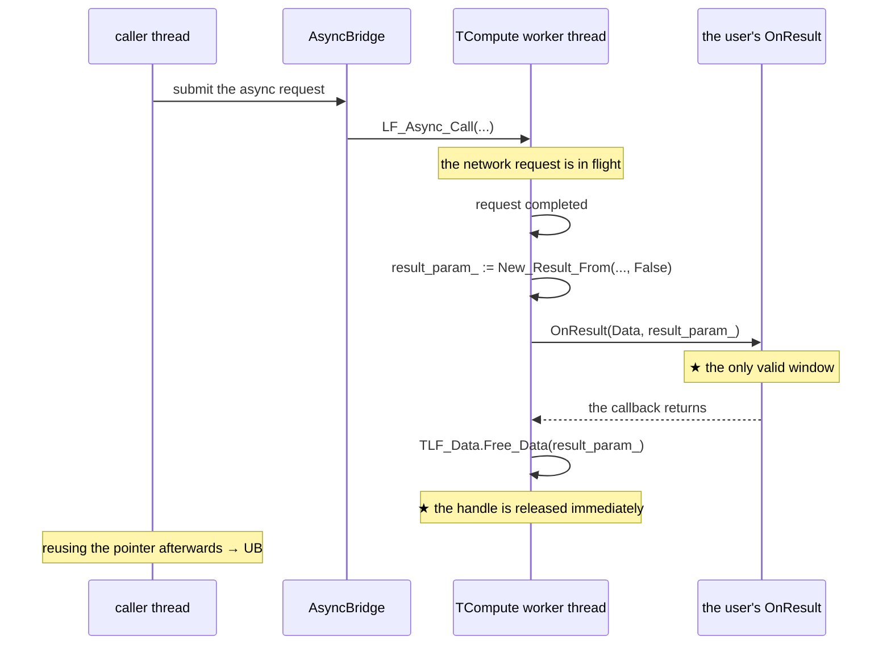

**The contract**:

- once the callback returns, the handle **becomes invalid immediately**.
- using that handle outside the callback is **undefined behaviour** (use-after-free).
- calling `LF_FreeData` is a **double free**.

#### 4.7.3 Why violating the contract "sometimes works, sometimes fails"

**The root cause**: `Free_Data` is a **pooled reclaim**:

```pascal
class procedure TLF_Data.Free_Data___(hnd: PLF_Data);
begin
  hnd^.Data_Info := '';
  DisposeObjectAndNil(hnd^.Data_Param);
  DisposeObjectAndNil(hnd^.Data_Result);   // ← the TMem64 is released
  DisposeObjectAndNil(hnd^.calling___);
  LF_DataMemory.Free_PLF_Data(hnd);        // ← the PLF_Data returns to the pool
end;
```

**How UB manifests depends on**:

- whether the allocator has already reused that memory.
- whether another thread allocated a new `TMem64` at the same moment.
- whether thread scheduling let the caller thread run only after `Free_Data`.

**Therefore**:

| Payload characteristic | Behaviour | Reason |
|-------------|------|------|
| **a small payload** (say returning `int 7`, 2 bytes) | usually "looks fine" | the allocator has not reused that small block yet |
| **a large payload** (say returning a dict, 17+ bytes) | usually "returns empty/garbage" | a much higher chance of having been reused |

**⚠️ This is the easiest scenario to misdiagnose**: a **type dichotomy** such as "`int` vs `dict`" leads
diagnosis astray. It is not a "type difference", it is "payload size affecting when memory is reused".
**Ask the right question when bisecting**.

#### 4.7.4 The correct usage patterns

**Pattern A: a synchronous call (recommended for gateway / proxy scenarios)**

```pascal
res_ptr := LF_Call(app, hnd, timeout_ms);
try
  LF_SetPos(res_ptr, 0);            // reset the position
  result_bytes := read_string_bytes(res_ptr);
finally
  LF_FreeData(res_ptr);             // ← legitimate, the caller owns it
end;
```

**Pattern B: an async call (everything must happen inside the callback)**

```pascal
procedure OnResult(Data, res_ptr: Pointer); cdecl;
begin
  // ✓ the handle is valid inside this callback

  LF_SetPos(res_ptr, 0);
  data := read_string_bytes(res_ptr);

  // ✓ copy the data out (bytes is a fresh object)
  my_queue.push(data);

  // ❌ never hand res_ptr out
  // ❌ never LF_FreeData(res_ptr)
end;
```

**Pattern C: use the high-level Future interface**

Every managed-language binding layer should provide a Future interface that "reads and copies the data
inside the callback", keeping raw pointers away from users.

#### 4.7.5 The handle ownership quick reference

| Origin | Owner | Releaser | Safe across threads |
|------|:------:|:------:|:----------:|
| `LF_CreateData` | the user | the user | ⚠️ needs external locking |
| `LF_CreateData_Permanent` | the user | the user | ⚠️ needs external locking |
| the `LF_Call` return value | the user | the user | ✅ yes |
| the `LF_UID_Call` return value | the user | the user | ✅ yes |
| the `LF_P2PNAME_Call` return value | the user | the user | ✅ yes |
| the `LF_LocalCall` return value | the user | the user | ✅ yes |
| inside a `LF_Async_Call` callback | **the framework** | **the framework** | ❌ no cross-thread use |
| inside a `LF_UID_Async_Call` callback | **the framework** | **the framework** | ❌ no cross-thread use |
| inside a `LF_P2PNAME_Async_Call` callback | **the framework** | **the framework** | ❌ no cross-thread use |

#### 4.7.6 What it means for cross-language bindings

- **every managed-language binding layer**: must **read and copy the data inside the callback** and only
  then hand it to the user; never let users touch a raw pointer.
- **Julia / Erlang / R**: the `output` pointer inside a `@cfunction` / NIF / C-extension callback is
  subject to the same async ownership rule — **do all the work inside the callback** and never pass a
  raw pointer through a Channel / Queue.
- **Python / C# / Java**: in ctypes / P/Invoke / FFM async callbacks, if the returned handle comes from
  the async family, **do all the work inside the callback**.
- **GC languages**: they are unaware of the C side's pointer lifetimes. **There are only two safe
  strategies**:
  1. **handle it entirely inside the callback** (read Input / write Output).
  2. **copy the data out inside the callback** (bytes/array) and then process it across threads.

---

## Chapter 5 The application handle (TAppHnd) in full

### 5.1 The essence of an application handle

`TAppHnd___ = Pointer`, pointing at the internal `TLF_App` (`Z.LingoFuse_Core.pas`).

**The `TLF_App` class structure** (source):

```pascal
TLF_App = class
private
  FUpdateEventPool: TLF_UpdateEventPool;
  FUpdated: boolean;
  procedure Do_LFRegEvent;
  procedure DoTimer();
public
  Name: TLF_String;
  Desc: TLF_String;
  Engine: TLF_Engine;
  constructor Create(Owner_Pool_: boolean);
  destructor Destroy; override;
  procedure FakeFree;
  procedure DoChange();
  procedure Subscribe_Update(Bind: TCore_Object; OnUpdate: TOn_LFUpdate);
  procedure Remove_Update(Bind: TCore_Object);
end;
```

**The key mechanisms**:
- **each App owns a `TLF_Engine`**, and the engine holds a `TLF_MethodPool` (the API table).
- **`FUpdateEventPool`**: the subscriber pool (such as `TC40_LF_Client`), notified when the API set
  changes.
- **`DoChange`**: called when the API set changes; sets `FUpdated := True` and calls `Reset_Timer`, so
  the broadcast happens once, 1 second later.

### 5.2 The creation and release APIs

#### 5.2.1 `LF_CreateApp(appName, Desc): TAppHnd`

**Internal mechanics**:
1. `TLF_App.Create(Owner_Pool_=True)`:
   - creates the `TLF_Engine`.
   - creates `FUpdateEventPool`.
   - `Subscribe_Timer_M(self, 1000, DoTimer)`: registers a 1-second timer for API-change broadcasts.
   - **adds itself to `LF_App_Pool`** (`Owner_Pool_=True`).
2. sets `Name` / `Desc` (an empty Desc is replaced with `'No Description'`).

**Key points**:
- the App created **joins `LF_App_Pool` automatically**.
- **an empty `Desc` is filled with `'No Description'` automatically**.

#### 5.2.2 `LF_FreeApp(appHnd)`

**Internal mechanics** (source `Z.LingoFuse_Export.pas`):
```pascal
procedure LF_FreeApp(appHnd: TAppHnd___);
begin
  if not Core_Dispatch_Order_Activted then exit;   // ① Shutdown guard
  if appHnd = nil then exit;
  app := appHnd;
  // ② unbind every TC40_LF_Client
  arry := C40_ClientPool.FastSearchClass(TC40_LF_Client);
  for i := 0 to length(arry) - 1 do
  begin
    Cli := arry[i] as TC40_LF_Client;
    if Cli.app = app then Cli.app := nil;
  end;
  // ③ stop the sequencing threads
  LF_Notify_Sequence_Thread_Pool.Kill_App(app);
  LF_Call_Sequence_Thread_Pool.Kill_App(app);
  // ④ FakeFree (removes the timer only)
  app.FakeFree;
end;
```

**Key points**:
- **it does not really free the App**: it only unbinds, stops the sequencing threads and removes the timer.
- **the object stays in `LF_App_Pool`**: the real release happens in `LF_Shutdown`.
- **the shutdown guard**: it is a no-op when `Core_Dispatch_Order_Activted = False`.

#### 5.2.3 `LF_Generate_AppName(): PAnsiChar`

**Internal mechanics**:
```pascal
function LF_Generate_AppName: pansichar;
begin
  // ① concatenate the address and RemoteID of every physical tunnel
  for i := 0 to C40_PhysicsTunnelPool.Count - 1 do
    tmp.Append(Build_Host_URL(...) + '&' + IntToStr(...RemoteID));
  // ② append the process name + PID
  tmp.Append('&' + Make_LingoFuse_Process_Name.Text);
  // ③ append the incrementing counter
  tmp.Append('&' + IntToStr(AtomInc(Generate_AppName_Call_Num)));
  // ④ prefix
  tmp := C_Generate_Prefix + tmp;    // '@__generate__@...'
  // ⑤ return a UTF-8 pointer, released after 5 seconds
  Result := tmp.BuildUTF8AnsiChar();
  Z.Notify.DelayFreeMem(5.0, Result);
end;
```

**The exact output with no clients** (🟢 confirmed from the source in v7.0):

```
@__generate__@&<process name:PID>&<counter>
```

**With clients**:

```
@__generate__@<addr1>&<remoteID1>&<addr2>&<remoteID2>&...&<process name:PID>&<counter>
```

**Key points**:
- **it is not `@__generate__@<empty>&<process name>&<counter>`, but starts directly with `&`** (because
  the loop body never ran, `tmp` was still empty, and then `Append('&' + ...)` appended straight away).
- the counter starts at 1 and increments (`AtomInc` returns the incremented value).
- **it must be called after `LF_PrepareDone`**.
- **the returned pointer becomes invalid after 5 seconds**.

#### 5.2.4 `LF_Get_AppName(appHnd): PAnsiChar`

**The contract**:
- **it returns nil when `appHnd = nil`** (safe).
- **the returned pointer becomes invalid after 5 seconds**.

#### 5.2.5 `LF_BindApp(appHnd): Integer`

**Internal mechanics** (source `Z.LingoFuse_Export.pas`):
```pascal
function LF_BindApp(appHnd: TAppHnd___): Integer;
begin
  Result := 0;
  if appHnd = nil then exit;
  app := appHnd;
  // ① the main thread must be live
  if not Simulator_Main_Thread_Activted then
  begin
    DoStatus('LF_BindApp: Main thread is not active - cannot bind app.');
    exit;
  end;
  // ② walk every TC40_LF_Client and bind those with app = nil
  arry := C40_ClientPool.FastSearchClass(TC40_LF_Client);
  for i := 0 to length(arry) - 1 do
  begin
    Cli := arry[i] as TC40_LF_Client;
    if Cli.app = nil then
    begin
      Cli.app := app;
      inc(Result);
      // ... print the log line
    end;
  end;
end;
```

**The contract**:
- **the main thread must already be started** (`Simulator_Main_Thread_Activted = True`).
- **it binds only clients with `Cli.app = nil`**.
- **it never overwrites an already bound client**.
- **it returns the number of clients bound successfully**.
- **the binding order equals the client creation order** (🟢 confirmed from the source in v7.0;
  `C40_ClientPool` is a `TGenericsList` whose internal order follows client creation order).
- when `Result = 0` it prints `'LF_BindApp: All clients are already occupied'`.

### 5.3 The visibility of an application handle

**Key points**:
- **APIs registered on an App are reachable through the "App name"**.
- **APIs registered on an App are also reachable through "UID" and "P2PName"** (UID / P2PName are
  client-level routing keys).
- **APIs registered on an App are not reachable through the "P2P registration" path** — P2P registration
  is a separate namespace.

### 5.4 App registration vs P2P registration

| Dimension | App registration (`AppHandle.register_call`) | P2P registration (`P2PRegistry.register_call`) |
|------|-------------------------------------|---------------------------------------|
| **underlying API** | `LF_RegisterCall` / `LF_RegisterNotify` | `LF_Register_P2P_Call` / `LF_Register_P2P_Notify` |
| **namespace** | the business App's API table | the API table of the process-level `___LF_P2P_APP___` |
| **lifecycle** | unbound when `AppHandle.close()` runs | lives until `LF_Shutdown` |
| **hit by App-name calls** | ✅ | ❌ |
| **hit by UID calls** | ✅ | ✅ |
| **hit by P2PName calls** | ✅ | ✅ |
| **typical use** | business APIs | global utilities (whoami / ping / status) |

**The architectural implications**:

| What you want to do | Recommended approach |
|----------|---------|
| a business API that should be discoverable by App name | `register_call` |
| expose it only to UID / P2PName, not to App-name discovery | `register_p2p_call` |
| a global utility any client can call by UID / group name | `register_p2p_call` |

### 5.5 The local call APIs

#### 5.5.1 `LF_LocalCall(appHnd, Param): TDataHnd`

**Internal mechanics**:
```pascal
function LF_LocalCall(appHnd: TAppHnd___; Param: TDataHnd___): TDataHnd___;
begin
  Result := nil;
  if appHnd = nil then exit;
  if Param = nil then exit;
  app := appHnd;
  tmp := TMem64.Create;
  try
    // ① encode Param into a TMem64
    PLF_Data(Param).Data_Param.EncryptToMem(tmp);
    // ② Begin_Call (calling___++)
    PLF_Data(Param).Begin_Call;
    // ③ execute
    Result := TLF_Data.New_Result_From(app.Engine.Execute_Call(tmp), True);
  finally
    // ④ End_Call (calling___--)
    PLF_Data(Param).End_Call;
    DisposeObject(tmp);
  end;
end;
```

**The contract**:
- **the input handle is not released** (the caller owns it).
- **a new handle is returned** (the caller owns it).
- **the internal `Begin_Call` / `End_Call` protect the input handle** (it cannot be reclaimed on timeout
  while `calling___ > 0`).
- **execution is local and does not touch the network**.
- **`New_Result_From(..., True)`** → `auto_recycle = True` → **the returned handle belongs to the caller**.

#### 5.5.2 `LF_LocalNotify(appHnd, Param)`

**Internal mechanics**:
```pascal
procedure LF_LocalNotify(appHnd: TAppHnd___; Param: TDataHnd___);
begin
  // ... like LF_LocalCall, but with no Output
  PLF_Data(Param).Data_Param.EncryptToMem(tmp);
  PLF_Data(Param).Begin_Call;
  app.Engine.Execute_Notify(tmp);
  PLF_Data(Param).End_Call;
end;
```

**Key point**: there is no return value.

### 5.6 Identity injection on local calls (corrected in v7.0)

**The key point (🟢 confirmed from the source in v7.0)**: **`LF_LocalCall` / `LF_LocalNotify` do not pass
through `Rebuild_UID_and_P2PName`**, therefore:

- if `Param` was created by `LF_CreateData`, its `FromUID` is `Null_UID()` and `FromP2PName` is empty —
  **there is no "sender"**.
- if `Param` was received from the network, its `FromUID` / `FromP2PName` are preserved.
- **on the callback's `Input`, `LF_Get_P2P_UID` / `LF_Get_P2P_Name` return empty values for a
  self-created handle**.

**For contrast: a local call through the `TC40_LF_Client.Send_*` path does inject identity**:

The `TC40_LF_Client.Send_Execute_Notify` source:
```pascal
procedure TC40_LF_Client.Send_Execute_Notify(app_Name__: TLF_String; Param: TMem64);
begin
  tmp_param := TMemory_Param_Tool.Rebuild_UID_and_P2PName(Param, FLast_UID, LF_P2P_name.V);
  try
    api_Name__ := TMemory_Param_Tool.Get_apiName(tmp_param);
    tmp_cli__ := Find_Local_API(app_Name__, api_Name__, True);   // look up locally
    if tmp_cli__ <> nil then
      begin
        tmp_cli__.APP.Engine.Execute_Notify(tmp_param);           // execute locally, but identity is already injected
        exit;
      end;
    ...
  finally
    DisposeObject(tmp_param);
  end;
end;
```

**What it means**:
- **when a `LF_Call` hits the local short circuit, the callback `Input` carries identity**.
- **`LF_LocalCall` calls `Engine.Execute_*` directly and injects no identity**.
- **if a local call must also carry identity**: use `LF_Call` (it hits the local short circuit and still
  injects identity).

**The related pitfall**: `LF-LOCAL-001`.

---

## Chapter 6 The API registration mechanism

### 6.1 The registration patterns compared

| Pattern | cdecl style | object method | nested / anonymous | the sync variant |
|------|:----------:|:--------:|:---------:|:--------:|
| **Call** | `LF_RegisterCall` | `LF_RegisterCall_M` | `LF_RegisterCall_P` | `LF_RegisterSyncCall_M` / `_P` |
| **Notify** | `LF_RegisterNotify` | `LF_RegisterNotify_M` | `LF_RegisterNotify_P` | `LF_RegisterSyncNotify_M` / `_P` |

**The sync variants**: `RegisterSyncCall_M` and friends marshal the callback to the main thread (through
`TSoft_Synchronize_Tool`) and, with a custom main loop, require `LF_Sync` to drive them.

### 6.2 The callback signatures

```pascal
// the cdecl style
TLF_Call_Event   = procedure(Trigger: Pointer; Input, Output: TDataHnd___); cdecl;
TLF_Notify_Event = procedure(Trigger: Pointer; Input: TDataHnd___); cdecl;

// an object method
TLF_Call_M   = procedure(Input, Output: TDataHnd___) of object;
TLF_Notify_M = procedure(Input: TDataHnd___) of object;

// nested (FPC) / anonymous (Delphi)
{$IFDEF FPC}
TLF_Call_P   = procedure(Input, Output: TDataHnd___) is nested;
TLF_Notify_P = procedure(Input: TDataHnd___) is nested;
{$ELSE}
TLF_Call_P   = reference to procedure(Input, Output: TDataHnd___);
TLF_Notify_P = reference to procedure(Input: TDataHnd___);
{$ENDIF}
```

### 6.3 The internal mechanics of `LF_RegisterCall`

**The source `TLF_Engine.Reg_Call`**:
```pascal
function TLF_Engine.Reg_Call(MethodName, Desc: TLF_String; Trigger: Pointer; On_Call: TLF_Call_Event): boolean;
var api_: TLF_MethodInfo;
begin
  Result := False;
  if LF_MethodPool.Exists_Key(MethodName) then
      exit;                    // a duplicate name → returns False
  api_ := TLF_MethodInfo.Create;
  api_.Name := MethodName;
  api_.Desc := Desc;
  api_.Mode := TLF_Mode.LF_Call__;
  api_.Trigger := Trigger;
  api_.On_Call := On_Call;
  LF_MethodPool.Add(MethodName, api_, False);
  APP.DoChange();              // marks the App changed (broadcast 1 second later)
  Result := True;
end;
```

**Key points**:
- **it refuses to overwrite an existing API name** (returns False).
- **it triggers `APP.DoChange`** → `FUpdated := True` + `Reset_Timer` → broadcast 1 second later.
- **the callback reads its parameters with `LF_ReadBuffer(Input, ...)` and writes results with
  `LF_WriteBuffer(Output, ...)`**.
- **inside the callback you can use `LF_Get_P2P_UID(Input)` / `LF_Get_P2P_Name(Input)` to get the sender
  identity** (**valid only on Input**).

### 6.4 The pattern-matching rules

**Key point**: calling an API registered as Call with Notify (or the reverse) **prints a warning but still
executes**:

| Registered as | Invoked as | Behaviour |
|---------|---------|------|
| Call | Call | ✅ normal |
| Call | Notify | ⚠️ prints a warning, runs `On_Call`, the Output is discarded |
| Notify | Call | ⚠️ prints a warning, runs `On_Notify`, the Output is empty |
| Notify | Notify | ✅ normal |

**The warning texts**:
- a Call registered, invoked via Notify: `'Warning: API "%s" is registered as Notify but invoked as Call; no return value will be produced.'`
- a Notify registered, invoked via Call: `'Warning: API "%s" is registered as Call but invoked via Notify; any returned value will be discarded.'`

### 6.5 `LF_Register_P2P_Call` / `LF_Register_P2P_Notify`

**How they differ from App-level registration**:
- they register into the global `LF_P2P_APP` (application name `___LF_P2P_APP___`).
- **when a call arrives through P2PName or UID**, these APIs are hit first.
- **when a call arrives through an App name, they are not necessarily hit** (it depends on App-name
  routing).


**Typical use**: registering global utility functions (such as `whoami` or a `Status` forwarder).

### 6.6 How P2P registration and App registration differ in visibility

**This is the easiest place to trip**: **App-name calls cannot hit P2P-registered functions.**

| Call style | Search scope on the target | Hits App registrations | Hits P2P registrations |
|----------|----------------|:-------------:|:-------------:|
| **a UID call** | every API registered on the target client | ✅ | ✅ |
| **a P2PName call** | every API registered on the selected client | ✅ | ✅ |
| **an App-name call** | the target App's registry | ✅ | ❌ |

**Why it works that way**:

- **UID / P2PName are "client-level" routing keys**: they first locate "some client", and that client
  then looks for the target function in its own local API table. App-registered and P2P-registered
  functions both live in that same local table.
- **the App name is an "application-level" routing key**: it locates "some App" and looks only in that
  App's registry. P2P-registered functions hang under the global `___LF_P2P_APP___`, not in a business
  App's table, so an App-name call cannot hit them.

**The architectural implications**:

| What you want to do | Recommended route |
|----------|---------|
| target a specific client and call any function it registered | **UID** |
| a cluster of homogeneous workers, any node handling it | **P2PName** |
| a fixed service name, discovered by App name | **App name** |
| expose it only to UID/P2P calls, not to App-name discovery | **P2P registration** |

---

## Chapter 7 Local calls

### 7.1 `LF_LocalCall(appHnd, Param): TDataHnd`

**Internal mechanics**:
```pascal
function LF_LocalCall(appHnd: TAppHnd___; Param: TDataHnd___): TDataHnd___;
begin
  Result := nil;
  if appHnd = nil then exit;
  if Param = nil then exit;
  app := appHnd;
  tmp := TMem64.Create;
  try
    PLF_Data(Param).Data_Param.EncryptToMem(tmp);
    PLF_Data(Param).Begin_Call;
    Result := TLF_Data.New_Result_From(app.Engine.Execute_Call(tmp), True);
  finally
    if Result <> nil then
        PLF_Data(Result)^.Data_Info := PFormat('result for app:%s api:%s', [app.Name.Text, PLF_Data(Param)^.Data_Param.apiName.Text]);
    PLF_Data(Param).End_Call;
    DisposeObject(tmp);
  end;
end;
```

**The contract**:
- **the input handle is not released** (the caller owns it).
- **a new handle is returned** (the caller owns it).
- **the internal `Begin_Call` / `End_Call` protect the input handle** (it cannot be reclaimed on timeout
  while `calling___ > 0`).
- **execution is local and does not touch the network**.
- **`New_Result_From(..., True)`** → `auto_recycle = True` → **the returned handle belongs to the caller**.
- **it does not inject the sender identity** (confirmed from the source in v7.0).

### 7.2 `LF_LocalNotify(appHnd, Param)`

**Internal mechanics**:
```pascal
procedure LF_LocalNotify(appHnd: TAppHnd___; Param: TDataHnd___);
begin
  if appHnd = nil then exit;
  if Param = nil then exit;
  app := appHnd;
  tmp := TMem64.Create;
  try
    PLF_Data(Param).Data_Param.EncryptToMem(tmp);
    PLF_Data(Param).Begin_Call;
    app.Engine.Execute_Notify(tmp);
  finally
    PLF_Data(Param).End_Call;
    DisposeObject(tmp);
  end;
end;
```

**Key points**: no return value. **It likewise does not inject identity**.

### 7.3 Identity injection on local calls (clarified in v7.0)

**`LF_LocalCall` / `LF_LocalNotify` do not pass through `Rebuild_UID_and_P2PName`**, therefore:

| Origin of the callback `Input` | Carries identity |
|-------------------|:-----------:|
| `LF_LocalCall` with a `Param` created by `LF_CreateData` | ❌ no identity |
| `LF_LocalCall` with a `Param` received from the network | ✅ the original identity is preserved |
| a `LF_Call` hitting the local short circuit | ✅ the sender identity is injected |

**If a local call must also carry identity**: use `LF_Call` (it hits the local short circuit and still
injects identity).

**The related pitfall**: `LF-LOCAL-001`.

---

# Part 3 — Routing and addressing

## Chapter 8 The three addressing schemes in detail

### 8.1 Overview of the three schemes

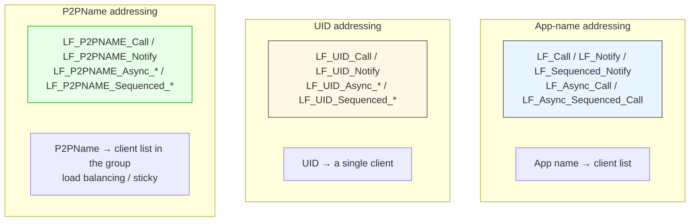

### 8.2 App-name addressing

**The API list**:
- `LF_Call(appName, Param, Timeout)`
- `LF_Async_Call(appName, Param, Data, OnResult)`
- `LF_Async_Sequenced_Call(appName, Param, Data, OnResult)`
- `LF_Notify(appName, Param)`
- `LF_Sequenced_Notify(appName, Param)`

**The routing algorithm** (client `Send_Execute_Notify`):

```pascal
// ① check locally first: does this process have an App with that name and that target API?
tmp_cli__ := Find_Local_API(app_Name__, api_Name__, True);
if tmp_cli__ <> nil then
  begin
    tmp_cli__.APP.Engine.Execute_Notify(tmp_param);   // execute locally
    exit;
  end;

// ② then check the remote cache: locally cached remote App information
tmp_cli__ := Find_Remote_API(app_Name__, api_Name__, True);
if tmp_cli__ <> nil then
    tmp_cli__.Send_Execute_Notify_Impl(app_Name__, tmp_param)  // forward through that client
else
    Send_Execute_Notify_Impl(app_Name__, tmp_param);           // send over its own connection
```

**Key points**:
- **local-first**: if this process has an App with that name and a matching API → execute locally,
  **without touching the network**.
- **cache acceleration**: `LF_Local_API_Cache` / `LF_Remote_API_Cache` cache `'AppName.ApiName'` →
  `TC40_LF_ClientList`.
- **cache invalidation (🟢 made precise in v7.0)**:
  - **on the server side**: `cmd_Init_APP_Info` / `cmd_No_App_Info` / `DoUserOut_Event`.
  - **on the client side**: `cmd_update_service_api_info` (a broadcast received) / `DoNetworkOffline`
    (a physical disconnect).

### 8.3 UID addressing

**The API list**:
- `LF_UID_Call(UID, Param, Timeout)`
- `LF_UID_Async_Call(UID, Param, Data, OnResult)`
- `LF_UID_Async_Sequenced_Call(UID, Param, Data, OnResult)`
- `LF_UID_Notify(UID, Param)`
- `LF_UID_Sequenced_Notify(UID, Param)`

**The routing algorithm** (client `Send_UID_Execute_Notify`):

```pascal
// ① check locally first: does this process have a client with that UID?
target_app := Find_Local_UID_App(UID_, api_Name__);
if target_app <> nil then
  begin
    target_app.Engine.Execute_Notify(tmp_param);   // execute locally
    exit;
  end;

// ② then check the remote cache: locally cached remote UID information
tmp_cli__ := Find_Remote_UID_API(UID_, api_Name__, True);
if tmp_cli__ <> nil then
    tmp_cli__.Send_UID_Execute_Notify_Impl(UID_, tmp_param)
else
    Send_UID_Execute_Notify_Impl(UID_, tmp_param);  // route through the server's UID table
```

**The server-side `FUID_Pool`**:
- **key**: a 32-byte `TUID___`.
- **value**: `TUID_Data` (a recv_io + send_io pair).
- **data origin**: reported by clients through the `Update_UID` command.
- **lookup**: `FUID_Pool.Get_Value_Ptr___(UID_)` → O(1).

**The UID generation mechanism (🟢 made precise in v7.0)**:

**A client UID is generated when `TunnelLink` succeeds**:

```pascal
if Is_Null_UID(FLast_UID) then
    FLast_UID := Generate_Global_UID(PhysicsTunnel.UID,
                                      DTNoAuth.RecvTunnel.ServerState^.UID,
                                      DTNoAuth.SendTunnel.ServerState^.UID)
else
    FLast_UID := Generate_Global_UID(FLast_UID,
                                      PhysicsTunnel.UID,
                                      DTNoAuth.RecvTunnel.ServerState^.UID,
                                      DTNoAuth.SendTunnel.ServerState^.UID);
```

- **the first connection**: `Generate_Global_UID(physical tunnel UID, receive tunnel server UID, send
  tunnel server UID)`.
- **a reconnect**: `Generate_Global_UID(previous UID, physical tunnel UID, receive tunnel server UID,
  send tunnel server UID)`.
- `Generate_Global_UID` comes from `Z.Net`; it produces a 256-bit UID with SHA3-256, mixing the current
  time + Tick + a global seed + the inputs.

**Key points**:
- **the UID is a session-level identifier**: generated when `TunnelLink` succeeds and changed after a
  reconnect.
- **local-first**: if this process has a client with the same UID → execute locally.
- **the server hash pool**: the UID is the server-side routing key that locates a client across
  connections.

### 8.4 P2PName addressing

**The API list**:
- `LF_P2PNAME_Call(p2p_name, Param, Timeout)`
- `LF_P2PNAME_Async_Call(p2p_name, Param, Data, OnResult)`
- `LF_P2PNAME_Async_Sequenced_Call(p2p_name, Param, Data, OnResult)`
- `LF_P2PNAME_Notify(p2p_name, Param)`
- `LF_P2PNAME_Sequenced_Notify(p2p_name, Param)`

**The routing algorithm**:
- **no local lookup at all**; **it always goes through the network**.
- the server looks up a set of UIDs in `FP2PName_Pool` and picks one by the load-balancing or sticky
  strategy.

**The exact mapping of the two selection strategies (🟢 v7.0)**:

| Command | Strategy | Implementation |
|------|------|------|
| `cmd_P2PName_Call` | **`Find_P2PName_LoadBalance`** | `Cycle_Anchor` round robin + load balancing |
| `cmd_P2PName_Notify` | **`Find_P2PName_LoadBalance`** | the same as above |
| `cmd_P2PName_Sequenced_Notify` | **`Find_P2PName_FixedSequenced`** | `Fixed_Sequenced_Time` stickiness |
| `cmd_P2PName_Sequenced_Call` | **`Find_P2PName_FixedSequenced`** | the same as above |

**The load-balancing implementation (Cycle_Anchor)**:
- **a global atomically incrementing counter** `Cycle_Anchor_Seed` (`Get_Cycle_Anchor`).
- every `(p2p_name, api)` job keeps an anchor value per UID.
- **the smallest anchor is selected first**, and once selected it is updated to the new global value
  (moving it to the end of the queue).
- **effect**: round robin + load balancing.
- **precision**: every call selects the least recently used UID exactly.

**The sticky implementation (FixedSequenced)**:
- sort by last processing time and take the smallest.
- if a UID has not been selected for longer than `Fixed_Sequenced_Time` (20 seconds by default), switch
  to another one.
- **effect**: the same UID serves for 20 seconds, then it switches.

**Key points**:
- **P2PName is a user-defined string**, set through `LF_Set_Opt_P2P_Name`.
- **the server does not distinguish the physical location of UIDs sharing a name**; it only groups by
  P2PName.
- **local-first routing does not apply** (it always goes through the network).

**⚠️ The hanging behaviour of a P2PName async Call (🟢 new in v7.0)**:

If the server's `cmd_P2PName_Call` cannot find the group name, it **only calls `DoStatus` and never
replies**. Therefore:

- **if the server cannot find the group name, the `LF_P2PNAME_Async_Call` callback never fires**.
- the client's `LF_P2PNAME_Async_Call` returns 1 (queued), but the callback never fires.
- **the caller must implement its own timeout**.

**⚠️ The behaviour of a P2PName call with an empty string**:

`LF_P2PNAME_Call("", param, timeout)` is sent to the server; the server's
`Find_P2PName_LoadBalance('')` returns nil, reports `no found p2pname:""`, and **never replies**.

### 8.5 The three schemes compared

| Dimension | App name | UID | P2PName |
|------|--------|-----|---------|
| index key | a UTF-8 string | 32 binary bytes | a UTF-8 string |
| routing granularity | application-level | session-level | group-level |
| local-first | ✅ | ✅ | ❌ |
| server hash pool | the App index | `FUID_Pool` | `FP2PName_Pool` |
| load balancing | ❌ (the App name is unique) | ❌ (the UID is unique) | ✅ (Cycle_Anchor) |
| stickiness | ❌ | ❌ | ✅ (FixedSequenced, 20 seconds) |
| hits App registrations | ✅ | ✅ | ✅ |
| hits P2P registrations | ❌ | ✅ | ✅ |
| typical use | a fixed service | **targeting a specific client** | a cluster of homogeneous services |

### 8.6 UID / P2PName automatically search App-registered functions

**The core fact**: **UID and P2PName calls automatically search the target client's App-registered
functions.**

**The mechanism**:

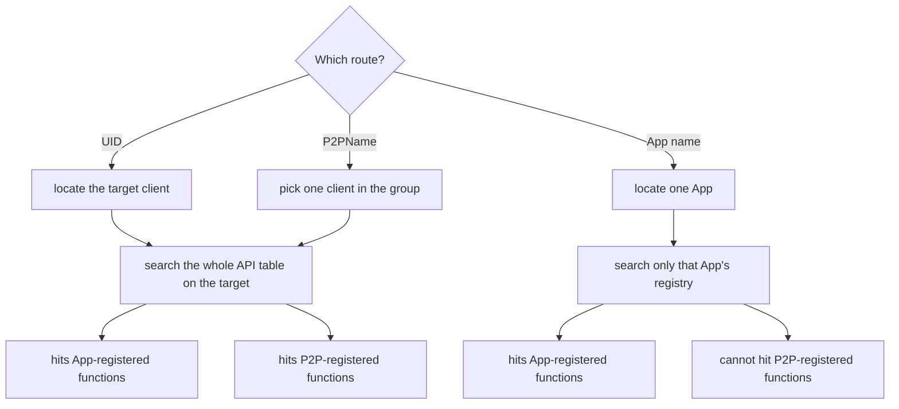

**The comparison table**:

| Call style | Search scope on the target | Hits App registrations | Hits P2P registrations |
|----------|----------------|:-------------:|:-------------:|
| **a UID call** | every API registered on the target client | ✅ | ✅ |
| **a P2PName call** | every API registered on the selected client | ✅ | ✅ |
| **an App-name call** | the target App's registry | ✅ | ❌ |

**The source evidence**:

**UID routing** (`Find_Local_UID_App` → `Find_API_From_P2P_APP`):
```pascal
function Find_API_From_P2P_APP(api_name__: SystemString): TLF_App;
begin
  Result := nil;
  // ① look in the P2P APP first
  if LF_P2P_APP.Engine.LF_MethodPool.Exists_Key(api_name__) then
    begin
      Result := LF_P2P_APP;
      exit;
    end;
  // ② then look in the business App pool
  LF_App_Pool.Lock;
  try
    if LF_App_Pool.Num > 0 then
      with LF_App_Pool.Invert_Repeat_ do
        repeat
          if queue^.Data.Engine.LF_MethodPool.Exists_Key(api_name__) then
            begin
              Result := queue^.Data;
              exit;
            end;
        until not Prev;
  finally
      LF_App_Pool.UnLock;
  end;
end;
```

**App-name routing** (`Find_Local_API`): it looks only in the `LF_MethodPool` of the App named
`app_Name__`.

---

## Chapter 9 Cross-addressing routing and the UID universal route

### 9.1 The UID is the universal routing identifier

**The key mechanism**: **a UID can target one specific client and call any API it registered** (both
APIs registered under an App name and APIs registered through P2P), **without knowing the App name**.

**The principle**:

1. **the client generates `FLast_UID` when `TunnelLink` succeeds**.
2. **the client reports its UID and P2PName through the `Update_UID` command**.
3. **the server's `FUID_Pool` builds the UID → recv_io mapping**.
4. **when `LF_UID_Call(UID, Param, Timeout)` runs**:
   - the client first looks locally for a client with the same UID.
   - on a miss → it sends the command to the server.
   - the server finds the recv_io through `FUID_Pool` → forwards to the target client.
5. **when the target client executes**:
   - it finds the local App through `Find_Local_UID_App(UID_, api_Name__)`.
   - it executes that App's API.

**Key points**:
- **the UID is decoupled from the App name**: the UID is a session identifier, the App name an
  application identifier, and the two are independent.
- **`LF_UID_Call` can call any API** (as long as the target client has the corresponding App and API).
- **no App name is needed**.

### 9.2 When to use the UID universal route

#### Scenario 1: the server pushes proactively to a specific client

```pascal
// The server knows some client's UID (extracted from an earlier callback).
procedure OnClientCalled(Trigger: Pointer; Input, Output: TDataHnd); cdecl;
var
  UID: TP2P_UID___;
  UIDPtr: PP2P_UID___;
begin
  // Valid only on the Input parameter (the sender's input handle); what comes back is a pointer.
  UIDPtr := LF_Get_P2P_UID(Input);
  if UIDPtr <> nil then
      UID := UIDPtr^;   // dereference and copy immediately; the framework frees the pointer after about 5 seconds
  // ... store it ...
end;

// Push proactively later.
LF_UID_Notify(StoredUID, DataHnd);   // no need to know the App name
```

#### Scenario 2: a targeted call across clients

```pascal
// Client A wants to call an API on client B.
// It does not need to know B's App name, only B's UID.

LF_UID_Call(B_UID, DataHnd, 3000);
```

#### Scenario 3: session-sticky routing

```pascal
// Every later call in the same session goes to the same client.
LF_UID_Sequenced_Notify(SessionUID, DataHnd);   // FIFO guaranteed
```

### 9.3 P2PName routing across APIs

**P2PName can call any API too**:

```pascal
// Suppose N workers all register a 'process' API and their P2PName is 'worker_group'.
LF_P2PNAME_Call('worker_group', DataHnd, 5000);
// The server load-balances across the N workers.
```

**Key points**:
- **P2PName is a group name**: several clients set the same P2PName and the server balances across them.
- **it does not identify a specific client**: the caller does not need to know which worker serves it.
- **it does not care where the API was registered**: App registration and P2P registration both work.

### 9.4 The typical cross-addressing architecture

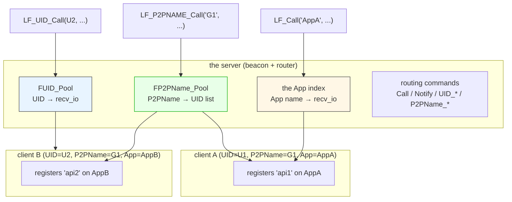

### 9.5 The whoami pattern: discovering your own UID and P2PName

**The problem**: how does a client learn the UID and P2PName the server assigned it?

**The answer**: the server registers a `whoami` API that returns the caller's UID and P2PName.

**The server**:

```pascal
procedure Cb_WhoAmI(Trigger: Pointer; Input, Output: TDataHnd); cdecl;
var
  UID: TP2P_UID___;
  UIDPtr: PP2P_UID___;
  P2P: string;
begin
  // Valid only on the callback's Input parameter; what comes back is a pointer.
  UIDPtr := LF_Get_P2P_UID(Input);
  if UIDPtr <> nil then
      UID := UIDPtr^                    // dereference and copy immediately
  else
      FillChar(UID, SizeOf(UID), 0);
  P2P := LF_Get_P2P_NameEx(Input);
  LF_WriteBuffer(Output, @UID[0], SizeOf(UID));
  LF_WriteString(Output, P2P);
end;

// Register it on LF_P2P_APP (process level) so any client can call it.
LF_Register_P2P_Call('whoami', 'Query caller identity', nil, @Cb_WhoAmI);
```

**The client**:

```pascal
function Probe_WhoAmI(out UID: TP2P_UID___; out P2PName: string): Boolean;
var
  Req, Res: LF.TDataHandle;
begin
  Result := False;
  FillChar(UID, SizeOf(UID), 0);
  P2PName := '';
  Req := LF.TDataHandle.Create('whoami');
  try
    Res := LF.CallApp('AnyApp', Req, 5000);   // goes through any App
    try
      if (Res = nil) or (Res.Size < SizeOf(UID) + 1) then Exit;
      Res.Pos := 0;
      Res.ReadBuffer(UID, SizeOf(UID));
      P2PName := Res.ReadString;
      Result := True;
    finally Res.Free; end;
  finally Req.Free; end;
end;
```

**Afterwards**: the client holds its own UID and P2PName and can use them for UID-targeted calls,
P2PName group calls, or discovery by other clients.

---

## Chapter 10 Automatic sender identity

### 10.1 The core mechanism

**The framework automatically injects the sender identity into the head of every remote request payload.** The client side does it with `Rebuild_UID_and_P2PName` before sending:

```
[apiName: string]
[FromUID: 32 bytes]         ← the sender's session UID
[FromP2PName: string]       ← the sender's P2PName
[Param.Size: Int32]
[Param: bytes]              ← the business parameter
```

**Important**:
- **`FromUID` / `FromP2PName` are "sender metadata"**, written automatically by the sending client; the
  receiver neither needs nor should pass them by hand.
- **the receiver can obtain these two values only on the callback's `Input` parameter, through `LF_Get_P2P_UID(Input)` / `LF_Get_P2P_Name(Input)`**.
- **these two functions must not be called on a self-created handle or an Output handle** (they return
  empty values / warn).
- **`LF_Get_P2P_UID` returns a `PP2P_UID___` pointer (not a value)**, and the framework frees that pointer
  after about 5 seconds.

### 10.2 The encode / decode implementation

**Encoding (`TMemory_Param_Tool.EncryptToMem`)**:

```pascal
procedure TMemory_Param_Tool.EncryptToMem(m64: TMem64);
begin
  m64.Clear;
  m64.WriteString(apiName.Text);              // the API name
  m64.WritePtr(@FromUID[0], SizeOf(TUID___)); // the 32-byte UID
  m64.WriteString(FromP2PName.Text);          // the P2PName
  m64.WriteInt32(Param.Size);                 // the business parameter length
  m64.WritePtr(Param.Memory, Param.Size);     // the business parameter
end;
```

**Decoding (`DecryptFromMem`)**:

```pascal
procedure TMemory_Param_Tool.DecryptFromMem(m64: TMem64);
begin
  if m64.ProtectedMode then
    begin
      // a read-only mapping: read directly
      m64.Position := 0;
      apiName.Text := m64.ReadString.Text;
      m64.ReadPtr(@FromUID[0], SizeOf(TUID___));
      FromP2PName.Text := m64.ReadString.Text;
      Param.Size := m64.ReadInt32;
      m64.ReadPtr(Param.Memory, Param.Size);
      Param.Position := 0;
    end
  else
    begin
      // writable: an O(1) swap plus a zero-copy mapping
      tmp.SwapInstance(m64);
      tmp.Position := 0;
      apiName.Text := tmp.ReadString.Text;
      tmp.ReadPtr(@FromUID[0], SizeOf(TUID___));
      FromP2PName.Text := tmp.ReadString.Text;
      i32 := tmp.ReadInt32;
      Param.Mapping(tmp.PosAsPtr, i32);       // zero copy
      Param.Position := 0;
    end;
end;
```

### 10.3 When injection happens (made precise in v7.0)

**Calls through the `TC40_LF_Client.Send_*` path do inject identity**:

```pascal
procedure TC40_LF_Client.Send_Execute_Notify_Impl(app_Name__: TLF_String; Param: TMem64);
begin
  DTNoAuth.SendTunnel.SendCompleteBuffer_StreamNotify('Notify',
    TDFE.Create
      .WriteString(app_Name__)
      .WriteMem64(Param)     // ← Param has already been through Rebuild
      .DelayFree
    );
end;

procedure TC40_LF_Client.Send_Execute_Notify(app_Name__: TLF_String; Param: TMem64);
var
  tmp_param: TMem64;
begin
  tmp_param := TMemory_Param_Tool.Rebuild_UID_and_P2PName(Param, FLast_UID, LF_P2P_name.V);
  try
    // ... a local lookup / a remote forward ...
    // whichever path is taken, tmp_param already carries the identity
  finally
    DisposeObject(tmp_param);
  end;
end;
```

**The key point (🟢 made precise in v7.0)**: **every `Send_*` method calls `Rebuild_UID_and_P2PName`**, therefore:

| Call path | Identity injected |
|---------|:-----------:|
| `LF_Call` / `LF_Notify` / `LF_Sequenced_*` | ✅ |
| a `LF_Call` hitting the local short circuit | ✅ |
| `LF_UID_Call` / `LF_UID_Notify` | ✅ |
| `LF_P2PNAME_Call` / `LF_P2PNAME_Notify` | ✅ |
| **`LF_LocalCall` / `LF_LocalNotify`** | ❌ |

**`LF_LocalCall` / `LF_LocalNotify` do not pass through `Rebuild_UID_and_P2PName`** (see §5.6,
`LF-LOCAL-001`).

### 10.4 The coverage

| Command | Direction | Identity injected |
|------|------|:--------:|
| `Notify` / `Sequenced_Notify` / `Call` / `Sequenced_Call` | both ways | ✅ |
| `UID_Notify` / `UID_Sequenced_Notify` / `UID_Call` / `UID_Sequenced_Call` | both ways | ✅ |
| `P2PName_Notify` / `P2PName_Sequenced_Notify` / `P2PName_Call` / `P2PName_Sequenced_Call` | both ways | ✅ |
| **a local call through the `Send_*` path** | — | ✅ |
| **`LF_LocalCall` / `LF_LocalNotify`** | — | ❌ |

### 10.5 The UID generation mechanism

**A client UID is generated when `TunnelLink` succeeds**:

```pascal
procedure TC40_LF_Client.Do_DT_P2PVM_NoAuth_Custom_Client_TunnelLink(...);
begin
  if Is_Null_UID(FLast_UID) then
      FLast_UID := Generate_Global_UID(PhysicsTunnel.UID, DTNoAuth.RecvTunnel.ServerState^.UID, DTNoAuth.SendTunnel.ServerState^.UID)
  else
      FLast_UID := Generate_Global_UID(FLast_UID, PhysicsTunnel.UID, DTNoAuth.RecvTunnel.ServerState^.UID, DTNoAuth.SendTunnel.ServerState^.UID);
end;
```

**Key points**:
- **it is derived from the physical tunnel UID plus the C4 server UID**.
- **it is regenerated on every reconnect**: the server must not assume a client keeps the same UID across
  reconnects.
- **the server's `FUID_Pool` is updated along with the reconnect**.

### 10.6 Typical usage scenarios

| Scenario | Usage |
|------|------|
| **call authorization** | compare `LF_Get_P2P_Name(Input)` against a whitelist |
| **audit logging** | record `LF_Get_P2P_UID(Input)` (hexadecimal) and `LF_Get_P2P_Name(Input)` |
| **session management** | keep a Session keyed by `UID` |
| **routing by group** | split traffic to different workers by `P2PName` |
| **multi-tenancy** | use `P2PName` as the tenant identifier |
| **broadcast filtering** | exclude callers with a particular `UID` |
| **whoami** | the server returns the caller's UID / P2PName for client self-discovery |

> **Again**: every usage above requires calling `LF_Get_P2P_UID` / `LF_Get_P2P_Name` from **the callback's
> `Input` parameter**. **Never** call them on any handle you created yourself or on an output handle.
> **Nor** in a `LF_LocalCall` / `LF_LocalNotify` callback (no identity is injected).

---

# Part 4 — Advanced topics

## Chapter 11 Runtime options in detail

> **This chapter expands every `LF_SetOption` option in depth**: internal mechanics, when it takes effect,
> dependencies, aliases and recommended values.

### 11.1 The execution semantics of `LF_SetOption` (🟢 clarified in v7.0)

```pascal
procedure LF_SetOption(Option, Value: pansichar);
begin
  with TSetOpt_Inst.Create do
    begin
      opt := DS(Option);
      V := DS(Value);
      if Simulator_Main_Thread_Activted then
        MainThreadPost.PostM_NP(DoRun)   // after the main thread runs: post it for async execution on the main thread
      else
        begin
          DoRun();                          // the main thread is not running: execute immediately
          Free;
        end;
    end;
end;
```

**Key points (🟢 v7.0)**:
- **while the main thread is not running**: it executes immediately and synchronously.
- **once the main thread is running**: it is posted to the main thread through `MainThreadPost.PostM_NP`,
  **with a small delay**.
- **the trap**: after the main thread has started, an option does not take effect synchronously. If you
  depend on it immediately afterwards (setting `Overlap_Connection` and calling `PrepareClient` right
  away, for instance), you may still read the old value.
- **unknown options**: silently ignored (the final `else` is missing).

### 11.2 Network-related options

#### 11.2.1 `Overlap_Connection`

- **Type**: Boolean
- **Default**: `False`
- **Aliases**: `Overlap_Client` / `OverlapConnection` / `OverlapClient` / `OverlapConnect`
- **Internal mechanics**:
  - controls how `LF_PrepareClient` treats a **duplicate address**.
  - `False`: only one client tunnel per physical address; a second `LF_PrepareClient` returns -1 (**discarding the new App parameter**).
  - `True`: every `LF_PrepareClient` creates a new tunnel (the `NewKeepAlive` command).
- **When it takes effect**: **it must be set before `LF_PrepareClient`**.
- **The precise effect of switching it at runtime (🟢 confirmed from the source in v7.0)**:
  - it only affects **the next `LF_PrepareClient`**.
  - **tunnels already created are not rearranged, not rolled back, and not added or removed automatically**.
  - **recommendation**: set `Overlap_Connection` before `LF_ResetPrepare`.
- **Recommended configurations**:

  | Scenario | Recommended | Why |
  |------|:------:|------|
  | one App per address | `False` | saves resources |
  | several Apps per address | `True` | each App needs its own tunnel |
  | a dynamic client plus BindApp | `False` + `LF_BindApp` | one empty tunnel, bound later |

#### 11.2.2 `Wait_Connection_ReadyOk`

- **Type**: Boolean
- **Default**: `True`
- **Aliases**: `Wait_API_Prepare_Done` / `API_Prepare_Done_Wait` / `WaitConnect` / `Wait_Ready` / `WaitReady`
- **Internal mechanics**: controls whether `LF_PrepareDone` **waits for every client to be ready**.
- **When it takes effect**: before `LF_PrepareDone`.

#### 11.2.3 `Wait_Connection_Timeout`

- **Type**: Integer (milliseconds)
- **Default**: `30000` (30 seconds)
- **Aliases**: `Wait_TimeOut` / `API_Prepare_Done_TimeOut` / `WaitTimeOut`
- **Internal mechanics**: the timeout inside `LF_PrepareDone` = `max(Wait_Connection_Timeout, 5000) + 1000` ms.

#### 11.2.4 `password` / `passwd`

- **Type**: String
- **Default**: `'DTC40@ZSERVER'`
- **Internal mechanics**: it writes into `Z.Net.C4.C40_Password` and serves as the authentication password
  for P2PVM and the C4 network.
- **`LF_GetOption('password')` returns `'********'` (a mask)**.

### 11.3 IPC-related options

| Option | Aliases | Internal mechanics |
|------|------|---------|
| `IPC_Serv_ThreadCount` | `IPC_ThreadCount` / `IPC_Server_ThreadCount` | writes `TZNet_Server_IPC.IPC_Serv_ThreadCount` |
| `IPC_Serv_MaxQueueLength` | `IPC_MaxQueueLength` / `IPC_Server_MaxQueueLength` | writes `TZNet_Server_IPC.IPC_Serv_MaxQueueLength` |
| `IPC_Serv_MaxMsgSize` | `IPC_MaxMsgSize` / `IPC_Server_MaxMsgSize` | writes `TZNet_Server_IPC.IPC_Serv_MaxMsgSize` |

**When they take effect**: **they must be set before the IPC server starts**.

### 11.4 Status-related options

| Option | Type | Default | Aliases | Internal mechanics |
|------|------|------|------|---------|
| `ShowThreadID` | Boolean | `True` | `ShowThread` / `Show_Thread` | writes `Z.status.StatusThreadID` |
| `ConsoleOutput` | Boolean | `True` | `Console_Output` | writes `Z.status.ConsoleOutput` |
| `Quiet` | Boolean | `False` | — | writes `Z.Net.C4.C40SetQuietMode` |

### 11.5 Data-handle-related options

#### 11.5.1 `DataHandle_Idle_Timeout`

- **Type**: Integer (milliseconds)
- **Default**: `600000` (10 minutes)
- **Aliases**: `Data_Idle_Timeout` / `Idle_Timeout`
- **Internal mechanics**: it writes `LF_DataPool.LF_DataHandle_Idle_Timeout`.
  - `> 0`: idle reclamation is enabled.
  - `= 0`: **idle reclamation is disabled**.

#### 11.5.2 `DataHandle_Pool_Scan_Interval`

- **Type**: Integer (milliseconds)
- **Default**: `5000` (5 seconds)
- **Aliases**: `Data_Scan_Interval` / `DataHandle_Scan_Interval`
- **Internal mechanics**: it writes `LF_DataPool.LF_DataHandle_Pool_Scan_Interval`.
  - `> 0`: each `Progress` only scans when this interval has elapsed.
  - `= 0`: **every `Progress` scans** (a performance drop).

### 11.6 P2P-related options

#### 11.6.1 `LF_P2P_name`

- **Type**: String
- **Default**: `''` (an empty string)
- **Aliases**: `P2P_name` / `LF_P2P` / `P2P`
- **Internal mechanics**:
  - it writes `Z.LingoFuse_Core.LF_P2P_name` (a `TLF_AtomString`).
  - **the client reports it to the server through the `Update_UID` command**.
  - **it is injected into the payload automatically on every send** (the third parameter of
    `Rebuild_UID_and_P2PName`).
- **When it takes effect**:
  - the client's `Progress` checks once a second whether `FLast_P2PName` changed and calls `Update_UID_Info`
    if it did.
  - **`LF_P2P_name.V` is read live when a request is sent**, so a change applies to the next request
    immediately.
- **Recommended usage**:
  ```pascal
  LF.Set_Opt_P2P_Name('worker_group');   // the client joins the group

  // the server calls any client in the group with LF_P2PNAME_Call('worker_group', ...)
  ```

#### 11.6.2 `Fixed_Sequenced_Time` / `Fixed_Sequenced_Life`

- **Type**: Integer (milliseconds)
- **Default**: `20000` (20 seconds)
- **Internal mechanics**: it writes `Z.LingoFuse_Core.Fixed_Sequenced_Time`.
  - it controls the **stickiness window** of `Find_Fixed_Sequenced_API` / `Find_P2PName_FixedSequenced`.
  - once the same UID has served longer than this value, the router switches to another UID.
- **Semantics (🟢 made precise in v7.0)**:
  - the `Sequenced` variants of `P2PName` routing use this value to decide the stickiness window.
  - **the best value**: 5-10 seconds for short jobs; 60 seconds or more for long jobs; up to an hour for
    strong stickiness.

### 11.7 Command-related options

#### 11.7.1 `No_Reponse_Cmd_NULL_Flush_Threshold`

- **Type**: Integer
- **Default**: `5000`
- **Internal mechanics**: it writes `Z.LingoFuse_Core.No_Reponse_Cmd_NULL_Flush_Threshold`.
  - it controls **the NULL flush threshold for commands with no response (Notify)**.
  - after every N Notifies it sends one NULL command automatically so the server confirms.

### 11.8 Debug-related options

#### 11.8.1 `debug` / `debug_cmd` / `debug_command` / `debugcommand`

- **Type**: String
- **Internal mechanics**:
  - **every call creates a `TC40_Console_Help`** and executes the command.
  - it supports every C4 console command: `service` / `tunnel` / `HPC_Thread_Info` / `ZDB2_Info` /
    `RegInfo` and so on.
- **`LF_GetOption('debug')` returns `'(no value: debug is write-only)'`** (write-only).
- **⚠️ It is expensive**: use it sparingly in production.

### 11.9 The option quick reference

| Option | Type | Default | When it takes effect | Number of aliases |
|------|------|------|---------|:--------:|
| `Overlap_Connection` | Boolean | `False` | before `PrepareClient` | 4 |
| `Wait_Connection_ReadyOk` | Boolean | `True` | before `PrepareDone` | 5 |
| `Wait_Connection_Timeout` | Integer (ms) | `30000` | before `PrepareDone` | 3 |
| `password` / `passwd` | String | `'DTC40@ZSERVER'` | globally, immediately | 1 |
| `IPC_Serv_ThreadCount` | Integer | platform-dependent | before the IPC server starts | 2 |
| `IPC_Serv_MaxQueueLength` | Integer | platform-dependent | before the IPC server starts | 2 |
| `IPC_Serv_MaxMsgSize` | Integer | platform-dependent | before the IPC server starts | 2 |
| `ShowThreadID` | Boolean | `True` | globally, immediately | 2 |
| `ConsoleOutput` | Boolean | `True` | globally, immediately | 1 |
| `Quiet` | Boolean | `False` | globally, immediately | 0 |
| `DataHandle_Idle_Timeout` | Integer (ms) | `600000` | after `PrepareDone` | 2 |
| `DataHandle_Pool_Scan_Interval` | Integer (ms) | `5000` | after `PrepareDone` | 2 |
| `LF_P2P_name` | String | `''` | the next request | 3 |
| `Fixed_Sequenced_Time` | Integer (ms) | `20000` | globally, immediately | 1 |
| `No_Reponse_Cmd_NULL_Flush_Threshold` | Integer | `5000` | globally, immediately | 0 |
| `debug` | String | — | globally, immediately | 3 |

---

## Chapter 12 Network preparation and the simulated main thread

### 12.1 The role of the simulated main thread

**The problem**: C4 needs a main thread to drive it (`C40Progress`), but the C ABI layer does not control
the user's main loop.

**The answer**: `LF_PrepareDone` starts a **simulated main thread** (`Simulated_Main_Thread`) that drives
C4 in an internal loop.

**The `Simulated_Main_Thread` main loop**:

```pascal
while Simulated_Main_Thread_Running do
  begin
    C40Progress(if_(LF_RunningCount.V > 0, 1, 10));  // dynamic throttling
    try
        LF_DataPool.Progress();                       // data pool scan
    except
    end;
  end;
```

**Key points (🟢 made precise in v7.0)**:
- **dynamic throttling**: 1ms while calls are active, 10ms while idle.
- **it drives** the C4 network **and** the data pool scan together.
- **it can only be started once per process** (`LF-MAIN-001`).

### 12.2 A custom main loop

**Option 1**: still let `LF_PrepareDone` start the simulated main thread (recommended).
- the simulated main thread works in the background.
- the user's main loop only handles UI / business logic.

**Option 2**: skip `LF_PrepareDone` and drive it by hand.
- you must call `LF_Sync` + `C40Progress` + `LF_DataPool.Progress` together.
- **not recommended**.

### 12.3 Deployment mode (unordered startup)

**The problem**: in a distributed system the client and server startup order is not deterministic.

**The answer**: `Wait_Connection_ReadyOk=False`.

```pascal
LF.Set_Opt_Wait_Connection_ReadyOk(False);
LF.Set_Opt_Wait_Connection_Timeout(5000);   // set a small value even though nothing waits
LF.PrepareClient(endpoint, App);
if LF.PrepareDone <> 1 then Halt(1);

// Wait separately for the critical App.
if not WaitForApp('CriticalApp', 60000) then
  WriteLn('Critical app not ready');

function WaitForApp(const AppName: string; TimeoutMs: Integer): Boolean;
var tk: TTimeTick;
begin
  tk := GetTimeTick;
  while GetTimeTick - tk < TimeoutMs do
  begin
    if LF.CheckAppEx(AppName) then Exit(True);
    TCompute.Sleep(200);
  end;
  Result := False;
end;
```

**Key point**: `LF_PrepareDone` returns immediately, but that does not guarantee the target service is
ready.

---

## Chapter 13 Status, queries and network events

### 13.1 Status management

#### 13.1.1 `LF_GetStatusCount(): Integer`

**Internal mechanics**:
```pascal
function LF_GetStatusCount(): Integer;
begin
  Status_Lock.Lock;
  try
      Result := Status_Pool.Num;      // the current queue length
  finally
      Status_Lock.UnLock;
  end;
end;
```

**Key point**: the queue is **capped at 1000 entries**; beyond that the oldest are dropped.

#### 13.1.2 `LF_GetStatus(): PAnsiChar`

**Internal mechanics**:
```pascal
function LF_GetStatus(): pansichar;
begin
  Result := @Status_Return_Buffer;    // a static 64KB buffer
  Status_Lock.Lock;
  try
    Status_Return_Buffer[0] := 0;
    if Status_Pool.Num > 0 then
    begin
      L := length(Status_Pool.First^.Data);
      if L > 0 then
      begin
        CopyPtr(@Status_Pool.First^.Data[0], @Status_Return_Buffer, Min(L, SizeOf(Status_Return_Buffer) - 1));
        Status_Return_Buffer[Min(L, SizeOf(Status_Return_Buffer) - 1)] := 0;
      end;
      Status_Pool.Next;   // dequeue
    end;
  finally
      Status_Lock.UnLock;
  end;
end;
```

**Key points**:
- **it returns a static buffer**: the next call overwrites it.
- **the 64 KB cap**: anything longer is truncated.
- **it dequeues**: every call takes one message out and removes it.

#### 13.1.3 `LF_PostStatus(status: PAnsiChar)`

**Internal mechanics**:
```pascal
procedure LF_PostStatus(status: pansichar);
begin
  if not Simulator_Main_Thread_Activted then
      DoStatus('LF_PostStatus: Main thread not running; message queued directly. message: %s', [DS(status).Text]);
  s := DS(status);
  Status_Lock.Lock;
  try
      Post_To_DoStatus_Queue(TCompute.CurrentThread, s.Text, 0);
  finally
      Status_Lock.UnLock;
  end;
end;
```

**Key points**:
- **while the main thread is not running**: it prints a warning but **still enqueues**.
- **it enqueues under a lock**.

### 13.2 The query APIs

#### 13.2.1 `LF_CheckMainThread(): Integer`

**Internal mechanics**: it returns `if_(Simulator_Main_Thread_Activted, 1, 0)`.

#### 13.2.2 `LF_CheckApp(appName): Integer`

**Internal mechanics**:
```pascal
function LF_CheckApp(appName: pansichar): Integer;
begin
  Result := if_((Find_Local_APP(DS(appName), False) <> nil) or (Find_Remote_APP(DS(appName), False) <> nil), 1, 0);
end;
```

**Key points**:
- **it checks** both **the local table and the remote cache**.
- **the broadcast delay is about 3 seconds**: a just-registered or just-unregistered App lags.

#### 13.2.3 `LF_CheckApi(appName, apiName): Integer`

**The same**: it queries `Find_Local_Api` / `Find_Remote_Api`.

#### 13.2.4 `LF_Check_UID(UID)` / `LF_Check_UID_Api(UID, apiName)`

**Internal mechanics**:
```pascal
function LF_Check_UID(UID: TP2P_UID___): Integer;
begin
  Result := if_(Find_Local_UID(UID) or (Find_Remote_UID(UID)), 1, 0);
end;
```

#### 13.2.5 `LF_Check_P2PNAME(p2p_name)` / `LF_Check_P2PNAME_Api(p2p_name, apiName)`

**The same**.

### 13.3 Network events

#### 13.3.1 `LF_Set_Network_Event(On_Connect, On_Disconnect)`

**Internal mechanics**:
```pascal
procedure LF_Set_Network_Event(On_Connect_, On_Disconnect_: TLF_Network_Event);
begin
  On_Network_Connect_Event := On_Connect_;
  On_Network_Disconnect_Event := On_Disconnect_;
end;
```

**The trigger chain (Connect)**:

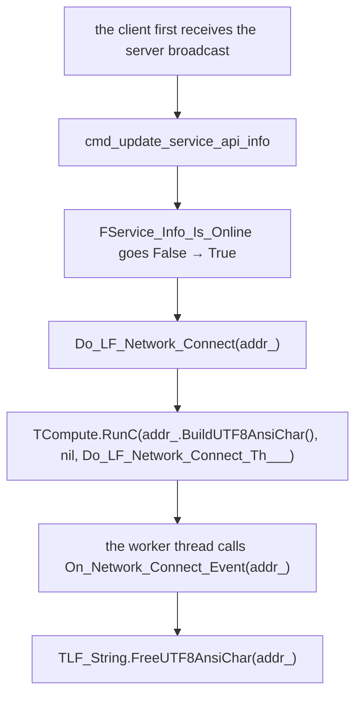

**Key points**:
- **Connect is not a TCP connect**: it is "the first server API broadcast received".
- **Disconnect is a physical link loss**.
- **the callback runs on a TCompute worker thread**.
- **`addr_` becomes invalid as soon as the callback returns**.

#### 13.3.2 The usage pattern

```pascal
procedure OnConnect(addr: PAnsiChar); cdecl;
var s: string;
begin
  s := UTF8ToString(addr);   // copy immediately
  TThread.Queue(nil,
    procedure
    begin
      Memo1.Lines.Add('Connected: ' + s);   // touch the UI on the main thread
    end);
end;

procedure OnDisconnect(addr: PAnsiChar); cdecl;
begin
  TThread.Queue(nil,
    procedure
    begin
      Memo1.Lines.Add('Disconnected');
    end);
end;

LF_Set_Network_Event(@OnConnect, @OnDisconnect);

// Uninstall (optionally, before LF_Shutdown).
LF_Set_Network_Event(nil, nil);
```

---

## Chapter 14 The threading model and concurrency

### 14.1 The four thread classes

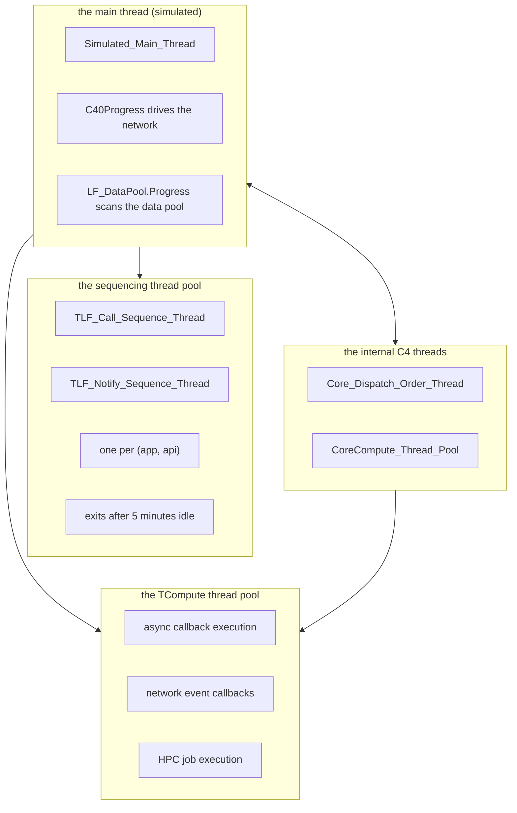

### 14.2 What each thread does

| Thread | Responsibility | The user may interact |
|------|------|:----------:|
| **the simulated main thread** | C4 progress, data pool scanning | no (internal) |
| **the TCompute thread pool** | async callbacks, network events, HPC | **inside a callback**, yes |
| **the sequencing thread pool** | FIFO serialized calls / notifications | **inside a callback**, yes |
| **the internal C4 threads** | network send and receive | no |

### 14.3 The thread-safety matrix

| Component | Thread-safe |
|------|:--------:|
| every exported function (except the status log) | ✅ fully thread-safe |
| concurrent writes to the same data handle | ❌ external synchronization needed |
| globals touched inside a callback | ❌ external synchronization needed |
| `LF_DataPool.Progress` | ✅ internally locked |
| `LF_SyncTool` | ✅ internally has a critical section |
| `addr_` of a network event callback | ❌ invalid after the callback returns |

### 14.4 The callback thread quick reference

| Callback type | Executing thread |
|---------|---------|
| `On_Call` (Call mode) | the main thread / a sequencing thread |
| `On_Notify` (Notify mode) | the main thread / a sequencing thread |
| `LF_Async_Call.OnResult` | a TCompute worker thread |
| `LF_Async_Sequenced_Call.OnResult` | a TCompute worker thread / a sequencing thread |
| `LF_UID_Async_*.OnResult` | a TCompute worker thread |
| `LF_P2PNAME_Async_*.OnResult` | a TCompute worker thread |
| `LF_Set_Network_Event.On_Connect` | a TCompute worker thread |
| `LF_Set_Network_Event.On_Disconnect` | a TCompute worker thread |
| `RegisterSyncCall_M` / `RegisterSyncNotify_M` | the main thread (needs `LF_Sync` to drive it) |

### 14.5 Thread-safety best practices

1. **across threads, call only `LF_*` functions**: they are fully thread-safe.
2. **lock write operations on the same handle**: read and write positions are not atomic.
3. **do not block in a callback and do not call `LF_Call` there**: it self-locks into a deadlock.
4. **marshal UI work to the main thread**: `TThread.Queue` / `Synchronize`.
5. **keep managed-language callbacks strongly referenced**: prevent GC collection.
6. **copy the network event `addr_` immediately**: it is invalid after the callback returns.
7. **an async callback's handle must be fully handled inside the callback**: never keep it across threads.

### 14.6 The handle lifetime of an async callback

#### 14.6.1 The timing compared: the sync family vs the async family

**The synchronous family (`LF_Call`)**:

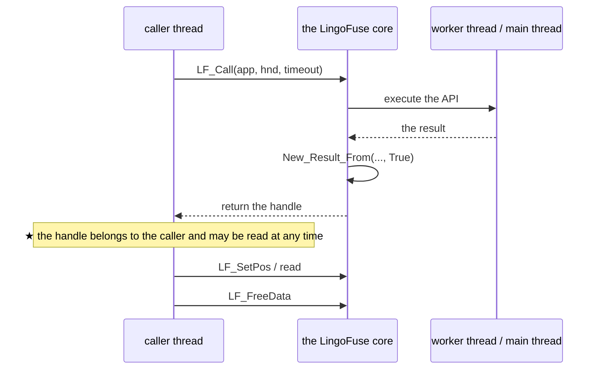

**The asynchronous family (`LF_Async_Call`)**:

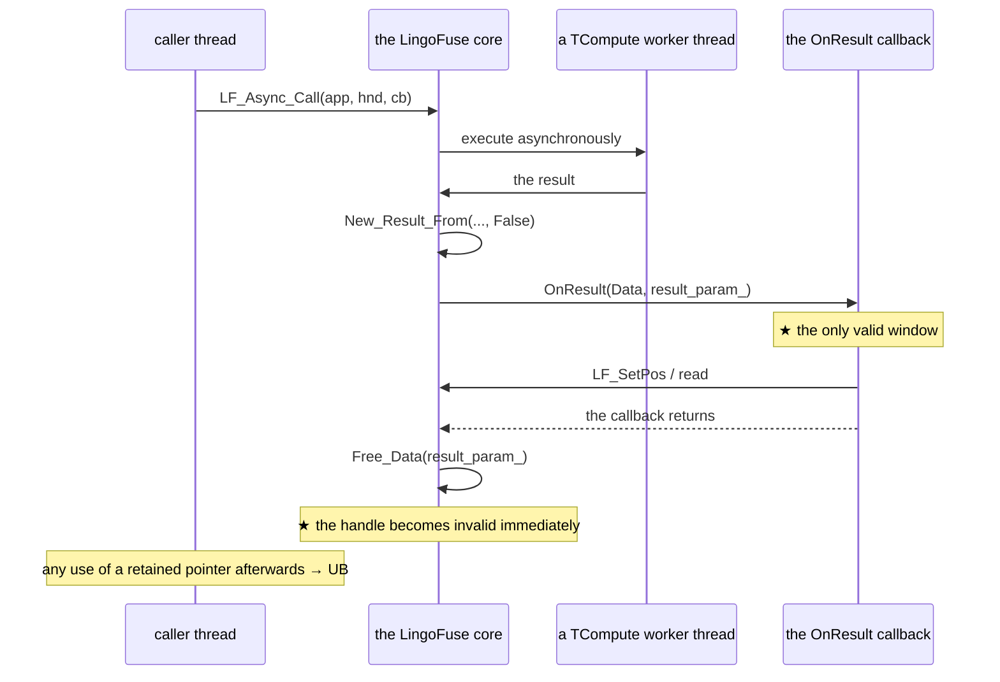

#### 14.6.2 Coupling with the threading model

**The lifetime of an async handle**:

- **start**: the `New_Result_From(..., False)` inside `TLF_Async_Call_Bridge.Do_Th`.
- **end**: the `Free_Data(result_param_)` inside `TLF_Async_Call_Bridge.Do_Th`.
- **both the start and the end are inside the TCompute worker thread**, and **only the `OnResult` callback
  invocation sits between them**.
- **the caller thread cannot perceive this window at all** — it only receives a completion notification
  from a future (or equivalent), by which time the handle is already invalid.

**This is the fundamental trap of cross-language bindings**: from the caller thread's point of view,
"the call completed" means "the result is available"; from the C side's point of view, "the call
completed" means "the handle has been released".

#### 14.6.3 The three safe strategies

| Strategy | How | Suitable for |
|------|---------|---------|
| **A. use the sync family** | scenarios that block anyway, such as a gateway / proxy / HTTP bridge | the `LF_Call` family |
| **B. copy inside the callback** | `read_string_bytes` inside the async callback to copy out the bytes | the `LF_Async_Call` family |
| **C. a high-level wrapper** | the binding layer's Future interface reads and copies inside the callback | every managed language |

**Any approach that keeps a raw handle outside the callback is wrong**.

#### 14.6.4 Compared with automatic reclamation

| Dimension | an automatically reclaimed handle | an async-family handle |
|------|----------------|---------------|
| `auto_recycle___` | `True` | `False` |
| idle reclamation | 10 minutes + a 5-second scan | not applicable (it never enters the pool) |
| release timing | `LF_FreeData` marks it, the pool scan follows | the instant the callback returns |
| active window | minutes | microseconds to milliseconds |
| protection | 3 layers (threshold + refresh + calling) | none |
| keeping it across threads | ⚠️ needs external locking | ❌ forbidden |

**The magnitude of the difference**: the "active window" of an automatically reclaimed handle is
**minutes**; for an async-family handle it is **milliseconds**.

---

## Chapter 15 Memory and lifetime management

### 15.1 The three-level memory pool architecture

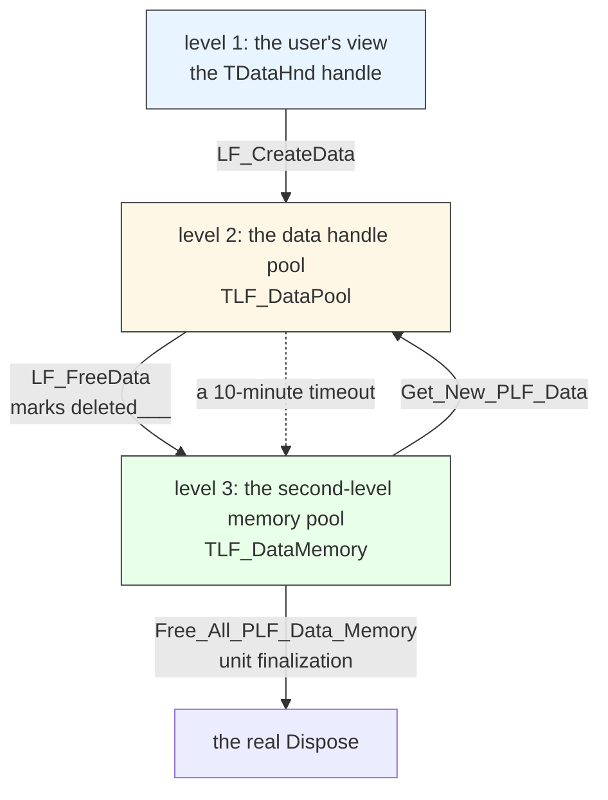

### 15.2 What each level does

| Level | Name | Responsibility |
|:--:|------|------|
| 1 | the user handle | the `TDataHnd` the user holds |
| 2 | the data handle pool | tracks live handles; scans and reclaims the idle / deleted ones |
| 3 | the second-level memory pool | caches reclaimed `TLF_Data` records, reducing `New`/`Dispose` |

### 15.3 The three branches of `TLF_DataPool.Progress`

**It scans once every 5 seconds**:

```pascal
for each handle in LF_DataPool:
  if handle.updated___ or handle.calling___ > 0 then
      handle.time___ := now;
      handle.updated___ := False;
  else if handle.deleted___ then
      add to the "released by the user" list;
      mark it reclaimed;
  else if now - handle.time___ > 10 minutes then
      add to the "released on timeout" list;
      mark it reclaimed;
```

**Key points**:
- **`updated___` or `calling___ > 0`**: refresh the timestamp.
- **`deleted___`**: the user released it explicitly.
- **timeout**: 10 minutes idle.
- **the release happens outside the pool**: to avoid disposing while holding the lock.

### 15.4 Sequencing thread exit and release (🟢 corrected in v7.0)

**The source** (the end of `TLF_Call_Sequence_Thread.Do_Run_Th` in `Z.LingoFuse_Core.pas`):

```pascal
if (Internal_Queue_Data___ <> nil) and (Internal_Queue_Pool___ <> nil) then
  begin
    Internal_Queue_Pool___.Lock;
    try Internal_Queue_Pool___.Remove(Internal_Queue_Data___);
    finally Internal_Queue_Pool___.UnLock; end;
  end;
DelayFreeObj(1.0, self);   // ← 1 second (the v6.0 docs recorded 5 seconds by mistake)
```

**The v6.0 correction**: v6.0 §14.1 quoted the 5 seconds from `Z.LingoFuse.md`; **the source is actually
1 second**.

### 15.5 The `calling___` counter

**Purpose**: protects an in-flight remote call.

**Implementation**:
```pascal
procedure TLF_Data.Begin_Call;
begin
  calling___.UnLock(calling___.LockP^ + 1);
  updated___ := True;
end;

procedure TLF_Data.End_Call;
begin
  calling___.UnLock(calling___.LockP^ - 1);
  updated___ := True;
end;
```

**Key points**:
- **every `LF_Call` / `LF_LocalCall` / `LF_Notify` / `LF_Sequenced_Notify` does `Begin_Call` / `End_Call`
  internally**.
- **the user never calls them by hand** (they are not exposed at the C ABI layer).

### 15.6 The semantics of `LF_CreateData_Permanent`

- **`auto_recycle___ = False`**: it does not join `LF_DataPool`.
- **`LF_FreeData` releases it immediately and synchronously** (no marking).
- **it is unaffected by the 10-minute timeout** (because it is never in the pool).
- **creating one in an initialization gap leaks it**: before `LF_PrepareDone` / after
  `LF_ExitMainThread`, `LF_FreeData` is a no-op.

### 15.7 The two-phase destruction of `LF_App`

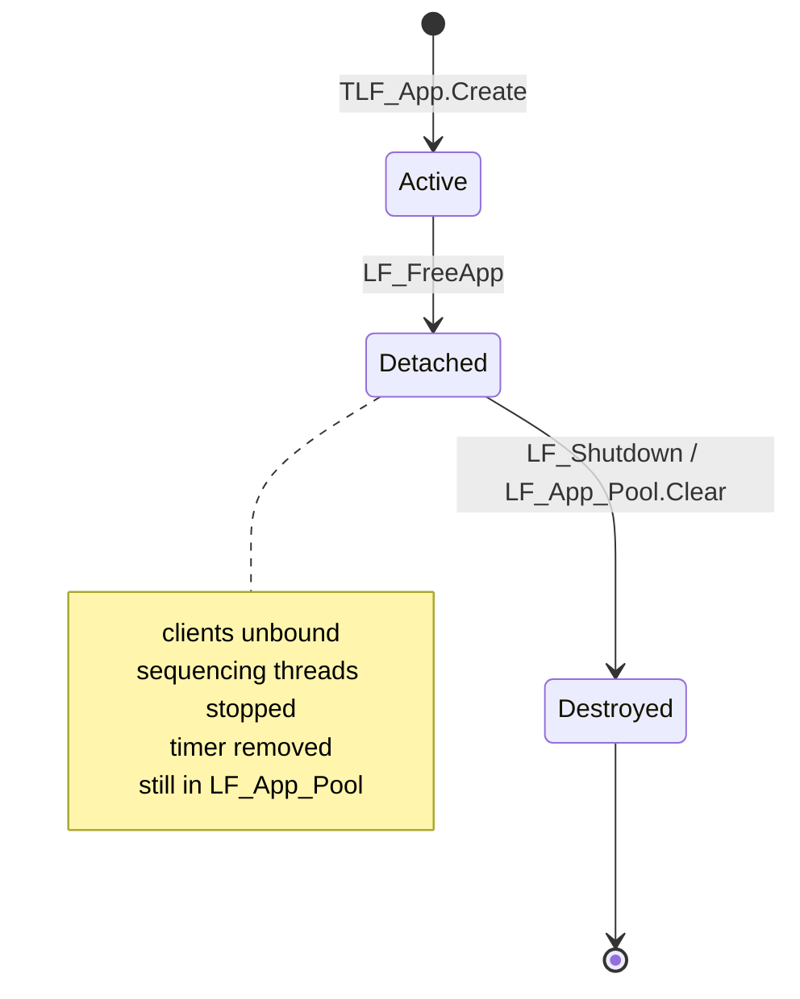

### 15.8 The leak investigation checklist

| # | Leak source | How to check | Fix |
|:-:|--------|---------|------|
| 1 | a data handle never freed with `LF_FreeData` | memory grows over a long run | use `try..finally` |
| 2 | an application handle never freed with `LF_FreeApp` | `LF_App_Pool` grows | release following the cleanup order |
| 3 | a `LF_CreateData_Permanent` handle never released | search for it explicitly | call `LF_FreeData` explicitly |
| 4 | the DLL never calls `LF_Shutdown` | memory is still held after the DLL unloads | add an unload hook |
| 5 | a sequencing notification thread never exits | check the TCompute thread count | it exits automatically after 5 idle minutes |
| 6 | records in the second-level pool never freed | check the `LF_DataMemory` pool size | released automatically at unit finalization |
| 7 | a callback closure captured a large object | check the anonymous functions | use weak references |
| 8 | holding a handle outside an async callback causes a double free | check whether `LF_FreeData` is called on an async handle | handle async handles only inside the callback |

### 15.9 The sequencing thread race

**The source** (the end of `TLF_Notify_Sequence_Thread.Do_Run_Th` plus `Kill_App`):

```pascal
// the end of Do_Run_Th
if (Internal_Queue_Data___ <> nil) and (Internal_Queue_Pool___ <> nil) then
  begin
    Internal_Queue_Pool___.Lock;
    try Internal_Queue_Pool___.Remove(Internal_Queue_Data___);
    finally Internal_Queue_Pool___.UnLock; end;
  end;
DelayFreeObj(1.0, self);

// inside Kill_App
queue^.Data^.Data.Second.Critical.Lock;
try
  queue^.Data^.Data.Second.Internal_Queue_Pool___ := nil;   // ← races with the check above
  queue^.Data^.Data.Second.Internal_Queue_Data___ := nil;
finally queue^.Data^.Data.Second.Critical.UnLock; end;
```

**The race**: `Do_Run_Th` checks `Internal_Queue_Pool___ <> nil` **without holding the lock**, and
`Kill_App` may set it to nil before that.

**The theoretical risk**: **a low-probability crash**.

**Mitigation**: make sure the sequencing threads have stopped before `LF_FreeApp`; avoid creating and
destroying Apps frequently under high concurrency.

---

## Chapter 16 Cross-language bindings

### 16.1 The C ABI boundary

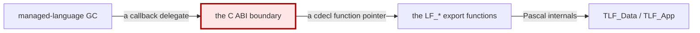

### 16.2 The general rules

1. **a callback must be `cdecl`** (or the language's equivalent: `CFUNCTYPE` / `extern "C"` /
   `@convention(c)`).
2. **managed-language callbacks must be kept strongly referenced**.
3. **strings are UTF-8** (`PAnsiChar`).
4. **`TP2P_UID___` is a 32-byte array**.
5. **a returned pointer becomes invalid after 5 seconds** (`LF_GetOption` / `LF_Get_AppName` /
   `LF_Generate_AppName` / `LF_Get_P2P_Name` / `LF_Get_P2P_UID`).
6. **`LF_WriteString` always appends #0**, and `LF_ReadString` reads tolerantly.
7. **the sender identity is available automatically** with no extra declaration; **it is valid only on
   the callback's Input parameter**.
8. **the handle ownership of the sync and async families is opposite**: the sync family belongs to the
   caller, the async family to the framework (released as soon as the callback returns).

### 16.3 The per-language quick reference

| Language | Key point |
|------|--------|
| **C / C++** | `extern "C"`; `cdecl`; copy the data inside async callbacks |
| **C# / .NET** | `CallingConvention.Cdecl`; keep callback references; copy the data inside async callbacks |
| **Python** | `CFUNCTYPE` (cdecl); keep callback references (module-level variables); copy the data inside async callbacks |
| **Java** | the JDK 22+ FFM API; keep upcallStubs strongly referenced; copy the data inside async callbacks |
| **Rust** | `extern "C"`; panics must be wrapped in `catch_unwind`; copy the data inside async callbacks |
| **Go** | `purego` or `cgo`; keep callback references; copy the data inside async callbacks |
| **Swift** | Swift 5.9+; `@convention(c)`; copy the data inside async callbacks |
| **Zig** | `@cImport`; `extern "C"`; copy the data inside async callbacks |
| **Erlang** | an NIF crash takes down the BEAM; OTP 27+; copy the data inside async callbacks |
| **Ruby** | Fiddle or a C extension; DevKit; copy the data inside async callbacks |
| **Fortran** | `iso_c_binding`; the compiler must match; copy the data inside async callbacks |
| **Julia** | `--threads=2`; `ccall`; copy the data inside async callbacks |
| **R** | the four-layer architecture plus a Job queue; copy the data inside async callbacks |
| **Dart** | `DynamicLibrary.open`; not available on Flutter Web; copy the data inside async callbacks |

### 16.4 The P2PName cross-language timeline (🟢 new in v7.0)

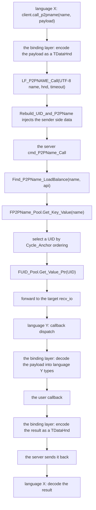

**The P2PName cross-language contract table (🟢 v7.0)**:

| Dimension | Contract |
|------|------|
| string encoding | UTF-8 with a trailing NUL |
| empty string | the server reports `no found p2pname:""` and never replies |
| length limit | no explicit limit |
| async hanging | if the server cannot find the group name, the callback never fires |
| timeout mechanism | implemented by the caller (the C ABI has no timeout parameter) |
| callback thread | a TCompute worker thread |
| handle ownership | the sync family belongs to the caller, the async family to the framework |

### 16.5 The cross-language declarations for sender identity

```c
/* LF_Get_P2P_UID: returns a pointer (to a 32-byte UID), released automatically by the framework with DelayFreeMem(5.0, ...) */
PP2P_UID___ LF_Get_P2P_UID(TDataHnd___ Hnd);

/* LF_Get_P2P_Name: returns a UTF-8 string pointer, released automatically after 5 seconds */
const char* LF_Get_P2P_Name(TDataHnd___ Hnd);
```

- `TP2P_UID___` is a 32-byte array; across languages, declare it as `uint8_t[32]`.
- `PP2P_UID___` is **a pointer to `TP2P_UID___`** (`uint8_t (*)[32]` or `uint8_t*`).
- **The usage restrictions (must read)**:
  - **it is valid only on the `Input` parameter of the callback that triggered the event**.
  - **it must not be called on a self-created handle (one created by `LF_CreateData`)**.
  - **it must not be called on an output handle (such as the `Result_` of `OnResult`)**.
  - **it must not be called inside a `LF_LocalCall` / `LF_LocalNotify` callback**.

### 16.6 The cross-language declarations for an async handle

```c
// the prototype of an async callback (cdecl)
typedef void (*TLF_Async_Call_OnResult)(void* Data, TDataHnd___ Result_);
```

**The cross-language contract**:

- `Data` is an opaque pointer supplied by the caller; LingoFuse does not manage its lifetime.
- `Result_` is **a framework-owned handle**:
  - it becomes invalid **immediately** after the callback returns.
  - `LF_FreeData(Result_)` is **forbidden** inside the callback.
  - every read **must** be completed inside the callback (or the data copied out).

---

## Chapter 17 Cleanup and shutdown

### 17.1 The mandatory cleanup order

```
LF_ExitMainThread    →    LF_FreeApp    →    LF_Shutdown
```

**Why this order**:

1. **`LF_ExitMainThread`**: stops the simulated main thread, which triggers `C40Clean`, the sequencing
   thread pool stop and the release of every data handle.
2. **`LF_FreeApp`**: unbinds the `app` references of every `TC40_LF_Client`, stops the sequencing threads
   and removes the timer via `FakeFree`.
3. **`LF_Shutdown`**: clears `LF_App_Pool` (really freeing the Apps), releases every data handle and
   unloads the IPC library.

**The consequences of the wrong order**:

```pascal
// ❌ wrong: Shutdown before FreeApp
LF_Shutdown;
LF_FreeApp(App);   // App was already released during Shutdown → UAF
```

### 17.2 The complete steps of `LF_Shutdown`

1. **clear the network event callbacks**: `On_Network_Connect_Event := nil` /
   `On_Network_Disconnect_Event := nil`.
2. **stop every sequenced notification thread**.
3. **release every remaining data handle**: `LF_DataPool.Free_All_Hnd`.
4. **exit the simulated main thread**: `LF_ExitMainThread`.
5. **clear the global application pool**: `LF_App_Pool.Clear`.
6. **unload the IPC library**: `UnloadIPCLibrary`.
7. **close the core dispatch thread**: `if IsLibrary then Close_Core_Dispatch_Thread`.

**Idempotency (🟢 confirmed from the source in v7.0)**: calling `LF_Shutdown` several times should be
idempotent. Every internal step has a precondition check (an empty pool is skipped, an inactive state is
skipped).

### 17.3 You can reinitialize after `LF_Shutdown`

```pascal
LF_Shutdown;
LF_ResetPrepare;             // clear the preparation queue
LF_PrepareService(...);
LF_PrepareClient(...);
if LF_PrepareDone = 1 then   // start again
  ...
```

**Key point**: `LF_Shutdown` resets `Simulated_Main_Thread_Running`, so `LF_PrepareDone` can succeed
again.

### 17.4 The DLL scenario

**`LF_Shutdown` must be called explicitly**:

```pascal
// in the DLL's exit function
procedure DllUnload; stdcall;
begin
  LF_Shutdown;   // must be called explicitly
end;
```

**The reason**: a DLL may be unloaded early by the host process, in which case LingoFuse's `finalization`
may never run.

---

# Part 5 — P2P and distribution

## Chapter 18 P2P distributed load

### 18.1 The core test: one-to-many means distributed

> **Whenever "one to many" appears, distribution is possible.**
>
> - one App name, registered by several programs;
> - one P2PName, registered by several programs;
> - one caller, connected to several servers;
> - one API name, exposed by several workers.

The LingoFuse C4 mesh forms a candidate pool automatically and selects a target by policy.

### 18.2 The three load granularities

| Granularity | Routing key | Selection | Local-first |
|------|--------|---------|:--------:|
| application-level | the App name | several client candidates, least recently used | ✅ |
| group-level | P2PName | server-side in-group balancing / stickiness | ❌ |
| session-level | UID | targeted, no balancing | ✅ (a local UID first) |

### 18.3 One App name registered by several programs

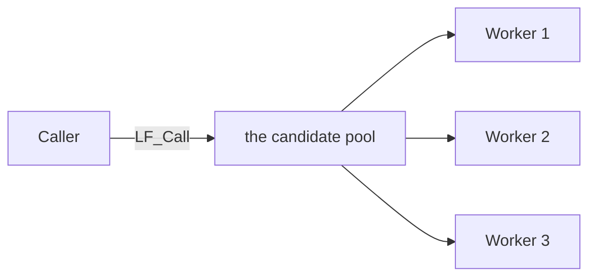

**The rules**:
- App-name routing is **local-first**.
- only when no local App has that name does it go to the remote candidates.
- with several candidates it load-balances by "least recently used".

- the broadcast cache has a delay of about 3 seconds.
- do not use the same App name inside one process to test "local vs remote".

### 18.4 One P2PName registered by several programs

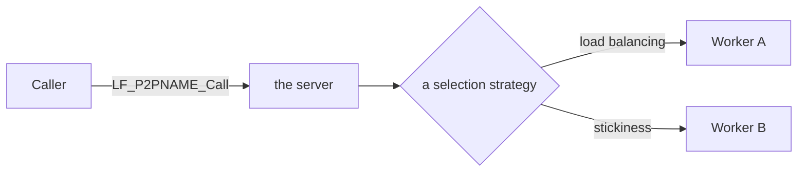

**The rules**:
- P2PName routing is **not local-first**; it always goes to the server / mesh.
- the server keeps a "group name → UID list" mapping.
- by default it load-balances with `Cycle_Anchor`.
- `Fixed_Sequenced_Time` defaults to 20 seconds and provides stickiness.
- suitable for stateless workers, compute nodes, codec nodes and GPU nodes.

### 18.5 Your program connects to several servers

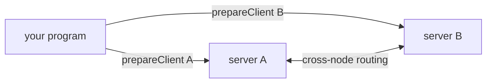

**The conditions and boundaries (🟢 made precise in v7.0)**:
- your program can `prepareClient` several server addresses.
- **the precondition**: the servers have established physical connections among themselves over the C4
  protocol (mutual `Client` / `Auto` connections), **forming a C4 mesh**.
- **if the servers do not interconnect**, they are **islands**, and no cross-server balancing happens
  automatically.
- **extra configuration**: none is needed for broadcast or routing; as long as the servers are connected
  through a C4 mesh, cross-node routing works automatically.
- **the mechanism**: each C4 server queries the service information of the other servers with the
  `QueryInfo` command; the distribution service collects and broadcasts it.

### 18.6 Serialization families and high-volume compute

**LingoFuse's serialization families**:
- `LF_Sequenced_Notify`
- `LF_Sequenced_Call`
- `LF_Async_Sequenced_Call`
- the Sequenced variants for UID / P2PName

**The guarantees**:
- FIFO within the same `(App, API)` pair;
- FIFO within the same `(UID, API)`;
- FIFO within the same `(P2PName, API)` pair, though the calls may land on different UIDs;
- different keys may run concurrently.

**Why it fits Matlab / R / Julia / video / audio naturally**:

| Scenario | Data shape | The advantage after serialization |
|------|---------|---------------|
| Matlab compute | matrices, arrays, simulation iterations | FIFO per iteration, results reported back in order |
| R statistics | data frames, batch processing | stable batch order, no out-of-order pollution |
| Julia high concurrency | task blocks, GPU batches | FIFO within an API, concurrency across APIs |
| video streaming | frame sequences, GOPs | no frame loss, per-frame processing and feedback |
| audio streaming | PCM / Opus blocks | stable block order, low-latency feedback |
| large data streams | chunked binary | binary handles, minimal encoding overhead |

### 18.7 Why it is nearly automatic and efficient

- **automatic discovery**: register an API, the server broadcasts, the caller caches candidates.
- **automatic load**: several registrations for one App name / P2PName, and the target is chosen
  automatically.
- **automatic ordering**: the Sequenced family is FIFO per routing key.
- **automatic handle pooling**: DataHandle creation, pooling and reclamation.
- **automatic async**: `LF_Async_*` plus Futures, copying results inside the callback.
- **binary efficiency**: a handle can hold raw bytes, saving an encoding step for video / audio /
  matrices.
- **zero-copy mapping**: on decode, `Param.Mapping` can map without copying.
- **cross-language uniformity**: the C ABI lets Matlab / R / Julia / Python / C++ all connect.

### 18.8 P2P distributed-load best practices

1. **read a UID only from the callback `Input`.**
2. **copy the value immediately once you have the pointer.**
3. **a UID can identify a peer until the link drops.** Re-run `whoami` after a reconnect.
4. **to get distribution, create one-to-many.**
5. **use P2PName for homogeneous workers.** Do not use an App name for multicast.
6. **use Sequenced when order matters.**
7. **use binary handles for large traffic.**
8. **with several servers, confirm the servers support cross-node routing.**
9. **do not call the synchronous `LF_Call` / `LF_Notify` / `LF_LocalCall` inside a callback.**
10. **an async handle belongs to the framework and is released as soon as the callback returns.**

---

## Chapter 19 Route optimizations: local short circuit and server-side local handling

### 19.1 The local short circuit (the target is local, so no network)

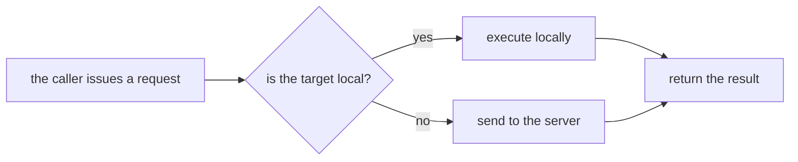

**Notes**:
- if the caller's process already registered the function for the target App / UID / P2PName, LingoFuse
  **executes locally first**, without touching the network.
- that saves network round trips and lowers latency.
- note: **App-name routing is local-first by default; UID routing is local-first too; P2PName routing is
  not**.

**The source evidence**:

```pascal
// the first step of the client's Send_Execute_Notify
tmp_cli__ := Find_Local_API(app_Name__, api_Name__, True);
if tmp_cli__ <> nil then
  begin
    tmp_cli__.APP.Engine.Execute_Notify(tmp_param);   // execute locally right away
    exit;
  end;
```

### 19.2 Server-side local handling (the request reaches the server, and the server can handle it)

```mermaid
flowchart LR
    A[a request arrives at the server] --> B{can the server handle it locally?}
    B -->|yes| C[the server executes locally]
    B -->|no| D[forward to the target client]
    C --> E[return the result]
    D --> E
```

**Notes**:
- when a request passes through the server, the server first checks whether it has the corresponding
  App / API in its own process.
- if it does, the server **handles it locally** and forwards nothing.
- that avoids unnecessary network forwarding and improves overall efficiency.
- **this optimization applies to App-name, UID and P2PName routing alike**.

**The source evidence**:

```pascal
// the first step of the server's cmd_Call
tmp_cli__ := Find_Local_API(app_Name__, api_Name__, True);
if tmp_cli__ <> nil then
  begin
    // handle it locally, do not forward
    RunHPC_CompleteBuffer_StreamM(Sender, nil, tmp_cli__, InData, OutData, Run_Call_Worker);
    exit;
  end;
// otherwise broadcast it to the other clients
```

### 19.3 The combined diagram of the two optimizations

```mermaid
flowchart TB
    A[the caller] --> B{can it be handled locally?}
    B -->|yes| C[execute locally]
    B -->|no| D[send to the server]
    D --> E{can the server handle it locally?}
    E -->|yes| F[the server executes locally]
    E -->|no| G[forward to the target client]
    C --> H[return the result]
    F --> H
    G --> H
```

### 19.4 The surprise of the local short circuit

**The problem**: in a multi-node test, `LF_Call` may actually execute locally, contrary to expectations.

**The cause**: C4 routing prefers a local App instance.

**The fixes**:
- establish whether the current process registered an App with that name.
- when a remote call is required, avoid a local App with the same name.
- or use distinct App names to separate local from remote.

**The related pitfall**: `LF-ROUTE-001`.

### 19.5 The impact of server-side local handling

**The problem**: when the server process itself registered an App with the same name, a request may
never be forwarded to the other clients.

**The cause**: the server process handles locally whatever it can.

**The fixes**:
- establish whether the server process should register a business App at all.
- a server usually acts only as a beacon and registers no business App.
- if it does register one, its handling capability must be made explicit.

**The related pitfall**: `LF-ROUTE-009`.

---

# Part 6 — The pitfalls knowledge base

## Chapter 20 The pitfalls knowledge base

> **The ID naming rule**: `LF-<subsystem>-<three-digit number>`.
>
> **What changed in v7.0**:
> - the "across an async boundary" wording in `LF-DATA-002` was removed (merged into `LF-ASYNC-001`).
> - added `LF-LOCAL-001` (local calls inject no identity), `LF-SEQ-003` (the sequencing thread releases
>   after 1 second) and `LF-ROUTE-012` (a P2PName async Call hangs).
> - `LF-ROUTE-011` was upgraded from "conjecture" to "verified".

### 20.1 The application / handle layer (LF-APP-*)

**LF-APP-001: a callback must be `cdecl`** (🟢)

- **Symptom**: the process crashes / the callback is never entered / `Trigger` becomes a garbage
  pointer / it crashes after changing environments.
- **Root cause**: the C ABI requires `cdecl`; Delphi defaults to `register` and FPC to `fastcall`.
- **Fix**:
  ```pascal
  procedure GoodCallback(Trigger: Pointer; Input, Output: TDataHnd); cdecl;
  ```
- **Related pitfalls**: `LF-CB-001`

**LF-APP-002: `LF_FreeApp` is a two-phase destructor** (🟢)

- **Symptom**: memory does not drop but grows; for a service that creates and destroys Apps frequently,
  `LF_App_Pool` keeps growing.
- **Root cause**: `LF_FreeApp` only unbinds, stops the sequencing threads and removes the timer; the
  object stays in `LF_App_Pool` until `LF_Shutdown` cleans up.
- **The correct approach**:
  - long-running processes: avoid creating and destroying Apps frequently.
  - short-lived jobs: restart the framework after `LF_Shutdown`.
- **Related pitfalls**: `LF-CLEAN-001`, `LF-CLEAN-002`

**LF-APP-003: `LF_Generate_AppName` must come after `LF_PrepareDone`** (🟢)

- **Symptom**: the name lacks the tunnel address and RemoteID; the server floods with `no found app`;
  clients receive no messages.
- **Root cause**: it needs the tunnel information concatenated, which does not exist before
  `LF_PrepareDone`.
- **Fix**: see the timing in §3.2.5.
- **Related pitfalls**: `LF-XLANG-001`, `LF-NET-003`

**LF-APP-004: the pointers returned by `LF_Generate_AppName` / `LF_Get_AppName` expire after 5 seconds** (🟢)

- **Symptom**: the string turns to garbage or an empty string, or an access violation occurs.
- **Root cause**: `Z.Notify.DelayFreeMem(5.0, Result)` releases it automatically.
- **Fix**: use the `Ex` variants to copy immediately.
- **Related pitfalls**: `LF-APP-003`, `LF-DATA-002`

**LF-APP-005: `LF_BindApp` binds only "unbound" clients** (🟢)

- **Symptom**: it returns 0 and the new App is never bound.
- **Root cause**: it binds only clients with `Cli.app = nil`; the main thread must be live.
- **Fix**:
  1. `Overlap_Connection=True` plus a new tunnel.
  2. prepare a different physical address.
  3. pass the App directly at the `PrepareClient` stage.
- **Binding order**: follows client creation order (🟢 made precise in v7.0).
- **Related pitfalls**: `LF-NET-001`, `LF-NET-004`

**LF-APP-006: with `Overlap_Connection=False` the second App is silently ignored** (🟢)

- **Symptom**: a second `LF_PrepareClient` returns a new tag, but the new App is never bound; later
  calls time out.
- **Root cause**: with `Overlap_Connection=False`, only one client tunnel is allowed per physical
  address.
- **Fix**: `LF_Set_Opt_Overlap_Connection(True)`.
- **Related pitfalls**: `LF-NET-001`, `LF-APP-005`

**LF-APP-007: `LF_FreeApp` has a shutdown guard** (🟢)

- **Symptom**: calling `LF_FreeApp` after `LF_Shutdown` is a no-op.
- **Root cause**: `if not Core_Dispatch_Order_Activted then exit`.
- **Fix**: the cleanup order `ExitMainThread → FreeApp → Shutdown`.
- **Related pitfalls**: `LF-CLEAN-001`, `LF-APP-002`

### 20.2 The callback layer (LF-CB-*)

**LF-CB-001: a callback must be explicitly `cdecl`** (🟢)
- **Note**: the same item as `LF-APP-001`.

**LF-CB-002: blocking LingoFuse functions are forbidden inside a callback** (🟢)

- **Symptom**: the whole process deadlocks.
- **Root cause**: the callback holds an internal lock and the remote call needs the same lock.
- **Fix**: submit the work asynchronously to a worker thread.

**LF-CB-003: long blocking inside a callback is forbidden** (🟢)

- **Symptom**: C4 thread pool threads become unavailable and requests queue up under high concurrency.
- **Fix**: the callback should only "read the input + enqueue + return immediately".

**LF-CB-004: callbacks must be thread-safe** (🟢)

- **Symptom**: occasional crashes, more likely on many-core machines.
- **Fix**: protect shared state with a critical section; use `RegisterSyncCall_M` for UI work.

**LF-CB-005: synchronous callbacks need `LF_Sync` driven by the main loop** (🟢)

- **Symptom**: the synchronous callback never runs.
- **Fix**: call `LF_Sync` periodically in the main loop.

### 20.3 The data handle layer (LF-DATA-*)

**LF-DATA-001: handles must be released explicitly** (🟢)

- **Symptom**: memory keeps growing under heavy call volume.
- **Root cause**: automatic reclamation is only an **asynchronous safety net** (10 minutes idle + a
  5-second scan).
- **Fix**: use `try..finally` to guarantee the release.

**LF-DATA-002: a handle must not be released inside a callback** (🟢)

- **Symptom**: crash / data corruption.
- **Fix**: do not release `Input` / `Output` in a callback; copy by value across threads.
- **v7.0 simplification**: the across-async-boundary part was merged into `LF-ASYNC-001`.

**LF-DATA-003: `Data_Param` and `Data_Result` are mutually exclusive** (🟢)

**LF-DATA-004: the tolerant mode of `LF_ReadString` may consume every remaining byte** (🟢)

**LF-DATA-005: `LF_WriteString` always appends #0** (🟢)

**LF-DATA-006: the second-level memory pool `TLF_DataMemory`** (🟢)

**LF-DATA-007: the `calling___` counter protects an in-flight remote call** (🟢)

**LF-DATA-008: the correct and incorrect uses of `LF_CreateData_Permanent`** (🟢)

### 20.4 The network preparation layer (LF-NET-*)

**LF-NET-001: only one client per physical address** (🟢)

**LF-NET-002: `LF_PrepareDone` blocks until the clients are ready** (🟢)

**LF-NET-003: `LF_PrepareDone` returns 1 only the first time in a process** (🟢)

**LF-NET-004: with `Wait_Connection_ReadyOk=False` the retry logic is yours** (🟢)

**LF-NET-005: network event callbacks run on a background TCompute worker thread** (🟢)

**LF-NET-006: the `addr_` of a network event callback is invalid as soon as the callback returns** (🟢)

**LF-NET-007: `LF_PrepareDone` still returns 1 after a timeout** (🟢)

### 20.5 The remote call layer (LF-CALL-*)

**LF-CALL-001: a `LF_Call` timeout returns a size-0 handle (not nil)** (🟢)

**LF-CALL-002: `LF_Notify` does not guarantee delivery; only `LF_Sequenced_Notify` guarantees order** (🟢)

### 20.6 The sequenced notification layer (LF-SEQ-*)

**LF-SEQ-001: a sequenced notification thread terminates automatically after 5 idle minutes** (🟢)

**LF-SEQ-002: the FIFO guarantee of `LF_Sequenced_Notify` covers only the same `(App, API)` pair** (🟢)

**LF-SEQ-003 [new in v7.0]: the sequencing thread is released 1 second after it exits** (🟢)
- **Symptom**: if you assume the 5-second lifetime the v6.0 docs described, you may end up with a
  dangling reference.
- **Root cause**: the source is `DelayFreeObj(1.0, self)`.
- **Fix**: do not rely on a "5-second safety window"; keep no reference to the sequencing thread after
  it exits.
- **Related pitfalls**: `LF-MEM-004`

### 20.7 The query and cache layer (LF-CHK-*)

**LF-CHK-001: `LF_CheckApp` / `LF_CheckApi` are cache-based, with about a 3-second delay** (🟢)

### 20.8 The runtime option layer (LF-OPT-*)

**LF-OPT-001: `LF_SetOption` silently ignores unknown options** (🟢)

**LF-OPT-002: runtime options are not persisted** (🟢)

**LF-OPT-003: the full semantics and recommended configurations of `Overlap_Connection`** (🟢)

### 20.9 Cleanup and lifetime (LF-CLEAN-*)

**LF-CLEAN-001: the correct cleanup order is `ExitMainThread` → `FreeApp` → `Shutdown`** (🟢)

**LF-CLEAN-002: you can reinitialize after `LF_Shutdown`** (🟢)

**LF-CLEAN-003: the DLL scenario requires an explicit `LF_Shutdown`** (🟢)

### 20.10 The threading model (LF-THREAD-*)

**LF-THREAD-001: every exported function is thread-safe** (🟢)

**LF-THREAD-002: concurrent writes to a data handle are not safe** (🟢)

### 20.11 Types and compilation (LF-TYPE-*)

**LF-TYPE-001: under FPC, `var` and `out` encode to the same reference category** (🟡)

**LF-TYPE-002: cross-language interfaces may use only primitive types** (🟢)

### 20.12 Cross-language data exchange (LF-XLANG-*)

**LF-XLANG-001: strings must follow the #0 terminator convention** (🟢)

**LF-XLANG-002: UTF-8 goes end to end, never through a `string` round trip** (🟡)

**LF-XLANG-003: the byte order is uniformly little-endian** (🟢)
- **reinforced in v7.0**: the Z framework **does not support big-endian platforms**. `{$IFDEF BIG_ENDIAN}`
  in `Z.Define.inc` raises a `{$MESSAGE FATAL}` compile error.

### 20.13 The JSON usage layer (LF-JSON-*)

**LF-JSON-001: `TZ_JsonObject` is a tree; the Parse-style methods may only be called on the root** (🟢)

**LF-JSON-002: JSON assembly must stay in the Unicode space and never round-trip through a `string`** (🟢)

**LF-JSON-003: the GBK / Latin-1 fallback must use `USystemString`** (🟢)

### 20.14 The simulated main thread (LF-MAIN-*)

**LF-MAIN-001: the simulated main thread can only be started once per process** (🟢)


**LF-MAIN-002: the simulated main thread drives every background job** (🟢)

**LF-MAIN-003: the relationship between `LF_ExitMainThread` and resource release** (🟢)

**LF-MAIN-004: the three-branch semantics of `LF_DataPool.Progress`** (🟢)

### 20.15 Memory and lifetime (LF-MEM-*)

**LF-MEM-001: the three-level memory pool architecture** (🟢)

**LF-MEM-002: `TLF_Data` is a record, not a class** (🟢)

**LF-MEM-003: the two-phase destruction of `TLF_App`** (🟢)

**LF-MEM-004: the delayed release of `TLF_Notify_Sequence_Thread` is 1 second** (🟢, corrected in v7.0)
- **The mechanism**: `DelayFreeObj(1.0, self)`.
- **The impact**: do not rely on a "5-second safety window".
- **Related pitfalls**: `LF-SEQ-003`

**LF-MEM-005: the leak investigation checklist** (🟢)
- see §15.8.

### 20.16 Core LF mechanisms (LF-MECH-*)

| ID | Mechanism | The risk in one sentence |
|---|------|-----------|
| `LF-MECH-001` | automatic data handle reclamation | automatic reclamation is an asynchronous safety net, not a release guarantee |
| `LF-MECH-002` | the `LF_FreeData` no-op window | releasing before PrepareDone / after ExitMainThread does nothing |
| `LF-MECH-003` | `LF_ExitMainThread` clears the handles | including permanent handles; they are unusable afterwards |
| `LF-MECH-004` | `LF_PrepareDone` succeeds only once | a second call returning 0 is not a failure; a timeout may still return 1 |
| `LF-MECH-005` | `LF_FreeApp` is a two-phase destructor | FreeApp does not release immediately; only Shutdown destroys |
| `LF-MECH-006` | the callback threading model | callbacks run on background worker threads; no blocking and no LF_Call |
| `LF-MECH-007` | the meaning of network events | Connect is not a TCP connect; addr becomes invalid immediately |
| `LF-MECH-008` | address uniqueness and Overlap | by default a second App on the same address is silently ignored |
| `LF-MECH-009` | LF_Call timeouts and idempotency | a timeout returns a size=0 handle; the server may keep executing |
| `LF-MECH-010` | local-first routing | a local App with the same name executes first, without the network |
| `LF-MECH-011` | broadcast cache delay | CheckApp / CheckApi lag by about 3 seconds |
| `LF-MECH-012` | the sequenced notification thread | FIFO only within the same (App, API) pair; the thread terminates when idle |
| `LF-MECH-013` | the runtime option mechanism | unknown options are silently ignored; nothing is persisted |
| `LF-MECH-014` | the calling counter and the memory pool | long calls protect the handle; the second-level pool reuses records |
| `LF-MECH-015` | the cleanup order and DLLs | ExitMainThread → FreeApp → Shutdown |
| `LF-MECH-016` | the NUL wire-format contract | string writes append #0; a tolerant read may consume the remainder |
| `LF-MECH-017` | the side data injection mechanism | the sender writes it automatically; it is valid only on the callback Input |
| `LF-MECH-018` | async handles are released immediately | async-family handles are released as soon as the callback returns; sync-family handles belong to the caller |

### 20.17 Local calls (LF-LOCAL-*, new in v7.0)

**LF-LOCAL-001: `LF_LocalCall` / `LF_LocalNotify` inject no sender identity** (🟢)

- **Symptom**: inside a local-call callback, `LF_Get_P2P_UID(Input)` returns all zeros and
  `LF_Get_P2P_Name(Input)` returns an empty string.
- **Root cause**: `LF_LocalCall` / `LF_LocalNotify` (`Z.LingoFuse_Export.pas`) call
  `PLF_Data(Param).Data_Param.EncryptToMem(tmp)` directly and **never go through
  `Rebuild_UID_and_P2PName`**.
  - if `Param` was created by `LF_CreateData`, its `FromUID` is `Null_UID()`.
- **Contrast**: **a local call that goes through the `TC40_LF_Client.Send_*` path (i.e. `LF_Call` hitting
  the local short circuit) does inject the identity**.
- **The fixes**:
  - if a local call needs to carry an identity → use `LF_Call` (it hits the local short circuit and still
    injects the identity).
  - or write the sender identity into the `Param` yourself.
- **Related pitfalls**: §5.6, §10.3, `LF-MECH-017`.

### 20.18 Routing and addressing (LF-ROUTE-*)

**LF-ROUTE-001: the surprise of local-first routing** (🟢)

**LF-ROUTE-002: a UID is a session-level identifier and changes after a reconnect** (🟢)

**LF-ROUTE-003: P2PName routing does no local lookup** (🟢)

**LF-ROUTE-004: the UID universal route can call any API** (🟢)

**LF-ROUTE-005: the Cycle_Anchor mechanism of P2PName load balancing** (🟢)

**LF-ROUTE-006: the FixedSequenced mechanism of P2PName stickiness** (🟢)

**LF-ROUTE-007: whoami mode is a precondition of UID routing** (🟢)

**LF-ROUTE-008: the APIs of the three addressing schemes cannot mix parameter types** (🟢)

**LF-ROUTE-009: the surprise of server-side local handling** (🟢)

**LF-ROUTE-010: UID / P2PName calls can hit App-registered functions, App-name calls cannot hit P2P-registered functions** (🟢)

**LF-ROUTE-011: the boundaries of automatic distribution across several servers** (🟢, upgraded from conjecture in v7.0)
- **The note**: your program can `prepareClient` several server addresses. **The precondition**: the
  servers have established physical connections among themselves over the C4 protocol (mutual `Client` /
  `Auto` connections), **forming a C4 mesh**.
- **if the servers do not interconnect**, they are islands, and no cross-server balancing happens.
- **extra configuration**: none is needed for broadcast or routing; as long as the servers are connected
  through a C4 mesh, cross-node routing works automatically.
- **Related pitfalls**: `LF-ROUTE-005`

**LF-ROUTE-012 [new in v7.0]: if the server cannot find the group name, a P2PName async Call never fires its callback** (🟢)
- **Symptom**: `LF_P2PNAME_Async_Call("no_such_group", ...)` returns 1 (already enqueued), but the callback
  never fires.
- **Root cause**: when `Find_P2PName_LoadBalance` returns nil, the server's `cmd_P2PName_Call` only does
  `DoStatus('no found p2pname:"%s"')` and **sends no reply**.
- **Contrast**: a synchronous `LF_P2PNAME_Call` times out and returns a size=0 handle; the async version
  **hangs forever**.
- **Fix**: the caller must implement its own timeout (track pending requests and discard the holder on
  timeout).
- **Related pitfalls**: §8.4, §11.3.

### 20.19 Async calls and handle ownership (LF-ASYNC-*)

**LF-ASYNC-001: the async family's `Result_` handle belongs to the framework and is released as soon as the callback returns** (🟢)

- **Symptoms**:
  - reading `Result_` outside the callback → empty data / garbage data.
  - calling `LF_FreeData` on `Result_` outside the callback → double free / crash.
  - the symptom looks "intermittent": a small payload looks fine, a large payload comes back empty.
- **Root cause**:
  - the sync family returns `New_Result_From(..., True)` with `auto_recycle = True`, so it belongs to the
    caller.
  - the async family does `New_Result_From(..., False)` inside `TLF_Async_Call_Bridge.Do_Th` with
    `auto_recycle = False`, and **calls `Free_Data` immediately after the callback returns**.
- **The fixes**:
  1. **pattern A**: use the sync family. The ownership contract is simple.
  2. **pattern B**: use the async family and **read and copy the data out inside the callback**.
  3. **pattern C**: use the Future interface the binding layer provides.
- **Related pitfalls**: `LF-ASYNC-002`, `LF-ASYNC-003`, `LF-ASYNC-006`, `LF-DATA-002`

**LF-ASYNC-002: an async handle must never be kept across threads** (🟢)

**LF-ASYNC-003: `LF_FreeData` on an async handle is forbidden** (🟢)

**LF-ASYNC-004: the "~1 second" in the comments is misleading** (🟢)

- **Root cause**: the comment says "released after 1 second", but the reality is "released **immediately**
  after the callback returns". The "1 second" is the `DelayFreeObj(1.0, Self)` that releases the **Bridge
  object**, not the `Result_` handle.
- **The lesson**: comments are second-hand information. When behaviour looks suspicious, read the source.

**LF-ASYNC-005: the `int` vs `dict` dichotomy is a false classification** (🟢)

- **Root cause**: the real variable is **payload size → the moment memory gets reused**.
- **Fix**: a dichotomy must ask the right question.

**LF-ASYNC-006: the sync and async ownership contracts cannot be mixed** (🟢)

**LF-ASYNC-007: the active window of an async handle is microseconds to milliseconds** (🟢)

**LF-ASYNC-008: the binding layer must wrap all async handle handling inside the callback** (🟢)

---

## Chapter 21 The LLM ecosystem pitfall index

> **This chapter is an index only**. The LLM ecosystem (the Python side, MCP gateways, LTB, stdio
> transport and so on) is another domain; the details live in `LingoFuse_LLM_Pitfalls_For_AI.md`.

### 21.1 The LLM ecosystem pitfall ID map

| LLM ecosystem pitfall ID | Topic | The counterpart in the Pascal layer |
|--------------|------|------------------|
| P0-1 | `client_name` must be a real App name | `LF-APP-003` |
| P0-3 | blocking LingoFuse functions must not be called in a callback | `LF-CB-002` |
| P2-1 | encoding problems | `LF-XLANG-002` |
| P4-2 | GUI cleanup order | `LF-CLEAN-001` |
| P7-3 | LTB pre-connection | `LF-NET-003` / `LF-MAIN-001` |
| **the P9 series** | **Structured Output** | **`LF-JSON-001` / `LF-JSON-002`** |
| **P10-1** | **calling parse on a child object leaves the parent tree dangling** | **`LF-JSON-001`** |
| **P10-2** | **JSON passing through AnsiString loses characters** | **`LF-JSON-002`** |
| **P10-3** | **the GBK fallback SetLength unit is wrong** | **`LF-JSON-003`** |
| **P11** | **async callback handles leak out** | **`LF-ASYNC-001` / `LF-ASYNC-002`** |
| **P12** | **`LF_Get_P2P_UID` returns a pointer instead of an array** | **§4.6.1 / `LF-ROUTE-002`** |
| **P13** | **"the request is not forwarded" caused by server-side local handling** | **`LF-ROUTE-009`** |
| **P14** | **an App-name call cannot hit a P2P-registered function** | **`LF-ROUTE-010` / §6.6** |
| **P15 (v7.0)** | **a local call injects no sender identity** | **`LF-LOCAL-001` / §5.6** |
| **P16 (v7.0)** | **a P2PName async Call hangs forever when the group name is not found** | **`LF-ROUTE-012` / §8.4** |

---

# Appendices

## Appendix A Error message verbatim index

| Error message verbatim | Section | A brief note |
|-------------|------|------|
| `no found app("...") api("...")` | `LF-APP-003` | client_name not registered, or generated too early |
| `LF_PrepareClient returned -1` | `LF-NET-001` | duplicate address |
| `repeat connection` | `LF-NET-001` | duplicate address |
| `prepare error: repeat listen` | `LF-NET-001` | duplicate listening address |
| `LF_PrepareDone failed` | `LF-NET-002` | the wait timed out |
| `LF_PrepareDone returned 0` | `LF-NET-003` / `LF-MAIN-001` | a second call |
| `LF_BindApp: Main thread is not active` | `LF-APP-005` | the main thread is not started |
| `LF_BindApp: All clients are already occupied` | `LF-APP-005` | no free client |
| `3029 function header doesn't match` | `LF-TYPE-001` | var/out have the same signature |
| `Can't find unit Z.Core` | compile configuration | the unit search path is not configured |
| `Queue "..." is already occupied` | port in use | the endpoint is occupied |
| `Callback type mismatch` | `LF-APP-001` | missing cdecl |
| `Timeout` / a size-0 result | `LF-CALL-001` | the call timed out |
| `Module not found: LingoFuse64.dll` | deployment | the dynamic library was not found |
| `hint: Data handle pool "N" handles were idle...` | `LF-DATA-001` | the automatic data handle reclamation log |
| `Sequenced notify api "..." thread idle timeout` | `LF-SEQ-001` | the sequenced notification thread idle-exit log |
| `LingoFuse Main Thread Begin/Exit` | `LF-MAIN-001` / `LF-MAIN-003` | the simulated main thread log |
| `[warning] Get_P2P_UID(): P2P Info only backcall "input" parameter.` | §4.6.1 / §10.4 | called on an output or self-created handle |
| `no found uid:%s api("%s")` | `LF-ROUTE-004` | UID routing could not find the target |
| `no found p2pname:"%s" api:"%s"` | `LF-ROUTE-005` / `LF-ROUTE-012` | P2PName routing could not find the target; the async version hangs forever |
| `LF_SetOption: opt="%s" val="%s"` | §11.1 | the option-setting log |
| `LF_P2P_name = %s` | §11.6.1 | the P2PName setting log |
| an access violation inside a network event callback | `LF-NET-005` | cross-thread UI access |
| the network event `addr_` turning to garbage / empty | `LF-NET-006` | a dangling `addr_` |
| `unrecognized type json_schema` | `LF-JSON-001` | a JSON Schema assembly error |
| `options.response_format` lost | `LF-JSON-001` | a dangling parent tree |
| `ToBytes` access violation | `LF-JSON-001` | a dangling parent tree |
| emoji / Korean turning into `?` in a Schema | `LF-JSON-002` | an AnsiString round trip |
| the GBK fallback output is garbage / truncated | `LF-JSON-003` | the wrong SetLength unit |
| empty data or a crash after an async callback (no explicit error message) | `LF-ASYNC-001` / `LF-ASYNC-002` / `LF-ASYNC-003` | an async handle leaking out / double free |
| the request was not forwarded to the target client (v6.0) | `LF-ROUTE-009` | server-side local handling |
| an App-name call to a P2P-registered function fails (v6.0) | `LF-ROUTE-010` | routing asymmetry |
| the P2P identity is empty inside a local-call callback (v7.0) | `LF-LOCAL-001` | it skips Rebuild_UID_and_P2PName |

## Appendix B The ID overview and maintenance conventions

### B.1 The current ID overview (v7.0)

| ID prefix | Entries | Note |
|---------|:------:|------|
| `LF-APP` | 7 | the application / handle layer |
| `LF-CB` | 5 | the callback layer |
| `LF-DATA` | 8 | the data handle layer |
| `LF-NET` | 7 | the network preparation layer |
| `LF-CALL` | 2 | the remote call layer |
| `LF-SEQ` | **3** | the sequenced notification layer (LF-SEQ-003 added in v7.0) |
| `LF-CHK` | 1 | queries and caching |
| `LF-OPT` | 3 | runtime options |
| `LF-CLEAN` | 3 | cleanup and lifetime |
| `LF-THREAD` | 2 | the threading model |
| `LF-TYPE` | 2 | types and compilation |
| `LF-XLANG` | 3 | cross-language data exchange |
| `LF-JSON` | 3 | the JSON usage layer |
| `LF-MAIN` | 4 | the simulated main thread |
| `LF-MEM` | 5 | memory and lifetime |
| `LF-MECH` | 18 | core LF mechanisms (shared across languages) |
| `LF-ROUTE` | **12** | routing and addressing (LF-ROUTE-012 added in v7.0) |
| `LF-ASYNC` | 8 | async calls and handle ownership |
| **`LF-LOCAL`** | **1** | **local calls (new in v7.0)** |
| **Total** | **95** | (92 in v6.0; 3 added in v7.0) |

### B.2 The maintenance conventions

1. **ID allocation**: increment per subsystem and **never reuse a deleted ID**.
2. **The evidence level must be marked**: 🟢 / 🟡.
3. **Required fields**: ID, title, evidence level, affected version, trigger condition, symptom, root
   cause, fix, verification checklist.
4. **Optional fields**: minimal reproduction, related pitfalls.
5. **Cross references**: the `related pitfalls` field is maintained in both directions.
6. **Upgrading the evidence level**: 🟡 → 🟢, only upwards.
7. **A new subsystem**: a dedicated subsystem prefix is created only when there are ≥ 3 pitfalls of the
   same origin.
8. **From v7.0 on the "uncertain" marker is no longer used**. Every assertion must have evidence.

## Appendix C Retrieval rules for AI users

### C.1 The retrieval priority

1. **check this knowledge base first**: by ID (`LF-XXX-NNN`) or by keyword.
2. **routing-related**: check chapter 8, chapter 9 and §20.18 (`LF-ROUTE-*`) first.
3. **P2P distributed-load-related**: check chapter 18 first.
4. **route-optimization-related**: check chapter 19 first.
5. **local-call identity**: check §5.6, §10.3 and `LF-LOCAL-001` first.
6. **options-related**: check chapter 11 first.
7. **JSON-related**: check §20.13 (`LF-JSON-001 / 002 / 003`) first, then `Z.Json.md`.
8. **main-thread-related**: check chapter 12 and §20.14 (`LF-MAIN-*`) first.
9. **memory-related**: check chapter 15 and §20.15 (`LF-MEM-*`) first.
10. **handle-ownership-related**: check §4.7 and §20.19 (`LF-ASYNC-*`) first.
11. **mechanism-level general questions**: check §20.16 (`LF-MECH-*`) first.
12. **no hit**: check the LLM ecosystem index in chapter 21.
13. **still no answer**: say plainly "the current material is not enough to decide" and suggest going back
    to the source.

### C.2 The metadata every answer must carry

- **the IDs relied on** (such as `LF-APP-003` / `LF-ROUTE-012` / `LF-LOCAL-001` / `LF-MECH-006`).
- **the evidence level** (🟢 / 🟡).

### C.3 The structured output template

```
[ID] LF-XXX-NNN
[Evidence level] 🟢 / 🟡
[Symptom] ...
[Root cause] ...
[Fix] ...
[Verification] ...
[Related pitfalls] ...
```

## Appendix D The core iron rules

### D.1 General iron rules

1. **a callback must be `cdecl`**, and calling `LF_Call` / `LF_Notify` / `LF_LocalCall` inside a callback
   is forbidden.
2. **a data handle must be freed explicitly with `LF_FreeData`**; automatic reclamation is not insurance
   (10 minutes idle + a 5-second scan).
3. **the cleanup order must be `ExitMainThread` → `FreeApp` → `Shutdown`**.
4. **`TZ_JsonObject` is a tree**: `Parae` / `Assign` / `LoadFromStream` / `ParseText` may only be called
   on the root; use `TZ_JsonString` for intermediate JSON containers.
5. **`LF_PrepareDone` can only succeed once per process**; `LF_ExitMainThread` clears every data handle
   (including permanent ones).
6. **a handle created by `LF_CreateData_Permanent` is never reclaimed automatically**; `LF_FreeData` is a
   no-op before `LF_PrepareDone` / after `LF_ExitMainThread`.
7. **network event callbacks run on a TCompute worker thread**, and `addr_` becomes invalid as soon as the
   callback returns.

### D.2 Routing-related iron rules

8. **a UID is a universal routing identifier**: knowing the UID lets you call any API of the target client
   without knowing the App name.
9. **P2PName routing does no local lookup**: it always goes over the network, and the server does the
   balancing / stickiness.
10. **App-name routing is local-first**: if this process has an App with that name it executes locally,
    without the network.
11. **the API parameter types differ across the three addressing schemes**: App name / P2PName take a
    `PAnsiChar`, UID takes a 32-byte array.
12. **server-side local handling**: once a request reaches the server, the server handles it locally if it
    can and forwards nothing.
13. **an App-name call cannot hit a P2P-registered function**; UID / P2PName calls can hit every
    registered function.

### D.3 Mechanism-related iron rules

14. **a `LF_Call` timeout returns a size=0 handle, not nil**; retries need business-level idempotency.
15. **several Apps on the same address require `Overlap_Connection=True` or `LF_BindApp`**.
16. **blocking and calling `LF_Call` / `LF_Notify` / `LF_LocalCall` inside a callback are forbidden**.
17. **after `LF_Shutdown` every other `LF_*` function is void**.

### D.4 The async handle ownership iron rules

18. **the handle returned by the sync family (`LF_Call` / `LF_UID_Call` / `LF_P2PNAME_Call`) belongs to the
    caller**, and the caller is responsible for `LF_FreeData`.
19. **the `Result_` handle of the async family (`LF_Async_Call` / `LF_UID_Async_Call` /
    `LF_P2PNAME_Async_Call`) belongs to the framework** and becomes invalid as soon as the callback
    returns; using it outside the callback is **forbidden**, and `LF_FreeData` is **forbidden**.
20. **the active window of a handle inside an async callback = the duration of the callback invocation**;
    when it must be used across threads, **the data must be copied first**.
21. **a dichotomy must ask the right question**: type differences (`int` vs `dict`) are usually a false
    classification; the real variable is **the moment memory gets reused**.
22. **comments are second-hand information**: when behaviour looks suspicious, read the source, not the
    comments. The "released after ~1 second" comment is misleading.

### D.5 The P2P identity query iron rules

23. **the data behind `LF_Get_P2P_UID` / `LF_Get_P2P_Name` is "the metadata the sender wrote automatically
    when sending the request"**, **not the business data of the handle itself**.
24. **these two functions are valid only on "the `Input` parameter of the callback that triggered the
    event"**; calling them on a self-created or output handle is void (empty result / a warning).
25. **`LF_Get_P2P_UID` returns a `PP2P_UID___` pointer**; the framework releases it automatically after
    about 5 seconds, so the caller **copies and reads only**, **never frees it manually** and **never keeps
    it long-term**.
26. **[new in v7.0] `LF_LocalCall` / `LF_LocalNotify` inject no sender identity**. If a local call must
    carry an identity too, use `LF_Call`.

### D.6 The P2P distributed-load iron rules

27. **to get distribution, create one-to-many**: several programs registering the same App name, or several
    programs registering the same P2PName.
28. **use P2PName for homogeneous workers; never use an App name for multicast** (App names are
    local-first).
29. **use Sequenced when order matters**: FIFO within the same `(App, API)` or `(P2PName, API)`.
30. **use binary handles for large traffic**: video frames, audio blocks, matrices, tensors — write the
    buffer directly.
31. **with several servers, confirm they support cross-node routing** (a C4 mesh is required), otherwise
    they are just islands.
32. **[new in v7.0] a P2PName async Call never fires its callback when the group name is not found**; the
    caller must implement its own timeout.

## Appendix E The complete clarification of the v6.0 uncertainty list

> This appendix gives the final conclusion for each of the 20 uncertain items in v6.0's appendix E.
> **From v7.0 on, the body keeps no "uncertain" marker at all**; every conclusion has been merged into the
> corresponding chapter of the body.

| # | The v6.0 uncertain item | The v7.0 conclusion | Location in the body |
|:-:|--------------|-----------|---------|
| 1 | the exact behaviour of `LF_SetOption` before `LF_PrepareDone` | **executed immediately while the main thread is not running; once it is running, dispatched to the main thread to run asynchronously (with a tiny delay)** | §11.1 |
| 2 | the exact impact of toggling `Overlap_Connection` at runtime | **it only affects the next `LF_PrepareClient`; existing tunnels are not rearranged** | §11.2.1 |
| 3 | the return-value format of `LF_Generate_AppName` when no client exists | **`@__generate__@&<process name:PID>&<counter>`** (note the leading `&`) | §5.2.3 |
| 4 | the binding order of `LF_BindApp` | **by client creation order (the internal order of `C40_ClientPool`)** | §5.2.5 |
| 5 | when `FAPI_Lookup_Cache` is invalidated | **server side: `cmd_Init_APP_Info` / `cmd_No_App_Info` / `DoUserOut_Event`; client side: `cmd_update_service_api_info` / `DoNetworkOffline`** | §8.2 |
| 6 | the selection precision of P2PName load balancing | **every call picks exactly the least recently used UID (the smallest `Cycle_Anchor`)** | §8.4 |
| 7 | the actual effect of changing `Fixed_Sequenced_Time` | **the semantics are clear (switch after the same UID has been served N milliseconds); the best value must be measured per scenario** | §11.6.2 |
| 8 | the details of the UID generation algorithm | **`Generate_Global_UID(physical tunnel UID, recv server UID, send server UID)`; the old UID joins on a reconnect** | §8.3 |
| 9 | the exact timing of `Rebuild_UID_and_P2PName` on the local-call path | **a local call through the `Send_*` path injects it; `LF_LocalCall` / `LF_LocalNotify` do not** | §5.6, §10.3 |
| 10 | the thread safety of `TZ_JsonObject` | **not thread-safe** (stated explicitly in `Z.Json.md`) | §20.13 |
| 11 | the exact thread ID of a network event callback | **a TCompute worker thread; the pool scheduler decides which one** | §14.4 |
| 12 | the idempotency of calling `LF_Shutdown` several times | **idempotent** (every step has a precondition check) | §17.2 |
| 13 | the race between `TLF_Notify_Sequence_Thread`'s `DelayFreeObj` and `Kill_App` | **theoretically present** (`Do_Run_Th` checks without holding the lock); avoid creating and destroying Apps under high concurrency | §15.9 |
| 14 | the timeout and concurrency semantics of `C40Progress` inside `Simulated_Main_Thread` | **dynamic throttling: 1ms while active / 10ms while idle** | §12.1 |
| 15 | big-endian platforms | **not supported** (a compile-time FATAL) | §20.12 |
| 16 | the exact release order of an async handle | **`Free_Data` runs on the line after `OnResult` returns; the window is 0** | §4.7.2 |
| 17 | the concurrency of `LF_Get_P2P_UID`'s delayed pointer release | **every call allocates independently and releases independently; they do not affect each other** | §4.6.1 |
| 18 | the exact conditions for multi-server cross-node routing | **the servers must establish physical connections over the C4 protocol to form a mesh**; no extra broadcast configuration is needed | §18.5 |
| 19 | the boundary of server-side local handling | **the server handles it locally if it can and forwards nothing (true for App-name / UID / P2PName routing alike)** | §19.2 |
| 20 | the timeline details of P2PName cross-language routing | **this knowledge base gives the full C ABI-level contract; each language binding layer's implementation must be checked against its own source** | §16.4 |

**The two corrections from v6.0 to v7.0**:

| Item | The v6.0 description | The v7.0 correction | Evidence |
|----|-----------|-----------|------|
| the delayed release after a sequencing thread exits | 5 seconds (quoting `Z.LingoFuse.md`) | **1 second** (the source `DelayFreeObj(1.0, self)`) | 🟢 |
| whether `LF_LocalCall` / `LF_LocalNotify` inject an identity | "local calls are injected automatically too" | **not injected**; only local calls through the `Send_*` path are | 🟢 |

---

## Document version

- **v7.0 (fully-settled edition + structural reorganization + 3 new pitfalls + 2 corrections)**
- **Last updated**: 2026-10-15
- **Maintainer**: the LingoFuse team
- **The v7.0 core commitments**:
  - **no "uncertain" marker is kept any more**.
  - **all 20 items of the original v6.0 appendix E are concluded**.
  - **the two descriptive deviations of v6.0 are corrected** (the sequencing thread releases after 1
    second; `LF_LocalCall` injects no identity).
  - **3 new pitfall IDs**: `LF-LOCAL-001`, `LF-SEQ-003`, `LF-ROUTE-012`.
  - **the P2PName five-function two-strategy mapping table** and **the C ABI cross-language contract
    table** are presented in full.
  - **every API mechanism is preserved in depth**: `LF_GetBuffer` / `LF_WriteBuffer` / `LF_Get_P2P_UID` /
    `LF_Get_P2P_Name` / `LF_CreateData` / `LF_CreateData_Permanent` / `LF_FreeData` / `LF_CreateApp` /
    `LF_FreeApp` / `LF_Generate_AppName` / `LF_BindApp` / `LF_LocalCall` / `LF_LocalNotify` /
    `LF_RegisterCall` / `LF_GetStatus` / `LF_PostStatus` / `LF_SetOption` and so on all keep their
    source-level mechanism notes.
  - **every Mermaid diagram is preserved in full**: the three-layer architecture, the lifetime state
    machine, the data handle state machine, the three-addressing overview, routing asymmetry, the async
    handle timeline, the cross-language P2PName timeline, the two-level route optimization diagrams and
    so on.
  - **every code example is preserved in full**: initialization order, whoami mode, local calls, UID
    targeting, P2PName grouping, network events, option setting and so on.
  - **every option is expanded in depth**: the full internal mechanics, effective timing, aliases and
    recommended values of the 16 options.
  - **the complete pitfalls knowledge base**: 95 IDs, each with its symptom, root cause, fix and related
    pitfalls.

