# Pascal Service Guide for LingoFuse HTTP Bridge

> Chinese version: [Pascal Service Guide for LingoFuse HTTP Bridge (bridge.py).md](Pascal Service Guide for LingoFuse HTTP Bridge (bridge.py).md)

**Version**: v4.0
**Last updated**: 2026-09-19
**Audience**: developers writing a LingoFuse server in Pascal (Free Pascal / Delphi) and exposing an HTTP interface to the outside world through `bridge.py`.
**Reference baseline**: every contract in this guide follows the current source of `lingofuse/bridge.py`.

> **What is central to this version**:
> - Corrected the outdated v3.0 claim that "the bridge does no JSON handling" — the current `bridge.py` **normalises JSON payloads** (optionally, on by default).
> - Re-argued "Pascal through the bridge is inherently stable" in precise terms.
> - Every flow chart uses Mermaid. Over-large diagrams are split into several small ones.
> - Only flows are described; no concrete directories.

---

## Contents

1. [Why Pascal through the bridge is inherently stable](#chapter-1-why-pascal-through-the-bridge-is-inherently-stable)
2. [The three-role architecture](#chapter-2-the-three-role-architecture)
3. [Preparing the environment](#chapter-3-preparing-the-environment)
4. [Pascal server development conventions](#chapter-4-pascal-server-development-conventions)
5. [How bridge.py handles payloads](#chapter-5-how-bridgepy-handles-payloads)
6. [Command-line operations in detail](#chapter-6-command-line-operations-in-detail)
7. [The end-to-end startup flow](#chapter-7-the-end-to-end-startup-flow)
8. [Testing and verification](#chapter-8-testing-and-verification)
9. [Troubleshooting](#chapter-9-troubleshooting)
10. [Production deployment recommendations](#chapter-10-production-deployment-recommendations)

---

## Chapter 1 Why Pascal through the bridge is inherently stable

### 1.1 The one-sentence conclusion

> **Pascal does only business computation; the bridge does HTTP and encoding. The boundary between the two is clear and fixed — that is the engineering basis for long-term stable operation.**

### 1.2 The three roots of stability

Stability is not a slogan; it comes from three facts that can be checked one by one:

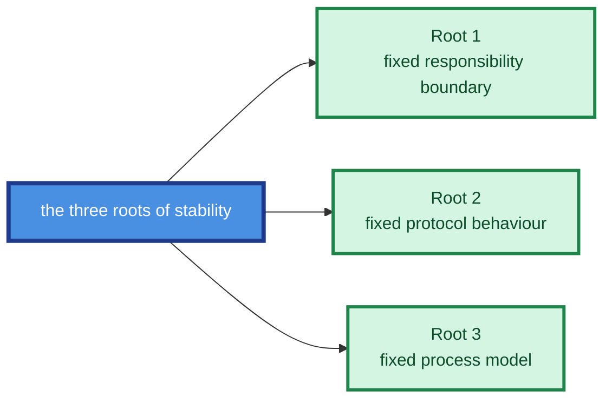

| Root | What it means | Why it is stable |
|------|---------|-----------|
| **fixed responsibility boundary** | Pascal only reads and writes a binary DataHnd; the bridge only moves between HTTP and DataHnd and normalises JSON | each side does a small number of deterministic things |
| **fixed protocol behaviour** | `LF_WriteString` unconditionally appends `\0`; `LF_ReadString` stops at `\0`; the bridge strips the trailing `\0` | the three actions agree at both ends and do not change with platform or version |
| **fixed process model** | the Pascal process and the bridge process talk over the LingoFuse C4 mesh; the bridge is stateless | a Pascal process crashing or restarting affects neither the bridge nor other nodes |

### 1.3 Who is responsible for what

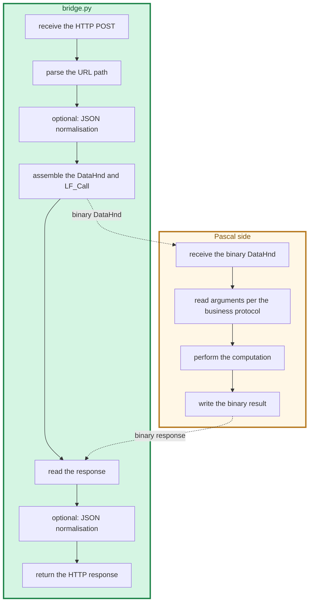

**Key points**:

1. **The Pascal side never touches HTTP** — it does not know whether the request came from a browser, curl, or another Pascal node.
2. **The Pascal side does no JSON parsing** — it merely reads the DataHnd bytes according to the business protocol. Whether that protocol is JSON or binary is a business decision.
3. **The Pascal side does no encoding conversion** — it trusts the DataHnd bytes only, and the bridge guarantees that the bytes entering the DataHnd are already in normalised form.
4. **The bridge does no business validation** — it only guarantees "the payload is valid JSON or passed through verbatim"; the specific business fields are the Pascal side's job.

### 1.4 The technical origin of the stability

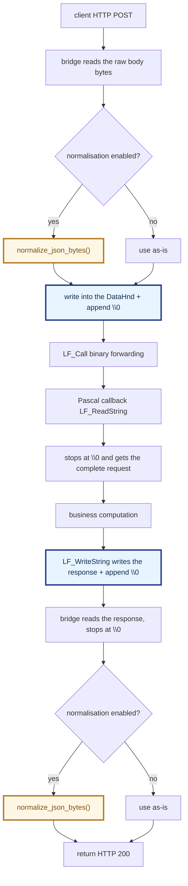

**Point by point**:

1. **`\0` reading and writing agree at both ends** — `LF_WriteString` adds it, `LF_ReadString` stops at it, the bridge strips it. These three steps are fixed, so the string boundary is always clear.
2. **JSON normalisation happens only at the bridge's edge** — the Pascal side only has to make sure what it writes conforms to the business agreement (preferably with `TZ_JsonObject` or `TPascalString.Bytes`), and the bridge normalises it into compact UTF-8 JSON the client can safely parse.
3. **The Pascal side does not know HTTP or browsers exist** — it sees one DataHnd in and one DataHnd out. Business logic and transport layer are fully decoupled.

### 1.5 Compared with other approaches

| Approach | Main problem | How the bridge differs |
|------|---------|------------------|
| an HTTP server embedded in Pascal | must maintain HTTP parsing, TLS, connection pools, concurrency | the bridge covers all of it; Pascal writes not a line of HTTP code |
| exposing the LingoFuse port directly from Pascal | a binary protocol is unfriendly to browsers and hard to layer security onto | the bridge offers standard HTTP, so the security layer can live in Nginx |
| hand-assembling JSON responses in Pascal | string escaping, UTF-8 encoding, trailing commas are all error-prone | the bridge normalises JSON, so the client always receives a valid payload |
| a Node/PHP middle tier | requires yet another runtime and dependency set | the bridge is one Python process with very few dependencies |

---

## Chapter 2 The three-role architecture

### 2.1 The three roles and their responsibilities

| Role | Language | Build artifact | Endpoint | Responsibility |
|------|------|---------|------|------|
| **bridge_service** | Pascal | native executable | `ipc:compute_grid` | the service registry (beacon); registers no business APIs |
| **bridge_compute** | Pascal | native executable | connects to the beacon | registers `pas.exp`, executes the business logic |
| **bridge.py** | Python | a script or a packaged single file | `http://0.0.0.0:8081` | the HTTP gateway, forwarding to `pas.exp` |

> **On paths**: this guide does not spell out directories. Build/install each program wherever you see fit, as long as `LingoFuse64.dll` (Windows) / `liblingofuse.so` (Linux) / `liblingofuse.dylib` (macOS) can be found.

### 2.2 The startup sequence (in four stages)

Because the full sequence diagram is too large, it is split into four smaller ones.

#### Stage 1 — the beacon starts

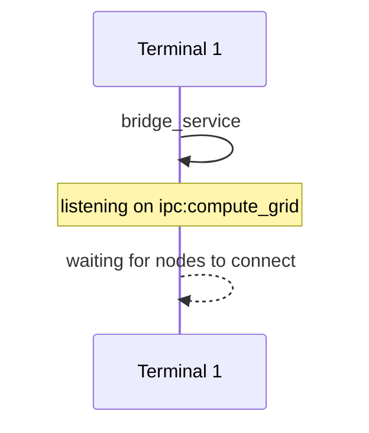

#### Stage 2 — the compute node registers

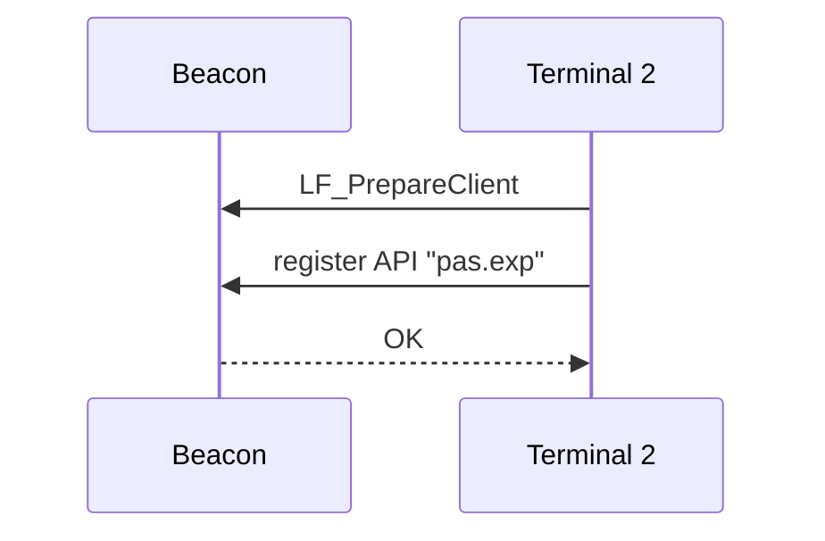

#### Stage 3 — the gateway joins

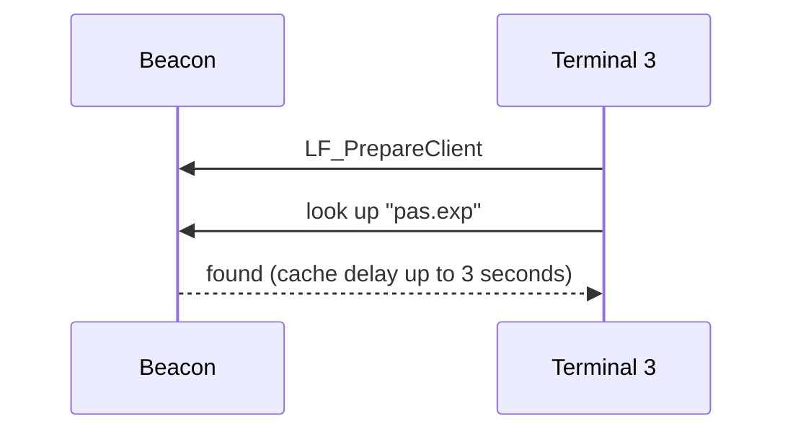

#### Stage 4 — an end-to-end call

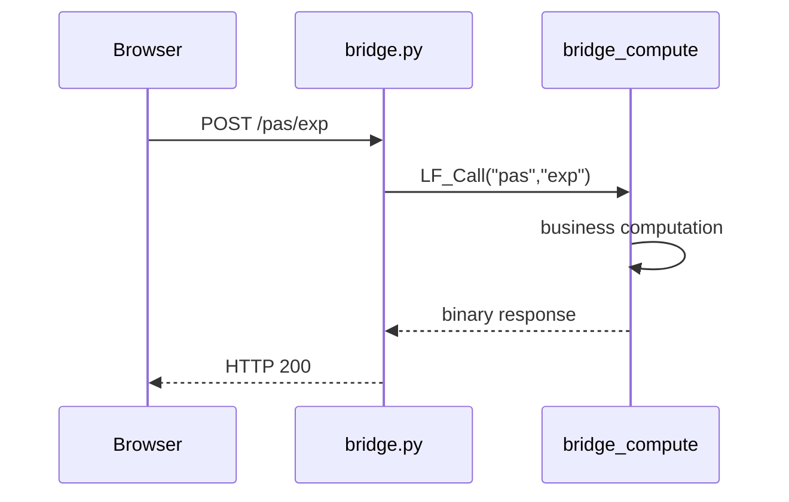

---

## Chapter 3 Preparing the environment

### 3.1 The dependency-check flow

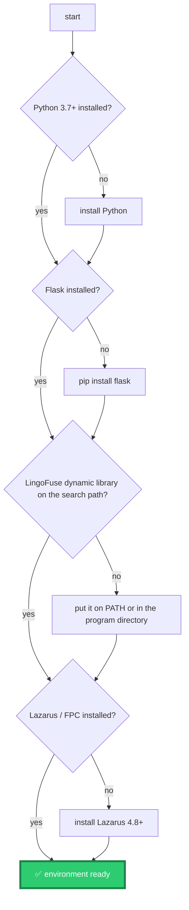

### 3.2 The dependency list

| Component | Version | Notes |
|------|---------|------|
| Python | ≥ 3.7 | runs bridge.py |
| Flask | ≥ 2.0 | bridge.py's HTTP framework |
| the lingofuse package | same version as this repository | the Python binding |
| the LingoFuse dynamic library | same version as this repository | the core RPC library |
| Lazarus / FPC | 3.2.2+ or 3.3.1 | compiles the Pascal side |

### 3.3 Where the dynamic library goes

Only one thing needs guaranteeing: the dynamic library can be found.

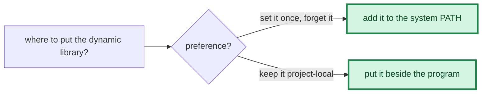

---

## Chapter 4 Pascal server development conventions

### 4.1 The standard API-registration pattern

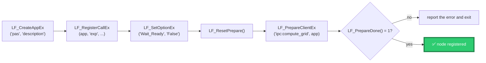

**Key point**: when registering the callback you **need not think about HTTP or JSON parsing** — the callback only reads and writes the binary DataHnd.

### 4.2 The JSON format convention

This is an **application-layer convention**, not a protocol requirement. The bridge does not validate it; the client (such as `web_demo.html`) relies on it.

**Request** (HTTP → bridge → Pascal):

```json
{"args": ["1+2*3"]}
```

**Success response**:

```json
{"code": 0, "result": "7"}
```

**Error response**:

```json
{"code": -1, "error": "error description"}
```

> **Hint**: the Pascal side should build responses with `TZ_JsonObject`, so the bytes written are already valid UTF-8 JSON and the bridge's normalisation classifies them as `canonical` (no byte change).

### 4.3 The contract between strings and `\0`


**Why this is the key to stability**:

- `LF_WriteString` unconditionally appends `\0` — consistent behaviour.
- `LF_ReadString` stops at `\0` — consistent behaviour.
- the bridge strips the trailing `\0` — the client gets a clean body.

These three steps hold at both ends, so the string boundary is always clear.

---

## Chapter 5 How bridge.py handles payloads

> **This chapter is the core correction of v4.0 relative to v3.0**. The v3.0 claim that "the bridge does not handle JSON" is **outdated** — the current `bridge.py` normalises JSON payloads by default.

### 5.1 The rule in one sentence

> **Payloads recognisable as JSON are normalised into compact UTF-8 JSON; payloads that are not are passed through verbatim. Binary safety is a hard guarantee.**

### 5.2 The payload flow on the request side

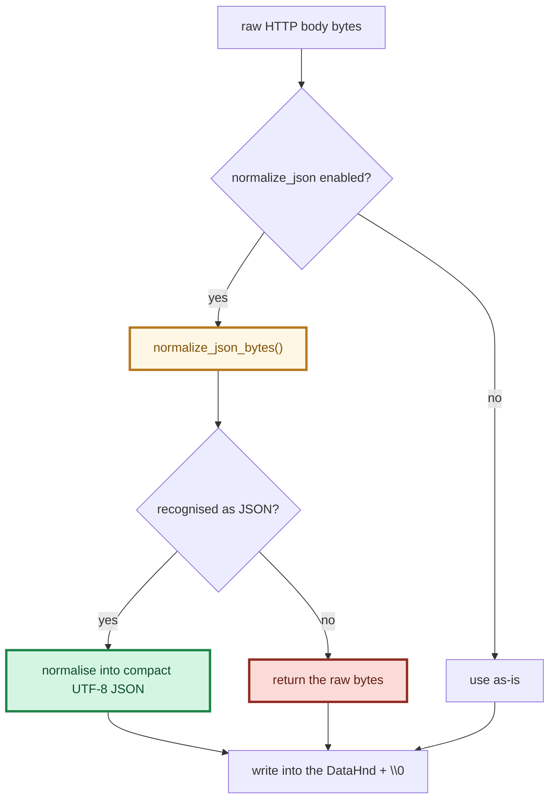

### 5.3 The payload flow on the response side

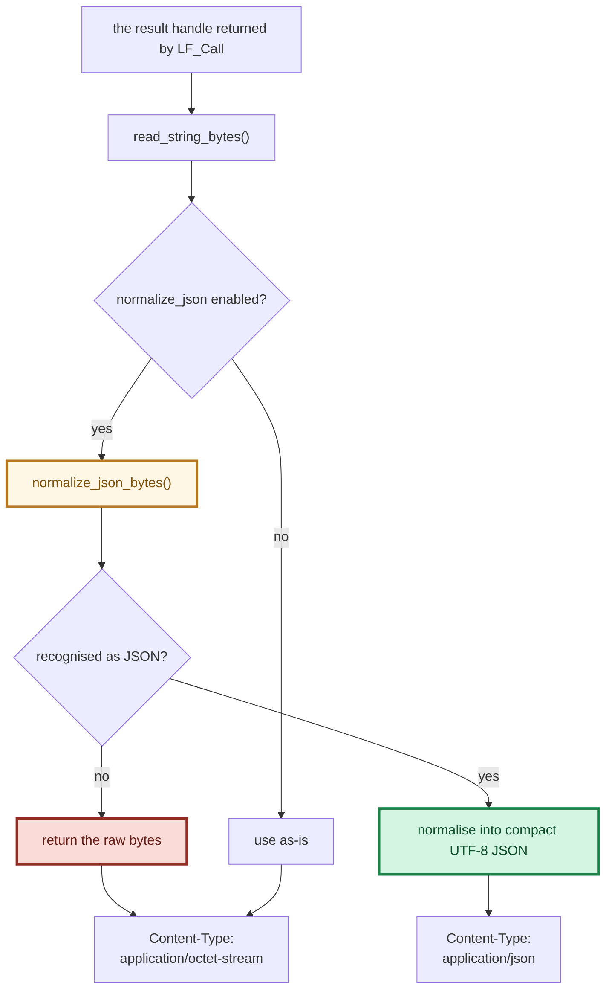

### 5.4 The seven normalisation steps

`normalize_json_bytes()` runs in order:

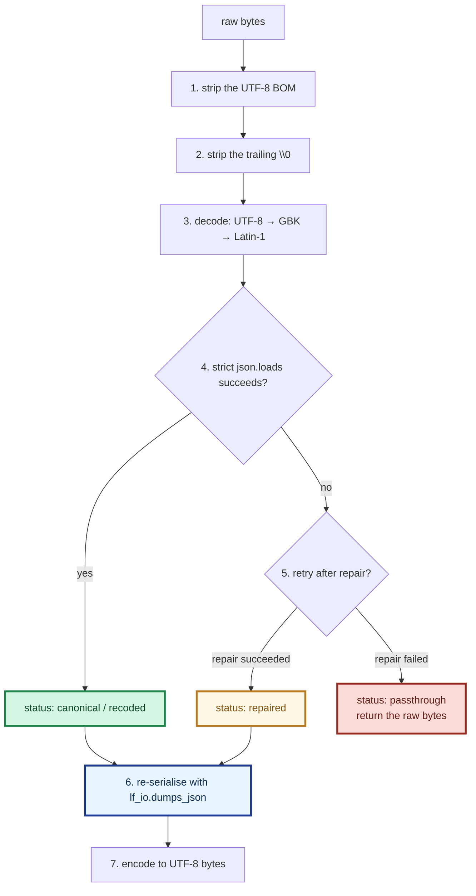

### 5.5 The four status codes

| Status | Meaning | Output | Content-Type |
|------|------|------|-------------|
| `canonical` | the input is already valid UTF-8 JSON | compact JSON | `application/json` |
| `recoded` | the input is valid JSON but in GBK / Latin-1 | converted to compact UTF-8 JSON | `application/json` |
| `repaired` | the input became valid only after repair (a trailing comma, say) | compact JSON | `application/json` |
| `passthrough` | cannot be recognised as JSON | **raw bytes unchanged** | `application/octet-stream` |

### 5.6 Processing examples

| Input | Output | Status |
|------|------|------|
| `{"a":1}` | `{"a":1}` | canonical |
| `{"a":1,}` | `{"a":1}` | repaired |
| `EF BB BF{"a":1}` | `{"a":1}` | canonical |
| `{"a":"你好"}` encoded in GBK | `{"a":"你好"}` in UTF-8 | recoded |
| `{"a":1}\x00` | `{"a":1}` | canonical |
| `\x89PNG\r\n...` | bytes completely unchanged | passthrough |
| `not json at all` | bytes completely unchanged | passthrough |

### 5.7 The binary-safety guarantee

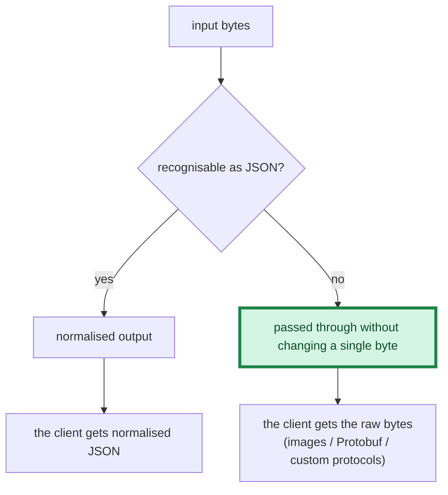

**The hard guarantee**: the bridge never guesses and never modifies a payload it cannot recognise as JSON.

### 5.8 The impact on the Pascal side

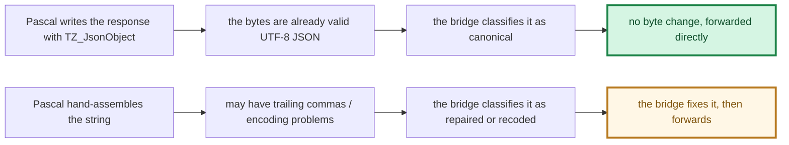

**Recommendation**: the Pascal side should **prefer `TZ_JsonObject`** to build responses, so the bridge takes the `canonical` path (zero modification). That saves CPU and makes behaviour fully predictable.

---

## Chapter 6 Command-line operations in detail

### 6.1 Three dimensions

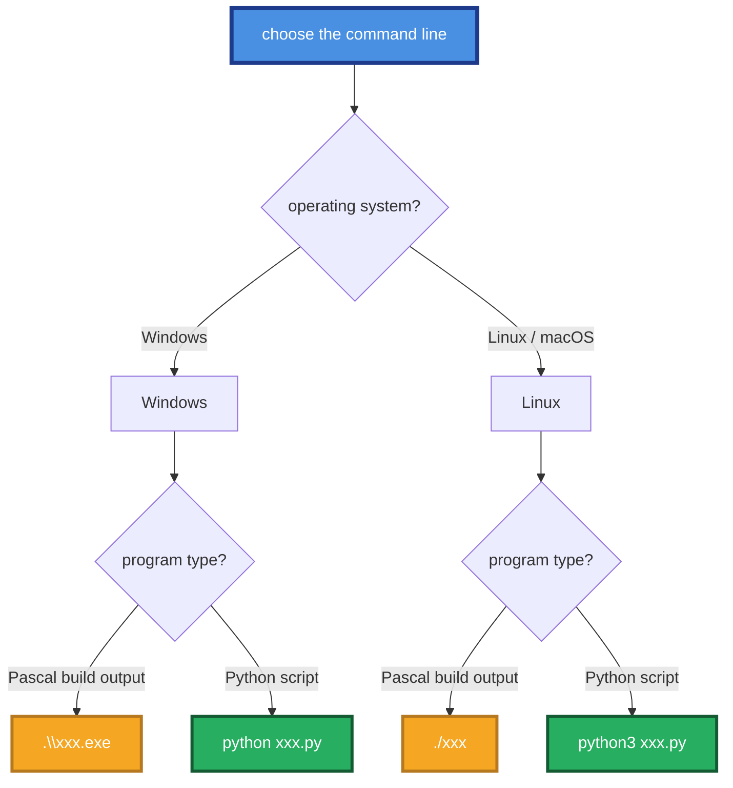

### 6.2 Platform differences for Pascal build outputs

**Building** (identical on both platforms):

```bash
lazbuild -B bridge_service.lpr
lazbuild -B bridge_compute.lpr
```

**Running**:

| Platform | Artifact name | How to run |
|------|-----------|---------|
| Windows | `bridge_service.exe` | `.\bridge_service.exe` or double-click |
| Windows | `bridge_compute.exe` | `.\bridge_compute.exe` or double-click |
| Linux | `bridge_service` | `./bridge_service` |
| Linux | `bridge_compute` | `./bridge_compute` |

> **Before the first run on Linux / macOS**: `chmod +x bridge_service bridge_compute`

### 6.3 bridge_service — the beacon (Pascal)

#### 6.3.1 Starting on Windows

**CMD**:

```cmd
bridge_service.exe
```

**PowerShell**:

```powershell
.\bridge_service.exe
```

> **PowerShell requires the `.\` prefix** — otherwise it reports "The term 'bridge_service.exe' is not recognized as the name of a cmdlet".

**Expected output**:

```
=== LingoFuse Beacon (bridge_service) ===
[OK] Beacon started on endpoint: ipc:compute_grid
Press Enter to exit...
```

#### 6.3.2 Starting on Linux

```bash
chmod +x bridge_service     # before the first run
./bridge_service
```

### 6.4 bridge_compute — the compute node (Pascal)

#### 6.4.1 Starting on Windows

**CMD**:

```cmd
bridge_compute.exe
```

**PowerShell**:

```powershell
.\bridge_compute.exe
```

**Expected output**:

```
=== LingoFuse Compute Node (bridge_compute) ===
[OK] Compute node connected to beacon, waiting for JSON requests...
Press Enter to exit...
```

#### 6.4.2 Starting on Linux

```bash
chmod +x bridge_compute
./bridge_compute
```

### 6.5 bridge.py — the HTTP gateway (Python)

#### 6.5.1 The two execution modes

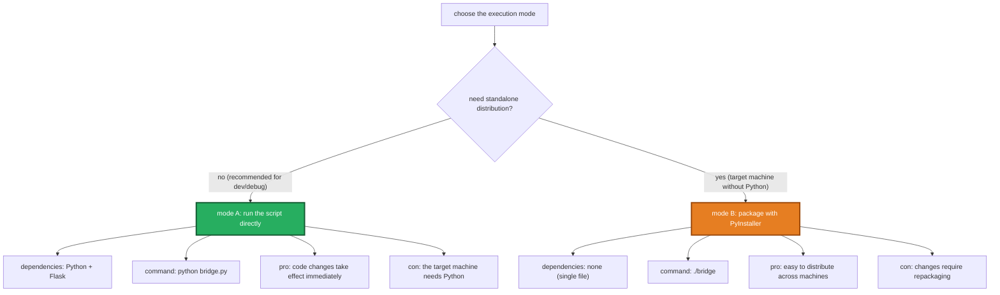

#### 6.5.2 Mode A: run the script directly (recommended)

**Windows CMD**:

```cmd
python lingofuse\bridge.py --endpoint ipc:compute_grid --no-precheck --debug --port 8081
```

**Windows PowerShell**:

```powershell
python .\lingofuse\bridge.py --endpoint ipc:compute_grid --no-precheck --debug --port 8081
```

**Linux / macOS**:

```bash
python3 lingofuse/bridge.py --endpoint ipc:compute_grid --no-precheck --debug --port 8081
```

> If the `lingofuse` package is not in the current directory, set `PYTHONPATH`:
> - Windows CMD: `set PYTHONPATH=<py dir>`
> - Windows PowerShell: `$env:PYTHONPATH="<py dir>"`
> - Linux: `export PYTHONPATH=<py dir>`

#### 6.5.3 Mode B: packaging with PyInstaller

**Packaging steps (one-off)**:

**Windows**:

```cmd
pip install pyinstaller
pyinstaller --onefile --name bridge lingofuse\bridge.py
```

Artifact: `dist\bridge.exe`

**Linux**:

```bash
pip3 install pyinstaller
pyinstaller --onefile --name bridge lingofuse/bridge.py
```

Artifact: `dist/bridge` (no extension)

**Running (after packaging)**:

**Windows**:

```cmd
bridge.exe --endpoint ipc:compute_grid --debug --port 8081
```

**Linux**:

```bash
chmod +x bridge
./bridge --endpoint ipc:compute_grid --debug --port 8081
```

> **Even after packaging, the dynamic library must still be on a searchable path** — PyInstaller packages only Python and Flask, not the LingoFuse dynamic library.

#### 6.5.4 The full argument reference

| Argument | Environment variable | Default | Description |
|------|---------|--------|------|
| `--host` | `LINGOFUSE_HOST` | `0.0.0.0` | listen address |
| `--port` | `LINGOFUSE_PORT` | `8081` | listen port |
| `--endpoint` | `LINGOFUSE_ENDPOINT` | `ipc:lingofuse_bridge` | **must match the Pascal side** |
| `--timeout` | `LINGOFUSE_TIMEOUT` | `5000` | call timeout (milliseconds) |
| `--app` | `LINGOFUSE_APP` | none | the default app for single-segment paths |
| `--threaded` / `--no-threaded` | `LINGOFUSE_THREADED` | `True` | multithreaded request handling |
| `--debug` / `--no-debug` | `LINGOFUSE_DEBUG` | `False` | verbose logging |
| `--no-precheck` / `--precheck` | `LINGOFUSE_NO_PRECHECK` | `False` | skip the `check_api` precheck |
| `--normalize-json` / `--no-normalize-json` | `LINGOFUSE_NORMALIZE_JSON` | `True` | JSON normalisation |
| `--log-file` | `LINGOFUSE_LOG_FILE` | `stderr` | log file path |

#### 6.5.5 Three typical startup commands

**Development debugging** (skip the precheck + verbose logging):

```bash
python3 lingofuse/bridge.py --endpoint ipc:compute_grid --no-precheck --debug --port 8081
```

**Production deployment** (listen locally only + log to a file):

```bash
python3 lingofuse/bridge.py --endpoint ipc:compute_grid --host 127.0.0.1 --port 8081 --log-file bridge.log
```

**JSON normalisation off** (pure byte pass-through):

```bash
python3 lingofuse/bridge.py --endpoint ipc:compute_grid --no-normalize-json --port 8081
```

---

## Chapter 7 The end-to-end startup flow

### 7.1 The full flow split into four stages

#### Stage 1 — the beacon

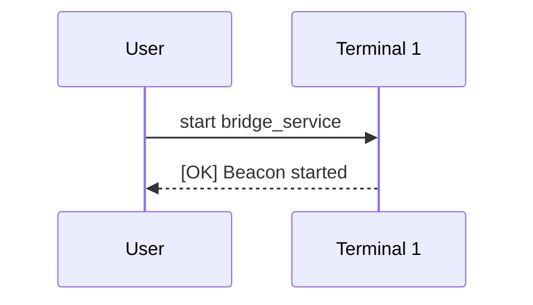

#### Stage 2 — the compute node

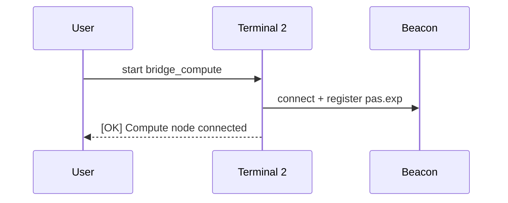

#### Stage 3 — the HTTP gateway

```mermaid
sequenceDiagram
    participant U as User
    participant T3 as Terminal 3
    participant T1 as Beacon
    U->>T3: start bridge.py
    T3->>T1: connect + look up pas.exp
    T3-->>U: [OK] Connected to LingoFuse service
```

#### Stage 4 — a call

```mermaid
sequenceDiagram
    participant B as Browser
    participant T3 as bridge.py
    participant T2 as bridge_compute
    B->>T3: POST /pas/exp
    T3->>T2: LF_Call("pas","exp")
    T2-->>T3: "7"
    T3-->>B: {"code":0,"result":"7"}
```

### 7.2 The three terminal commands

**Windows (CMD)**:

```cmd
:: terminal 1
bridge_service.exe

:: terminal 2 (after terminal 1 prints OK)
bridge_compute.exe

:: terminal 3 (after terminal 2 prints OK)
python lingofuse\bridge.py --endpoint ipc:compute_grid --no-precheck --debug --port 8081
```

**Windows (PowerShell)**:

```powershell
# terminal 1
.\bridge_service.exe

# terminal 2
.\bridge_compute.exe

# terminal 3
python .\lingofuse\bridge.py --endpoint ipc:compute_grid --no-precheck --debug --port 8081
```

**Linux**:

```bash
# terminal 1
./bridge_service

# terminal 2
./bridge_compute

# terminal 3
python3 lingofuse/bridge.py --endpoint ipc:compute_grid --no-precheck --debug --port 8081
```

---

## Chapter 8 Testing and verification

### 8.1 Testing with curl

**Windows CMD** (quotes need escaping):

```cmd
curl -X POST http://127.0.0.1:8081/pas/exp ^
  -H "Content-Type: application/json" ^
  -d "{\"args\": [\"1+2*3\"]}"
```

**Linux / macOS**:

```bash
curl -X POST http://127.0.0.1:8081/pas/exp \
  -H "Content-Type: application/json" \
  -d '{"args": ["1+2*3"]}'
```

**Expected response**:

```json
{"code":0,"result":"7"}
```

### 8.2 Testing in a browser

Open `web_demo.html`, enter `1+2*3`, click "compute", and it should show `✅ 7`.

### 8.3 Testing with the Python script

```bash
# Windows
python test_bridge.py

# Linux
python3 test_bridge.py
```

---

## Chapter 9 Troubleshooting

### 9.1 The troubleshooting decision tree

```mermaid
flowchart TD
    Start["the browser shows an error"] --> Q1{"what is the error?"}

    Q1 -- "API 'exp' not available" --> A1{"what is the --endpoint value?"}
    A1 -- "ipc:lingofuse_bridge (the default)" --> F1["change it to --endpoint ipc:compute_grid"]
    A1 -- "ipc:compute_grid" --> A2{"is bridge_compute running?"}
    A2 -- "no" --> F2["start bridge_compute"]
    A2 -- "yes" --> F3["retry with --no-precheck"]

    Q1 -- "network error" --> B1{"is bridge.py running?"}
    B1 -- "no" --> F4["start bridge.py"]
    B1 -- "yes" --> F5["check whether port 8081 is in use"]

    Q1 -- "HTTP 200 but the body is empty" --> C1{"is bridge_compute reporting errors?"}
    C1 -- "yes" --> F6["fix the Pascal callback"]
    C1 -- "no" --> F7["log the request body inside the callback"]

    style F1 fill:#E74C3C,stroke:#922B21,stroke-width:3px,color:#FFFFFF
    style F2 fill:#E74C3C,stroke:#922B21,stroke-width:3px,color:#FFFFFF
    style F3 fill:#F5A623,stroke:#B7791F,stroke-width:3px,color:#FFFFFF
    style F4 fill:#E74C3C,stroke:#922B21,stroke-width:3px,color:#FFFFFF
    style F5 fill:#F5A623,stroke:#B7791F,stroke-width:3px,color:#FFFFFF
    style F6 fill:#F5A623,stroke:#B7791F,stroke-width:3px,color:#FFFFFF
    style F7 fill:#F5A623,stroke:#B7791F,stroke-width:3px,color:#FFFFFF
```

### 9.2 A quick reference of common problems

| Symptom | Root cause | Fix |
|------|------|------|
| `API 'exp' not available` | `--endpoint` was left at its default | add `--endpoint ipc:compute_grid` |
| `API 'exp' not available` (endpoint correct) | broadcast delay | add `--no-precheck` |
| `LF_PrepareClient returned -1` | the address is already in use | kill the old process or change the endpoint |
| the browser shows "network error" | the bridge is not running or the port is in use | check terminal 3 |
| PowerShell says "not recognized as an internal or external command" | the `.\` prefix is missing | `.\bridge_service.exe` |
| Linux `Permission denied` | the executable lacks permission | `chmod +x bridge_service` |
| Linux `command not found` | the `./` prefix is missing | `./bridge_service` |
| the DLL cannot be found after packaging | the dynamic library is not on PATH | copy it beside the exe |
| `ModuleNotFoundError: lingofuse` | `PYTHONPATH` is not set | set `PYTHONPATH` or `cd` into the right directory |

### 9.3 What the error codes mean

| code | HTTP status | Meaning | Trigger |
|:----:|:-----------:|------|---------|
| `-1` | 200 | the remote call failed | timeout / empty response / backend exception |
| `-2` | **400** | the request shape is wrong | the URL path cannot be parsed |
| `-3` | 200 | the API precheck failed | `check_api` returned False |

---

## Chapter 10 Production deployment recommendations

### 10.1 The deployment topology

```mermaid
flowchart TB
    subgraph Internet["public internet"]
        Users["users / browsers"]
    end

    subgraph Gateway["production gateway"]
        Nginx["Nginx<br/>reverse proxy + HTTPS"]
        Gunicorn["Gunicorn<br/>multiple workers"]
        Bridge["bridge.py"]
    end

    subgraph Backend["backend services"]
        Beacon["bridge_service"]
        Node1["bridge_compute #1"]
        Node2["bridge_compute #2"]
        Node3["bridge_compute #N"]
    end

    Users -->|"HTTPS"| Nginx
    Nginx -->|"HTTP"| Gunicorn
    Gunicorn --> Bridge
    Bridge --> Beacon
    Node1 -.-> Beacon
    Node2 -.-> Beacon
    Node3 -.-> Beacon
    Bridge -.->|"LF_Call"| Node1
    Bridge -.->|"LF_Call"| Node2
    Bridge -.->|"LF_Call"| Node3

    style Nginx fill:#4A90E2,stroke:#1E3A8A,stroke-width:3px,color:#FFFFFF
    style Gunicorn fill:#9B59B6,stroke:#6C3483,stroke-width:3px,color:#FFFFFF
    style Bridge fill:#27AE60,stroke:#145A32,stroke-width:3px,color:#FFFFFF
    style Beacon fill:#F5A623,stroke:#B7791F,stroke-width:3px,color:#FFFFFF
```

### 10.2 Elastic scaling

```mermaid
flowchart LR
    A["1 bridge_compute<br/>the minimum configuration"] --> B["3<br/>medium load"]
    B --> C["10+<br/>high load"]

    style A fill:#D5F5E3,stroke:#1E8449,stroke-width:3px,color:#0E4D2A
    style B fill:#FFF7E6,stroke:#B7791F,stroke-width:3px,color:#7E5109
    style C fill:#FADBD8,stroke:#922B21,stroke-width:3px,color:#641E16
```

**The core idea**: **just add `bridge_compute` instances** — no change to `bridge.py`, no change to the client.

### 10.3 Key configuration recommendations

| Item | Recommendation |
|------|------|
| process count | run N `bridge_compute` instances (LingoFuse balances the load automatically) |
| WSGI | use Gunicorn instead of Flask's built-in server |
| logging | `--log-file` + logrotate |
| timeout | `--timeout 10000` (raise it for long tasks) |
| listening | use `--host 127.0.0.1` in production (Nginx reverse-proxies) |
| dynamic library | on PATH or in the program directory |
| system service | `nssm`/`sc` on Windows; `systemd` on Linux |
| JSON normalisation | keep it on by default (the `canonical` path costs zero modifications and abnormal payloads get fixed) |

---

## Appendix A: A summary of the command-line arguments

### A.1 Pascal build outputs (no arguments)

| Program | Windows | Linux |
|------|---------|-------|
| beacon | `bridge_service.exe` | `./bridge_service` |
| compute node | `bridge_compute.exe` | `./bridge_compute` |

### A.2 Every bridge.py argument

| Argument | Type | Default |
|------|------|--------|
| `--host` | string | `0.0.0.0` |
| `--port` | integer | `8081` |
| `--endpoint` | string | `ipc:lingofuse_bridge` |
| `--timeout` | integer (ms) | `5000` |
| `--app` | string | none |
| `--threaded` / `--no-threaded` | switch | on |
| `--debug` / `--no-debug` | switch | off |
| `--no-precheck` / `--precheck` | switch | precheck on |
| `--normalize-json` / `--no-normalize-json` | switch | normalisation on |
| `--log-file` | path | `stderr` |

### A.3 Every environment variable

| Field | Environment variable |
|------|---------|
| `host` | `LINGOFUSE_HOST` |
| `port` | `LINGOFUSE_PORT` |
| `endpoint` | `LINGOFUSE_ENDPOINT` |
| `timeout_ms` | `LINGOFUSE_TIMEOUT` |
| `default_app` | `LINGOFUSE_APP` |
| `threaded` | `LINGOFUSE_THREADED` |
| `debug` | `LINGOFUSE_DEBUG` |
| `no_precheck` | `LINGOFUSE_NO_PRECHECK` |
| `normalize_json` | `LINGOFUSE_NORMALIZE_JSON` |
| `log_file` | `LINGOFUSE_LOG_FILE` |

> **Configuration precedence**: command line > environment variables > built-in defaults.

---

## Appendix B: Integrating with web_demo.html

The URL hard-coded in `web_demo.html`:

```javascript
const API_URL = 'http://127.0.0.1:8081/pas/exp';
```

Therefore:

- the bridge must listen on `127.0.0.1:8081` (the default `0.0.0.0:8081` already satisfies this)
- it must be able to find the Pascal compute node through `/pas/exp`
- if the app name is not `pas`, change the URL in `web_demo.html`

---

## Summary

> **The flow**: start `bridge_service` (the beacon) first, then `bridge_compute` (which computes exp), and finally `bridge.py` (**always with `--endpoint ipc:compute_grid`**).

> **Command differences**: on Windows use `.\xxx.exe` or `python xxx.py`; on Linux use `./xxx` or `python3 xxx.py`.

> **The trap to avoid**: bridge.py's default endpoint is `ipc:lingofuse_bridge`, not `ipc:compute_grid` — that is the root cause of 90% of "API not available" problems.

> **The payload rule**: the bridge normalises payloads it can recognise as JSON and passes the rest through verbatim. Binary safety is a hard guarantee.

> **Stability**: Pascal does only business computation, the bridge does only HTTP and encoding, and the `\0` contract agrees at both ends — that is the engineering basis for long-term stable operation.
