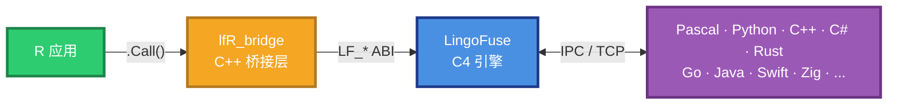
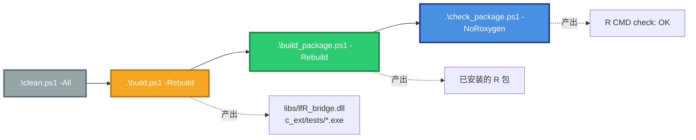
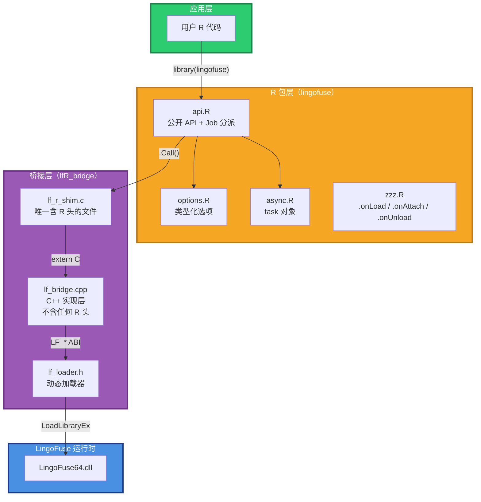
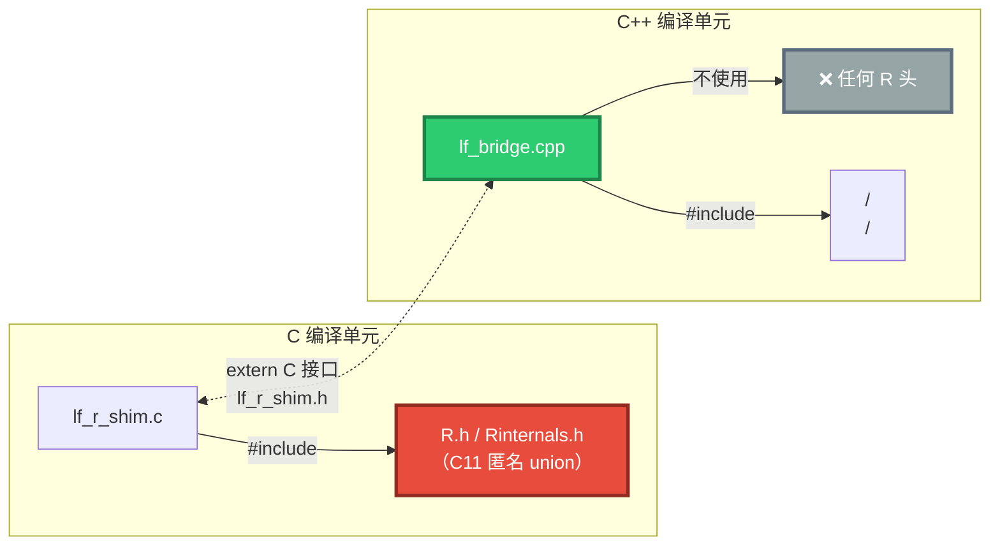
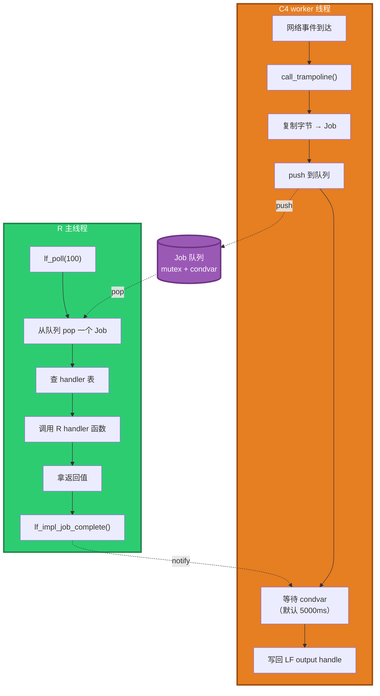
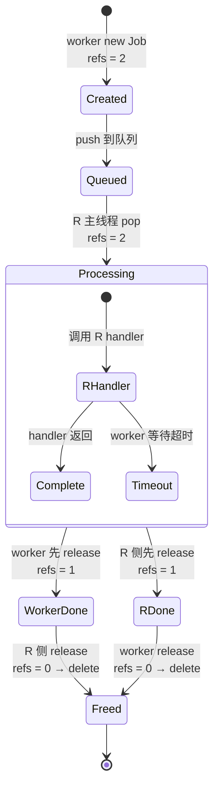
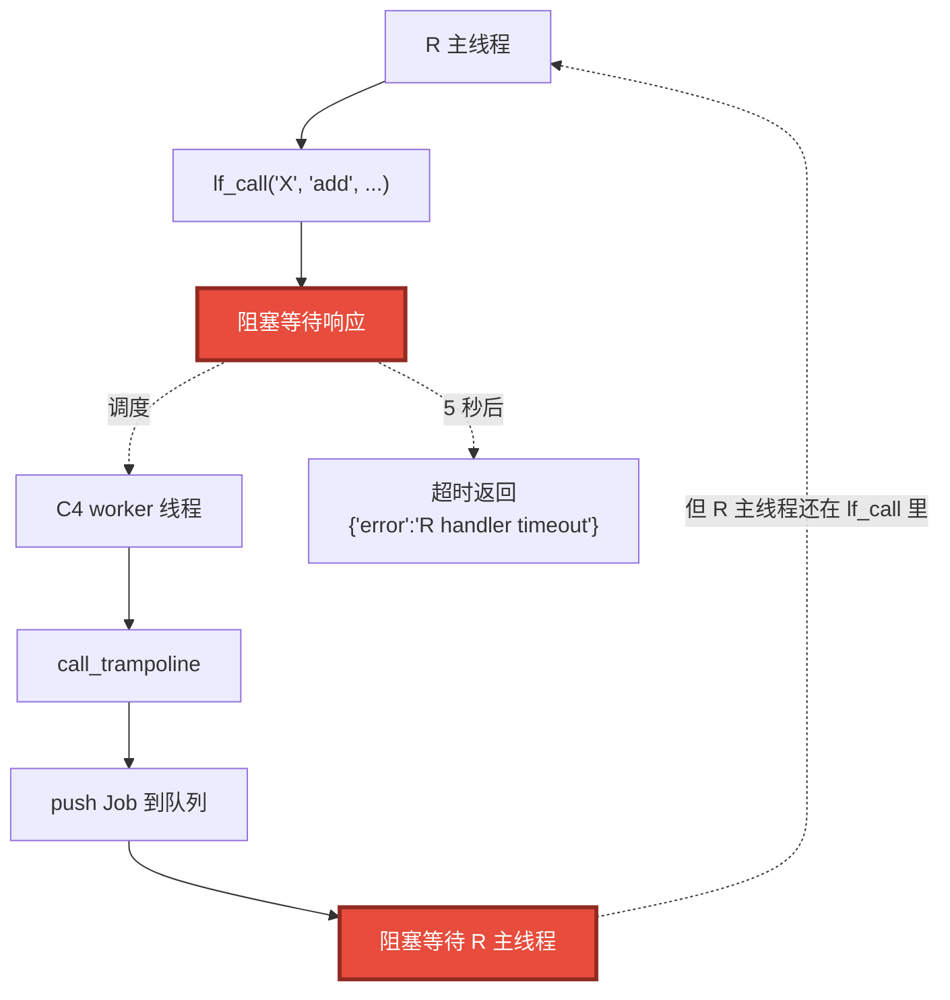
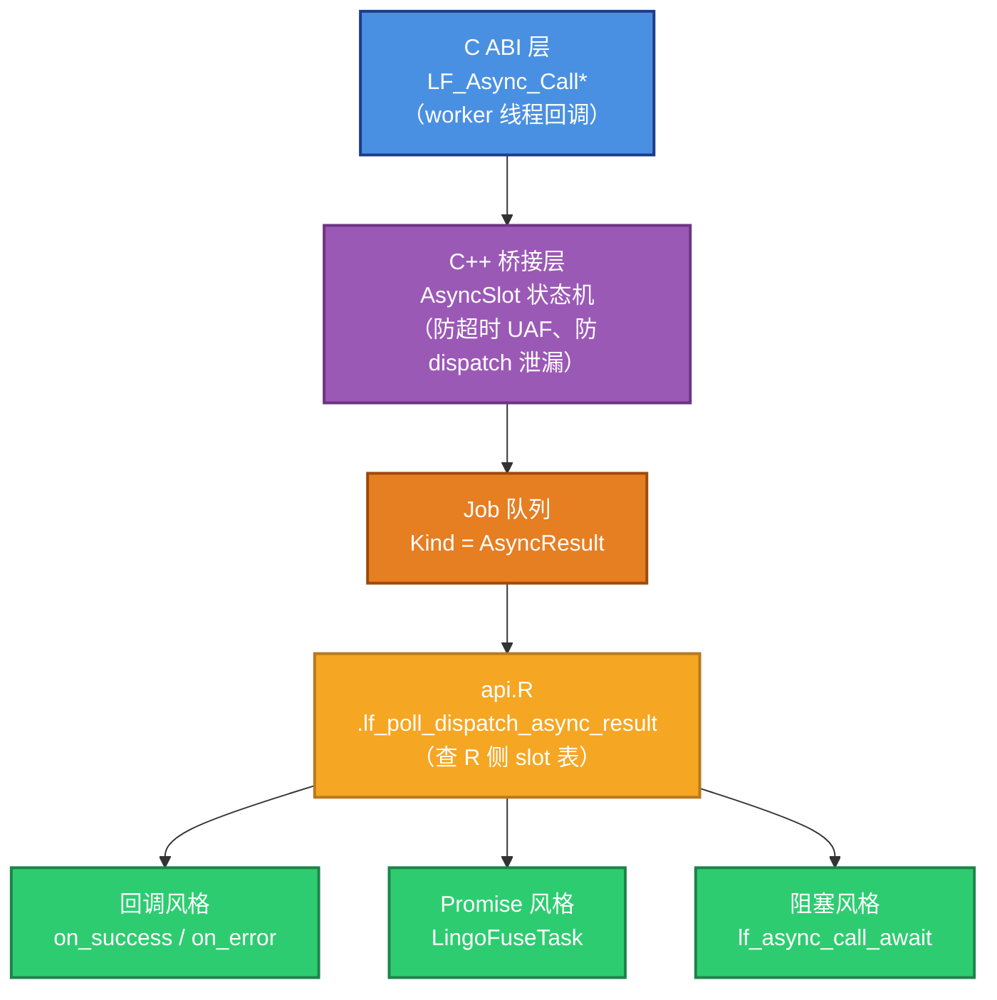

# LingoFuse R 绑定（v2.0，59 符号全覆，无硬编码路径，一键测试）

> **让 R 与其他 16 种语言直接对话。**
> 不写 IDL，不生成桩代码，不搭 HTTP 服务。

[](https://www.r-project.org/)
[]()
[]()
[]()
[]()

---

## 目录

- [0. 概览](#0-概览)
- [1. 环境搭建](#1-环境搭建)
  - [1.1 软件要求](#11-软件要求)
  - [1.2 安装 R](#12-安装-r)
  - [1.3 安装 Rtools](#13-安装-rtools)
  - [1.4 获取 LingoFuse 运行时](#14-获取-lingofuse-运行时)
  - [1.5 环境诊断](#15-环境诊断)
- [2. 依赖要求](#2-依赖要求)
- [3. 从源码构建](#3-从源码构建)
  - [3.1 从零构建](#31-从零构建)
  - [3.2 构建脚本一览](#32-构建脚本一览)
  - [3.3 构建产物](#33-构建产物)
  - [3.4 常见构建错误](#34-常见构建错误)
- [4. 安装与卸载](#4-安装与卸载)
  - [4.1 安装 R 包](#41-安装-r-包)
  - [4.2 配置 runtime 位置](#42-配置-runtime-位置)
  - [4.3 卸载](#43-卸载)
- [5. 目录结构](#5-目录结构)
- [6. 架构与原理](#6-架构与原理)
  - [6.1 四层架构](#61-四层架构)
  - [6.2 C 与 C++ 分层的必要性](#62-c-与-c-分层的必要性)
  - [6.3 运行时目录解析](#63-运行时目录解析)
  - [6.4 回调机制：Job 队列](#64-回调机制job-队列)
  - [6.5 Job 生命周期](#65-job-生命周期)
  - [6.6 单线程重入限制](#66-单线程重入限制)
  - [6.7 异步编程模型](#67-异步编程模型)
  - [6.8 DLL 生命周期](#68-dll-生命周期)
- [7. 在 R 项目中使用 LF](#7-在-r-项目中使用-lf)
  - [7.1 Hello World：单进程自测](#71-hello-world单进程自测)
  - [7.2 跨进程调用](#72-跨进程调用)
  - [7.3 三套寻址模式](#73-三套寻址模式)
  - [7.4 同步调用](#74-同步调用)
  - [7.5 异步调用：三种风格](#75-异步调用三种风格)
  - [7.6 单向通知](#76-单向通知)
  - [7.7 二进制载荷](#77-二进制载荷)
  - [7.8 Side data：自动发送方身份](#78-side-data自动发送方身份)
  - [7.9 网络事件](#79-网络事件)
  - [7.10 运行时选项](#710-运行时选项)
  - [7.11 进程级 P2P 注册](#711-进程级-p2p-注册)
  - [7.12 完整 API 索引](#712-完整-api-索引)
- [8. 测试体系](#8-测试体系)
  - [8.1 分层测试链](#81-分层测试链)
  - [8.2 一键运行全部测试](#82-一键运行全部测试)
  - [8.3 手动运行单个测试](#83-手动运行单个测试)
  - [8.4 测试规模总览](#84-测试规模总览)
- [9. R CMD check](#9-r-cmd-check)
- [10. 常见错误](#10-常见错误)
- [11. 已知限制](#11-已知限制)

---

## 0. 概览

本仓库是 **LingoFuse 的 R 语言第一方绑定**。它让 R 既能**调用**其他语言写的 LingoFuse 服务，也能**作为服务端**被其他语言调用。



### v2.0 覆盖范围

| 维度 | 覆盖 |
|---|:---:|
| **C ABI 符号** | **59 / 59**（完整覆盖） |
| R 导出函数 | **200+**（含 16 对 `set_opt_*` / `get_opt_*`、3 种寻址 × 6 种调用形状） |
| 寻址模式 | **3 套**（App 名 / UID / P2PName） |
| 调用风格 | **3 种**（同步 / 回调 / Promise-task / 阻塞-await） |
| 测试断言 | **211 项**（含 C++ 层 86 项 + R 层 125 项） |

### 六条硬性承诺

1. **字节级互通** — 与 Pascal / Python / C++ / C# 等绑定产生**完全一致**的线格式。
2. **RAII 语义** — 句柄通过 R `externalptr` 管理，GC 触发 finalizer 时自动释放。
3. **零拷贝** — R `raw` 向量直接映射到 C++ `std::string`，不经过 JSON 序列化。
4. **可任意搬移** — 整个 `r/` 目录可复制到任何位置，所有脚本与二进制**不含任何硬编码绝对路径**。
5. **完整 ABI 覆盖** — C ABI 的 59 个导出符号全部通过 R 层可达。
6. **现代化异步** — 异步编程不暴露裸 callback id；提供 Promise 风格 task 对象，超时、dispatch 失败、生命周期全部由框架管理。

### 适合谁

- **数据分析师 / 科研工作者**：用 R 调用 Python 训练服务、C++ 推理引擎、Julia 数值后端
- **R 服务后端**：把 R 统计模型、统计算法暴露给 Web 后端 / LLM Agent
- **跨语言集成**：R 只是工具链中的一环，需要与 Pascal、C#、Rust 等语言系统互调
- **不推荐**：纯 R 项目、无法接受单人维护风险、需要 CRAN 上架的团队

---

## 1. 环境搭建

### 1.1 软件要求

| 项目 | 最低版本 | 说明 |
|------|:--------:|------|
| **R** | **4.0+** | 依赖 `R_RegisterCFinalizerEx` 和 `R_MakeExternalPtr` 的现代语义。已在 **R 4.6.1 (ucrt) x64** 上完整验证。 |
| **Rtools** | **Rtools45**（配 R 4.6.x）<br/>Rtools44（配 R 4.5.x） | Windows 上的 C/C++ 编译工具链。**只有编译桥接层时才需要**；只用预编译包可以跳过。 |
| **操作系统** | Windows 10+ / Linux（待验证）/ macOS（待验证） | 当前**只在 Windows x64 上完整验证过**。Linux / macOS 走同一份代码路径，但未实测。 |
| **磁盘空间** | ~10 MB | 桥接 DLL + R 包 + 测试二进制 |
| **LingoFuse 运行时** | 3.10+ | 单独分发，**不包含在 R 包内** |

**LingoFuse 运行时文件**（按平台）：

| 平台 | 运行时文件 |
|------|-----------|
| Windows 64 | `LingoFuse64.dll`, `z_ipc_64.dll`, `mimalloc64.dll` |
| Windows 32 | `LingoFuse32.dll`, `z_ipc_32.dll`, `mimalloc32.dll` |
| Linux | `liblingofuse.so`, `libz_ipc.so`, `libmimalloc.so` |
| macOS | `liblingofuse.dylib`, `libz_ipc.dylib`, `libmimalloc.dylib` |

### 1.2 安装 R

**Windows**：从 [CRAN](https://cran.r-project.org/bin/windows/base/) 下载最新版 R，安装时勾选 **"Add R to PATH"**。安装后验证：

```powershell
R.exe --version
# R version 4.6.1 (2026-06-24 ucrt) -- "Happy Hop"
```

**Linux**：

```bash
sudo apt install r-base r-base-dev         # Debian / Ubuntu
sudo dnf install R R-devel                 # Fedora / RHEL
```

**macOS**：

```bash
brew install r
```

### 1.3 安装 Rtools

**仅 Windows 需要**，用于编译桥接 DLL。

**Rtools 版本必须与 R 版本匹配**：

| R 版本 | 所需 Rtools | 下载地址 |
|---|:---:|---|
| R 4.6.x | **Rtools45** | https://cran.r-project.org/bin/windows/Rtools/rtools45/ |
| R 4.5.x | Rtools44 | https://cran.r-project.org/bin/windows/Rtools/rtools44/ |
| R 4.4.x | Rtools43 | https://cran.r-project.org/bin/windows/Rtools/rtools43/ |

**安装步骤**：

1. 从对应 URL 下载 `rtools45-x86_64.exe`（或对应版本）。
2. 运行安装程序，**默认路径即可**（`C:\rtools45\`）。
3. **勾选"Add rtools to system PATH"**（虽然 R 会通过 `R CMD config` 自己找编译器，但加上更保险）。
4. 重启 PowerShell 让 PATH 生效。

**验证**：

```powershell
R.exe CMD config CC
# gcc

R.exe CMD config CXX
# g++ -std=gnu++20
```

**关键点**：R 在 Windows 上用哪个编译器，由 `R CMD config CC/CXX` 决定，**与 PATH 上的 gcc 无关**。如果你同时装了 MinGW-Builds 或 MSYS2，它们不会被使用。

### 1.4 获取 LingoFuse 运行时

运行时由 **LingoFuse 主仓库**分发，与 R 绑定分开。有两种方式：

**方式 A：克隆主仓库（推荐）**

```powershell
cd D:\CoreLibrary
git clone --recursive https://github.com/PassByYou888/LingoFuse.git
# 或下载 Release 压缩包，解压到 D:\CoreLibrary\LingoFuse
```

主仓库的 `Binary/` 目录包含预编译的 Windows 32/64 位 DLL。

**方式 B：只下载运行时文件**

从 LingoFuse Release 页面下载对应平台的 `LingoFuse64.dll`、`z_ipc_64.dll`、`mimalloc64.dll`，放到任意目录（例如 `D:\LingoFuseRuntime\`）。

**推荐布局**：

```
D:\CoreLibrary\
├── LingoFuse\                 ← 主仓库
│   ├── Binary\                ← 运行时 DLL 放在这里
│   │   ├── LingoFuse64.dll
│   │   ├── z_ipc_64.dll
│   │   └── mimalloc64.dll
│   └── ...
└── LingoFuse\r\               ← 本仓库（R 绑定）
    ├── build.ps1
    └── ...
```

这样只要在 `r/` 目录下运行任何脚本，相对探测 `../Binary/` 就会自动找到运行时，**无需任何参数或环境变量**。

### 1.5 环境诊断

本仓库提供 `check_env.ps1` 一键检查环境：

```powershell
cd D:\CoreLibrary\LingoFuse\r
.\check_env.ps1
```

**输出示例**：

```
========================================================================
1. R installation
========================================================================
[OK] R.exe found
       C:\Program Files\R\R-4.6.1\bin\R.exe
[OK] R version
       R version 4.6.1 (2026-06-24 ucrt)
[OK] R_HOME
       C:\PROGRA~1\R\R-46~1.1

========================================================================
2. R CMD config (toolchain source of truth)
========================================================================
[OK] R CMD config CC
       gcc
[OK] R CMD config CXX
       g++ -std=gnu++20

========================================================================
3. C / C++ compilers used by R CMD SHLIB
========================================================================
[OK] C compiler
       resolved: C:\rtools45\x86_64-w64-mingw32.static.posix\bin\gcc.exe
[OK] C++ compiler
       resolved: C:\rtools45\...

========================================================================
5. R.dll
========================================================================
[OK] R.dll found
       C:\Program Files\R\R-4.6.1\bin\x64\R.dll

========================================================================
Verdict
========================================================================
[READY] The environment can build R extensions.
```

**如果显示 `[BLOCKED]`**：按提示补齐 Rtools 或 R 安装。**最常见的坑**是忘了勾 "Add rtools to system PATH"，或者安装 Rtools 后没重启 PowerShell。

---

## 2. 依赖要求

### 2.1 R 侧

| 依赖 | 用途 | 是否必需 |
|------|------|:--------:|
| R base | 全部导出 API 只用 base | ✅ |
| `jsonlite` | **仅用于用户代码**（`demo/*.R` 和测试脚本）；包本身不 import | ❌ |
| `roxygen2` | 生成 `NAMESPACE` 和 `man/` | 🛠 开发时 |
| `Rtools45` | Windows 上的 C/C++ 编译工具链 | 🛠 构建时 |

**R 包本身没有任何运行时依赖**——`DESCRIPTION` 的 `Imports` 为空，`Suggests` 也为空（已刻意移除 `jsonlite`，避免 `R CMD check` 联网校验依赖图）。

安装 `jsonlite`（可选，推荐，用于示例代码和测试脚本）：

```r
install.packages("jsonlite")
```

### 2.2 C/C++ 侧

桥接层用标准 C/C++ 写成，**不依赖任何第三方 C++ 库**（无 Boost、无 protobuf、无 nlohmann）。只依赖：

| 依赖 | 用途 |
|------|------|
| C++17 STL | `std::string` / `std::atomic` / `std::mutex` / `std::condition_variable` / `std::unordered_map` / `std::filesystem` |
| `<windows.h>` 或 `<dlfcn.h>` | 动态加载运行时 |
| LingoFuse 的 C ABI | `LF_*` 导出函数 |

**没有依赖 LingoFuse 官方 C++ 头文件**（`LingoFuse.hpp` / `lf_io.hpp` / `nlohmann/json`），因为那些头文件依赖 nlohmann/json 且强制 UTF-8 契约，与 R 的 `SEXP` 边界不兼容。桥接层通过手写的 ABI 声明直接调用 `LF_*`。

---

## 3. 从源码构建

**只在你修改了 C/C++ 源码时才需要构建。** 如果只是用 R 接口，跳到 [§4 安装](#4-安装与卸载)。

### 3.1 从零构建



**标准构建流程**：

```powershell
cd D:\CoreLibrary\LingoFuse\r

# 1. 清空所有构建产物
.\clean.ps1 -All

# 2. 编译 c_ext 层（桥接 DLL + C++ 测试二进制）
.\build.ps1 -Rebuild

# 3. 复制源码到 R 包 + 生成 NAMESPACE/man + R CMD INSTALL
.\build_package.ps1 -Rebuild

# 4. （可选）R CMD check
.\check_package.ps1 -NoRoxygen
```

**每步的作用**：

| 步骤 | 做什么 | 大概耗时 |
|:----:|------|:---:|
| 1 | 删除旧的 `.o` / `.dll` / `man/*.Rd` / `NAMESPACE` | < 1 秒 |
| 2 | 用 Rtools gcc 编译 `lf_r_shim.c` + `lf_bridge.cpp` → `lfR_bridge.dll`；同时编译 4 个 C++ 测试二进制 | 20-40 秒 |
| 3 | 把 `c_ext/src/` 拷到 `lingofuse/src/`，跑 `roxygen2::roxygenise()`，然后 `R CMD INSTALL` | 30-60 秒 |
| 4 | `R CMD build` + `R CMD check`（离线模式） | 40-90 秒 |

### 3.2 构建脚本一览

| 脚本 | 定位 | 何时用 |
|------|------|--------|
| `check_env.ps1` | 环境诊断 | 首次搭建 / 编译报错 |
| **`build.ps1`** | 编译 c_ext 桥接层 + C++ 二进制 | 改了任何 C/C++ 代码 |
| **`build_package.ps1`** | 复制源 + roxygenise + R CMD INSTALL | 改了任何 C/C++ 代码，且要重装 R 包 |
| `install_package.ps1` | 只装 R 包 | 源文件已就绪，或从 `.tar.gz` 装 |
| `uninstall_package.ps1` | 卸载 R 包 | 清理 |
| `clean.ps1` | 清理构建产物 | 从零重来 |
| `check_package.ps1` | `R CMD build` + `R CMD check`（离线） | 验证包质量 |
| **`run_all_tests.ps1`** | **一键跑全部测试** | **日常验证 / CI** |

**关键参数**：

| 参数 | 脚本 | 作用 |
|------|------|------|
| `-Rebuild` | `build.ps1` / `build_package.ps1` | 删除所有中间产物后重编译 |
| `-All` | `clean.ps1` | 额外删除 `man/` / `NAMESPACE` / 拷贝到 `lingofuse/src/` 的源文件 |
| `-NoRoxygen` | `build_package.ps1` / `install_package.ps1` / `check_package.ps1` | 跳过自动 roxygenise |
| `-RuntimeDir <path>` | `run_all_tests.ps1` | 显式指定 runtime 目录 |
| `-SkipClean` / `-SkipBuild` / `-SkipInstall` / `-SkipCheck` | `run_all_tests.ps1` | 跳过相应阶段 |

**`clean.ps1 -All` 会删除 `man/` / `NAMESPACE` / `lingofuse/src/` 里的拷贝源文件**。下次 `build_package.ps1` 会全部重新生成——这一点已经自动化。

### 3.3 构建产物

| 步骤 | 产物 | 位置 |
|:----:|------|------|
| 2 | `lfR_bridge.dll` | `libs/` |
| 2 | `bridge_selftest.exe` | `c_ext/tests/` |
| 2 | `test_service.exe` / `echo_client.exe` / `cross_client.exe` | `c_ext/tests/` |
| 3 | `lingofuse/src/lf_*.{c,h,cpp}` | 从 `c_ext/src/` 复制 |
| 3 | `lingofuse/NAMESPACE` + `lingofuse/man/*.Rd` | roxygen2 生成（v2.0 有 136 个 `.Rd`） |
| 3 | 已安装的 R 包 | R 的默认库（通常是 `Program Files\R\...\library\lingofuse\`） |
| 4 | `.tar.gz` + `.Rcheck` | `_check_YYYYMMDD_HHMMSS/` |

### 3.4 常见构建错误

#### `cannot find -lR` 或 `R_init_xxx not found`

**原因**：`lf_r_shim.c` 尾部没使用 `LF_R_INIT_NAME` 宏。

**修**：确认 `c_ext/src/lf_r_shim.c` 尾部包含：

```c
#ifndef LF_R_INIT_NAME
#  define LF_R_INIT_NAME R_init_lfR_bridge
#endif

void LF_R_INIT_NAME(DllInfo *dll) { ... }
```

以及 `lingofuse/src/Makevars[.win]` 里有 `-DLF_R_INIT_NAME=R_init_lingofuse`。

#### `error: implicit declaration of function 'lf_impl_job_input_size'`

**原因**：函数名拼写不一致（应为 `lf_impl_job_get_input_size`）。

**修**：搜索并统一：

```powershell
(Get-Content c_ext\src\lf_r_shim.c -Raw) `
    -replace 'lf_impl_job_input_size', 'lf_impl_job_get_input_size' `
    | Set-Content c_ext\src\lf_r_shim.c -NoNewline
```

#### `Error in e[[1L]] : object of type 'symbol' is not subsettable`

**原因**：`NAMESPACE` 解析失败，通常是旧版本残留或半截生成的文件。

**修**：删掉重新生成。

```powershell
Remove-Item lingofuse\NAMESPACE -Force
Remove-Item lingofuse\man -Recurse -Force
.\build_package.ps1 -Rebuild
```

#### `Failed to assign RegisteredNativeSymbol`

**原因**：`NAMESPACE` 里 `useDynLib` 缺 `.fixes = "C_"`。

**修**：`lingofuse/NAMESPACE` 首行应为：

```
useDynLib(lingofuse, .registration = TRUE, .fixes = "C_")
```

（roxygen2 从 `api.R` 的 `"_PACKAGE"` 块自动生成，不要手改。）

---

## 4. 安装与卸载

### 4.1 安装 R 包

**方式 A：从源码树安装（推荐开发用）**

```powershell
cd D:\CoreLibrary\LingoFuse\r
.\build_package.ps1 -Rebuild
```

它会自动完成：拷贝源码 → roxygenise → `R CMD INSTALL`。

**方式 B：从 `.tar.gz` 安装（推荐分发用）**

```powershell
# 先构建 tar.gz
.\check_package.ps1 -Keep

# 然后从 tar.gz 安装
.\install_package.ps1 -Tarball "_check_20261016_120000\lingofuse_0.5.0.tar.gz"
```

**方式 C：`R CMD INSTALL` 直接安装**

```powershell
R.exe CMD INSTALL lingofuse
```

**验证安装**：

```r
library(lingofuse)
lf_is_loaded()          # FALSE（还没加载 runtime）
lf_find_runtime()       # 自动探测，或返回 NULL
```

### 4.2 配置 runtime 位置

安装完 R 包后，需要告诉它 LingoFuse runtime 在哪。**四种方式任选**（优先级从高到低）：

#### 方式 1：推荐布局——零配置

把 runtime 放在 `<repo>/Binary/`：

```
D:\CoreLibrary\LingoFuse\
├── Binary\                    ← runtime DLL 在这里
│   └── LingoFuse64.dll
└── r\
    └── ...
```

从 `r/` 目录或任何子目录运行脚本时，**相对探测会自动找到**：

```r
library(lingofuse)
lf_load(lf_find_runtime())    # 自动探测，无需参数
```

#### 方式 2：环境变量

```r
Sys.setenv(LINGOFUSE_RUNTIME = "D:/CoreLibrary/LingoFuse/Binary")
library(lingofuse)            # 自动加载
```

或在 PowerShell / Bash 里：

```powershell
$env:LINGOFUSE_RUNTIME = "D:\CoreLibrary\LingoFuse\Binary"
```

```bash
export LINGOFUSE_RUNTIME=/opt/LingoFuse/Binary
```

#### 方式 3：R option

```r
options(lingofuse.runtime = "D:/CoreLibrary/LingoFuse/Binary")
library(lingofuse)
```

#### 方式 4：显式加载

```r
library(lingofuse)
lf_load("D:/CoreLibrary/LingoFuse/Binary")
```

**解析顺序**（`lf_find_runtime()` 内部）：

| 优先级 | 来源 |
|:---:|---|
| 1 | 显式参数（`lf_load(dir)` / `lf_find_runtime(explicit = dir)`） |
| 2 | `LINGOFUSE_RUNTIME` 环境变量 |
| 3 | `lingofuse.runtime` R option |
| 4 | 相对探测：`Binary/`、`runtime/`、`runtime/Binary/`、`lib/`、`../Binary/`、`../../Binary/`、… |

### 4.3 卸载

```powershell
Rscript -e "remove.packages('lingofuse')"
```

或：

```powershell
.\uninstall_package.ps1
```

**注意**：如果包在**当前 R 会话**里曾调用过 `lf_prepare_done`，`detach` 时会触发 `.onUnload`，打印：

```
lingofuse: LF was running. The bridge DLL is left loaded;
the OS will reclaim it at process exit.
```

这是**故意的**——`LF_Shutdown` 是异步的，C4 worker 线程可能还在 DLL 里跑，并且 `lf_loader.h` 已经通过 `GET_MODULE_HANDLE_EX_FLAG_PIN` 把 runtime DLL 钉住。**让 OS 在进程退出时回收**是唯一安全的做法。

---

## 5. 目录结构

```
r/
├── README.md                   本文件
├── build.ps1                   编译桥接 DLL + C++ 测试二进制
├── build_package.ps1           复制源文件 + roxygenise + R CMD INSTALL
├── check_env.ps1               环境诊断
├── check_package.ps1           R CMD build + R CMD check（离线）
├── clean.ps1                   清理构建产物
├── install_package.ps1         只装 R 包
├── run_all_tests.ps1           一键跑全部测试
├── uninstall_package.ps1       卸载 R 包
│
├── .vscode/
│   └── settings.json
│
├── c_ext/                      原生扩展层
│   ├── src/                    桥接层源码（唯一真相）
│   │   ├── lf_bridge.cpp       C++ 实现（Job 队列 / async 状态机 / 三套寻址）
│   │   ├── lf_loader.h         运行时加载器 + find_runtime_dir()
│   │   ├── lf_r_shim.c         C shim（唯一含 R 头的文件）
│   │   └── lf_r_shim.h         C/C++ 接口（纯 C89）
│   └── tests/                  R 与 C++ 测试脚本
│       ├── bridge_selftest.cpp C++ 层独立自测（86 项）
│       ├── smoke_test.R        STEP 1 - 构建链路
│       ├── abi_test.R          STEP 2 - C ABI 往返
│       ├── caller_test.R       STEP 3a - R 作为客户端
│       ├── callee_test.R       STEP 3b - R 作为服务端
│       ├── cross_node.R        STEP 4 - 二进制协议
│       ├── options_test.R      STEP 5 - 类型化选项
│       ├── async_test.R        STEP 6 - 异步 R 层
│       ├── uid_p2p_service.R   STEP 7 - UID/P2P 服务端
│       ├── uid_p2p_client.R    STEP 7 - UID/P2P 客户端
│       ├── lf_r_api.R          测试脚本共用的 R API
│       ├── lf_runtime.R        测试脚本共用的 runtime 解析器
│       ├── cross_client.cpp    配套 cross_node.R
│       ├── echo_client.cpp     配套 callee_test.R
│       └── test_service.cpp    配套 caller_test.R
│
├── demo/
│   ├── client.R                两进程 demo 客户端
│   └── server.R                两进程 demo 服务端
│
├── libs/                       生成的开发用 DLL（git 忽略）
│   └── lfR_bridge.dll
│
└── lingofuse/                  标准 R 包
    ├── DESCRIPTION
    ├── LICENSE
    ├── NAMESPACE               由 roxygen2 生成
    ├── inst/
    │   └── README.md           安装到 system.file("README.md")
    ├── man/                    由 roxygen2 生成（136 个 .Rd）
    ├── R/
    │   ├── api.R               公开 API + Job 分派 + lf_find_runtime()
    │   ├── options.R           类型化选项访问器（16 对 set/get）
    │   ├── async.R             现代化异步层（task 对象 + then/catch/finally）
    │   └── zzz.R               .onLoad / .onAttach / .onUnload
    ├── src/
    │   ├── lf_bridge.cpp       从 c_ext/src 复制
    │   ├── lf_loader.h         从 c_ext/src 复制
    │   ├── lf_r_shim.c         从 c_ext/src 复制
    │   ├── lf_r_shim.h         从 c_ext/src 复制
    │   ├── Makevars            手写
    │   └── Makevars.win        手写
    └── tests/
        └── smoke.R             R CMD check 时自动运行
```

**关键事实**：

- **`c_ext/src/` 是唯一的源码真相**。`lingofuse/src/` 里的同名文件是 `build_package.ps1` 每次构建时拷贝过去的。
- **`lingofuse/` 是标准 R 包布局**，可以直接 `R CMD INSTALL`。
- **`libs/lfR_bridge.dll` 是开发用的独立 DLL**，供 `c_ext/tests/*.R` 脚本 `dyn.load()` 使用。它与 R 包装的 DLL 是**同一份代码**，只是初始化函数名不同（`R_init_lfR_bridge` vs `R_init_lingofuse`）。
- **`NAMESPACE` 和 `man/*.Rd` 由 roxygen2 从 `lingofuse/R/*.R` 的 `#'` 注释生成**，不要手工修改。
- **所有路径相对于脚本自身解析**（`$PSScriptRoot` / `commandArgs("--file=")`），整个目录树可任意搬移。

---

## 6. 架构与原理

### 6.1 四层架构



**每层的职责**：

| 层 | 文件 | 职责 | 约束 |
|----|------|------|------|
| L1 | 用户 R | 调用 `lf_*` 函数 | 无 |
| L2 | `api.R` | 参数校验、Job 分派、handler 表管理 | 不直接 `.Call` 复杂类型 |
| L2 | `options.R` | 类型化的选项访问器 | 只调 `lf_set_option` / `lf_get_option` |
| L2 | `async.R` | task 对象、Promise 风格 handler 链 | 只通过 `.lf_state$async_slots` 与 `api.R` 通信 |
| L3a | `lf_r_shim.c` | `.Call` 入口、`SEXP` ↔ C 类型的转换 | **只有此文件可以 `#include <R.h>`** |
| L3b | `lf_bridge.cpp` | Job 队列、async 状态机、回调 trampoline | **绝不 `#include <R.h>`** |
| L4 | `LingoFuse64.dll` | C4 网络、序列化、负载均衡 | 由 `lf_loader.h` 在运行时加载 |

### 6.2 C 与 C++ 分层的必要性



**为什么要分层**：

1. R 4.6 的 `R.h` 依赖 C11 匿名 `union` / 匿名 `enum`，这是 **MSVC 的 C 前端无法编译的**。
2. 但 **C++17 编译器（gcc/g++）支持 C11 匿名 union 作为扩展**。
3. 即使如此，让 C++ 编译单元包含 R 头会引入 `_Complex` / `SEXP` 等类型，与 C++ 标准库冲突。
4. **所以：C 文件管 R 头，C++ 文件管业务逻辑，二者通过纯 C89 的 `lf_r_shim.h` 通信**。

`lf_r_shim.h` 里**没有任何 R 类型**——只有 `void*` / `int64_t` / `const char*`。

### 6.3 运行时目录解析

**这是保证"任意位置可运行"的核心机制**。R 和 C++ 两端都实现了一致的解析顺序：

| 优先级 | 来源 | 说明 |
|:------:|------|------|
| 1 | 命令行参数 | `Rscript ... <runtime_dir>` 或 `xxx.exe <runtime_dir>` |
| 2 | `LINGOFUSE_RUNTIME` 环境变量 | `$env:LINGOFUSE_RUNTIME = "<runtime_dir>"` |
| 3 | `lingofuse.runtime` R option | `options(lingofuse.runtime = "<runtime_dir>")`（仅 R 侧） |
| 4 | **相对探测** | 在脚本目录和当前工作目录下依次探测：`Binary/`、`runtime/`、`runtime/Binary/`、`lib/`、`../Binary/`、`../../Binary/`、`../../../Binary/` 等 |

**推荐布局**：把 runtime 放在 `<repo>/Binary/`，则**任何位置启动、无需任何参数**：

```
<任意目录>/
├── Binary/                      ← 运行时 DLL（LingoFuse64.dll 等）
└── r/                           ← 整个 R 绑定目录
    ├── c_ext/tests/*.R
    ├── demo/*.R
    └── lingofuse/
```

对应实现：

| 位置 | 实现 |
|------|------|
| R 脚本 | `c_ext/tests/lf_runtime.R` 的 `lf_find_runtime()`；demo 脚本内联的 `lf_resolve_runtime_dir()` |
| R 包 | `lingofuse::lf_find_runtime()`（导出函数） |
| C++ 测试程序 | `lf_loader.h` 的 `lf::find_runtime_dir()` |

**特殊行为**：

- R 侧的 `lf_find_runtime(explicit = ...)`：**当显式参数存在但无效时，直接返回 `NULL`**，不会回退到其他来源。这防止用户拼错路径后静默使用其他目录。
- `lingofuse` 包的 `.onLoad`（`zzz.R`）会自动读取 `LINGOFUSE_RUNTIME` 和 `lingofuse.runtime`，如果发现就自动加载 runtime。`.onAttach` 只在非默认路径时打印一行提示。
- **C++ 二进制在找不到 runtime 时打印清晰的诊断**（包含 `Usage:` 和三种解决方式），然后退出码 1。

### 6.4 回调机制：Job 队列

**核心约束**：**C4 worker 线程不能碰 R 解释器**。R 是单线程的——所有 R 代码必须在同一个线程执行。



**Job 队列里的四种 Job**（v2.0 新增后两种）：

| Kind | 来源 | R 侧处理 |
|:---:|---|---|
| `Call` | App-bound / P2P 注册的 Call API | 调 handler，写回 output |
| `Notify` | App-bound / P2P 注册的 Notify API | 调 handler，无 output |
| `AsyncResult` | 异步调用完成 | 调 task 的 `on_success` / `on_error` |
| `NetEvent` | 网络连接 / 断开 | 调 `lf_set_network_event` 安装的回调 |

**契约**：

| 规则 | 后果 |
|------|------|
| worker 线程**绝不**调用任何 R API | 违反则**进程崩溃**（R 内部断言） |
| worker 线程只复制字节 + 排队 + 阻塞 | — |
| R 主线程只从队列取 Job + 调用 handler | — |
| R handler **绝不**调用 `lf_call` / `lf_notify` | 违反则**死锁**（见 §6.6） |
| handler 内**不得**阻塞超过 `timeout_ms` | 否则 worker 超时返回 `{"error":"R handler timeout"}` |

### 6.5 Job 生命周期

**这是整个系统最容易出 UAF 的地方**。采用**原子引用计数**方案：



**关键不变量**：

- Job 初始 `refs = 2`（双向 Job）：一个引用归 worker，一个归 R 侧。
- **单向 Job**（AsyncResult / NetEvent）初始 `refs = 1`：只有 R 侧持有引用。
- **谁最后放弃引用，谁 `delete`**。无论哪侧先释放，另一个总能正确释放，**不会双重释放**，也**不会泄漏**。

**超时场景**：
1. worker 等待超过 `timeout_ms` → 设置 `done = true`，**不删除 Job**，直接返回
2. worker 侧释放它的引用
3. 稍后 R handler 完成 → `lf_impl_job_complete` 看到 `done == true` → **不再写 output**，直接释放 R 侧引用 → Job 销毁

### 6.6 单线程重入限制

**`LF_Call` 不可重入**。这在 Pascal 指南里编号 **LF-CB-002**。



**解决方案**：`lf_local_call()` / `lf_local_notify()` 绕过 C4 网络，**直接从 R 侧的 handler 表派发**。

| 场景 | 用哪个 | 是否需要 pump loop |
|------|--------|:------------------:|
| 单进程自测（自我调用） | `lf_local_call` | ❌ 不需要 |
| 跨进程/跨机器调用 | `lf_call` | ✅ 需要 |
| 异步调用（不发回调，只发请求） | `lf_async_call` | ✅ 需要 |
| 异步调用 + 立即等结果 | `lf_async_call_await` | ❌ 内部 pump |

### 6.7 异步编程模型

v2.0 引入完整的异步层。C ABI 的 `LF_Async_Call*` 是回调式：C 侧持有一个 C 函数指针，结果到达时在 **worker 线程**调用它。R 层不能直接暴露这个模型——那会让用户面对裸指针和线程切换。

**三层封装**：



**关键设计**：

- **C++ 侧的 ctypes 回调对象永不主动释放**——即使 R 侧超时放弃，C 侧 callback 仍能在回调触发时找到一个有效的槽位并**丢弃结果**，而不会 UAF。
- **超时在 R 侧实现**——`lf_poll` 每次迭代检查 `async_slots` 的 deadline，触发 `on_error("timeout", 1L, user_data)`。
- **C 侧无超时参数**——`LF_Async_Call` 本身不接受 timeout；R 侧的 timeout 纯粹是"我不想再等了"的决策，不影响 C 侧请求继续执行。

### 6.8 DLL 生命周期

**问题**：LingoFuse 一旦被 `LoadLibrary` 加载，内部就启动后台线程（数据句柄池扫描器、模拟主线程、C4 网络）。如果在这些线程还在运行时调用 `FreeLibrary`，Windows 会在卸载 DLL 后触发访问冲突（退出码 `0xC0000005`）。

**解决方案**分两层：

1. **C++ 加载器层（`lf_loader.h`）**：
   - `load()` 使用 `GetModuleHandleExA` 配合 `GET_MODULE_HANDLE_EX_FLAG_PIN`（Windows）或 `RTLD_NODELETE`（POSIX）**钉住** runtime DLL。
   - 被钉住的 DLL 在进程生命周期内不会被卸载。Windows 会直接终止进程，而不是运行 detach 序列。**从根上消除竞态**。
   - `unload()` 和 `detach()` **只清空函数指针表**，从不调用 `FreeLibrary`/`dlclose`。

2. **R 层（`api.R` 的 `lf_cleanup()`）**：
   - 运行完整关闭序列：`lf_exit_main_thread` → `lf_app_free` → `lf_shutdown`。
   - **不调用** `dyn.unload()`（这会让 R 试图卸载桥接 DLL，进而尝试卸载 runtime DLL，触发崩溃）。
   - 让 OS 在进程退出时回收所有 DLL。

**副作用**：一个进程只能 `dlopen` 一次 runtime（因为无法卸载）。这在实践中没问题——LingoFuse 本身就是"一次加载，全局使用"的架构。

---

## 7. 在 R 项目中使用 LF

### 7.1 Hello World：单进程自测

**单进程自测演示 R 函数被自己的 R 代码调用**——不经过网络，不需要第二个进程。

```r
library(lingofuse)

# 1. 加载 runtime（若已通过环境变量/option 配置，此步可省）
lf_load(lf_find_runtime())    # 或者 lf_load("D:/CoreLibrary/LingoFuse/Binary")

# 2. 创建 App
app <- lf_create_app("CalcSelf", "self-contained demo")

# 3. 注册一个 Call API
lf_register_call(app, "add", "Add two integers", function(input) {
    req <- jsonlite::fromJSON(input)
    jsonlite::toJSON(list(result = req$a + req$b), auto_unbox = TRUE)
})

# 4. 单进程本地调用——绕过 C4 网络，直接派发
res <- lf_local_call(app, "add", '{"a":3,"b":4}')
cat("response:", res, "\n")
# 输出：response: {"result":7}

# 5. 清理
lf_cleanup(app)
```

**关键**：这里**没有** `lf_prepare_service` / `lf_prepare_client` / `lf_prepare_done`。因为 `lf_local_call` 完全不经过 C4 网络，只在 R 内部派发。

### 7.2 跨进程调用

R 作为服务端，另一个 R 进程（或任何其他语言进程）作为客户端——**这才走真正的 C4 网络**。

**服务端**（`demo/server.R`，T1 终端）：

```r
library(lingofuse)
library(jsonlite)

app <- lf_create_app("CalcR", "R calculator demo")

lf_register_call(app, "add", "add two integers", function(input) {
    req <- fromJSON(input)
    toJSON(list(result = req$a + req$b), auto_unbox = TRUE)
})

lf_prepare_service("ipc:r_calc", "ipc:r_calc")
lf_prepare_client("ipc:r_calc", app)
stopifnot(lf_prepare_done() == 1L)

cat("[server] online: CalcR @ ipc:r_calc\n")

# pump 循环：处理来自其他进程的请求
start <- Sys.time()
while (as.numeric(Sys.time() - start, units = "secs") < 60) {
    lf_poll(100)   # 100ms 超时
}
lf_cleanup(app)
```

**客户端**（`demo/client.R`，T2 终端）：

```r
library(lingofuse)
library(jsonlite)

# 纯消费者：没有 app 绑定
lf_prepare_client("ipc:r_calc", NULL)
stopifnot(lf_prepare_done() == 1L)

# 等 app 上线（广播延迟 ~3s）
for (i in 1:50) {
    if (lf_check_api("CalcR", "add")) break
    Sys.sleep(0.2)
}

res <- lf_call("CalcR", "add",
               toJSON(list(a = 3L, b = 4L), auto_unbox = TRUE),
               timeout_ms = 5000)
cat("response:", res, "\n")
# 输出：response: {"result":7}

lf_cleanup(NULL)
```

**运行方式**（runtime 放在 `<repo>/Binary/` 则无需参数）：

```powershell
# T1
Rscript demo\server.R

# T2
Rscript demo\client.R
```

### 7.3 三套寻址模式

LingoFuse 支持三套正交寻址，共享同一套调用形状：

| 模式 | 索引键 | 本地优先 | 服务端选择策略 | 典型用途 |
|---|---|:---:|---|---|
| **App 名** | UTF-8 字符串 | ✅ | 最久未用 | 固定服务 |
| **UID** | 32 字节二进制 | ✅ | 直接命中 | **定向到具体客户端** |
| **P2PName** | UTF-8 字符串 | ❌ | Cycle_Anchor / FixedSequenced | 同质服务集群 |

**本地优先**表示：如果调用进程自己注册了同名 App / 相同 UID 的客户端，调用会被本地服务，不走网络。P2PName 刻意**不做**本地优先——服务端需要维护负载均衡状态。

```r
# ---- App 名寻址 ----
lf_call("CalcR", "add", '{"a":1,"b":2}')

# ---- UID 寻址 ----
lf_uid_call(uid_raw, "add", '{"a":1,"b":2}')            # raw(32)
lf_uid_call("d2ee...c97c", "add", '{"a":1,"b":2}')      # 或 64 字符 hex 字符串

# ---- P2PName 寻址 ----
lf_p2pname_call("calc_workers", "add", '{"a":1,"b":2}')
```

### 7.4 同步调用

**每套寻址都有同步调用**（阻塞直到响应或超时）：

```r
# 字符串载荷
resp <- lf_call("CalcR", "add", '{"a":1,"b":2}', timeout_ms = 5000)
# resp 是字符串；超时返回 ""

resp <- lf_uid_call(uid, "add", '{"a":1,"b":2}', timeout_ms = 5000)
resp <- lf_p2pname_call("calc_workers", "add", '{"a":1,"b":2}', timeout_ms = 5000)

# 二进制载荷
req_raw <- as.raw(c(0x01, 0x02, 0x03, 0x04))
resp_raw <- lf_call_bin("CalcR", "echo_bin", req_raw, timeout_ms = 5000)
# resp_raw 是 raw 向量；超时返回 raw(0)
```

**timeout_ms = 0** 表示"无限等待"（不推荐）。

### 7.5 异步调用：三种风格

v2.0 提供三种异步风格，都建立在同一套 C ABI 之上，可以自由混用。

#### 风格 1 — 回调

```r
lf_async_call("Calc", "add", '{"a":1,"b":2}',
    on_success = function(result, user_data) {
        cat("got:", result, "\n")
    },
    on_error = function(error_msg, error_kind, user_data) {
        message("failed: ", error_msg, " (kind=", error_kind, ")")
    },
    timeout_ms = 5000,
    user_data = list(request_id = 42))

# 主循环里必须 pump：
while (running) {
    lf_poll(100)
}
```

`error_kind` 取值：

| Kind | 含义 |
|:---:|---|
| `0` | dispatch 失败（C 侧拒绝，回调永不触发） |
| `1` | R 侧超时（reaper 触发） |
| `2` | C 侧错误（保留） |
| `3` | 未知错误（保留） |

#### 风格 2 — Promise（task 对象）

```r
t <- lf_async_task("Calc", "add", '{"a":1,"b":2}', timeout_ms = 5000)

# 随时附加 handler（在完成前后都可以）
lf_task_then(t,    function(result, task) print(result))
lf_task_catch(t,   function(err, kind, task) message(err))
lf_task_finally(t, function(task) cat("done\n"))

# 状态查询
lf_task_state(t)      # "pending" / "done" / "error"
lf_task_result(t)     # 结果（若未完成或失败会报错）
lf_task_error(t)      # 错误消息（或 NULL）

# 打印
print(t)
# <LingoFuseTask>
#   id       : 42
#   api_name : add
#   target   : Calc
#   state    : done
#   timeout  : 5000 ms
#   result   : '{"result":7}'
```

#### 风格 3 — 阻塞 await

```r
result <- lf_async_call_await("Calc", "add", '{"a":1,"b":2}',
                              timeout_ms = 5000)
# 返回时一定拿到结果或抛错
```

`lf_task_await(t)` 也可用于 task 对象：

```r
t <- lf_async_task("Calc", "add", '{"a":1,"b":2}', timeout_ms = 5000)
result <- lf_task_await(t)                      # 用 task 自带 deadline
result <- lf_task_await(t, timeout_ms = 3000)   # 额外 3 秒保护
```

#### 六种寻址 × 三种风格的完整矩阵

| 寻址 | 回调 | Promise | 阻塞 await |
|---|---|---|---|
| App | `lf_async_call` | `lf_async_task` | `lf_async_call_await` |
| App + Sequenced | `lf_async_sequenced_call` | `lf_async_sequenced_task` | `lf_async_sequenced_call_await` |
| UID | `lf_uid_async_call` | `lf_uid_async_task` | `lf_uid_async_call_await` |
| UID + Sequenced | `lf_uid_async_sequenced_call` | `lf_uid_async_sequenced_task` | `lf_uid_async_sequenced_call_await` |
| P2PName | `lf_p2pname_async_call` | `lf_p2pname_async_task` | `lf_p2pname_async_call_await` |
| P2PName + Sequenced | `lf_p2pname_async_sequenced_call` | `lf_p2pname_async_sequenced_task` | `lf_p2pname_async_sequenced_call_await` |

#### 手动控制（底层）

```r
id <- lf_async_call_raw("Calc", "add", '{"a":1,"b":2}', timeout_ms = 5000)
# id 是数值 callback id；可自行管理 on_success / on_error
# ... 做其他工作 ...
lf_async_release(id)      # 放弃 C 侧槽位，late response 被丢弃
lf_async_slot_count()     # 诊断：当前有多少未决槽位
```

### 7.6 单向通知

通知是单程的：没有响应，不保证送达。

```r
# App 名寻址（无序）
lf_notify("CalcR", "log", "starting computation")

# App 名寻址 + FIFO（同一 (app, api) 对内有序）
lf_sequenced_notify("CalcR", "log", "step 1")
lf_sequenced_notify("CalcR", "log", "step 2")   # 一定在 step 1 之后到达
lf_sequenced_notify("CalcR", "log", "step 3")

# UID 寻址
lf_uid_notify(uid, "log", "hello")
lf_uid_sequenced_notify(uid, "log", "ordered step")

# P2PName 寻址
lf_p2pname_notify("calc_workers", "log", "broadcast")
lf_p2pname_sequenced_notify("calc_workers", "log", "ordered broadcast")
```

**顺序保证范围**：`Sequenced` 只保证同一 `(目标, api)` 对内 FIFO。跨 API、跨目标没有顺序保证。

### 7.7 二进制载荷

**默认是字符串模式**（UTF-8 + 末尾 NUL）。对于二进制协议（如 CrossDemo、图像、Protobuf），需要 `bin = TRUE` 模式。

```r
# 服务端注册二进制 handler
lf_register_call(app, "echo_bin", "echo raw bytes", bin = TRUE,
    handler = function(req) {
        # req 是 raw 向量（无 NUL 剥离）
        req
    })

# 客户端调用
req <- as.raw(c(0x01, 0x02, 0x03, 0x04))
res <- lf_call_bin("TargetApp", "echo_bin", req, timeout_ms = 5000)
# res 是 raw 向量，长度 4，内容与 req 相同
```

**两种模式的关键差异**：

| 模式 | handler 收到 | handler 返回 | NUL 处理 |
|------|:-----------:|:-----------:|:--------:|
| 字符串（默认） | `character(1)` | `character(1)` | 剥离末尾 NUL |
| 二进制（`bin=TRUE`） | `raw` | `raw` | **不剥离** |

### 7.8 Side data：自动发送方身份

**每个入站请求的载荷头部自动携带发送方身份**——这是框架在**发送方**注入的，接收方从 `Input` 句柄读取。

```r
# 服务端注册一个 with_context = TRUE 的 handler
lf_register_call(app, "audit", "log caller identity",
    with_context = TRUE,
    handler = function(input, ctx) {
        # ctx$sender_uid: raw(32) 或 NULL
        # ctx$sender_p2p_name: character(1)，未设置时为空串
        uid_hex <- if (is.null(ctx$sender_uid)) "" else
            paste(sprintf("%02x", as.integer(ctx$sender_uid)),
                  collapse = "")
        cat("caller uid:", uid_hex, "\n")
        cat("caller p2p:", ctx$sender_p2p_name, "\n")
        "ok"
    })
```

**whoami 模式**（客户端自我发现）：

```r
# 服务端
lf_register_call(app, "whoami", "return caller identity",
    with_context = TRUE,
    handler = function(input, ctx) {
        uid_hex <- if (is.null(ctx$sender_uid)) "" else
            paste(sprintf("%02x", as.integer(ctx$sender_uid)), collapse = "")
        jsonlite::toJSON(
            list(uid_hex  = uid_hex,
                 p2p_name = ctx$sender_p2p_name),
            auto_unbox = TRUE)
    })

# 客户端
resp <- lf_call("SomeService", "whoami", "", 3000)
info <- jsonlite::fromJSON(resp)
my_uid <- info$uid_hex       # 64 字符 hex 字符串
my_p2p <- info$p2p_name      # 我的 P2P 组名
```

**何时 side data 不可用**：

| 场景 | sender_uid | sender_p2p_name |
|---|:---:|:---:|
| 远程请求到达回调 | ✅ 已注入 | ✅ 已注入 |
| `lf_call` 命中本地短路 | ✅ 已注入 | ✅ 已注入 |
| `lf_local_call`（R 侧派发） | ❌ `NULL` | ❌ `""` |
| `lf_c_local_call`（C 引擎） | ❌ `NULL` | ❌ `""` |
| 自建句柄（`lf_create_data`） | ❌ `NULL` | ❌ `""` |

**UID 是会话级的**——每次重连重新生成。缓存 UID 仅在当前链路生命周期内有效。

### 7.9 网络事件

```r
# 安装
lf_set_network_event(
    on_connect    = function(addr) cat("Connected:", addr, "\n"),
    on_disconnect = function(addr) cat("Disconnected:", addr, "\n"))

# 移除
lf_clear_network_event()
```

**事件语义**：

- **"Connect" 不是 TCP 握手完成**——是"首次收到服务端 API 广播"，即"最早能够路由远程调用"的时刻。
- **"Disconnect"** 每次物理链路丢失触发一次；自动重连不会为"重连尝试本身"触发 Disconnect。

**线程模型**：事件回调通过 `lf_poll` 在 **R 主线程**派发。这与 Call / Notify 的 Job 派发走同一条队列，因此**没有跨线程问题**。

### 7.10 运行时选项

v2.0 提供**类型化的选项访问器**——每个选项一个 setter/getter 对，自动处理布尔 / 数值 / 字符的转换和校验。

```r
# ---- 布尔 ----
lf_set_opt_quiet(TRUE)
isTRUE(lf_get_opt_quiet())        # TRUE

lf_set_opt_overlap_connection(TRUE)
lf_set_opt_wait_connection_ready_ok(FALSE)

# ---- 数值（毫秒）----
lf_set_opt_wait_connection_timeout(15000)
lf_set_opt_fixed_sequenced_time(25000)
lf_set_opt_data_handle_idle_timeout(600000)

# ---- 字符 ----
lf_set_opt_p2p_name("worker_group")
lf_set_opt_password("my_secret")

# ---- 密码读取总是掩码 ----
lf_get_opt_password()             # "********"
```

**类型错误会被立即捕获**：

```r
lf_set_opt_quiet("yes")           # Error: option 'Quiet' requires a length-1 logical
lf_set_opt_quiet(NA)              # Error: ...
lf_set_opt_quiet(c(TRUE, FALSE))  # Error: ...
```

**工具函数**：

```r
# 一次读出所有可读选项（返回命名 list）
snap <- lf_options_snapshot()
# $Quiet
# [1] FALSE
# $Wait_Connection_Timeout
# [1] 30000
# ...

# 返回所有选项的数据框（诊断用）
print(lf_options_table())
#                    key      type   current      default                                   notes
# 1             password character ******** DTC40@ZSERVER       P2PVM authentication; read returns the mask
# 2                debug character                              Write-only; runs a C4 debug command
# 3                Quiet   logical    FALSE         FALSE            Suppress most internal logging
# ...

# 重置为文档默认值
lf_options_reset()                         # 保留用户密码
lf_options_reset(include_password = TRUE)  # 连密码也重置
```

**完整选项列表**：

| 选项 | 类型 | 默认值 | 含义 |
|---|---|---|---|
| `password` | 字符 | `"DTC40@ZSERVER"` | P2PVM 认证令牌 |
| `debug` | 字符 | — | 只写；运行 C4 调试命令 |
| `Quiet` | 布尔 | `FALSE` | 抑制内部日志 |
| `ShowThreadID` | 布尔 | `TRUE` | 状态消息带线程 ID |
| `ConsoleOutput` | 布尔 | 依赖宿主 | 状态消息镜像到 stdout |
| `Overlap_Connection` | 布尔 | `FALSE` | 允许同一地址的多个客户端 |
| `Wait_Connection_ReadyOk` | 布尔 | `TRUE` | `prepare_done` 阻塞等待所有客户端 |
| `Wait_Connection_Timeout` | 数值 | `30000` ms | 上述等待超时 |
| `IPC_Serv_ThreadCount` | 数值 | 平台相关 | IPC 服务端线程池大小 |
| `IPC_Serv_MaxQueueLength` | 数值 | 平台相关 | IPC 入站队列长度 |
| `IPC_Serv_MaxMsgSize` | 数值 | 平台相关 | 单个 IPC 消息大小上限 |
| `Fixed_Sequenced_Time` | 数值 | `20000` ms | P2PName 粘性窗口 |
| `LF_P2P_name` | 字符 | `""` | 本进程的 P2P 组名 |
| `DataHandle_Idle_Timeout` | 数值 | `600000` ms | 自动句柄空闲回收阈值 |
| `DataHandle_Pool_Scan_Interval` | 数值 | `5000` ms | 池扫描限速 |
| `No_Reponse_Cmd_NULL_Flush_Threshold` | 数值 | `5000` | 单向命令 null-flush 阈值 |

**选项不持久化**——`lf_shutdown` 后所有选项恢复默认。重启框架需要重新设置。

**字符串接口仍然可用**（用于动态 key 场景）：

```r
lf_set_option("Quiet", "True")              # 底层字符串接口
lf_get_option("Quiet")                      # "True"
lf_get_option("__no_such_option__")         # ""（未知名返回空串，不报错）
```

### 7.11 进程级 P2P 注册

**第二个独立的注册命名空间**——与 App 绑定注册正交。

```r
# 注册（不需要 App）
lf_register_p2p_call("whoami", "return caller identity",
    with_context = TRUE,
    handler = function(input, ctx) {
        # ... 返回 sender 身份
    })

lf_register_p2p_notify("global_log", "broadcast log",
    handler = function(input) {
        cat("[global]", input, "\n")
    })

# 移除
lf_unregister_p2p("whoami")
```

**两个命名空间的路由差异**（**关键，易踩坑**）：

| 调用路由 | 命中 App 绑定 | 命中 P2P 注册 |
|---|:---:|:---:|
| App 名调用 | ✅ | ❌ |
| UID 调用 | ✅ | ✅ |
| P2PName 调用 | ✅ | ✅ |

**记忆要点**：UID / P2PName 是"客户端级"路由键——先定位到某个客户端，再在它的**全部**本地 API 表里找。App 名是"应用级"路由键——只在**那个 App 的注册表**里找，P2P 注册的函数挂在全局 `___LF_P2P_APP___` 下，不在业务 App 的表里。

**生命周期**：P2P 注册活到进程结束——`lf_free_app` 不影响它，只有 `lf_shutdown` 会清除。

**典型用途**：全局健康探针（`whoami` / `ping`）、能力发现、状态汇报。

### 7.12 完整 API 索引

#### 运行时生命周期

| 函数 | 用途 |
|---|---|
| `lf_load(dir)` | 从显式目录加载 runtime |
| `lf_unload()` | 释放函数指针表（**不**卸载 DLL） |
| `lf_is_loaded()` | runtime 是否已加载？ |
| `lf_last_error()` | 最近一次桥接层错误 |
| `lf_cleanup(app)` | 完整关闭序列 |
| `lf_find_runtime(explicit, script_dir)` | 解析 runtime 目录 |

#### 应用与数据句柄

| 函数 | 用途 |
|---|---|
| `lf_create_app(name, desc)` | 创建 App |
| `lf_free_app(app)` | 与所有客户端解绑 |
| `lf_app_bind(app)` | 绑定到空闲客户端（返回数量） |
| `lf_app_unregister(app, api)` | 从 App 注册表移除 API |
| `lf_generate_app_name()` | 生成全局唯一 App 名 |
| `lf_data_create(api)` | 创建自动回收句柄 |
| `lf_data_create_permanent(api)` | 创建永久句柄 |
| `lf_data_free(hnd)` | 释放句柄 |
| `lf_data_write(hnd, raw)` / `lf_data_read(hnd, n)` | 原始字节 I/O |
| `lf_data_get_size(hnd)` / `lf_data_set_size(hnd, n)` | 大小操作 |
| `lf_data_set_pos(hnd, pos)` | 定位 |
| `lf_data_get_buffer(hnd)` | 返回内部缓冲作为 externalptr |

#### 网络准备与健康检查

| 函数 | 用途 |
|---|---|
| `lf_prepare_service(listen, physics)` | 准备监听服务 |
| `lf_prepare_client(endpoint, app)` | 准备客户端（App 可选） |
| `lf_prepare_done()` | 启动模拟主线程（每进程一次） |
| `lf_exit_main_thread()` | 通知主线程退出 |
| `lf_check_main_thread()` | 主线程是否运行？ |
| `lf_check_app(name)` / `lf_check_api(app, api)` | App / API 可见性 |
| `lf_check_uid(uid)` / `lf_check_uid_api(uid, api)` | UID 可见性 |
| `lf_check_p2pname(name)` / `lf_check_p2pname_api(name, api)` | P2PName 可见性 |

#### 同步调用

| 函数 | 寻址 | 载荷 |
|---|---|---|
| `lf_call(app, api, payload, timeout_ms)` | App 名 | 字符串 |
| `lf_call_bin(app, api, raw, timeout_ms)` | App 名 | raw |
| `lf_uid_call(uid, api, payload, timeout_ms)` | UID | 字符串 |
| `lf_uid_call_bin(uid, api, raw, timeout_ms)` | UID | raw |
| `lf_p2pname_call(name, api, payload, timeout_ms)` | P2PName | 字符串 |
| `lf_p2pname_call_bin(name, api, raw, timeout_ms)` | P2PName | raw |

#### 单向通知

| 函数 | 顺序保证 |
|---|---|
| `lf_notify` / `lf_uid_notify` / `lf_p2pname_notify` | 无 |
| `lf_sequenced_notify` / `lf_uid_sequenced_notify` / `lf_p2pname_sequenced_notify` | FIFO per (target, api) |
| `lf_notify_bin` / `lf_uid_notify_bin` / `lf_p2pname_notify_bin` | 二进制载荷 |

#### 本地执行

| 函数 | 语义 |
|---|---|
| `lf_local_call(app, api, payload, p2p = FALSE)` | R 侧派发（不走网络） |
| `lf_local_notify(app, api, payload, p2p = FALSE)` | R 侧派发 |
| `lf_c_local_call(app, api, payload)` | C 引擎派发（LF_LocalCall） |
| `lf_c_local_notify(app, api, payload)` | C 引擎派发 |

#### API 注册

| 函数 | 命名空间 |
|---|---|
| `lf_register_call(app, api, desc, handler, bin, with_context)` | App 绑定 |
| `lf_register_notify(app, api, desc, handler, bin, with_context)` | App 绑定 |
| `lf_register_p2p_call(api, desc, handler, bin, with_context)` | 进程级 P2P |
| `lf_register_p2p_notify(api, desc, handler, bin, with_context)` | 进程级 P2P |
| `lf_unregister_p2p(api)` | 移除 P2P 注册 |

#### 异步（回调 / Promise / 阻塞）

18 个入口函数（3 种寻址 × 2 种有序性 × 3 种风格），见 [§7.5](#75-异步调用三种风格)。

#### 异步辅助

| 函数 | 用途 |
|---|---|
| `lf_async_call_raw(...)` 等 6 个 | 底层接口，返回 callback id |
| `lf_async_release(id)` | 放弃 C 侧槽位 |
| `lf_async_slot_count()` | 诊断：未决槽位数 |
| `lf_task_then(t, fn)` | 附加成功 handler |
| `lf_task_catch(t, fn)` | 附加错误 handler |
| `lf_task_finally(t, fn)` | 附加最终化 handler |
| `lf_task_state(t)` / `lf_task_result(t)` / `lf_task_error(t)` | 状态查询 |
| `lf_task_await(t, timeout_ms)` | 阻塞等待 |

#### 选项（类型化）

16 对 `lf_set_opt_*` / `lf_get_opt_*`，见 [§7.10](#710-运行时选项)。

#### 状态队列

| 函数 | 用途 |
|---|---|
| `lf_get_status_count()` | 队列中待处理消息数 |
| `lf_get_status()` | 弹出最旧的一条（队列为空返回 `""`） |
| `lf_post_status(text)` | 注入自定义消息 |

#### 网络事件

| 函数 | 用途 |
|---|---|
| `lf_set_network_event(on_connect, on_disconnect)` | 安装事件回调 |
| `lf_clear_network_event()` | 移除事件回调 |

#### Pump 循环

| 函数 | 用途 |
|---|---|
| `lf_poll(timeout_ms)` | 处理一个 Job（含异步结果、网络事件） |
| `lf_run(max_iterations, timeout_ms)` | 循环 pump 直到 `lf_stop()` |
| `lf_stop()` | 请求 pump 循环停止 |

---

## 8. 测试体系

### 8.1 分层测试链

整个测试体系沿**依赖深度**递进——从"能加载 DLL"到"能跨语言二进制互通"：

```mermaid
graph LR
    S1["STEP 1<br/>构建链路<br/>smoke_test.R"]
    S2a["STEP 2a<br/>C++ 层<br/>bridge_selftest.exe"]
    S2b["STEP 2b<br/>C ABI<br/>abi_test.R"]
    S3a["STEP 3a<br/>R 作为 Caller<br/>caller_test.R"]
    S3b["STEP 3b<br/>R 作为 Callee<br/>callee_test.R"]
    S4["STEP 4<br/>CrossDemo<br/>cross_node.R"]
    S5["STEP 5<br/>类型化选项<br/>options_test.R"]
    S6["STEP 6<br/>异步层<br/>async_test.R"]
    S7["STEP 7<br/>UID/P2PName<br/>uid_p2p_*.R"]

    S1 --> S2a --> S2b --> S3a --> S3b --> S4
    S4 --> S5 --> S6 --> S7

    style S1 fill:#95A5A6,stroke:#5D6D7E,stroke-width:3px,color:#FFFFFF
    style S2a fill:#F5A623,stroke:#B7791F,stroke-width:3px,color:#FFFFFF
    style S2b fill:#F5A623,stroke:#B7791F,stroke-width:3px,color:#FFFFFF
    style S3a fill:#2ECC71,stroke:#1E8449,stroke-width:3px,color:#FFFFFF
    style S3b fill:#2ECC71,stroke:#1E8449,stroke-width:3px,color:#FFFFFF
    style S4 fill:#9B59B6,stroke:#6C3483,stroke-width:3px,color:#FFFFFF
    style S5 fill:#3498DB,stroke:#1E3A8A,stroke-width:3px,color:#FFFFFF
    style S6 fill:#3498DB,stroke:#1E3A8A,stroke-width:3px,color:#FFFFFF
    style S7 fill:#E74C3C,stroke:#922B21,stroke-width:3px,color:#FFFFFF
```



**依赖深度对照**：

| 步骤 | 加载 runtime | 用 C4 网络 | 用二进制协议 | 跨进程 |
|:----:|:---:|:---:|:---:|:---:|
| 1 | ❌ | ❌ | ❌ | ❌ |
| 2a | ✅ | ❌ | ❌ | ❌ |
| 2b | ✅ | ❌ | ❌ | ❌ |
| 3a | ✅ | ✅ | ❌ | ✅ |
| 3b | ✅ | ✅ | ❌ | ✅ |
| 4 | ✅ | ✅ | ✅ | ✅ |
| 5 | ✅ | ❌ | ❌ | ❌ |
| 6 | ✅ | ❌ | ❌ | ❌ |
| 7 | ✅ | ✅ | ❌ | ✅ |

### 8.2 一键运行全部测试

**最常用的入口**：

```powershell
cd D:\CoreLibrary\LingoFuse\r
$env:LINGOFUSE_RUNTIME = (Resolve-Path "..\Binary").Path
.\run_all_tests.ps1
```

它会依次运行 16 个阶段。**双进程测试无需多终端**——服务端由 `Start-Process` 后台启动，客户端前台运行（用一个空行满足 "Press Enter to exit" 提示），服务端由 `finally { Stop-Process -Force }` 回收。

**预期末尾**：

```
########################################################################
# Test Summary
########################################################################
Test                                     Status Detail
------------------------------------------------------------------------
clean                                    PASS
build                                    PASS
build_package                            PASS
roxygen2                                 SKIP
install_package                          PASS
R CMD check                              PASS
STEP 1 smoke_test.R                      PASS
STEP 2a bridge_selftest.exe              PASS
STEP 2b abi_test.R                       PASS
STEP 3a caller_test.R                    PASS
STEP 3b callee_test.R                    PASS
STEP 4 cross_node.R                      PASS
STEP 5 options_test.R                    PASS
STEP 6 async_test.R                      PASS
STEP 7 uid_p2p                           PASS
demo server/client                       PASS
------------------------------------------------------------------------

  Total   : 16
  Passed  : 15
  Failed  : 0
  Skipped : 1

  Logs are under: D:\CoreLibrary\LingoFuse\r\test_logs
```

每一步的完整输出都写在 `test_logs\` 下的独立日志文件里，可以事后查。

**常用参数**：

```powershell
# 显式指定 runtime 目录
.\run_all_tests.ps1 -RuntimeDir "D:\CoreLibrary\LingoFuse\Binary"

# 只跑测试，跳过构建/安装/检查（日常回归）
.\run_all_tests.ps1 -SkipClean -SkipBuild -SkipInstall -SkipCheck
```

### 8.3 手动运行单个测试

**STEP 1**（不需要 runtime）：

```powershell
Rscript c_ext\tests\smoke_test.R
# 期望：Passed : 9  Failed : 0
```

**STEP 2a**（C++ 层）：

```powershell
.\c_ext\tests\bridge_selftest.exe
# 期望：Passed : 86  Failed : 0
```

**STEP 2b**（C ABI）：

```powershell
Rscript c_ext\tests\abi_test.R
# 期望：Passed : 18  Failed : 0
```

**STEP 5**（类型化选项）：

```powershell
Rscript c_ext\tests\options_test.R
# 期望：Passed : 39  Failed : 0
```

**STEP 6**（异步 R 层）：

```powershell
Rscript c_ext\tests\async_test.R
# 期望：Passed : 38  Failed : 0
```

**STEP 7**（两进程 UID/P2PName，需两个终端）：

```powershell
# T1
Rscript c_ext\tests\uid_p2p_service.R "" 30

# T2（T1 显示 "Service online" 后）
Rscript c_ext\tests\uid_p2p_client.R ""
# 期望：Passed : 21  Failed : 0
```

### 8.4 测试规模总览

| 测试 | 断言数 | 说明 |
|---|:---:|---|
| `bridge_selftest.exe` | **86** | C++ 桥接层独立自测 |
| `smoke_test.R` (STEP 1) | **9** | 构建链路 |
| `abi_test.R` (STEP 2b) | **18** | C ABI 数据句柄 / App 句柄 |
| `caller_test.R` (STEP 3a) | **12** | R 调用 C++ 服务 |
| `callee_test.R` (STEP 3b) | — | C++ 客户端调用 R 服务 |
| `cross_node.R` (STEP 4) | — | 二进制协议互通 |
| `options_test.R` (STEP 5) | **39** | 类型化选项 |
| `async_test.R` (STEP 6) | **38** | 异步 task / 超时 / dispatch 失败 |
| `uid_p2p_client.R` (STEP 7) | **21** | UID / P2PName 三套寻址 |
| `smoke.R` (R CMD check) | — | 包级纯 R 检查 |
| **合计** | **211+** | — |

---

## 9. R CMD check

```powershell
.\check_package.ps1 -NoRoxygen
```

**产物**：`_check_YYYYMMDD_HHMMSS/` 目录，含 `.tar.gz` 和 `.Rcheck/`。

**为什么需要离线模式**：`R CMD check` 默认会联网校验依赖图（"checking package dependencies"），在内网/代理环境会**挂起几十分钟**。`check_package.ps1` 通过以下机制绕过：

- 设置 `_R_CHECK_PACKAGE_DEPENDS_=false` 等环境变量
- 通过 `R_PROFILE_USER` 把 `repos` 指向 `http://127.0.0.1:1/`（回环地址，任何请求立即被拒）
- `R_DEFAULT_INTERNET_TIMEOUT=2`（2 秒超时）
- 脚本退出前恢复所有被修改的环境变量

**预期结果**：

```
* checking for missing documentation entries ... OK
...
* checking tests ...
  Running 'smoke.R'
 OK
* DONE
Status: 0 ERROR, 0 WARNING, 2 NOTEs
```

**两个常驻 NOTE**：

1. `startup message cannot be suppressed`——runtime 内部的 `[LF-DEBUG]` 打印绕过 R 的 sink。**无法从 R 层修**（需要改 Pascal runtime）。
2. `checking foreign function calls`——`.Call` 使用 base R 的常规提示。

这两个 NOTE 不影响安装或功能，**可以安全忽略**。

---

## 10. 常见错误

### `could not find function "lf_load"`

**原因**：脚本在 `source("api.R")` 之前就调用了 `lf_load`；或包未安装。

**修**：装包（`library(lingofuse)`），或改用直接 `.Call`：

```r
.Call("lf_load_library", runtime_dir)   # 不依赖 api.R 的 R 函数
```

### `cannot find -lR` 或 `R_init_xxx not found`

**原因**：`lf_r_shim.c` 尾部没使用 `LF_R_INIT_NAME` 宏。

**修**：确认 `c_ext/src/lf_r_shim.c` 尾部包含 `LF_R_INIT_NAME` 定义，且 `lingofuse/src/Makevars[.win]` 里有 `-DLF_R_INIT_NAME=R_init_lingofuse`。

### `Failed to assign RegisteredNativeSymbol`

**原因**：`NAMESPACE` 里 `useDynLib` 缺 `.fixes = "C_"`。

**修**：`lingofuse/NAMESPACE` 首行应为：

```
useDynLib(lingofuse, .registration = TRUE, .fixes = "C_")
```

### `Error in e[[1L]] : object of type 'symbol' is not subsettable`

**原因**：`NAMESPACE` 解析失败，通常是旧版本残留或半截生成的文件。

**修**：

```powershell
Remove-Item lingofuse\NAMESPACE -Force
Remove-Item lingofuse\man -Recurse -Force
.\build_package.ps1 -Rebuild
```

### `unexpected 'else'`

**原因**：R 里 `if/else` 跨行时，`else` 必须和 `if` 的右括号同行（或整体用 `{}` 包裹）。

**反例**：

```r
runtime <- if (length(args) >= 1) args[1]
           else "default"    # ❌ 报错
```

**正确**：

```r
runtime <- if (length(args) >= 1) {
    args[1]
} else {
    "default"
}
```

### `{"error":"R handler timeout"}`

**原因**：单进程下用 `lf_call` 或 `lf_uid_call` 自调自己，**必然死锁**——`lf_call` 阻塞的线程无法 pump Job 队列。

**修**：

- 单进程自测改用 `lf_local_call`
- 需要验证 UID 路由时用 `lf_uid_notify`（单向，不阻塞）
- 跨进程场景确保客户端和服务端在不同进程

### `Subdirectory 'src' contains: lf_loader.hpp`

**原因**：`R CMD check` 不认 `.hpp` 作为 `src/` 里的合法头文件后缀。

**修**：改名为 `.h`。

### R 包加载时报 `lf_load_library not resolved`

**原因**：`roxygenise` / `pkgload::load_all()` 时包 DLL 未就绪，但 `LINGOFUSE_RUNTIME` 已设置。

**修**：`zzz.R` 的 `.onLoad` 必须用 `is.loaded("lf_load_library")` 探测符号（当前实现已如此）。

### STEP 2 abi_test.R 退出码 `-1073741819`（`0xC0000005`）

**原因**：`lf_unload_library` 或 `dyn.unload` 在 LingoFuse 后台线程仍运行时卸载了 DLL。

**修**（当前实现已修复）：

1. `lf_loader.h` 在 `load()` 时用 `GET_MODULE_HANDLE_EX_FLAG_PIN` 钉住 runtime DLL。
2. `abi_test.R` 结尾调用 `lf_exit_main_thread` + `lf_shutdown`，**不调用 `dyn.unload`**。

### `clean.ps1 -All` 后 `install_package.ps1` 报 "missing src\lf_*.{c,h,cpp}"

**原因**：`clean.ps1 -All` 删除了 `lingofuse/src/` 里从 `c_ext/src/` 拷贝的源文件。

**修**：用 `build_package.ps1 -Rebuild` 代替 `install_package.ps1`（它会先复制再安装）。或直接跑 `run_all_tests.ps1`，它按正确顺序执行。

### `Explicit runtime directory does not exist: ..\..\..\Binary`

**原因**：相对路径错了。从不同位置出发，正确的相对路径不同。

**修**：设置一次环境变量，之后所有脚本和 exe 都自动找到：

```powershell
$env:LINGOFUSE_RUNTIME = (Resolve-Path "..\Binary").Path
```

或者把 runtime 放在 `<repo>/Binary/`，让相对探测自动处理。

---

## 11. 已知限制

| 项 | 状态 | 说明 |
|----|:----:|------|
| **Windows x64** | ✅ 完整验证 | R 4.6.1 + Rtools45 |
| **Windows x86** | ⏳ 未测 | 代码支持，但未编译过 |
| **Linux / macOS** | ⏳ 未测 | 代码路径一致，但未在真机跑过 |
| **R < 4.0** | ❌ 不支持 | 依赖 `R_RegisterCFinalizerEx` 的现代语义 |
| **单线程重入** | ❌ 不可能 | LF_Call 设计上不可重入。用 `lf_local_call` 替代 |
| **进程内重复加载** | ⚠️ 一次 | runtime DLL 被钉住，同一进程只能加载一次 |
| **`lf_run` 优雅停止** | ⚠️ 不完美 | 目前靠固定时长或 Ctrl+C；未来可用 `later::later_fd` 实现 |
| **CRAN 提交** | ❌ 不可行 | 运行时是外部二进制依赖，CRAN 政策拒绝 |
| **`man/` 无 examples** | ⚠️ 待补 | 目前 `checking examples ... NONE`，不影响 check 通过 |
| **`[LF-DEBUG]` 启动消息** | ⚠️ 无法从 R 层抑制 | runtime 在 `LoadLibrary` 期间直接写 stdout；需要改 Pascal 侧才能消除 |

### R CMD check 常驻 NOTE

两个不影响功能的 NOTE：

1. **startup message cannot be suppressed**——由 `[LF-DEBUG]` 触发。修法：需要 LingoFuse 主仓库改 runtime 加载逻辑（在 `LF_LoadLibrary` 之前检查 `Quiet` option）。**当前无法从 R 侧消除**。

2. **checking foreign function calls**——`.Call` 是 base R 的常规使用方式，这个 NOTE 只是提示。所有 R 扩展包都有。

### 不推荐的使用场景

- **纯 R 项目**（所有逻辑都可以用 R 重写，引入 LF 只会增加复杂度和故障点）
- **无法接受单人维护风险**，且没有自行编译、自行维护能力的团队
- **需要 PHP 作为服务端**（PHP 只能作为调用者，见[主仓库说明](https://github.com/PassByYou888/LingoFuse)）
- **对并发性能有硬性要求**，且不愿自行做 App 层 PoC 验证的团队
- **Flutter Web 项目**（Dart FFI 不可用）
- **32 位 Windows 项目**（Dart 绑定未测试）

---

## 继续探索

| 你想做什么 | 去哪里 |
|---|---|
| 看 R 桥接源码 | [`c_ext/src/`](c_ext/src/) |
| 看 R 公开 API | [`lingofuse/R/api.R`](lingofuse/R/api.R) |
| 看类型化选项实现 | [`lingofuse/R/options.R`](lingofuse/R/options.R) |
| 看异步层实现 | [`lingofuse/R/async.R`](lingofuse/R/async.R) |
| 自己编译核心动态库 | [LingoFuse 主仓库](https://github.com/PassByYou888/LingoFuse) 的 `src/CONTRIBUTING.md` |
| 用代码生成器自动产出多语言绑定 | [LingoFuse-Tools](https://github.com/PassByYou888/LingoFuse-Tools) |
| 只看同机 IPC，不需要完整 RPC | [zIPC](https://github.com/PassByYou888/zIPC) |
| 构建 Pascal 智能体 | [pasAgent](https://github.com/PassByYou888/LingoFuse-pasAgent) / [pasAgent-v3](https://github.com/PassByYou888/LingoFuse-pasAgent-v3) |
| 构建 C++ 智能体 | [cppAgent](https://github.com/PassByYou888/LingoFuse-cppAgent) |
| 构建 .NET 智能体 | [csharpAgent](https://github.com/PassByYou888/LingoFuse-csharpAgent) |

---

*本文档由 LingoFuse R 绑定维护。有问题提 Issue，急事联系项目作者。*

**采用前请务必：跑 `run_all_tests.ps1`，做 PoC，验证你自己的场景。**