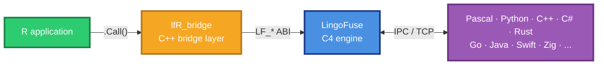
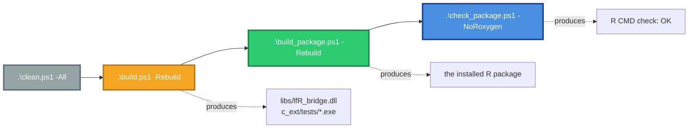
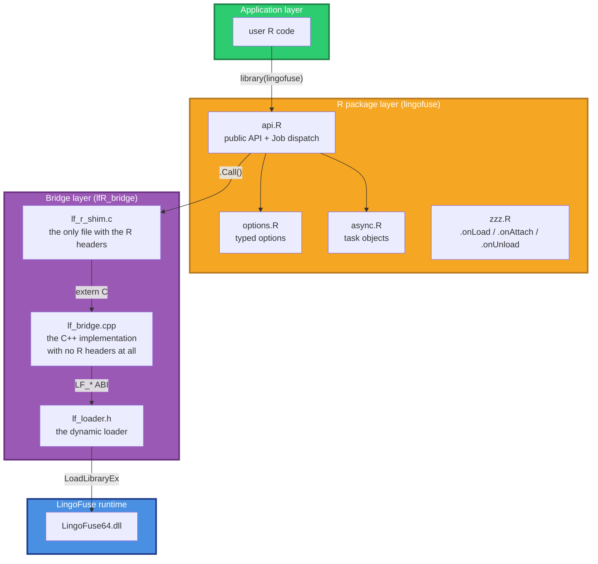
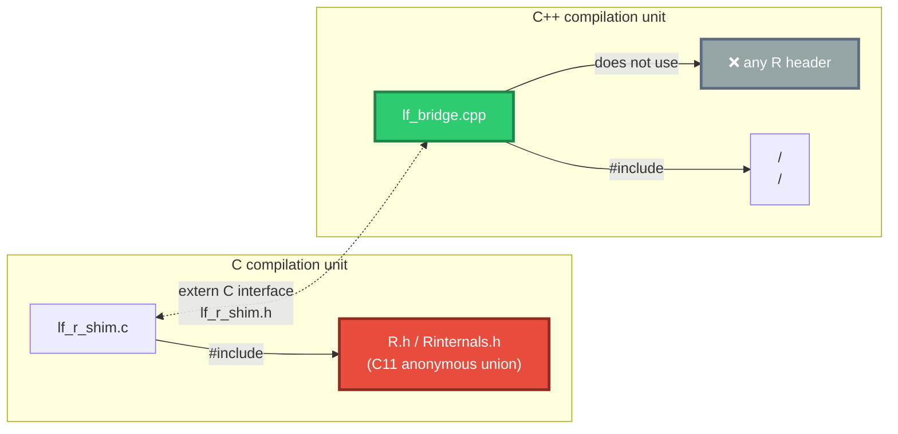
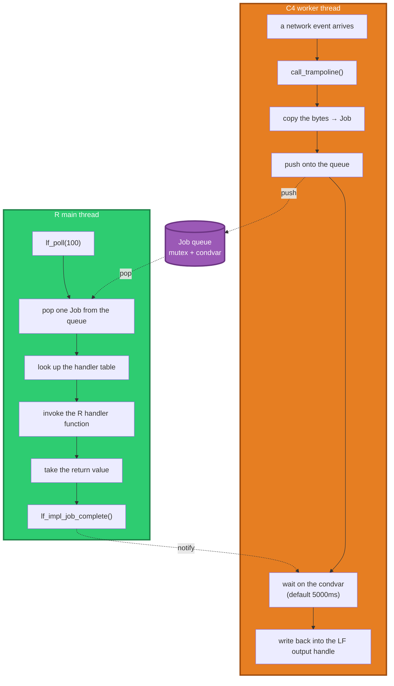
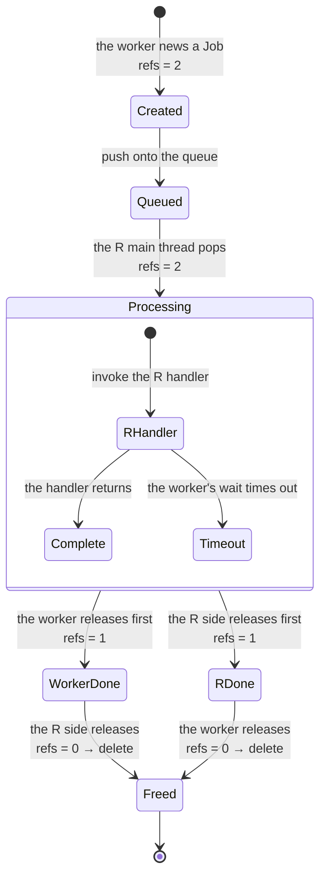
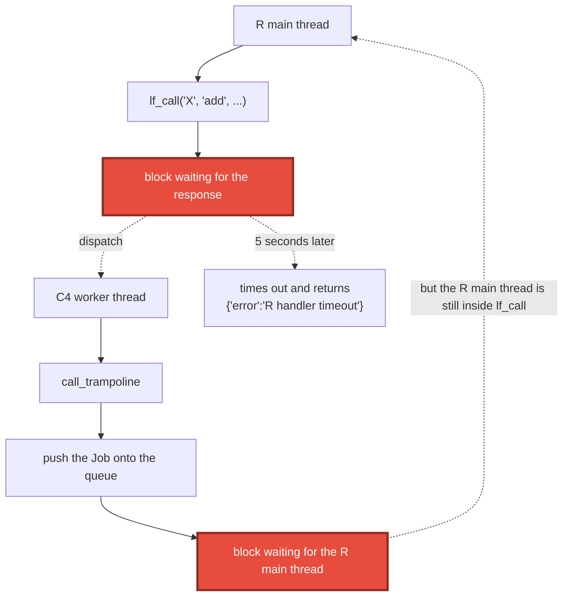
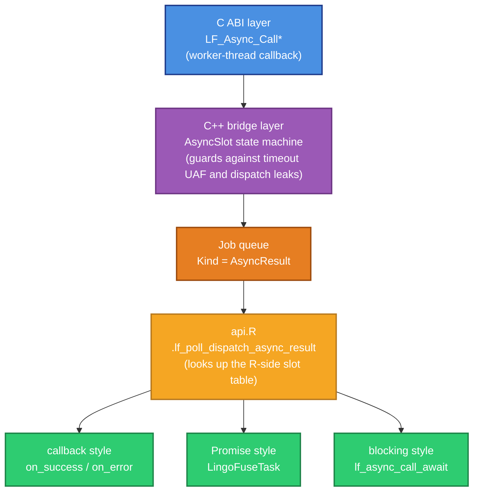

# The LingoFuse R binding (v2.0: all 59 symbols, no hard-coded paths, one-command tests)

> Chinese version: [README.md](README.md)

> **Let R talk directly with 16 other languages.**
> No IDL, no stub generation, no HTTP server to stand up.

[](https://www.r-project.org/)
[]()
[]()
[]()
[]()

---

## Contents

- [0. Overview](#0-overview)
- [1. Environment setup](#1-environment-setup)
  - [1.1 Software requirements](#11-software-requirements)
  - [1.2 Installing R](#12-installing-r)
  - [1.3 Installing Rtools](#13-installing-rtools)
  - [1.4 Obtaining the LingoFuse runtime](#14-obtaining-the-lingofuse-runtime)
  - [1.5 Environment diagnostics](#15-environment-diagnostics)
- [2. Dependency requirements](#2-dependency-requirements)
- [3. Building from source](#3-building-from-source)
  - [3.1 Building from scratch](#31-building-from-scratch)
  - [3.2 Build script overview](#32-build-script-overview)
  - [3.3 Build artifacts](#33-build-artifacts)
  - [3.4 Common build errors](#34-common-build-errors)
- [4. Install and uninstall](#4-install-and-uninstall)
  - [4.1 Installing the R package](#41-installing-the-r-package)
  - [4.2 Configuring the runtime location](#42-configuring-the-runtime-location)
  - [4.3 Uninstalling](#43-uninstalling)
- [5. Directory structure](#5-directory-structure)
- [6. Architecture and rationale](#6-architecture-and-rationale)
  - [6.1 The four-layer architecture](#61-the-four-layer-architecture)
  - [6.2 Why the C and C++ layers are separated](#62-why-the-c-and-c-layers-are-separated)
  - [6.3 Runtime directory resolution](#63-runtime-directory-resolution)
  - [6.4 The callback mechanism: the Job queue](#64-the-callback-mechanism-the-job-queue)
  - [6.5 Job lifecycle](#65-job-lifecycle)
  - [6.6 Single-thread re-entrancy limit](#66-single-thread-re-entrancy-limit)
  - [6.7 The async programming model](#67-the-async-programming-model)
  - [6.8 DLL lifecycle](#68-dll-lifecycle)
- [7. Using LF in an R project](#7-using-lf-in-an-r-project)
  - [7.1 Hello World: single-process self-test](#71-hello-world-single-process-self-test)
  - [7.2 Cross-process calls](#72-cross-process-calls)
  - [7.3 The three addressing modes](#73-the-three-addressing-modes)
  - [7.4 Synchronous calls](#74-synchronous-calls)
  - [7.5 Async calls: three styles](#75-async-calls-three-styles)
  - [7.6 One-way notifications](#76-one-way-notifications)
  - [7.7 Binary payloads](#77-binary-payloads)
  - [7.8 Side data: the automatic sender identity](#78-side-data-the-automatic-sender-identity)
  - [7.9 Network events](#79-network-events)
  - [7.10 Runtime options](#710-runtime-options)
  - [7.11 Process-level P2P registration](#711-process-level-p2p-registration)
  - [7.12 Complete API index](#712-complete-api-index)
- [8. The test system](#8-the-test-system)
  - [8.1 The layered test chain](#81-the-layered-test-chain)
  - [8.2 Running all tests with one command](#82-running-all-tests-with-one-command)
  - [8.3 Running a single test manually](#83-running-a-single-test-manually)
  - [8.4 Test scale overview](#84-test-scale-overview)
- [9. R CMD check](#9-r-cmd-check)
- [10. Common errors](#10-common-errors)
- [11. Known limitations](#11-known-limitations)

---

## 0. Overview

This repository is **the first-party R binding for LingoFuse**. It lets R both **call** LingoFuse
services written in other languages and **serve as a server** that other languages can call.



### v2.0 coverage

| Dimension | Coverage |
|---|:---:|
| **C ABI symbols** | **59 / 59** (complete) |
| R exported functions | **200+** (including 16 `set_opt_*` / `get_opt_*` pairs and 3 addressing modes × 6 call shapes) |
| Addressing modes | **3** (App name / UID / P2PName) |
| Call styles | **3** (synchronous / callback / Promise-task / blocking-await) |
| Test assertions | **211** (86 at the C++ layer + 125 at the R layer) |

### Six hard commitments

1. **byte-level interop** — produces **exactly the same** wire format as the Pascal / Python / C++ / C# bindings.
2. **RAII semantics** — handles are managed through R `externalptr` and released automatically when GC runs the finalizer.
3. **zero copy** — an R `raw` vector maps directly onto a C++ `std::string`, with no JSON serialization in between.
4. **relocatable anywhere** — the whole `r/` directory can be copied anywhere; every script and binary is **free of hard-coded absolute paths**.
5. **complete ABI coverage** — all 59 exported C ABI symbols are reachable from the R layer.
6. **modern async** — async programming never exposes a raw callback id; it offers Promise-style task objects, with timeout, dispatch failure and lifecycle all managed by the framework.

### Who it is for

- **data analysts / researchers**: use R to call Python training services, C++ inference engines, Julia numerical backends
- **R service backends**: expose R statistical models and algorithms to a web backend / LLM agent
- **cross-language integration**: R is just one link in the toolchain and must interoperate with Pascal, C#, Rust and other systems
- **not recommended**: pure-R projects, teams that cannot accept single-maintainer risk, teams that need a CRAN release

---

## 1. Environment setup

### 1.1 Software requirements

| Item | Minimum version | Notes |
|------|:--------:|------|
| **R** | **4.0+** | depends on the modern semantics of `R_RegisterCFinalizerEx` and `R_MakeExternalPtr`. Fully verified on **R 4.6.1 (ucrt) x64**. |
| **Rtools** | **Rtools45** (with R 4.6.x)<br/>Rtools44 (with R 4.5.x) | the C/C++ toolchain on Windows. **Only needed to compile the bridge layer**; skip it if you only use the prebuilt package. |
| **Operating system** | Windows 10+ / Linux (unverified) / macOS (unverified) | currently **fully verified on Windows x64 only**. Linux / macOS share the same code path but have not been measured. |
| **Disk space** | ~10 MB | the bridge DLL + R package + test binaries |
| **LingoFuse runtime** | 3.10+ | distributed separately, **not bundled in the R package** |

**The LingoFuse runtime files** (per platform):

| Platform | Runtime files |
|------|-----------|
| Windows 64 | `LingoFuse64.dll`, `z_ipc_64.dll`, `mimalloc64.dll` |
| Windows 32 | `LingoFuse32.dll`, `z_ipc_32.dll`, `mimalloc32.dll` |
| Linux | `liblingofuse.so`, `libz_ipc.so`, `libmimalloc.so` |
| macOS | `liblingofuse.dylib`, `libz_ipc.dylib`, `libmimalloc.dylib` |

### 1.2 Installing R

**Windows**: download the latest R from [CRAN](https://cran.r-project.org/bin/windows/base/) and tick **"Add R to PATH"** during installation. Verify afterwards:

```powershell
R.exe --version
# R version 4.6.1 (2026-06-24 ucrt) -- "Happy Hop"
```

**Linux**:

```bash
sudo apt install r-base r-base-dev         # Debian / Ubuntu
sudo dnf install R R-devel                 # Fedora / RHEL
```

**macOS**:

```bash
brew install r
```

### 1.3 Installing Rtools

**Windows only**, needed to compile the bridge DLL.

**The Rtools version must match the R version**:

| R version | Rtools needed | Download |
|---|:---:|---|
| R 4.6.x | **Rtools45** | https://cran.r-project.org/bin/windows/Rtools/rtools45/ |
| R 4.5.x | Rtools44 | https://cran.r-project.org/bin/windows/Rtools/rtools44/ |
| R 4.4.x | Rtools43 | https://cran.r-project.org/bin/windows/Rtools/rtools43/ |

**Installation steps**:

1. Download `rtools45-x86_64.exe` (or the matching version) from the corresponding URL.
2. Run the installer; **the default path is fine** (`C:\rtools45\`).
3. **Tick "Add rtools to system PATH"** (R finds its compiler through `R CMD config` anyway, but this is safer).
4. Restart PowerShell so the PATH takes effect.

**Verify**:

```powershell
R.exe CMD config CC
# gcc

R.exe CMD config CXX
# g++ -std=gnu++20
```

**The key point**: which compiler R uses on Windows is decided by `R CMD config CC/CXX`, **not** by
whatever gcc is on PATH. If you also have MinGW-Builds or MSYS2 installed, they are not used.

### 1.4 Obtaining the LingoFuse runtime

The runtime is distributed by **the LingoFuse main repository**, separately from the R binding. Two
approaches:

**Option A: clone the main repository (recommended)**

```powershell
cd D:\CoreLibrary
git clone --recursive https://github.com/PassByYou888/LingoFuse.git
# or download the release archive and unzip it to D:\CoreLibrary\LingoFuse
```

The main repository's `Binary/` directory holds prebuilt 32/64-bit Windows DLLs.

**Option B: download only the runtime files**

Download the matching `LingoFuse64.dll`, `z_ipc_64.dll` and `mimalloc64.dll` from the LingoFuse
release page and put them in any directory (for example `D:\LingoFuseRuntime\`).

**The recommended layout**:

```
D:\CoreLibrary\
├── LingoFuse\                 ← the main repository
│   ├── Binary\                ← the runtime DLLs live here
│   │   ├── LingoFuse64.dll
│   │   ├── z_ipc_64.dll
│   │   └── mimalloc64.dll
│   └── ...
└── LingoFuse\r\               ← this repository (the R binding)
    ├── build.ps1
    └── ...
```

With that layout, running any script inside `r/` lets the relative probe of `../Binary/` find the
runtime automatically — **no parameters, no environment variables**.

### 1.5 Environment diagnostics

This repository provides `check_env.ps1` to check the environment in one command:

```powershell
cd D:\CoreLibrary\LingoFuse\r
.\check_env.ps1
```

**Example output**:

```
========================================================================
1. R installation
========================================================================
[OK] R.exe found
       C:\Program Files\R\R-4.6.1\bin\R.exe
[OK] R version
       R version 4.6.1 (2026-06-24 ucrt)
[OK] R_HOME
       C:\PROGRA~1\R\R-46~1.1

========================================================================
2. R CMD config (toolchain source of truth)
========================================================================
[OK] R CMD config CC
       gcc
[OK] R CMD config CXX
       g++ -std=gnu++20

========================================================================
3. C / C++ compilers used by R CMD SHLIB
========================================================================
[OK] C compiler
       resolved: C:\rtools45\x86_64-w64-mingw32.static.posix\bin\gcc.exe
[OK] C++ compiler
       resolved: C:\rtools45\...

========================================================================
5. R.dll
========================================================================
[OK] R.dll found
       C:\Program Files\R\R-4.6.1\bin\x64\R.dll

========================================================================
Verdict
========================================================================
[READY] The environment can build R extensions.
```

**If it shows `[BLOCKED]`**: fill in the missing Rtools or R installation as indicated. **The most
common pitfall** is forgetting to tick "Add rtools to system PATH", or not restarting PowerShell
after installing Rtools.

---

## 2. Dependency requirements

### 2.1 On the R side

| Dependency | Purpose | Required? |
|------|------|:--------:|
| R base | every exported API uses base only | ✅ |
| `jsonlite` | **user code only** (`demo/*.R` and the test scripts); the package itself does not import it | ❌ |
| `roxygen2` | generates `NAMESPACE` and `man/` | 🛠 at development time |
| `Rtools45` | the C/C++ toolchain on Windows | 🛠 at build time |

**The R package itself has no runtime dependencies** — `Imports` in `DESCRIPTION` is empty, and so
is `Suggests` (`jsonlite` was deliberately removed to keep `R CMD check` from validating the
dependency graph online).

Install `jsonlite` (optional, recommended, for the example code and test scripts):

```r
install.packages("jsonlite")
```

### 2.2 On the C/C++ side

The bridge layer is written in standard C/C++ and **depends on no third-party C++ library** (no
Boost, no protobuf, no nlohmann). It depends only on:

| Dependency | Purpose |
|------|------|
| the C++17 STL | `std::string` / `std::atomic` / `std::mutex` / `std::condition_variable` / `std::unordered_map` / `std::filesystem` |
| `<windows.h>` or `<dlfcn.h>` | loading the runtime dynamically |
| LingoFuse's C ABI | the `LF_*` exported functions |

**It does not use LingoFuse's official C++ headers** (`LingoFuse.hpp` / `lf_io.hpp` /
`nlohmann/json`), because those headers depend on nlohmann/json and enforce a UTF-8 contract that
is incompatible with R's `SEXP` boundary. The bridge layer calls `LF_*` directly through
hand-written ABI declarations.

---

## 3. Building from source

**You only need to build if you changed the C/C++ sources.** If you only use the R interface, skip
to [§4 Install and uninstall](#4-install-and-uninstall).

### 3.1 Building from scratch



**The standard build flow**:

```powershell
cd D:\CoreLibrary\LingoFuse\r

# 1. clear all build artifacts
.\clean.ps1 -All

# 2. compile the c_ext layer (bridge DLL + C++ test binaries)
.\build.ps1 -Rebuild

# 3. copy sources into the R package + generate NAMESPACE/man + R CMD INSTALL
.\build_package.ps1 -Rebuild

# 4. (optional) R CMD check
.\check_package.ps1 -NoRoxygen
```

**What each step does**:

| Step | What it does | Rough duration |
|:----:|------|:---:|
| 1 | delete the old `.o` / `.dll` / `man/*.Rd` / `NAMESPACE` | < 1 second |
| 2 | compile `lf_r_shim.c` + `lf_bridge.cpp` → `lfR_bridge.dll` with the Rtools gcc; also compile the 4 C++ test binaries | 20-40 seconds |
| 3 | copy `c_ext/src/` into `lingofuse/src/`, run `roxygen2::roxygenise()`, then `R CMD INSTALL` | 30-60 seconds |
| 4 | `R CMD build` + `R CMD check` (offline mode) | 40-90 seconds |

### 3.2 Build script overview

| Script | Role | When to use it |
|------|------|--------|
| `check_env.ps1` | environment diagnostics | first-time setup / build errors |
| **`build.ps1`** | compile the c_ext bridge layer + the C++ binaries | after changing any C/C++ code |
| **`build_package.ps1`** | copy sources + roxygenise + R CMD INSTALL | after changing any C/C++ code, and you need to reinstall the R package |
| `install_package.ps1` | install the R package only | sources are ready, or installing from a `.tar.gz` |
| `uninstall_package.ps1` | uninstall the R package | cleanup |
| `clean.ps1` | clean build artifacts | starting over |
| `check_package.ps1` | `R CMD build` + `R CMD check` (offline) | validating package quality |
| **`run_all_tests.ps1`** | **run every test in one command** | **routine validation / CI** |

**Key parameters**:

| Parameter | Script | Effect |
|------|------|------|
| `-Rebuild` | `build.ps1` / `build_package.ps1` | delete all intermediates and recompile |
| `-All` | `clean.ps1` | additionally delete `man/` / `NAMESPACE` / the sources copied into `lingofuse/src/` |
| `-NoRoxygen` | `build_package.ps1` / `install_package.ps1` / `check_package.ps1` | skip the automatic roxygenise |
| `-RuntimeDir <path>` | `run_all_tests.ps1` | specify the runtime directory explicitly |
| `-SkipClean` / `-SkipBuild` / `-SkipInstall` / `-SkipCheck` | `run_all_tests.ps1` | skip the corresponding phase |

**`clean.ps1 -All` deletes `man/` / `NAMESPACE` / the copied sources under `lingofuse/src/`.** The
next `build_package.ps1` regenerates all of them — that is already automated.

### 3.3 Build artifacts

| Step | Artifact | Location |
|:----:|------|------|
| 2 | `lfR_bridge.dll` | `libs/` |
| 2 | `bridge_selftest.exe` | `c_ext/tests/` |
| 2 | `test_service.exe` / `echo_client.exe` / `cross_client.exe` | `c_ext/tests/` |
| 3 | `lingofuse/src/lf_*.{c,h,cpp}` | copied from `c_ext/src/` |
| 3 | `lingofuse/NAMESPACE` + `lingofuse/man/*.Rd` | generated by roxygen2 (136 `.Rd` files in v2.0) |
| 3 | the installed R package | R's default library (usually `Program Files\R\...\library\lingofuse\`) |
| 4 | `.tar.gz` + `.Rcheck` | `_check_YYYYMMDD_HHMMSS/` |

### 3.4 Common build errors

#### `cannot find -lR` or `R_init_xxx not found`

**Cause**: the tail of `lf_r_shim.c` does not use the `LF_R_INIT_NAME` macro.

**Fix**: confirm the tail of `c_ext/src/lf_r_shim.c` contains:

```c
#ifndef LF_R_INIT_NAME
#  define LF_R_INIT_NAME R_init_lfR_bridge
#endif

void LF_R_INIT_NAME(DllInfo *dll) { ... }
```

and that `lingofuse/src/Makevars[.win]` contains `-DLF_R_INIT_NAME=R_init_lingofuse`.

#### `error: implicit declaration of function 'lf_impl_job_input_size'`

**Cause**: an inconsistent function name (it should be `lf_impl_job_get_input_size`).

**Fix**: search for it and make it consistent:

```powershell
(Get-Content c_ext\src\lf_r_shim.c -Raw) `
    -replace 'lf_impl_job_input_size', 'lf_impl_job_get_input_size' `
    | Set-Content c_ext\src\lf_r_shim.c -NoNewline
```

#### `Error in e[[1L]] : object of type 'symbol' is not subsettable`

**Cause**: `NAMESPACE` failed to parse, usually from an old-version leftover or a half-generated file.

**Fix**: delete it and regenerate.

```powershell
Remove-Item lingofuse\NAMESPACE -Force
Remove-Item lingofuse\man -Recurse -Force
.\build_package.ps1 -Rebuild
```

#### `Failed to assign RegisteredNativeSymbol`

**Cause**: the `useDynLib` entry in `NAMESPACE` is missing `.fixes = "C_"`.

**Fix**: the first line of `lingofuse/NAMESPACE` should be:

```
useDynLib(lingofuse, .registration = TRUE, .fixes = "C_")
```

(roxygen2 generates it from the `"_PACKAGE"` block in `api.R`; do not edit it by hand.)

---

## 4. Install and uninstall

### 4.1 Installing the R package

**Option A: install from the source tree (recommended during development)**

```powershell
cd D:\CoreLibrary\LingoFuse\r
.\build_package.ps1 -Rebuild
```

It automatically copies the sources → roxygenise → `R CMD INSTALL`.

**Option B: install from a `.tar.gz` (recommended for distribution)**

```powershell
# build the tar.gz first
.\check_package.ps1 -Keep

# then install from the tar.gz
.\install_package.ps1 -Tarball "_check_20261016_120000\lingofuse_0.5.0.tar.gz"
```

**Option C: install directly with `R CMD INSTALL`**

```powershell
R.exe CMD INSTALL lingofuse
```

**Verify the installation**:

```r
library(lingofuse)
lf_is_loaded()          # FALSE (the runtime is not loaded yet)
lf_find_runtime()       # probes automatically, or returns NULL
```

### 4.2 Configuring the runtime location

After installing the R package you need to tell it where the LingoFuse runtime is. **Pick any of the
four ways** (in descending priority):

#### Way 1: the recommended layout — zero configuration

Put the runtime in `<repo>/Binary/`:

```
D:\CoreLibrary\LingoFuse\
├── Binary\                    ← the runtime DLLs live here
│   └── LingoFuse64.dll
└── r\
    └── ...
```

When a script runs from the `r/` directory or any subdirectory, **the relative probe finds it
automatically**:

```r
library(lingofuse)
lf_load(lf_find_runtime())    # probes automatically, no arguments needed
```

#### Way 2: an environment variable

```r
Sys.setenv(LINGOFUSE_RUNTIME = "D:/CoreLibrary/LingoFuse/Binary")
library(lingofuse)            # loads automatically
```

Or in PowerShell / Bash:

```powershell
$env:LINGOFUSE_RUNTIME = "D:\CoreLibrary\LingoFuse\Binary"
```

```bash
export LINGOFUSE_RUNTIME=/opt/LingoFuse/Binary
```

#### Way 3: an R option

```r
options(lingofuse.runtime = "D:/CoreLibrary/LingoFuse/Binary")
library(lingofuse)
```

#### Way 4: load explicitly

```r
library(lingofuse)
lf_load("D:/CoreLibrary/LingoFuse/Binary")
```

**The resolution order** (inside `lf_find_runtime()`):

| Priority | Source |
|:---:|---|
| 1 | an explicit argument (`lf_load(dir)` / `lf_find_runtime(explicit = dir)`) |
| 2 | the `LINGOFUSE_RUNTIME` environment variable |
| 3 | the `lingofuse.runtime` R option |
| 4 | the relative probe: `Binary/`, `runtime/`, `runtime/Binary/`, `lib/`, `../Binary/`, `../../Binary/`, … |

### 4.3 Uninstalling

```powershell
Rscript -e "remove.packages('lingofuse')"
```

Or:

```powershell
.\uninstall_package.ps1
```

**Note**: if the package ever called `lf_prepare_done` in the **current R session**, `detach`
triggers `.onUnload` and prints:

```
lingofuse: LF was running. The bridge DLL is left loaded;
the OS will reclaim it at process exit.
```

That is **deliberate** — `LF_Shutdown` is asynchronous, C4 worker threads may still be running
inside the DLL, and `lf_loader.h` has already pinned the runtime DLL with
`GET_MODULE_HANDLE_EX_FLAG_PIN`. **Letting the OS reclaim it at process exit** is the only safe
approach.

---

## 5. Directory structure

```
r/
├── README.md                   this file
├── build.ps1                   compile the bridge DLL + the C++ test binaries
├── build_package.ps1           copy sources + roxygenise + R CMD INSTALL
├── check_env.ps1               environment diagnostics
├── check_package.ps1           R CMD build + R CMD check (offline)
├── clean.ps1                   clean build artifacts
├── install_package.ps1         install the R package only
├── run_all_tests.ps1           run every test in one command
├── uninstall_package.ps1       uninstall the R package
│
├── .vscode/
│   └── settings.json
│
├── c_ext/                      the native extension layer
│   ├── src/                    the bridge layer sources (the single source of truth)
│   │   ├── lf_bridge.cpp       the C++ implementation (Job queue / async state machine / three addressing modes)
│   │   ├── lf_loader.h         the runtime loader + find_runtime_dir()
│   │   ├── lf_r_shim.c         the C shim (the only file that includes the R headers)
│   │   └── lf_r_shim.h         the C/C++ interface (pure C89)
│   └── tests/                  the R and C++ test scripts
│       ├── bridge_selftest.cpp standalone C++ layer self-test (86 items)
│       ├── smoke_test.R        STEP 1 - the build chain
│       ├── abi_test.R          STEP 2 - the C ABI round-trip
│       ├── caller_test.R       STEP 3a - R as a client
│       ├── callee_test.R       STEP 3b - R as a server
│       ├── cross_node.R        STEP 4 - the binary protocol
│       ├── options_test.R      STEP 5 - typed options
│       ├── async_test.R        STEP 6 - the async R layer
│       ├── uid_p2p_service.R   STEP 7 - the UID/P2P server
│       ├── uid_p2p_client.R    STEP 7 - the UID/P2P client
│       ├── lf_r_api.R          the R API shared by the test scripts
│       ├── lf_runtime.R        the runtime resolver shared by the test scripts
│       ├── cross_client.cpp    pairs with cross_node.R
│       ├── echo_client.cpp     pairs with callee_test.R
│       └── test_service.cpp    pairs with caller_test.R
│
├── demo/
│   ├── client.R                the client of the two-process demo
│   └── server.R                the server of the two-process demo
│
├── libs/                       the generated development DLL (git-ignored)
│   └── lfR_bridge.dll
│
└── lingofuse/                  the standard R package
    ├── DESCRIPTION
    ├── LICENSE
    ├── NAMESPACE               generated by roxygen2
    ├── inst/
    │   └── README.md           installed to system.file("README.md")
    ├── man/                    generated by roxygen2 (136 .Rd files)
    ├── R/
    │   ├── api.R               the public API + Job dispatch + lf_find_runtime()
    │   ├── options.R           the typed option accessors (16 set/get pairs)
    │   ├── async.R             the modern async layer (task objects + then/catch/finally)
    │   └── zzz.R               .onLoad / .onAttach / .onUnload
    ├── src/
    │   ├── lf_bridge.cpp       copied from c_ext/src
    │   ├── lf_loader.h         copied from c_ext/src
    │   ├── lf_r_shim.c         copied from c_ext/src
    │   ├── lf_r_shim.h         copied from c_ext/src
    │   ├── Makevars            hand-written
    │   └── Makevars.win        hand-written
    └── tests/
        └── smoke.R             runs automatically during R CMD check
```

**Key facts**:

- **`c_ext/src/` is the single source of truth.** The same-named files in `lingofuse/src/` are
  copied there by `build_package.ps1` on every build.
- **`lingofuse/` is a standard R package layout**, so `R CMD INSTALL` works directly on it.
- **`libs/lfR_bridge.dll` is the standalone development DLL**, used by the
  `c_ext/tests/*.R` scripts through `dyn.load()`. It is **the same code** as the DLL wrapped by
  the R package; only the init function name differs (`R_init_lfR_bridge` vs `R_init_lingofuse`).
- **`NAMESPACE` and `man/*.Rd` are generated by roxygen2 from the `#'` comments in
  `lingofuse/R/*.R`**; do not edit them by hand.
- **All paths resolve relative to the script itself** (`$PSScriptRoot` / `commandArgs("--file=")`),
  so the whole directory tree can be moved anywhere.

---

## 6. Architecture and rationale

### 6.1 The four-layer architecture



**Each layer's responsibility**:

| Layer | Files | Responsibility | Constraint |
|----|------|------|------|
| L1 | user R | calls the `lf_*` functions | none |
| L2 | `api.R` | argument validation, Job dispatch, handler-table management | never `.Call`s complex types directly |
| L2 | `options.R` | typed option accessors | only calls `lf_set_option` / `lf_get_option` |
| L2 | `async.R` | task objects, Promise-style handler chains | talks to `api.R` only through `.lf_state$async_slots` |
| L3a | `lf_r_shim.c` | the `.Call` entry points, `SEXP` ↔ C type conversion | **only this file may `#include <R.h>`** |
| L3b | `lf_bridge.cpp` | the Job queue, async state machine, callback trampolines | **never `#include <R.h>`** |
| L4 | `LingoFuse64.dll` | C4 networking, serialization, load balancing | loaded at runtime by `lf_loader.h` |

### 6.2 Why the C and C++ layers are separated



**Why the separation is necessary**:

1. R 4.6's `R.h` relies on C11 anonymous `union` / anonymous `enum`, which **MSVC's C front end
   cannot compile**.
2. But **C++17 compilers (gcc/g++) accept C11 anonymous unions as an extension**.
3. Even so, letting a C++ compilation unit include the R headers would pull in `_Complex` / `SEXP`
   and the like, conflicting with the C++ standard library.
4. **So: the C file owns the R headers, the C++ file owns the business logic, and the two talk
   through the pure-C89 `lf_r_shim.h`**.

`lf_r_shim.h` contains **no R types at all** — only `void*` / `int64_t` / `const char*`.

### 6.3 Runtime directory resolution

**This is the core mechanism behind "runs from anywhere"**. The R and C++ sides implement the same
resolution order:

| Priority | Source | Notes |
|:------:|------|------|
| 1 | a command-line argument | `Rscript ... <runtime_dir>` or `xxx.exe <runtime_dir>` |
| 2 | the `LINGOFUSE_RUNTIME` environment variable | `$env:LINGOFUSE_RUNTIME = "<runtime_dir>"` |
| 3 | the `lingofuse.runtime` R option | `options(lingofuse.runtime = "<runtime_dir>")` (R side only) |
| 4 | **the relative probe** | probes, in the script directory and the current working directory: `Binary/`, `runtime/`, `runtime/Binary/`, `lib/`, `../Binary/`, `../../Binary/`, `../../../Binary/`, and so on |

**The recommended layout**: put the runtime in `<repo>/Binary/`, and then **it can be started from
anywhere with no arguments**:

```
<any directory>/
├── Binary/                      ← the runtime DLLs (LingoFuse64.dll and friends)
└── r/                           ← the whole R binding directory
    ├── c_ext/tests/*.R
    ├── demo/*.R
    └── lingofuse/
```

The corresponding implementations:

| Location | Implementation |
|------|------|
| R scripts | `lf_find_runtime()` in `c_ext/tests/lf_runtime.R`; the inline `lf_resolve_runtime_dir()` in the demo scripts |
| the R package | `lingofuse::lf_find_runtime()` (an exported function) |
| C++ test programs | `lf::find_runtime_dir()` in `lf_loader.h` |

**Special behaviours**:

- R's `lf_find_runtime(explicit = ...)`: **when an explicit argument is present but invalid it
  returns `NULL` directly** and never falls back to another source. That stops a misspelled path
  from silently using a different directory.
- The `lingofuse` package's `.onLoad` (`zzz.R`) reads `LINGOFUSE_RUNTIME` and `lingofuse.runtime`
  automatically and loads the runtime if it finds either. `.onAttach` prints one informational
  line only when the path is not the default.
- **C++ binaries print a clear diagnostic when the runtime is missing** (including `Usage:` and
  three ways to fix it), then exit with code 1.

### 6.4 The callback mechanism: the Job queue

**The core constraint**: **C4 worker threads must never touch the R interpreter**. R is
single-threaded — all R code must run on the same thread.



**The four Job kinds in the queue** (the last two are new in v2.0):

| Kind | Origin | R-side handling |
|:---:|---|---|
| `Call` | a Call API registered App-bound / as P2P | invoke the handler, write back the output |
| `Notify` | a Notify API registered App-bound / as P2P | invoke the handler, no output |
| `AsyncResult` | an async call completed | invoke the task's `on_success` / `on_error` |
| `NetEvent` | a network connect / disconnect | invoke the callback installed by `lf_set_network_event` |

**The contract**:

| Rule | Consequence |
|------|------|
| worker threads **never** call any R API | violating it **crashes the process** (an internal R assertion) |
| worker threads only copy bytes + enqueue + block | — |
| the R main thread only pops Jobs + invokes handlers | — |
| an R handler **never** calls `lf_call` / `lf_notify` | violating it **deadlocks** (see §6.6) |
| a handler **must not** block longer than `timeout_ms` | otherwise the worker times out and returns `{"error":"R handler timeout"}` |

### 6.5 Job lifecycle

**This is where a use-after-free is most likely anywhere in the system**. The design uses **atomic
reference counting**:



**The key invariants**:

- a Job starts at `refs = 2` (a two-way Job): one reference for the worker, one for the R side.
- **one-way Jobs** (AsyncResult / NetEvent) start at `refs = 1`: only the R side holds a reference.
- **whoever drops the last reference deletes it**. Whichever side releases first, the other always
  releases correctly — **no double free and no leak**.

**The timeout path**:
1. the worker waits longer than `timeout_ms` → sets `done = true`, **does not delete the Job**, and
   returns directly
2. the worker releases its reference
3. later the R handler completes → `lf_impl_job_complete` sees `done == true` → **writes no
   output**, releases the R-side reference → the Job is destroyed

### 6.6 Single-thread re-entrancy limit

**`LF_Call` is not re-entrant.** This is numbered **LF-CB-002** in the Pascal guide.



**The solution**: `lf_local_call()` / `lf_local_notify()` bypass the C4 network and **dispatch
straight from the R-side handler table**.

| Scenario | Which to use | Needs a pump loop |
|------|--------|:------------------:|
| single-process self-test (calling itself) | `lf_local_call` | ❌ no |
| cross-process / cross-machine calls | `lf_call` | ✅ yes |
| async calls (no callback, request only) | `lf_async_call` | ✅ yes |
| async call + wait for the result immediately | `lf_async_call_await` | ❌ pumps internally |

### 6.7 The async programming model

v2.0 introduces a complete async layer. The C ABI's `LF_Async_Call*` is callback-based: the C side
holds a C function pointer and invokes it on a **worker thread** when the result arrives. The R
layer cannot expose that model directly — it would leave users facing raw pointers and thread
switches.

**Three layers of wrapping**:



**Key design points**:

- **the C++-side ctypes callback object is never released proactively** — even if the R side gives
  up on a timeout, the C-side callback can still find a valid slot when it fires and **discard the
  result**, without a UAF.
- **the timeout is implemented on the R side** — each `lf_poll` iteration checks the `async_slots`
  deadlines and fires `on_error("timeout", 1L, user_data)`.
- **the C side has no timeout parameter** — `LF_Async_Call` itself accepts no timeout; the R-side
  timeout is purely a "I no longer want to wait" decision and does not stop the C-side request from
  continuing.

### 6.8 DLL lifecycle

**The problem**: once LingoFuse is loaded by `LoadLibrary`, it starts background threads internally
(the data handle pool scanner, the simulated main thread, C4 networking). Calling `FreeLibrary`
while those threads are still running makes Windows raise an access violation after unloading the
DLL (exit code `0xC0000005`).

**The solution** has two layers:

1. **the C++ loader layer (`lf_loader.h`)**:
   - `load()` uses `GetModuleHandleExA` with `GET_MODULE_HANDLE_EX_FLAG_PIN` (Windows) or
     `RTLD_NODELETE` (POSIX) to **pin** the runtime DLL.
   - a pinned DLL is never unloaded during the process lifetime. Windows simply terminates the
     process instead of running the detach sequence. **That eliminates the race at its root**.
   - `unload()` and `detach()` **only clear the function pointer table** and never call
     `FreeLibrary`/`dlclose`.

2. **the R layer (`lf_cleanup()` in `api.R`)**:
   - runs the full shutdown sequence: `lf_exit_main_thread` → `lf_app_free` → `lf_shutdown`.
   - **does not** call `dyn.unload()` (that would make R try to unload the bridge DLL, which would
     in turn try to unload the runtime DLL and crash).
   - lets the OS reclaim all DLLs at process exit.

**The side effect**: a process can `dlopen` the runtime only once (because it cannot be unloaded).
That is fine in practice — LingoFuse itself is a "load once, use globally" architecture.

---

## 7. Using LF in an R project

### 7.1 Hello World: single-process self-test

**The single-process self-test demonstrates an R function being called by R's own code** — it does
not go over the network and needs no second process.

```r
library(lingofuse)

# 1. load the runtime (skip if it is already configured via an env var / option)
lf_load(lf_find_runtime())    # or lf_load("D:/CoreLibrary/LingoFuse/Binary")

# 2. create an App
app <- lf_create_app("CalcSelf", "self-contained demo")

# 3. register a Call API
lf_register_call(app, "add", "Add two integers", function(input) {
    req <- jsonlite::fromJSON(input)
    jsonlite::toJSON(list(result = req$a + req$b), auto_unbox = TRUE)
})

# 4. a single-process local call — bypasses the C4 network and dispatches directly
res <- lf_local_call(app, "add", '{"a":3,"b":4}')
cat("response:", res, "\n")
# output: response: {"result":7}

# 5. clean up
lf_cleanup(app)
```

**The key point**: there is **no** `lf_prepare_service` / `lf_prepare_client` / `lf_prepare_done`
here. `lf_local_call` never touches the C4 network; it dispatches entirely inside R.

### 7.2 Cross-process calls

R as the server and another R process (or any process in another language) as the client —
**this is what actually goes over the C4 network**.

**The server** (`demo/server.R`, terminal T1):

```r
library(lingofuse)
library(jsonlite)

app <- lf_create_app("CalcR", "R calculator demo")

lf_register_call(app, "add", "add two integers", function(input) {
    req <- fromJSON(input)
    toJSON(list(result = req$a + req$b), auto_unbox = TRUE)
})

lf_prepare_service("ipc:r_calc", "ipc:r_calc")
lf_prepare_client("ipc:r_calc", app)
stopifnot(lf_prepare_done() == 1L)

cat("[server] online: CalcR @ ipc:r_calc\n")

# the pump loop: handle requests coming from other processes
start <- Sys.time()
while (as.numeric(Sys.time() - start, units = "secs") < 60) {
    lf_poll(100)   # 100ms timeout
}
lf_cleanup(app)
```

**The client** (`demo/client.R`, terminal T2):

```r
library(lingofuse)
library(jsonlite)

# a pure consumer: no app binding
lf_prepare_client("ipc:r_calc", NULL)
stopifnot(lf_prepare_done() == 1L)

# wait for the app to come online (broadcast latency ~3s)
for (i in 1:50) {
    if (lf_check_api("CalcR", "add")) break
    Sys.sleep(0.2)
}

res <- lf_call("CalcR", "add",
               toJSON(list(a = 3L, b = 4L), auto_unbox = TRUE),
               timeout_ms = 5000)
cat("response:", res, "\n")
# output: response: {"result":7}

lf_cleanup(NULL)
```

**How to run it** (with the runtime in `<repo>/Binary/` no arguments are needed):

```powershell
# T1
Rscript demo\server.R

# T2
Rscript demo\client.R
```

### 7.3 The three addressing modes

LingoFuse supports three orthogonal addressing modes that share one set of call shapes:

| Mode | Index key | Local-first | Server-side selection policy | Typical use |
|---|---|---|---|---|
| **App name** | a UTF-8 string | ✅ | least recently used | fixed services |
| **UID** | 32 binary bytes | ✅ | direct hit | **targeting a specific client** |
| **P2PName** | a UTF-8 string | ❌ | Cycle_Anchor / FixedSequenced | homogeneous service clusters |

**Local-first** means: if the calling process has itself registered a client with the same App name
/ the same UID, the call is served locally instead of going over the network. P2PName deliberately
**does not** do local-first — the server side needs to maintain its load-balancing state.

```r
# ---- App name addressing ----
lf_call("CalcR", "add", '{"a":1,"b":2}')

# ---- UID addressing ----
lf_uid_call(uid_raw, "add", '{"a":1,"b":2}')            # raw(32)
lf_uid_call("d2ee...c97c", "add", '{"a":1,"b":2}')      # or a 64-character hex string

# ---- P2PName addressing ----
lf_p2pname_call("calc_workers", "add", '{"a":1,"b":2}')
```

### 7.4 Synchronous calls

**Every addressing mode has a synchronous call** (blocking until the response arrives or it times
out):

```r
# string payloads
resp <- lf_call("CalcR", "add", '{"a":1,"b":2}', timeout_ms = 5000)
# resp is a string; on timeout it returns ""

resp <- lf_uid_call(uid, "add", '{"a":1,"b":2}', timeout_ms = 5000)
resp <- lf_p2pname_call("calc_workers", "add", '{"a":1,"b":2}', timeout_ms = 5000)

# binary payloads
req_raw <- as.raw(c(0x01, 0x02, 0x03, 0x04))
resp_raw <- lf_call_bin("CalcR", "echo_bin", req_raw, timeout_ms = 5000)
# resp_raw is a raw vector; on timeout it returns raw(0)
```

**timeout_ms = 0** means "wait forever" (not recommended).

### 7.5 Async calls: three styles

v2.0 offers three async styles, all built on the same C ABI, freely mixable.

#### Style 1 — callbacks

```r
lf_async_call("Calc", "add", '{"a":1,"b":2}',
    on_success = function(result, user_data) {
        cat("got:", result, "\n")
    },
    on_error = function(error_msg, error_kind, user_data) {
        message("failed: ", error_msg, " (kind=", error_kind, ")")
    },
    timeout_ms = 5000,
    user_data = list(request_id = 42))

# the main loop must pump:
while (running) {
    lf_poll(100)
}
```

`error_kind` values:

| Kind | Meaning |
|:---:|---|
| `0` | dispatch failed (the C side rejected it; the callback never fires) |
| `1` | R-side timeout (the reaper fired) |
| `2` | a C-side error (reserved) |
| `3` | an unknown error (reserved) |

#### Style 2 — Promise (task objects)

```r
t <- lf_async_task("Calc", "add", '{"a":1,"b":2}', timeout_ms = 5000)

# attach handlers at any time (before or after completion)
lf_task_then(t,    function(result, task) print(result))
lf_task_catch(t,   function(err, kind, task) message(err))
lf_task_finally(t, function(task) cat("done\n"))

# state queries
lf_task_state(t)      # "pending" / "done" / "error"
lf_task_result(t)     # the result (errors if it is unfinished or failed)
lf_task_error(t)      # the error message (or NULL)

# printing
print(t)
# <LingoFuseTask>
#   id       : 42
#   api_name : add
#   target   : Calc
#   state    : done
#   timeout  : 5000 ms
#   result   : '{"result":7}'
```

#### Style 3 — blocking await

```r
result <- lf_async_call_await("Calc", "add", '{"a":1,"b":2}',
                              timeout_ms = 5000)
# on return you always have a result, or an error was raised
```

`lf_task_await(t)` also works on task objects:

```r
t <- lf_async_task("Calc", "add", '{"a":1,"b":2}', timeout_ms = 5000)
result <- lf_task_await(t)                      # uses the task's own deadline
result <- lf_task_await(t, timeout_ms = 3000)   # an extra 3-second guard
```

#### The complete six addressing modes × three styles matrix

| Addressing | Callback | Promise | Blocking await |
|---|---|---|---|
| App | `lf_async_call` | `lf_async_task` | `lf_async_call_await` |
| App + Sequenced | `lf_async_sequenced_call` | `lf_async_sequenced_task` | `lf_async_sequenced_call_await` |
| UID | `lf_uid_async_call` | `lf_uid_async_task` | `lf_uid_async_call_await` |
| UID + Sequenced | `lf_uid_async_sequenced_call` | `lf_uid_async_sequenced_task` | `lf_uid_async_sequenced_call_await` |
| P2PName | `lf_p2pname_async_call` | `lf_p2pname_async_task` | `lf_p2pname_async_call_await` |
| P2PName + Sequenced | `lf_p2pname_async_sequenced_call` | `lf_p2pname_async_sequenced_task` | `lf_p2pname_async_sequenced_call_await` |

#### Manual control (the low-level interface)

```r
id <- lf_async_call_raw("Calc", "add", '{"a":1,"b":2}', timeout_ms = 5000)
# id is a numeric callback id; you can manage on_success / on_error yourself
# ... do other work ...
lf_async_release(id)      # give up the C-side slot; the late response is discarded
lf_async_slot_count()     # diagnostics: how many slots are currently pending
```

### 7.6 One-way notifications

Notifications are one-way: there is no response and delivery is not guaranteed.

```r
# App name addressing (unordered)
lf_notify("CalcR", "log", "starting computation")

# App name addressing + FIFO (ordered within the same (app, api) pair)
lf_sequenced_notify("CalcR", "log", "step 1")
lf_sequenced_notify("CalcR", "log", "step 2")   # always arrives after step 1
lf_sequenced_notify("CalcR", "log", "step 3")

# UID addressing
lf_uid_notify(uid, "log", "hello")
lf_uid_sequenced_notify(uid, "log", "ordered step")

# P2PName addressing
lf_p2pname_notify("calc_workers", "log", "broadcast")
lf_p2pname_sequenced_notify("calc_workers", "log", "ordered broadcast")
```

**The scope of the ordering guarantee**: `Sequenced` only guarantees FIFO within the same
`(target, api)` pair. There is no ordering guarantee across APIs or across targets.

### 7.7 Binary payloads

**The default is string mode** (UTF-8 + a trailing NUL). For binary protocols (such as CrossDemo,
images, Protobuf) you need `bin = TRUE` mode.

```r
# the server registers a binary handler
lf_register_call(app, "echo_bin", "echo raw bytes", bin = TRUE,
    handler = function(req) {
        # req is a raw vector (with no NUL stripping)
        req
    })

# the client calls it
req <- as.raw(c(0x01, 0x02, 0x03, 0x04))
res <- lf_call_bin("TargetApp", "echo_bin", req, timeout_ms = 5000)
# res is a raw vector of length 4 with the same content as req
```

**The key differences between the two modes**:

| Mode | Handler receives | Handler returns | NUL handling |
|------|:-----------:|:-----------:|:--------:|
| string (default) | `character(1)` | `character(1)` | strips the trailing NUL |
| binary (`bin=TRUE`) | `raw` | `raw` | **no stripping** |

### 7.8 Side data: the automatic sender identity

**The payload header of every inbound request automatically carries the sender identity** — the
framework injects it **on the sender side**, and the receiver reads it from the `Input` handle.

```r
# the server registers a handler with with_context = TRUE
lf_register_call(app, "audit", "log caller identity",
    with_context = TRUE,
    handler = function(input, ctx) {
        # ctx$sender_uid: raw(32) or NULL
        # ctx$sender_p2p_name: character(1), an empty string when unset
        uid_hex <- if (is.null(ctx$sender_uid)) "" else
            paste(sprintf("%02x", as.integer(ctx$sender_uid)),
                  collapse = "")
        cat("caller uid:", uid_hex, "\n")
        cat("caller p2p:", ctx$sender_p2p_name, "\n")
        "ok"
    })
```

**The whoami pattern** (client self-discovery):

```r
# the server
lf_register_call(app, "whoami", "return caller identity",
    with_context = TRUE,
    handler = function(input, ctx) {
        uid_hex <- if (is.null(ctx$sender_uid)) "" else
            paste(sprintf("%02x", as.integer(ctx$sender_uid)), collapse = "")
        jsonlite::toJSON(
            list(uid_hex  = uid_hex,
                 p2p_name = ctx$sender_p2p_name),
            auto_unbox = TRUE)
    })

# the client
resp <- lf_call("SomeService", "whoami", "", 3000)
info <- jsonlite::fromJSON(resp)
my_uid <- info$uid_hex       # a 64-character hex string
my_p2p <- info$p2p_name      # my P2P group name
```

**When side data is unavailable**:

| Scenario | sender_uid | sender_p2p_name |
|---|:---:|:---:|
| a remote request reaching the callback | ✅ injected | ✅ injected |
| `lf_call` hitting a local short-circuit | ✅ injected | ✅ injected |
| `lf_local_call` (R-side dispatch) | ❌ `NULL` | ❌ `""` |
| `lf_c_local_call` (the C engine) | ❌ `NULL` | ❌ `""` |
| a self-built handle (`lf_create_data`) | ❌ `NULL` | ❌ `""` |

**The UID is session-scoped** — it is regenerated on every reconnect. A cached UID is valid only
for the lifetime of the current link.

### 7.9 Network events

```r
# install
lf_set_network_event(
    on_connect    = function(addr) cat("Connected:", addr, "\n"),
    on_disconnect = function(addr) cat("Disconnected:", addr, "\n"))

# remove
lf_clear_network_event()
```

**The event semantics**:

- **"Connect" is not the completion of the TCP handshake** — it is "the first server API broadcast
  was received", i.e. the earliest moment a remote call can be routed.
- **"Disconnect"** fires once per physical link loss; automatic reconnection does not fire
  Disconnect for "the reconnection attempt itself".

**The threading model**: event callbacks are dispatched through `lf_poll` on the **R main thread**.
They share the same queue as Call / Notify Job dispatch, so **there are no cross-thread issues**.

### 7.10 Runtime options

v2.0 provides **typed option accessors** — one setter/getter pair per option, with automatic
boolean / numeric / character conversion and validation.

```r
# ---- boolean ----
lf_set_opt_quiet(TRUE)
isTRUE(lf_get_opt_quiet())        # TRUE

lf_set_opt_overlap_connection(TRUE)
lf_set_opt_wait_connection_ready_ok(FALSE)

# ---- numeric (milliseconds) ----
lf_set_opt_wait_connection_timeout(15000)
lf_set_opt_fixed_sequenced_time(25000)
lf_set_opt_data_handle_idle_timeout(600000)

# ---- character ----
lf_set_opt_p2p_name("worker_group")
lf_set_opt_password("my_secret")

# ---- password reads are always masked ----
lf_get_opt_password()             # "********"
```

**Type errors are caught immediately**:

```r
lf_set_opt_quiet("yes")           # Error: option 'Quiet' requires a length-1 logical
lf_set_opt_quiet(NA)              # Error: ...
lf_set_opt_quiet(c(TRUE, FALSE))  # Error: ...
```

**Helper functions**:

```r
# read all readable options at once (returns a named list)
snap <- lf_options_snapshot()
# $Quiet
# [1] FALSE
# $Wait_Connection_Timeout
# [1] 30000
# ...

# return a data frame of all options (for diagnostics)
print(lf_options_table())
#                    key      type   current      default                                   notes
# 1             password character ******** DTC40@ZSERVER       P2PVM authentication; read returns the mask
# 2                debug character                              Write-only; runs a C4 debug command
# 3                Quiet   logical    FALSE         FALSE            Suppress most internal logging
# ...

# reset to the documented defaults
lf_options_reset()                         # keeps the user password
lf_options_reset(include_password = TRUE)  # resets the password too
```

**The complete option list**:

| Option | Type | Default | Meaning |
|---|---|---|---|
| `password` | character | `"DTC40@ZSERVER"` | the P2PVM authentication token |
| `debug` | character | — | write-only; runs a C4 debug command |
| `Quiet` | logical | `FALSE` | suppress internal logging |
| `ShowThreadID` | logical | `TRUE` | status messages carry the thread ID |
| `ConsoleOutput` | logical | host-dependent | mirror status messages to stdout |
| `Overlap_Connection` | logical | `FALSE` | allow several clients at the same address |
| `Wait_Connection_ReadyOk` | logical | `TRUE` | `prepare_done` blocks until all clients are ready |
| `Wait_Connection_Timeout` | numeric | `30000` ms | the timeout for that wait |
| `IPC_Serv_ThreadCount` | numeric | platform-dependent | the IPC server thread pool size |
| `IPC_Serv_MaxQueueLength` | numeric | platform-dependent | the IPC inbound queue length |
| `IPC_Serv_MaxMsgSize` | numeric | platform-dependent | the maximum size of one IPC message |
| `Fixed_Sequenced_Time` | numeric | `20000` ms | the P2PName stickiness window |
| `LF_P2P_name` | character | `""` | the P2P group name of this process |
| `DataHandle_Idle_Timeout` | numeric | `600000` ms | the idle-reclaim threshold for automatic handles |
| `DataHandle_Pool_Scan_Interval` | numeric | `5000` ms | the pool-scan rate limit |
| `No_Reponse_Cmd_NULL_Flush_Threshold` | numeric | `5000` | the null-flush threshold for one-way commands |

**Options are not persisted** — all options return to their defaults after `lf_shutdown`. Restarting
the framework means setting them again.

**The string interface is still available** (for dynamic-key scenarios):

```r
lf_set_option("Quiet", "True")              # the low-level string interface
lf_get_option("Quiet")                      # "True"
lf_get_option("__no_such_option__")         # "" (an unknown name returns an empty string, no error)
```

### 7.11 Process-level P2P registration

**A second, independent registration namespace** — orthogonal to App-bound registration.

```r
# register (no App needed)
lf_register_p2p_call("whoami", "return caller identity",
    with_context = TRUE,
    handler = function(input, ctx) {
        # ... return the sender identity
    })

lf_register_p2p_notify("global_log", "broadcast log",
    handler = function(input) {
        cat("[global]", input, "\n")
    })

# remove
lf_unregister_p2p("whoami")
```

**How routing differs between the two namespaces** (**important, and easy to get wrong**):

| Call route | Hits App bindings | Hits P2P registrations |
|---|:---:|:---:|
| App name call | ✅ | ❌ |
| UID call | ✅ | ✅ |
| P2PName call | ✅ | ✅ |

**The thing to remember**: UID / P2PName are "client-level" routing keys — they first locate a
particular client and then search **its entire** local API table. The App name is an "application-
level" routing key — it searches only **that App's registration table**, and functions registered
through P2P hang off the global `___LF_P2P_APP___`, not under the business App's table.

**Lifetime**: P2P registrations live until the process ends — `lf_free_app` does not affect them;
only `lf_shutdown` clears them.

**Typical uses**: global health probes (`whoami` / `ping`), capability discovery, status reporting.

### 7.12 Complete API index

#### Runtime lifecycle

| Function | Purpose |
|---|---|
| `lf_load(dir)` | load the runtime from an explicit directory |
| `lf_unload()` | release the function pointer table (**does not** unload the DLL) |
| `lf_is_loaded()` | is the runtime loaded? |
| `lf_last_error()` | the most recent bridge-layer error |
| `lf_cleanup(app)` | the full shutdown sequence |
| `lf_find_runtime(explicit, script_dir)` | resolve the runtime directory |

#### Application and data handles

| Function | Purpose |
|---|---|
| `lf_create_app(name, desc)` | create an App |
| `lf_free_app(app)` | unbind from all clients |
| `lf_app_bind(app)` | bind to idle clients (returns the count) |
| `lf_app_unregister(app, api)` | remove an API from the App registry |
| `lf_generate_app_name()` | generate a globally unique App name |
| `lf_data_create(api)` | create an automatically reclaimed handle |
| `lf_data_create_permanent(api)` | create a permanent handle |
| `lf_data_free(hnd)` | release a handle |
| `lf_data_write(hnd, raw)` / `lf_data_read(hnd, n)` | raw byte I/O |
| `lf_data_get_size(hnd)` / `lf_data_set_size(hnd, n)` | size operations |
| `lf_data_set_pos(hnd, pos)` | seek |
| `lf_data_get_buffer(hnd)` | return the internal buffer as an externalptr |

#### Network preparation and health checks

| Function | Purpose |
|---|---|
| `lf_prepare_service(listen, physics)` | prepare the listening service |
| `lf_prepare_client(endpoint, app)` | prepare the client (the App is optional) |
| `lf_prepare_done()` | start the simulated main thread (once per process) |
| `lf_exit_main_thread()` | tell the main thread to exit |
| `lf_check_main_thread()` | is the main thread running? |
| `lf_check_app(name)` / `lf_check_api(app, api)` | App / API visibility |
| `lf_check_uid(uid)` / `lf_check_uid_api(uid, api)` | UID visibility |
| `lf_check_p2pname(name)` / `lf_check_p2pname_api(name, api)` | P2PName visibility |

#### Synchronous calls

| Function | Addressing | Payload |
|---|---|---|
| `lf_call(app, api, payload, timeout_ms)` | App name | string |
| `lf_call_bin(app, api, raw, timeout_ms)` | App name | raw |
| `lf_uid_call(uid, api, payload, timeout_ms)` | UID | string |
| `lf_uid_call_bin(uid, api, raw, timeout_ms)` | UID | raw |
| `lf_p2pname_call(name, api, payload, timeout_ms)` | P2PName | string |
| `lf_p2pname_call_bin(name, api, raw, timeout_ms)` | P2PName | raw |

#### One-way notifications

| Function | Ordering guarantee |
|---|---|
| `lf_notify` / `lf_uid_notify` / `lf_p2pname_notify` | none |
| `lf_sequenced_notify` / `lf_uid_sequenced_notify` / `lf_p2pname_sequenced_notify` | FIFO per (target, api) |
| `lf_notify_bin` / `lf_uid_notify_bin` / `lf_p2pname_notify_bin` | binary payload |

#### Local execution

| Function | Semantics |
|---|---|
| `lf_local_call(app, api, payload, p2p = FALSE)` | R-side dispatch (no network) |
| `lf_local_notify(app, api, payload, p2p = FALSE)` | R-side dispatch |
| `lf_c_local_call(app, api, payload)` | C-engine dispatch (LF_LocalCall) |
| `lf_c_local_notify(app, api, payload)` | C-engine dispatch |

#### API registration

| Function | Namespace |
|---|---|
| `lf_register_call(app, api, desc, handler, bin, with_context)` | App-bound |
| `lf_register_notify(app, api, desc, handler, bin, with_context)` | App-bound |
| `lf_register_p2p_call(api, desc, handler, bin, with_context)` | process-level P2P |
| `lf_register_p2p_notify(api, desc, handler, bin, with_context)` | process-level P2P |
| `lf_unregister_p2p(api)` | remove a P2P registration |

#### Async (callback / Promise / blocking)

18 entry points (3 addressing modes × 2 ordering variants × 3 styles); see
[§7.5](#75-async-calls-three-styles).

#### Async helpers

| Function | Purpose |
|---|---|
| `lf_async_call_raw(...)` and 5 siblings | the low-level interface, returning a callback id |
| `lf_async_release(id)` | give up the C-side slot |
| `lf_async_slot_count()` | diagnostics: the number of pending slots |
| `lf_task_then(t, fn)` | attach a success handler |
| `lf_task_catch(t, fn)` | attach an error handler |
| `lf_task_finally(t, fn)` | attach a finalization handler |
| `lf_task_state(t)` / `lf_task_result(t)` / `lf_task_error(t)` | state queries |
| `lf_task_await(t, timeout_ms)` | blocking wait |

#### Options (typed)

16 `lf_set_opt_*` / `lf_get_opt_*` pairs; see [§7.10](#710-runtime-options).

#### Status queue

| Function | Purpose |
|---|---|
| `lf_get_status_count()` | the number of pending messages in the queue |
| `lf_get_status()` | pop the oldest one (returns `""` when the queue is empty) |
| `lf_post_status(text)` | inject a custom message |

#### Network events

| Function | Purpose |
|---|---|
| `lf_set_network_event(on_connect, on_disconnect)` | install event callbacks |
| `lf_clear_network_event()` | remove event callbacks |

#### The pump loop

| Function | Purpose |
|---|---|
| `lf_poll(timeout_ms)` | process one Job (including async results and network events) |
| `lf_run(max_iterations, timeout_ms)` | pump in a loop until `lf_stop()` |
| `lf_stop()` | request that the pump loop stop |

---

## 8. The test system

### 8.1 The layered test chain

The whole test system progresses by **dependency depth** — from "the DLL loads" to "binary interop
across languages":

```mermaid
graph LR
    S1["STEP 1<br/>build chain<br/>smoke_test.R"]
    S2a["STEP 2a<br/>C++ layer<br/>bridge_selftest.exe"]
    S2b["STEP 2b<br/>C ABI<br/>abi_test.R"]
    S3a["STEP 3a<br/>R as Caller<br/>caller_test.R"]
    S3b["STEP 3b<br/>R as Callee<br/>callee_test.R"]
    S4["STEP 4<br/>CrossDemo<br/>cross_node.R"]
    S5["STEP 5<br/>typed options<br/>options_test.R"]
    S6["STEP 6<br/>async layer<br/>async_test.R"]
    S7["STEP 7<br/>UID/P2PName<br/>uid_p2p_*.R"]

    S1 --> S2a --> S2b --> S3a --> S3b --> S4
    S4 --> S5 --> S6 --> S7

    style S1 fill:#95A5A6,stroke:#5D6D7E,stroke-width:3px,color:#FFFFFF
    style S2a fill:#F5A623,stroke:#B7791F,stroke-width:3px,color:#FFFFFF
    style S2b fill:#F5A623,stroke:#B7791F,stroke-width:3px,color:#FFFFFF
    style S3a fill:#2ECC71,stroke:#1E8449,stroke-width:3px,color:#FFFFFF
    style S3b fill:#2ECC71,stroke:#1E8449,stroke-width:3px,color:#FFFFFF
    style S4 fill:#9B59B6,stroke:#6C3483,stroke-width:3px,color:#FFFFFF
    style S5 fill:#3498DB,stroke:#1E3A8A,stroke-width:3px,color:#FFFFFF
    style S6 fill:#3498DB,stroke:#1E3A8A,stroke-width:3px,color:#FFFFFF
    style S7 fill:#E74C3C,stroke:#922B21,stroke-width:3px,color:#FFFFFF
```



**Dependency depth by step**:

| Step | Loads the runtime | Uses C4 networking | Uses the binary protocol | Cross-process |
|:----:|:---:|:---:|:---:|:---:|
| 1 | ❌ | ❌ | ❌ | ❌ |
| 2a | ✅ | ❌ | ❌ | ❌ |
| 2b | ✅ | ❌ | ❌ | ❌ |
| 3a | ✅ | ✅ | ❌ | ✅ |
| 3b | ✅ | ✅ | ❌ | ✅ |
| 4 | ✅ | ✅ | ✅ | ✅ |
| 5 | ✅ | ❌ | ❌ | ❌ |
| 6 | ✅ | ❌ | ❌ | ❌ |
| 7 | ✅ | ✅ | ❌ | ✅ |

### 8.2 Running all tests with one command

**The most commonly used entry point**:

```powershell
cd D:\CoreLibrary\LingoFuse\r
$env:LINGOFUSE_RUNTIME = (Resolve-Path "..\Binary").Path
.\run_all_tests.ps1
```

It runs 16 phases in sequence. **The two-process tests need no extra terminals** — the server is
started in the background with `Start-Process` and the client runs in the foreground (a blank line
satisfies the "Press Enter to exit" prompt), while the server is reclaimed by
`finally { Stop-Process -Force }`.

**The expected tail**:

```
########################################################################
# Test Summary
########################################################################
Test                                     Status Detail
------------------------------------------------------------------------
clean                                    PASS
build                                    PASS
build_package                            PASS
roxygen2                                 SKIP
install_package                          PASS
R CMD check                              PASS
STEP 1 smoke_test.R                      PASS
STEP 2a bridge_selftest.exe              PASS
STEP 2b abi_test.R                       PASS
STEP 3a caller_test.R                    PASS
STEP 3b callee_test.R                    PASS
STEP 4 cross_node.R                      PASS
STEP 5 options_test.R                    PASS
STEP 6 async_test.R                      PASS
STEP 7 uid_p2p                           PASS
demo server/client                       PASS
------------------------------------------------------------------------

  Total   : 16
  Passed  : 15
  Failed  : 0
  Skipped : 1

  Logs are under: D:\CoreLibrary\LingoFuse\r\test_logs
```

The complete output of every step is written to a separate log file under `test_logs\`, so you can
inspect it afterwards.

**Common parameters**:

```powershell
# specify the runtime directory explicitly
.\run_all_tests.ps1 -RuntimeDir "D:\CoreLibrary\LingoFuse\Binary"

# run only the tests, skipping build/install/check (routine regression)
.\run_all_tests.ps1 -SkipClean -SkipBuild -SkipInstall -SkipCheck
```

### 8.3 Running a single test manually

**STEP 1** (needs no runtime):

```powershell
Rscript c_ext\tests\smoke_test.R
# expected: Passed : 9  Failed : 0
```

**STEP 2a** (the C++ layer):

```powershell
.\c_ext\tests\bridge_selftest.exe
# expected: Passed : 86  Failed : 0
```

**STEP 2b** (the C ABI):

```powershell
Rscript c_ext\tests\abi_test.R
# expected: Passed : 18  Failed : 0
```

**STEP 5** (typed options):

```powershell
Rscript c_ext\tests\options_test.R
# expected: Passed : 39  Failed : 0
```

**STEP 6** (the async R layer):

```powershell
Rscript c_ext\tests\async_test.R
# expected: Passed : 38  Failed : 0
```

**STEP 7** (two-process UID/P2PName; needs two terminals):

```powershell
# T1
Rscript c_ext\tests\uid_p2p_service.R "" 30

# T2 (after T1 prints "Service online")
Rscript c_ext\tests\uid_p2p_client.R ""
# expected: Passed : 21  Failed : 0
```

### 8.4 Test scale overview

| Test | Assertions | Notes |
|---|:---:|---|
| `bridge_selftest.exe` | **86** | standalone C++ bridge layer self-test |
| `smoke_test.R` (STEP 1) | **9** | the build chain |
| `abi_test.R` (STEP 2b) | **18** | C ABI data handles / App handles |
| `caller_test.R` (STEP 3a) | **12** | R calling a C++ service |
| `callee_test.R` (STEP 3b) | — | a C++ client calling an R service |
| `cross_node.R` (STEP 4) | — | binary protocol interop |
| `options_test.R` (STEP 5) | **39** | typed options |
| `async_test.R` (STEP 6) | **38** | async tasks / timeouts / dispatch failures |
| `uid_p2p_client.R` (STEP 7) | **21** | the three UID / P2PName addressing modes |
| `smoke.R` (R CMD check) | — | package-level pure-R checks |
| **Total** | **211+** | — |

---

## 9. R CMD check

```powershell
.\check_package.ps1 -NoRoxygen
```

**Artifact**: a `_check_YYYYMMDD_HHMMSS/` directory containing the `.tar.gz` and `.Rcheck/`.

**Why offline mode is needed**: `R CMD check` validates the dependency graph online by default
("checking package dependencies"), which **hangs for tens of minutes** behind a proxy or on an
intranet. `check_package.ps1` works around it through the following mechanisms:

- it sets environment variables such as `_R_CHECK_PACKAGE_DEPENDS_=false`
- it points `repos` at `http://127.0.0.1:1/` (a loopback address where any request is rejected
  instantly) through `R_PROFILE_USER`
- `R_DEFAULT_INTERNET_TIMEOUT=2` (a 2-second timeout)
- it restores all modified environment variables before the script exits

**The expected result**:

```
* checking for missing documentation entries ... OK
...
* checking tests ...
  Running 'smoke.R'
 OK
* DONE
Status: 0 ERROR, 0 WARNING, 2 NOTEs
```

**The two persistent NOTEs**:

1. `startup message cannot be suppressed` — the runtime's internal `[LF-DEBUG]` print bypasses R's
   sink. **It cannot be fixed from the R layer** (it needs a change in the Pascal runtime).
2. `checking foreign function calls` — `.Call` usage, the routine note from base R.

Neither NOTE affects installation or functionality and **both can safely be ignored**.

---

## 10. Common errors

### `could not find function "lf_load"`

**Cause**: the script called `lf_load` before `source("api.R")`, or the package is not installed.

**Fix**: install the package (`library(lingofuse)`), or switch to a direct `.Call`:

```r
.Call("lf_load_library", runtime_dir)   # does not depend on the R function in api.R
```

### `cannot find -lR` or `R_init_xxx not found`

**Cause**: the tail of `lf_r_shim.c` does not use the `LF_R_INIT_NAME` macro.

**Fix**: confirm the tail of `c_ext/src/lf_r_shim.c` contains the `LF_R_INIT_NAME` definition and
that `lingofuse/src/Makevars[.win]` contains `-DLF_R_INIT_NAME=R_init_lingofuse`.

### `Failed to assign RegisteredNativeSymbol`

**Cause**: the `useDynLib` entry in `NAMESPACE` is missing `.fixes = "C_"`.

**Fix**: the first line of `lingofuse/NAMESPACE` should be:

```
useDynLib(lingofuse, .registration = TRUE, .fixes = "C_")
```

### `Error in e[[1L]] : object of type 'symbol' is not subsettable`

**Cause**: `NAMESPACE` failed to parse, usually from an old-version leftover or a half-generated file.

**Fix**:

```powershell
Remove-Item lingofuse\NAMESPACE -Force
Remove-Item lingofuse\man -Recurse -Force
.\build_package.ps1 -Rebuild
```

### `unexpected 'else'`

**Cause**: when `if/else` spans lines in R, `else` must be on the same line as `if`'s closing brace
(or the whole construct must be wrapped in `{}`).

**Counter-example**:

```r
runtime <- if (length(args) >= 1) args[1]
           else "default"    # ❌ error
```

**Correct**:

```r
runtime <- if (length(args) >= 1) {
    args[1]
} else {
    "default"
}
```

### `{"error":"R handler timeout"}`

**Cause**: in a single process, using `lf_call` or `lf_uid_call` to call yourself **always
deadlocks** — the thread blocked in `lf_call` cannot pump the Job queue.

**Fix**:

- use `lf_local_call` for single-process self-tests
- use `lf_uid_notify` when you need to validate UID routing (one-way, non-blocking)
- in cross-process scenarios make sure the client and the server are in different processes

### `Subdirectory 'src' contains: lf_loader.hpp`

**Cause**: `R CMD check` does not accept `.hpp` as a legal header suffix in `src/`.

**Fix**: rename it to `.h`.

### The R package reports `lf_load_library not resolved` on load

**Cause**: during `roxygenise` / `pkgload::load_all()` the package DLL is not ready yet, but
`LINGOFUSE_RUNTIME` is already set.

**Fix**: `.onLoad` in `zzz.R` must probe for the symbol with `is.loaded("lf_load_library")` (the
current implementation already does).

### STEP 2 abi_test.R exits with code `-1073741819` (`0xC0000005`)

**Cause**: `lf_unload_library` or `dyn.unload` unloaded the DLL while LingoFuse background threads
were still running.

**Fix** (already fixed in the current implementation):

1. `lf_loader.h` pins the runtime DLL with `GET_MODULE_HANDLE_EX_FLAG_PIN` during `load()`.
2. `abi_test.R` ends by calling `lf_exit_main_thread` + `lf_shutdown` and **does not call
   `dyn.unload`**.

### After `clean.ps1 -All`, `install_package.ps1` reports "missing src\lf_*.{c,h,cpp}"

**Cause**: `clean.ps1 -All` deleted the sources under `lingofuse/src/` that had been copied from
`c_ext/src/`.

**Fix**: use `build_package.ps1 -Rebuild` instead of `install_package.ps1` (it copies before
installing). Or just run `run_all_tests.ps1`, which executes the steps in the right order.

### `Explicit runtime directory does not exist: ..\..\..\Binary`

**Cause**: the relative path is wrong. The correct relative path differs by starting location.

**Fix**: set the environment variable once and then every script and exe finds it automatically:

```powershell
$env:LINGOFUSE_RUNTIME = (Resolve-Path "..\Binary").Path
```

Or put the runtime in `<repo>/Binary/` and let the relative probe handle it.

---

## 11. Known limitations

| Item | Status | Notes |
|----|:----:|------|
| **Windows x64** | ✅ fully verified | R 4.6.1 + Rtools45 |
| **Windows x86** | ⏳ untested | the code supports it, but it has never been compiled |
| **Linux / macOS** | ⏳ untested | the code path is identical, but it has not been run on real hardware |
| **R < 4.0** | ❌ unsupported | depends on the modern semantics of `R_RegisterCFinalizerEx` |
| **single-thread re-entrancy** | ❌ impossible | LF_Call is non-re-entrant by design. Use `lf_local_call` instead |
| **repeated loading in one process** | ⚠️ once only | the runtime DLL is pinned, so one process can load it only once |
| **graceful stop of `lf_run`** | ⚠️ imperfect | currently based on a fixed duration or Ctrl+C; `later::later_fd` could be used later |
| **CRAN submission** | ❌ infeasible | the runtime is an external binary dependency, which CRAN policy rejects |
| **`man/` without examples** | ⚠️ pending | currently `checking examples ... NONE`; does not prevent check from passing |
| **the `[LF-DEBUG]` startup message** | ⚠️ cannot be suppressed from R | the runtime writes to stdout directly during `LoadLibrary`; only a Pascal-side change can remove it |

### Persistent R CMD check NOTEs

Two NOTEs that do not affect functionality:

1. **startup message cannot be suppressed** — triggered by `[LF-DEBUG]`. Fix: the LingoFuse main
   repository must change the runtime loading logic (check the `Quiet` option before
   `LF_LoadLibrary`). **It cannot be eliminated from the R side today**.

2. **checking foreign function calls** — `.Call` is routine base-R usage and this NOTE is just an
   informational hint. Every R extension package has it.

### Discouraged usage scenarios

- **pure-R projects** (all the logic can be rewritten in R; adding LF only adds complexity and failure points)
- teams that **cannot accept single-maintainer risk** and cannot compile or maintain the code themselves
- **projects that need PHP as the server** (PHP can only be a caller; see the
  [main repository readme](https://github.com/PassByYou888/LingoFuse))
- teams with **hard concurrency-performance requirements** who are unwilling to run their own App-
  level PoC validation
- **Flutter Web projects** (Dart FFI is unavailable)
- **32-bit Windows projects** (the Dart binding is untested)

---

## Keep exploring

| What you want to do | Where to go |
|---|---|
| read the R bridge sources | [`c_ext/src/`](c_ext/src/) |
| read the public R API | [`lingofuse/R/api.R`](lingofuse/R/api.R) |
| read the typed option implementation | [`lingofuse/R/options.R`](lingofuse/R/options.R) |
| read the async layer implementation | [`lingofuse/R/async.R`](lingofuse/R/async.R) |
| compile the core dynamic library yourself | `src/CONTRIBUTING.md` in the [LingoFuse main repository](https://github.com/PassByYou888/LingoFuse) |
| generate multi-language bindings with the code generator | [LingoFuse-Tools](https://github.com/PassByYou888/LingoFuse-Tools) |
| use same-machine IPC only, without full RPC | [zIPC](https://github.com/PassByYou888/zIPC) |
| build Pascal agents | [pasAgent](https://github.com/PassByYou888/LingoFuse-pasAgent) / [pasAgent-v3](https://github.com/PassByYou888/LingoFuse-pasAgent-v3) |
| build C++ agents | [cppAgent](https://github.com/PassByYou888/LingoFuse-cppAgent) |
| build .NET agents | [csharpAgent](https://github.com/PassByYou888/LingoFuse-csharpAgent) |

---

*This document is maintained by the LingoFuse R binding. Open an issue if you find a problem; contact the project author if it is urgent.*

**Before adopting it, be sure to: run `run_all_tests.ps1`, do a PoC, and validate your own scenario.**

