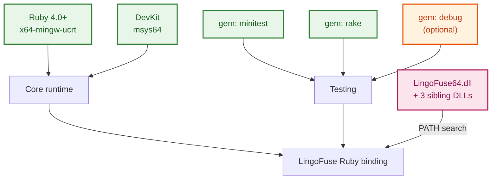
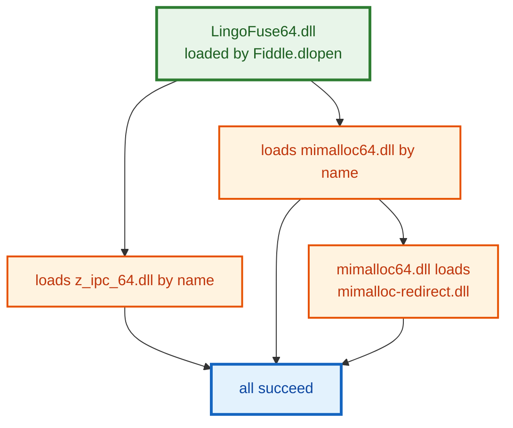
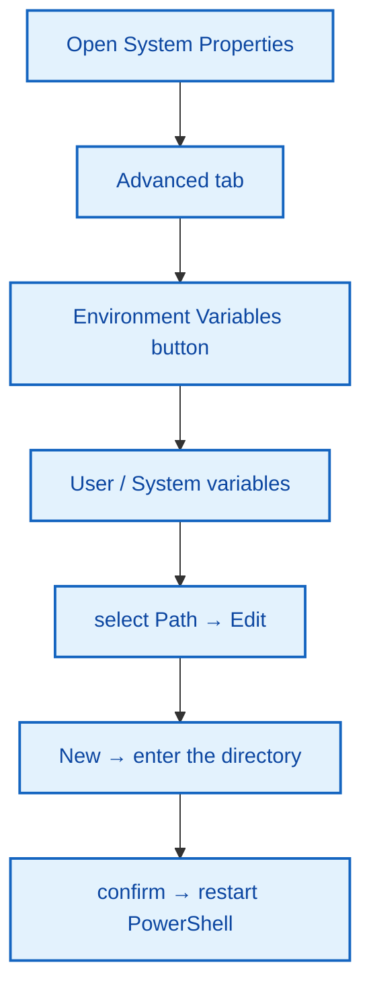
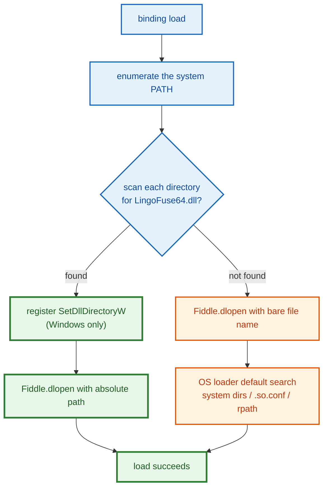
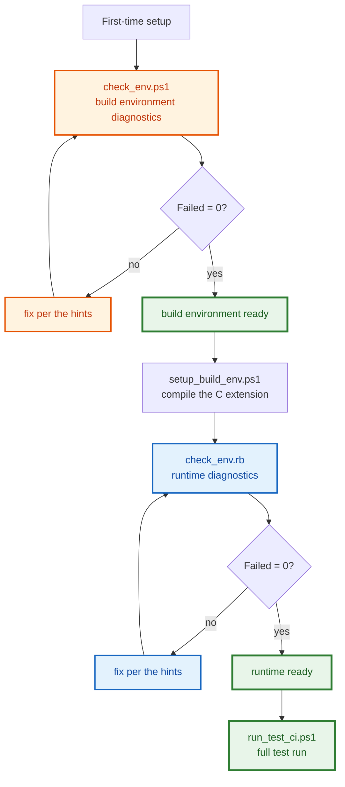
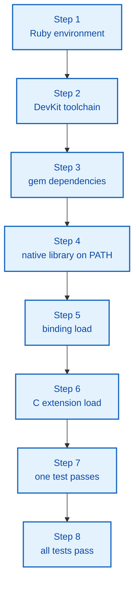
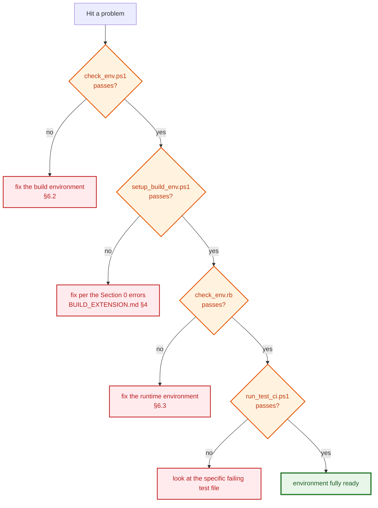
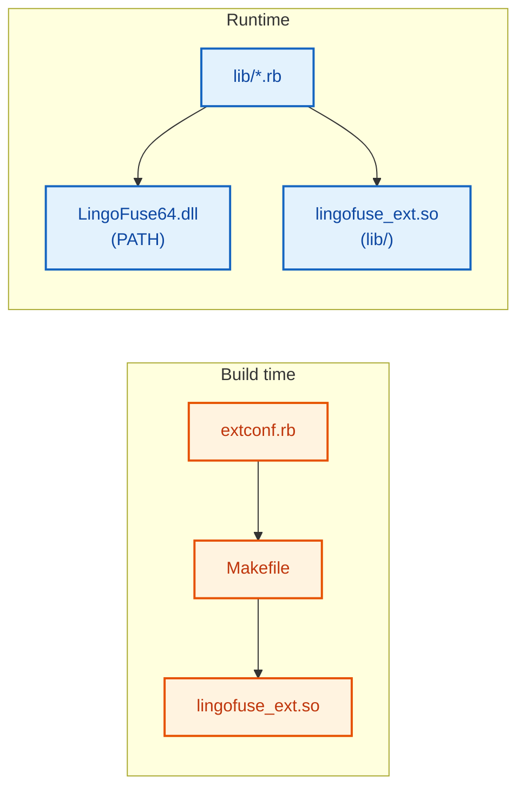

# Ruby Dependency Installation Guide

> Chinese version: [INSTALL_DEPENDENCIES.md](INSTALL_DEPENDENCIES.md)

This guide describes the runtime environment and dependency libraries the LingoFuse Ruby binding needs, together with the concrete installation steps on Windows.

---

## 1. Overview

| Dependency | Purpose | How to install |
|---|---|---|
| Ruby 4.0+ (x64-mingw-ucrt) | runtime environment | RubyInstaller package |
| DevKit (bundled with RubyInstaller) | compiling the C extension | RubyInstaller package + `msys64` |
| `minitest` (gem) | test framework | `gem install minitest` |
| `rake` (gem) | task runner | `gem install rake` |
| `debug` (gem) | debugger backend | `gem install debug` |
| system `pthread` | C extension threading primitives | shipped with DevKit |
| `LingoFuse64.dll` | the native RPC library | obtained from the `Binary/` directory, placed on PATH |

**Fiddle is part of the Ruby standard library** and does not need separate installation. The FFI gem is **not** a dependency of this binding.

### 1.1 Dependency layers



---

## 2. The Ruby runtime

### 2.1 Installing RubyInstaller

Download from [RubyInstaller for Windows](https://rubyinstaller.org/downloads/):

- **Ruby+Devkit 4.0.x (x64)** (not the version without Devkit)

During installation tick:

- ☑ Add Ruby executables to your PATH
- ☑ Associate `.rb` and `.rbw` files with this Ruby installation
- ☑ Install MSYS2 development toolchain

**After installation you must restart PowerShell**, otherwise the PATH change does not take effect.

### 2.2 Verifying

Open a **new** PowerShell:

```powershell
ruby -v
```

**Expected**:

```
ruby 4.0.7 (2026-09-15 revision 229531a6cf) +PRISM [x64-mingw-ucrt]
```

**Key point**: `x64-mingw-ucrt` is the correct platform. If it shows `x64-mswin64` or `x86-mingw32`, you installed the wrong version.

```powershell
gem -v
```

**Expected**: `4.x.x` or higher.

### 2.3 Checking the install path

```powershell
ruby -e "require 'rbconfig'; puts RbConfig::CONFIG['bindir']"
```

**Expected** (roughly):

```
C:/Ruby40-x64/bin
```

Note this path down; you will need it when configuring VS Code or the debugger.

---

## 3. DevKit (required to compile the C extension)

### 3.1 Confirming DevKit is installed

```powershell
Get-Command make
Get-Command gcc
```

**Expected**:

| Command | Expected output |
|---|---|
| `make` | `C:\Ruby40-x64\msys64\usr\bin\make.exe` |
| `gcc` | `...\mingw64\bin\gcc.exe` or `D:\mingw64\bin\gcc.exe` |

### 3.2 Checking that make is not the Embarcadero build

```powershell
make --version
```

**Expected**:

```
GNU Make 4.4.1
```

**If it shows Embarcadero / Borland / CodeGear**:

Embarcadero's `make.exe` is incompatible with GNU Make and will make the Makefile generated by mkmf fail to compile.

| Fix | Command | Scope |
|:--------:|------|----------|
| 1 | `$env:PATH = "C:\Ruby40-x64\msys64\usr\bin;" + $env:PATH` | current session |
| 2 | System settings → environment variables: move the msys64 path ahead of Embarcadero | permanent |
| 3 | use the project's own `setup_build_env.ps1`, which handles it automatically | inside the script |

### 3.3 Checking the MSYS2 environment

DevKit is provided through MSYS2. Check the directories:

```powershell
Test-Path C:\Ruby40-x64\msys64\usr\bin\make.exe
Test-Path C:\Ruby40-x64\msys64\mingw64\bin\gcc.exe
```

Both should be `True`.

If `msys64` does not exist, then DevKit was not ticked when installing RubyInstaller. **Re-run the RubyInstaller package**, choose "Add or remove components" and tick "MSYS2 development toolchain".

### 3.4 Checking the headers

Compiling a C extension needs the Ruby headers:

```powershell
ruby -e "require 'rbconfig'; puts RbConfig::CONFIG['rubyhdrdir']"
ruby -e "require 'rbconfig'; puts RbConfig::CONFIG['rubyarchhdrdir']"
```

**Expected**:

```
C:/Ruby40-x64/include/ruby-4.0.0
C:/Ruby40-x64/include/ruby-4.0.0/x64-mingw-ucrt
```

Confirm the key header exists:

```powershell
Test-Path C:\Ruby40-x64\include\ruby-4.0.0\ruby\thread.h
```

**Expected**: `True`

---

## 4. gem dependencies

### 4.1 minitest

The test framework (the version bundled with Ruby is usually enough, but installing it explicitly guarantees consistency):

```powershell
gem install minitest
```

**Expected**:

```
Successfully installed minitest-5.x.x
1 gem installed
```

**Verify**:

```powershell
ruby -e "require 'minitest/autorun'; puts 'minitest OK'"
```

**Expected**: `minitest OK`

### 4.2 rake

The task runner, used to execute the `Rakefile`:

```powershell
gem install rake
```

**Verify**:

```powershell
cd D:\CoreLibrary\LingoFuse\ruby
rake -T
```

**Expected**: lists every `rake test:*` task (about 15–20 of them).

### 4.3 debug

The backend for the Ruby debugger. Needed when debugging with the VS Code rdbg extension:

```powershell
gem install debug
```

**Expected**:

```
Building native extensions. This could take a while...
Successfully installed debug-1.11.1
1 gem installed
```

**Note**: `debug` compiles a native extension, so **DevKit must already be installed**. If this step errors, go back to section 3 and check DevKit.

**Verify**:

```powershell
ruby -e "require 'debug'; puts 'debug OK'"
```

**Expected**: `debug OK`

### 4.4 Gems you do not need

The following gems are **not** dependencies of this binding; do not install them:

| gem | Why it is not needed |
|---|---|
| `ffi` | this binding uses the standard-library Fiddle, not FFI |
| `ffi-compiler` | same as above |
| `sqlite3` | unrelated |
| `json` | already part of the Ruby standard library |
| `rubocop` | a code-style tool, optional |

---

## 5. The native library (LingoFuse64.dll)

### 5.1 Locating principle

The native library (`LingoFuse64.dll` and its three sibling DLLs) is loaded **at runtime** by `lib/lingofuse/binding.rb` through `Fiddle.dlopen`. **The load path comes only from the operating system's library search path**:

| Platform | Environment variable | Separator |
|------|----------|:------:|
| Windows | `PATH` | `;` |
| Linux / BSD | `LD_LIBRARY_PATH` | `:` |
| macOS | `DYLD_LIBRARY_PATH` + `DYLD_FALLBACK_LIBRARY_PATH` | `:` |

**There is no binding-specific environment variable** (for example the old `LINGOFUSE_LIB_PATH` has been removed). This matches how any other Windows program uses PATH, and it is the only mechanism.

### 5.2 The files needed

The four DLLs **must sit in the same directory**:

| File | Purpose |
|---|---|
| `LingoFuse64.dll` | the core RPC library |
| `z_ipc_64.dll` | the IPC substrate |
| `mimalloc64.dll` | the memory allocator |
| `mimalloc-redirect.dll` | the mimalloc redirect |

**Why they must share a directory**: when `LingoFuse64.dll` loads, it loads the other three DLLs **by file name**. The Windows loader does not automatically search "the directory of the already-loaded DLL" during `LoadLibrary`, so they must be in the same directory and that directory must be on `PATH`.



**If one DLL is missing, or they are spread across directories, loading fails with `The specified module could not be found`.**

### 5.3 Where to put them

The recommendation is a dedicated directory, for example:

```
D:\LingoFuse\Binary\
├── LingoFuse64.dll
├── z_ipc_64.dll
├── mimalloc64.dll
└── mimalloc-redirect.dll
```

Then add that directory to `PATH`.

### 5.4 Adding the directory to PATH

**Current PowerShell session**:

```powershell
$env:PATH = "D:\LingoFuse\Binary;" + $env:PATH
```

**Permanently** (Windows system settings):

1. `Win + R` → `sysdm.cpl` → Advanced → Environment Variables
2. find `Path` under "User variables" or "System variables"
3. add `D:\LingoFuse\Binary`
4. confirm, then restart PowerShell



**Linux / BSD** (`~/.bashrc` or `~/.zshrc`):

```bash
export LD_LIBRARY_PATH="/opt/lingofuse/lib:$LD_LIBRARY_PATH"
```

**macOS** (`~/.zshrc`):

```bash
export DYLD_LIBRARY_PATH="/opt/lingofuse/lib:$DYLD_LIBRARY_PATH"
```

### 5.5 Verifying

**Open a new PowerShell** and confirm PATH already contains the target directory:

```powershell
$env:PATH -split ';' | Select-String "LingoFuse"
```

**Expected**: a line containing `D:\LingoFuse\Binary`.

Then run the binding load:

```powershell
cd D:\CoreLibrary\LingoFuse\ruby
ruby -I lib -e "require 'lingofuse'; puts LingoFuse.loaded?; puts LingoFuse.library_name"
```

**Expected**:

```
true
LingoFuse64.dll
```

### 5.6 The runtime search order

The search order in `binding.rb` has **only** these two branches:



**None of the following paths are searched**:

- ❌ the `LINGOFUSE_LIB_PATH` environment variable (removed)
- ❌ the binding's own directory
- ❌ the `Binary/` subdirectory
- ❌ the project root
- ❌ the current working directory

**Only PATH.** If it is not on PATH, it will not be found.

---

## 6. One-command environment diagnostics

The project ships two diagnostic scripts with different purposes.

### 6.1 How they divide the work

| Script | What it checks | When to run |
|---|---|---|
| `check_env.ps1` | the **toolchain** for compiling the C extension | first-time setup, when compilation fails |
| `check_env.rb` | the Ruby binding's **runtime** | first use, when loading fails |



### 6.2 `check_env.ps1` — build environment diagnostics

```powershell
cd D:\CoreLibrary\LingoFuse\ruby
powershell -ExecutionPolicy Bypass -File check_env.ps1
```

**What it checks** (8 sections):

| Section | Checks |
|:-------:|--------|
| 1 | PowerShell version + operating system |
| 2 | Ruby version / platform / `RbConfig` |
| 3 | **GNU Make (distinguishing Embarcadero) + gcc** |
| 4 | `mkmf` availability + actually compiling a C program |
| 5 | `pthread.h` compile and link + `ruby/thread.h` presence |
| 6 | **native library PATH probe** (informational; a miss is only a WARN) |
| 7 | integrity of the extension source tree |
| 8 | the summary report |

**Expected tail**:

```
  Passed : 26
  Warned : 0
  Failed : 0

  All required checks passed.
```

**Note on Section 6**: this section enumerates `$env:PATH` directly and scans each directory for `LingoFuse64.dll`. When it finds one it also verifies that the 3 sibling DLLs are in the same directory. Not finding it only reports `[WARN]`; it does not block.

### 6.3 `check_env.rb` — runtime diagnostics

```powershell
ruby check_env.rb
```

**What it checks** (5 sections):

| Section | Checks |
|:-------:|--------|
| 1 | Ruby version |
| 2 | package layout (11 lib files + 3 test files) |
| 3 | native library load + C ABI round-trip (create / write / read / free) |
| 4 | full-stack smoke test + **C extension load state** |
| 5 | summary |

**Expected tail**:

```
  Passed : 26
  Failed : 0
```

**The key check**:

```
  [OK]   lingofuse_ext is loaded (NativeBridge available).
```

If it shows `[FAIL] lingofuse_ext is NOT available`, the C extension is not installed correctly; go back to `BUILD_EXTENSION.md` and rebuild it.

---

## 7. The complete verification checklist

Run the following commands in order, and only move on when each step passes.

### Step 1: the Ruby environment

```powershell
ruby -v
gem -v
```

**Expected**: Ruby 4.0+, `x64-mingw-ucrt`, gem 4.x+.

### Step 2: the DevKit toolchain

```powershell
make --version
gcc --version
```

**Key point**: `make --version` must show `GNU Make`.

### Step 3: gem dependencies

```powershell
gem list minitest rake debug
```

**Expected**: the three gems listed with their versions.

### Step 4: the native library is on PATH

```powershell
$env:PATH -split ';' | Select-String "LingoFuse"
```

**Expected**: a line containing the target directory.

Or take Section 6 of `check_env.ps1` as the authoritative verdict.

### Step 5: binding load

```powershell
cd D:\CoreLibrary\LingoFuse\ruby
ruby -I lib -e "require 'lingofuse'; puts LingoFuse.loaded?"
```

**Expected**: `true`

### Step 6: C extension load

```powershell
ruby -I lib -e "require 'lingofuse_ext'; puts LingoFuse::NativeBridge.respond_to?(:create_ref)"
```

**Expected**: `true`

### Step 7: run one test

```powershell
ruby test/test_errors.rb
```

**Expected**:

```
23 runs, 39 assertions, 0 failures, 0 errors, 0 skips
```

### Step 8: run all tests

```powershell
powershell -ExecutionPolicy Bypass -File run_test_ci.ps1
```

**Expected tail**:

```
========================================================================
All 14 test files passed.
========================================================================
```

### 7.1 The verification flowchart



---

## 8. VS Code configuration (optional)

If you want to debug Ruby inside VS Code:

### 8.1 Installing extensions

Search and install from the Extensions panel:

| Extension | Author | Purpose |
|---|---|---|
| **VSCode rdbg Ruby Debugger** | Koichi Sasada | breakpoint debugging (required) |
| Ruby LSP | Shopify | syntax hints (optional) |

**Do not install**: `Ruby` (the old one, deprecated), `ruby-debug-ide` (outdated).

### 8.2 User settings

Press `Ctrl + Shift + P` → `Preferences: Open User Settings (JSON)` and add:

```json
{
  "rdbg.ruby": "C:\\Ruby40-x64\\bin\\ruby.exe",
  "rdbg.useBundler": false
}
```

Adjust the path to the actual output of `RbConfig::CONFIG['bindir']`.

### 8.3 Project settings

Create `D:\CoreLibrary\LingoFuse\ruby\.vscode\launch.json`:

```json
{
  "version": "0.2.0",
  "configurations": [
    {
      "type": "rdbg",
      "name": "Debug current file",
      "request": "launch",
      "script": "${file}",
      "args": [],
      "useBundler": false
    },
    {
      "type": "rdbg",
      "name": "Debug cross_service.rb",
      "request": "launch",
      "script": "${workspaceFolder}/cross/cross_service.rb",
      "args": [],
      "useBundler": false
    },
    {
      "type": "rdbg",
      "name": "Debug cross_node.rb",
      "request": "launch",
      "script": "${workspaceFolder}/cross/cross_node.rb",
      "args": [],
      "useBundler": false
    },
    {
      "type": "rdbg",
      "name": "Debug cross_call.rb",
      "request": "launch",
      "script": "${workspaceFolder}/cross/cross_call.rb",
      "args": [],
      "useBundler": false
    }
  ]
}
```

### 8.4 Breakpoint debugging

1. open the target `.rb` file
2. click the gutter left of the line number until a red dot appears (a breakpoint)
3. press `F5` and pick a debug configuration from the drop-down
4. the program stops at the breakpoint and the "Variables" panel on the left shows the current scope

**Multi-process note**: the `Cross Demo` is three independent processes and VS Code can debug only one at a time. The typical approach:

- debug `cross_service.rb` in VS Code
- run `ruby cross/cross_node.rb` and `ruby cross/cross_call.rb` in separate PowerShell windows

---

## 9. Troubleshooting quick reference

| Symptom | Cause | Fix |
|---|---|---|
| `ruby: command not found` | PATH change not in effect | restart PowerShell or reinstall RubyInstaller |
| `cannot load such file -- lingofuse` | `$LOAD_PATH` does not include `lib/` | use `require_relative` or `-I lib` |
| `Failed to load the LingoFuse native library` | the native library is not on PATH | see §5.4, add the directory to PATH |
| `The specified module could not be found` | sibling DLLs missing or scattered | all 4 DLLs must share one directory |
| `[BUG] rb_thread_call_with_gvl()` | the C extension was not compiled | run `setup_build_env.ps1` |
| `[LingoFuse::NativeBridge] lingofuse_ext not available` | the C extension is not in `lib/` | see BUILD_EXTENSION.md issue 5 |
| `No GNU Make found` | DevKit not installed / PATH ordering | see §3.2 |
| `Fatal makefile ... No terminator` | Embarcadero Make was used | prepend msys64 to PATH |
| `gettimeofday: conflicting types` | header conflict | update `lingofuse_ext.c` (drop `<sys/time.h>`) |
| `undefined reference to 'clock_gettime'` | MinGW lacks pthread | reinstall DevKit |
| `gem install debug` fails | DevKit not installed | install DevKit before debug |
| `cannot load such file -- debug` | the gem is not installed | `gem install debug` |
| `Workspace not activated` (VS Code) | abnormal workspace URI | open with `code .` rather than `code <path>` |
| `Cannot find any Ruby installations` (Ruby LSP) | extension detection failed | uninstall Ruby LSP, or use rdbg instead |

### 9.1 The general troubleshooting order



---

## 10. File inventory

Once you are done, the project should contain the following dependency-related files:

```
ruby/
├── Gemfile                          declares development dependencies
├── lingofuse.gemspec                gem metadata (no runtime dependencies)
├── Rakefile                         rake tasks
├── check_env.ps1                    build environment diagnostics (PowerShell)
├── check_env.rb                     runtime environment diagnostics (Ruby)
├── setup_build_env.ps1              one-command C extension build
├── clean.ps1                        clean build artifacts
├── run_tests.ps1                    development test runner (Windows)
├── run_test_ci.ps1                  CI test runner (Windows)
├── run_test_ci.sh                   CI test runner (Linux / macOS)
├── BUILD_EXTENSION.md               the build guide
├── INSTALL_DEPENDENCIES.md          this file
├── README.md                        the complete manual
├── lib/
│   ├── lingofuse.rb                 public entry point
│   ├── lingofuse_ext.so             the C extension (build artifact)
│   └── lingofuse/                   binding source
├── ext/lingofuse_ext/               C extension source
└── test/                            test suite (14 files)
```

### 10.1 Runtime dependencies versus build-time dependencies



**The key difference**:

| Dependency | When it is needed | Placement requirement |
|------|:--------:|----------|
| `lingofuse_ext.so` | produced at build time, loaded at runtime | `lib/` (beside `lingofuse/`) |
| `LingoFuse64.dll` | runtime only | any directory on PATH, all 4 DLLs together |
