# LingoFuse Ruby 绑定 — 完整手册

**版本**：2.0.0
**目标平台**：Windows 10 / 11 / Server 2019+（x64）
**Ruby 版本**：4.0+（x64-mingw-ucrt）

---

## 目录

1. [这是什么](#一这是什么)
2. [体系结构](#二体系结构)
3. [环境要求](#三环境要求)
4. [依赖安装](#四依赖安装)
5. [环境诊断](#五环境诊断)
6. [编译 C 扩展](#六编译-c-扩展)
7. [在自有 Ruby 项目中引入 LingoFuse](#七在自有-ruby-项目中引入-lingofuse)
8. [测试](#八测试)
9. [API 说明](#九api-说明)
   - [9.1 顶层模块函数](#91-顶层模块函数)
   - [9.2 DataHandle](#92-lingofusedatahandle)
   - [9.3 AppHandle](#93-lingofuseapphandle)
   - [9.4 LfIo](#94-lingofuselfio)
   - [9.5 Framework](#95-lingofuseframework)
   - [9.6 Status](#96-lingofusestatus)
   - [9.7 NetworkEvents](#97-lingofusenetworkevents)
   - [9.8 Address（v2.0 新增）](#98-lingofuseaddress-v20-新增)
   - [9.9 AsyncSupport（v2.0 新增）](#99-lingofuseasyncsupport-v20-新增)
   - [9.10 Options（v2.0 新增）](#910-lingofuseoptions-v20-新增)
   - [9.11 P2PRegistration（v2.0 新增）](#911-lingofusep2pregistration-v20-新增)
10. [使用示例](#十使用示例)
11. [故障排查速查](#十一故障排查速查)
12. [v2.0 迁移指南](#十二v20-迁移指南)

---

## 一、这是什么

LingoFuse Ruby 绑定让 Ruby 程序能够：

- **调用**由 Pascal / C++ / C# / Python / JavaScript / Rust / Go / Dart / Java / Swift / Zig / Erlang 写的函数
- **被**上述任何语言调用
- 在**同一进程内**、**同机跨进程**、或**跨机器**范围内工作
- 使用**字节级统一**的线格式，无需 IDL、无需桩代码、无需 HTTP 服务

一句话总结：

> **任何语言写的函数，任何其他语言都能直接调；Ruby 是 14 种一等公民语言之一。**

---

## 二、体系结构

### 2.1 五层架构

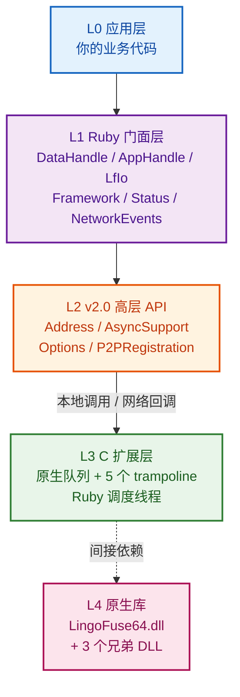

**依赖方向**：L0 → L1 → L2 → L3 → L4。L3 是唯一的原生入口；L1 和 L2 都不接触 Fiddle 或 C。

### 2.2 v1.0 与 v2.0 的差异

| 维度 | v1.0.0 | v2.0.0 |
|------|--------|--------|
| 原生加载机制 | Fiddle（纯 Ruby） | 自写 C 扩展 `lingofuse_ext.so` |
| 寻址模式 | 仅 App 名 | App 名 / UID / P2PName |
| 异步调用 | 仅回调式（`async_call`） | 回调式 + Future 式（`call_future`） |
| 运行时选项 | 字符串型 `set_option` | + 16 个类型化 `set_opt_xxx` |
| P2P 注册 | 无 | 有（进程级，独立于 App） |
| 远端回调 | 不可用（Fiddle 死锁） | 可用（C 扩展编组） |
| 测试套件 | 14 个文件 | 18 个文件 |

### 2.3 C 扩展存在的必要性

**这是整个绑定最重要的设计决策。** Ruby 的 Fiddle **无法**从 LingoFuse 的原生工作线程回调 Ruby 代码。

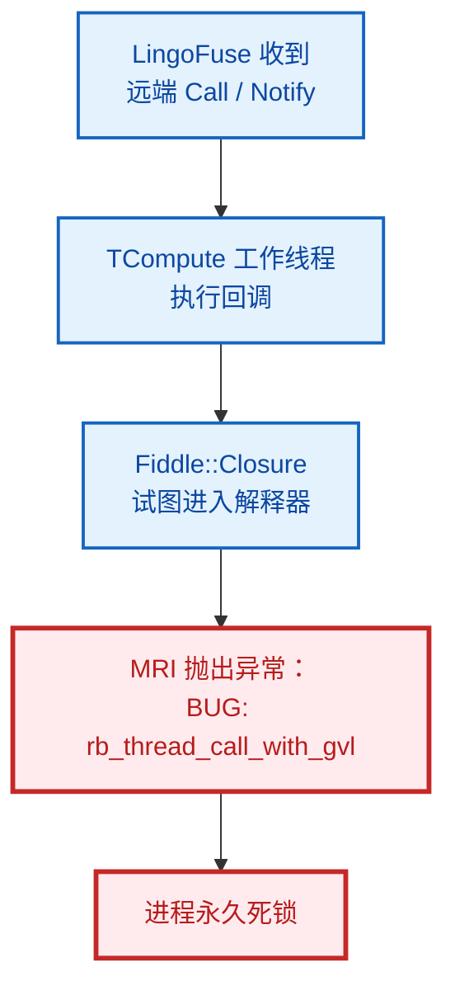

**决策表**：

| 使用场景 | 是否需要 C 扩展 |
|----------|:---------------:|
| 只做本地调用（`AppHandle#local_call` / `local_notify`） | 不需要 |
| 注册 Call / Notify API，但只从本地触发 | 不需要 |
| 需要接收远端调用（作为服务端） | **必需** |
| 需要网络事件回调 | **必需** |
| 需要异步调用（`call_future`） | **必需** |

### 2.4 C 扩展如何解决问题

**原生线程侧**：

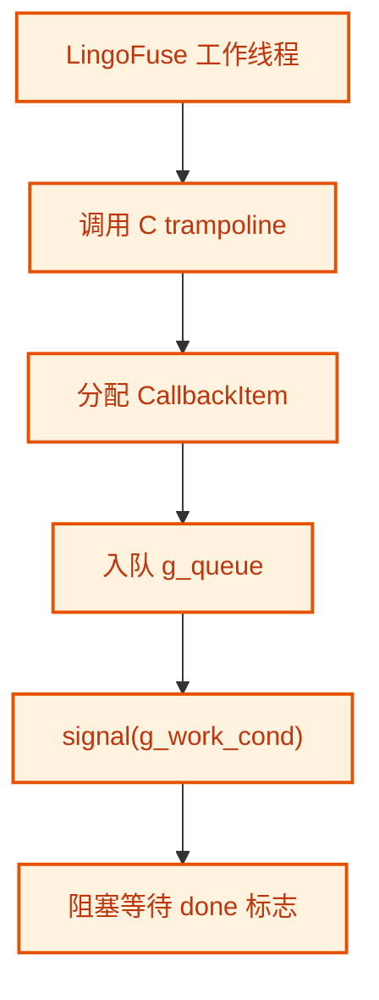

**Ruby 调度线程侧**：

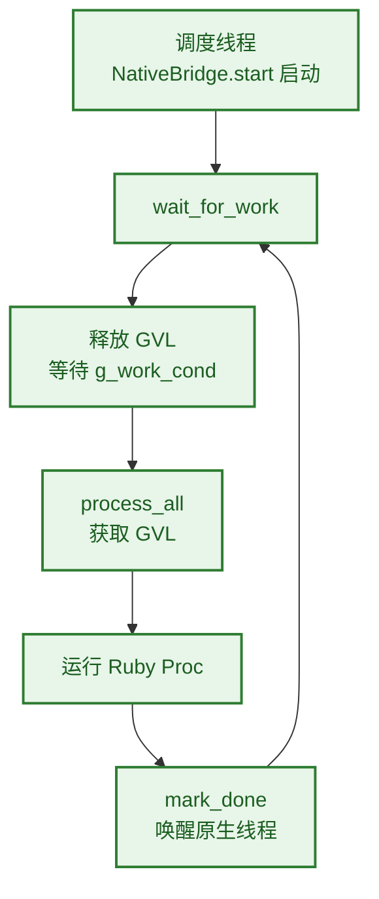

### 2.5 v2.0 新增的第五个 trampoline

v1.x 的 C 扩展有 4 个 trampoline（Call / Notify / Network connect / Network disconnect）。v2.0 新增了第五个：

| Trampoline | Kind | 触发者 | 回调参数 |
|------------|:----:|--------|----------|
| `trampoline_call` | 0 | `LF_RegisterCall` | `(trigger, input, output)` |
| `trampoline_notify` | 1 | `LF_RegisterNotify` | `(trigger, input)` |
| `trampoline_network_connect` | 2 | `LF_Set_Network_Event` | `(addr)` |
| `trampoline_network_disconnect` | 3 | `LF_Set_Network_Event` | `(addr)` |
| **`trampoline_async_call`** | **4** | `LF_Async_Call` | **`(data, result)`** |

`trampoline_async_call` 的 `data` 承载 `CallbackRef*`，`result` 是框架拥有的 `TDataHnd`。它的生命周期契约在 `lib/lingofuse/async_support.rb` 里详细说明。

### 2.6 DataHandle 生命周期状态机

**三种构造方式**：

| 构造 | 底层 API | 空闲回收 | dispose 语义 |
|------|----------|:--------:|--------------|
| `DataHandle.new(api)` | `LF_CreateData` | 10 分钟 | 只标记，池扫描时释放（≤ 5 秒） |
| `DataHandle.create_permanent(api)` | `LF_CreateData_Permanent` | 永不 | 立即同步释放 |
| `DataHandle.borrow(raw)` | 无 | 由原生层管理 | no-op |

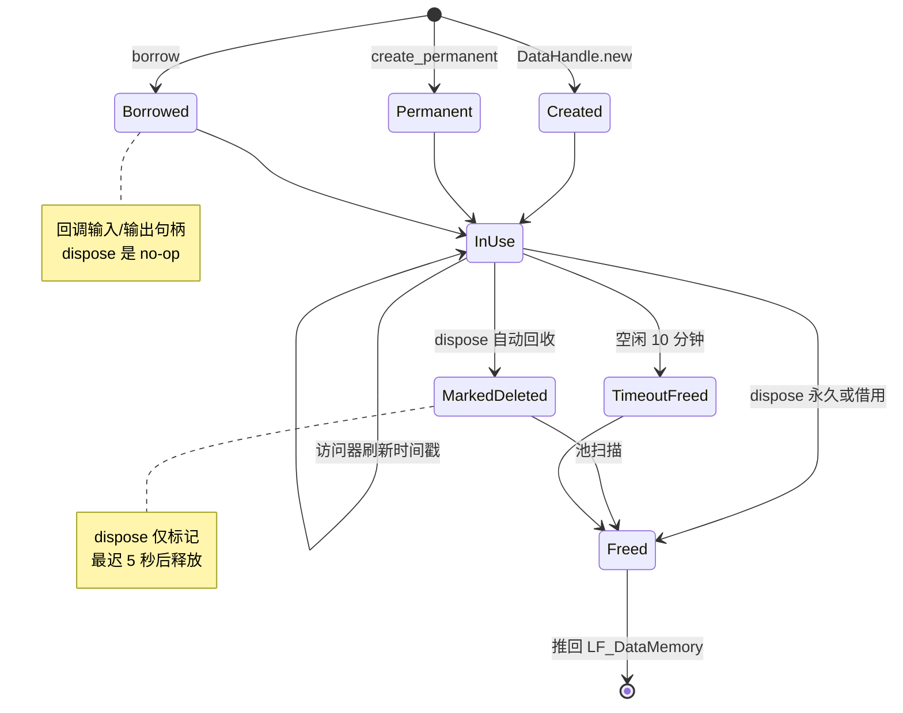

### 2.7 依赖关系

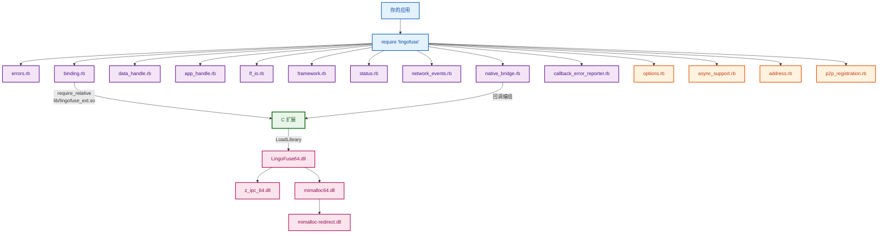

### 2.8 文件布局

```
ruby/
├── README.md                      本文件
├── BUILD_AND_DEPLOY.md            C 扩展构建与部署指南
├── INSTALL_DEPENDENCIES.md        依赖安装指南
├── Gemfile                        Bundler 声明
├── lingofuse.gemspec              gem 元数据（v2.0.0）
├── Rakefile                       rake 任务
│
├── setup_build_env.ps1            C 扩展一键编译
├── clean.ps1                      清理编译产物
├── check_env.ps1                  编译环境诊断
├── check_env.rb                   运行时诊断
├── run_tests.ps1                  开发测试（Windows）
├── run_test_ci.ps1                CI 测试（Windows）
├── run_test_ci.sh                 CI 测试（Linux / macOS）
│
├── .vscode/
│   └── launch.json                VS Code 调试配置
│
├── lib/
│   ├── lingofuse.rb               公共入口（v2.0.0）
│   ├── lingofuse_ext.so           C 扩展（编译产物）
│   └── lingofuse/
│       ├── errors.rb              异常层级
│       ├── callback_error_reporter.rb
│       ├── binding.rb             C 扩展包装
│       ├── data_handle.rb
│       ├── app_handle.rb
│       ├── lf_io.rb
│       ├── framework.rb
│       ├── status.rb
│       ├── network_events.rb
│       ├── native_bridge.rb
│       ├── options.rb             v2.0：16 对类型化访问器
│       ├── async_support.rb       v2.0：CallFuture / AsyncBridge
│       ├── address.rb             v2.0：三寻址 Target
│       └── p2p_registration.rb    v2.0：进程级 P2P 注册
│
├── ext/lingofuse_ext/
│   ├── extconf.rb                 mkmf 配置
│   ├── LingoFuse.h                C ABI 头（上游）
│   ├── LingoFuse.c                加载器 + 59 forwarders
│   └── lingofuse_ext.c            Ruby C API 表面
│
├── cross/
│   ├── cross_service.rb           信标
│   ├── cross_node.rb              工作节点
│   └── cross_call.rb              压测客户端
│
└── test/                          18 个测试文件
    ├── test_errors.rb
    ├── test_callback_error_reporter.rb
    ├── test_module_helpers.rb
    ├── test_lf_io.rb
    ├── test_lf_io_extra.rb
    ├── test_data_handle.rb
    ├── test_data_handle_extra.rb
    ├── test_app_handle.rb
    ├── test_app_handle_extra.rb
    ├── test_status.rb
    ├── test_network_events.rb
    ├── test_framework.rb
    ├── test_network.rb
    ├── test_options.rb              v2.0
    ├── test_address.rb              v2.0
    ├── test_async_support.rb        v2.0
    ├── test_p2p_registration.rb     v2.0
    └── test_native_bridge_self_test.rb
```

---

## 三、环境要求

### 3.1 硬件与操作系统

| 项 | 要求 |
|---|---|
| 操作系统 | Windows 10（1809+）/ Windows 11 / Windows Server 2019+ |
| 架构 | x64（ARM64 未测试） |
| 磁盘空间 | ≥ 1 GB（含 Ruby + DevKit） |
| 内存 | ≥ 4 GB |

### 3.2 软件清单

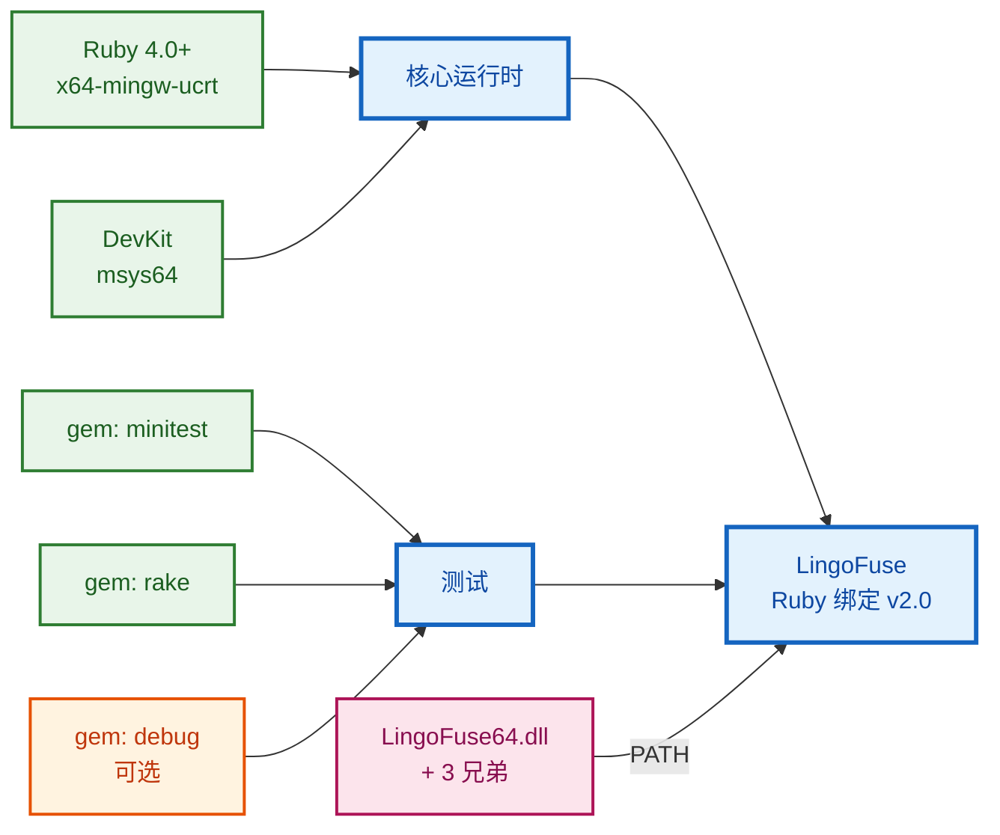

**必需**：Ruby 4.0+、DevKit、`minitest`、`rake`、4 个 LingoFuse DLL 在 PATH 上。

**可选**：`debug`（仅 VS Code 调试需要）。

### 3.3 版本选择对照表

| 组件 | 最低版本 | **推荐版本** | 禁止版本 | 说明 |
|------|:--------:|:------------:|:--------:|------|
| Ruby | 2.7.0 | **4.0.x** | x86-mingw32 | 必须 `x64-mingw-ucrt` |
| 平台 | Windows 10 1809 | **Windows 11** | — | 需要 PowerShell 5+ |
| PowerShell | 5.0 | **7.x** | 2.0-4.0 | 5.0 已够用 |
| gem: minitest | 5.0 | **5.x 最新** | — | 通常随 Ruby 一起装 |
| gem: rake | 13.0 | **13.x 最新** | — | |
| gem: debug | — | **1.11+** | — | 可选，用于 VS Code 调试 |
| LingoFuse DLL | 3.10 | **3.10+** | — | 需支持 v2.0 的 C ABI |

**关键警告**：

- ⚠️ **一定要装 x64-mingw-ucrt 版本的 Ruby**。x64-mswin64 版本会失败
- ⚠️ **一定要装带 DevKit 的 RubyInstaller**。不带 DevKit 无法编译 C 扩展
- ⚠️ **一定不要用 Embarcadero / Borland / CodeGear 的 make.exe**。与 GNU Make 语法不兼容

---

## 四、依赖安装

详见 [`INSTALL_DEPENDENCIES.md`](INSTALL_DEPENDENCIES.md)。这里只给最简速查。

### 4.1 Step 1 — 安装 Ruby + DevKit

下载 [RubyInstaller](https://rubyinstaller.org/downloads/)，选择 **Ruby+Devkit 4.0.x (x64)**。

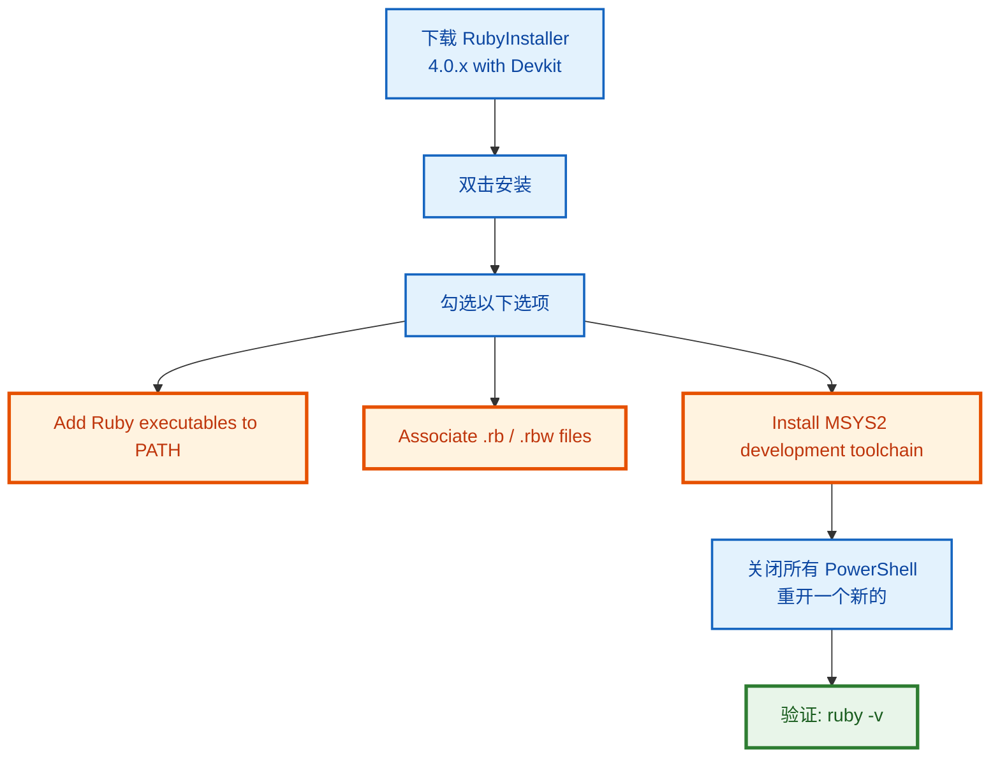

### 4.2 Step 2 — 验证 DevKit

```powershell
make --version
gcc --version
```

**期望**：`GNU Make 4.4.1` 和 MinGW-w64 的 gcc。

### 4.3 Step 3 — gem 依赖

```powershell
gem install minitest
gem install rake
gem install debug        # 可选
```

### 4.4 Step 4 — 原生库加入 PATH

四个 DLL **必须放在同一目录**：

| 文件 | 用途 |
|---|---|
| `LingoFuse64.dll` | 核心 RPC 库 |
| `z_ipc_64.dll` | IPC 底层 |
| `mimalloc64.dll` | 内存分配器 |
| `mimalloc-redirect.dll` | mimalloc 重定向 |

**该目录必须在 PATH 上**：

```powershell
$env:PATH = "D:\LingoFuse\Binary;" + $env:PATH
```

**这就是全部机制**。运行时绑定只从 PATH 搜索原生库，没有绑定专属的环境变量。

**验证**：

```powershell
cd D:\CoreLibrary\LingoFuse\ruby
ruby -I lib -e "require 'lingofuse'; puts LingoFuse.loaded?"
```

**期望**：`true`

---

## 五、环境诊断

两个诊断脚本，用途不同。详见 [`INSTALL_DEPENDENCIES.md` §6](INSTALL_DEPENDENCIES.md#六一键环境诊断)。

| 脚本 | 检查对象 | 何时运行 |
|------|----------|----------|
| `check_env.ps1` | 编译 C 扩展的工具链 | 首次搭建环境、编译失败时 |
| `check_env.rb` | Ruby 绑定的运行时（含 v2.0 子系统探测） | 首次使用、加载失败时 |

**一键运行**：

```powershell
cd D:\CoreLibrary\LingoFuse\ruby
powershell -ExecutionPolicy Bypass -File check_env.ps1
ruby check_env.rb
```

**期望**：两个脚本都以 `Failed : 0` 结尾。

`check_env.rb` 的 5 个 Section：

| Section | 内容 |
|:-------:|------|
| 1 | Ruby 运行时信息 |
| 2 | 包布局（15 个 lib 文件 + 7 个 test 文件） |
| 3 | 原生库加载 + 4 个 v2.0 子系统标志 + C ABI 往返 |
| 4 | 全栈冒烟测试（AppHandle.local_call） |
| 5 | v2.0 子系统快速探测（Address / Options / AsyncSupport / P2PRegistration） |

---

## 六、编译 C 扩展

详见 [`BUILD_AND_DEPLOY.md`](BUILD_AND_DEPLOY.md)。

### 6.1 一键编译

```powershell
cd D:\CoreLibrary\LingoFuse\ruby
powershell -ExecutionPolicy Bypass -File setup_build_env.ps1
```

### 6.2 内部流程

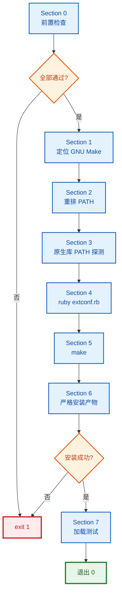

**期望关键输出**：

```
========================================================================
6. Artifact
========================================================================
  [OK]   Built: lingofuse_ext.so (98304 bytes)
  [OK]   Installed: D:\...\lib\lingofuse_ext.so (98304 bytes)

========================================================================
7. Load test
========================================================================
         LOADED: true true true
  [OK]   lingofuse_ext loads and exposes the full expected surface.
```

### 6.3 清理

```powershell
cd D:\CoreLibrary\LingoFuse\ruby
powershell -ExecutionPolicy Bypass -File clean.ps1
```

---

## 七、在自有 Ruby 项目中引入 LingoFuse

> **本章是独立章节，讲的是把 LingoFuse Ruby 绑定作为依赖项引入到**你自己的** Ruby 项目里。**

### 7.1 关键事实：三类文件的加载机制

Ruby 有三种"库"，加载机制完全不同：

| 类型 | 例子 | 加载者 | 搜索路径 |
|------|------|--------|----------|
| **Ruby 源文件** | `*.rb` | `require` / `require_relative` | `$LOAD_PATH` 或相对当前文件 |
| **Ruby C 扩展** | `lingofuse_ext.so` | `require_relative`（**本绑定**） | 相对 `native_bridge.rb` 固定为 `lib/` |
| **原生系统 DLL** | `LingoFuse64.dll` | `LF_LoadLibrary`（C 扩展内部） | **仅系统 PATH** |

**核心结论**：

> **C 扩展由 `native_bridge.rb` 通过 `require_relative` 加载，位置固定在 `lib/`。你只需要把整个 `ruby/` 目录拷过去，`.so` 会自动被找到。**
>
> **原生 DLL 由 C 扩展内部的 `LF_LoadLibrary` 加载，走操作系统加载器的规则。你必须把包含 4 个 DLL 的目录加到 PATH 上。**

### 7.2 两条独立的搜索路径

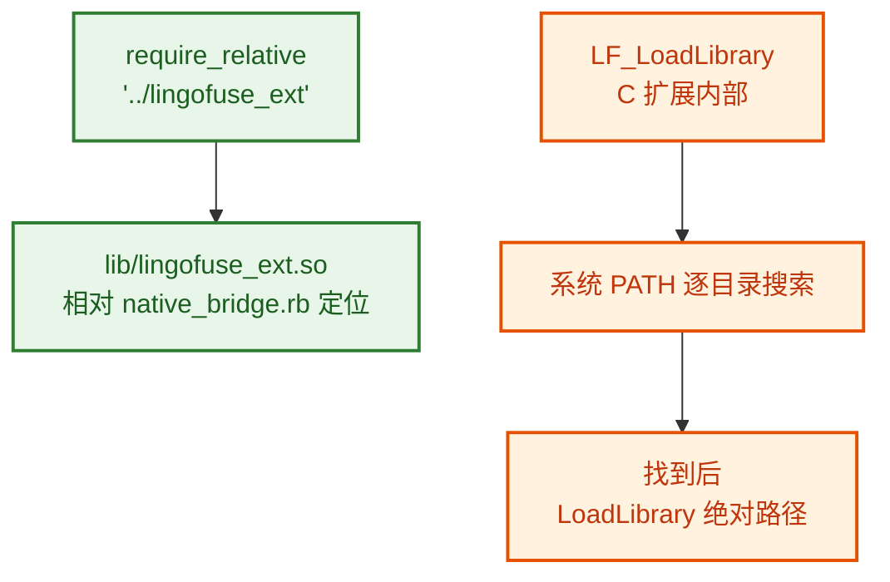

### 7.3 只需做两件事

#### 步骤 1 — 把整个 `ruby/` 目录拷贝到你的项目

不需要拆散 `lib/`、`lingofuse/`、`lingofuse_ext.so` 的相对结构。整个 `ruby/` 是一个自包含单元。

#### 步骤 2 — 把原生库目录加入 PATH

```powershell
# Windows PowerShell
$env:PATH = "D:\LingoFuse\Binary;" + $env:PATH
```

```bash
# Linux
export LD_LIBRARY_PATH="/opt/lingofuse/lib:$LD_LIBRARY_PATH"
```

```bash
# macOS
export DYLD_LIBRARY_PATH="/opt/lingofuse/lib:$DYLD_LIBRARY_PATH"
```

### 7.4 三种引入方案

#### 方案 A — 绝对路径 require（快速验证）

```ruby
# C:\temp\my_app.rb
lingofuse_lib = 'D:/CoreLibrary/LingoFuse/ruby/lib'
$LOAD_PATH.unshift(lingofuse_lib) unless $LOAD_PATH.include?(lingofuse_lib)

require 'lingofuse'

puts LingoFuse.loaded?
puts LingoFuse.library_name
puts LingoFuse.platform
```

#### 方案 B — 把 `ruby/` 整体拷到项目内（推荐）

```
C:\temp\my_app\
├── my_app.rb
└── ruby\                          ← 整个 ruby/ 拷过来
    ├── lib\
    │   ├── lingofuse.rb
    │   ├── lingofuse_ext.so       ← C 扩展（已包含）
    │   └── lingofuse\
    └── ...
```

**`my_app.rb`**：

```ruby
$LOAD_PATH.unshift(File.expand_path('ruby/lib', __dir__))
require 'lingofuse'

puts "loaded: #{LingoFuse.loaded?}"
puts "native bridge: #{LingoFuse::NativeBridge.available?}"
```

#### 方案 C — Windows 目录联接（Junction）

```powershell
mkdir C:\temp\my_app\ruby -Force
cmd /c mklink /J C:\temp\my_app\ruby\lib D:\CoreLibrary\LingoFuse\ruby\lib
```

### 7.5 三种方案对比

| 方案 | 命令复杂度 | 包更新后 | 需要管理员 | 适合场景 |
|:----:|:---------:|:--------:|:---------:|----------|
| A 绝对路径 require | 零 | 立即生效 | 否 | 快速验证、一次性脚本 |
| B 拷贝整个 ruby/ | 一条 copy | 需重新复制 | 否 | 长期项目、打包分发 |
| C Windows Junction | 两条命令 | 立即生效 | 否 | Windows 开发调试 |

### 7.6 完整最小示例

**`app.rb`**：

```ruby
# frozen_string_literal: true

lib_dir = File.expand_path('ruby/lib', __dir__)
$LOAD_PATH.unshift(lib_dir) unless $LOAD_PATH.include?(lib_dir)

require 'lingofuse'

puts "LingoFuse loaded: #{LingoFuse.loaded?}"
puts "Version:          #{LingoFuse::VERSION}"
puts "Library name:     #{LingoFuse.library_name}"
puts "NativeBridge:     #{LingoFuse::NativeBridge.available?}"

# v2.0 三寻址
t = LingoFuse.app('MyApp')
puts "Target:           #{t.describe}"

# v2.0 类型化选项
LingoFuse.set_opt_quiet(true)
puts "quiet:            #{LingoFuse.get_opt_quiet.inspect}"
LingoFuse.set_opt_quiet(false)

# v2.0 本地往返
app = LingoFuse::AppHandle.new('MyApp', 'Demo')
app.register_call('echo', 'Echo a string') do |input, output|
  text = LingoFuse::LfIo.read_string(input)
  LingoFuse::LfIo.write_string(output, text)
end

param = LingoFuse::DataHandle.new('echo')
LingoFuse::LfIo.write_string(param, 'hello')

result = app.local_call(param)
puts "Result:           #{LingoFuse::LfIo.read_string(result)}"

param.dispose
result.dispose
app.dispose
```

**运行**：

```powershell
$env:PATH = "D:\LingoFuse\Binary;" + $env:PATH
cd C:\temp\my_app
ruby app.rb
```

### 7.7 关键注意点

**注意点 1 — C 扩展（`.so`）位置固定**

`lingofuse_ext.so` 必须与 `lingofuse/` 目录同级（都在 `lib/` 下）。

**注意点 2 — 原生 DLL 必须在 PATH 上**

**注意点 3 — 4 个 DLL 必须永远在一起**

**注意点 4 — 版本必须匹配**

`lingofuse_ext.so` 编译时的 Ruby 版本必须和运行时的 Ruby 版本一致。

---

## 八、测试

### 8.1 测试体系总览（v2.0 共 18 个文件）

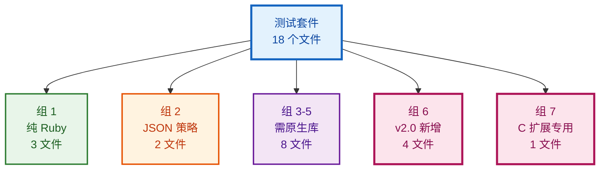

| 组 | 文件 | 是否需要原生库 | 备注 |
|:--:|------|:--------------:|------|
| 1 | `test_errors.rb` | 否 | |
| 1 | `test_callback_error_reporter.rb` | 否 | |
| 1 | `test_module_helpers.rb` | 部分 | 部分用例需原生库 |
| 2 | `test_lf_io.rb` | 部分 | JSON 策略不需，句柄 IO 需 |
| 2 | `test_lf_io_extra.rb` | 部分 | 同上 |
| 3 | `test_data_handle.rb` | 是 | |
| 3 | `test_data_handle_extra.rb` | 是 | |
| 4 | `test_app_handle.rb` | 是 | |
| 4 | `test_app_handle_extra.rb` | 是 | |
| 5 | `test_status.rb` | 是 | |
| 5 | `test_network_events.rb` | 是 | |
| 5 | `test_framework.rb` | 是 | |
| 5 | `test_network.rb` | 是 | |
| **6** | **`test_options.rb`** | **是** | **v2.0** |
| **6** | **`test_address.rb`** | **部分** | **v2.0：构造不需，调用需** |
| **6** | **`test_async_support.rb`** | **是** | **v2.0** |
| **6** | **`test_p2p_registration.rb`** | **是** | **v2.0** |
| 7 | `test_native_bridge_self_test.rb` | C 扩展专用 | |

### 8.2 三种运行方式

| 方式 | 命令 | 用途 |
|------|------|------|
| 开发（Windows） | `.\run_tests.ps1` | 交互式跑全部 18 个文件 |
| CI（Windows） | `.\run_test_ci.ps1` | 与开发版功能相同，独立文件 |
| CI（Linux / macOS） | `bash run_test_ci.sh` | 在 POSIX 环境跑 |

### 8.3 运行流程

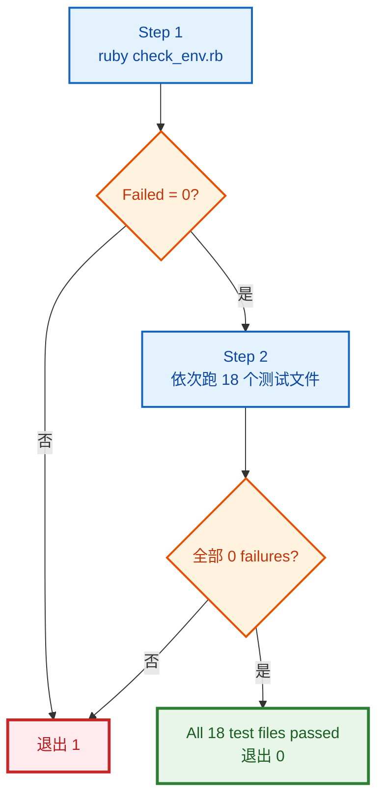

### 8.4 预期输出

```powershell
cd D:\CoreLibrary\LingoFuse\ruby
.\run_test_ci.ps1
```

**末尾**：

```
========================================================================
All 18 test files passed.
========================================================================
```

### 8.5 日志中"看起来像错误但实际是预期"的条目

| 日志 | 来源 | 说明 |
|------|------|------|
| `[LingoFuse::NativeBridge] callback raised: intentional ...` | 自测 11 / 14 | 故意触发异常，验证 C 端 fallback 日志 |
| `[LingoFuse] Callback error in ...boom...` | test_app_handle | 故意抛异常，验证异常隔离 |
| `no found api "does_not_exist"` | 多个文件 | 故意调用不存在的 API |
| `prepare error: repeat listen/connection addr` | test_framework / test_network | 故意重复地址 |
| `no connection` | test_address | 故意调不可达目标 |
| `LF_UID_Call: no connection` | test_address | 故意 UID 调不可达 |
| `LF_P2PNAME_Call: no connection` | test_address | 故意 P2PName 调不可达 |
| `hint: Data handle pool "N" handles automatically freed.` | 所有含 DataHandle 的测试 | 10 分钟空闲回收，正常行为 |

---

## 九、API 说明

### 9.1 顶层模块函数

```ruby
require 'lingofuse'
```

| 函数 | 说明 |
|------|------|
| `LingoFuse::VERSION` | 绑定版本字符串（`"2.0.0"`） |
| `LingoFuse.load_library` | 幂等，总是返回 `true` |
| `LingoFuse.loaded?` | 原生库是否已加载 |
| `LingoFuse.library_name` | 平台相关的库文件名 |
| `LingoFuse.platform` | Hash：`{ ruby:, platform:, library:, version:, has_async_support:, has_address:, has_options:, has_p2p_reg: }` |
| `LingoFuse.cstr_ptr(str)` | 转 `Fiddle::Pointer`（NUL 结尾 UTF-8） |
| `LingoFuse.read_cstr(ptr)` | 从指针读 UTF-8 字符串 |

### 9.2 `LingoFuse::DataHandle`

RAII 包装：`TDataHnd`。

**构造**：

```ruby
h = LingoFuse::DataHandle.new('api_name')             # 自动回收
h = LingoFuse::DataHandle.create_permanent('api_name') # 永久
h = LingoFuse::DataHandle.borrow(raw_pointer)          # 借用
LingoFuse::DataHandle.open('api_name') { |h| ... }     # 块形式
```

**方法分类**：

| 类别 | 方法 |
|------|------|
| 生命周期 | `dispose` / `close` / `valid?` / `owning?` / `raw` |
| 位置 / 大小 | `position` / `position=` / `size` / `size=` / `get_buffer_pointer` |
| 字节 I/O | `write_bytes` / `read_bytes` / `read_bytes_exact` / `try_read_bytes` / `read_all_bytes` |
| 标量 I/O | `write_int8` … `write_double` / `read_int8` … `read_double`（均小端序） |
| 字符串 I/O | `write_string` / `read_string` / `read_string_bytes` / `try_read_string` |

### 9.3 `LingoFuse::AppHandle`

RAII 包装：`TAppHnd`。

**构造**：

```ruby
app = LingoFuse::AppHandle.new('AppName', 'description')
```

**方法**：

| 方法 | 说明 |
|------|------|
| `app.register_call(name, desc, &block)` | 注册 Call API |
| `app.register_notify(name, desc, &block)` | 注册 Notify API |
| `app.unregister(name)` | 注销，返回 `true` / `false` |
| `app.local_call(param)` | 本地同步调用，返回新 `DataHandle` |
| `app.local_notify(param)` | 本地异步通知 |
| `app.bind` | 绑定到空闲客户端，返回数量 |
| `app.dispose` | 释放（**两阶段析构第一步**） |
| `app.valid?` / `app.raw` / `app.name` | 状态访问 |

**回调签名**：

```ruby
app.register_call('add', 'Add two ints') do |input, output|
  a = input.read_int32
  b = input.read_int32
  output.write_int32(a + b)
end

app.register_notify('log', 'One-way log') do |input|
  msg = input.read_string
  puts msg
end
```

**回调整约**：

- 回调运行在 Ruby 调度线程
- `input` / `output` 是**借用句柄**，不要 `dispose`
- 回调内不要调用 `local_call` / `call` / `notify`（死锁）
- 回调内不要操作 UI（用 `Thread::Queue` 转发）

### 9.4 `LingoFuse::LfIo`

统一 JSON / 字符串 / 字节 I/O。

| 函数 | 说明 |
|------|------|
| `LfIo.dumps_json(obj)` | 序列化：紧凑、非 ASCII 字面量、`ensure_ascii: false` |
| `LfIo.loads_json(text)` | strict 解析 |
| `LfIo.write_string(handle, str)` | 写 UTF-8 + NUL |
| `LfIo.read_string(handle)` | 读到 NUL |
| `LfIo.write_string_bytes(handle, bytes)` | 写原始字节 + NUL |
| `LfIo.read_string_bytes(handle)` | 读到 NUL（不解码） |
| `LfIo.peek_string_bytes(handle)` | 读到 NUL，**不移动游标** |
| `LfIo.read_all_bytes(handle)` | 读剩余全部 |
| `LfIo.write_json(handle, obj)` | 序列化 + 写 + NUL |
| `LfIo.read_json(handle)` | 读 + 解析（抛 `JSON::ParserError`） |
| `LfIo.try_read_json(handle)` | 非抛异常版本（返回 `nil`） |
| `LfIo.cstr(value)` | 规范化为字符串 |

**线格式**：`[UTF-8 encoded JSON text][NUL byte]`。

**跨语言字节级兼容**：`{"a":1}` 在所有绑定上的字节序列都是：

```
7B 22 61 22 3A 31 7D 00
```

### 9.5 `LingoFuse::Framework`

进程级门面。

| 方法 | 说明 |
|------|------|
| `Framework.reset_prepare` | 清空准备队列 |
| `Framework.prepare_service(listen, physics)` | 准备服务端点 |
| `Framework.prepare_client(physics, app)` | 准备客户端连接 |
| `Framework.prepare_done` | 启动框架（**只返回一次 `true`**） |
| `Framework.exit_main_thread` | 请求主线程退出 |
| `Framework.set_option(name, value)` | 调整运行时选项（字符串型） |
| `Framework.generate_app_name` | 生成唯一 App 名 |
| `Framework.get_app_name(app)` | 查询 App 权威名 |
| `Framework.call(app, param, timeout_ms)` | 同步远程调用 |
| `Framework.try_call(app, param, timeout_ms)` | 空响应返回 `nil` |
| `Framework.notify(app, param)` | 单向通知 |
| `Framework.sequenced_notify(app, param)` | FIFO 通知 |
| `Framework.shutdown` | 完全关闭（幂等） |

### 9.6 `LingoFuse::Status`

| 方法 | 说明 |
|------|------|
| `Status.get_status_count` | 队列中待处理消息数 |
| `Status.get_status` | 弹出下一条 |
| `Status.drain_status(max)` | 弹出最多 `max` 条 |
| `Status.post_status(msg)` | 推入一条 |
| `Status.check_main_thread` | 主线程是否运行 |
| `Status.check_app(name)` | App 是否可见 |
| `Status.check_api(app, api)` | API 是否可见 |

### 9.7 `LingoFuse::NetworkEvents`

进程全局连接 / 断开处理器。

```ruby
LingoFuse::NetworkEvents.set(
  on_connect:    ->(addr) { puts "+ #{addr}" },
  on_disconnect: ->(addr) { puts "- #{addr}" }
)
LingoFuse::NetworkEvents.clear
LingoFuse::NetworkEvents.installed?
LingoFuse::NetworkEvents.set_listener(listener)
```

**语义**：

- **Connect** — 客户端首次收到服务 API 广播时触发，**不是** TCP 建链
- **Disconnect** — 物理链路丢失时触发
- **回调线程** — Ruby 调度线程（v2.0 起，不再是原生线程）

### 9.8 `LingoFuse::Address`（v2.0 新增）

三寻址抽象。所有 `Target` 共享同一套 call 形状。

**构造**：

```ruby
LingoFuse.app('MyApp')                  # => AppTarget
LingoFuse.uid(uid_bytes_or_hex)         # => UIDTarget
LingoFuse.p2pname('workers')            # => P2PNameTarget

# 或使用完整路径
LingoFuse::Address.app('MyApp')
LingoFuse::Address.uid(uid)
LingoFuse::Address.p2pname('workers')

# 或直接构造
LingoFuse::AppTarget.new('MyApp', default_timeout_ms: 3000)
LingoFuse::UIDTarget.new('00' * 32)
LingoFuse::P2PNameTarget.new('workers')
```

**统一方法**（三个子类共享）：

| 方法 | 说明 |
|------|------|
| `target.call(api, payload = nil, timeout_ms: nil)` | 同步请求，返回反序列化结果；超时抛 `TimeoutError` |
| `target.call_future(api, payload = nil, timeout_ms: nil)` | 返回 `CallFuture`，不阻塞 |
| `target.notify(api, payload = nil)` | 单向通知 |
| `target.sequenced_notify(api, payload = nil)` | FIFO 单向通知 |
| `target.describe` | 人类可读描述 |

**寻址语义**：

| Target | 路由键 | 本地优先 | 负载均衡 |
|--------|--------|:--------:|:--------:|
| `AppTarget` | App 名（String） | ✅ | ❌ |
| `UIDTarget` | 32 字节 UID | ✅ | ❌ |
| `P2PNameTarget` | 组名（String） | ❌ | ✅（服务端） |

**UID 输入格式**：32 字节 String 或 64 字符 hex String。

### 9.9 `LingoFuse::AsyncSupport`（v2.0 新增）

现代异步子系统。

**类型**：

| 类型 | 用途 |
|------|------|
| `CallFuture` | 线程安全 Future |
| `AsyncOp` | 单次异步操作的状态机 |
| `AsyncBridge` | 进程单例，管理所有未决操作 |
| `AsyncSupport.run_async_with_future` | 工厂方法 |

**`CallFuture` 方法**：

| 方法 | 说明 |
|------|------|
| `future.value(timeout_ms: nil)` | 阻塞等待结果，超时抛 `TimeoutError` |
| `future.done?` | 是否已解析 |
| `future.abandoned?` | 是否已被放弃 |
| `future.fulfill(v)` / `future.reject(e)` | 内部使用，幂等 |
| `future.mark_abandoned!` | 内部使用，幂等 |

**状态机**：

```
PENDING ── callback fires ──> FIRED
   │
   ├── timeout fires ──> ABANDONED ── late callback ──> FIRED
   │
   └── dispatch fails ──> NOT_QUEUED
```

**关键设计**：

- C 请求**无超时**；超时由 Ruby 侧的 `CallFuture#value` 决定
- 超时后 C 回调仍会到达，但结果被丢弃（`AsyncOp` 检测到已 `ABANDONED` 直接跳过用户回调）
- 分派失败立即释放 ref，不泄漏
- 复用：`AsyncBridge.instance.stats` 提供诊断计数

### 9.10 `LingoFuse::Options`（v2.0 新增）

16 对类型化 `set_opt_xxx` / `get_opt_xxx`。

| 选项短名 | Ruby 类型 | 默认值 | 说明 |
|----------|:---------:|--------|------|
| `password` | String | 内置 token | 只读时返回 `"********"` 掩码 |
| `debug` | String | — | 只写；读时返回占位符 |
| `quiet` | Boolean | false | 抑制大部分日志 |
| `show_thread_id` | Boolean | true | 日志带线程 ID |
| `console_output` | Boolean | 取决于宿主 | 控制台输出 |
| `overlap_connection` | Boolean | false | 允许多客户端同地址 |
| `wait_connection_ready_ok` | Boolean | true | `prepare_done` 是否等待客户端就绪 |
| `wait_connection_timeout` | Integer（毫秒） | 30000 | 等待超时 |
| `ipc_serv_thread_count` | Integer | 平台相关 | IPC 服务端线程数 |
| `ipc_serv_max_queue_length` | Integer | 平台相关 | IPC 入站队列长度 |
| `ipc_serv_max_msg_size` | Integer | 平台相关 | IPC 单条消息上限 |
| `fixed_sequenced_time` | Integer（毫秒） | 20000 | 顺序通知粘性窗口 |
| `p2p_name` | String | `""` | 本进程 P2P 组名 |
| `data_handle_idle_timeout` | Integer（毫秒） | 600000 | 自动回收空闲阈值 |
| `data_handle_pool_scan_interval` | Integer（毫秒） | 5000 | 池扫描间隔 |
| `no_reponse_cmd_null_flush_threshold` | Integer | 5000 | 无响应命令 NULL 刷新阈值 |

**注意拼写**：`No_Reponse`（无第二个 s）是 Pascal 侧历史拼写，Ruby 侧的 `set_opt_no_reponse_cmd_null_flush_threshold` 必须保留。

**诊断快照**：

```ruby
LingoFuse::Options.to_h   # 返回 16 个 key 的 Hash
```

### 9.11 `LingoFuse::P2PRegistration`（v2.0 新增）

进程级 P2P 注册，与 `AppHandle` 平行但独立。

| 方法 | 说明 |
|------|------|
| `P2PRegistration.register_call(name, desc, &block)` | 注册进程级 Call API |
| `P2PRegistration.register_notify(name, desc, &block)` | 注册进程级 Notify API |
| `P2PRegistration.unregister(name)` | 注销，返回 `true` / `false` |
| `P2PRegistration.registered?(name)` | 查询 |
| `P2PRegistration.registered_names` | 返回所有已注册名（快照 Array） |

**顶层别名**：`LingoFuse.register_p2p_call` / `LingoFuse.register_p2p_notify` / `LingoFuse.unregister_p2p`。

**与 App 级注册的对照**：

| 维度 | App 级（`AppHandle`） | P2P 级（本模块） |
|------|----------------------|------------------|
| 命名空间 | 每个 App 独立 | 进程级，独立于任何 App |
| 可达性 | App 名 + UID | 仅 UID + P2PName |
| 生命周期 | 随 `AppHandle` 释放而解绑 | 存活到进程退出（`LF_Shutdown`） |
| 重复注册 | 抛 `RegistrationError` | 抛 `RegistrationError` |

---

## 十、使用示例

### 10.1 纯本地调用

```ruby
require 'lingofuse'

app = LingoFuse::AppHandle.new('Calculator', 'Demo')

app.register_call('add', 'Add two ints') do |input, output|
  a = input.read_int32
  b = input.read_int32
  output.write_int32(a + b)
end

param = LingoFuse::DataHandle.new('add')
param.write_int32(5)
param.write_int32(7)

result = app.local_call(param)
puts result.read_int32   # 12

param.dispose
result.dispose
app.dispose
```

### 10.2 三寻址（v2.0）

```ruby
require 'lingofuse'

# --- App 名寻址（本地优先）---
t_app = LingoFuse.app('Calculator')
result = t_app.call('add', { 'a' => 40, 'b' => 2 }, timeout_ms: 3000)
puts result['result']  # 42

# --- UID 寻址（本地优先）---
my_uid = "\x00" * 32    # 实际通过 whoami 探测获得
t_uid = LingoFuse.uid(my_uid)
t_uid.notify('log', { 'msg' => 'hello' })

# --- P2PName 寻址（永远走网络，服务端负载均衡）---
t_p2p = LingoFuse.p2pname('worker_group')
t_p2p.notify('log', { 'msg' => 'broadcast' })
```

### 10.3 现代异步（v2.0）

```ruby
require 'lingofuse'

# --- Future 风格 ---
t = LingoFuse.app('CalcSvc')
future = t.call_future('add', { 'a' => 5, 'b' => 7 }, timeout_ms: 3000)

# 做别的事，然后再取结果
result = future.value(timeout_ms: 5000)
puts result['result']  # 12

# --- 超时与放弃标志 ---
future2 = t.call_future('slow_api', nil, timeout_ms: 50)
begin
  future2.value(timeout_ms: 200)
rescue LingoFuse::TimeoutError
  puts 'timed out'
  puts "abandoned? #{future2.abandoned?}"  # true
end
```

### 10.4 类型化选项（v2.0）

```ruby
require 'lingofuse'

# --- 布尔 ---
LingoFuse.set_opt_quiet(true)
puts LingoFuse.get_opt_quiet.inspect   # true
LingoFuse.set_opt_quiet(false)

# --- 整数 ---
LingoFuse.set_opt_wait_connection_timeout(60000)
puts LingoFuse.get_opt_wait_connection_timeout  # 60000

# --- 字符串 ---
LingoFuse.set_opt_p2p_name('worker_group')
puts LingoFuse.get_opt_p2p_name.inspect  # "worker_group"
LingoFuse.set_opt_p2p_name('')

# --- 诊断快照 ---
puts LingoFuse::Options.to_h[:quiet]
```

### 10.5 进程级 P2P 注册（v2.0）

```ruby
require 'lingofuse'

# 注册一个进程级工具 API，任何客户端可以通过 UID 或 P2PName 调用
LingoFuse.register_p2p_call('whoami', 'echo caller identity') do |input, output|
  uid = input.get_p2p_uid     # 32 字节二进制
  name = input.get_p2p_name   # UTF-8 字符串
  output.write_json({
    'uid_hex' => uid.unpack1('H*'),
    'p2p_name' => name
  })
end

# ... 服务运行 ...

# 注销
LingoFuse.unregister_p2p('whoami')
```

### 10.6 服务端

```ruby
require 'lingofuse'

app = LingoFuse::AppHandle.new('Calculator', 'Server')

app.register_call('add', 'Add') do |input, output|
  req = LingoFuse::LfIo.read_json(input)
  result = (req['a'] || 0) + (req['b'] || 0)
  LingoFuse::LfIo.write_json(output, { 'result' => result })
end

LingoFuse.set_opt_wait_connection_ready_ok(false)
LingoFuse::Framework.reset_prepare
LingoFuse::Framework.prepare_service('ipc:calc', 'ipc:calc')
LingoFuse::Framework.prepare_client('ipc:calc', app)

if LingoFuse::Framework.prepare_done
  puts 'Server ready. Press Enter to exit...'
  $stdin.gets
end

LingoFuse::Framework.exit_main_thread
app.dispose
LingoFuse::Framework.shutdown
```

### 10.7 客户端

```ruby
require 'lingofuse'

LingoFuse.set_opt_wait_connection_ready_ok(false)
LingoFuse::Framework.reset_prepare
LingoFuse::Framework.prepare_client('ipc:calc', nil)
LingoFuse::Framework.prepare_done

# 等待 App 可见
30.times do
  break if LingoFuse::Status.check_app('Calculator')
  sleep 0.2
end

# --- 用 v2.0 三寻址 API ---
t = LingoFuse.app('Calculator')
begin
  result = t.call('add', { 'a' => 40, 'b' => 2 }, timeout_ms: 3000)
  puts result['result']  # 42
rescue LingoFuse::TimeoutError => e
  warn "call timed out: #{e.message}"
end

LingoFuse::Framework.exit_main_thread
LingoFuse::Framework.shutdown
```

### 10.8 Cross Demo

三个进程，验证跨进程 / 跨语言：

```powershell
# 终端 1
ruby cross/cross_service.rb

# 终端 2
ruby cross/cross_node.rb

# 终端 3
ruby cross/cross_call.rb
```

| 进程 | 角色 | 说明 |
|------|------|------|
| `cross_service.rb` | 协调者（信标） | 创建 `ipc:cross` 端点，不注册任何 API |
| `cross_node.rb` | 工作节点 | 注册 `demo.add` / `demo.inv_seri` 两个 Call API |
| `cross_call.rb` | 压测客户端 | 32 线程 × 10 秒，压测 `demo` 应用 |

---

## 十一、故障排查速查

| 症状 | 原因 | 修复 |
|------|------|------|
| `ruby: command not found` | PATH 未生效 | 重启 PowerShell |
| `cannot load such file -- lingofuse` | `$LOAD_PATH` 未包含 `lib/` | §7.4 |
| `Failed to load the LingoFuse native library` | 原生库不在 PATH 上 | §4.4 |
| `The specified module could not be found` | 兄弟 DLL 缺失或分散 | 4 个 DLL 必须同目录 |
| `[BUG] rb_thread_call_with_gvl()` | C 扩展未编译或未加载 | 跑 `setup_build_env.ps1` |
| `[LingoFuse::NativeBridge] lingofuse_ext not available` | C 扩展不在 `lib/` | BUILD_AND_DEPLOY.md |
| `No GNU Make found` | DevKit 未安装 / PATH 顺序 | INSTALL_DEPENDENCIES.md §3.2 |
| `Fatal makefile ... No terminator` | 用了 Embarcadero Make | 前置 msys64 到 PATH |
| `Cannot replace lib\lingofuse_ext.so` | 文件被占用 | `Get-Process ruby \| Stop-Process -Force` |
| `prepare error: repeat listen` | 地址重复 | `Framework.reset_prepare` 后重试 |
| `prepare error: repeat connection` | 地址重复 | 设 `overlap_connection = true` |
| `no connection` | 目标 App 不可见 | 等 broadcast 广播，用 `check_app` 轮询 |
| `no found app/api` | App/API 名不匹配 | 检查拼写、大小写 |
| `hint: Data handle pool ... automatically freed.` | 10 分钟空闲回收 | 正常行为 |
| `callback raised: ...`（前缀 `NativeBridge`） | 回调抛异常 | 修回调 |
| `CallFuture#value timed out after Nms` | 异步超时 | 提高 `timeout_ms` 或检查服务端 |
| `P2P API '...' is already registered` | P2P 名重复 | 用 `registered_names` 检查 |
| `UID must be exactly 32 bytes` | UID 长度错误 | 用 32 字节或 64 字符 hex |
| `调试器无法启动` | `debug` gem 未装 | `gem install debug` |

### 11.1 通用排查顺序

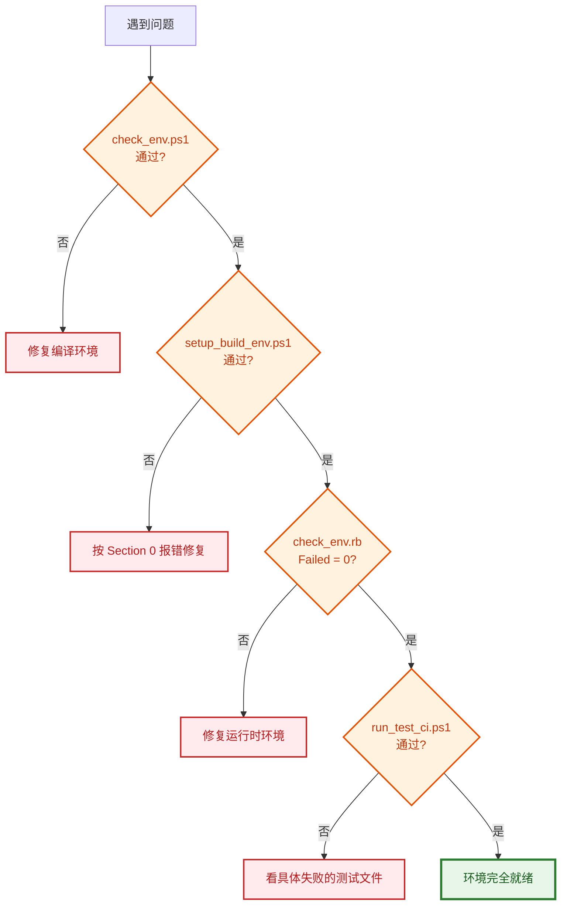

---

## 十二、v2.0 迁移指南

### 12.1 从 v1.x 升级到 v2.0

**第一步：重编译 C 扩展**

```powershell
cd D:\CoreLibrary\LingoFuse\ruby
powershell -ExecutionPolicy Bypass -File clean.ps1
powershell -ExecutionPolicy Bypass -File setup_build_env.ps1
```

**第二步：更新 Gemfile / gemspec**

`lingofuse.gemspec` 的版本号已经是 `2.0.0`。

**第三步：审查现有代码**

绝大多数 v1.x 代码在 v2.0 上**无改动可用**。以下是唯二需要注意的点：

| 项 | v1.x 行为 | v2.0 行为 |
|----|-----------|-----------|
| `LingoFuse.platform.keys` | 3 个 | **8 个**（+ version + 4 个 has_xxx） |
| `LingoFuse::VERSION` | `"1.0.0"` | `"2.0.0"` |
| `LingoFuse.loaded?` | 已存在 | 已存在（语义一致） |

**第四步：可选 — 使用 v2.0 新特性**

- **三寻址**：把 `Framework.call('app', ...)` 改为 `LingoFuse.app('app').call(...)`
- **异步**：把 `async_call` + 回调改为 `call_future`
- **类型化选项**：把 `Framework.set_option('Quiet', 'True')` 改为 `LingoFuse.set_opt_quiet(true)`
- **P2P 注册**：用 `LingoFuse.register_p2p_call` 替代 App 级注册（如果需要跨 App 可达）

### 12.2 v1.x 到 v2.0 API 对照表

| v1.x | v2.0 |
|------|------|
| `client.json_call('api', payload)` | `LingoFuse.app('MyApp').call('api', payload)` |
| `client.json_notify('api', payload)` | `LingoFuse.app('MyApp').notify('api', payload)` |
| `client.async_call('api', payload, on_result: ...)` | `LingoFuse.app('MyApp').call_future('api', payload)` |
| `Framework.set_option('Quiet', 'True')` | `LingoFuse.set_opt_quiet(true)` |
| `Framework.set_option('Wait_Connection_Timeout', '30000')` | `LingoFuse.set_opt_wait_connection_timeout(30000)` |
| `app.register_call('api', 'desc', &block)` | 不变 |
| `app.local_call(param)` | 不变 |
| `LingoFuse::DataHandle.new('api')` | 不变 |

### 12.3 双向兼容性

**v2.0 内部**：所有 v1.x API 都保留（`Framework.call` / `Framework.notify` 等），可以与 v2.0 新 API 混用。

**v1.x 无法运行 v2.0 代码**：v2.0 新 API（`Address` / `AsyncSupport` / `Options` / `P2PRegistration`）在 v1.x 上不存在。

---

## 附录 A — 与其他语言的互通性

同一个 JSON 载荷在**所有** LingoFuse 绑定上产生**相同的字节序列**：

| 语言 | 文件 | 绑定类型 |
|------|------|----------|
| Pascal | `lingofuse_import.pas` | 原生 |
| C | `LingoFuse.h` / `LingoFuse.c` | 原生 |
| C++ | `LingoFuse.hpp` / `lf_io.hpp` | 原生 |
| C# | `LingoFuse.cs` / `LfIo.cs` | P/Invoke |
| Python | `lingofuse.lf_io` | ctypes |
| JavaScript | `index.js` / `lf-io.js` | Koffi |
| **Ruby** | **本绑定** | **Fiddle + C 扩展** |
| Rust | `io.rs` | FFI |
| Go | `lingofuse.go` | purego |
| Dart | `lf_io.dart` | FFI |
| Java | `LingoFuse.java` | FFM API |
| Swift | `LfIo.swift` | C++ 桥 |
| Zig | `lf_io.zig` | C ABI |
| Erlang | `lingofuse.erl` | NIF |

**示例**：`{"a":1}` 在所有绑定上的线字节：

```
7B 22 61 22 3A 31 7D 00
```

跨语言 RPC **无需任何转码层**。

---

## 附录 B — 快速命令卡

```powershell
# ============ 环境诊断 ============
cd D:\CoreLibrary\LingoFuse\ruby

.\check_env.ps1                        # 编译环境
ruby check_env.rb                      # 运行时环境（含 v2.0 子系统探测）

# ============ 编译 C 扩展 ============
.\setup_build_env.ps1                  # 一键编译 + 安装 + 加载测试
.\clean.ps1                            # 清理全部编译产物
.\clean.ps1 -DryRun                    # 预览清理
.\clean.ps1 -KeepInstalled             # 只清 ext/，保留 lib/

# ============ 测试 ============
.\run_tests.ps1                        # 开发测试（18 个文件）
.\run_test_ci.ps1                      # CI 测试（18 个文件）

# 单个测试
ruby test\test_errors.rb
ruby test\test_address.rb
ruby test\test_async_support.rb
ruby test\test_options.rb
ruby test\test_p2p_registration.rb

# ============ Cross Demo（三个终端）============
ruby cross\cross_service.rb
ruby cross\cross_node.rb
ruby cross\cross_call.rb
```

---

## 附录 C — 关于动态库搜索的关键总结

### C.1 三条规则

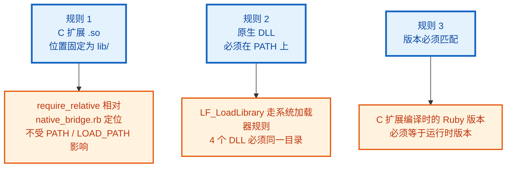

### C.2 记忆要点

**C 扩展 `lingofuse_ext.so`**：

- 位置：`lib/`（与 `lingofuse/` 同级）
- 加载者：`native_bridge.rb` 的 `require_relative`
- 需要配置吗？**不需要**。只要整个 `ruby/` 目录结构没变，自动找到。

**原生库 `LingoFuse64.dll` + 3 个兄弟**：

- 位置：PATH 上的任意目录
- 加载者：C 扩展内部的 `LF_LoadLibrary`
- 需要配置吗？**需要**。把它们所在的目录加到 PATH 上。
- 4 个 DLL 必须在**同一目录**。

---

## 附录 D — 许可

MIT。

---

*文档版本 2.0 · 与 LingoFuse Ruby 绑定 2.0.0 匹配 · 最后更新 2026-10-14*
