# LingoFuse Ruby binding — the complete manual

> Chinese version: [README.md](README.md)

**Version**: 2.0.0
**Target platform**: Windows 10 / 11 / Server 2019+ (x64)
**Ruby version**: 4.0+ (x64-mingw-ucrt)

---

## Contents

1. [What this is](#1-what-this-is)
2. [Architecture](#2-architecture)
3. [Requirements](#3-requirements)
4. [Installing the dependencies](#4-installing-the-dependencies)
5. [Environment diagnostics](#5-environment-diagnostics)
6. [Building the C extension](#6-building-the-c-extension)
7. [Adding LingoFuse to your own Ruby project](#7-adding-lingofuse-to-your-own-ruby-project)
8. [Testing](#8-testing)
9. [API reference](#9-api-reference)
   - [9.1 Top-level module functions](#91-top-level-module-functions)
   - [9.2 DataHandle](#92-lingofusedatahandle)
   - [9.3 AppHandle](#93-lingofuseapphandle)
   - [9.4 LfIo](#94-lingofuselfio)
   - [9.5 Framework](#95-lingofuseframework)
   - [9.6 Status](#96-lingofusestatus)
   - [9.7 NetworkEvents](#97-lingofusenetworkevents)
   - [9.8 Address (new in v2.0)](#98-lingofuseaddress-new-in-v20)
   - [9.9 AsyncSupport (new in v2.0)](#99-lingofuseasyncsupport-new-in-v20)
   - [9.10 Options (new in v2.0)](#910-lingofuseoptions-new-in-v20)
   - [9.11 P2PRegistration (new in v2.0)](#911-lingofusep2pregistration-new-in-v20)
10. [Usage examples](#10-usage-examples)
11. [Troubleshooting quick reference](#11-troubleshooting-quick-reference)
12. [The v2.0 migration guide](#12-the-v20-migration-guide)

---

## 1. What this is

The LingoFuse Ruby binding lets a Ruby program:

- **call** functions written in Pascal / C++ / C# / Python / JavaScript / Rust / Go / Dart / Java / Swift / Zig / Erlang
- **be called by** any of those languages
- work **in the same process**, **across processes on the same machine**, or **across machines**
- use a **byte-level unified** wire format, with no IDL, no stubs and no HTTP service

In one sentence:

> **A function written in any language can be called directly by any other language; Ruby is one of the 14 first-class languages.**

---

## 2. Architecture

### 2.1 The five-layer architecture

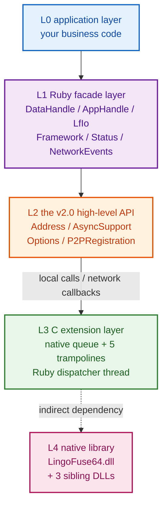

**The dependency direction**: L0 → L1 → L2 → L3 → L4. L3 is the only native entry point; neither L1 nor L2 touches Fiddle or C.

### 2.2 How v1.0 and v2.0 differ

| Dimension | v1.0.0 | v2.0.0 |
|------|--------|--------|
| native loading mechanism | Fiddle (pure Ruby) | a hand-written C extension `lingofuse_ext.so` |
| addressing modes | App name only | App name / UID / P2PName |
| asynchronous calls | callback style only (`async_call`) | callback style + Future style (`call_future`) |
| runtime options | the string-based `set_option` | + 16 typed `set_opt_xxx` |
| P2P registration | none | yes (process-level, independent of App) |
| remote callbacks | unusable (Fiddle deadlock) | usable (marshalled by the C extension) |
| test suite | 14 files | 18 files |

### 2.3 Why the C extension is necessary

**This is the most important design decision in the whole binding.** Ruby's Fiddle **cannot** call back into Ruby code from LingoFuse's native worker threads.

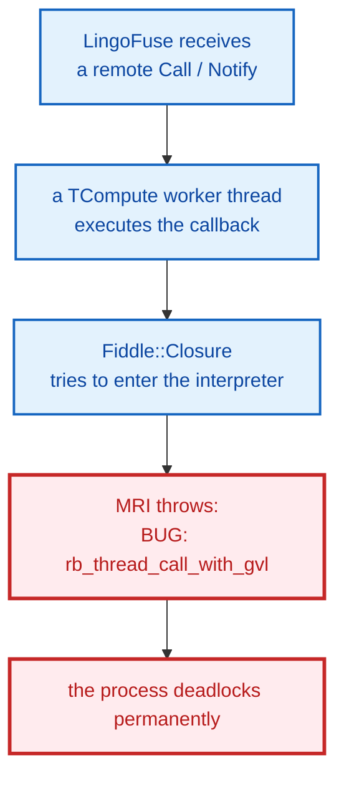

**The decision table**:

| Use case | Is a C extension needed? |
|----------|:---------------:|
| local calls only (`AppHandle#local_call` / `local_notify`) | no |
| register Call / Notify APIs, but trigger them only locally | no |
| receive remote calls (act as a server) | **required** |
| network event callbacks | **required** |
| asynchronous calls (`call_future`) | **required** |

### 2.4 How the C extension solves the problem

**On the native thread side**:

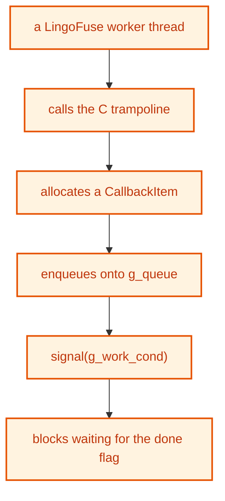

**On the Ruby dispatcher thread side**:

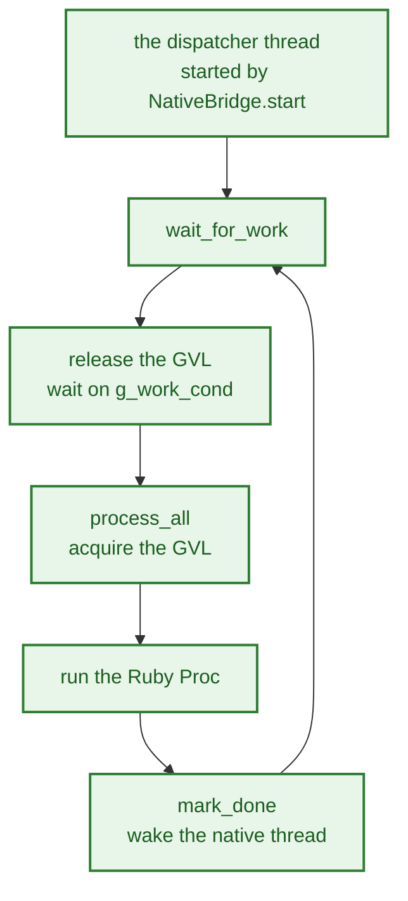

### 2.5 The fifth trampoline added in v2.0

The v1.x C extension had 4 trampolines (Call / Notify / Network connect / Network disconnect). v2.0 adds a fifth:

| Trampoline | Kind | Triggered by | Callback arguments |
|------------|:----:|--------|----------|
| `trampoline_call` | 0 | `LF_RegisterCall` | `(trigger, input, output)` |
| `trampoline_notify` | 1 | `LF_RegisterNotify` | `(trigger, input)` |
| `trampoline_network_connect` | 2 | `LF_Set_Network_Event` | `(addr)` |
| `trampoline_network_disconnect` | 3 | `LF_Set_Network_Event` | `(addr)` |
| **`trampoline_async_call`** | **4** | `LF_Async_Call` | **`(data, result)`** |

For `trampoline_async_call`, `data` carries a `CallbackRef*` and `result` is a framework-owned `TDataHnd`. Its lifetime contract is documented in detail in `lib/lingofuse/async_support.rb`.

### 2.6 The DataHandle lifecycle state machine

**Three ways to construct one**:

| Construction | Underlying API | Idle reclaim | `dispose` semantics |
|------|----------|:--------:|--------------|
| `DataHandle.new(api)` | `LF_CreateData` | 10 minutes | mark only; freed on the next pool scan (≤ 5 seconds) |
| `DataHandle.create_permanent(api)` | `LF_CreateData_Permanent` | never | freed synchronously, immediately |
| `DataHandle.borrow(raw)` | none | managed by the native layer | no-op |

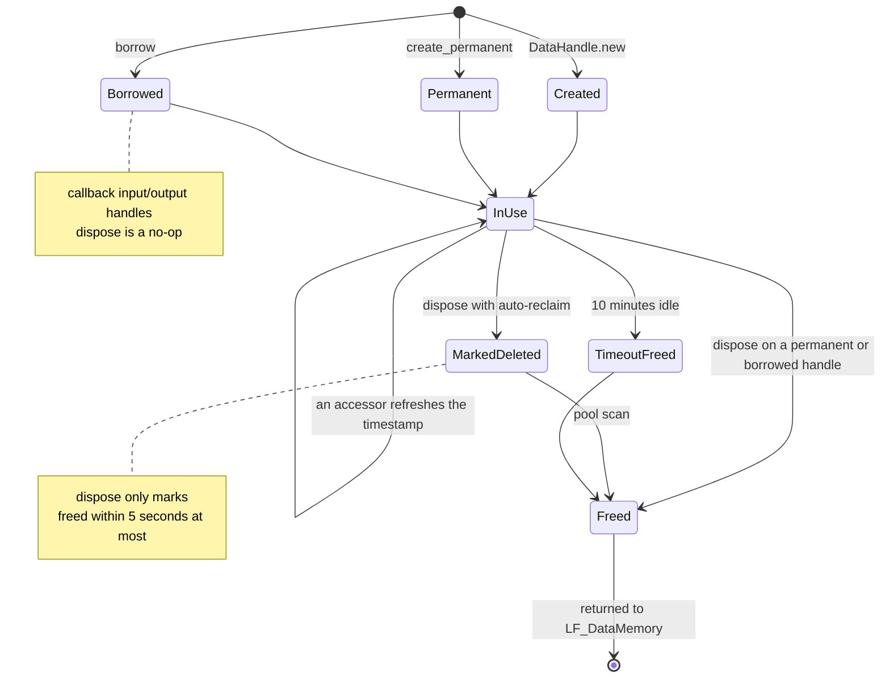

### 2.7 The dependency graph

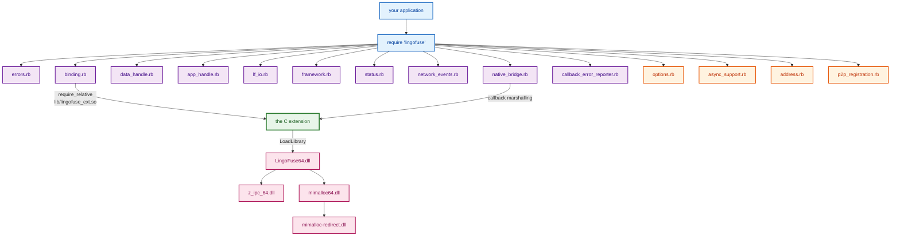

### 2.8 The file layout

```
ruby/
├── README.md                      this file
├── BUILD_AND_DEPLOY_en.md            the C-extension build and deployment guide
├── INSTALL_DEPENDENCIES_en.md        the dependency installation guide
├── Gemfile                        the Bundler declaration
├── lingofuse.gemspec              gem metadata (v2.0.0)
├── Rakefile                       rake tasks
│
├── setup_build_env.ps1            one-key C-extension build
├── clean.ps1                      clean build artifacts
├── check_env.ps1                  build-environment diagnostics
├── check_env.rb                   runtime diagnostics
├── run_tests.ps1                  development tests (Windows)
├── run_test_ci.ps1                CI tests (Windows)
├── run_test_ci.sh                 CI tests (Linux / macOS)
│
├── .vscode/
│   └── launch.json                the VS Code debug configuration
│
├── lib/
│   ├── lingofuse.rb               the public entry point (v2.0.0)
│   ├── lingofuse_ext.so           the C extension (build artifact)
│   └── lingofuse/
│       ├── errors.rb              the exception hierarchy
│       ├── callback_error_reporter.rb
│       ├── binding.rb             the C-extension wrapper
│       ├── data_handle.rb
│       ├── app_handle.rb
│       ├── lf_io.rb
│       ├── framework.rb
│       ├── status.rb
│       ├── network_events.rb
│       ├── native_bridge.rb
│       ├── options.rb             v2.0: 16 pairs of typed accessors
│       ├── async_support.rb       v2.0: CallFuture / AsyncBridge
│       ├── address.rb             v2.0: the three addressing targets
│       └── p2p_registration.rb    v2.0: process-level P2P registration
│
├── ext/lingofuse_ext/
│   ├── extconf.rb                 mkmf configuration
│   ├── LingoFuse.h                the C ABI header (upstream)
│   ├── LingoFuse.c                the loader + 59 forwarders
│   └── lingofuse_ext.c            the Ruby C API surface
│
├── cross/
│   ├── cross_service.rb           the beacon
│   ├── cross_node.rb              the worker node
│   └── cross_call.rb              the load client
│
└── test/                          18 test files
    ├── test_errors.rb
    ├── test_callback_error_reporter.rb
    ├── test_module_helpers.rb
    ├── test_lf_io.rb
    ├── test_lf_io_extra.rb
    ├── test_data_handle.rb
    ├── test_data_handle_extra.rb
    ├── test_app_handle.rb
    ├── test_app_handle_extra.rb
    ├── test_status.rb
    ├── test_network_events.rb
    ├── test_framework.rb
    ├── test_network.rb
    ├── test_options.rb              v2.0
    ├── test_address.rb              v2.0
    ├── test_async_support.rb        v2.0
    ├── test_p2p_registration.rb     v2.0
    └── test_native_bridge_self_test.rb
```

---

## 3. Requirements

### 3.1 Hardware and operating system

| Item | Requirement |
|---|---|
| Operating system | Windows 10 (1809+) / Windows 11 / Windows Server 2019+ |
| Architecture | x64 (ARM64 untested) |
| Disk space | ≥ 1 GB (including Ruby + DevKit) |
| Memory | ≥ 4 GB |

### 3.2 The software list

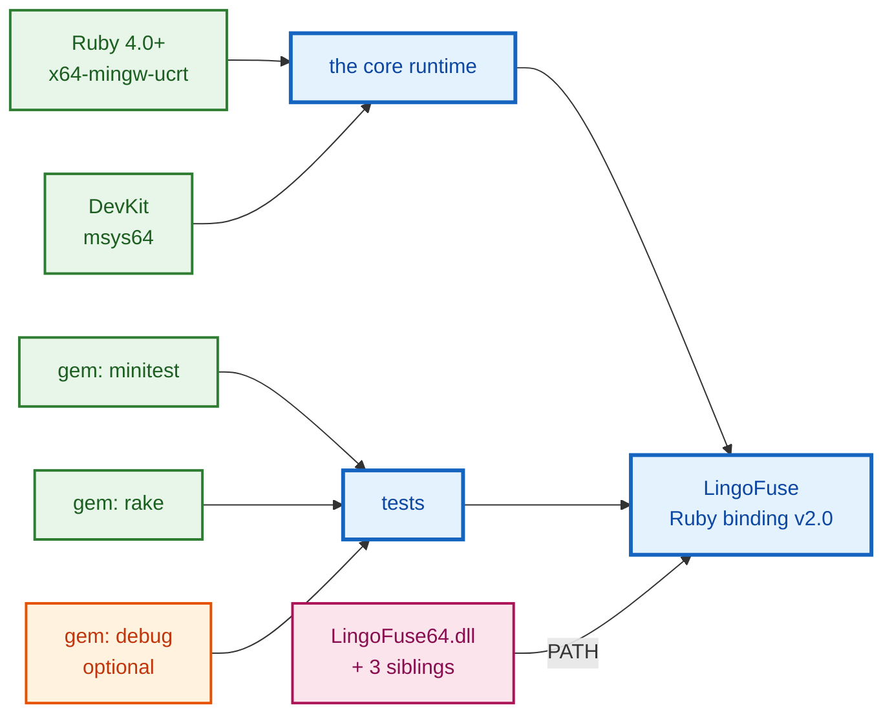

**Required**: Ruby 4.0+, DevKit, `minitest`, `rake`, and the 4 LingoFuse DLLs on PATH.

**Optional**: `debug` (needed only for VS Code debugging).

### 3.3 The version selection table

| Component | Minimum | **Recommended** | Forbidden | Notes |
|------|:--------:|:------------:|:--------:|------|
| Ruby | 2.7.0 | **4.0.x** | x86-mingw32 | must be `x64-mingw-ucrt` |
| Platform | Windows 10 1809 | **Windows 11** | — | needs PowerShell 5+ |
| PowerShell | 5.0 | **7.x** | 2.0-4.0 | 5.0 is enough |
| gem: minitest | 5.0 | **the newest 5.x** | — | usually installed with Ruby |
| gem: rake | 13.0 | **the newest 13.x** | — | |
| gem: debug | — | **1.11+** | — | optional, for VS Code debugging |
| LingoFuse DLL | 3.10 | **3.10+** | — | must support the v2.0 C ABI |

**Critical warnings**:

- ⚠️ **You must install the x64-mingw-ucrt build of Ruby**. The x64-mswin64 build fails
- ⚠️ **You must install RubyInstaller with DevKit**. Without DevKit you cannot compile the C extension
- ⚠️ **Never use Embarcadero / Borland / CodeGear make.exe**. It is incompatible with GNU Make syntax

---

## 4. Installing the dependencies

See [`INSTALL_DEPENDENCIES_en.md`](INSTALL_DEPENDENCIES_en.md) for details. Only the briefest summary is given here.

### 4.1 Step 1 — install Ruby + DevKit

Download [RubyInstaller](https://rubyinstaller.org/downloads/) and choose **Ruby+Devkit 4.0.x (x64)**.

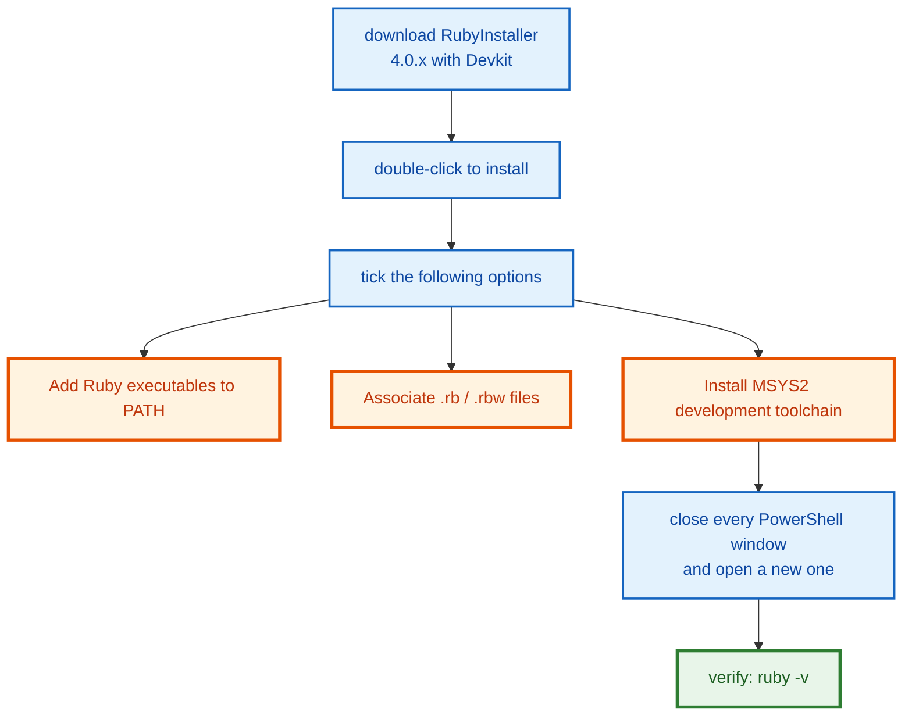

### 4.2 Step 2 — verify DevKit

```powershell
make --version
gcc --version
```

**Expected**: `GNU Make 4.4.1` and MinGW-w64 gcc.

### 4.3 Step 3 — gem dependencies

```powershell
gem install minitest
gem install rake
gem install debug        # optional
```

### 4.4 Step 4 — put the native library on PATH

The four DLLs **must sit in the same directory**:

| File | Purpose |
|---|---|
| `LingoFuse64.dll` | the core RPC library |
| `z_ipc_64.dll` | the IPC substrate |
| `mimalloc64.dll` | the memory allocator |
| `mimalloc-redirect.dll` | the mimalloc redirect |

**That directory must be on PATH**:

```powershell
$env:PATH = "D:\LingoFuse\Binary;" + $env:PATH
```

**That is the entire mechanism**. The runtime binding searches for the native library only via PATH; there is no binding-specific environment variable.

**Verify**:

```powershell
cd D:\CoreLibrary\LingoFuse\ruby
ruby -I lib -e "require 'lingofuse'; puts LingoFuse.loaded?"
```

**Expected**: `true`

---

## 5. Environment diagnostics

Two diagnostics scripts with different purposes. See [`INSTALL_DEPENDENCIES_en.md` §6](INSTALL_DEPENDENCIES_en.md#6-one-command-environment-diagnostics).

| Script | What it checks | When to run it |
|------|----------|----------|
| `check_env.ps1` | the toolchain for building the C extension | first-time setup, or when a build fails |
| `check_env.rb` | the Ruby binding's runtime (including v2.0 subsystem probes) | first use, or when loading fails |

**Run both**:

```powershell
cd D:\CoreLibrary\LingoFuse\ruby
powershell -ExecutionPolicy Bypass -File check_env.ps1
ruby check_env.rb
```

**Expected**: both scripts end with `Failed : 0`.

`check_env.rb`'s 5 sections:

| Section | Content |
|:-------:|------|
| 1 | Ruby runtime information |
| 2 | package layout (15 lib files + 7 test files) |
| 3 | native library loading + the 4 v2.0 subsystem flags + a C ABI round trip |
| 4 | a full-stack smoke test (`AppHandle.local_call`) |
| 5 | a quick probe of the v2.0 subsystems (Address / Options / AsyncSupport / P2PRegistration) |

---

## 6. Building the C extension

See [`BUILD_AND_DEPLOY_en.md`](BUILD_AND_DEPLOY_en.md) for details.

### 6.1 The one-key build

```powershell
cd D:\CoreLibrary\LingoFuse\ruby
powershell -ExecutionPolicy Bypass -File setup_build_env.ps1
```

### 6.2 The internal flow

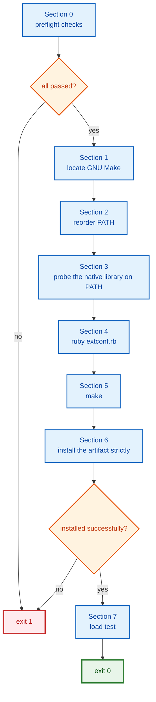

**The key expected output**:

```
========================================================================
6. Artifact
========================================================================
  [OK]   Built: lingofuse_ext.so (98304 bytes)
  [OK]   Installed: D:\...\lib\lingofuse_ext.so (98304 bytes)

========================================================================
7. Load test
========================================================================
         LOADED: true true true
  [OK]   lingofuse_ext loads and exposes the full expected surface.
```

### 6.3 Cleaning

```powershell
cd D:\CoreLibrary\LingoFuse\ruby
powershell -ExecutionPolicy Bypass -File clean.ps1
```

---

## 7. Adding LingoFuse to your own Ruby project

> **This chapter is self-contained: it is about bringing the LingoFuse Ruby binding into **your own** Ruby project as a dependency.**

### 7.1 The key fact: how the three kinds of file are loaded

Ruby has three kinds of "library", loaded in completely different ways:

| Kind | Example | Loader | Search path |
|------|------|--------|----------|
| **Ruby source file** | `*.rb` | `require` / `require_relative` | `$LOAD_PATH`, or relative to the current file |
| **Ruby C extension** | `lingofuse_ext.so` | `require_relative` (**this binding**) | relative to `native_bridge.rb`, fixed at `lib/` |
| **native system DLL** | `LingoFuse64.dll` | `LF_LoadLibrary` (inside the C extension) | **the system PATH only** |

**The core conclusions**:

> **The C extension is loaded by `native_bridge.rb` through `require_relative`, at a location fixed to `lib/`. You only have to copy the whole `ruby/` directory across and the `.so` is found automatically.**
>
> **The native DLL is loaded by `LF_LoadLibrary` inside the C extension and follows the operating system loader's rules. You must put the directory holding the 4 DLLs on PATH.**

### 7.2 Two independent search paths

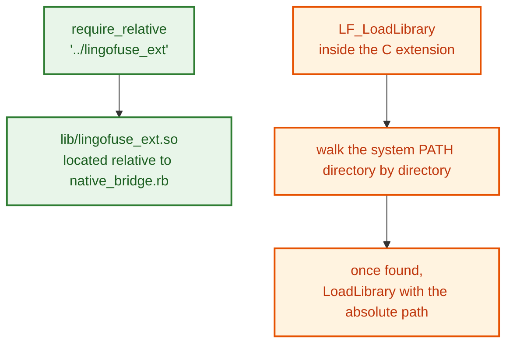

### 7.3 You only have to do two things

#### Step 1 — copy the whole `ruby/` directory into your project

There is no need to break up the relative structure of `lib/`, `lingofuse/` and `lingofuse_ext.so`. The whole `ruby/` directory is one self-contained unit.

#### Step 2 — put the native library directory on PATH

```powershell
# Windows PowerShell
$env:PATH = "D:\LingoFuse\Binary;" + $env:PATH
```

```bash
# Linux
export LD_LIBRARY_PATH="/opt/lingofuse/lib:$LD_LIBRARY_PATH"
```

```bash
# macOS
export DYLD_LIBRARY_PATH="/opt/lingofuse/lib:$DYLD_LIBRARY_PATH"
```

### 7.4 The three integration options

#### Option A — require by absolute path (quick verification)

```ruby
# C:\temp\my_app.rb
lingofuse_lib = 'D:/CoreLibrary/LingoFuse/ruby/lib'
$LOAD_PATH.unshift(lingofuse_lib) unless $LOAD_PATH.include?(lingofuse_lib)

require 'lingofuse'

puts LingoFuse.loaded?
puts LingoFuse.library_name
puts LingoFuse.platform
```

#### Option B — copy the whole `ruby/` directory into the project (recommended)

```
C:\temp\my_app\
├── my_app.rb
└── ruby\                          ← copy the whole ruby/ directory here
    ├── lib\
    │   ├── lingofuse.rb
    │   ├── lingofuse_ext.so       ← the C extension (already included)
    │   └── lingofuse\
    └── ...
```

**`my_app.rb`**:

```ruby
$LOAD_PATH.unshift(File.expand_path('ruby/lib', __dir__))
require 'lingofuse'

puts "loaded: #{LingoFuse.loaded?}"
puts "native bridge: #{LingoFuse::NativeBridge.available?}"
```

#### Option C — a Windows directory junction

```powershell
mkdir C:\temp\my_app\ruby -Force
cmd /c mklink /J C:\temp\my_app\ruby\lib D:\CoreLibrary\LingoFuse\ruby\lib
```

### 7.5 Comparing the three options

| Option | Command complexity | After a package update | Needs administrator | Suited to |
|:----:|:---------:|:--------:|:---------:|----------|
| A require by absolute path | none | effective immediately | no | quick verification, one-off scripts |
| B copy the whole ruby/ | one copy | must copy again | no | long-term projects, packaged distribution |
| C a Windows junction | two commands | effective immediately | no | Windows development and debugging |

### 7.6 A complete minimal example

**`app.rb`**:

```ruby
# frozen_string_literal: true

lib_dir = File.expand_path('ruby/lib', __dir__)
$LOAD_PATH.unshift(lib_dir) unless $LOAD_PATH.include?(lib_dir)

require 'lingofuse'

puts "LingoFuse loaded: #{LingoFuse.loaded?}"
puts "Version:          #{LingoFuse::VERSION}"
puts "Library name:     #{LingoFuse.library_name}"
puts "NativeBridge:     #{LingoFuse::NativeBridge.available?}"

# v2.0 three addressing schemes
t = LingoFuse.app('MyApp')
puts "Target:           #{t.describe}"

# v2.0 typed options
LingoFuse.set_opt_quiet(true)
puts "quiet:            #{LingoFuse.get_opt_quiet.inspect}"
LingoFuse.set_opt_quiet(false)

# v2.0 local round trip
app = LingoFuse::AppHandle.new('MyApp', 'Demo')
app.register_call('echo', 'Echo a string') do |input, output|
  text = LingoFuse::LfIo.read_string(input)
  LingoFuse::LfIo.write_string(output, text)
end

param = LingoFuse::DataHandle.new('echo')
LingoFuse::LfIo.write_string(param, 'hello')

result = app.local_call(param)
puts "Result:           #{LingoFuse::LfIo.read_string(result)}"

param.dispose
result.dispose
app.dispose
```

**Run it**:

```powershell
$env:PATH = "D:\LingoFuse\Binary;" + $env:PATH
cd C:\temp\my_app
ruby app.rb
```

### 7.7 The key points to watch

**Point 1 — the C extension (`.so`) has a fixed location**

`lingofuse_ext.so` must be at the same level as the `lingofuse/` directory (both under `lib/`).

**Point 2 — the native DLLs must be on PATH**

**Point 3 — the 4 DLLs must always stay together**

**Point 4 — the versions must match**

The Ruby version `lingofuse_ext.so` was compiled against must equal the runtime Ruby version.

---

## 8. Testing

### 8.1 An overview of the test system (18 files in v2.0)

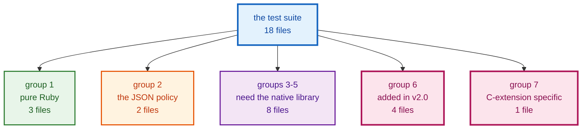

| Group | File | Needs the native library | Notes |
|:--:|------|:--------------:|------|
| 1 | `test_errors.rb` | no | |
| 1 | `test_callback_error_reporter.rb` | no | |
| 1 | `test_module_helpers.rb` | partly | some cases need the native library |
| 2 | `test_lf_io.rb` | partly | the JSON policy needs none; handle IO does |
| 2 | `test_lf_io_extra.rb` | partly | same as above |
| 3 | `test_data_handle.rb` | yes | |
| 3 | `test_data_handle_extra.rb` | yes | |
| 4 | `test_app_handle.rb` | yes | |
| 4 | `test_app_handle_extra.rb` | yes | |
| 5 | `test_status.rb` | yes | |
| 5 | `test_network_events.rb` | yes | |
| 5 | `test_framework.rb` | yes | |
| 5 | `test_network.rb` | yes | |
| **6** | **`test_options.rb`** | **yes** | **v2.0** |
| **6** | **`test_address.rb`** | **partly** | **v2.0: construction needs none, calls do** |
| **6** | **`test_async_support.rb`** | **yes** | **v2.0** |
| **6** | **`test_p2p_registration.rb`** | **yes** | **v2.0** |
| 7 | `test_native_bridge_self_test.rb` | C-extension specific | |

### 8.2 The three ways to run them

| Method | Command | Purpose |
|------|------|------|
| development (Windows) | `.\run_tests.ps1` | run all 18 files interactively |
| CI (Windows) | `.\run_test_ci.ps1` | same functionality as the development version, separate file |
| CI (Linux / macOS) | `bash run_test_ci.sh` | run in a POSIX environment |

### 8.3 The run flow

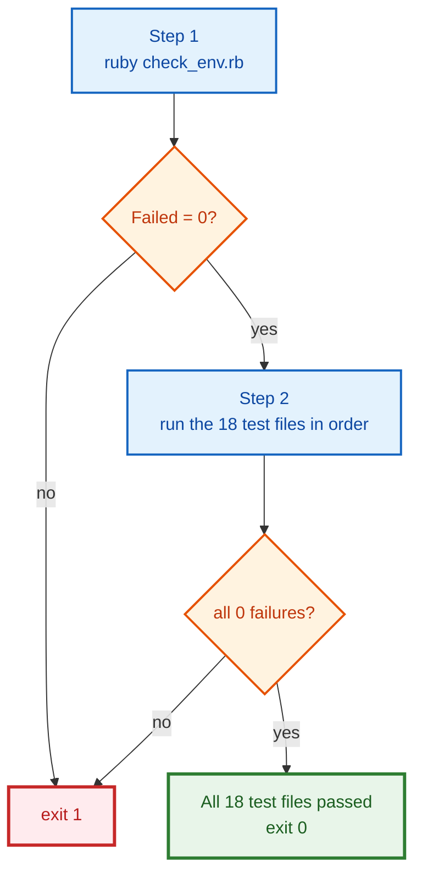

### 8.4 The expected output

```powershell
cd D:\CoreLibrary\LingoFuse\ruby
.\run_test_ci.ps1
```

**At the end**:

```
========================================================================
All 18 test files passed.
========================================================================
```

### 8.5 Log entries that look like errors but are expected

| Log | Source | Notes |
|------|------|------|
| `[LingoFuse::NativeBridge] callback raised: intentional ...` | self-test 11 / 14 | deliberately throws, to verify the C-side fallback logging |
| `[LingoFuse] Callback error in ...boom...` | test_app_handle | deliberately throws, to verify exception isolation |
| `no found api "does_not_exist"` | several files | deliberately calls a non-existent API |
| `prepare error: repeat listen/connection addr` | test_framework / test_network | deliberately repeats an address |
| `no connection` | test_address | deliberately calls an unreachable target |
| `LF_UID_Call: no connection` | test_address | deliberately calls an unreachable UID |
| `LF_P2PNAME_Call: no connection` | test_address | deliberately calls an unreachable P2PName |
| `hint: Data handle pool "N" handles automatically freed.` | every test with a DataHandle | 10-minute idle reclaim, normal behaviour |

---

## 9. API reference

### 9.1 Top-level module functions

```ruby
require 'lingofuse'
```

| Function | Description |
|------|------|
| `LingoFuse::VERSION` | the binding version string (`"2.0.0"`) |
| `LingoFuse.load_library` | idempotent, always returns `true` |
| `LingoFuse.loaded?` | whether the native library is loaded |
| `LingoFuse.library_name` | the platform-specific library file name |
| `LingoFuse.platform` | Hash: `{ ruby:, platform:, library:, version:, has_async_support:, has_address:, has_options:, has_p2p_reg: }` |
| `LingoFuse.cstr_ptr(str)` | convert to a `Fiddle::Pointer` (NUL-terminated UTF-8) |
| `LingoFuse.read_cstr(ptr)` | read a UTF-8 string from a pointer |

### 9.2 `LingoFuse::DataHandle`

An RAII wrapper around `TDataHnd`.

**Construction**:

```ruby
h = LingoFuse::DataHandle.new('api_name')             # auto-reclaim
h = LingoFuse::DataHandle.create_permanent('api_name') # permanent
h = LingoFuse::DataHandle.borrow(raw_pointer)          # borrow
LingoFuse::DataHandle.open('api_name') { |h| ... }     # block form
```

**Method categories**:

| Category | Methods |
|------|------|
| lifecycle | `dispose` / `close` / `valid?` / `owning?` / `raw` |
| position / size | `position` / `position=` / `size` / `size=` / `get_buffer_pointer` |
| byte IO | `write_bytes` / `read_bytes` / `read_bytes_exact` / `try_read_bytes` / `read_all_bytes` |
| scalar IO | `write_int8` … `write_double` / `read_int8` … `read_double` (all little-endian) |
| string IO | `write_string` / `read_string` / `read_string_bytes` / `try_read_string` |

### 9.3 `LingoFuse::AppHandle`

An RAII wrapper around `TAppHnd`.

**Construction**:

```ruby
app = LingoFuse::AppHandle.new('AppName', 'description')
```

**Methods**:

| Method | Description |
|------|------|
| `app.register_call(name, desc, &block)` | register a Call API |
| `app.register_notify(name, desc, &block)` | register a Notify API |
| `app.unregister(name)` | unregister, returns `true` / `false` |
| `app.local_call(param)` | local synchronous call, returns a new `DataHandle` |
| `app.local_notify(param)` | local asynchronous notification |
| `app.bind` | bind to idle clients, returns the count |
| `app.dispose` | release (**the first stage of two-phase destruction**) |
| `app.valid?` / `app.raw` / `app.name` | state accessors |

**Callback signature**:

```ruby
app.register_call('add', 'Add two ints') do |input, output|
  a = input.read_int32
  b = input.read_int32
  output.write_int32(a + b)
end

app.register_notify('log', 'One-way log') do |input|
  msg = input.read_string
  puts msg
end
```

**Callback contract**:

- callbacks run on the Ruby dispatcher thread
- `input` / `output` are **borrowed handles**; do not `dispose` them
- do not call `local_call` / `call` / `notify` inside a callback (deadlock)
- do not touch the UI inside a callback (hand off via `Thread::Queue`)

### 9.4 `LingoFuse::LfIo`

Unified JSON / string / byte IO.

| Function | Description |
|------|------|
| `LfIo.dumps_json(obj)` | serialize: compact, non-ASCII literals, `ensure_ascii: false` |
| `LfIo.loads_json(text)` | strict parse |
| `LfIo.write_string(handle, str)` | write UTF-8 + NUL |
| `LfIo.read_string(handle)` | read up to NUL |
| `LfIo.write_string_bytes(handle, bytes)` | write raw bytes + NUL |
| `LfIo.read_string_bytes(handle)` | read up to NUL (no decoding) |
| `LfIo.peek_string_bytes(handle)` | read up to NUL, **without moving the cursor** |
| `LfIo.read_all_bytes(handle)` | read all remaining bytes |
| `LfIo.write_json(handle, obj)` | serialize + write + NUL |
| `LfIo.read_json(handle)` | read + parse (raises `JSON::ParserError`) |
| `LfIo.try_read_json(handle)` | non-raising version (returns `nil`) |
| `LfIo.cstr(value)` | normalise to a string |

**Wire format**: `[UTF-8 encoded JSON text][NUL byte]`.

**Byte-level cross-language compatibility**: the byte sequence for `{"a":1}` on every binding is:

```
7B 22 61 22 3A 31 7D 00
```

### 9.5 `LingoFuse::Framework`

The process-level facade.

| Method | Description |
|------|------|
| `Framework.reset_prepare` | clear the preparation queue |
| `Framework.prepare_service(listen, physics)` | prepare a service endpoint |
| `Framework.prepare_client(physics, app)` | prepare a client connection |
| `Framework.prepare_done` | start the framework (**returns `true` only once**) |
| `Framework.exit_main_thread` | request that the main thread exit |
| `Framework.set_option(name, value)` | adjust a runtime option (string-based) |
| `Framework.generate_app_name` | generate a unique App name |
| `Framework.get_app_name(app)` | query the authoritative name of an App |
| `Framework.call(app, param, timeout_ms)` | synchronous remote call |
| `Framework.try_call(app, param, timeout_ms)` | returns `nil` on an empty response |
| `Framework.notify(app, param)` | one-way notification |
| `Framework.sequenced_notify(app, param)` | FIFO notification |
| `Framework.shutdown` | fully shut down (idempotent) |

### 9.6 `LingoFuse::Status`

| Method | Description |
|------|------|
| `Status.get_status_count` | number of messages pending in the queue |
| `Status.get_status` | pop the next one |
| `Status.drain_status(max)` | pop up to `max` |
| `Status.post_status(msg)` | push one |
| `Status.check_main_thread` | whether the main thread is running |
| `Status.check_app(name)` | whether an App is visible |
| `Status.check_api(app, api)` | whether an API is visible |

### 9.7 `LingoFuse::NetworkEvents`

A process-global connect / disconnect handler.

```ruby
LingoFuse::NetworkEvents.set(
  on_connect:    ->(addr) { puts "+ #{addr}" },
  on_disconnect: ->(addr) { puts "- #{addr}" }
)
LingoFuse::NetworkEvents.clear
LingoFuse::NetworkEvents.installed?
LingoFuse::NetworkEvents.set_listener(listener)
```

**Semantics**:

- **Connect** — fires when the client first receives a service API broadcast; **not** on TCP connect
- **Disconnect** — fires when the physical link is lost
- **Callback thread** — the Ruby dispatcher thread (no longer a native thread since v2.0)

### 9.8 `LingoFuse::Address` (new in v2.0)

The three-addressing abstraction. All `Target` objects share one call shape.

**Construction**:

```ruby
LingoFuse.app('MyApp')                  # => AppTarget
LingoFuse.uid(uid_bytes_or_hex)         # => UIDTarget
LingoFuse.p2pname('workers')            # => P2PNameTarget

# or via the fully qualified path
LingoFuse::Address.app('MyApp')
LingoFuse::Address.uid(uid)
LingoFuse::Address.p2pname('workers')

# or construct directly
LingoFuse::AppTarget.new('MyApp', default_timeout_ms: 3000)
LingoFuse::UIDTarget.new('00' * 32)
LingoFuse::P2PNameTarget.new('workers')
```

**The unified methods** (shared by the three subclasses):

| Method | Description |
|------|------|
| `target.call(api, payload = nil, timeout_ms: nil)` | synchronous request, returns the deserialized result; raises `TimeoutError` on timeout |
| `target.call_future(api, payload = nil, timeout_ms: nil)` | returns a `CallFuture`, does not block |
| `target.notify(api, payload = nil)` | one-way notification |
| `target.sequenced_notify(api, payload = nil)` | FIFO one-way notification |
| `target.describe` | a human-readable description |

**Addressing semantics**:

| Target | Routing key | Local first | Load balancing |
|--------|--------|:--------:|:--------:|
| `AppTarget` | App name (String) | ✅ | ❌ |
| `UIDTarget` | a 32-byte UID | ✅ | ❌ |
| `P2PNameTarget` | group name (String) | ❌ | ✅ (server side) |

**UID input format**: a 32-byte String or a 64-character hex String.

### 9.9 `LingoFuse::AsyncSupport` (new in v2.0)

The modern asynchronous subsystem.

**Types**:

| Type | Purpose |
|------|------|
| `CallFuture` | a thread-safe Future |
| `AsyncOp` | the state machine of a single async operation |
| `AsyncBridge` | the process singleton managing all outstanding operations |
| `AsyncSupport.run_async_with_future` | the factory method |

**`CallFuture` methods**:

| Method | Description |
|------|------|
| `future.value(timeout_ms: nil)` | block until the result, raise `TimeoutError` on timeout |
| `future.done?` | whether it has been resolved |
| `future.abandoned?` | whether it has been abandoned |
| `future.fulfill(v)` / `future.reject(e)` | internal use, idempotent |
| `future.mark_abandoned!` | internal use, idempotent |

**The state machine**:

```
PENDING ── callback fires ──> FIRED
   │
   ├── timeout fires ──> ABANDONED ── late callback ──> FIRED
   │
   └── dispatch fails ──> NOT_QUEUED
```

**Key design points**:

- the C request has **no timeout**; the timeout is decided by `CallFuture#value` on the Ruby side
- after a timeout the C callback still arrives, but the result is discarded (`AsyncOp` sees `ABANDONED` and skips the user callback entirely)
- a failed dispatch releases the ref immediately, with no leak
- introspection: `AsyncBridge.instance.stats` provides diagnostic counters

### 9.10 `LingoFuse::Options` (new in v2.0)

16 pairs of typed `set_opt_xxx` / `get_opt_xxx`.

| Option short name | Ruby type | Default | Description |
|----------|:---------:|--------|------|
| `password` | String | the built-in token | returns the mask `"********"` when read |
| `debug` | String | — | write-only; reading returns a placeholder |
| `quiet` | Boolean | false | suppress most logging |
| `show_thread_id` | Boolean | true | log lines carry the thread ID |
| `console_output` | Boolean | depends on the host | console output |
| `overlap_connection` | Boolean | false | allow multiple clients on the same address |
| `wait_connection_ready_ok` | Boolean | true | whether `prepare_done` waits for clients to be ready |
| `wait_connection_timeout` | Integer (ms) | 30000 | the wait timeout |
| `ipc_serv_thread_count` | Integer | platform-dependent | IPC server thread count |
| `ipc_serv_max_queue_length` | Integer | platform-dependent | IPC inbound queue length |
| `ipc_serv_max_msg_size` | Integer | platform-dependent | IPC per-message limit |
| `fixed_sequenced_time` | Integer (ms) | 20000 | the sequenced-notify stickiness window |
| `p2p_name` | String | `""` | this process's P2P group name |
| `data_handle_idle_timeout` | Integer (ms) | 600000 | the auto-reclaim idle threshold |
| `data_handle_pool_scan_interval` | Integer (ms) | 5000 | the pool scan interval |
| `no_reponse_cmd_null_flush_threshold` | Integer | 5000 | the no-response command NULL flush threshold |

**Watch the spelling**: `No_Reponse` (no second s) is a historical spelling on the Pascal side; Ruby's `set_opt_no_reponse_cmd_null_flush_threshold` must keep it.

**A diagnostic snapshot**:

```ruby
LingoFuse::Options.to_h   # returns a Hash with 16 keys
```

### 9.11 `LingoFuse::P2PRegistration` (new in v2.0)

Process-level P2P registration, parallel to `AppHandle` but independent of it.

| Method | Description |
|------|------|
| `P2PRegistration.register_call(name, desc, &block)` | register a process-level Call API |
| `P2PRegistration.register_notify(name, desc, &block)` | register a process-level Notify API |
| `P2PRegistration.unregister(name)` | unregister, returns `true` / `false` |
| `P2PRegistration.registered?(name)` | query |
| `P2PRegistration.registered_names` | returns every registered name (a snapshot Array) |

**Top-level aliases**: `LingoFuse.register_p2p_call` / `LingoFuse.register_p2p_notify` / `LingoFuse.unregister_p2p`.

**Compared with App-level registration**:

| Dimension | App level (`AppHandle`) | P2P level (this module) |
|------|----------------------|------------------|
| namespace | separate per App | process-level, independent of any App |
| reachability | App name + UID | UID + P2PName only |
| lifetime | unbound when the `AppHandle` is released | lives until the process exits (`LF_Shutdown`) |
| duplicate registration | raises `RegistrationError` | raises `RegistrationError` |

---

## 10. Usage examples

### 10.1 A pure local call

```ruby
require 'lingofuse'

app = LingoFuse::AppHandle.new('Calculator', 'Demo')

app.register_call('add', 'Add two ints') do |input, output|
  a = input.read_int32
  b = input.read_int32
  output.write_int32(a + b)
end

param = LingoFuse::DataHandle.new('add')
param.write_int32(5)
param.write_int32(7)

result = app.local_call(param)
puts result.read_int32   # 12

param.dispose
result.dispose
app.dispose
```

### 10.2 The three addressing schemes (v2.0)

```ruby
require 'lingofuse'

# --- App-name addressing (local first) ---
t_app = LingoFuse.app('Calculator')
result = t_app.call('add', { 'a' => 40, 'b' => 2 }, timeout_ms: 3000)
puts result['result']  # 42

# --- UID addressing (local first) ---
my_uid = "\x00" * 32    # in practice obtained by probing whoami
t_uid = LingoFuse.uid(my_uid)
t_uid.notify('log', { 'msg' => 'hello' })

# --- P2PName addressing (always over the network, load balanced on the server) ---
t_p2p = LingoFuse.p2pname('worker_group')
t_p2p.notify('log', { 'msg' => 'broadcast' })
```

### 10.3 Modern async (v2.0)

```ruby
require 'lingofuse'

# --- Future style ---
t = LingoFuse.app('CalcSvc')
future = t.call_future('add', { 'a' => 5, 'b' => 7 }, timeout_ms: 3000)

# do something else, then fetch the result
result = future.value(timeout_ms: 5000)
puts result['result']  # 12

# --- timeouts and the abandoned flag ---
future2 = t.call_future('slow_api', nil, timeout_ms: 50)
begin
  future2.value(timeout_ms: 200)
rescue LingoFuse::TimeoutError
  puts 'timed out'
  puts "abandoned? #{future2.abandoned?}"  # true
end
```

### 10.4 Typed options (v2.0)

```ruby
require 'lingofuse'

# --- boolean ---
LingoFuse.set_opt_quiet(true)
puts LingoFuse.get_opt_quiet.inspect   # true
LingoFuse.set_opt_quiet(false)

# --- integer ---
LingoFuse.set_opt_wait_connection_timeout(60000)
puts LingoFuse.get_opt_wait_connection_timeout  # 60000

# --- string ---
LingoFuse.set_opt_p2p_name('worker_group')
puts LingoFuse.get_opt_p2p_name.inspect  # "worker_group"
LingoFuse.set_opt_p2p_name('')

# --- a diagnostic snapshot ---
puts LingoFuse::Options.to_h[:quiet]
```

### 10.5 Process-level P2P registration (v2.0)

```ruby
require 'lingofuse'

# register a process-level utility API; any client can reach it via UID or P2PName
LingoFuse.register_p2p_call('whoami', 'echo caller identity') do |input, output|
  uid = input.get_p2p_uid     # 32 binary bytes
  name = input.get_p2p_name   # a UTF-8 string
  output.write_json({
    'uid_hex' => uid.unpack1('H*'),
    'p2p_name' => name
  })
end

# ... the service runs ...

# unregister
LingoFuse.unregister_p2p('whoami')
```

### 10.6 The server

```ruby
require 'lingofuse'

app = LingoFuse::AppHandle.new('Calculator', 'Server')

app.register_call('add', 'Add') do |input, output|
  req = LingoFuse::LfIo.read_json(input)
  result = (req['a'] || 0) + (req['b'] || 0)
  LingoFuse::LfIo.write_json(output, { 'result' => result })
end

LingoFuse.set_opt_wait_connection_ready_ok(false)
LingoFuse::Framework.reset_prepare
LingoFuse::Framework.prepare_service('ipc:calc', 'ipc:calc')
LingoFuse::Framework.prepare_client('ipc:calc', app)

if LingoFuse::Framework.prepare_done
  puts 'Server ready. Press Enter to exit...'
  $stdin.gets
end

LingoFuse::Framework.exit_main_thread
app.dispose
LingoFuse::Framework.shutdown
```

### 10.7 The client

```ruby
require 'lingofuse'

LingoFuse.set_opt_wait_connection_ready_ok(false)
LingoFuse::Framework.reset_prepare
LingoFuse::Framework.prepare_client('ipc:calc', nil)
LingoFuse::Framework.prepare_done

# wait for the App to become visible
30.times do
  break if LingoFuse::Status.check_app('Calculator')
  sleep 0.2
end

# --- using the v2.0 three-addressing API ---
t = LingoFuse.app('Calculator')
begin
  result = t.call('add', { 'a' => 40, 'b' => 2 }, timeout_ms: 3000)
  puts result['result']  # 42
rescue LingoFuse::TimeoutError => e
  warn "call timed out: #{e.message}"
end

LingoFuse::Framework.exit_main_thread
LingoFuse::Framework.shutdown
```

### 10.8 The cross demo

Three processes, verifying cross-process / cross-language operation:

```powershell
# terminal 1
ruby cross/cross_service.rb

# terminal 2
ruby cross/cross_node.rb

# terminal 3
ruby cross/cross_call.rb
```

| Process | Role | Notes |
|------|------|------|
| `cross_service.rb` | coordinator (beacon) | creates the `ipc:cross` endpoint, registers no APIs |
| `cross_node.rb` | worker node | registers the two Call APIs `demo.add` / `demo.inv_seri` |
| `cross_call.rb` | load client | 32 threads × 10 seconds, load-testing the `demo` app |

---

## 11. Troubleshooting quick reference

| Symptom | Cause | Fix |
|------|------|------|
| `ruby: command not found` | PATH not in effect | restart PowerShell |
| `cannot load such file -- lingofuse` | `lib/` not on `$LOAD_PATH` | §7.4 |
| `Failed to load the LingoFuse native library` | the native library is not on PATH | §4.4 |
| `The specified module could not be found` | a sibling DLL is missing or scattered | the 4 DLLs must share one directory |
| `[BUG] rb_thread_call_with_gvl()` | the C extension was not compiled or not loaded | run `setup_build_env.ps1` |
| `[LingoFuse::NativeBridge] lingofuse_ext not available` | the C extension is not in `lib/` | BUILD_AND_DEPLOY_en.md |
| `No GNU Make found` | DevKit not installed / PATH order | INSTALL_DEPENDENCIES_en.md §3.2 |
| `Fatal makefile ... No terminator` | Embarcadero Make was used | put msys64 first on PATH |
| `Cannot replace lib\lingofuse_ext.so` | the file is in use | `Get-Process ruby \| Stop-Process -Force` |
| `prepare error: repeat listen` | duplicate address | retry after `Framework.reset_prepare` |
| `prepare error: repeat connection` | duplicate address | set `overlap_connection = true` |
| `no connection` | the target App is not visible | wait for the broadcast, poll with `check_app` |
| `no found app/api` | the App/API name does not match | check spelling and case |
| `hint: Data handle pool ... automatically freed.` | 10-minute idle reclaim | normal behaviour |
| `callback raised: ...` (prefix `NativeBridge`) | the callback threw | fix the callback |
| `CallFuture#value timed out after Nms` | async timeout | raise `timeout_ms` or check the server |
| `P2P API '...' is already registered` | duplicate P2P name | check with `registered_names` |
| `UID must be exactly 32 bytes` | wrong UID length | use 32 bytes or 64 hex characters |
| `the debugger cannot start` | the `debug` gem is not installed | `gem install debug` |

### 11.1 The general troubleshooting order

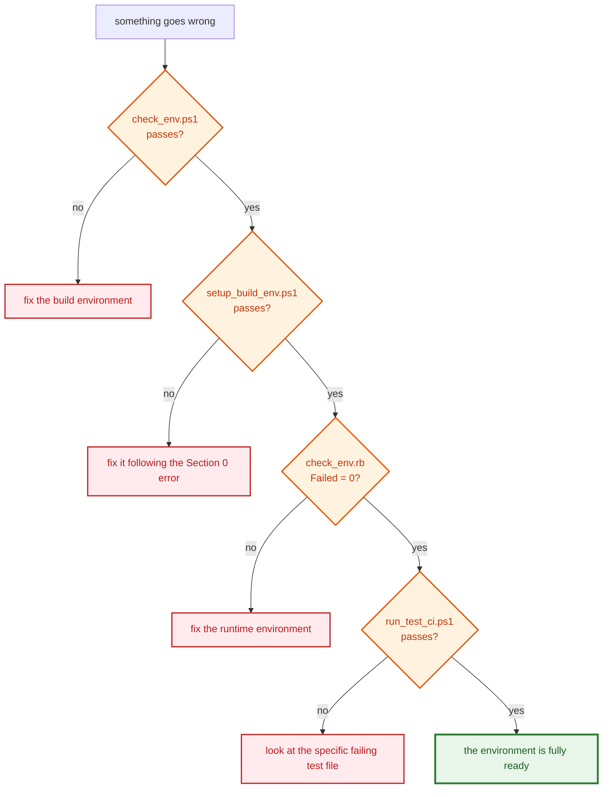

---

## 12. The v2.0 migration guide

### 12.1 Upgrading from v1.x to v2.0

**Step one: recompile the C extension**

```powershell
cd D:\CoreLibrary\LingoFuse\ruby
powershell -ExecutionPolicy Bypass -File clean.ps1
powershell -ExecutionPolicy Bypass -File setup_build_env.ps1
```

**Step two: update Gemfile / gemspec**

The version in `lingofuse.gemspec` is already `2.0.0`.

**Step three: review the existing code**

The overwhelming majority of v1.x code **works unchanged** on v2.0. These are the only two points to watch:

| Item | v1.x behaviour | v2.0 behaviour |
|----|-----------|-----------|
| `LingoFuse.platform.keys` | 3 | **8** (+ version + 4 has_xxx) |
| `LingoFuse::VERSION` | `"1.0.0"` | `"2.0.0"` |
| `LingoFuse.loaded?` | exists | exists (identical semantics) |

**Step four: optionally use the new v2.0 features**

- **three addressing schemes**: change `Framework.call('app', ...)` to `LingoFuse.app('app').call(...)`
- **async**: change `async_call` + callback to `call_future`
- **typed options**: change `Framework.set_option('Quiet', 'True')` to `LingoFuse.set_opt_quiet(true)`
- **P2P registration**: use `LingoFuse.register_p2p_call` instead of App-level registration (when cross-App reachability is needed)

### 12.2 The v1.x to v2.0 API mapping

| v1.x | v2.0 |
|------|------|
| `client.json_call('api', payload)` | `LingoFuse.app('MyApp').call('api', payload)` |
| `client.json_notify('api', payload)` | `LingoFuse.app('MyApp').notify('api', payload)` |
| `client.async_call('api', payload, on_result: ...)` | `LingoFuse.app('MyApp').call_future('api', payload)` |
| `Framework.set_option('Quiet', 'True')` | `LingoFuse.set_opt_quiet(true)` |
| `Framework.set_option('Wait_Connection_Timeout', '30000')` | `LingoFuse.set_opt_wait_connection_timeout(30000)` |
| `app.register_call('api', 'desc', &block)` | unchanged |
| `app.local_call(param)` | unchanged |
| `LingoFuse::DataHandle.new('api')` | unchanged |

### 12.3 Two-way compatibility

**Inside v2.0**: every v1.x API is retained (`Framework.call` / `Framework.notify` and so on) and may be mixed freely with the new v2.0 APIs.

**v1.x cannot run v2.0 code**: the new v2.0 APIs (`Address` / `AsyncSupport` / `Options` / `P2PRegistration`) do not exist on v1.x.

---

## Appendix A — interoperability with the other languages

The same JSON payload produces **the same byte sequence** on **every** LingoFuse binding:

| Language | File | Binding type |
|------|------|----------|
| Pascal | `lingofuse_import.pas` | native |
| C | `LingoFuse.h` / `LingoFuse.c` | native |
| C++ | `LingoFuse.hpp` / `lf_io.hpp` | native |
| C# | `LingoFuse.cs` / `LfIo.cs` | P/Invoke |
| Python | `lingofuse.lf_io` | ctypes |
| JavaScript | `index.js` / `lf-io.js` | Koffi |
| **Ruby** | **this binding** | **Fiddle + C extension** |
| Rust | `io.rs` | FFI |
| Go | `lingofuse.go` | purego |
| Dart | `lf_io.dart` | FFI |
| Java | `LingoFuse.java` | FFM API |
| Swift | `LfIo.swift` | C++ bridge |
| Zig | `lf_io.zig` | C ABI |
| Erlang | `lingofuse.erl` | NIF |

**Example**: the wire bytes of `{"a":1}` on every binding:

```
7B 22 61 22 3A 31 7D 00
```

Cross-language RPC **needs no transcoding layer at all**.

---

## Appendix B — the quick command card

```powershell
# ============ environment diagnostics ============
cd D:\CoreLibrary\LingoFuse\ruby

.\check_env.ps1                        # the build environment
ruby check_env.rb                      # the runtime environment (including v2.0 subsystem probes)

# ============ building the C extension ============
.\setup_build_env.ps1                  # one-key build + install + load test
.\clean.ps1                            # clean every build artifact
.\clean.ps1 -DryRun                    # preview the clean
.\clean.ps1 -KeepInstalled             # clean only ext/, keep lib/

# ============ testing ============
.\run_tests.ps1                        # development tests (18 files)
.\run_test_ci.ps1                      # CI tests (18 files)

# a single test
ruby test\test_errors.rb
ruby test\test_address.rb
ruby test\test_async_support.rb
ruby test\test_options.rb
ruby test\test_p2p_registration.rb

# ============ the cross demo (three terminals) ============
ruby cross\cross_service.rb
ruby cross\cross_node.rb
ruby cross\cross_call.rb
```

---

## Appendix C — the essential summary on dynamic library search

### C.1 The three rules

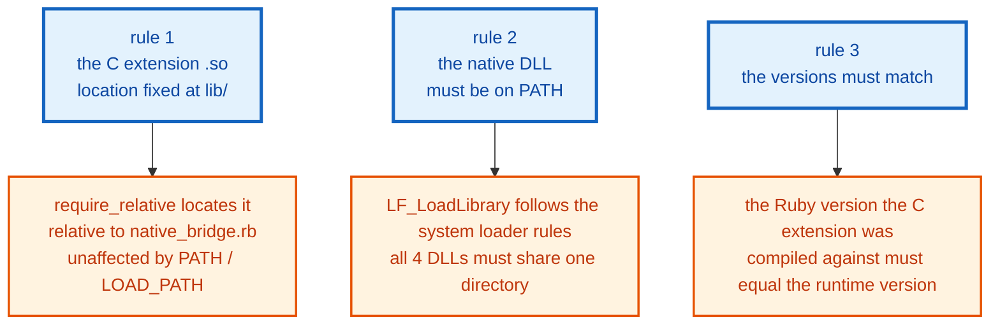

### C.2 The points to remember

**The C extension `lingofuse_ext.so`**:

- location: `lib/` (at the same level as `lingofuse/`)
- loader: `require_relative` in `native_bridge.rb`
- does it need configuring? **No.** As long as the whole `ruby/` directory structure is unchanged, it is found automatically.

**The native library `LingoFuse64.dll` + its 3 siblings**:

- location: any directory on PATH
- loader: `LF_LoadLibrary` inside the C extension
- does it need configuring? **Yes.** Put the directory holding them on PATH.
- all 4 DLLs must be in **the same directory**.

---

## Appendix D — licence

MIT.

---

*Document version 2.0 · matches the LingoFuse Ruby binding 2.0.0 · last updated 2026-10-14*

