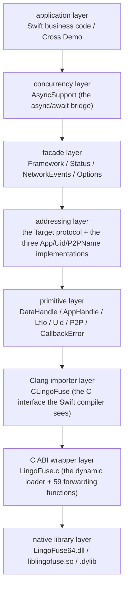

# The LingoFuse Swift interface

> Chinese version: [README.md](README.md)

> **The official Swift binding for LingoFuse, the cross-language communication foundation.**
>
> The Swift side fully implements C ABI import, RAII handle wrappers, unified JSON I/O, three-layer
> addressing, the process-level facade, modern `async/await` calls, network events, the status queue,
> typed options, plus 260+ XCTest cases and three cross-language demos that interoperate directly
> with C++ / Pascal / C# / Rust.
>
> Reading this README tells you:
> - how the Swift binding's technical stack is layered;
> - which compiler and environment versions are needed;
> - how to run the tests, what the tests cover, and what the results are;
> - how to run the cross-language demos and verify Swift's multi-language interop with other languages;
> - how to use each module's API.

---

## 1. The conclusion first

The LingoFuse Swift binding forms a **complete closed loop** and has a production-ready foundation.

| Dimension | Status | Notes |
|------|:----:|------|
| C ABI import | ✅ complete | the Clang importer automatically imports **59** C exported functions |
| RAII data handle | ✅ complete | `DataHandle`, supporting both auto-reclaim and permanent handles |
| RAII app handle | ✅ complete | `AppHandle`, supporting Call / Notify / LocalCall / Bind |
| Unified JSON I/O | ✅ complete | `LfIo` is the only serialization entry point, guaranteeing cross-language byte identity |
| **Three-layer addressing** | ✅ complete | `AppTarget` / `UidTarget` / `P2PNameTarget` |
| **UID value type** | ✅ complete | `Uid`, 32 bytes, value semantics, two-way Hex / Bytes conversion |
| **P2P side data** | ✅ complete | `DataHandle.p2pUid()` / `p2pName()` |
| **Process-level P2P registration** | ✅ complete | `P2P.registerCall` / `registerNotify` / `unregister` |
| **Modern async/await** | ✅ complete | `callAsync` / `sequencedCallAsync` / synchronous `sequencedCall` |
| **Typed runtime options** | ✅ complete | `Options` 16 setter/getter pairs + a string escape hatch |
| Process-level facade | ✅ complete | `Framework` provides network preparation, remote calls, options and shutdown |
| Network events | ✅ complete | `NetworkEvents` global connect / disconnect callbacks |
| Status queue and health checks | ✅ complete | the `Status` status queue + three liveness probes for App / UID / P2PName |
| Exception hierarchy | ✅ complete | `LingoFuseError` covers every failure mode |
| Callback error reporting | ✅ complete | `CallbackErrorReporter` handles callback exceptions uniformly |
| Test coverage | ✅ complete | **261 XCTest cases, all passing** |
| Cross-language interop | ✅ measured | C++ ↔ Swift is byte-identical in both directions; see chapter 5 |
| Cross-platform | ✅ measured (Windows)<br>⚠️ to be tested (macOS / Linux) | the C wrapper already has branches for all three platforms |
| Documentation | ✅ this file | with complete API usage notes |

**Overall judgement**: the Swift binding's functional coverage is on a par with the C++ / C# / Rust bindings, and its test density is the highest of all the bindings so far.

---

## 2. The Swift interface's technical stack

### 2.1 The seven-layer structure



| Layer | Files | Role |
|----|------|------|
| application | user code / `Cross*` | build business logic with the Swift API |
| concurrency | `AsyncSupport.swift` | bridge C callbacks to Swift `async/await` |
| facade | `Framework*.swift` / `Status*.swift` / `NetworkEvents.swift` / `Options.swift` | process-level configuration + convenience methods for the three addressing schemes |
| addressing | `Target.swift` | a unified abstraction over the three addressing modes |
| primitive | `DataHandle*.swift` / `AppHandle.swift` / `LfIo.swift` / `Uid.swift` / `P2P.swift` / `CallbackError.swift` / `Errors.swift` | the type-safe Swift interface |
| Clang importer | `Sources/CLingoFuse/*` | lets the Swift compiler see the C ABI |
| C ABI wrapper | `LingoFuse.c` + `LingoFuse.h` | cross-platform dynamic library loading, forwarding 59 functions |
| native library | `LingoFuse64.dll` etc. | the C4 RPC engine compiled by Pascal |

### 2.2 How the Swift targets are split

Swift Package Manager requires a strict separation between C targets and Swift targets:

```
swift/
├── Package.swift
├── Sources/
│   ├── CLingoFuse/              # C target: only .c / .h
│   │   ├── LingoFuse.c
│   │   └── include/
│   │       └── LingoFuse.h
│   ├── LingoFuse/               # Swift target: only .swift
│   │   ├── LingoFuse.swift          module entry point (re-exports CLingoFuse)
│   │   ├── Errors.swift             the exception hierarchy
│   │   ├── CallbackError.swift      the callback error reporter
│   │   ├── Uid.swift                the 32-byte UID value type
│   │   ├── DataHandle.swift         the RAII data handle
│   │   ├── DataHandle+P2PIdentity.swift  the side-data access extension
│   │   ├── AppHandle.swift          the RAII app handle + C callback trampolines
│   │   ├── LfIo.swift               unified JSON I/O
│   │   ├── Options.swift            16 pairs of typed runtime options
│   │   ├── P2P.swift                process-level P2P registration
│   │   ├── Target.swift             the three-layer addressing abstraction
│   │   ├── AsyncSupport.swift       the async/await bridge
│   │   ├── Framework.swift          the process-level facade
│   │   ├── Framework+GetOption.swift   the string escape hatch
│   │   ├── Framework+UidP2PName.swift  UID / P2PName convenience methods
│   │   ├── NetworkEvents.swift      network events
│   │   ├── Status.swift             the status queue
│   │   └── Status+UidP2PName.swift  UID / P2PName liveness probes
│   ├── CrossService/            # executable: the beacon
│   │   └── main.swift
│   ├── CrossNode/               # executable: the worker node
│   │   └── main.swift
│   └── CrossCall/               # executable: the load-test client
│       └── main.swift
└── Tests/
    └── LingoFuseTests/          # the test target (14 test suites)
        ├── CAbiTests.swift              66 cases
        ├── DataHandleTests.swift        20 cases
        ├── LfIoTests.swift              18 cases
        ├── UidTests.swift               17 cases
        ├── OptionsTests.swift           22 cases
        ├── P2PTests.swift               13 cases
        ├── TargetTests.swift            20 cases
        ├── AsyncSupportTests.swift      13 cases
        ├── P2PSideDataTests.swift       11 cases
        ├── AppHandleTests.swift         12 cases
        ├── FrameworkTests.swift         24 cases
        ├── NetworkEventsTests.swift      7 cases
        ├── StatusTests.swift            13 cases
        └── IntegrationTests.swift        5 cases
```

### 2.3 The callback bridging mechanism

A Swift C callback **must be a C ABI-compatible function pointer**. The LingoFuse Swift binding uses **`@convention(c)` closure constants** (not `@_cdecl` functions; see §3.6), together with `Unmanaged` to pass the context:

```
Swift closure ((DataHandle, DataHandle) -> Void)
    │
    ▼
the LfCallContext box (boxed)
    │  Unmanaged.passUnretained
    ▼
the trigger pointer (void*) → C4 network → a native worker thread
    │  Unmanaged.fromOpaque
    ▼
LfCallContext recovered → the user closure is invoked
```

This corresponds one for one with Pascal's `LF_EventPool` + `TMethod`, C++'s `trigger` pointer and C#'s `Delegate`.

**The modern async bridge** (`AsyncSupport.swift`):

```
async let result = try await target.callAsync(...)
    │
    ▼
withCheckedThrowingContinuation { cont in
    AsyncCallContext (heap allocated) --Unmanaged.passRetained--> void*
        │
        ▼  C ABI dispatch
    LF_Async_Call (executes on a C4 worker thread)
        │
        ▼  callback fires
    swiftAsyncCallTrampoline (a @convention(c) closure)
        │  1. takeRetainedValue recovers the AsyncCallContext
        │  2. copy the framework-owned result handle into a new DataHandle
        │  3. cont.resume(returning: newHandle)
        ▼
what the user sees is an ordinary Swift DataHandle
```

**Invisible from the user's point of view**: no need to touch `LF_AsyncCallOnResult`, `Unmanaged`, `CheckedContinuation` or trampolines.

---

## 3. Setting up the environment

### 3.1 Compiler and toolchain version requirements

| Component | Minimum | Recommended | Notes |
|------|:--------:|:--------:|------|
| **Swift toolchain** | 5.9 | **6.4** | 5.9 supports `@convention(c)`; 6.4 unifies the Windows / Linux / macOS build process |
| **Swift Package Manager** | bundled | bundled | no separate install |
| **Windows** | Windows 10 | Windows 11 | needs the VC++ runtime |
| **macOS** | macOS 12 | macOS 14 | Xcode 26.6 is the last version supporting Intel |
| **Linux** | a modern glibc | the latest distribution | the official Swift toolchain |
| **XCTest** | bundled | bundled | for testing |

**On choosing the Swift version**:
- **Swift 5.9** is the minimum usable version; `@convention(c)` is stable and it suits older systems.
- **Swift 6.4** unifies the Windows / Linux / macOS build process and is recommended.

**The macOS deployment target**:
- set to **macOS 12.0**, which supports both Apple Silicon and Intel Macs.
- Xcode 27 drops support for Intel hosts; Xcode 26.6 is the last compatible version.

### 3.2 Native library requirements

The Swift binding **does not include** the LingoFuse native shared library. The native library is produced by the Pascal build and must be obtained separately and placed where the Swift executable can find it.

| Platform | Core library | IPC dependency | Memory allocator |
|------|--------|----------|-----------|
| Windows 64 | `LingoFuse64.dll` | `z_ipc_64.dll` | `mimalloc64.dll` |
| Windows 32 | `LingoFuse32.dll` | `z_ipc_32.dll` | `mimalloc32.dll` |
| Linux | `liblingofuse.so` | `libz_ipc.so` | `libmimalloc.so` (optional) |
| macOS | `liblingofuse.dylib` | `libz_ipc.dylib` | `libmimalloc.dylib` (optional) |

**The search order** (implemented by `LF_LoadLibrary` in `LingoFuse.c`):

1. the directory containing the current executable
2. the system loader paths (`PATH` / `LD_LIBRARY_PATH` / `DYLD_LIBRARY_PATH`)

**A Windows deployment example**:

```powershell
# option 1: add to PATH (recommended; must be repeated in every new PowerShell window)
$env:PATH += ";D:\CoreLibrary\LingoFuse\Binary"

# option 2: copy into the executable directory
Copy-Item D:\CoreLibrary\LingoFuse\Binary\LingoFuse64.dll  D:\CoreLibrary\LingoFuse\swift\.build\debug\
Copy-Item D:\CoreLibrary\LingoFuse\Binary\z_ipc_64.dll    D:\CoreLibrary\LingoFuse\swift\.build\debug\
Copy-Item D:\CoreLibrary\LingoFuse\Binary\mimalloc64.dll  D:\CoreLibrary\LingoFuse\swift\.build\debug\

# option 3: add to the system PATH permanently
[Environment]::SetEnvironmentVariable(
    "PATH",
    $env:PATH + ";D:\CoreLibrary\LingoFuse\Binary",
    "User"
)
```

**On Windows you must also install** the VC++ 2015-2022 redistributable:
<https://aka.ms/vs/17/release/vc_redist.x64.exe>

### 3.3 Getting the source and building

```powershell
cd D:\CoreLibrary\LingoFuse\swift
swift build
```

The first build takes about 5-10 seconds. Build artifacts:

```
.build/debug/
├── CrossService.exe
├── CrossNode.exe
├── CrossCall.exe
└── LingoFusePackageTests.exe
```

### 3.4 Build modes

```powershell
# a Debug build (the default, for development)
swift build

# a Release build (for production / performance testing)
swift build -c release

# clean
swift package clean
```

### 3.5 A known VSCode configuration problem

In a mixed C/Swift target environment the VSCode SourceKit-LSP extension may report a pile of red errors (`No such module 'PackageDescription'`, `'LingoFuse.h' file not found`, and so on). These are **language-server environment configuration problems, not source problems** — as long as `swift build` succeeds, the source is correct.

The fix:

1. Install the official extension `swiftlang.swift-vscode` (uninstall the old one).
2. Open the settings, search for `swift.path`, and fill in the Swift toolchain's `bin` directory:
   ```
   C:\Users\<user name>\AppData\Local\Programs\Swift\Toolchains\6.4.0+Asserts\usr\bin
   ```
3. Restart VSCode.
4. If it still errors, create `.vscode/settings.json` at the project root:
   ```json
   {
       "swift.path": "C:/Users/<user name>/AppData/Local/Programs/Swift/Toolchains/6.4.0+Asserts/usr/bin"
   }
   ```

**Note**: in this repository's `Package.swift`, the `LingoFuse` target uses

```swift
.unsafeFlags(["-Xfrontend", "-validate-tbd-against-ir=none"])
```

to work around a known defect in the Swift-on-Windows frontend (a `@_cdecl` symbol exists in the IR but not in the TBD file, which makes cross-file references fail). See the inline comments in `Package.swift`.

### 3.6 `@_cdecl` vs `@convention(c)`

The LingoFuse Swift binding's callback trampolines use **`@convention(c)` closure constants**, not `@_cdecl` functions. The reason:

- **`@_cdecl` on Windows emits a copy of the C symbol into every .o file that references it**, and `lld-link` reports `duplicate symbol`.
- **A `@convention(c)` closure lives on the Swift ABI** and participates in intra-module references as an ordinary Swift variable, **emitting no C symbol**.
- When passed to the C ABI, Swift converts the closure value into a C function pointer automatically; the behaviour is fully equivalent.

Every callback trampoline in the source (`swiftCallTrampoline` / `swiftNotifyTrampoline` / `swiftAsyncCallTrampoline` / `swiftNetworkConnectTrampoline` / `swiftNetworkDisconnectTrampoline`) follows this convention.

---

## 4. Testing

### 4.1 The verification environment

The test results recorded in this document are based on the following environment:

| Item | Value |
|----|----|
| Operating system | Windows 11 |
| Architecture | x86_64 |
| Swift toolchain | 6.4.0 (swift-6.4.0-RELEASE) |
| Test framework | XCTest (bundled with the toolchain) |
| Native library | LingoFuse64.dll (v3.10) |
| Run date | 2026-10-14 |

### 4.2 Running the tests

```powershell
cd D:\CoreLibrary\LingoFuse\swift
swift test
```

The expected tail of the output:

```
Test Suite 'All tests' passed at ...
     Executed 261 tests, with 0 failures (0 unexpected) in XX.XXX (XX.XXX) seconds
```

Running a single test suite:

```powershell
swift test --filter CAbiTests
swift test --filter DataHandleTests
swift test --filter LfIoTests
swift test --filter UidTests
swift test --filter OptionsTests
swift test --filter P2PTests
swift test --filter TargetTests
swift test --filter AsyncSupportTests
swift test --filter P2PSideDataTests
swift test --filter AppHandleTests
swift test --filter FrameworkTests
swift test --filter NetworkEventsTests
swift test --filter StatusTests
swift test --filter IntegrationTests
```

Running a single test:

```powershell
swift test --filter "CAbiTests/test50_write_string_appends_nul"
```

### 4.3 An overview of the test coverage

**261 tests, 14 test suites, all passing.**

| Test suite | Tests | Coverage | Result |
|----------|:------:|----------|:----:|
| `CAbiTests` | 66 | the C ABI layer: library loading / data handles / atomic types / strings / AppHandle / **UID / P2PName / async / P2P registration / GetOption** | ✅ PASS |
| `DataHandleTests` | 20 | the RAII data handle: construction / lifecycle / byte IO / scalar IO / strings | ✅ PASS |
| `LfIoTests` | 18 | unified JSON I/O: encoding / decoding / string framing / byte framing / wire-format invariants | ✅ PASS |
| `UidTests` | 17 | UID value semantics: construction / Hex round trip / null / equality / formatting | ✅ PASS |
| `OptionsTests` | 22 | typed options: 16 setter/getter pairs / strict encoding / numeric tolerance / escape hatch | ✅ PASS |
| `P2PTests` | 13 | process-level P2P registration: registration / duplicate rejection / unregistration / idempotence / namespace independence | ✅ PASS |
| `TargetTests` | 20 | three-layer addressing: construction / description / default timeout / calls to absent targets / value semantics | ✅ PASS |
| `AsyncSupportTests` | 13 | modern async: deterministic timeout for `sequencedCall` / bounded waits for `callAsync` | ✅ PASS |
| `P2PSideDataTests` | 11 | side data access: self-created handles / permanent handles / disposed handles / borrowed handles | ✅ PASS |
| `AppHandleTests` | 12 | the RAII app handle: registration / unregistration / local calls / callback lifetime | ✅ PASS |
| `FrameworkTests` | 24 | the process-level facade: options / network preparation / liveness / **UID / P2PName addressing** | ✅ PASS |
| `NetworkEventsTests` | 7 | network events: install / clear / replacement semantics | ✅ PASS |
| `StatusTests` | 13 | the status queue / App liveness / **UID / P2PName liveness** | ✅ PASS |
| `IntegrationTests` | 5 | end-to-end IPC sessions: JSON calls / long strings / the ABI channel / Notify / **async round trips** | ✅ PASS |
| **Total** | **261** | | ✅ |

### 4.4 Item-by-item coverage detail

**`CAbiTests` (66 cases)** — verifying every exported function in the C ABI layer:

| Category | What is covered |
|------|--------|
| library loading | idempotence of `LF_LoadLibrary` / `LF_FreeLibrary` |
| data handle lifecycle | `LF_CreateData` / `LF_CreateData_Permanent` / `LF_FreeData` |
| position and size | `LF_GetPos` / `LF_SetPos` / `LF_GetSize` / `LF_SetSize` |
| buffers | `LF_GetBuffer` / `LF_GetBufferOffset` / `LF_WriteBuffer` / `LF_ReadBuffer` |
| atomic types | `LF_WriteInt8` … `LF_WriteDouble` and `LF_ReadInt8` … `LF_ReadDouble` |
| strings | `LF_WriteString` / `LF_ReadString`, including UTF-8 and tolerant reads |
| app handles | `LF_CreateApp` / `LF_FreeApp` / `LF_Get_AppName` |
| API registration | `LF_RegisterCall` / `LF_RegisterNotify` / `LF_Unregister` |
| local execution | `LF_LocalCall` / `LF_LocalNotify` |
| runtime options | `LF_SetOption` / **`LF_GetOption`** |
| status and health | `LF_GetStatusCount` / `LF_GetStatus` / `LF_PostStatus` / `LF_CheckMainThread` / `LF_CheckApp` / `LF_CheckApi` |
| network preparation (surface) | `LF_ResetPrepare` / `LF_PrepareService` |
| **side data access (new in v1.1)** | `LF_Get_P2P_UID` / `LF_Get_P2P_Name` |
| **P2P registration (new in v1.1)** | `LF_Register_P2P_Call` / `LF_Register_P2P_Notify` / `LF_Unregister_P2P` |
| **async calls (new in v1.1)** | `LF_Async_Call` / `LF_Async_Sequenced_Call` |
| **UID addressing (new in v1.1)** | `LF_UID_Call` / `LF_UID_Async_Call` / `LF_UID_Async_Sequenced_Call` / `LF_UID_Notify` / `LF_UID_Sequenced_Notify` |
| **P2PName addressing (new in v1.1)** | `LF_P2PNAME_Call` / `LF_P2PNAME_Async_Call` / `LF_P2PNAME_Async_Sequenced_Call` / `LF_P2PNAME_Notify` / `LF_P2PNAME_Sequenced_Notify` |
| **UID / P2PName liveness (new in v1.1)** | `LF_Check_UID` / `LF_Check_UID_Api` / `LF_Check_P2PNAME` / `LF_Check_P2PNAME_Api` |
| **UID helpers (new in v1.1)** | `LF_WriteUid` / `LF_ReadUid` |

**`DataHandleTests` (20 cases)** — verifying the RAII data handle:
- construction: auto-reclaim / permanent / borrowed
- lifecycle: `dispose` idempotence / use-after-dispose throws / dispose on a borrowed handle is a no-op
- position and size: the read/write cursor
- byte IO: round trips / exact reads / try reads / full reads
- scalar IO: round trips for 10 types / a short read throws
- strings: ASCII / UTF-8 / empty string / tolerant reads

**`LfIoTests` (18 cases)** — verifying JSON I/O and the wire format:
- encoding: compact / non-ASCII literals / Emoji literals / no slash escaping
- decoding: valid JSON / invalid throws / a type mismatch throws
- handle JSON IO: appending the NUL frame / round trips / Unicode round trips / empty payloads / the try variants
- byte IO: `writeStringBytes` / `readStringBytes` / `readAllBytes`
- **wire-format invariants**: the byte sequence for `{"a":1}` must be `7B 22 61 22 3A 31 7D 00`; the UTF-8 bytes of `{"msg":"世界"}` are verified byte by byte

**`UidTests` (17 cases)** — verifying the UID value type:
- construction: exactly 32 bytes / too short throws / too long throws
- Hex: lowercase round trips / uppercase round trips / the `0x` prefix / the `0X` prefix / wrong length / invalid characters
- value semantics: equality / hashing / copies preserve the value
- formatting: `description` is 64 lowercase characters / `debugDescription` is the short form / the special null form
- constants: `byteCount = 32` / `hexLength = 64`

**`OptionsTests` (22 cases)** — verifying typed options:
- Bool round trips × 5 (Quiet / ShowThreadID / ConsoleOutput / Overlap_Connection / Wait_Connection_ReadyOk)
- numeric round trips × 8 (Wait_Connection_Timeout / Fixed_Sequenced_Time / DataHandle_Idle_Timeout / DataHandle_Pool_Scan_Interval / IPC_Serv_ThreadCount / IPC_Serv_MaxQueueLength / IPC_Serv_MaxMsgSize / No_Reponse_Cmd_NULL_Flush_Threshold)
- string round trips × 2 (P2PName / the empty string)
- write-only options × 2 (Password / Debug)
- interoperability with `Framework.getOption` × 3
- numeric tolerance × 3 (trailing garbage / an invalid value returning 0 / signed values)
- strict Bool encoding × 2 (case-insensitive / only "True" accepted)

**`P2PTests` (13 cases)** — verifying process-level P2P registration:
- `registerCall` succeeds / a duplicate is rejected / unregister returns true / unregistering an unregistered name returns false / idempotence / re-registration
- `registerNotify` succeeds / a duplicate is rejected / unregister returns true
- multiple names coexisting / Call-Notify namespaces are independent
- `retainedContextCount` is monotonic (DEBUG)

**`TargetTests` (20 cases)** — verifying the three-layer addressing:
- construction / `description` / the default timeout / a custom timeout
- call / tryCall for AppTarget / UidTarget / P2PNameTarget against absent targets
- notify / sequencedNotify do not crash
- value semantics: equality / inequality
- protocol conformance: a generic function accepts all three target kinds

**`AsyncSupportTests` (13 cases)** — verifying modern async:
- protocol conformance × 1
- deterministic timeouts for `sequencedCall` × 4 (App / UID / P2PName / the default timeout)
- bounded waits for `callAsync` / `sequencedCallAsync` × 4
- bounded waits for `Framework.callAsync*` × 3
- AsyncTarget protocol conformance × 1

**`P2PSideDataTests` (11 cases)** — verifying side data access:
- on a self-created auto-reclaim handle, `p2pUid()` returns null / `p2pName()` returns ""
- the same on a self-created permanent handle
- on a disposed handle: no crash, no throw, returns null / ""
- on a borrowed handle: no crash, no throw, returns null / "", and does not release the underlying handle
- return-type assertions: `Uid` is copyable; `String` is owned

**`AppHandleTests` (12 cases)** — verifying the RAII app handle:
- construction / dispose idempotence / use-after-dispose
- registering a Call / a duplicate registration is rejected / unregistration / registering a Notify
- local Call round trips / a missing API returns an empty handle / local Notify
- callback context lifetime: fires after registration / stops firing after unregistration

**`FrameworkTests` (24 cases)** — verifying the process-level facade:
- `setOption` / `resetPrepare` / `getOption` / `getOption` is case-insensitive
- health checks: `checkMainThread` / `checkApp` / `checkApi`
- network preparation: `prepareService` / duplicate detection / `prepareClient`
- `shutdown` idempotence
- `generateAppName`
- App addressing: `call` / `tryCall` / `notify` / `sequencedNotify`
- **UID addressing (new in v1.1)**: `callByUid` / `tryCallByUid` / `notifyByUid` / `sequencedNotifyByUid`
- **P2PName addressing (new in v1.1)**: `callByP2PName` / `tryCallByP2PName` / `notifyByP2PName` / `sequencedNotifyByP2PName`

**`NetworkEventsTests` (7 cases)** — verifying network events:
- installing both / installing only connect / installing only disconnect
- clearing / idempotent clearing / clearing with all nils
- replacement semantics

**`StatusTests` (13 cases)** — verifying the status queue and liveness:
- the count is non-negative / extracting strings
- injecting still works while the main thread is not running
- extracting 0 entries / a negative count are both no-ops
- the default extraction returns at most 64 entries
- App / Api liveness
- **UID / P2PName liveness (new in v1.1)**: `checkUid` / `checkUidApi` / `checkP2PName` / `checkP2PNameApi`

**`IntegrationTests` (5 cases)** — end-to-end IPC sessions:
- a JSON call over a single address (Add 5 + 7 = 12)
- a 64 KiB long-string round trip
- the ABI channel (native binary, no JSON)
- Notify callback firing
- **an async round-trip smoke test (new in v1.1)**: `callAsync` does not hang under a bounded wait

### 4.5 The test results

```
Test Suite 'All tests' passed at 2026-10-14 XX:XX:XX.XXX
     Executed 261 tests, with 0 failures (0 unexpected) in XX.XXX seconds
```

**261 / 261 passing, 0 failures, 0 unexpected.**

The integration test logs show a real IPC session running all the way through, including the full C4 service-mesh handshake, P2P VM tunnel establishment, IPC queue creation, callback dispatch and a clean exit.

---

## 5. Cross-language interop (the cross demos)

### 5.1 What a cross demo is

LingoFuse's core idea is **"a function written in any language can be called directly by any other language"**. To verify this promise, **each language binding ships its own set of three programs called "Cross"**:

| Program | Role | Notes |
|------|------|------|
| `CrossService` | coordinator (beacon) | creates the IPC endpoint `ipc:cross`, registers no APIs |
| `CrossNode` | worker node | registers the `add` / `inv_seri` APIs of the `demo` app |
| `CrossCall` | load-test client | 32 threads × 10 seconds load-testing the `demo` app |

**Every language binding implements these three programs**:

| Language | CrossService | CrossNode | CrossCall | Location |
|------|:------------:|:---------:|:---------:|------|
| Pascal | ✅ | ✅ | ✅ | `pascal/cross_demo/` |
| C++ | ✅ | ✅ | ✅ | `cpp/CrossDemo/` |
| C# | ✅ | ✅ | ✅ | `csharp/CrossService/` `CrossNode/` `CrossCall/` |
| **Swift** | ✅ | ✅ | ✅ | **`swift/Sources/CrossService/` `CrossNode/` `CrossCall/`** |
| Rust / Go / JS etc. | ✅ | ✅ | ✅ | their own directories |

**The key point**: every language's cross demo **shares the same wire-format contract**:

```
add       (int32 a, int32 b)                       -> int32
inv_seri  (uint8, uint16, uint32, uint64,
           string(NUL), float)                     -> reversed types
```

The byte sequence written by a `CrossNode` in any language is exactly the same, and the byte sequence read by a `CrossCall` in any language is exactly the same. That is the **foundation** of LingoFuse's multi-language interop.

### 5.2 Running the Swift cross demo (self-connected)

Three terminals:

```
terminal 1:  cd D:\CoreLibrary\LingoFuse\swift
             swift run CrossService

terminal 2:  cd D:\CoreLibrary\LingoFuse\swift
             swift run CrossNode                 # after terminal 1 prints running

terminal 3:  cd D:\CoreLibrary\LingoFuse\swift
             swift run CrossCall                 # after terminal 2 prints Online
```

`CrossCall` should print a throughput report:

```
[Call] Load test summary
         duration          : 10.000 s
         total calls       : NNNNN
         success           : NNNNN (100.00 %)
         failed            : 0
         add calls         : NNNNN
         inv_seri calls    : NNNNN
         throughput        : XXXX.XX calls/s
         success throughput: XXXX.XX calls/s
```

### 5.3 Running the cross-language demo (the core verification)

**Direction 1: a C++ service + a Swift caller**

```
terminal 1:  D:\CoreLibrary\LingoFuse\Binary\CrossService.exe
terminal 2:  D:\CoreLibrary\LingoFuse\Binary\CrossNode.exe
terminal 3:  cd D:\CoreLibrary\LingoFuse\swift
             swift run CrossCall
```

**Swift `CrossCall` calling the C++ `CrossNode`.**

**Direction 2: a Swift service + a C++ caller**

```
terminal 1:  cd D:\CoreLibrary\LingoFuse\swift
             swift run CrossService
terminal 2:  cd D:\CoreLibrary\LingoFuse\swift
             swift run CrossNode
terminal 3:  D:\CoreLibrary\LingoFuse\Binary\CrossCall.exe
```

**C++ `CrossCall` calling the Swift `CrossNode`.**

**Direction 3: mixing all the languages**

```
terminal 1:  C++ CrossService
terminal 2:  Swift CrossNode
terminal 3:  Pascal CrossNode
terminal 4:  C# CrossNode
terminal 5:  Swift CrossCall     ← traffic is automatically load-balanced across the three nodes
```

C4 mesh load balancing is based on the App name and is language-agnostic. Three nodes in different languages register the same `demo` app, and `CrossCall`'s traffic is distributed evenly.

### 5.4 The verified interop results

| Test direction | Result | Notes |
|----------|:----:|------|
| Swift CrossService + Swift CrossNode + Swift CrossCall | ✅ pass | fully self-connected |
| **C++ CrossService/Node + Swift CrossCall** | ✅ **pass** | **the Swift caller reads the C++ bytes correctly** |
| **Swift CrossService/Node + C++ CrossCall** | ✅ **pass** | **the C++ caller reads the Swift bytes correctly** |

**Two-way verification passing means**:

- the 4 bytes written by Swift `DataHandle.writeInt32` = the 4 bytes written by C++ `param.write<int32_t>()`
- the UTF-8 + NUL written by Swift `DataHandle.writeString` = the bytes written by C++ `write_string`
- the IEEE 754 little-endian value written by Swift `DataHandle.writeSingle` = the bytes written by C++ `write<float>()`
- every byte written by C++ is read correctly by Swift

**This is the verification of the Swift binding's single most important promise**: no transcoding layer, no adapter layer, no serialization layer across languages — direct byte-level interop.

---

## 6. API usage

### 6.1 Importing

```swift
import LingoFuse
```

All public types live under the `LingoFuse` namespace.

### 6.2 Loading the native library

The Swift binding **requires an explicit call to `LF_LoadLibrary()`** (consistent with the C++ binding, and unlike the C# binding's automatic loading). It must be the first `LF_*` call after program start:

```swift
if LF_LoadLibrary() != 1 {
    fatalError("the LingoFuse native library was not found; check PATH or the executable's own directory")
}
```

### 6.3 `DataHandle` — the data handle

The data handle is LingoFuse's binary payload container. Two kinds:

```swift
// an auto-reclaim handle (recommended; reclaimed by the pool after 10 minutes idle)
let dh = try DataHandle(apiName: "my_api")

// a permanent handle (not auto-reclaimed; must be disposed manually)
let perm = try DataHandle.createPermanent(apiName: "template")
```

Basic IO:

```swift
// write integers (little-endian)
try dh.writeInt32(42)
try dh.writeUInt64(0xFFFFFFFF)
try dh.writeDouble(3.14)

// write a string (UTF-8 + NUL)
try dh.writeString("Hello 世界 🌍")

// write raw bytes
try dh.writeBytes([0x01, 0x02, 0x03])

// read
dh.position = 0
let a = try dh.readInt32()
let s = try dh.readString()
let bytes = try dh.readBytes(3)
```

Lifecycle:

```swift
dh.dispose()       // manual release
// or rely on deinit to release automatically
```

**Side data access** (reading **the sender's identity**; valid only on a callback's INPUT handle):

```swift
_ = try app.registerCall("whoami", "Echo sender identity") { input, output in
    // input is the INPUT handle of the triggering event
    let uid = input.p2pUid()       // a Uid value (32 bytes)
    let name = input.p2pName()     // a String (possibly empty)

    struct Reply: Codable {
        let uid_hex: String
        let p2p_name: String
    }
    try? LfIo.writeJson(output, Reply(uid_hex: uid.toHex(), p2p_name: name))
}
```

**Traps**:
- `dispose` on an auto-reclaim handle only marks it deleted; the actual release happens on the next pool scan (≤ 5 seconds)
- `dispose` on a permanent handle releases synchronously
- for handles created before `Framework.prepareDone` or after `Framework.exitMainThread`, `dispose` is a no-op
- `p2pUid()` / `p2pName()` **are valid only on INPUT handles**; on self-created handles / output handles / disposed handles they return `Uid.null` / `""` and never throw

### 6.4 `AppHandle` — the app handle

An app is the logical container of APIs, and the App name is the network routing key:

```swift
let app = try AppHandle(name: "Calculator", description: "Simple calculator")

// register a Call API (request-response)
_ = try app.registerCall("add", "Add two integers") { input, output in
    guard let a = try? input.readInt32(),
          let b = try? input.readInt32() else { return }
    try? output.writeInt32(a + b)
}

// register a Notify API (one-way)
_ = try app.registerNotify("log", "Log a message") { input in
    if let msg = try? input.readString() {
        print("[remote log] \(msg)")
    }
}

// a local call (bypassing the network)
let param = try DataHandle(apiName: "add")
try param.writeInt32(5)
try param.writeInt32(7)
param.position = 0
let result = try app.localCall(param)
print("5 + 7 =", try result.readInt32())

// unregister
_ = try app.unregister("add")

// release
app.dispose()
```

**Callback constraints** (critical):

- callbacks run on a **native worker thread**, not on the calling thread and not on the main thread
- **do not block**: no `sleep`, no waiting on events and no large file IO inside a callback
- **do not call blocking LF functions**: do not call `Framework.call` / `Framework.prepareDone` / `Framework.shutdown` / `app.localCall` / `app.localNotify` inside a callback (it deadlocks)
- **do not touch the UI**: when the UI must be updated use `DispatchQueue.main.async` or `@MainActor`
- **do not throw**: the user closure signature is `(DataHandle, DataHandle) -> Void`; if errors need handling, use `do-catch` inside the closure

**Callback exception handling**:

```swift
CallbackErrorReporter.setHandler { source, error in
    logger.error("[LingoFuse] \(source): \(error)")
}
```

With no handler installed, exceptions are written to stderr.

### 6.5 `LfIo` — unified JSON I/O

`LfIo` is the only serialization entry point for JSON / strings / bytes. The cross-language contract requires every binding to process payloads through it:

```swift
struct AddArgs: Codable { let a: Int; let b: Int }
struct AddResult: Codable { let result: Int }

// write JSON (compact, literal UTF-8, no \uXXXX escapes)
let param = try DataHandle(apiName: "add")
try LfIo.writeJson(param, AddArgs(a: 5, b: 7))
param.position = 0

// read JSON
let args: AddArgs = try LfIo.readJson(param)

// the try variant (does not throw)
let maybe: AddArgs? = LfIo.tryReadJson(param)
```

**The serialization policy** (identical across all language bindings):

- compact output: no indentation, no trailing newline
- non-ASCII literals: `你好` is emitted as the UTF-8 bytes `E4 BD A0 E5 A5 BD`, not as `\u4f60\u597d`
- Emoji literals: `🌍` is emitted as the UTF-8 bytes `F0 9F 8C 8D`
- no slash escaping: `a/b` is emitted as `a/b`, not `a\/b`
- NUL framing: one `0x00` appended after the JSON

**Do not bypass `LfIo` and manipulate `DataHandle` directly**. Calling `writeBytes` / `readBytes` directly breaks the cross-language byte contract.

### 6.6 `Options` — typed runtime options

16 pairs of typed setters/getters covering all the common runtime options:

```swift
// connection readiness
Options.setWaitConnectionReadyOk(false)       // do not wait for all clients
Options.setWaitConnectionTimeout(10_000)      // 10 seconds
Options.setOverlapConnection(true)            // allow multiple clients on the same address

// logging
Options.setQuiet(true)                        // quiet mode
Options.setShowThreadID(true)                 // log lines carry the thread ID
Options.setConsoleOutput(true)                // console output

// P2P
Options.setP2PName("swift_worker_group")      // this process's P2P group name

// the data handle pool
Options.setDataHandleIdleTimeout(600_000)     // reclaim after 10 minutes idle
Options.setDataHandlePoolScanInterval(5_000)  // scan every 5 seconds

// reading
let quiet = Options.getQuiet()                // Bool
let timeout = Options.getWaitConnectionTimeout()  // UInt64
let group = Options.getP2PName()              // String
```

**The string escape hatch** (for dynamic option names / untyped aliases):

```swift
Framework.setOption("Quiet", "True")
let value = Framework.getOption("Quiet")      // -> "True"
```

**Internal conventions** (consistent with C++ / C# / Python / Rust):

- **Bool setters** strictly write `"True"` / `"False"`
- **Bool getters** treat only a case-insensitive `"True"` as `true`
- **numeric setters** write a decimal string
- **numeric getters** extract the leading digits and tolerate trailing garbage; a parse failure returns `0`
- **unset / unknown keys** return `""` / `false` / `0` from the getter

**Traps**:
- options **do not persist across `Framework.shutdown`**; they must be set again on every restart
- options **take effect immediately**, but concurrent readers may see the old value, the new value, or a torn read

### 6.7 `P2P` — process-level P2P registration

The process-level P2P namespace is **independent of any app**. Registered APIs are reachable only via **UID addressing** or **P2PName addressing**, **not** via App-name addressing:

```swift
// register a process-level P2P Call API
try P2P.registerCall("whoami", description: "Echo caller identity") { input, output in
    let uid = input.p2pUid()
    let name = input.p2pName()
    struct Reply: Codable {
        let uid_hex: String
        let p2p_name: String
    }
    try? LfIo.writeJson(output, Reply(uid_hex: uid.toHex(), p2p_name: name))
}

// register a process-level P2P Notify API
try P2P.registerNotify("log", description: "Log a message") { input in
    if let msg: String = LfIo.tryReadJson(input) {
        print("[P2P log] \(msg)")
    }
}

// unregister
_ = P2P.unregister("whoami")
```

**Compared with `AppHandle.registerCall`**:

| Dimension | `AppHandle.registerCall` | `P2P.registerCall` |
|------|--------------------------|---------------------|
| namespace | the app's own | process-level P2P |
| reachable via | App name / UID / P2PName | **UID / P2PName** |
| bound to an app | yes (AppHandle) | no (process-level) |
| underlying C ABI | `LF_RegisterCall` | `LF_Register_P2P_Call` |
| unregistration | `AppHandle.unregister` | `P2P.unregister` |
| lifetime | until the AppHandle is released | **until the process exits** |

**Typical uses**: global utility APIs such as health probes, capability discovery and identity echo ("whoami").

### 6.8 `Target` — three-layer addressing

The `Target` abstraction unifies the three addressing schemes into one set of call semantics. Every `Target` automatically gets `call` / `tryCall` / `notify` / `sequencedNotify` / `callAsync` / `sequencedCallAsync` / `sequencedCall`:

```swift
// App addressing (local-first)
let appT = AppTarget("Calculator")
let response = try appT.call("add", param, timeoutMs: 3000)

// UID addressing (local-first)
let uidT = UidTarget(uid)
try uidT.notify("log", param)

// P2PName addressing (always over the network)
let p2pT = P2PNameTarget("worker_group")
let r2 = try p2pT.call("process", param, timeoutMs: 5000)
```

**How the three differ**:

| Addressing | Routing key | Local first | Load balancing |
|------|--------|:--------:|:--------:|
| `AppTarget` | App name (String) | ✅ | N/A |
| `UidTarget` | UID (32 bytes) | ✅ | N/A |
| `P2PNameTarget` | group name (String) | ❌ | ✅ (server side) |

**Value semantics**: all three targets are `struct` + `Hashable`, so they can be copied and used as Set / Dictionary keys.

**`description`**: used in error messages and logs.

```swift
AppTarget("X").description          // "app(X)"
UidTarget(.null).description        // "uid(00000000..00000000)"
P2PNameTarget("G").description      // "p2p(G)"
```

### 6.9 Modern async calls (async/await)

**The Swift user writes ordinary `async`/`await`** and never touches any C ABI concept.

**Top-level convenience methods**:

```swift
Task {
    // App addressing
    let response = try await Framework.callAsync("Calculator", param)

    // UID addressing
    let r2 = try await Framework.callAsyncByUid(uid, param)

    // P2PName addressing
    let r3 = try await Framework.callAsyncByP2PName("worker_group", param)

    response.dispose()
    r2.dispose()
    r3.dispose()
}
```

**The async methods on `Target`**:

```swift
Task {
    let target = AppTarget("Calculator")

    // an async call
    let response = try await target.callAsync("add", param)

    // an async sequenced call (FIFO preserved within the same target + api)
    let response2 = try await target.sequencedCallAsync("add", param)

    response.dispose()
    response2.dispose()
}
```

**The synchronous, blocking sequenced call** (only for situations already running on a dedicated thread):

```swift
// ⚠️ do not call this on Swift concurrency's shared executor; it blocks the thread
let target = AppTarget("Calculator")
let response = try target.sequencedCall("add", param, timeoutMs: 3000)
```

**The timeout policy** (**important**):

- `callAsync` / `sequencedCallAsync` / `Framework.callAsync*` **take no timeout parameter**. This is a **deliberate alignment** with the C++ / Rust bindings: the C ABI async family has no timeouts, and the C side guarantees that every dispatched request eventually fires its callback (carrying a result or an empty payload).
- `sequencedCall` (the synchronous blocking version) **must take a timeout**: it blocks the thread, and without a timeout the thread hangs forever.

Need a hard timeout on an async call? Wrap it at your own layer:

```swift
let deadline = Date().addingTimeInterval(5.0)
let result: DataHandle? = await withTaskGroup(of: DataHandle?.self) { group in
    group.addTask {
        try? await target.callAsync("add", param)
    }
    group.addTask {
        try? await Task.sleep(nanoseconds: 5_000_000_000)
        return nil
    }
    let first = await group.next() ?? nil
    group.cancelAll()
    return first
}
```

**How to keep things seamless in practice**:

```swift
func loadDashboard() async throws -> Dashboard {
    // an ordinary async call
    let user = try await fetchCurrentUser()

    // a LingoFuse async call — mixed seamlessly with ordinary async
    let authParam = try DataHandle(apiName: "verify")
    try LfIo.writeJson(authParam, user)
    let authResp = try await Framework.callAsync("AuthSvc", authParam)
    defer { authResp.dispose() }

    // another ordinary async call
    let summary = try await summarize(authResp)

    await MainActor.run {
        self.viewState = .loaded(summary)
    }
    return summary
}
```

### 6.10 `Framework` — the process-level facade

Network preparation:

```swift
// clear the previous preparation queue
Framework.resetPrepare()

// set options
Framework.setOption("Overlap_Connection", "True")
Framework.setOption("Wait_Connection_Timeout", "10000")

// prepare a service endpoint
_ = try Framework.prepareService(
    listeningAddr: "ipc:my_service",
    physicsAddr: "ipc:my_service"
)

// prepare a client (optionally bound to an app)
let app = try AppHandle(name: "MyApp")
_ = try Framework.prepareClient(
    physicsAddr: "ipc:my_service",
    app: app
)

// start (returns true only once per process)
let started = Framework.prepareDone()
if !started && !Status.checkMainThread() {
    fatalError("startup failed")
}
```

**The `prepareDone` contract**:
- it **returns `true` only once per process**
- a second call (with no `shutdown` in between) returns `false`, which is **not a failure**
- to restart the framework: `shutdown()` → `resetPrepare()` → `prepareDone()`

Remote calls:

```swift
// App addressing
let response = try Framework.call("Calculator", param, timeoutMs: 3000)
if response.size > 0 {
    let result: AddResult = try LfIo.readJson(response)
}
response.dispose()

// tryCall: returns nil on timeout
if let response = try Framework.tryCall("Calculator", param, timeoutMs: 3000) {
    let result: AddResult = try LfIo.readJson(response)
    response.dispose()
}

// UID addressing
let r2 = try Framework.callByUid(uid, param, timeoutMs: 3000)

// P2PName addressing
let r3 = try Framework.callByP2PName("worker_group", param, timeoutMs: 3000)

// one-way notifications
Framework.notify("Logger", param)
Framework.sequencedNotify("Logger", param)

// notify by UID / P2PName
Framework.notifyByUid(uid, param)
Framework.notifyByP2PName("worker_group", param)
```

Health checks:

```swift
Framework.checkMainThread()          // is the main thread running
Framework.checkApp("Calculator")     // is the App visible (~3 s broadcast delay)
Framework.checkApi("Calculator", "add")  // is the API visible
```

Shutdown:

```swift
// the cleanup order (LF-CLEAN-001)
NetworkEvents.clearNetworkEvent()
Framework.exitMainThread()
app.dispose()
Framework.shutdown()
LF_FreeLibrary()
```

### 6.11 `NetworkEvents` — network events

Process-level connect / disconnect callbacks:

```swift
NetworkEvents.setNetworkEvent(
    onConnect: { addr in
        print("[+] Connected: \(addr)")
    },
    onDisconnect: { addr in
        print("[-] Disconnected: \(addr)")
    }
)

// clear
NetworkEvents.clearNetworkEvent()

// check the state
if NetworkEvents.isNetworkEventInstalled {
    // ...
}
```

**Semantics**:
- **Connect**: fires when the server's API broadcast is first received, **not** on TCP connect
- **Disconnect**: fires when the physical link drops
- **callbacks run on a native worker thread** — do not touch the UI
- **`setNetworkEvent` is replace semantics**, not patch semantics

### 6.12 `Status` — the status queue and health checks

```swift
// the status queue (capped at 1000 entries)
let count = Status.getStatusCount()
let msg = Status.getStatus()             // extract one
let batch = Status.drainStatus(maxMessages: 64)  // batch extraction

// inject
Status.postStatus("my custom message")

// health checks (App addressing)
Status.checkMainThread()
Status.checkApp("Calculator")
Status.checkApi("Calculator", "add")

// health checks (UID / P2PName addressing)
Status.checkUid(uid)
Status.checkUidApi(uid, "whoami")
Status.checkP2PName("worker_group")
Status.checkP2PNameApi("worker_group", "process")
```

**Note**: the status queue is processed by the native simulated main thread. Before `Framework.prepareDone` the queue may be empty or hold stale data. But **injection (`postStatus`) is not subject to this**: messages are enqueued even while the main thread is not running.

### 6.13 `LingoFuseError` — the exception hierarchy

Every LingoFuse exception is a `LingoFuseError`:

```swift
do {
    let dh = try DataHandle(apiName: "my_api")
    try dh.writeString("hello")
} catch LingoFuseError.objectDisposed(let name) {
    print("\(name) has been disposed")
} catch LingoFuseError.readFailed(let op, let expected, let actual) {
    print("\(op) read failed: expected \(expected) bytes, got \(actual)")
} catch {
    print("LingoFuse error: \(error)")
}
```

The exception types:

| Type | Triggered when |
|------|----------|
| `.generic(message:)` | an unclassified error |
| `.libraryLoadFailed(libraryName:underlying:)` | native library loading failed |
| `.nullHandle(operation:)` | the handle is null or already disposed |
| `.invalidArgument(operation:detail:)` | argument validation failed |
| `.writeFailed(operation:expected:actual:)` | fewer bytes were written than expected |
| `.readFailed(operation:expected:actual:)` | fewer bytes were read than expected |
| `.callFailed(operation:targetApp:targetApi:)` | a remote call failed |
| `.registrationFailed(operation:apiName:)` | registration was rejected (usually a duplicate name) |
| `.notConnected(operation:)` | the framework is not running |
| `.timeout(targetApp:)` | a remote call timed out |
| `.objectDisposed(objectName:)` | a disposed object was used |

### 6.14 Complete minimal examples

**The server**:

```swift
import Foundation
import LingoFuse

// 1. load the native library
if LF_LoadLibrary() != 1 {
    fatalError("the native library was not found")
}

// 2. create the app and register APIs
let app = try AppHandle(name: "Calculator", description: "Demo")
_ = try app.registerCall("add", "Add two integers") { input, output in
    struct Args: Codable { let a: Int; let b: Int }
    struct Result: Codable { let result: Int }

    guard let args: Args = LfIo.tryReadJson(input) else { return }
    let result = Result(result: args.a + args.b)
    try? LfIo.writeJson(output, result)
}

// 3. start the framework
Options.setOverlapConnection(true)
Framework.resetPrepare()
_ = try Framework.prepareService(
    listeningAddr: "ipc:calc",
    physicsAddr: "ipc:calc"
)
_ = try Framework.prepareClient(physicsAddr: "ipc:calc", app: app)
if !Framework.prepareDone() && !Status.checkMainThread() {
    fatalError("startup failed")
}

print("Ready. Press Enter to stop.")
_ = readLine()

// 4. clean up
NetworkEvents.clearNetworkEvent()
Framework.exitMainThread()
app.dispose()
Framework.shutdown()
LF_FreeLibrary()
```

**The client (synchronous)**:

```swift
import Foundation
import LingoFuse

if LF_LoadLibrary() != 1 { fatalError("the native library was not found") }

Options.setWaitConnectionReadyOk(true)
Framework.resetPrepare()
_ = try Framework.prepareClient(physicsAddr: "ipc:calc", app: nil)
if !Framework.prepareDone() && !Status.checkMainThread() {
    fatalError("startup failed")
}

// wait for the target to become visible (the broadcast delay is about 3 seconds)
for _ in 0..<30 {
    if Framework.checkApp("Calculator") { break }
    Thread.sleep(forTimeInterval: 0.1)
}

// call
struct Args: Codable { let a: Int; let b: Int }
struct Result: Codable { let result: Int }

let param = try DataHandle(apiName: "add")
try LfIo.writeJson(param, Args(a: 5, b: 7))
param.position = 0

if let response = try Framework.tryCall("Calculator", param, timeoutMs: 3000) {
    let result: Result = try LfIo.readJson(response)
    print("5 + 7 = \(result.result)")
    response.dispose()
}

// clean up
NetworkEvents.clearNetworkEvent()
Framework.exitMainThread()
Framework.shutdown()
LF_FreeLibrary()
```

**The client (asynchronous)**:

```swift
import Foundation
import LingoFuse

if LF_LoadLibrary() != 1 { fatalError("the native library was not found") }

Options.setWaitConnectionReadyOk(true)
Framework.resetPrepare()
_ = try Framework.prepareClient(physicsAddr: "ipc:calc", app: nil)
if !Framework.prepareDone() && !Status.checkMainThread() {
    fatalError("startup failed")
}

for _ in 0..<30 {
    if Framework.checkApp("Calculator") { break }
    try await Task.sleep(nanoseconds: 100_000_000)
}

struct Args: Codable { let a: Int; let b: Int }
struct Result: Codable { let result: Int }

let param = try DataHandle(apiName: "add")
try LfIo.writeJson(param, Args(a: 5, b: 7))
param.position = 0

let response = try await Framework.callAsync("Calculator", param)
defer { response.dispose() }

let result: Result = try LfIo.readJson(response)
print("5 + 7 = \(result.result)")

NetworkEvents.clearNetworkEvent()
Framework.exitMainThread()
Framework.shutdown()
LF_FreeLibrary()
```

---

## 7. The list of common traps

| # | Trap | The right way |
|:-:|------|---------|
| 1 | forgetting `LF_LoadLibrary()` | the first `LF_*` call in every program must be `LF_LoadLibrary()` |
| 2 | calling a blocking function inside a callback | make it asynchronous with `DispatchQueue` / `Task` |
| 3 | manipulating the UI directly inside a callback | marshal via `DispatchQueue.main.async` or `@MainActor` |
| 4 | throwing inside a callback | the user closure signature does not throw; use `do-catch` inside |
| 5 | forgetting `dispose()` | use RAII or `defer` |
| 6 | treating `prepareDone`'s second `false` as a failure | it is not a failure; check `checkMainThread()` |
| 7 | multiple Apps on the same address being silently ignored | set `Options.setOverlapConnection(true)` |
| 8 | treating a `Framework.call` timeout as nil | test `response.size == 0` instead |
| 9 | bypassing `LfIo` and manipulating `DataHandle` directly | it breaks the cross-language byte contract |
| 10 | treating a successful `readJson` returning nil as a failure | distinguish `tryReadJson`'s return from a JSON literal `null` |
| 11 | retaining the `addr` pointer in a network event callback | the Swift side already copies it into a `String` |
| 12 | using an auto-reclaim handle before `prepareDone` | the reclaim pool only scans while the main thread is running |
| 13 | forgetting to `dispose` a permanent handle | permanent handles are never auto-reclaimed and must be released manually |
| 14 | calling `generateAppName` before `prepareDone` | it must be called after, otherwise the name lacks tunnel information |
| **15** | **calling `p2pUid()` / `p2pName()` on an OUTPUT handle** | **they are valid only on INPUT handles; otherwise they return `Uid.null` / `""`** |
| **16** | **calling `p2pUid()` / `p2pName()` on a self-created handle** | **same as above — a self-created handle has no "sender" and no side data** |
| **17** | **calling the synchronous `sequencedCall` on Swift concurrency's shared executor** | **it blocks the thread; in an async context use `sequencedCallAsync` instead** |
| **18** | **expecting a timeout on the async methods** | **`callAsync` / `sequencedCallAsync` have no timeout; wrap your own layer for a hard timeout** |
| **19** | **releasing the context immediately after a process-level P2P `unregister`** | **P2P contexts live for the process lifetime; `unregister` only removes the registry entry** |
| **20** | **assuming `Options` persist across `Framework.shutdown`** | **options do not persist; set them again on every restart** |

---

## 8. Directory reference

```
swift/
├── Package.swift                    the SPM package definition
├── README.md                        this file
├── build.ps1 / test.ps1 / clean.ps1 PowerShell build scripts
├── Sources/
│   ├── CLingoFuse/                  the C target
│   │   ├── LingoFuse.c              the C ABI wrapper (59 forwarding functions)
│   │   └── include/LingoFuse.h      the C ABI declarations
│   ├── LingoFuse/                   the Swift target
│   │   ├── LingoFuse.swift          the module entry point (re-exports CLingoFuse)
│   │   ├── Errors.swift             the exception hierarchy
│   │   ├── CallbackError.swift      the callback error reporter
│   │   ├── Uid.swift                the 32-byte UID value type
│   │   ├── DataHandle.swift         the RAII data handle
│   │   ├── DataHandle+P2PIdentity.swift  side data access
│   │   ├── AppHandle.swift          the RAII app handle + C callback trampolines
│   │   ├── LfIo.swift               unified JSON I/O
│   │   ├── Options.swift            16 pairs of typed runtime options
│   │   ├── P2P.swift                process-level P2P registration
│   │   ├── Target.swift             the three-layer addressing abstraction
│   │   ├── AsyncSupport.swift       the async/await bridge
│   │   ├── Framework.swift          the process-level facade
│   │   ├── Framework+GetOption.swift   the string escape hatch
│   │   ├── Framework+UidP2PName.swift  UID / P2PName convenience methods
│   │   ├── NetworkEvents.swift      network events
│   │   ├── Status.swift             the status queue
│   │   └── Status+UidP2PName.swift  UID / P2PName liveness probes
│   ├── CrossService/                Cross Demo: the beacon
│   │   └── main.swift
│   ├── CrossNode/                   Cross Demo: the worker node
│   │   └── main.swift
│   └── CrossCall/                   Cross Demo: the load-test client
│       └── main.swift
└── Tests/
    └── LingoFuseTests/              the XCTest suites (14)
        ├── CAbiTests.swift          66 cases
        ├── DataHandleTests.swift    20 cases
        ├── LfIoTests.swift          18 cases
        ├── UidTests.swift           17 cases
        ├── OptionsTests.swift       22 cases
        ├── P2PTests.swift           13 cases
        ├── TargetTests.swift        20 cases
        ├── AsyncSupportTests.swift  13 cases
        ├── P2PSideDataTests.swift   11 cases
        ├── AppHandleTests.swift     12 cases
        ├── FrameworkTests.swift     24 cases
        ├── NetworkEventsTests.swift  7 cases
        ├── StatusTests.swift        13 cases
        └── IntegrationTests.swift    5 cases
```

---

## 9. Comparison with the other language bindings

| Feature | Swift | C++ | C# | Rust |
|------|:-----:|:---:|:--:|:----:|
| underlying binding | Clang importer + C target | dynamic loading + a function-pointer table | DllImport | libloading + OnceLock |
| RAII data handle | `DataHandle` | `DataHandle` | `DataHandle` | `DataHandle` |
| RAII app handle | `AppHandle` | `App` | `AppHandle` | `AppHandle` |
| UID value type | `Uid` | `TP2P_UID` | — | `Uid` |
| unified JSON I/O | `LfIo` | `lf_io.hpp` | `LfIo` | `io` |
| **three-layer addressing abstraction** | **the `Target` protocol** | — | — | — |
| **typed options** | **`Options`** | **`LF_Set_Opt_*`** | **`Options`** | **`options`** |
| **process-level P2P registration** | **`P2P`** | **`LF_Register_P2P_*`** | **`LingoFuseP2P`** | **`p2p`** |
| **modern async** | **`async/await`** | **`callAsync`** | **`Task`** | **`async_call`** |
| network events | `NetworkEvents` | `setNetworkEvent` | `NetworkEvents` | `network_events` |
| status checks | `Status` | `checkApp` | `LingoFuseStatus` | `status` |
| permanent handles | `createPermanent` | `createPermanent` | `CreatePermanent` | `create_permanent` |
| callback bridging | `@convention(c)` + `Unmanaged` | `LF_CDECL` function pointers | `[UnmanagedFunctionPointer(Cdecl)]` | `extern "C"` + `Box::leak` |
| **test count** | **261** | 82 | 58 | 67 |
| CI | local | GitHub Actions | local | local |
| Cross Demo | ✅ | ✅ | ✅ | ✅ |
| cross-language interop | ✅ measured against C++ | ✅ | ✅ | ✅ |

---

## 10. Closing remarks

The Swift binding is one of the **most densely tested** and **functionally complete** members of LingoFuse's all-language family. 261 tests cover every layer from the C ABI to the high-level wrappers, and the cross-language demo verifies byte-level interop with C++ in both directions.

**The core promise**: a function written in any language can be called directly by any other language. The Swift binding honours that promise — no transcoding layer, no adapter layer, no IDL, direct byte-level interop.

**The core features added in v1.1**:

- **a unified three-layer addressing abstraction** (the `Target` protocol): App / UID / P2PName addressing share one set of synchronous + asynchronous semantics.
- **typed runtime options** (`Options`): 16 setter/getter pairs eliminate the possibility of spelling errors in string keys.
- **process-level P2P registration** (`P2P`): a global utility API namespace independent of any app.
- **modern async/await** (`AsyncSupport`): the user writes `try await` and never touches `Unmanaged` / `CheckedContinuation` / C trampolines.
- **side data access** (`DataHandle.p2pUid()` / `p2pName()`): read the sender's identity inside a callback, supporting whoami, auditing, multi-tenancy and similar scenarios.

---

## 11. Licence

MIT. Use it as you like, change it as you like, sell it if you want.

---

*Swift binding version: 1.1.0*
*Verification environment: Windows 11 x86_64, Swift 6.4.0, LingoFuse v3.10*
*Test results: 261 / 261 passing*
*Last updated: 2026-10-14*

